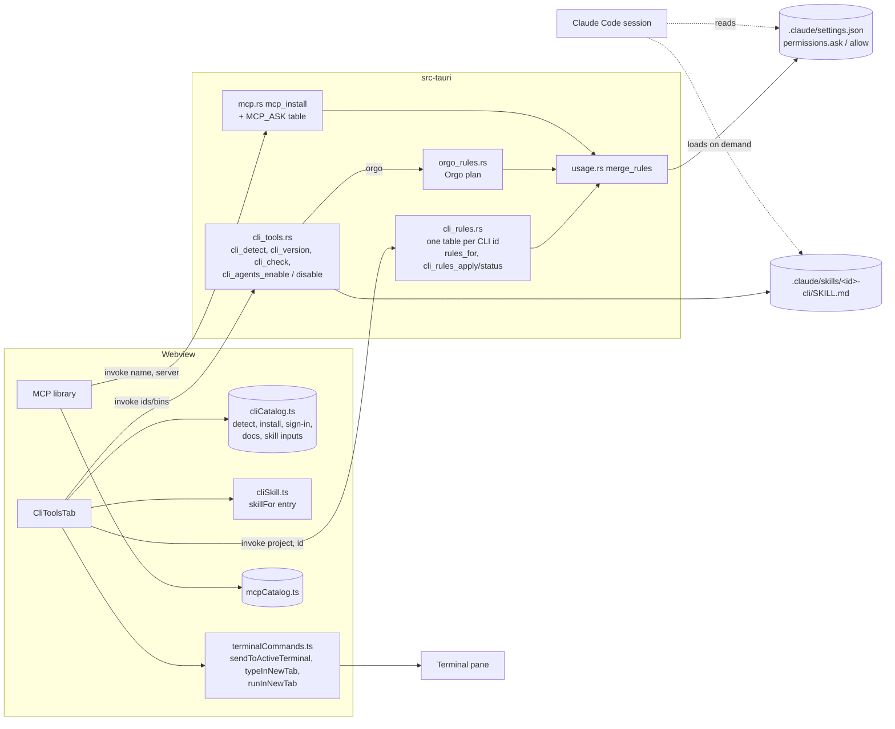
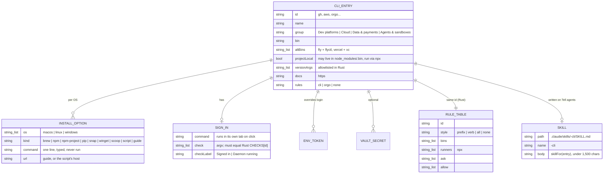

There are eight stories, built in order. Each one works end to end and is tested under the repo's verification command, which is unchanged.

- **Story 1:** a **CLI tools** tab in the Integrations panel, next to the MCP library. It detects, installs (by typing the command for the user to run) and signs in to four CLIs: `gh`, `vercel`, `stripe` and `orgo`. It writes nothing that agents read.
- **Story 2:** Claude Code permission rules for a CLI, built in Rust from one table per CLI. `ask` covers commands that deploy, delete, spend money, touch keys or print secrets. `allow` covers read-only ones. Rules for `gh`, `vercel` and `stripe`. `orgo` uses the Orgo plan's rules.
- **Story 3:** telling agents. A short skill per CLI, written only if missing, after its rules.
- **Stories 4 to 6:** the other fifteen CLIs, end to end, in three groups: dev platforms and data, then cloud, then agents and sandboxes.
- **Stories 7 and 8:** six more MCP servers. Vercel and Cloudflare come with `ask` rules. Figma, Atlassian, AWS Knowledge and Chrome DevTools follow.

This plan depends on the parallel plan `plan/orgo-agent-computers` (local commit `b8f00e8` in `wt-orgo`, not yet pushed). Its rules for Orgo are reused here and never redefined. See "Coordination".

<frozen-after-approval reason="human-owned intent — do not modify unless human renegotiates">

## Intent

**Problem:** agents in ADE reach the outside world through two channels: MCP servers and command-line tools. ADE curates MCP servers but knows nothing about CLIs. It cannot tell whether `gh`, `vercel` or `aws` is installed or signed in. It cannot help install one. It does not tell agents which CLIs to use, or how to use them safely. In ADE's Continuous mode (`claude --dangerously-skip-permissions`, `src/lib/agentCommand.ts:50`), an agent can run `vercel --prod`, `stripe pay`, `aws ec2 terminate-instances` or `gh auth token` without a prompt. The MCP library has fifteen servers and misses vendor servers for deploy platforms and design.

**Approach:**
1. A typed catalog, `src/data/cliCatalog.ts`, shaped like `mcpCatalog.ts`. A new **CLI tools** tab shows it. Per CLI, the tab shows:
   - whether it is installed, found on PATH or in the project's `node_modules/.bin`;
   - its version;
   - install options for this OS, which ADE types into a terminal without pressing Enter;
   - a sign-in button and an on-click sign-in check;
   - the docs.
2. Per CLI, one action, **Tell agents**:
   - It first merges Claude Code `ask` and `allow` rules into the project's `.claude/settings.json`.
   - Then it writes a short skill, `.claude/skills/<id>-cli/SKILL.md`, if one is missing.
   - The rules come from a Rust table keyed by CLI id. The webview names the CLI; Rust picks the rules.
3. Each CLI keeps its own login. ADE's vault holds a value only where a CLI or its SDK needs one from the environment.
4. Six more MCP servers, each checked against its vendor's docs and the live endpoint.

## Owner's decisions (2026-10-29)

1. **Scope:** "a CLI library + more MCPs", planned separately from Orgo. The CLI library is a new "CLI tools" tab in the Integrations panel, next to the MCP library. Its job is to detect, install, sign in to and tell agents about each CLI. The MCP library grows with more useful servers.
2. **CLIs: all four groups.**
   - Dev platforms: gh, vercel, netlify, supabase, flyctl, wrangler.
   - Cloud: aws, gcloud, az, doctl, terraform.
   - Data & payments: stripe, psql, sqlite3, duckdb.
   - Agents & sandboxes: orgo, e2b, modal, docker.
3. **`orgo` is a library entry that reuses the Orgo plan's rules** (that plan's decision 10 and "How the pieces coexist"). Its rules are not redefined here.
4. **The owner's standing stance** (from the Orgo decisions), which this plan applies to every CLI and MCP server:
   - Commands that create billable resources, delete things, touch billing or keys, or print secrets ask in Claude Code. This holds in Continuous mode too, wherever Claude Code allows it.
   - Nothing is created without the user's action.
   - No secret is kept in plain text.
5. **ADE never runs an installer, or `curl | sh`, on its own.** Install commands are shown, or typed into a terminal for the user to check and run.

## Boundaries & Constraints (all stories)

**Always:**
- Every CLI fact a story relies on comes from the vendor's docs or package, cited in the entry tables below. Install commands, sign-in commands and check commands go into the catalog only from that table. Anything marked unverified (U-list) is checked before the story that needs it is sharded.
- Every permission rule ADE writes for a CLI comes from `src-tauri/src/cli_rules.rs`, or `src-tauri/src/orgo_rules.rs` for `orgo`. The webview passes a CLI id, never a rule.
- ADE edits `.claude/settings.json` only by merging, through the Orgo plan's `merge_rules`. It keeps the user's keys and rules in order. If the file is not valid JSON, the action is refused and the file left alone. ADE never deletes a rule.
- ADE writes a skill file only if it is missing. It removes one only while it is byte-identical to what ADE wrote.
- ADE runs a CLI itself only for its version (`--version` and the like) and, on the user's click, a sign-in check from a fixed Rust list. Neither is given vault secrets.
- The verification command is unchanged.

**Never:**
- ADE never presses Enter on an install command. The one exception is a sign-in command, which runs in its own tab on the user's click. It starts a browser or device-code flow and creates nothing.
- No CLI credential moves into ADE's vault. The two optional vault entries (`DATABASE_URL`, `E2B_API_KEY`) are for code and servers that read the environment.
- No change to `CLAUDE.md` or its BMAD paragraph mechanism. No change to `relay/` or `mobile/`. No new npm or Cargo dependency.
- ADE does not install vendor agent plugins or skills (`gh skill install`, `stripe agent setup`), and it does not run their MCP installers.

## Coordination with `plan/orgo-agent-computers`

Read at its latest commit, `b8f00e8` ("Plan: Orgo CLI story and Continuous-mode hard stop (review round 2)"). That commit exists only in the `wt-orgo` worktree, and `origin` is at `63eb835`.

| This plan uses | From the Orgo plan | If that story has not landed yet |
|---|---|---|
| `merge_rules(root, "ask" \| "allow" \| "deny", rules)` in `src-tauri/src/usage.rs` | Story 1, which generalises `merge_deny` | Story 2 here makes the same generalisation, with the same signature and the Orgo plan's AC10 (the deny tests unchanged). Whichever lands second reuses it. |
| `orgo`'s CLI rules (`CLI_ASK`, `CLI_ALLOW`), skill text and `orgo_cli_setup(project)` | Story 1c, `src-tauri/src/orgo_rules.rs` | The `orgo` card shows detection, install and sign-in (Story 1). Its **Tell agents** button is replaced by "Comes with the Orgo CLI setup (Orgo plan, Story 1c)". |
| The test matcher `rule_matches(rule, cmd)` | Story 1c's tests | Story 2 here writes it in `src-tauri/src/rule_match.rs` (`#[cfg(test)]`), to the same spec. The Orgo plan's tests import it from there. Either way, there is one matcher. |
| Continuous-mode `--disallowedTools` | Story 1b | Not used for library CLIs. See Q5. |
| `IntegrationsPanel.test.tsx` | Created by Story 1 | Story 1 here creates it if it is missing. Both plans add cases. |
| ADR number | Proposes 0010 | This plan proposes **0011**. |

**Where the two plans differ, and what this plan recommends** (Q2):
- **Installs.** Orgo 1c runs `npm install -g orgo` in a new tab after a confirm. This plan only ever types install commands, so the user sees the line before running it (decision 5). Recommend: when 1c's row becomes this library's `orgo` entry, its install follows the library and is typed.
- **Sign-in** is the same in both plans: `orgo login` runs in a new tab on a click.
- **Agent guidance** is the same shape in both plans: a write-once skill in `.claude/skills/<name>/SKILL.md`. Orgo's is `orgo-cli`. This plan's names follow it: `gh-cli`, `aws-cli` and so on.
- **Allow rules** go into the committed `.claude/settings.json` in both plans. Allow rules in a committed file wait for workspace trust. Until then those commands prompt in Manual mode, which is the safe direction.

**Facts about the Orgo CLI from its package** (`orgo@2.3.0`, read 2026-10-29), passed to the Orgo plan, which owns them:
- `.version(VERSION, "-v, --version")`.
- Aliases: `computers`/`c`, `workspaces`/`ws`, `templates`/`t`, `api-keys`/`keys`, and `delete`/`rm` (in two groups).
- `vnc-password`, `billing topup`, `billing portal`, `egress residential` and `clone watch --install`, which adds a launchd agent.
- `--yes` appears 15 times and skips confirmations.

## Security: what Claude Code's permission rules do, and what they can't do

**Verified 2026-10-29** against the docs, fetched as Markdown from `https://code.claude.com/docs/en/{permissions,permission-modes,settings,memory,hooks}.md`.

| # | Fact | Source section |
|---|---|---|
| C1 | `*` stands for any text. A trailing ` *` that is the rule's **only** wildcard also matches the bare command: `Bash(ls *)` matches `ls`. The space matters: `Bash(ls *)` doesn't match `lsof`, and `Bash(ls*)` does. `:*` equals a trailing ` *`, but only at the end. | permissions › Wildcard patterns (example table) |
| C2 | A `*` in the middle matches the words in its place, flags included: `Bash(git * main)` matches `git push origin main` and `git -c core.fsmonitor=<script> diff main`. The spaces around it are literal, so `Bash(git log * main)` doesn't match `git log main`. | same table |
| C3 | Claude Code warns at startup about an **allow** rule with a `*` before the subcommand. Ask and deny rules carry no such warning. | permissions › Wildcard patterns |
| C4 | Rules are evaluated deny, then ask, then allow. "A matching ask rule prompts even when a more specific allow rule also matches." | permissions › Manage permissions |
| C5 | Compound commands are split on `&&`, `\|\|`, `;`, `\|`, `\|&`, `&` and newlines. Ask and deny rules apply when any subcommand matches, "including a command nested inside a subshell, a command substitution, or a control-flow body". | permissions › Compound commands |
| C6 | Before matching, Claude Code strips `timeout`, `time`, `nice`, `nohup`, `stdbuf`, `command`, `builtin`, `noglob` and bare `xargs`. "A deny or ask rule matches past any leading assignment." An allow rule matches only past known-safe ones. | permissions › Wrappers |
| C7 | `npx`, `docker exec`, `devbox run`, `mise exec` and `direnv exec` are **not** stripped. | permissions › Wrappers |
| C8 | Rules don't match a different form of the same program: `/usr/bin/curl …`, `sh -c '…'`, `git -C . push`, `git 'push'`. A rule "covers the invocation Claude usually produces and isn't a security boundary around the program." | permissions › What a Bash rule doesn't match |
| C9 | "Claude Code doesn't auto-approve the following in any mode, including `bypassPermissions` … Tools matched by an explicit ask rule." | permission-modes › Actions no mode auto-approves |
| C10 | Content-scoped ask rules such as `Bash(git push *)` still prompt under the Bash sandbox's auto-allow. | permissions › sandbox notes; permission-modes › Common setups |
| C11 | Built-in read-only commands run without a prompt in every mode: `ls`, `cat`, `grep`, read-only `git`, read-only `docker` (which prompts when pointed at another daemon). To make one prompt, add an ask rule. | permissions › Read-only commands |
| C12 | Ask and deny rules take globs in the tool-name position, such as `mcp__vercel__buy_*`. Allow globs work only after a literal `mcp__<server>__`. A rule naming no known tool warns at startup, except names containing `_` or `*`. | permissions › Tool name wildcards |
| C13 | Rule edits apply "starting with Claude's next tool call in the same turn". Bypass mode allows writes to `.claude/` (Orgo plan, permission-modes › Protected paths). So **a Continuous-mode agent can delete these rules**. | permissions › Manage permissions |
| C14 | PowerShell has its own rules, `PowerShell(…)`, with the same shape. | permissions › PowerShell |
| C15 | Files in `.claude/rules/` load into context at launch. Skills load "only when you invoke them or when Claude determines they're relevant." | memory › Organize rules with `.claude/rules/` |
| C16 | A PreToolUse hook can return `"ask"`. "Deny and ask rules are still evaluated regardless of what the hook returns." The docs do not say whether a hook's `ask` prompts under `bypassPermissions`. | hooks › PreToolUse decision control |

**What follows for this design:**
- **Ask rules are the mechanism** (C9). They prompt in Manual, auto and Continuous modes. They catch the risky command inside `a && b`, `$(…)` and loops, and past `FOO=1` or `timeout 30` (C5, C6).
- **Allow rules only save prompts in Manual mode.** They are never written with a wildcard before the subcommand (C3). They are never written for a command whose flags can print a secret: `gh auth status` is allowed exactly, and `gh auth status --show-token` asks.
- **Flags before the subcommand** are covered two ways:
  - "prefix" CLIs (`gh`, `stripe`, …) get `Bash(<bin> -*)`, so any flag in first position asks, and `Bash(<bin> <group> -*)` for a flag between group and verb. This is the Orgo plan's approach.
  - "verb" CLIs (`aws`, `gcloud`, …) get each rule twice: `Bash(<bin> <verb>…)` and `Bash(<bin> * <verb>…)`. The middle `*` covers any service path and any flags (C2).
- **What these rules cannot stop.** The guide says this, and Story 2's AC6 pins it:
  - Other forms of the same program (C8): a full path, `sh -c`, `bash -c`, `eval`, a quoted subcommand, `pnpm exec` / `yarn` / `bunx` (only `npx` is covered, for the CLIs used that way), and a shell alias or function.
  - The same API reached another way: `curl` with a token the agent finds, an SDK in a script, or a CLI's raw `api` command where it isn't listed.
  - Subcommands a vendor adds later, until the table is updated. For "prefix" CLIs, a subcommand the table doesn't list runs unprompted in Continuous mode. The tables are deny-lists of known risks, not allow-lists.
  - A Continuous-mode agent can rewrite `.claude/settings.json` (C13). The Orgo plan's Story 1b is the only hard stop, and only for Orgo. Q5 asks about extending it.
  - Sessions started in a subfolder may not read the root `.claude/settings.json` (Orgo plan U8).
  - Providers other than Claude Code (Codex, Ollama) don't read these rules.
  - **Windows:** Claude Code may run commands through its PowerShell tool there, which `Bash(…)` rules don't cover (C14, U2). The tab says so on Windows.
- **Over-matching is in the safe direction.** `Bash(gcloud * delete*)` also asks for `gcloud … --filter="name ~ delete"`. That is a prompt, never a missed risk.

## Secrets

Each CLI signs in with its own flow and keeps its own credential: the OS keychain, or its config file. ADE stores none of them and never copies one.

| CLI | Signs in with | Keeps it in | Env token it prefers over that login (from its docs) |
|---|---|---|---|
| gh | `gh auth login` | system keyring or `~/.config/gh` | `GH_TOKEN`, `GITHUB_TOKEN` ("takes precedence over previously stored credentials") |
| vercel | `vercel login` | Vercel's config dir | `VERCEL_TOKEN` |
| netlify | `netlify login` | Netlify's config | `NETLIFY_AUTH_TOKEN` |
| supabase | `supabase login` | keyring or `~/.supabase` | `SUPABASE_ACCESS_TOKEN` |
| fly | `fly auth login` | `~/.fly` | `FLY_API_TOKEN` |
| wrangler | `wrangler login` | Wrangler's config | `CLOUDFLARE_API_TOKEN` |
| aws | `aws configure sso`, then `aws sso login` | `~/.aws` | `AWS_ACCESS_KEY_ID` and related |
| gcloud | `gcloud auth login` | `~/.config/gcloud` | (none listed) |
| az | `az login` | `~/.azure` | (none listed) |
| doctl | `doctl auth init` (pastes a token into doctl's own prompt) | doctl's config | `DIGITALOCEAN_ACCESS_TOKEN` |
| terraform | none; providers use the cloud CLIs' logins. `terraform login` is for HCP Terraform only. | `~/.terraform.d` | (none) |
| stripe | `stripe login` (browser pairing; a Stripe admin may have to enable CLI access first) | `~/.config/stripe` | `STRIPE_API_KEY` |
| psql | none | `~/.pgpass`, or a connection string | `DATABASE_URL` (by convention), `PGPASSWORD` |
| sqlite3, duckdb | none | | |
| orgo | `orgo login` (device code) | `~/.orgo/credentials.json` | `ORGO_API_KEY` ("skips `~/.orgo/credentials.json`") |
| e2b | `e2b auth login` | E2B's config | `E2B_API_KEY` |
| modal | `modal setup` / `modal token new` | `~/.modal.toml` | `MODAL_TOKEN_ID`, `MODAL_TOKEN_SECRET` |
| docker | `docker login` (registries only) | credential helper | |

**What ADE does with this:**
- **Nothing moves into the vault.** Most of these CLIs refresh or scope their own tokens, such as Stripe's restricted CLI keys and AWS SSO sessions. A long-lived key in the vault would be weaker, and the vault exports every secret into every new ADE terminal (`docs/guide/integrations.md`).
- **Every CLI card names the env tokens that override its login** (`envTokens`). When one of them is in the vault, the card says: "`GH_TOKEN` is in your vault, so `gh` in ADE terminals uses it instead of your `gh auth login`." This is the case the Orgo plan recommends on purpose for `ORGO_API_KEY`, a workspace-scoped key. For other CLIs it is usually an accident.
- **Two optional vault rows**, shown like the MCP library's secret rows, with "Add to vault":
  - `DATABASE_URL`, on `psql`. It is the same name the DBHub MCP entry uses. The skill tells agents to connect with `psql "$DATABASE_URL"`, never with the value, and to use a read-only role.
  - `E2B_API_KEY`, on `e2b`. Only for code the agent writes with the E2B SDK. The CLI itself signs in with `e2b auth login`.
- **Commands that print credentials ask** (Stories 2, 4 to 6), and the skills tell agents not to run them: `gh auth token`, `aws secretsmanager get-secret-value`, `gcloud auth print-access-token`, `az account get-access-token`, `terraform output -json`, `vercel env pull`, `orgo computers vnc-password`, and the rest in the tables.
- ADE's own probes (version, sign-in check) run with ADE's process environment, not the vault's. So a check can say "signed in" while a terminal is using a vault token instead. The env-token notice covers that.

</frozen-after-approval>

## Architecture



- **The catalog** (`src/data/cliCatalog.ts`) is data for the UI: names, groups, binaries, version arguments, install options, sign-in, docs, env tokens and skill inputs. It holds no rules.
- **The rules** (`src-tauri/src/cli_rules.rs`) are a table per CLI id, expanded by one generator (below). This follows the Orgo plan: the webview names an action, Rust picks the rules.
- **Probes** (`src-tauri/src/cli_tools.rs`):
  - `cli_detect` finds binaries without running them.
  - `cli_version` runs only an allowlisted version argument.
  - `cli_check` runs only an argv from its fixed `CHECKS` table, picked by id.
- **Writes** are two files, both in the project: `.claude/settings.json` (merge only) and the skill (write-once).



```mermaid
sequenceDiagram
  actor U as User
  participant T as CliToolsTab
  participant CT as cli_tools.rs
  participant CR as cli_rules.rs
  participant M as usage.rs merge_rules
  participant F as Project files
  U->>T: Tell agents (gh)
  T->>U: confirm: "Claude Code will ask before …; adds a gh skill"
  U->>T: OK
  T->>CT: cli_agents_enable(project, "gh", skillFor(gh))
  CT->>CR: rules_for("gh")
  CR-->>CT: ask[], allow[]
  CT->>M: merge_rules(root, "ask", ask)
  M->>F: read .claude/settings.json (refuse if not a JSON object)
  M->>F: write merged (user keys and rules kept, in order)
  CT->>M: merge_rules(root, "allow", allow)
  CT->>F: .claude/skills/gh-cli/SKILL.md exists?
  alt missing
    CT->>F: write skill
  else present
    CT-->>CT: keep it (status "kept")
  end
  CT-->>T: {askAdded, allowAdded, skill: written | kept}
  T-->>U: "Claude Code will ask before risky gh commands. Agents can read the gh skill."
```

**Order matters.** Rules are merged before the skill is written, so agents never learn about a CLI before its ask rules exist. If the rule merge fails, the skill is not written.

### The rule generator (`cli_rules.rs`)

```rust
pub enum Style { Prefix, Verb, All, None }
pub struct CliRules {
    pub id: &'static str,
    pub style: Style,
    pub bins: &'static [&'static str],     // ["fly", "flyctl"]
    pub runners: &'static [&'static str],  // ["npx"]: also emit "npx <bin> …"
    pub ask: &'static [&'static str],
    pub allow: &'static [&'static str],
}
```

For every `b` in `bins`, and `"<r> <bin>"` for every runner `r`:

- **Prefix** style: for each ask item `P`:
  - emit `Bash(b P)` if `P` contains `*`, else `Bash(b P *)`. With a trailing ` *` as its only wildcard, the rule also matches the bare command (C1). An item `=X` is exact: `Bash(b X)`.
  - Add `Bash(b -*)` once: a flag before the first word asks.
  - Add `Bash(b G -*)` for each group `G`: the first word of a multi-word item, when that word is plain (no `*`, no `=`). A flag between group and verb asks.
- **Verb** style: for each ask item `V`, emit `Bash(b V)` and `Bash(b * V)`. Items usually end in `*` with no space (`delete*`), so the verb also matches at the end of the command. They keep a space where a longer word would over-match (`release *` does not catch `fly releases`).
- **All** style: `Bash(b *)`, which also matches bare `b`.
- **None** style: no ask rules.
- **Allow** items: `=X` gives `Bash(b X)`. Otherwise `A` gives `Bash(b A *)`. Allow items never contain `*`, so no allow rule has a wildcard before its subcommand (C3).
- The output is deduplicated, in table order.

## The CLI entries

Install, sign-in and check values were verified 2026-10-29 at the source in the last column. `guide` means the vendor's steps take several commands or an installer, so ADE links to them and types nothing. `script` options are labelled "runs a script from `<host>`".

| id | Binaries | Version | Install (macOS · Linux · Windows) | Sign in · check | Source |
|---|---|---|---|---|---|
| gh | gh | `--version` | `brew install gh` · guide (apt repo) · `winget install --id GitHub.cli --source winget` | `gh auth login` · `gh auth status` | cli/cli `README.md`, `docs/install_{macos,linux,windows}.md`; cli.github.com/manual |
| vercel | vercel, vc | `--version` | `npm i -g vercel` (all) | `vercel login` · `vercel whoami` | vercel.com/docs/cli; npm `vercel` bin `{vc, vercel}` |
| netlify | netlify | `--version` | `npm install -g netlify-cli` (all) | `netlify login` · `netlify status` (U3) | netlify/cli `README.md`; docs.netlify.com/cli/get-started |
| supabase | supabase (project-local) | `--version` | `brew install supabase/tap/supabase` (macOS, Linux) · `npm install -D supabase` (project, run as `npx supabase`) · guide (Scoop) | `supabase login` · `supabase projects list` (U3) | supabase/cli `README.md` |
| fly | fly, flyctl | `version` | `brew install flyctl` · script `curl -L https://fly.io/install.sh \| sh` · script `pwsh -Command "iwr https://fly.io/install.ps1 -useb \| iex"` | `fly auth login` · `fly auth whoami` | fly.io/docs/flyctl/install, /flyctl/auth |
| wrangler | wrangler (project-local) | `--version` | `npm i -D wrangler@latest` (project, run as `npx wrangler`) | `wrangler login` · `wrangler whoami` | developers.cloudflare.com/workers/wrangler/install-and-update |
| aws | aws | `--version` | guide (pkg) · guide (zip) · guide (msi) | `aws configure sso` · `aws sts get-caller-identity` | docs.aws.amazon.com/cli/latest/userguide/getting-started-install.html |
| gcloud | gcloud | `--version` | `brew install --cask gcloud-cli` · guide (apt) · guide (installer) | `gcloud auth login` · `gcloud config get-value account` (non-empty = signed in, U3) | cloud.google.com/sdk/docs/install-sdk, /downloads-homebrew |
| az | az | `version` | `brew install azure-cli` · guide · `winget install --exact --id Microsoft.AzureCLI` | `az login` · `az account show` | learn.microsoft.com/cli/azure/install-azure-cli-{macos,linux,windows} |
| doctl | doctl | `version` | `brew install doctl` · `sudo snap install doctl` · guide | `doctl auth init` · `doctl account get` | docs.digitalocean.com/reference/doctl/how-to/install |
| terraform | terraform | `version` | `brew tap hashicorp/tap && brew install hashicorp/tap/terraform` · guide (apt repo) · guide | none (optional `terraform login` for HCP Terraform) | developer.hashicorp.com/terraform/install |
| stripe | stripe | `--version` | `npm install -g @stripe/cli` (all) · `brew install stripe` (macOS) · guide (apt, Scoop) | `stripe login` · `stripe login list` | docs.stripe.com/stripe-cli/use-cli.md; stripe/stripe-cli `README.md` |
| psql | psql | `--version` | guide · guide · guide (postgresql.org/download) | none; vault row `DATABASE_URL` | postgresql.org/download |
| sqlite3 | sqlite3 | `--version` | preinstalled · guide · guide (sqlite.org/download) | none | sqlite.org |
| duckdb | duckdb | `--version` | script `curl https://install.duckdb.org \| bash` (macOS, Linux) · `winget install DuckDB.cli` | none | duckdb.org/install |
| orgo | orgo | `--version` | `npm install -g orgo` (all) · script `curl -fsSL https://orgo.ai/install.sh \| bash` (macOS, Linux) | `orgo login` · `orgo whoami` | docs.orgo.ai/guides/cli; npm `orgo@2.3.0`; Orgo plan F13 |
| e2b | e2b | `--version` | `brew install e2b` · `npm i -g @e2b/cli` (all) | `e2b auth login` · `e2b auth info` | docs.e2b.dev/cli, /sdk-reference/cli/v2.22.3/auth |
| modal | modal | `--version` | `pip install modal` (all) | `modal setup` · `modal profile current` (U3) | modal.com/docs/guide, /reference/cli/profile |
| docker | docker | `--version` | guide (Docker Desktop) · guide (Engine, apt repo) · guide (Docker Desktop) | `docker login` (registries) · `docker info` labelled "Daemon running" | docs.docker.com/engine/install |

**Agent guidance per entry** (the skill inputs, Story 3):

| id | Learn a command first | Machine-readable / non-interactive | Never (unless the user asks) |
|---|---|---|---|
| gh | `gh <command> --help` | `--json <fields>` with `--jq`; `GH_PROMPT_DISABLED=1` | `gh auth token`, `gh auth status --show-token` |
| vercel | `vercel <command> --help`; prefer the Vercel MCP for reading | `--yes` skips prompts (only when the user asked for the action) | `vercel env pull`, `vercel pull` (they write secrets to files) |
| netlify | `netlify <command> --help` | `--json` where offered | `netlify env:get`, `netlify git-credential` |
| supabase | `supabase <command> --help` | `-o json` | `supabase projects api-keys` |
| fly | `fly <command> --help` | `--json` | `fly tokens …`, `fly secrets list` |
| wrangler | `npx wrangler <command> --help` | `--json` where offered | `wrangler auth token` |
| aws | `aws <service> <operation> help` | `--output json --no-cli-pager` | `get-secret-value`, `get-parameter --with-decryption`, `ecr get-login-password`, `configure export-credentials` |
| gcloud | `gcloud <group> <command> --help` | `--format=json` | `gcloud auth print-access-token`, `secrets versions access` |
| az | `az <group> <command> --help` | `--output json --only-show-errors` | `az account get-access-token`, `keyvault secret show`, `… keys list` |
| doctl | `doctl <command> --help` | `--output json` | `doctl databases connection`, `databases user get` |
| terraform | `terraform -help <command>` | `-json`, `-input=false`, `-no-color`; read with `plan`, not `apply` | `terraform output -json`, `terraform show -json`, `terraform state pull` |
| stripe | `stripe <command> --help`, `stripe docs search` | `--json` where offered; never `--live` unless asked | `stripe config --list`, `stripe projects env --pull` |
| psql | `psql --help` | `psql "$DATABASE_URL" -X -A -t -c "<SQL>"` with a read-only role | print `$DATABASE_URL` |
| sqlite3 | `sqlite3 -help` | `-readonly`, `-json` | |
| duckdb | `duckdb -help` | `-readonly`, `-json` | |
| orgo | `orgo manifest` | `--json` after the subcommand | Orgo plan's skill text |
| e2b | `e2b <command> --help` | `--format json` | |
| modal | `modal <command> --help` | `--json` where offered | `modal token …` |
| docker | `docker <command> --help` | `--format json` | `docker inspect` of containers holding secrets in env; `docker login` |

**Rule tables per entry** (`cli_rules.rs`). These are the ask items, before expansion. The allow items are complete. Story tests pin each table's behaviour with corpora, not its spelling.

| id | Style, bins, runners | Ask items (key risky subcommands) | Allow items |
|---|---|---|---|
| gh | prefix; gh | repo create, repo delete, repo edit, repo rename, repo archive, repo sync, repo deploy-key, pr merge, release create, release delete, release edit, release upload, secret, variable, auth token, auth login, auth logout, auth refresh, auth switch, auth setup-git, `auth status *-t*`, `auth status *--show-token*`, api, workflow run, workflow enable, workflow disable, run cancel, run delete, run rerun, cache delete, issue delete, issue transfer, codespace, extension, gist create, gist delete, gist edit, label delete, project delete, ssh-key, gpg-key, alias, config set, skill | pr view, pr list, pr diff, pr checks, pr status, issue view, issue list, issue status, run view, run list, run watch, workflow list, workflow view, repo view, release list, release view, search, `=auth status`, status |
| vercel | all; vercel, vc; npx | everything: bare `vercel` and `vercel <path>` deploy, so a prefix list can't cover deploys. Read-only work goes through the Vercel MCP (Story 7). | none |
| stripe | prefix; stripe | pay, post, delete, projects, config, `=login`, `login -*`, logout, reauth, switch, sandbox, agent, tools, fixtures, events resend, `*--live*`, `* create*`, `* update*`, `* delete*`, `* cancel*`, `* capture*`, `* confirm*`, `* pay *`, `* void*`, `* finalize*`, `* reverse*`, `* approve*` | logs tail, docs, `=login list`, listen, `=version` |
| netlify | prefix; netlify; npx | deploy, api, env, env:set, env:unset, env:import, env:clone, env:migrate, env:get, env:list, sites:create, sites:delete, create, init, link, unlink, switch, login, logout, claim, blobs:set, blobs:delete, blob:set, blob:delete, database, db, migrations, reset, apply, agents:create, agents:run, agents:stop, git-credential | status, sites:list, logs, logs:function, logs:deploy, functions:list, teams:list |
| supabase | verb; supabase; npx | create\*, delete\*, update\*, deploy\*, push\*, reset\*, repair\*, restore\*, activate\*, `set *`, `unset *`, api-keys\*, link\*, unlink\*, login\*, logout\*, `rm *`, `cp *`, `mv *`, dump\*, squash\*, `add *`, remove\*, bootstrap\*, enable\*, disable\*, upgrade\*, encryption\* | projects list, migration list, functions list, branches list, gen types |
| fly | verb; fly, flyctl | create\*, destroy\*, delete\*, remove\*, deploy\*, launch\*, scale\*, allocate\*, `release *`, extend\*, fork\*, clone\*, stop\*, start\*, suspend\*, resume\*, update\*, `set *`, `unset *`, import\*, secrets\*, tokens\*, `token *`, ssh\*, console\*, attach\*, detach\*, login\*, logout\*, signup\*, `run *`, move\*, migrate\*, upgrade\*, `add *` | status, logs, apps list, machine list, releases, version, `=auth whoami`, doctor |
| wrangler | verb; wrangler; npx | deploy\*, publish\*, delete\*, create\*, put\*, upload\*, push\*, apply\*, modify\*, update\*, rollback\*, secret\*, token\*, issue-token\*, credentials\*, login\*, logout\*, bulk\*, enable\*, disable\*, setup\*, activate\*, deactivate\*, `execute *--remote*`, `dev *--remote*`, remove\*, trigger\*, send\*, purge\*, restore\*, rename\* | whoami, tail, d1 list, kv namespace list, r2 bucket list, deployments list, versions list, types |
| aws | verb; aws | create-\*, delete-\*, put-\*, update-\*, modify-\*, terminate-\*, run-\*, start-\*, stop-\*, reboot-\*, attach-\*, detach-\*, associate-\*, disassociate-\*, authorize-\*, revoke-\*, register-\*, deregister-\*, enable-\*, disable-\*, import-\*, invoke\*, publish\*, send-\*, restore-\*, copy-\*, reset-\*, set-\*, replace-\*, cancel-\*, add-\*, remove-\*, purchase-\*, accept-\*, reject-\*, allocate-\*, release-\*, execute-\*, request-\*, upload-\*, tag-\*, untag-\*, `deploy *`, get-secret-value\*, get-parameter\*, get-login-password\*, get-authorization-token\*, get-session-token\*, get-federation-token\*, assume-role\*, export-credentials\*, get-role-credentials\*, get-credentials-for-identity\*, configure\*, login\*, logout\*, `s3 cp *`, `s3 mv *`, `s3 rm *`, `s3 sync *`, `s3 mb *`, `s3 rb *`, `s3 presign *` | `=sts get-caller-identity`, s3 ls |
| gcloud | verb; gcloud | create\*, delete\*, update\*, deploy\*, add-\*, remove-\*, set-iam-policy\*, `config set*`, `config unset*`, import\*, export\*, reset\*, resize\*, start\*, stop\*, suspend\*, resume\*, restore\*, ssh\*, scp\*, attach\*, detach\*, enable\*, disable\*, move\*, rollback\*, promote\*, cancel\*, submit\*, execute\*, print-access-token\*, print-identity-token\*, `access *`, login\*, activate-service-account\*, revoke\*, application-default\*, `billing *`, link\*, unlink\*, upload\*, purge\*, upgrade\*, switchover\*, failover\*, clone\*, get-credentials\* | `=config list`, `=auth list`, projects list, `config get-value`, `=version` |
| az | verb; az | create\*, delete\*, update\*, `set *`, start\*, stop\*, restart\*, deallocate\*, deploy\*, purge\*, import\*, assign\*, login\*, logout\*, get-access-token\*, `secret show*`, `secret download*`, `keys *`, list-keys\*, get-credentials\*, list-publishing-credentials\*, show-connection-string\*, connection-string\*, regenerate\*, renew\*, reset\*, restore\*, move\*, invoke\*, run-command\*, ssh\*, `add *`, `remove *`, upload\*, generate-sas\*, failover\*, scale\*, resize\*, swap\* | `=account show`, group list, `=version` |
| doctl | verb; doctl | create\*, delete\*, update\*, resize\*, power-off\*, power-on\*, power-cycle\*, reboot\*, rebuild\*, restore\*, snapshot\*, attach\*, detach\*, assign\*, unassign\*, purge\*, flush\*, auth\*, `kubeconfig save*`, `registry login*`, docker-config\*, connection\*, `user *`, reset\*, migrate\*, upgrade\*, deploy\*, `add *`, `remove *`, enable\*, disable\* | `=account get`, compute droplet list, apps list, `=version` |
| terraform | verb; terraform | apply\*, destroy\*, import\*, taint\*, untaint\*, `state *`, force-unlock\*, `workspace delete*`, login\*, logout\*, output\*, show\*, console\*, refresh\*, test\* | `=version`, validate, fmt, providers |
| psql | all; psql, pg_restore, dropdb, dropuser | everything: SQL can't be classified by a command prefix | none |
| sqlite3 | none (Q3) | | `-readonly` |
| duckdb | none (Q3) | | none: `-readonly` covers the database file, and it is unverified whether it also stops `COPY … TO` and `ATTACH` (U9) |
| orgo | from `orgo_rules.rs` (Orgo plan 1c): `CLI_ASK` 52 rules, `CLI_ALLOW` about 18 | | |
| e2b | prefix; e2b | sandbox create, sandbox spawn, sandbox fork, sandbox resume, sandbox exec, sandbox connect, sandbox kill, sandbox pause, sandbox snapshot, template create, template delete, template publish, template unpublish, template migrate, auth login, auth logout, auth configure | sandbox list, sandbox logs, sandbox metrics, sandbox info, template list, `=auth info` |
| modal | prefix; modal | deploy, run, serve, shell, launch, app stop, app rollback, app rollover, secret create, secret delete, volume create, volume delete, volume put, volume rm, volume cp, volume rename, container exec, container stop, token, setup, profile activate, environment create, environment delete, environment update | app list, app logs, app history, app info, container list, container logs, secret list, volume list, volume ls, `=profile current`, profile list |
| docker | verb; docker | rm\*, rmi\*, prune\*, push\*, login\*, logout\*, `down *-v*`, `down *--volumes*`, `down *--rmi*`, `context use*`, `context create*`, secret\*, swarm\*, trust\* | none: C11 already runs read-only docker without a prompt |

**Rule counts, once expanded:** about 60 for gh, 4 for vercel and psql, about 130 for aws, 90 for gcloud and 80 for az. They are written only for the CLIs a user enables in a project (Q9).

## How agents learn about the CLIs (Story 3)

**Choice: one skill per enabled CLI**, `.claude/skills/<id>-cli/SKILL.md`, not a generated section in `CLAUDE.md` or a `.claude/rules/` file.

**Why:**
- **It is the same shape as the Orgo plan's `orgo-cli` skill**, which that plan says "becomes the entry's 'tell agents' text" in this library.
- **It respects setup's rule.** ADE writes the file only if it is missing and never rewrites it. There is no generated file to keep in sync with edits, and no new `CLAUDE.md` mechanism beside the BMAD paragraph (`.ade/context/claude-md-bmad-paragraph.md`), which stays untouched.
- **It loads on demand** (C15). Only the descriptions sit in context until Claude decides a skill is relevant. A rules file would cost every session every enabled CLI's text.
- **A BMAD switch leaves it alone.** The switch moves only folders named like a bundled v6 skill (`bundled_skills`, `src-tauri/src/bmadswitch.rs:830-848`). A test checks that no `<id>-cli` name collides with `src-tauri/resources/bmad-v6/skills/*`.

**`skillFor(entry)`** in `src/lib/cliSkill.ts` renders frontmatter and body, under 1,500 characters:

```markdown
---
name: gh-cli
description: Use when working with GitHub from the terminal through the gh CLI — pull requests, issues, Actions runs, releases.
---
# GitHub CLI (`gh`)

- Check it's there with `gh --version`. If it's missing, ask the user to install it from ADE (Integrations → CLI tools). Don't install or upgrade it yourself.
- Before a command you haven't used, run `gh <command> --help`.
- Prefer machine-readable output: `--json <fields>` with `--jq`. Set `GH_PROMPT_DISABLED=1` so it never waits for input.
- Write the command plainly: `gh`, then the subcommand, then flags. Don't use aliases, full paths, `sh -c` or `eval`.
- Commands that deploy, delete, spend money, or touch keys and secrets ask the user first. That's expected; don't look for another way to run them.
- The user is signed in with their own `gh auth login`. Don't sign in or out, and never print credentials: no `gh auth token`, no `gh auth status --show-token`.
```

For `projectLocal` CLIs, the skill says to run the tool as `npx <bin>`. That is the runner form the rules cover.

**Stop telling agents:**
- ADE removes the skill only while it is byte-identical to `skillFor(entry)`. Otherwise it keeps it and says so.
- Rules are never removed, as in the Orgo plan.
- The card then shows "Agents not told; rules kept".

## MCP additions (Stories 7 and 8)

Each one was checked on 2026-10-29 in three ways: the vendor's own docs or repository; a live `POST initialize` to the URL; and, for sign-in servers, the OAuth metadata. All five sign-in servers publish dynamic client registration and PKCE S256, so Claude Code's `/mcp` needs no client id. That is the same as the existing Sentry, Supabase, Notion, Linear and Stripe entries.

| id | Category | `.mcp.json` server | Why it earns a place | Ask rules ADE adds | Verified at |
|---|---|---|---|---|---|
| vercel | Cloud & deploy (new) | `{type: "http", url: "https://mcp.vercel.com"}`, sign in | Vercel's official server: deployments, runtime logs and errors, projects, docs. It gives agents read access to Vercel without the CLI, whose rules ask for everything. | `mcp__vercel__buy_*`, `…__create_or_transfer_domain`, `…__create_deployment`, `…__deploy_to_vercel`, `…__create_sandboxes*`, `…__extend_session_timeout`, `…__*_kms_*`, `…__*project_env*`, `…__get_shared_env_var`, `…__update_project_protection_bypass`, `…__pause_project`, `…__accept_project_transfer_request`, `…__replace_domain_dns_records`, `…__get_project_deletion_link`, `…__delete_*`, `…__remove_*` | vercel.com/docs/agent-resources/vercel-mcp ("Vercel's official MCP server … remote MCP with OAuth"; Claude Code is a supported client); its 27 tool-category pages (for example `buy_domain`, `create_sandboxes_v4`, `create_kms_signing_key`, `get_project_env`); live `401` with `resource_metadata`; registration `https://api.vercel.com/login/oauth/register` |
| cloudflare | Cloud & deploy | `{type: "http", url: "https://mcp.cloudflare.com/mcp"}`, sign in | Cloudflare's recommended server, covering its whole API in about 1k tokens of tool definitions ("Code Mode": `search` the spec, `execute` calls). Complements `wrangler`. | `mcp__cloudflare__execute`: every API call asks, because one code-mode tool both reads and writes. The scopes picked at sign-in limit it further. | cloudflare/mcp-server-cloudflare `README.md` ("Cloudflare API MCP Server (recommended)"); cloudflare/mcp `README.md` (OAuth, `search`/`execute`); live `401` `scope="user:read account:read"`; registration `https://mcp.cloudflare.com/register` |
| figma | Work tools | `{type: "http", url: "https://mcp.figma.com/mcp"}`, sign in | Design context for building UI from a Figma file, which ADE's designer role works with. Available on every Figma plan, Starter included; Claude Code is in Figma's client catalog. | `mcp__figma__generate_*`, `mcp__figma__weave_run_*`. Figma says canvas writing "will eventually become a usage-based paid feature" (U6). | help.figma.com "Guide to the Figma MCP server"; developers.figma.com tools-and-prompts; live `401`; registration `https://api.figma.com/v1/oauth/mcp/register` |
| atlassian | Work tools | `{type: "http", url: "https://mcp.atlassian.com/v2/mcp"}`, sign in | Jira, Confluence and Bitbucket, through Atlassian's official server (v2 is the recommended endpoint). | None. Its tools are found at run time through discovery and execute calls, so tool names are not stable to match. Atlassian's admin permission groups are the control: `delete_jira` and `manage_jira` are off by default. | atlassian/atlassian-mcp-server `README.md` (v2 URL; Claude Code row "`claude mcp add --transport http atlassian https://mcp.atlassian.com/v2/mcp`"); live `401`; DCR at auth.atlassian.com |
| aws-knowledge | Docs & knowledge | `{type: "http", url: "https://knowledge-mcp.global.api.aws"}`, no sign-in | Current AWS docs, API references and What's New, hosted by AWS. It pairs with the `aws` CLI. Read-only and needs no account. | None (read-only) | awslabs/mcp `README.md` ("remote, fully-managed MCP server hosted by AWS"); live `200` |
| chrome-devtools | Web & browser | `{command: "npx", args: ["-y", "chrome-devtools-mcp@latest", "--isolated", "--no-usage-statistics", "--no-performance-crux"]}` | Google's official DevTools server: performance traces, network and console in a real Chrome. Playwright drives pages but has no traces. `--isolated` uses a throw-away profile, so none of the user's sign-ins are exposed. The two `--no-…` flags turn off usage statistics and CrUX lookups, which are on by default. | None. It drives a local, isolated browser. | ChromeDevTools/chrome-devtools-mcp `README.md` (Disclaimers, Usage statistics) and `docs/configuration.md` (`--isolated`) |

**How the ask rules are written:**
- Story 7 generalises the Orgo plan's install-time rule merge. The `name == "orgo"` check becomes a Rust table, `MCP_ASK: &[(&str, &[&str])]`, in `src-tauri/src/mcp.rs`. Orgo's row points at `orgo_rules::MCP_ASK`.
- The globs are allowed for ask rules (C12) and exempt from the "matches no tool" warning, because they contain `_` and `*`.
- The contract is the Orgo plan's `.ade/context/mcp-ask-rules.md`, which gains the new rows.

**Checked and not added:**
- **Supabase and Stripe:** already in the catalog. Q6 asks whether they now need ask rules.
- **Slack:** Claude Code connects through Slack's plugin (`claude plugin install slack`), and a workspace admin must approve it. Slack's server has no dynamic client registration ("We do not support … Dynamic Client Registration"), so it can't be a plain `.mcp.json` entry.
- **Datadog:** its endpoint depends on the region (`mcp.datadoghq.com`, `.eu`, `us3.` and so on). One entry would be wrong for most users outside US1.
- **PagerDuty:** its hosted server needs either an OAuth app the user registers (static callback port) or a user API token in a header. It is also niche for an IDE. Deferred.
- **Docker:** the MCP Toolkit is a gateway run by Docker Desktop (`docker mcp gateway run`), not a server entry. The `docker` CLI covers the use.
- **Firecrawl:** verified, `https://mcp.firecrawl.dev/v2/mcp-oauth` with registration. Its crawl and agent tools spend paid credits, and Fetch and Claude Code's own WebFetch already read pages.
- **Brave, Exa (search):** both verified. Claude Code ships WebSearch. Exa works without a key, but the overlap doesn't earn a slot (Q8).
- **AWS MCP Server (preview):** `uvx mcp-proxy-for-aws@latest https://aws-mcp.us-east-1.api.aws/mcp`, which signs with the user's AWS credentials. It is in preview and overlaps the `aws` CLI with broader write reach.
- **Neon:** verified (`https://mcp.neon.tech/mcp`, OAuth), but not asked for, and it overlaps DBHub and Supabase.

The catalog grows from 15 to 21, or to 22 with the Orgo plan's entry. README and the guide follow the count, which a test checks against `MCP_CATALOG.length`.

## Failure modes

| Failure | Handling |
|---|---|
| A binary isn't on PATH but the app was started from the Dock | `find_command` already checks common folders, then a login shell's PATH (`src-tauri/src/lib.rs:106-176`). `cli_detect` reuses it and also checks `<project>/node_modules/.bin`. |
| A version command hangs or prompts | stdin is null; there is a 10 s timeout, after which the process is killed and the card shows "Installed (version unknown)". |
| A version command phones home or self-updates | The probe env sets `NO_UPDATE_NOTIFIER=1`, `CHECKPOINT_DISABLE=1` (Terraform), `STRIPE_NO_AUTO_UPDATE=1` (Stripe: "automatically installs updates") and `CLOUDSDK_COMPONENT_MANAGER_DISABLE_UPDATE_CHECK=1`. Version probes run only for binaries found, once per tab open. Remaining cases are U4. |
| No active terminal when typing an install | `typeInNewTab` opens a tab in the project and types without Enter. |
| A typed install is wrong for the user's shell (fish, PowerShell) | Options are per OS. Windows options are PowerShell commands. Multi-step installs are guides. `&&` needs fish 3.0+, which the guide notes (Terraform's line). |
| `.claude/settings.json` isn't valid JSON, or `permissions.ask` isn't a list | `merge_rules` refuses. Nothing is written: no rules, no skill. The notice names the file. |
| A skill already exists (the user's, or an older ADE text) | It is kept, and the result says "kept". Rules are still merged. |
| A sign-in check needs the network and fails | It shows "Couldn't check: <first line>", never "Not signed in". |
| A vault token overrides the CLI's login | The card names it (Secrets). |
| Windows: Claude Code uses PowerShell | The card says the rules may not apply (U2). |
| Continuous agent deletes the rules | Not prevented (C13). The guide says so. Q5 asks about a hard stop. |
| The Orgo plan's stories aren't merged yet | `orgo` shows detection, install and sign-in only, with a pointer to the Orgo plan. Story 2 brings its own `merge_rules` and matcher if needed (Coordination). |

## Proposed ADR 0011 (written on approval)

`.ade/context/decisions/0011-cli-library-types-installs-and-asks-before-risk.md`. 0010 is proposed by the Orgo plan.
- **Context:** agents use CLIs as much as MCP servers. ADE's Continuous mode bypasses prompts. Claude Code's Bash rules are prefix patterns, not a boundary.
- **Decision:**
  - ADE detects CLIs without running them, and runs only allowlisted version arguments and a fixed sign-in check list.
  - It types install commands and never presses Enter on them.
  - Each CLI keeps its own login. No CLI credential goes into the vault.
  - Telling agents about a CLI merges Claude Code `ask` rules (and read-only `allow` rules) from a Rust table keyed by CLI id, then writes a write-once skill.
  - Rules ask, never deny. Orgo's Continuous denies are the exception, in the Orgo plan.
  - ADE never deletes a rule.
- **Consequences:**
  - Continuous mode still prompts for listed risky commands. Unlisted commands, other invocation forms and agents that edit the settings file are not stopped. The guide says so.
  - Adding a CLI is a catalog entry plus a rule table plus corpus tests.

**Context file (Story 1, extended by each story):** `.ade/context/cli-library.md`. It records:
- the IPC commands and their shapes: `cli_detect`, `cli_version`, `cli_check`, `cli_rules_apply`, `cli_rules_status`, `cli_agents_enable`, `cli_agents_disable`;
- the skill path and name rule (`<id>-cli`);
- the generator's semantics;
- that rules go to `.claude/settings.json` and are never removed;
- that `orgo` defers to `orgo_rules.rs`.

---

# Story 1: the CLI tools tab, with gh, vercel, stripe and orgo

## Code Map (1)

- `src/components/IntegrationsPanel.tsx`: the `initialTab` union (:11) and state (:27); the tab buttons (:147-152); the header path text (:153); the vault list (`vault_list`, :52), which the new tab needs for env-token notices.
- `src/App.tsx:231-233`: window events that open a tab (`open-secrets`, …).
- `src/components/CommandPalette.tsx:167-169`: the Integrations entries.
- `src/components/AgentsTab.tsx`, `AntiSlopTab.tsx`: tab components that take `root`, `onNotice` and `onError`. `CliToolsTab` follows them.
- `src/lib/terminalCommands.ts`: `sendToActiveTerminal(command, run)` (:13); `runInNewTabPane` (:29), which presses Enter. A new `typeInNewTab` does the same without Enter.
- `src-tauri/src/lib.rs`: `find_command` (:106), `check_command_exists` (:101), and the invoke handler list (around :445).
- `src-tauri/src/contracts.rs:253-272`: `contracts_tools`, the precedent for a version probe (no timeout; not reused).
- `src/data/mcpCatalog.ts`: the shape to mirror; `McpSecret` (:10) is reused for the optional vault rows.
- `docs/guide/integrations.md`, `README.md:46`.

## Design Notes (1)

**Catalog types** (`src/data/cliCatalog.ts`):

```ts
export type CliGroup = "Dev platforms" | "Cloud" | "Data & payments" | "Agents & sandboxes";
export type Os = "macos" | "linux" | "windows";
export type InstallKind = "brew" | "npm" | "npm-project" | "pip" | "snap" | "winget" | "scoop" | "script" | "guide";
export interface InstallOption { os: Os[]; kind: InstallKind; label: string; command?: string; url?: string }
export interface CliEntry {
  id: string; name: string; group: CliGroup; description: string;
  bin: string; altBins?: string[]; projectLocal?: boolean;
  versionArgs: string[];
  install: InstallOption[];
  signIn?: { command: string; check?: string[]; checkLabel?: "Signed in" | "Daemon running" };
  envTokens?: string[];
  secrets?: McpSecret[];
  docs: string;
}
export const CLI_CATALOG: CliEntry[];
export const CLI_GROUPS: CliGroup[];
export function installOptionsFor(entry: CliEntry, os: Os): InstallOption[];
export function matchCli(entries: CliEntry[], query: string): CliEntry[];
```

Story 3 adds `agent` (the skill inputs) and `rules: "cli" | "orgo" | "none"`.

**Rust** (`src-tauri/src/cli_tools.rs`, new, registered in `lib.rs`):
- `cli_detect(project: Option<String>, bins: Vec<String>) -> Detected { os, found: Vec<Found { bin, path: Option<String>, local: bool }> }`
  - At most 32 bins, validated as `find_command` does.
  - `local` is true when `<project>/node_modules/.bin/<bin>` (or `<bin>.cmd` on Windows) is a file. Otherwise `find_command` is used.
  - Nothing is executed. `os` is `std::env::consts::OS`, mapped to `macos | linux | windows`.
- `cli_version(bin, args) -> Option<String>`:
  - `args` must be one of `["--version"]`, `["version"]`, `["-v"]`, `["-V"]`, `["-version"]`.
  - It resolves `bin` the way `cli_detect` does.
  - It spawns with stdin null and the probe env (Failure modes), and kills the process after 10 s.
  - It returns the first non-empty line of stdout, else of stderr, with ANSI codes stripped and at most 120 characters.
- `cli_check(id) -> Check { ok: bool, line: String }`:
  - `id` selects an argv from the fixed table `CHECKS` (Story 1: `gh auth status`, `vercel whoami`, `stripe login list`, `orgo whoami`). An unknown id is an error.
  - The spawn rules are the same as `cli_version`, with a 20 s timeout, because these calls go to the network.
  - `ok` is exit status 0. Output is returned to the webview and never logged or stored.
- These spawns inherit ADE's own process environment. Vault values are only ever added to PTYs (`src-tauri/src/pty.rs:168`).

**The tab** (`src/components/CliToolsTab.tsx`, tab id `"cli"`, label "CLI tools", after "MCP library"):
- **Toolbar:** a search box (`matchCli`) and group pills, like the MCP library.
- **Card**, per entry: name, group tag, description, and a status line:
  - "Installed 2.62.0 · /opt/homebrew/bin/gh";
  - or "In this project · node_modules/.bin/wrangler, run as `npx wrangler`";
  - or "Not installed".
- **Install** (shown when not installed): the options for this OS, each a row with its label and kind tag.
  - `script` rows also show "runs a script from `<host>`".
  - Command rows have **Type in terminal**. It calls `sendToActiveTerminal(command, false)`, or, with no active terminal, `typeInNewTab("Install <name>", root, command)`. Notice: "Typed into the terminal. Check it, then press Enter. Come back and choose Check again."
  - `guide` rows are an "Install guide" link.
  - **Check again** re-runs detection.
- **Sign in** (when installed and `signIn` is set): `runInNewTab("<Name> sign-in", root, signIn.command)`.
  - **Check sign-in** invokes `cli_check({ id })` on click only and shows "Signed in · <line>", "Not signed in", or "Couldn't check · <line>". The last applies when the exit is non-zero and the line names a network error (U3 refines this).
- **Env tokens:** for each name in `envTokens` that `vault_list` has, a note: "`NAME` is in your vault, so `<bin>` in ADE terminals uses it instead of your sign-in."
- **Docs** link.
- **Footer:** "ADE types install commands but never runs them. CLIs keep their own sign-in; ADE stores none of their credentials."
- The command palette gains "CLI tools: Install and sign in to command-line tools", which dispatches `open-cli-tools`. `App.tsx` maps it to `setIntegrations("cli")`.

**Entries in Story 1:** `gh`, `vercel`, `stripe` and `orgo`, with the values in the entry table. `orgo`'s install, sign-in and check equal the Orgo plan's F13.

## Acceptance Criteria (1)

Each names the test that covers it. The developer writes it failing first.

1. `CLI_CATALOG` ids are unique and match `^[a-z0-9-]+$`, groups are in `CLI_GROUPS`, `docs` are `https:`, and Story 1's ids are exactly `gh`, `vercel`, `stripe` and `orgo`. Covered by `src/data/__tests__/cliCatalog.test.ts` › "entries are well-formed".
2. Every install `command`:
   - is one line;
   - contains `| sh`, `| bash` or `| iex` only if its kind is `script`;
   - every `script` and `guide` option has an `https:` `url`;
   - `installOptionsFor(e, os)` is non-empty for every entry and every OS.

   Covered by `cliCatalog.test.ts` › "install options are one-line commands, scripts are labelled".
3. Rendering the tab with `cli_detect` returning `gh` found at a path, `vercel` found in `node_modules/.bin` (`local: true`), and the rest missing, and `cli_version("gh")` returning `gh version 2.62.0`:
   - the gh card shows the version and path;
   - the vercel card shows "run as `npx vercel`";
   - stripe and orgo show "Not installed" with this OS's options;
   - the panel's tab list has "CLI tools" right after "MCP library".

   Covered by `src/components/__tests__/CliToolsTab.test.tsx` › "shows what is installed and where".
4. **Type in terminal**:
   - with an active PTY, it writes the command with no trailing `\r`;
   - with none, it opens a tab named "Install Stripe" in the project root and writes the command with no `\r`;
   - no code path writes an install command followed by `\r`.

   Covered by `CliToolsTab.test.tsx` › "install commands are typed, never run" (mocked `write_pty` and tab store).
5. `orgo`'s `script` option shows "runs a script from orgo.ai", the host taken from its `url`. A `guide` option renders a link and no type button. Covered by `CliToolsTab.test.tsx` › "scripts are labelled and guides are links".
6. **Sign in** opens one new tab named "GitHub CLI sign-in" running `gh auth login`. Covered by `CliToolsTab.test.tsx` › "sign-in runs in its own tab".
7. `cli_check` is not invoked on mount. **Check sign-in** invokes it with exactly `{ id: "gh" }`, and the card shows the returned line. Covered by `CliToolsTab.test.tsx` › "sign-in is checked only on click, by id".
8. With `vault_list` holding `GH_TOKEN`, the gh card names `GH_TOKEN`. Without it, there is no note. Covered by `CliToolsTab.test.tsx` › "a vault token that overrides the CLI's login is named".
9. `cli_detect`:
   - finds an executable at `<project>/node_modules/.bin/vercel` as `local: true`;
   - finds one only on a temp PATH-like folder as `local: false` (through a test seam for the search folders);
   - rejects `../x`, `a b`, `-rf` and `.hidden`;
   - takes at most 32 names.

   Covered by `src-tauri/src/cli_tools.rs` › `detect_prefers_the_project_bin_and_validates_names`.
10. `cli_version` (`#[cfg(unix)]`, fake scripts in a temp dir):
    - refuses args outside the allowlist;
    - returns the first non-empty line;
    - returns `None` when the script exits non-zero;
    - returns within the timeout (overridden to 1 s in the test) for a script that sleeps 30 s, and the child is killed;
    - gives a script that reads stdin EOF at once;
    - sees `STRIPE_NO_AUTO_UPDATE=1` and `CHECKPOINT_DISABLE=1` in the environment.

    Covered by `cli_tools.rs` › `version_probe_is_bounded_and_quiet`.
11. `cli_check` with an unknown id errors without spawning. No argv in `CHECKS` contains, case-insensitively, `token`, `secret`, `password`, `show`, `print`, `export`, `key`, `delete` or `create`. Covered by `cli_tools.rs` › `checks_never_print_credentials`.
12. Every catalog entry's `signIn.check` equals that id's argv in `CHECKS`, read from `src-tauri/src/cli_tools.rs`, and every `CHECKS` id is a catalog entry. Covered by `scripts/cliCatalogRust.test.ts` (new) › "sign-in checks match Rust".
13. `docs/guide/integrations.md` has a `## CLI tools` section whose table names exactly the catalog's CLIs, grouped as in `CLI_GROUPS`. `README.md` mentions the CLI tools tab. Covered by `scripts/cliCatalogDocs.test.ts` (new) › "the guide lists exactly the catalog".

## Verification (1)

**Commands (the repo's verification command, unchanged):**
- `npx tsc --noEmit`: expected exit 0.
- `npm test`: expected all pass, including `cliCatalog.test.ts`, `CliToolsTab.test.tsx`, `cliCatalogRust.test.ts` and `cliCatalogDocs.test.ts`.
- `cd src-tauri && cargo test`: expected all pass, including the three `cli_tools.rs` tests.
- `cd relay && cargo test`: expected all pass (no change).
- `cd mobile && npx tsc --noEmit && npx jest`: expected all pass (no change).

**Manual checks (owner):**
- On macOS with `gh` from Homebrew and the app started from the Dock: gh shows its version and path.
- Type the Stripe npm line, run it, and choose Check again: Stripe shows as installed.
- Sign in to gh, then use Check sign-in.
- U4: time `vercel --version`, `stripe --version` and `orgo --version` with the probe env, offline.

## Slice (1)

`src/data/cliCatalog.ts` and its test; `src/components/CliToolsTab.tsx` and its test; `src/components/IntegrationsPanel.tsx`; `src/App.tsx` (one event); `src/components/CommandPalette.tsx` (one entry); `src/lib/terminalCommands.ts` (`typeInNewTab`); `src/index.css` (reusing `mcp-card` styles, a few new classes); `src-tauri/src/cli_tools.rs` and `lib.rs`; `scripts/cliCatalogRust.test.ts`, `scripts/cliCatalogDocs.test.ts`; `docs/guide/integrations.md`, `README.md`; `.ade/context/cli-library.md`.

---

# Story 2: Claude Code rules for a CLI (gh, vercel, stripe; orgo via the Orgo plan)

Depends on Story 1, and on the Orgo plan's `merge_rules` (Story 1) and `rule_matches` (Story 1c), or brings them itself (Coordination).

## Code Map (2)

- `src-tauri/src/usage.rs`: `merge_deny` (:651) → `merge_rules` (Orgo plan Story 1); `settings_path` (:544); `load_settings` and `save_settings` (:718-729).
- `src-tauri/src/orgo_rules.rs` (Orgo plan): `CLI_ASK`, `CLI_ALLOW`, `orgo_cli_setup`.
- New: `src-tauri/src/cli_rules.rs`; `src-tauri/src/rule_match.rs` (`#[cfg(test)]`, if the Orgo plan hasn't added it).
- `src/components/CliToolsTab.tsx` from Story 1.

## Design Notes (2)

- **`cli_rules.rs`** holds `CLI_RULES: &[CliRules]` and `rules_for(id)`, following the generator above. Story 2's rows are `gh`, `vercel` and `stripe`, from the table.
- **`cli_rules_apply(project, id) -> Applied { ask_added: Vec<String>, allow_added: Vec<String> }`**:
  - The id must be in `CLI_RULES`. `orgo` is refused with "Orgo's rules come with the Orgo CLI setup".
  - It merges ask rules, then allow rules, into `.claude/settings.json` through `merge_rules`.
  - On a bad file nothing is written (`merge_rules` reads and checks before writing). Ask is merged first, so a later failure leaves the safe half.
- **`cli_rules_status(project, id) -> { missing_ask: usize, missing_allow: usize }`**: reads both settings files. Rules count as present if they are in either file.
- **UI**, on an installed CLI's card:
  - **Add Claude Code rules** opens a confirm that lists five examples of what will ask (from `rules_for`, through a `cli_rules_preview(id)` command) and the counts.
  - It then invokes `cli_rules_apply({ project, id })`.
  - The card shows "Rules added" when `cli_rules_status` reports none missing.
  - For `orgo`, the card shows the Orgo plan's **Set up CLI** (1c) if that story has landed, else "Comes with the Orgo CLI setup".
- **Windows**, from `cli_detect`'s `os`: the card adds "On Windows, Claude Code may run commands through PowerShell, which these rules don't cover yet."
- **Guide**, `## CLI tools` › `### What asks`:
  - the rule styles in plain words;
  - each CLI's ask items (read from `cli_rules.rs` by the docs test);
  - the limits list from Security;
  - that a Continuous-mode agent can edit `.claude/settings.json`.

## Acceptance Criteria (2)

The rule tests use `rule_matches(rule, cmd)`. It implements C1, C2 and C6:
- literal text, with `*` matching any text;
- a trailing ` *` that is the only wildcard also matches the bare command;
- `:*` at the end;
- for ask and deny only, leading `NAME=value` assignments and the C6 wrappers are stripped first.

1. `rule_matches` reproduces every row of the docs' wildcard table: for example `Bash(git log * main)` matches `git log --oneline main` but not `git log main`, `Bash(ls *)` doesn't match `lsof`, and `Bash(ls*)` does. It also strips `timeout 30` and `FOO=bar` for ask rules. Covered by `src-tauri/src/rule_match.rs` › `matches_claude_codes_documented_examples`.
2. Every command in the gh risky corpus matches a gh ask rule. The corpus:
   - `gh repo delete o/r --yes`, `gh pr merge 12 --squash`, `gh pr -R o/r merge 12`, `gh --repo o/r pr merge 1`;
   - `gh auth token`, `gh auth status --show-token`, `gh auth status -t`;
   - `gh api -X DELETE repos/o/r`, `gh secret set X`, `gh workflow run deploy.yml`, `gh release create v1`, `gh codespace create`, `gh alias set d 'repo delete'`;
   - `GH_TOKEN=x gh repo delete o/r`, `timeout 60 gh pr merge 3`, `cd x && gh repo delete o/r`.

   Covered by `src-tauri/src/cli_rules.rs` › `gh_asks_before_risky_commands`.
3. Every command in the gh read-only corpus matches a gh allow rule and no gh ask rule: `gh pr view 12`, `gh pr list --json number,title`, `gh pr diff 12`, `gh pr checks 12`, `gh issue list --search "delete button"`, `gh run view 99 --log`, `gh repo view`, `gh auth status`. Covered by `cli_rules.rs` › `gh_read_only_runs_freely`.
4. `vercel`, `vercel --prod`, `vercel ./app`, `vercel ls`, `vc deploy`, `npx vercel env pull` and `vercel domains buy x.com` all match a vercel ask rule, and vercel has no allow rules. Covered by `cli_rules.rs` › `vercel_always_asks`.
5. Stripe:
   - The risky corpus matches an ask rule: `stripe pay`, `stripe customers delete cus_1`, `stripe refunds create --charge ch_1`, `stripe invoices pay in_1`, `stripe customers list --live`, `stripe --api-key sk_test_x customers list`, `stripe post /v1/charges`, `stripe delete /v1/customers/cus_1`, `stripe projects add neon`, `stripe config --list`, `stripe switch acct_1 --live`, `stripe agent setup`, `stripe login`, `stripe login --interactive`.
   - `stripe logs tail`, `stripe docs search refunds`, `stripe login list` and `stripe listen --forward-to localhost:4242` match an allow rule and no ask rule.
   - `stripe customers list` matches no rule.

   Covered by `cli_rules.rs` › `stripe_asks_before_money_live_mode_and_keys`.
6. The limits corpus matches no rule, so the guide's limits list stays true: `/opt/homebrew/bin/gh repo delete o/r`, `sh -c 'gh repo delete o/r'`, `gh 'repo' delete o/r`, `pnpm exec vercel --prod`, `bunx vercel`. Covered by `cli_rules.rs` › `limits_are_what_the_guide_says`.
7. For every row of `CLI_RULES`:
   - every generated rule starts `Bash(` followed by a bin or `<runner> <bin>` of that row, then a space or `)`;
   - no allow rule contains `*` other than one final ` *`;
   - no allow rule matches any command in any ask corpus;
   - the output has no duplicates.

   Covered by `cli_rules.rs` › `generated_rules_are_well_formed`.
8. `cli_rules_apply("gh")` on a settings file with `model`, `hooks`, user `allow`/`ask`/`deny` rules and one gh rule already present:
   - keeps every other key and rule in order;
   - adds each missing rule once at the end of its list;
   - returns only the added rules;
   - leaves the file byte-identical on a second call, returning empty lists.

   With `{ not json`, or `permissions.ask` set to a string, it errors and the file is byte-identical. Covered by `cli_rules.rs` › `apply_merges_and_refuses_bad_files`.
9. `cli_rules_apply` with `orgo` or an unknown id errors and creates no file. Covered by `cli_rules.rs` › `orgo_rules_are_not_redefined_here`.
10. Every catalog entry with `rules: "cli"` has a `CLI_RULES` row with the same id and bins (`bin` plus `altBins`), and every row has such an entry. Read from `cli_rules.rs`. Covered by `scripts/cliCatalogRust.test.ts` › "every CLI with rules has a Rust table".
11. In the tab:
    - **Add Claude Code rules** shows the preview, and on confirm invokes `cli_rules_apply` with exactly `{ project, id: "gh" }`;
    - the notice gives the counts;
    - the card shows "Rules added" when the mocked `cli_rules_status` reports none missing;
    - the orgo card shows the Orgo pointer and no "Add Claude Code rules".

    Covered by `CliToolsTab.test.tsx` › "adding rules names the CLI, never the rules".
12. With `cli_detect` reporting `os: "windows"`, an installed card shows the PowerShell note. On `macos` it doesn't. Covered by `CliToolsTab.test.tsx` › "Windows says the rules may not apply".
13. The guide's `### What asks` names every ask item of every `CLI_RULES` row (read from Rust), lists each command of AC6 as not covered, and mentions "Continuous" and ".claude/settings.json". Covered by `scripts/cliCatalogDocs.test.ts` › "the rules section matches the Rust tables".

## Verification (2)

The five commands, unchanged. Expected all pass, including the new `cli_rules.rs` and `rule_match.rs` tests and the extended TS tests.

**Manual checks (owner):**
- In a scratch project, add the gh rules and start `claude` at the root in Manual mode: `gh pr list` runs, `gh repo delete` prompts.
- Start an agent from the picker with Continuous on: `gh pr merge` still prompts, and `gh pr view` runs.
- Check `/permissions` lists the rules from `.claude/settings.json`.
- U2: on Windows, see which tool Claude Code uses for `gh pr merge`.

## Slice (2)

`src-tauri/src/cli_rules.rs`; `src-tauri/src/rule_match.rs` (if absent); `src-tauri/src/usage.rs` (only if `merge_rules` is absent); `lib.rs`; `CliToolsTab.tsx` and its test; `cliCatalog.ts` (`rules` field); `scripts/cliCatalogRust.test.ts`, `scripts/cliCatalogDocs.test.ts`; `docs/guide/integrations.md`; `.ade/context/cli-library.md`.

---

# Story 3: telling agents, with a skill per CLI

Depends on Story 2.

## Code Map (3)

- `src/lib/frontmatter.ts`: the parser the skill test uses.
- `src-tauri/src/projectsetup.rs`: `write_or_clean` and `inside(dir, path)` (:458-466), the only-if-missing write to reuse.
- `src-tauri/src/bmadswitch.rs:830-848`: `bundled_skills`.
- `src-tauri/resources/bmad-v6/skills/`: the bundled v6 skill names.

## Design Notes (3)

- **`CliEntry.agent`**: `{ purpose: string; discover: string; json: string; nonInteractive?: string; never: string[] }`, from the guidance table.
- **`skillFor(entry): string`** in `src/lib/cliSkill.ts`, as shown in "How agents learn".
- **`cli_agents_enable(project, id, skill) -> Enabled { ask_added, allow_added, skill: "written" | "kept" }`**:
  1. Run `cli_rules_apply(project, id)`. On error, return it; no skill is written.
  2. Write `.claude/skills/<id>-cli/SKILL.md` only if missing, with `write_or_clean` and `inside`. The path is built in Rust from the validated id. The webview sends content, not a path.
  3. `skill` must start with `---\nname: <id>-cli\n` and be at most 4,096 bytes, or it is refused.
- **For `orgo`:** the tab calls the Orgo plan's `orgo_cli_setup(project)`, which writes its own rules and `orgo-cli` skill.
- **`cli_agents_disable(project, id, skill) -> "removed" | "kept" | "absent"`**: removes the file only while it is byte-identical to `skill`, then removes the folder if it is empty. Rules are kept.
- **The button** becomes **Tell agents**. Its confirm says: "Adds Claude Code rules so risky `<bin>` commands ask first, then a `<id>-cli` skill so agents know how to use it." The enabled state shows **Stop telling agents**.
- **Status:** `cli_agents_status(project, ids)` returns, per id, whether the skill file exists. Combined with `cli_rules_status`, the card shows one of "Agents told", "Rules only" or "Not told".

## Acceptance Criteria (3)

1. For each Story 1 entry except orgo:
   - `skillFor` output parses with `frontmatter.ts`;
   - `name` is `<id>-cli`;
   - the description names the CLI;
   - the body is at most 1,500 characters;
   - it contains the bin, `agent.discover`, "Don't install or upgrade it yourself", "ask the user first", and every item of `agent.never`;
   - for `projectLocal` entries it contains `npx <bin>`.

   Covered by `src/lib/__tests__/cliSkill.test.ts` › "skills say how to use the CLI safely".
2. No `<id>-cli` for any catalog entry equals, case-insensitively, a folder in `src-tauri/resources/bmad-v6/skills/`. Covered by `cliSkill.test.ts` › "CLI skills never collide with bundled BMAD skills".
3. `cli_agents_enable("gh")` on an empty project:
   - creates `.claude/settings.json` holding the gh rules;
   - writes `.claude/skills/gh-cli/SKILL.md` with the given content;
   - returns `skill: "written"`.

   A second call returns `"kept"`, empty rule lists, and leaves both files byte-identical. Covered by `src-tauri/src/cli_tools.rs` › `tell_agents_writes_rules_then_the_skill_once`.
4. With an existing, different `gh-cli/SKILL.md`, it is left byte-identical and the result is `"kept"`. Covered by `cli_tools.rs` › `an_existing_skill_is_never_overwritten`.
5. With `.claude/settings.json` invalid, `cli_agents_enable` errors and no skill folder is created. Covered by `cli_tools.rs` › `no_skill_without_rules`.
6. A skill that doesn't start with its own `name:` frontmatter, or is over 4,096 bytes, is refused. An id outside `CLI_RULES` is refused. No write happens outside `<project>/.claude/skills/`, including for `id = "../x"`. Covered by `cli_tools.rs` › `skill_writes_are_confined`.
7. `cli_agents_disable` removes an unedited skill and its empty folder, keeps an edited one (`"kept"`), returns `"absent"` when there is none, and leaves `.claude/settings.json` byte-identical in every case. Covered by `cli_tools.rs` › `stop_telling_removes_only_what_ade_wrote`.
8. In the tab:
   - **Tell agents** invokes `cli_agents_enable` with `{ project, id, skill: skillFor(entry) }` after the confirm;
   - the card then shows "Agents told";
   - for orgo it invokes the Orgo plan's command instead;
   - **Stop telling agents** invokes `cli_agents_disable`, and a `"kept"` result says the edited skill was left.

   Covered by `CliToolsTab.test.tsx` › "tell agents writes rules then the skill".
9. The guide's `## CLI tools` explains **Tell agents** and names the skill path pattern `.claude/skills/<id>-cli/SKILL.md`. Covered by `cliCatalogDocs.test.ts` › "the guide explains the skills".

## Verification (3)

The five commands, unchanged. Expected all pass.

**Manual checks (owner):**
- Tell agents about gh in a scratch project, start `claude`, and ask "what's the latest CI run on this branch?". It uses `gh run list --json …`.
- Ask it to delete the repository: it prompts.

## Slice (3)

`src/lib/cliSkill.ts` and its test; `cliCatalog.ts` (`agent` fields for the four); `cli_tools.rs` (enable, disable, status) and `lib.rs`; `CliToolsTab.tsx` and its test; `scripts/cliCatalogDocs.test.ts`; the guide; the context file.

---

# Story 4: dev platforms and data (netlify, supabase, fly, wrangler, psql, sqlite3, duckdb)

Depends on Story 3. Data plus tests: no new mechanism.

## Design Notes (4)

- Catalog entries come from the entry tables, `CHECKS` rows come from the sign-in column, and `CLI_RULES` rows from the rule table.
- `fly` has `altBins: ["flyctl"]`.
- `supabase` and `wrangler` are `projectLocal`, with runner `npx`.
- `psql` declares the `DATABASE_URL` vault row. It reuses `McpSecret` and the Secrets tab's "Add to vault".
- `sqlite3` and `duckdb` are style `none`. `sqlite3` allows `-readonly`; `duckdb` has no allows (U9, Q3).

## Acceptance Criteria (4)

1. The seven entries satisfy Story 1's AC1, AC2 and AC12 and Story 3's AC1 and AC2 (the existing tests, now covering them). Covered by the existing tests.
2. Risky corpora match an ask rule:
   - netlify: `netlify deploy --prod`, `netlify env:get KEY`, `netlify sites:delete id`, `netlify blob:set s k v`, `netlify api deleteSite`, `npx netlify deploy`, `netlify --debug deploy`.
   - supabase: `supabase db push`, `supabase --workdir x db push`, `npx supabase db reset --linked`, `supabase projects api-keys --project-ref r`, `supabase secrets set A=1`, `supabase functions deploy f`, `supabase branches create b`.
   - fly: `fly deploy`, `flyctl apps destroy a`, `fly machine run img`, `fly secrets list`, `fly ips allocate-v4`, `fly ssh console`, `fly scale count 3`.
   - wrangler: `npx wrangler deploy`, `wrangler d1 execute db --remote --command "drop table t"`, `wrangler r2 bucket delete b`, `wrangler secret put K`, `wrangler auth token`, `wrangler ai-search jobs create x`.
   - psql: `psql "$DATABASE_URL" -c "select 1"`, `psql`, `dropdb app`.

   Covered by `cli_rules.rs` › `dev_platform_and_data_risks_ask`.
3. Read-only corpora match an allow rule and no ask rule: `netlify status`, `supabase projects list`, `supabase gen types --lang typescript`, `fly status`, `fly releases`, `fly logs`, `flyctl auth whoami`, `wrangler whoami`, `npx wrangler tail`, `sqlite3 -readonly app.db .tables`. `wrangler d1 execute db --command "select 1"` (local), `wrangler dev` and `duckdb data.duckdb` match no rule. Covered by `cli_rules.rs` › `dev_platform_and_data_reads_run`.
4. The psql card shows the `DATABASE_URL` row with "Add to vault" when it is missing, and "in vault" when present. The psql skill uses `"$DATABASE_URL"` and never a literal URL. Covered by `CliToolsTab.test.tsx` › "psql uses the vault's DATABASE_URL by reference"; `cliSkill.test.ts` (extended).
5. The guide table and `### What asks` include the seven. Covered by the existing docs tests.

## Verification (4)

The five commands, unchanged.

**Manual (owner):**
- `npx wrangler deploy` prompts in Continuous mode.
- `fly releases` runs without a prompt in Manual mode.
- U3: the check exit codes of `netlify status` and `supabase projects list` while signed out.

## Slice (4)

`cliCatalog.ts`, `cli_rules.rs`, `cli_tools.rs` (`CHECKS`), the tests named above, the guide.

---

# Story 5: cloud (aws, gcloud, az, doctl, terraform)

Depends on Story 3. Data plus tests.

## Acceptance Criteria (5)

1. The five entries satisfy the existing entry, check and skill tests. Covered by the existing tests.
2. Risky corpora match an ask rule:
   - aws: `aws ec2 terminate-instances --instance-ids i-1`, `aws --profile prod --region us-east-1 ec2 run-instances --image-id x`, `aws s3 rm s3://b --recursive`, `aws --region eu-west-1 s3 sync . s3://b`, `aws secretsmanager get-secret-value --secret-id x`, `aws ecr get-login-password`, `aws configure export-credentials`, `aws configure`, `aws iam create-access-key`, `aws lambda invoke --function-name f out.json`, `aws cloudformation deploy --stack-name s`, `AWS_PROFILE=prod aws rds delete-db-instance --db-instance-identifier d`.
   - gcloud: `gcloud compute instances create vm`, `gcloud --project p run deploy svc`, `gcloud auth print-access-token`, `gcloud secrets versions access latest --secret s`, `gcloud projects add-iam-policy-binding p --member x --role y`, `gcloud services enable compute.googleapis.com`, `gcloud builds submit`, `gcloud billing projects link p --billing-account a`.
   - az: `az group delete -n g --yes`, `az vm create -n v -g g`, `az account get-access-token`, `az keyvault secret show --name s --vault-name v`, `az storage account keys list -n a`, `az ad sp create-for-rbac`, `az webapp deployment slot swap -g g -n a -s staging`.
   - doctl: `doctl compute droplet create d --size s-1vcpu-1gb --image ubuntu-24-04-x64 --region nyc1`, `doctl databases connection id`, `doctl databases user get id u`, `doctl kubernetes cluster kubeconfig save c`, `doctl --context work compute droplet delete d`.
   - terraform: `terraform apply -auto-approve`, `terraform -chdir=infra destroy`, `terraform output -json`, `terraform show -json`, `terraform state pull`, `terraform state rm x`, `terraform test`.

   Covered by `cli_rules.rs` › `cloud_risks_ask`.
3. Read-only corpora match an allow rule and no ask rule: `aws sts get-caller-identity`, `aws s3 ls`, `gcloud config list`, `gcloud auth list`, `gcloud projects list`, `az account show`, `az group list`, `doctl account get`, `doctl compute droplet list`, `terraform version`, `terraform validate`, `terraform fmt -check`. `aws ec2 describe-instances`, `gcloud compute instances list` and `terraform plan` match no rule: they run in Continuous mode and prompt in Manual mode. Covered by `cli_rules.rs` › `cloud_reads_run`.
4. Over-matching stays in the safe direction, and its known cases are pinned as asking:
   - `gcloud compute instances list --filter="name ~ delete"`.

   And as not asking:
   - `gcloud compute addresses list`, because `add-*` needs the hyphen;
   - `aws logs describe-log-groups`;
   - `terraform plan -out=tfplan`.

   Covered by `cli_rules.rs` › `cloud_verb_rules_over_match_only_safely`.
5. The guide includes the five. Covered by the existing docs tests.

## Verification (5)

The five commands, unchanged.

**Manual (owner):**
- With `aws` signed in through SSO, Check sign-in shows the account ARN, and `aws s3 ls` runs without a prompt.
- `aws --profile x ec2 run-instances …` prompts in Continuous mode. Answer No.

## Slice (5)

As Story 4.

---

# Story 6: agents and sandboxes (e2b, modal, docker; orgo is already in)

Depends on Story 3. Data plus tests.

## Acceptance Criteria (6)

1. The three entries satisfy the existing entry, check and skill tests. docker's check label is "Daemon running". `e2b` declares the optional `E2B_API_KEY` vault row, described as "for the E2B SDK in your code; the CLI signs in with `e2b auth login`". Covered by the existing tests plus `CliToolsTab.test.tsx` › "docker reports its daemon; e2b's key is optional".
2. Risky corpora match an ask rule:
   - e2b: `e2b sandbox create base`, `e2b sandbox spawn`, `e2b --format json sandbox kill id`, `e2b template publish t`, `e2b auth logout`.
   - modal: `modal deploy app.py`, `modal run app.py`, `modal serve app.py`, `modal shell`, `modal app stop a`, `modal secret create s K=V`, `modal volume rm v /p`, `modal token new`.
   - docker: `docker rm -f c`, `docker rmi img`, `docker system prune -a`, `docker volume rm v`, `docker compose down -v`, `docker push me/img`, `docker login`, `docker --context remote rm c`, `docker context use prod`.

   Covered by `cli_rules.rs` › `sandbox_risks_ask`.
3. Read-only corpora match an allow rule and no ask rule: `e2b sandbox list`, `e2b auth info`, `modal app list`, `modal profile current`. `docker ps`, `docker run --rm -it node:22 node -v`, `docker compose up -d` and `docker compose down` (no `-v`) match no rule. Covered by `cli_rules.rs` › `sandbox_reads_run`.
4. The guide includes the three, and says `docker run` can mount host folders, which no rule catches. Covered by `cliCatalogDocs.test.ts` › "docker's limit is stated".

## Verification (6)

The five commands, unchanged.

**Manual:** `modal run` prompts in Continuous mode. `docker ps` runs.

## Slice (6)

As Story 4.

---

# Story 7: MCP servers for cloud and deploy: Vercel and Cloudflare, with ask rules

Independent of Stories 1 to 6. Depends on the Orgo plan's Story 1: install-time rule merging and `IntegrationsPanel.test.tsx`.

## Code Map (7)

- `src/data/mcpCatalog.ts`: `McpCategory` (:8) and `MCP_CATEGORIES` (:155) gain "Cloud & deploy".
- `src-tauri/src/mcp.rs`: `mcp_install` (:44), with the Orgo plan's rule step.
- `docs/guide/integrations.md`: the library table (:13-19); the sign-in bullet (:25).
- `README.md:46`.

## Design Notes (7)

- **Two entries** from the MCP table, both `oauth: true`.
- **`MCP_ASK`** in `mcp.rs` maps server name to rules:
  - `vercel`: the sixteen rules in the table;
  - `cloudflare`: `mcp__cloudflare__execute`;
  - `orgo`: `orgo_rules::MCP_ASK`.
- **`mcp_install`** merges the server's rules before writing `.mcp.json`, with the same refusal and ordering as the Orgo plan's Story 1. Removal keeps the rules.
- **The Vercel fixture:**
  - The developer captures Vercel's published tool names into `src-tauri/src/testdata/vercel-mcp-tools.txt`, one per line, with the capture date at the top. The source is the 27 category pages under `https://vercel.com/docs/agent-resources/vercel-mcp/tools/`.
  - The plan's sample from 2026-10-29 includes `buy_domain`, `buy_domains`, `buy_single_domain`, `create_or_transfer_domain`, `create_deployment`, `deploy_to_vercel`, `create_sandboxes_v4`, `create_kms_signing_key`, `revoke_kms_signing_key`, `create_project_env`, `get_project_env`, `update_project_protection_bypass`, `list_deployments`, `get_deployment`, `get_runtime_logs`, `get_runtime_errors`, `list_projects` and `search_vercel_documentation`.
- **Notices:**
  - Vercel: "Claude Code will ask before Vercel buys a domain, deploys, starts a sandbox, or touches keys or environment variables."
  - Cloudflare: "Claude Code will ask before every Cloudflare API call. Pick narrow permissions when you sign in."

## Acceptance Criteria (7)

1. Both entries are sign-in servers with `https` URLs and no secrets (the Orgo plan's AC3 test). `matchCatalog(MCP_CATALOG, "deploy")` includes `vercel`, and `"browser click"` still returns `["playwright"]`. Covered by `src/data/__tests__/mcpCatalog.test.ts` (extended).
2. Every Vercel fixture name that the test's risky list classifies matches a `MCP_ASK["vercel"]` rule (as `mcp__vercel__<name>`). The risky list holds every name containing `buy_`, `_kms_`, `project_env`, `env_var`, `create_sandboxes`, `delete_` or `remove_`, plus `create_or_transfer_domain`, `create_deployment`, `deploy_to_vercel`, `extend_session_timeout`, `update_project_protection_bypass`, `pause_project`, `accept_project_transfer_request`, `replace_domain_dns_records` and `get_project_deletion_link`. These names match none: `list_deployments`, `get_deployment`, `get_runtime_logs`, `get_runtime_errors`, `list_projects`, `get_project`, `list_teams` and `search_vercel_documentation`. Covered by `src-tauri/src/mcp.rs` › `vercel_asks_before_money_deploys_and_keys`.
3. Installing `cloudflare` adds exactly `mcp__cloudflare__execute` to `permissions.ask`. Installing `vercel` adds its rules. A second install is byte-identical. Removing either keeps the rules. Covered by `mcp.rs` › `mcp_ask_table_merges_on_install`.
4. `MCP_ASK` has a row for every catalog entry that the test's list `RULED` names (`orgo`, `vercel`, `cloudflare`) and no other. Read from `mcp.rs`. Covered by `scripts/mcpCatalogRust.test.ts` (new) › "MCP ask rules exist exactly for the ruled servers".
5. The Install notice for each states what will ask. Covered by `IntegrationsPanel.test.tsx` › "vercel and cloudflare say what asks".
6. The guide table names exactly the catalog, including "Cloud & deploy". The README count equals `MCP_CATALOG.length`. Covered by the Orgo plan's `mcpCatalogDocs.test.ts` (unchanged test, new data).

## Verification (7)

The five commands, unchanged.

**Manual (owner):**
- Install both, sign in through `/mcp`, and ask Vercel for the latest deployment's runtime errors: it runs without a prompt.
- Ask it to buy a domain: it prompts. Answer No.
- U7: compare the signed-in tool list with the fixture.

## Slice (7)

`mcpCatalog.ts` and its test; `mcp.rs` (table and fixture test); `src-tauri/src/testdata/vercel-mcp-tools.txt`; `scripts/mcpCatalogRust.test.ts`; `IntegrationsPanel.test.tsx`; the guide; README; `.ade/context/mcp-ask-rules.md`.

---

# Story 8: MCP servers for design, docs and the browser: Figma, Atlassian, AWS Knowledge, Chrome DevTools

Depends on Story 7's `MCP_ASK` table.

## Acceptance Criteria (8)

1. The four entries match the MCP table:
   - Figma and Atlassian are `oauth: true` with no secrets;
   - AWS Knowledge is `{type: "http", url}` with no `oauth` and no secrets;
   - Chrome DevTools has `needs: "npx"` and its args contain `--isolated`, `--no-usage-statistics` and `--no-performance-crux`.

   Covered by `mcpCatalog.test.ts` › "new servers keep the user's data in".
2. `MCP_ASK["figma"]` matches `mcp__figma__generate_image`, `mcp__figma__generate_figma_design` and `mcp__figma__weave_run_model`, and does not match `mcp__figma__get_design_context` or `mcp__figma__get_screenshot`. Covered by `mcp.rs` › `figma_asks_before_paid_generation`.
3. `atlassian`, `aws-knowledge` and `chrome-devtools` have no `MCP_ASK` row, and the guide says why for each: Atlassian's admin groups; read-only docs; a local isolated browser. Covered by `mcpCatalogRust.test.ts` (extended) and `mcpCatalogDocs.test.ts` › "servers without rules say why".
4. Search: `"design"` finds `figma`, `"jira"` finds `atlassian`, `"performance trace"` finds `chrome-devtools`, `"aws docs"` finds `aws-knowledge`. Covered by `mcpCatalog.test.ts` (extended).
5. Guide and README counts follow. Covered by the existing docs tests.

## Verification (8)

The five commands, unchanged.

**Manual (owner):**
- Figma: sign in and ask for a frame's design context.
- Chrome DevTools: run a performance trace of `localhost`, and check that the launched Chrome has no sign-ins.
- U6: does `generate_image` show a credit cost?

## Slice (8)

`mcpCatalog.ts` and its test; `mcp.rs` (`figma` row); the docs tests; the guide; README.

---

## Verification (all stories)

The verification command is the repo's, unchanged: `npx tsc --noEmit` · `npm test` · `cd src-tauri && cargo test` · `cd relay && cargo test` · `cd mobile && npx tsc --noEmit && npx jest`.

- Every Rust test uses temp folders and fake executables. No test runs a real CLI or reaches the network. Unix-only probe tests are `#[cfg(unix)]`, and Windows paths are covered by unit tests of the path logic.
- The command stays offline and free.

## Story order and dependencies

1 → 2 → 3, then 4, 5 and 6 in any order. 7 → 8, independent of 1 to 6.

The Orgo plan's Story 1 comes before 2 and 7, or 2 brings `merge_rules` itself. Its Story 1c comes before the orgo card's **Tell agents**; until then the orgo card has a pointer.

## Unverified (check before the story that needs it)

- **U1.** Whether Claude Code's Bash tool loads the user's shell aliases and functions. Either way, rules don't see through them; this only decides the guide's wording (Story 2).
- **U2.** On Windows, whether Claude Code runs these CLIs through its PowerShell tool, which `Bash(…)` rules don't cover. If it does, a follow-up emits `PowerShell(…)` twins (Story 2 manual check; Deferred).
- **U3.** Exit codes of `netlify status`, `supabase projects list`, `gcloud config get-value account`, `e2b auth info` and `modal profile current` when signed out (Stories 4 to 6). Until they are checked, the card says "Couldn't check" rather than "Not signed in" for a non-zero exit with unrecognised output.
- **U4.** Which version commands still reach the network or self-update with the probe env: `vercel`, `netlify`, `wrangler`, `fly`, `doctl`, `az`, `orgo` (Story 1 manual check; extends the env list or drops the version for that CLI).
- **U5.** Whether netlify accepts space-separated forms (`netlify env get`) as well as `env:get`. If it does, the table adds them (Story 4).
- **U6.** Whether Figma's `generate_*` and `weave_run_*` tools spend paid credits. They ask either way (Story 8).
- **U7.** Vercel's signed-in tool list against the published reference (Story 7).
- **U8.** Shared with the Orgo plan: a session started in a subfolder may not read the root `.claude/settings.json`.
- **U9.** Whether `duckdb -readonly` also refuses `COPY … TO` a file and `ATTACH` of another database. If it does, `duckdb` gets the same `-readonly` allow as `sqlite3` (Story 4).

## Deferred Work

- `PowerShell(…)` twins for Windows (U2).
- Ask rules for the existing Stripe and Supabase MCP entries (Q6).
- A Continuous-mode hard stop for "money moves" commands across CLIs (Q5).
- More agent and sandbox CLIs: Daytona, Runloop, kubectl (Q10).
- Typing vendor agent setups as an option (`gh skill install cli/cli gh`, `stripe agent setup`).
- `pnpm exec`, `yarn` and `bunx` runner forms.

## Open Questions (owner)

- **Q1. Where agents read about CLIs.**
  - Recommend: a write-once skill per CLI, `.claude/skills/<id>-cli/SKILL.md`, the same as the Orgo plan's `orgo-cli`. It loads on demand, never edits `CLAUDE.md`, and BMAD switches leave it alone.
  - The alternative is one generated `.claude/rules/ade-cli-tools.md`. It is always in context, and it would need a rewrite-when-unedited mechanism.
- **Q2. Installs: typed, never run.**
  - Recommend: every install is typed for the user to press Enter, including `orgo`'s. The Orgo plan's 1c runs `npm install -g orgo` after a confirm.
  - Sign-in runs on click in both plans.
- **Q3. SQL clients.**
  - Recommend: `psql` (and `pg_restore`, `dropdb`, `dropuser`) always ask, because SQL can't be classified by a command prefix.
  - `sqlite3` and `duckdb` work on local files: no ask rules. `sqlite3 -readonly` is allowed; `duckdb` gets no allow until U9 is checked.
  - The alternative is to make them always ask too, at the cost of a prompt per query in every mode.
- **Q4. The Vercel CLI always asks.** Recommend yes. Bare `vercel` and `vercel <path>` deploy, so a prefix list can't cover deploys. Read-only work goes through the Vercel MCP (Story 7).
- **Q5. A hard stop beyond Orgo.**
  - The Orgo plan's Story 1b denies Orgo's creating commands on the Continuous launch line, where an agent can't edit them.
  - Recommend: no blanket deny for library CLIs, because it would block deploys outright in Continuous mode.
  - Do consider a small "money moves" deny set as a later story: `stripe pay`, `stripe projects billing`, `vercel domains buy`, `aws * purchase-*`, `gcloud * billing *`.
- **Q6. Existing MCP entries.** The Stripe MCP can move money and the Supabase MCP can delete projects and create billable branches. Recommend a follow-up story that applies the same stance to them from their published tool lists.
- **Q7. Allow rules in the committed `.claude/settings.json`.**
  - Recommend yes, as the Orgo plan does: the team gets the same prompts, and allow rules wait for workspace trust.
  - The alternative, `.claude/settings.local.json`, keeps them personal.
- **Q8. The six MCP additions.** Recommend Vercel, Cloudflare API, Figma, Atlassian, AWS Knowledge and Chrome DevTools. Search (Exa, Brave) is dropped because Claude Code has WebSearch. Say if you want Exa anyway: it is free, needs no key, and is verified.
- **Q9. Rule volume.** `aws`, `gcloud` and `az` each add about 80 to 130 rules to `.claude/settings.json` when enabled. Recommend accepting it: it is per project and only for CLIs the user enables. The rules show in `/permissions` with their file.
- **Q10. "And similar" agent CLIs.** Recommend waiting for a concrete need. Daytona, Runloop and kubectl are candidates.

## Review Triage Log

None yet: adversarial review pending.
