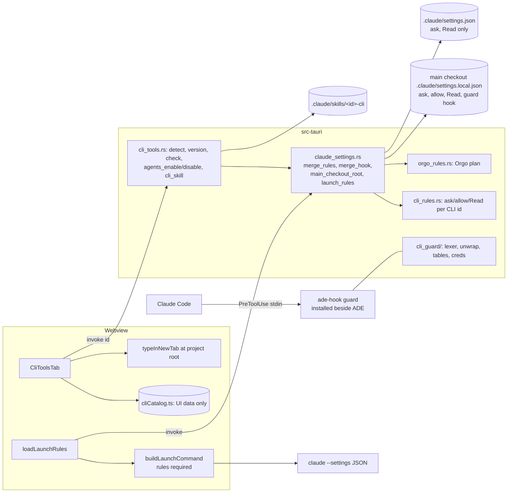
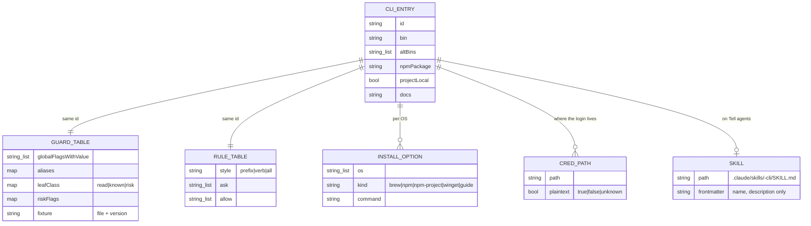

This is v1, narrowed by the owner on 2026-10-29. It covers four CLIs: **gh, stripe, vercel and wrangler**. A **command guard** decides when they ask: ADE ships a PreToolUse hook that parses each Bash command before Claude Code runs it, with ask rules on top. Seven stories, built in order:

- **Story 1, the command guard, for gh, on every ADE launch.** A `guard` subcommand of ADE's bundled `ade-hook` helper. ADE's launch line carries it, in the same `--settings` value as the Orgo plan's ask rules.
- **Story 2, the CLI tools tab.** For the four CLIs it shows what's installed, types install commands, signs in, and names where each credential lives. It writes nothing agents read.
- **Story 3, Tell agents, for gh.** This covers Claude Code sessions the user starts in this repository. Rules and the guard go into the main checkout's root `.claude/settings.local.json`, and a skill that Rust writes from the CLI id.
- **Story 4, stripe**, through the guard, end to end.
- **Story 5, vercel and wrangler**, through the guard, end to end.
- **Story 6, MCP: Vercel and Chrome DevTools.** Ask rules, a test of all 248 Vercel tools, and the guard on Vercel's tools.
- **Story 7, ask rules for the existing GitHub, Stripe, Supabase and DBHub MCP entries.**

The other fifteen CLIs, and Cloudflare, Figma, Atlassian and AWS Knowledge, are deferred to later stories on the same mechanism.

The plan shares two pieces with `plan/orgo-agent-computers` (at `f32ca1e`): one settings module, and one `--settings` launch value. It proposes an amendment to that plan's AC11 (see Coordination).

<frozen-after-approval reason="human-owned intent — do not modify unless human renegotiates">

## Intent

**Problem:** agents in ADE use command-line tools as much as MCP servers. ADE doesn't know which CLIs are installed or signed in, can't help install them, and doesn't tell agents how to use them safely. In ADE's Continuous mode (`claude --dangerously-skip-permissions`), an agent can run `vercel --prod`, `stripe pay` or `gh auth token` without a prompt. Prefix-pattern permission rules alone don't hold: they miss runners (`npx -y vercel@latest`), aliases (`vc`, `gh cs`), global flags, `sh -c`, absolute paths and npm scripts.

**Approach:** v1 covers gh, stripe, vercel and wrangler:
1. A **CLI tools** tab next to the MCP library. It detects each CLI, types its install command for the user, signs in, and tells agents about it.
2. A **command guard**: a small PreToolUse hook that ADE ships. Before Claude Code runs a Bash command, the guard parses it and asks for a command that deploys, deletes, spends money, touches keys or prints secrets. Claude Code ask rules sit on top.
3. A few more MCP servers, and ask rules for the MCP servers already in the library.

## Owner's decisions (2026-10-29)

1. **Scope:** a CLI library plus more MCPs, planned separately from Orgo.
2. **CLI groups:** all four groups matter: dev platforms, cloud, data & payments, agents & sandboxes.
3. **Narrow v1 plus a stronger check.**
   - v1 is **gh, stripe, vercel and wrangler** only.
   - ADE adds a **PreToolUse hook that parses each Bash command**: aliases, global flags before or after the subcommand, runner forms, `env`, `sh -c`, absolute paths and compound commands. Ask rules sit on top.
   - The other 15 CLIs come later on the same mechanism.
4. **The standing stance** (from the Orgo decisions):
   - commands that create billable resources, delete things, touch billing or keys, or print secrets ask in Claude Code, even in Continuous mode where possible;
   - nothing is created without the user's action;
   - no secret is kept in plain text.

   It covers every MCP server too.
5. **ADE never runs an installer, or `curl | sh`, on its own.** Install commands are typed for the user to check and run.
6. **Settings key order (accepted for Orgo, applied here).** The first rules merge may reorder a committed `.claude/settings.json`, keeping every value. Key-order preservation is its own deferred story.

</frozen-after-approval>

## Boundaries & Constraints (all stories)

**Always:**
- **One settings module.** `src-tauri/src/claude_settings.rs` holds the merge, `main_checkout_root` and the launch-settings composition. It is shared with the Orgo plan, and whichever builds first creates it.
- **Rules come from Rust tables keyed by CLI id.** The webview names a CLI; it never sends a rule, a hook command or skill text.
- **The guard runs from outside the project.** It is ADE's installed `ade-hook` helper, so an agent cannot edit it.
- **The guard never returns `allow`, and never rewrites a command.** It returns `ask` or `deny`, or no decision.
- **The guard fails closed.** A command that names a guarded CLI, alias or credential path, but can't be parsed, asks. A guard that crashes or times out blocks the call: the hook entry sets `onFailure: "block"`.
- ADE merges settings and never deletes a rule. A file that is not a JSON object is refused and left alone.
- Install commands are typed into a **new tab at the project root**, never into the active pane, which may be running an agent. They are never run.
- **ADE never executes a project-local binary.** It doesn't execute anything found under the project or a `node_modules` folder. Versions are probed only on click.
- The verification command is unchanged: `npx tsc --noEmit` · `npm test` · `cd src-tauri && cargo test` · `cd relay && cargo test` · `cd mobile && npx tsc --noEmit && npx jest`. Tests run offline against captured fixtures.

**Never:**
- No CLI credential goes into ADE's vault, and ADE stores no CLI credential.
- No change to `CLAUDE.md`, `relay/` or `mobile/`. No new npm or Cargo dependency: the guard's lexer is hand-written.
- No Windows support in v1. On Windows, `settings.local.json` isn't read at the repository root, Claude Code may run commands through PowerShell, and ADR 0003 hasn't checked hooks on Windows' shell. The tab says so.

## Coordination with `plan/orgo-agent-computers` (read at `f32ca1e`)

| Shared piece | Orgo plan today | This plan |
|---|---|---|
| Settings module | Q11: recommends `src-tauri/src/claude_settings.rs` for `merge_rules`, `load_settings`, `save_settings` and `main_checkout_root` | **Same module.** This plan adds `merge_hook`, `launch_settings` and the test matcher `rule_matches`. Whichever plan builds first creates it; the other extends it. |
| Launch flag | One `--settings '{"permissions":{"ask":…}}'` on every claude/deepseek launch. `rules: LaunchRules` is required; `loadLaunchRules()` caches only on success and fails closed. AC11 pins the value to exactly `{"permissions":{"ask": rules.ask}}`. | **Proposed amendment to Orgo AC11**, written into both plans' context files (`.ade/context/launch-settings.md`, new; `orgo-permission-rules.md` points to it). Details below the table. |
| Key order | Decision 11: semantic equality, preservation deferred | Same (decision 6). |
| Orgo CLI (1c) | On hold. Its round-2 design runs `npm install -g orgo` after a confirm. | Out of v1. When it comes back, recommend it as the library's `orgo` entry, with a **typed** install (decision 5), on the guard. |
| MCP ask rules on install | Story 1: `MCP_ASK` merged when Orgo is installed | Story 6 generalises it to a table keyed by server. **Fallback:** if Orgo's Story 1 hasn't landed, Story 6 adds the table and the install-time merge itself, in `claude_settings.rs` and `mcp.rs`. |
| ADR | 0010 | 0011 |

**The proposed amendment to Orgo's AC11:**
- Orgo's Rust `orgo_launch_rules()` becomes `launch_rules()` in `claude_settings.rs`. It still takes no project.
- It returns `{ ask, continuousDeny, guard }`:
  - `ask` is Orgo's `MCP_ASK` followed by the CLI ask rules;
  - `guard` is `{ command: <absolute path of the installed ade-hook> }`, or `null` when the helper isn't installed, as in a dev build without `cargo build -p ade-hook`.
- AC11 becomes: exactly one `--settings`, whose value parses to an object with `permissions.ask` equal to `rules.ask`. When `rules.guard` is set, it also has `hooks.PreToolUse` equal to exactly one guard entry, with args `["guard"]`, or `["guard","--headless"]` for a `-p` task. There are no other keys.
- `--settings` takes one value (round 4 of the Orgo review: Claude Code 2.1.42 `Jq6`/`jM5`), so both plans must compose into it. A second flag is not an option.

## Claude Code facts (verified 2026-10-29)

Sources: the docs, fetched as Markdown from `code.claude.com/docs/en/{hooks,permissions,permission-modes,settings,skills,worktrees,cli-reference}.md`, and Claude Code's own code (the 2.1.42 `cli.js` bundle at `/opt/node22/lib/node_modules/@anthropic-ai/claude-code`, and the 2.1.312 binary at `/opt/claude-code/bin/claude`).

**Hooks**

| # | Fact | Source |
|---|---|---|
| H1 | A PreToolUse command hook gets JSON on stdin with `tool_name`, `tool_input.command`, `cwd` and `permission_mode` (`"default"`, `"plan"`, `"acceptEdits"`, `"auto"`, `"dontAsk"` or `"bypassPermissions"`; Manual arrives as `"default"`). | hooks › Common input fields; PreToolUse input |
| H2 | It decides by exiting 0 with one JSON object: `hookSpecificOutput.permissionDecision` of `allow`, `deny`, `ask` or `defer`, plus `permissionDecisionReason`. The reason is shown to the user for `ask` and to Claude for `deny`. Exit 2 blocks, with stderr as the reason. Empty stdout with exit 0 means no decision. | hooks › Exit code output; PreToolUse decision control |
| H3 | "Deny and ask rules are still evaluated regardless of what the hook returns." Among several hooks, `deny` beats `defer`, which beats `ask`, which beats `allow`. | hooks; permissions › Precedence among rules, hooks, and mods |
| H4 | Any other exit code, a hook that can't start, a timeout, or invalid JSON is a non-blocking error, **unless** the hook sets `"onFailure": "block"` (Claude Code ≥ 2.1.295), in which case it blocks the call. The default timeout is 600 s, and a timed-out PreToolUse hook doesn't block by default. | hooks › Other exit codes, Timeouts, Block the action when a hook fails |
| H5 | Exec form: with `args`, `command` is spawned directly, with no shell. | hooks › Exec form and shell form |
| H6 | A hook's `ask` forces a prompt in auto mode. **The docs don't say what it does under `bypassPermissions`.** In the code, the interactive permission callback takes the hook's `ask` as a forced decision and skips the mode check: 2.1.42 `($!==void 0?Promise.resolve($):pX(…))`, 2.1.312 `(vt!==void 0?Promise.resolve(vt):EHe(…))`. So in an interactive Continuous session it prompts. The headless callback (2.1.42 `createCanUseTool`, used for `-p` and the SDK) takes no forced decision, so a hook `ask` there may be lost. The guard therefore **denies** under `--headless`. This is the P2 manual check (V1). | hooks › PreToolUse decision control; code as cited |
| H7 | Hooks from settings files also run inside sub-agents. Hook entries from every settings level are merged. `allowManagedHooksOnly` blocks user, project and local hooks. | hooks › Hook locations |
| H8 | The `if` filter is "best-effort". The docs: "use the permission system rather than a hook to enforce a hard allow or deny". So the guard uses no `if`, and ask rules stay on top. | hooks › How `if` patterns match Bash commands |

**Where settings load from**

| # | Fact | Source |
|---|---|---|
| S1 | "Hooks and other `.claude/settings.json` keys load from the current working directory's `.claude/` folder with no parent-directory fallback." | permissions:714 |
| S2 | "`.claude/settings.local.json` loads from the git repository root instead, even when you start Claude Code in a subdirectory." This needs Claude Code ≥ 2.1.211. It doesn't hold on Windows, outside git, at a home-directory root, or when the root isn't owned by the user. | settings:86-96; permissions:716 |
| S3 | A worktree session uses the main checkout's `.claude/settings.local.json` (approvals are saved there and "apply in the main checkout and in every other worktree"). | worktrees:244-250 |
| S4 | Skills load from `.claude/skills/` in the start directory and every parent up to the repository root. In a worktree, they come from the main checkout only when the worktree has no `.claude/skills` of its own. | skills:174-178 |
| S5 | `--settings <file-or-json>` takes one value. Its permission lists are concatenated with the files' lists. | Orgo plan round 4 (2.1.42 `Jq6`/`jM5`); cli-reference |

**Bash rules**

| # | Fact | Source |
|---|---|---|
| B1 | `*` stands for any text. A trailing ` *` that is the only wildcard also matches the bare command. The spaces around a middle `*` are literal: `Bash(git log * main)` doesn't match `git log main`. | permissions › Wildcard patterns |
| B2 | Ask and deny rules apply to every subcommand of a compound command, `$(…)` and loops, and past a leading assignment. Only `timeout`, `time`, `nice`, `nohup`, `stdbuf`, `command`, `builtin`, `noglob` and bare `xargs` are stripped. `npx`, `env`, absolute paths and `sh -c` are not. A rule "isn't a security boundary around the program." | permissions › Compound commands, Wrappers, What a Bash rule doesn't match |
| B3 | "Claude Code doesn't auto-approve … in any mode, including `bypassPermissions` … tools matched by an explicit ask rule." | permission-modes › Actions no mode auto-approves |
| B4 | `Read` and `Edit` deny rules also apply to file commands Claude Code recognises in Bash (`cat`, `head`, `tail`, `sed`, `tee`). | permissions › Read and Edit |

**What follows:**
- **Rules must be wherever a skill can load** (B2 of the review). That means three places:
  - the launch flag;
  - the main checkout's root `.claude/settings.local.json` (S2, S3);
  - the shared `.claude/settings.json`, for teammates who start at the root.
- **The guard's hook entry never goes into the committed file,** because it names a machine-local binary. It goes on the launch flag and in the root `settings.local.json`, like ADE's agent-status hooks (ADR 0003).

## The command guard

**What it is:** `ade-hook guard`, a new subcommand of the existing helper crate `src-tauri/ade-hook`.
- ADE installs the helper next to its own executable (ADR 0003). It is outside every project, so an agent can't edit the script that judges it.
- The logic lives in `src-tauri/src/cli_guard/` (`mod.rs`, `lexer.rs`, `unwrap.rs`, `tables.rs`, `creds.rs`). The main crate also compiles it, so `cargo test` covers it, the same way `hook_forward.rs` is covered today.
- The core is a pure function: `classify(command: &str, ctx: &Ctx) -> Verdict`.
  - `Ctx` supplies the cwd, environment lookups and file reads. Tests inject fakes.
  - The guard never touches the network, writes nothing, and keeps no state. It reads only four things:
    - stdin;
    - `package.json` scripts, for `npm run` and the like;
    - the wrangler config in the cwd, for `dev` with remote bindings;
    - gh's `config.yml`, for user aliases.

**The hook entries.** Two places, the same command:

```jsonc
// 1. On every ADE launch, inside the shared --settings value (exec form: no shell, a path with spaces is one argument)
{"matcher": "Bash", "hooks": [{"type": "command", "command": "/Applications/ADE.app/Contents/MacOS/ade-hook",
  "args": ["guard"], "timeout": 5, "onFailure": "block"}]}
// -p launches (Orchestrator) pass ["guard", "--headless"]

// 2. In the main checkout's root .claude/settings.local.json, for sessions the user starts (Story 3)
{"matcher": "Bash", "hooks": [{"type": "command", "command": "\"${ADE_GUARD_BIN:-true}\" guard", "timeout": 5, "onFailure": "block"}]}
```

- **`ADE_GUARD_BIN`** is set in every ADE terminal, after any inherited value is removed, whenever the helper exists beside ADE's executable. It is independent of the agent-status endpoint.
  - Outside ADE the variable is unset. The hook then runs `true` and makes no decision, so the file entry is harmless in other terminals. The launch flag doesn't apply there, and Claude Code sessions outside ADE are not guarded. The guide says so.
  - A stale `ADE_GUARD_BIN`, for example in a tmux server that outlived ADE, makes every Bash call in that session fail closed. The guide says to restart the session (Q3).
- **Story 6** adds a second entry with `"matcher": "mcp__vercel__.*"` to the same two places, for Vercel's MCP tools.

**What it decides** (H2):
- **Risky:** exit 0 with `{"hookSpecificOutput":{"hookEventName":"PreToolUse","permissionDecision":"ask","permissionDecisionReason":"ADE: gh repo delete deletes a repository"}}`.
- **Headless (`--headless`):** the same JSON with `"deny"`, because no one can answer, and the reason tells Claude to ask the user (H6).
- **Not a guarded CLI, or a read:** exit 0 with empty stdout, so the normal permission flow and the mode decide.
- **The text names a guarded CLI, alias or credential path, but can't be parsed:** `ask`, "ADE couldn't parse this command".
- **Internal error:** the panic is caught and the guard prints `ask`. A crash or a timeout blocks through `onFailure`.

**How it parses a command:**
1. **The lexer** (`lexer.rs`, written for this; no dependency) handles:
   - single and double quotes, `$'…'` and backslash escapes;
   - `\`+newline continuations;
   - the operators `&&`, `||`, `;`, `|`, `|&`, `&` and newline;
   - `( … )` and `{ …; }`;
   - `$( … )`, backticks and `<( … )`, each parsed recursively;
   - redirections and their targets, which are recorded for the credential check;
   - here-docs (`<<`, `<<-`, quoted and unquoted markers). A here-doc body is parsed as commands when it feeds a shell (`bash <<EOF`).
   - Control words (`if`, `then`, `for … in`, `do`, `while`, `case`) put the next word in command position.

   Anything it can't place is a parse failure.
2. **Unwrapping** each simple command (`unwrap.rs`) strips, repeatedly:
   - leading `NAME=value` assignments;
   - `env` and its options (`-i`, `-u X`, `-C dir`; `-S str` is parsed again);
   - `sudo` and its options;
   - `command`, `builtin`, `exec`, `nohup`, `time`, `nice [-n N]`, `timeout [opts] D`, `stdbuf [opts]`, `xargs [opts]` and `watch [opts]`.

   It then resolves:
   - `sh`/`bash`/`zsh`/`dash`/`fish -c STR`, including combined `-lc`, and `eval ARGS`: the string is parsed again;
   - the runners:
     - `npx [-y|--yes|--no|-p PKG|--package PKG]… PKG[@version] ARGS`;
     - `npm exec|x [--] PKG`;
     - `pnpm exec|dlx X`, `yarn exec|dlx X` and `bunx`/`bun x X`;
     - `pnpm X` and `yarn X` when `X` is a guarded bin;
   - scripts: `npm run|run-script|start|test S`, `pnpm [run] S`, `yarn [run] S` and `bun run S`.
     - The script's body comes from `package.json` in the cwd, or after a `cd D` earlier in the same command line. It is parsed again, at most 4 levels deep.
     - `pnpm deploy` is pnpm's own command, not a script.
   - an absolute or relative path to a binary: its basename;
   - `node …/node_modules/<pkg>/…`: that package's bin;
   - package and bin aliases: `vercel`/`vc`; `wrangler`/`wrangler2`/`cf-wrangler`; `@stripe/cli` → `stripe`.
3. **Classifying** (`tables.rs`): one table per CLI, holding:
   - global flags and their arity, so `gh -R o/r pr merge` and `stripe --api-key x customers delete` find the subcommand;
   - subcommand aliases;
   - pflag combined shorts, so `-at` is read as `-a -t`;
   - leaves classed **read**, **known** (a non-risky write such as `gh pr create`) or **risk**;
   - risky flags on a leaf (`pr close -d`, `auth status -t`, `--live`, `--remote`).

   **A leaf the table doesn't know asks.** So does a gh extension. New subcommands therefore fail closed.
4. **Credential paths** (`creds.rs`): any word or redirect target that resolves to a guarded CLI's credential file asks. An example is `cat ~/.config/gh/hosts.yml`.

**What the guard can't see. These are limits, stated in the guide:**
- The user's shell aliases and functions: it sees the command text, not the shell's definitions.
- What a script the agent writes and then runs will do (`node deploy.js`, `python x.py`, a Makefile target).
- A command whose name is a variable expansion that names no guarded CLI: `$CMD args` with `CMD=gh`. If the text names a guarded CLI anywhere, it asks.
- The same APIs reached another way: `curl` with a token found in a file the guard doesn't know about, or an SDK.
- Runners outside the list (`deno run npm:vercel`, `mise exec`, `devbox run`).
- Sessions under `allowManagedHooksOnly`.
- Codex and other agents that are not Claude Code.
- Claude Code sessions outside ADE terminals, unless they start in the repository, where the root `settings.local.json` applies but `ADE_GUARD_BIN` is unset.

**Fixtures (captured once by the developer, committed under `src-tauri/src/cli_guard/testdata/`, each with its version and capture command at the top):**
- **gh:** `GH_CONFIG_DIR=$(mktemp -d) gh help reference` from gh 2.89.0. That is 215 command headings, captured during planning. Built-in alias `co: pr checkout`. Group aliases from the manual: `cs`; `ext`, `extensions`; `agent`, `agents`, `agent-tasks`.
- **stripe:** `stripe --map json`. The flag exists in `pkg/cmd/root.go:350`: "Print a command tree [tree|compact|paths|json]". The hidden `daemon` and `plugin` commands are added by hand from their sources.
- **vercel:** the command names and aliases parsed from the `vercel@65.7.0` npm bundle (`name:"…",aliases:[…]` in `dist/`). Bins `vc` and `vercel`.
- **wrangler:** the command strings parsed from `wrangler@4.155.0` (`wrangler-dist/cli.js`, `command: "wrangler …"`). Bins `wrangler`, `wrangler2` and `cf-wrangler`.

**The tests run over generated corpora** (`cli_guard` › `corpora`):
- For every leaf in a fixture, the canonical command and its variants are generated:
  - a global flag before it, and after it;
  - `env X=1`, `sh -c '…'`, an absolute path, `cd x && …`, `$(…)`;
  - and, for npm-distributed CLIs, `npx`, `npx -y …@latest`, `pnpm dlx`, `yarn dlx`, `bunx`, and an `npm run` script whose body is the command.
- A risky leaf must ask in every variant. A read leaf must give no decision in every variant.
- A test also checks that **every fixture leaf is classified explicitly**, so a leaf can't fall into the "unknown asks" default by accident without the table saying so.

## Rules on top of the guard

The guard is the classifier. Ask rules are the documented floor (B3) for the canonical forms, in case the guard isn't loaded.

**`cli_rules.rs` keeps them compact.** Per CLI, it holds the canonical risky leaves:
- **Prefix style** (gh, stripe): `Bash(b G V *)`.
- **Verb style** (wrangler): each verb gives four rules, `Bash(b V)`, `Bash(b V *)`, `Bash(b * V)` and `Bash(b * V *)`, so a verb is caught last, middle or alone (review B3: `fly auth token`). A glob item `V*` gives `Bash(b V*)` and `Bash(b * V*)`.
- **All style** (vercel): `Bash(vercel)`, `Bash(vercel *)`, `Bash(vc)` and `Bash(vc *)`.

Allow rules for reads are written only to the root `settings.local.json`, for Manual-mode convenience. They never contain `*` other than a final ` *`, and never cover a leaf with a secret-printing flag.

**`Read(…)` ask rules for credential files** go to the same places as the ask rules:
- `Read(~/.config/gh/hosts.yml)`
- `Read(~/.config/stripe/**)`
- `Read(~/.local/share/com.vercel.cli/**)`, `Read(~/Library/Application Support/com.vercel.cli/**)`
- `Read(~/.wrangler/**)`, `Read(~/.config/.wrangler/**)`, `Read(~/Library/Preferences/.wrangler/**)`

They cover Claude's Read tool. The guard covers `cat` and the like. B4 documents Read *deny* rules for Bash file commands; whether *ask* rules apply there too is U4.

**What it's all expanded to:** about 25 rules for gh, 20 for stripe, 4 for vercel and 60 for wrangler, plus 8 `Read` rules. Together with Orgo's 23, the launch value is about 4 KB of JSON (U5).

## The four CLIs

Install, sign-in and status values are verified at the cited source. **Credential** says where the CLI keeps its sign-in, and the card shows it.

| id | Bins | Install (typed, never run) | Sign in · status (on click) | Credential | Env tokens that override the login (card notice) | Source |
|---|---|---|---|---|---|---|
| gh | gh | macOS `brew install gh`; Windows `winget install --id GitHub.cli --source winget`; Linux: the apt steps from a guide link | `gh auth login` · `gh auth status` | "the system credential store; if none is found, gh falls back to a plain text file" (`~/.config/gh/hosts.yml`) | `GH_TOKEN`, `GITHUB_TOKEN`, `GH_ENTERPRISE_TOKEN`, `GITHUB_ENTERPRISE_TOKEN` | cli/cli `docs/install_*.md`; cli.github.com/manual/gh_auth_login, gh_help_environment |
| stripe | stripe | `npm install -g @stripe/cli` (all); macOS `brew install stripe` | `stripe login` · `stripe login list` | `~/.config/stripe/` (or `$XDG_CONFIG_HOME/stripe`); plaintext is U3 | `STRIPE_API_KEY` (a live key makes every command live; the guard checks the `sk_live_`/`rk_live_` prefix) | docs.stripe.com/stripe-cli/use-cli.md; stripe/stripe-cli README |
| vercel | vercel, vc | `npm i -g vercel` (all) | `vercel login` · `vercel whoami` | Vercel's data dir (`com.vercel.cli`, through xdg-app-paths); file and format are U3 | `VERCEL_TOKEN` | vercel.com/docs/cli; npm `vercel@65.7.0` |
| wrangler | wrangler, wrangler2, cf-wrangler (project-local) | `npm i -D wrangler@latest` in the project, run as `npx wrangler` | `npx wrangler login` · `npx wrangler whoami` | Wrangler's config dir; keyring or encrypted file store (`CLOUDFLARE_AUTH_USE_KEYRING`, `FileCredentialStore`) is U3 | `CLOUDFLARE_API_TOKEN`, `CLOUDFLARE_API_KEY` + `CLOUDFLARE_EMAIL`, `CF_API_TOKEN`, `CF_API_KEY` | developers.cloudflare.com/workers/wrangler/install-and-update, …/system-environment-variables; npm `wrangler@4.155.0` |

**Guard classification per CLI.** The key risky leaves ask; reads give no decision; unknown leaves ask.

**gh**
- Risky:
  - repo create, delete, edit, rename, archive, sync and deploy-key; repo autolink create and delete; pr merge; `pr close -d`/`--delete-branch`;
  - release create, edit, upload, delete and **delete-asset**;
  - secret *; variable set and delete; cache delete;
  - workflow run, enable and disable; run cancel, delete and rerun;
  - issue delete and transfer; label delete; gist create, edit and delete;
  - **project delete, close, item-delete and field-delete**;
  - **codespace / cs** (all but list and view); **extension / ext** install, upgrade, remove, exec and create, plus any extension command; **agent-task / agent / agents create**; skill install;
  - auth token, login, logout, refresh, switch and setup-git; **`auth status` with `-t`/`--show-token`, combined shorts included (`-at`)**;
  - ssh-key *, gpg-key *, alias set/import/delete, config set;
  - **`api` unless it is provably a read**: a read means no `-X`/`--method` other than GET, no `-f`/`-F`/`--field`/`--raw-field`/`--input`, and, for `graphql`, a query with no `mutation`. A graphql query from a file asks.
  - User aliases come from gh's `config.yml`. Shell (`!`) aliases ask.
- Read: pr view, list, diff, checks and status; issue view, list and status; run view, list and watch; workflow list and view; repo view; release list and view; search; status; `auth status`; label list; cache list; variable list and get; secret list; project list, view, item-list and field-list; ruleset list and view; alias list; config get and list; version and help.
- Known (no decision): pr create, comment, edit, checkout and review; issue create, comment and edit; repo clone; browse.

**stripe**
- Risky:
  - pay, post, delete, projects (all but list, status, catalog, search and spend), **provision** (an alias of `projects add`), config, login (except `login list`), logout, reauth, switch, sandbox, agent, tools, fixtures, events resend;
  - **daemon** (a local gRPC server that runs CLI commands; hidden), **plugin** (hidden; installs plugins);
  - **listen**, which prints a `whsec_…` secret and `--forward-to` can send events anywhere;
  - every resource operation other than list, retrieve and search;
  - **any command when live**: `--live` anywhere, `--api-key sk_live_…`/`rk_live_…` anywhere, or `STRIPE_API_KEY` with a live prefix in the environment.
- Read: logs tail, docs, `login list`, version, help, and resource list, retrieve and search.
- Known: trigger (sandbox objects), open, completion, feedback.

**vercel**
- Read: `ls`/`list`, inspect, logs, whoami, help, `--version`/`-v`, `env ls`, `project ls`/`projects ls`, `domains ls`, `dns ls`, `certs ls`, `alias ls`, `teams ls`.
- Known: `dev` and `build` (local).
- **Everything else asks.** That includes bare `vercel` and `vercel <path>`, which deploy, and `vercel --prod`, `api`, `curl`, `buy`, `env pull`, `pull` and `link`.

**wrangler**
- Risky:
  - leaves whose last word is a risky verb: create, delete, deploy, publish, put, upload, push, apply, modify, update, rollback, secret, token, issue-token, credentials, login, logout, bulk, enable, disable, setup, activate, deactivate, remove, trigger, send, purge, restore, rename, cancel, configure;
  - `d1 execute` with `--remote`;
  - `dev` with `--remote`, or with a wrangler config in the cwd that sets `remote = true` / `"remote": true` on a binding (an unreadable config asks).
- Read: whoami, tail, the list, get, info, logs, schema and stats leaves, types, `d1 execute` without `--remote`, and help.
- Known: dev (local), build, check, complete, docs.

## How agents learn (Story 3)

- **Skills are rendered in Rust** from the CLI id (`cli_skill(id)`), as `.claude/skills/<id>-cli/SKILL.md`. ADE writes one only if it is missing, and removes one only while it is byte-identical. The webview never sends skill content (review M10).
- **Frontmatter is `name` and `description` only.** There is no `allowed-tools`, no `hooks` and no `` !` ``; a test enforces it.
- The body tells the agent:
  - to check the tool with `<bin> --version`, which the guard and rules never make ask;
  - to ask the user to install it from ADE if it's missing, and not to install it;
  - to read `--help` first;
  - which JSON and non-interactive flags to use;
  - to write the command plainly;
  - that risky commands ask, and not to look for another way to run them;
  - which commands print credentials, never to run them, and never to read the credential file.
- **Skills load from parent folders, and in worktrees from the main checkout (S4).** That is why the rules and the guard go to the main checkout's root `settings.local.json` and the launch flag: an agent can't learn a CLI from a skill where its rules don't apply.

## Architecture





```mermaid
sequenceDiagram
  participant A as Agent (Claude Code, Continuous)
  participant CC as Claude Code
  participant H as ade-hook guard
  participant U as User
  A->>CC: Bash "cd web && npx -y vercel@latest --prod"
  CC->>H: stdin {tool_input.command, cwd, permission_mode: bypassPermissions}
  H->>H: lex → [cd web] && [npx -y vercel@latest --prod]
  H->>H: unwrap npx → vercel; table: not a read leaf → risk
  H-->>CC: exit 0 {permissionDecision: ask, reason: "ADE: vercel deploys to production"}
  CC->>CC: ask rules also evaluated (H3)
  CC->>U: permission prompt [settings] "ADE: vercel deploys…"
  U-->>CC: No
  CC-->>A: denied, with the reason
```

## Failure modes

| Failure | Handling |
|---|---|
| Helper missing (dev build) | `launch_rules().guard` is `null`. Launches carry the ask rules only. The tab says "Command guard unavailable in this build". |
| Helper crashes or exceeds 5 s | `onFailure: "block"` blocks the call (H4). Needs Claude Code ≥ 2.1.295: on older versions, a crash fails open, and the guide says so (U6). |
| Stale `ADE_GUARD_BIN` in an old terminal | Every Bash call blocks until the session is restarted. ADE strips inherited values in new terminals (Q3). |
| Unparseable command that names a guarded CLI | ask |
| Agent in user-started Continuous mode edits `settings.local.json` | The file rules and hook can be removed. ADE-launched sessions keep the launch flag, which can't be edited. Stated. |
| `-p` (Orchestrator) | The guard denies risky commands, with a reason. Ask rules are refused under `-p` anyway (Orgo plan). |
| Settings file not a JSON object | Refused; nothing is written: no rules, no hook, no skill. |
| First merge reorders keys | Accepted (decision 6). The notice says so; semantic equality is tested. |
| Windows | No guard, no Tell agents; the tab explains (Boundaries). |

## Proposed ADR 0011 (written on approval)

`0011-cli-library-guarded-by-a-command-hook.md`.
- **Context:** prefix rules can't hold against runners, aliases, flags or `sh -c`. Settings files load from different places than skills.
- **Decision:**
  - A PreToolUse command guard, shipped in ADE's helper and run from outside the project, classifies commands for each library CLI, with ask rules on top.
  - It never allows, asks for risky and unknown commands, denies under `-p`, and fails closed.
  - Rules and the guard go on every ADE launch through the one shared `--settings` value, and into the main checkout's root `settings.local.json`. Ask and Read rules also go into the shared `settings.json`.
  - Skills are rendered in Rust.
  - Install commands are typed into a new tab and never run. Project-local binaries are never executed.
- **Consequences:** each new CLI is a fixture, a guard table, a rule table and corpus tests. The guard is a parser that must keep up with CLI releases, but unknown leaves ask.

Context files:
- `.ade/context/launch-settings.md` (new, shared with Orgo): the `launch_rules()` shape, the AC11 amendment, and the guard hook entry.
- `.ade/context/cli-guard.md` (new): the decision JSON, the `--headless` contract, the table format, the fixture versions, and the limits.

---

# Story 1: the command guard, for gh, on every ADE launch

## Code Map (1)

- `src-tauri/ade-hook/src/main.rs`: today it runs `hook_forward::main()`. It gains a `guard` subcommand.
- `src-tauri/src/hook_forward.rs`: the precedent of a module the main crate compiles for tests. `src-tauri/Cargo.toml:18`: the workspace member.
- `src-tauri/src/pty.rs:168`: where terminal env is set. It gains `ADE_GUARD_BIN`.
- `src/lib/agentCommand.ts:49-53` `claudeCommand`, `:68` `buildLaunchCommand`; `src/lib/agentLaunch.ts:21,42`; `src/components/OrchestratorTab.tsx:292`; the probes at `agentCommand.ts:156,165`.
- The Orgo plan's `src/lib/orgoRules.ts` (`loadLaunchRules`) and `orgo_launch_rules()`. This story renames them to neutral names, or creates them if Orgo hasn't landed (Coordination).
- New: `src-tauri/src/claude_settings.rs` (if absent), `src-tauri/src/cli_guard/`, `src-tauri/src/cli_rules.rs`, and testdata.

## Design Notes (1)

- `cli_guard` as specified, with gh's table, fixture and credential paths.
- `launch_rules()` in `claude_settings.rs` returns `{ ask, continuousDeny, guard }`:
  - `ask` is Orgo's `MCP_ASK` (if present) followed by `cli_rules` for gh;
  - `guard` is the helper path, found beside `std::env::current_exe()`.
- `src/lib/launchRules.ts` exports `loadLaunchRules()`, which caches only on success. If Orgo's `orgoRules.ts` exists, it becomes this file.
- `LaunchOptions.rules: LaunchRules` is required. `claudeCommand` writes one `--settings` value:
  - `{"permissions":{"ask":rules.ask}}`;
  - plus `hooks.PreToolUse` with the guard entry when `rules.guard` is set;
  - with args `["guard","--headless"]` when the launch has a `-p` task.
- The probes use a module-private `PROBE_RULES`.
- `ADE_GUARD_BIN` is exported in new terminals when the helper exists. Inherited values are removed first.

## Acceptance Criteria (1)

1. **The lexer** splits and recursively parses each of the following, and flags a parse failure on an unclosed quote, an unclosed `$(` or a missing here-doc end. Covered by `src-tauri/src/cli_guard/lexer.rs` › `lexes_the_shapes_agents_write`. The shapes:
   - `a && b || c; d | e |& f & g`;
   - a newline-separated pair;
   - `( a ) && { b; }`;
   - `echo "$(gh repo delete x)"` and `` echo `gh api -X DELETE y` ``;
   - `diff <(gh pr diff 1) f`;
   - `'it'\''s'` and `$'a\nb'`;
   - a `\`+newline continuation inside a gh command;
   - `bash <<'EOF'\ngh repo delete x\nEOF`;
   - `cat <<EOF > f\ngh repo delete x\nEOF`, whose body is not a command;
   - `for r in a b; do gh repo delete $r; done`.
2. **Unwrapping** reaches `gh` through each of these, and through two of them nested (`sudo env -i sh -c 'gh …'`). Covered by `cli_guard/unwrap.rs` › `unwraps_every_documented_form`. The forms:
   - `GH_TOKEN=x gh`, `env -i gh`, `env -S 'gh …'`, `sudo gh`, `command gh`, `nohup gh`, `nice -n 5 gh`, `timeout 30 gh`, `xargs -n1 gh`;
   - `sh -c 'gh …'`, `bash -lc "gh …"`, `eval gh …`;
   - `/usr/local/bin/gh`, `./bin/gh`.
3. **Every gh leaf** in `gh-2.89.0-reference.md` is classified explicitly in gh's table. The test fails on any unclassified leaf and prints it. Covered by `cli_guard/tables.rs` › `gh_table_covers_the_reference`.
4. **Generated corpora:**
   - every gh risky leaf asks in each variant (global flag before and after, `env`, `sh -c`, absolute path, `cd x &&`, `$(…)`, `co`/`cs`/`ext`/`agent` aliases where they apply);
   - every read leaf gives no decision in each variant.

   Covered by `cli_guard` › `gh_corpus_asks_for_every_risky_leaf`, `gh_corpus_reads_pass`.
5. **Hand corpus**: these ask:
   - `gh release delete-asset v1 a.zip`, `gh pr close 3 -d`, `gh project item-delete 1 --id x`, `gh agent create "do x"`, `gh cs create`, `gh ext install o/r`;
   - `gh auth status -at`, `gh auth status --show-token`;
   - `gh api -X DELETE repos/o/r`, `gh api repos/o/r/issues -f title=x`, `gh api graphql -f query='mutation { … }'`, `gh api graphql --input q.graphql`;
   - `gh myext run` (an unknown leaf);
   - a user alias `rmr: repo delete` read from a fake `config.yml`, and a `!`-prefixed shell alias.

   These give no decision: `gh api repos/o/r`, `gh api graphql -f query='query { viewer { login } }'`, `gh auth status`, `gh co 12`.

   Covered by `cli_guard` › `gh_hand_corpus`.
6. **Credentials:** `cat ~/.config/gh/hosts.yml`, `base64 < ~/.config/gh/hosts.yml`, `cp ~/.config/gh/hosts.yml /tmp/x` and `grep oauth ~/.config/gh/hosts.yml` ask, and `cat ~/.config/gh/config.yml` doesn't. Covered by `cli_guard/creds.rs` › `credential_files_ask`.
7. **Fail closed:**
   - `gh repo delete "unterminated` asks with "couldn't parse";
   - `echo "unterminated` (no guarded name) gives no decision;
   - an injected panic in classify prints `ask` JSON and exits 0;
   - the guard never prints `allow` for any command across all corpora;
   - `--headless` turns every `ask` into `deny` with the same reason.

   Covered by `cli_guard` › `fails_closed_and_never_allows`.
8. **The helper contract:** `ade-hook guard`, fed the docs' PreToolUse stdin example with `tool_input.command` replaced:
   - prints exactly one JSON object matching the H2 shape and exits 0 for a risky command;
   - prints nothing for `npm test`;
   - prints nothing for a non-Bash `tool_name`;
   - prints `ask` for malformed stdin, and exits 0.

   Covered by `cli_guard` › `helper_stdin_stdout_contract`, which calls the same `run(stdin, stdout, ctx)` the binary calls.
9. **Rules:** the gh ask rules match the canonical form of every gh risky leaf under `rule_matches`, and no read leaf. `rule_matches` reproduces the docs' wildcard table rows. Covered by `cli_rules.rs` › `gh_rules_cover_canonical_risks`; `claude_settings.rs` › `matches_claude_codes_documented_examples`.
10. **The launch value:** `buildLaunchCommand(provider, rolePath, { rules })` for claude and deepseek has exactly one `--settings`. Its value parses to an object with:
    - `permissions.ask` equal to `rules.ask`;
    - `hooks.PreToolUse` equal to exactly the guard entry (`command` = `rules.guard.command`, `args: ["guard"]`, `timeout: 5`, `onFailure: "block"`, `matcher: "Bash"`) when `rules.guard` is set, and absent when it is `null`;
    - no other keys.

    With a `-p` task the args are `["guard","--headless"]`. Codex is unchanged. A call without `rules` is a `@ts-expect-error`. Covered by `src/lib/__tests__/agentCommand.test.ts` › "every Claude Code launch carries the rules and the guard" (this is the amended Orgo AC11).
11. **Every launch path:** the picker, `dispatchAgent` and the Orchestrator all type a command whose `--settings` carries the guard. When `loadLaunchRules` rejects, no command is typed. Covered by `agentLaunch.test.ts` and `OrchestratorTab.test.tsx` (extended).
12. **Terminal env:** a new terminal has `ADE_GUARD_BIN` set to the helper path when the helper exists, and not set otherwise. An inherited `ADE_GUARD_BIN=/x` is replaced or removed. Covered by `src-tauri/src/pty.rs` › `guard_bin_is_set_only_when_the_helper_exists`.
13. **Speed:** `classify` on each of the 200 longest corpus commands takes under 5 ms in a release build. The test runs in debug with a 50 ms bound. Covered by `cli_guard` › `classify_is_fast`.
14. **Context:** `.ade/context/launch-settings.md` and `cli-guard.md` exist. `orgo-permission-rules.md`, if present, links the AC11 amendment. This is a Definition of Done item; no test.

## Verification (1)

The five commands of the verification command, unchanged.

**Manual matrix (P2, owner, Claude Code ≥ 2.1.295, with the release helper):**
- V1, interactive Continuous launch from the picker: `gh repo delete o/scratch` prompts with the ADE reason.
- V2, the same through `sh -c` and `npx`-free variants: they prompt.
- V3, a Manual launch: it prompts.
- V4, an Orchestrator `-p` dispatch that is asked to delete a repository: it is refused with the reason.
- V5, a project with its own `.claude/settings.json` PreToolUse hook: both hooks run (the `--settings` hook loads alongside the project's).
- V6, a 4 KB `--settings` line typed into zsh, bash and fish launches (U5).
- **Until V1 and V5 pass, the guide does not claim that the guard asks in Continuous mode.**

## Slice (1)

`src-tauri/ade-hook/src/main.rs`; `src-tauri/src/cli_guard/**` (with testdata); `src-tauri/src/claude_settings.rs`; `src-tauri/src/cli_rules.rs`; `src-tauri/src/pty.rs`; `lib.rs`; `src/lib/agentCommand.ts`, `agentLaunch.ts`, `launchRules.ts`; `src/components/OrchestratorTab.tsx`; the tests named above; the two context files; a "Command guard" section in `docs/guide/agents.md`.

---

# Story 2: the CLI tools tab (gh, stripe, vercel, wrangler)

## Code Map (2)

- `src/components/IntegrationsPanel.tsx` (:11, :27, :147-153); `src/App.tsx:231-233`; `src/components/CommandPalette.tsx:167-169`; `src/lib/terminalCommands.ts` (`runInNewTabPane` :29); `src-tauri/src/lib.rs` `find_command` (:106).

## Design Notes (2)

- **`src/data/cliCatalog.ts`** holds UI data only: id, name, bins, `npmPackage`, `projectLocal`, install options, sign-in, credential description, env tokens and docs.
- **`cli_detect(project, ids)`**, in Rust, from ids, never runs anything:
  - For a `projectLocal` entry, it reads `<project>/node_modules/<npmPackage>/package.json` (`version`) and does not look at `.bin` (review B1).
  - For the others, it uses `find_command`, and then **refuses a resolved path inside the project or any `node_modules`**, reporting "found in the project; not run".
- **`cli_version(id)`** runs only on the **Show version** click, and only for a path `cli_detect` accepted. stdin is null, the timeout is 10 s, and the env sets `NO_UPDATE_NOTIFIER=1` and `STRIPE_NO_AUTO_UPDATE=1`. The version argument is fixed per id.
- **`cli_check(id)`**, on click: Rust picks the argv for the id from `CHECKS` (`gh auth status`, `stripe login list`, `vercel whoami`, wrangler `whoami` through the project's `node_modules/wrangler/bin/wrangler.js` run with `node`, which is only on click). It returns `{ok, line}`.
  - Running a project's wrangler executes project code. So the wrangler check names that in its confirm: "Runs this project's wrangler (`node_modules/wrangler`)" (Q6).
- **Install**: **Type in a new terminal** calls `typeInNewTab("Install <Name>", projectRoot, command)`. It never types into the active pane (review M11), and never adds `\r`.
- **Sign in**: `runInNewTab("<Name> sign-in", projectRoot, command)` on click.
- **Card notes:**
  - where the credential lives, and whether it is plaintext ("may fall back to plain text", "unknown");
  - env tokens present in the vault (review M15);
  - on Windows: "The command guard and Tell agents aren't available on Windows yet."

## Acceptance Criteria (2)

1. Catalog ids are unique; Story 2's ids are exactly gh, stripe, vercel and wrangler; every install command is one line; `guide` options have an `https` URL; each entry has at least one option per OS. Covered by `src/data/__tests__/cliCatalog.test.ts`.
2. **B1:** a temp project with an executable `node_modules/.bin/gh`, `node_modules/.bin/wrangler` and `bin/gh`, with the search folders pointed at the project through a test seam:
   - `cli_detect` reports wrangler's version from `node_modules/wrangler/package.json`;
   - it reports gh as "found in the project; not run";
   - a spawn recorder shows **no process was started**, by detect or by `cli_version("gh")`.

   Covered by `src-tauri/src/cli_tools.rs` › `never_executes_project_binaries`.
3. `cli_version` and `cli_check` take only an id; an unknown id errors without spawning. `CHECKS` equals exactly the four argvs above. A fake script that sleeps is killed at the timeout, and one that reads stdin gets EOF. Covered by `cli_tools.rs` › `probes_are_fixed_bounded_and_on_click`.
4. Rendering the tab:
   - "CLI tools" follows "MCP library";
   - no `cli_version` or `cli_check` is invoked on mount;
   - **Show version** and **Check sign-in** invoke them with `{ id }` only.

   Covered by `src/components/__tests__/CliToolsTab.test.tsx` › "nothing runs until you click".
5. **Type in a new terminal** opens a tab named "Install Stripe" in the project root and writes the command with no `\r`. The active pane's PTY receives nothing, even when one exists. Covered by `CliToolsTab.test.tsx` › "installs are typed into a new tab, never run, never into the active pane".
6. **Sign in** opens one tab running the sign-in command. Covered by `CliToolsTab.test.tsx` › "sign-in runs in its own tab".
7. With `vault_list` holding `GH_TOKEN`, `VERCEL_TOKEN`, `CLOUDFLARE_API_TOKEN` and `STRIPE_API_KEY`, each card names its variable. Without them there are no notes. Covered by `CliToolsTab.test.tsx` › "vault tokens that override a login are named".
8. Each card shows its credential location and plaintext status from the catalog. Covered by `CliToolsTab.test.tsx` › "cards say where the credential lives".
9. With `cli_detect` reporting `os: "windows"`, every card shows the Windows note and no **Tell agents**. Covered by `CliToolsTab.test.tsx` › "Windows has no guard yet".
10. The guide has a `## CLI tools` table naming exactly the catalog's CLIs. Covered by `scripts/cliCatalogDocs.test.ts`.

## Verification (2)

The five commands, unchanged.

**Manual:**
- On macOS, from the Dock: gh is detected, and **Show version** works.
- A project with wrangler installed shows its version without running anything (check with `fs_usage` or a log).

## Slice (2)

`cliCatalog.ts` and its test; `CliToolsTab.tsx` and its test; `IntegrationsPanel.tsx`; `App.tsx`; `CommandPalette.tsx`; `terminalCommands.ts` (`typeInNewTab`); `src-tauri/src/cli_tools.rs` and `lib.rs`; `scripts/cliCatalogDocs.test.ts`; the guide; `src/index.css`.

---

# Story 3: Tell agents, for gh (sessions the user starts)

Depends on Stories 1 and 2.

## Design Notes (3)

**`cli_agents_enable(project, id)`**, in this order:
1. `root = main_checkout_root(project)`.
2. Validate `<root>/.claude/settings.local.json` and `<project>/.claude/settings.json`. If either is invalid, refuse.
3. Merge into the local file:
   - ask, allow and `Read` rules;
   - the guard hook entry, once, recognised by its exact command string.
4. Merge the ask and `Read` rules into the shared file.
5. Write `<project>/.claude/skills/<id>-cli/SKILL.md` from `cli_skill(id)`, only if it is missing.

It returns `{askAdded, allowAdded, hookAdded, skill}`.

**`cli_agents_disable(project, id)`** removes the skill only while it is byte-identical to `cli_skill(id)`. It never removes a rule or the hook.

**The confirm** names both files and the skill. **The notice:** "Sessions you start in this repository now ask before risky gh commands (rules and the command guard in .claude/settings.local.json at the repository root). Agents can read the gh-cli skill. The first write may reformat .claude/settings.json."

## Acceptance Criteria (3)

1. In a temp main checkout with a linked worktree, `cli_agents_enable(<worktree>/app, "gh")`:
   - writes the hook and the rules to the **main checkout's** root `.claude/settings.local.json`;
   - writes the ask and `Read` rules to `<worktree>/app/.claude/settings.json`;
   - writes the skill under `<worktree>/app/.claude/skills/gh-cli/`.

   Covered by `src-tauri/src/cli_tools.rs` › `rules_and_guard_go_where_skills_load`.
2. **The hook entry:**
   - is written exactly once, as `{"matcher":"Bash","hooks":[{"type":"command","command":"\"${ADE_GUARD_BIN:-true}\" guard","timeout":5,"onFailure":"block"}]}`;
   - sits beside any existing ADE agent-status hooks and user hooks, which are kept;
   - is **never** written to `.claude/settings.json`.

   Covered by `cli_tools.rs` › `the_guard_hook_is_local_and_once`.
3. **Merge:**
   - every key and value of an existing file survives (semantic equality, decision 6);
   - rule arrays keep their order with ADE's rules appended once;
   - a second call leaves both files byte-identical.

   An invalid file or a wrong shape errors, and all files stay byte-identical, with no skill written. Covered by `claude_settings.rs` › `merge_keeps_values_and_refuses_bad_files`.
4. **The skill:**
   - `cli_skill("gh")` frontmatter has exactly the keys `name` (`gh-cli`) and `description`;
   - for every id it has no `allowed-tools`, `hooks`, `model` or `` !` ``;
   - it names `gh --version`, `--help`, `--json`, "Don't install", "ask the user", `gh auth token` and `hosts.yml`;
   - it is at most 1,500 characters.

   Covered by `cli_tools.rs` › `skills_are_rendered_in_rust_and_inert`.
5. `cli_agents_enable` takes only `(project, id)`. An id outside the guard tables errors and writes nothing. No write lands outside `<root>/.claude/` and `<project>/.claude/`, including for `id = "../x"`. Covered by `cli_tools.rs` › `writes_are_confined`.
6. An existing `gh-cli/SKILL.md` is kept byte-identical. Disable removes only an unedited skill and leaves the settings files byte-identical. Covered by `cli_tools.rs` › `skills_are_written_once_and_removed_only_unedited`.
7. **`gh --version` asks under no rule and gets no guard decision**, so the skill's first instruction never prompts. Covered by `cli_guard` › `the_skill_check_command_runs` and `cli_rules.rs` (extended).
8. No `<id>-cli` name collides with `src-tauri/resources/bmad-v6/skills/*`. Covered by `cli_tools.rs` › `no_collision_with_bmad_skills`.
9. In the tab, **Tell agents** invokes `cli_agents_enable` with `{ project, id }` only, and the card shows "Agents told". Covered by `CliToolsTab.test.tsx` › "tell agents names the CLI, nothing else".
10. The guide says:
    - where the files go and why (subfolders, worktrees);
    - that `settings.local.json` isn't read at the repository root on Windows or outside git;
    - that user-started Continuous agents can edit it;
    - the guard's limits list.

    Covered by `cliCatalogDocs.test.ts` › "the guide states where rules apply and what the guard can't see".

## Verification (3)

The five commands, unchanged.

**Manual:**
- Type `claude` yourself in `<repo>/app` and in a worktree, then ask for `gh repo delete`: it prompts with the ADE reason.
- `/permissions` lists the rules, and `/hooks` lists the guard.

## Slice (3)

`cli_tools.rs` (enable, disable, `cli_skill`); `claude_settings.rs` (`merge_hook`); `CliToolsTab.tsx` and its test; the guide; `cli-guard.md`.

---

# Story 4: stripe, through the guard

Depends on Story 3. Data plus tests, on the same mechanism.

## Acceptance Criteria (4)

1. Every leaf of the captured `stripe --map json`, plus the hidden `daemon` and `plugin`, is classified explicitly. Covered by `cli_guard/tables.rs` › `stripe_table_covers_the_map`.
2. Generated corpora: risky leaves ask in every variant, including `npx @stripe/cli …` and global flags (`--api-key x`, `-p proj`, `--config f`) before and after. Read leaves pass. Covered by `cli_guard` › `stripe_corpus`.
3. **Hand corpus.** These ask:
   - `stripe pay`, `stripe provision neon/postgres`, `stripe daemon`, `stripe plugin install x`, `stripe listen --forward-to localhost:4242`;
   - `stripe customers delete cus_1`, `stripe invoices pay in_1`;
   - `stripe customers list --api-key sk_live_x`, `stripe customers list --live`;
   - `stripe login`, `stripe login --interactive`, `stripe config --list`.

   With a fake env `STRIPE_API_KEY=sk_live_x`, `stripe customers list` asks; with `sk_test_x` it doesn't. `stripe login list` and `stripe logs tail` give no decision. Covered by `cli_guard` › `stripe_hand_corpus`.
4. `cat ~/.config/stripe/config.toml` asks. Covered by `creds.rs` (extended).
5. The stripe ask rules cover the canonical risky forms. `cli_skill("stripe")` passes Story 3's skill test. Covered by the existing tests.
6. The guide's guard section lists stripe's live-mode rule and `listen`. Covered by `cliCatalogDocs.test.ts`.

## Verification (4)

The five commands, unchanged.

**Manual:** with the release helper, `stripe listen` prompts in Continuous mode, and `stripe logs tail` doesn't.

---

# Story 5: vercel and wrangler, through the guard

Depends on Story 3.

## Acceptance Criteria (5)

1. Every vercel command and alias from the `vercel@65.7.0` bundle, and every wrangler command string from `wrangler@4.155.0`, is classified explicitly. Covered by `tables.rs` › `vercel_table_covers_the_bundle`, `wrangler_table_covers_the_bundle`.
2. **vercel hand corpus.** These ask:
   - `vercel`, `vercel ./app`, `vc --prod`, `vercel deploy`, `vercel rm x`, `vercel alias set a b`, `vercel api /v9/projects -X DELETE`, `vercel env pull`, `vercel buy domain x.com`;
   - through runners: `npx vercel --prod`, `npx -y vercel@latest --prod`, `npx --yes --package vercel vc deploy`, `pnpm dlx vercel`, `pnpm vercel`, `yarn dlx vercel`, `bunx vercel`, `bun x vercel`, `npm exec vercel -- --prod`;
   - through scripts: `npm run deploy` with `"deploy": "vercel --prod"`, `pnpm run ship` with `"ship": "npm run deploy"` (two levels), `node node_modules/vercel/dist/vc.js --prod`.

   `vercel ls`, `vercel inspect u`, `vercel logs u`, `vercel whoami` and `vercel --version` give no decision. Covered by `cli_guard` › `vercel_hand_corpus`.
3. **wrangler hand corpus.** These ask:
   - `npx wrangler deploy`, `wrangler2 deploy`, `cf-wrangler kv key put k v`, `wrangler auth token`;
   - `wrangler d1 execute db --remote --command "drop table t"`, `wrangler dev --remote`;
   - `wrangler dev` with a fake `wrangler.jsonc` binding holding `"remote": true`, and with an unreadable config;
   - `wrangler ai-search jobs create x`.

   `wrangler whoami`, `wrangler d1 execute db --command "select 1"`, `wrangler dev` (no remote bindings) and `npx wrangler tail` give no decision. Covered by `cli_guard` › `wrangler_hand_corpus`.
4. Generated corpora for both pass, with every runner form in the variant set. Covered by `cli_guard` › `vercel_corpus`, `wrangler_corpus`.
5. **What still escapes is pinned, so the guide stays true:**
   - `deno run npm:vercel --prod`;
   - `mise exec -- vercel --prod`;
   - `node deploy.js`, where `deploy.js` calls Vercel's API;
   - `$C --prod` with `C=vercel` set in an earlier tool call;
   - a shell alias `v=vercel` used as `v --prod`.

   Each gives no decision, except `$C --prod`, which asks only when the text names vercel. Covered by `cli_guard` › `documented_escapes`.
6. The rule tables, credential paths and skills for both pass the existing tests. Covered by the existing tests.

## Verification (5)

The five commands, unchanged.

**Manual:** in Continuous mode, `npx -y vercel@latest --prod` and `npm run deploy` prompt.

---

# Story 6: MCP, Vercel and Chrome DevTools

Independent of Stories 2 to 5. Depends on Story 1 for the guard. The MCP-rules table and install-time merge come from Orgo's Story 1, or are built here (Coordination).

## Design Notes (6)

**The entries:**
- **Vercel:** `{type: "http", url: "https://mcp.vercel.com"}`, sign in through `/mcp`, category "Cloud & deploy".
- **Chrome DevTools:** `{command: "npx", args: ["-y", "chrome-devtools-mcp@latest", "--isolated", "--no-usage-statistics", "--no-performance-crux"]}`, category "Web & browser".

Both were verified on 2026-10-29: the vendor docs, a live `401` with registration metadata for Vercel, and the README and configuration doc for Chrome DevTools.

**Ask rules (`MCP_ASK`):**
- **Vercel:** verb globs for every non-read prefix in the reviewer's capture of all 248 tools (`src-tauri/src/testdata/vercel-mcp-tools.txt`, re-captured with its date):
  - `mcp__vercel__create_*`, `update_*`, `edit_*`, `buy_*`, `add_*`, `upload_*`, `stage_*`, `restore_*`, `request_*`, `patch_*`, `invalidate_*`, and one glob per remaining verb (100 non-read tools across 48 verbs);
  - plus, by name, the secret-returning gets: `get_project_env`, `get_shared_env_var`, `get_edge_config_token`, `get_edge_config_tokens`, `get_access_to_vercel_url`, `get_bypass_ip`, `get_project_deletion_link`, `get_cert_by_id`.
- **Chrome DevTools:** `mcp__chrome-devtools__upload_file`.

**The guard on Vercel's tools:** a second hook entry with matcher `mcp__vercel__.*`. For a tool name that does not start with `get_`, `list_`, `search_`, `count_`, `aggregate_`, `read_` or `check_`, or that is one of the secret gets, the guard returns `ask`. **A tool Vercel adds later therefore asks** unless it is a read.

## Acceptance Criteria (6)

1. **The inverted test:** every name in `vercel-mcp-tools.txt` that is not read-prefixed, and every named secret get, matches a `MCP_ASK["vercel"]` rule **and** gets `ask` from the guard. Every other name matches no rule and gets no decision. Covered by `mcp.rs` › `every_vercel_write_asks`.
2. The guard asks for an invented `mcp__vercel__frobnicate_project` and passes `mcp__vercel__list_frobs`. Covered by `cli_guard` › `vercel_mcp_unknowns_ask`.
3. `mcp__chrome-devtools__upload_file` matches a rule; `navigate_page` and `performance_start_trace` don't. Covered by `mcp.rs` › `devtools_upload_asks`.
4. Installing either entry merges its rules into the main checkout's root `settings.local.json` and the shared `settings.json`, with the Orgo install's refusal and ordering. Removing it keeps them. This works without Orgo's Story 1 (fallback path tested). Covered by `mcp.rs` › `mcp_rules_merge_on_install`.
5. The launch value's `ask` includes `MCP_ASK` for both servers, and the launch hooks include the `mcp__vercel__.*` guard entry. Covered by `agentCommand.test.ts` (extended).
6. Both entries are well-formed: Vercel is a sign-in server with an https URL; Chrome DevTools' args contain `--isolated`, `--no-usage-statistics` and `--no-performance-crux`. The guide and README counts match `MCP_CATALOG.length`. Covered by `mcpCatalog.test.ts`, `mcpCatalogDocs.test.ts`.
7. The guide says Chrome DevTools uses a throw-away profile, and lists what asks for each server. Covered by `mcpCatalogDocs.test.ts`.

## Verification (6)

The five commands, unchanged.

**Manual:**
- Sign in to Vercel, and ask for runtime errors: no prompt.
- Ask it to buy a domain: it prompts. Answer No.
- Compare the signed-in tool list with the fixture (U7).

---

# Story 7: ask rules for the MCP servers already in the library

Decision 4 covers every MCP server. It applies to GitHub, Stripe, Supabase and DBHub.

## Design Notes (7)

- **Per server:** the developer captures the published tool list into `src-tauri/src/testdata/<server>-mcp-tools.txt`, dated. The sources:
  - GitHub: `github/github-mcp-server` README;
  - Stripe: `docs.stripe.com/mcp`;
  - Supabase: `supabase.com/docs/guides/getting-started/mcp`;
  - DBHub: `bytebase/dbhub` README.
- Ask rules are verb globs over every non-read prefix, plus named secret-returning reads, as in Story 6.
- **Existing installs:** ADE never edits `.mcp.json` entries it didn't just install. So the MCP card offers **Add ask rules** for an installed server, which does the same merge.
- **DBHub:** if its README documents a read-only flag, the entry gains it (U8). Either way, `execute_sql` asks.

## Acceptance Criteria (7)

1. For each of the four servers, the inverted test from Story 6 passes against its fixture. Covered by `mcp.rs` › `existing_servers_ask_before_writes`.
2. **Add ask rules** on an installed GitHub card merges `MCP_ASK["github"]` with the same refusal rules, and is idempotent. Covered by `mcp.rs` › `rules_can_be_added_to_an_installed_server`; `IntegrationsPanel.test.tsx`.
3. A fresh install of any of the four adds its rules. Covered by `mcp.rs` (extended).
4. The launch value includes all four servers' rules. Covered by `agentCommand.test.ts` (extended).
5. The guide lists what asks per server. Covered by `mcpCatalogDocs.test.ts`.

## Verification (7)

The five commands, unchanged.

**Manual:** the Stripe MCP's `create_refund` prompts in Continuous mode.

---

## Story order and dependencies

- 1 → 2 → 3 → 4, and 3 → 5.
- 6 needs 1. 7 needs 6.
- The shared pieces with Orgo (`claude_settings.rs`, `launch_rules`) are built by whichever plan lands first.

## Unverified (check before the story that needs it)

- **U1 (H6, P2).** Whether a hook's `ask` prompts under `bypassPermissions` in the Claude Code version users run. The code reading says it does, interactively. Manual V1; until it passes, the guide claims nothing for Continuous mode.
- **U2 (P2).** Whether hooks passed through `--settings` load alongside the project's hooks. Manual V5.
- **U3.** Credential storage details: whether Stripe's `config.toml` is plaintext, and the exact files and formats for Vercel and wrangler. The card says "unknown" until checked.
- **U4.** Whether `Read` *ask* rules, not only deny rules, apply to `cat` and the like in Bash (B4). The guard covers it either way.
- **U5.** That a 4 KB `--settings` line types and parses in zsh, bash and fish. The fallback is a read-only file in app data, at the cost of agent-editability (Q7).
- **U6.** The minimum Claude Code version for `onFailure` (2.1.295) against the versions ADE users run. Below it, a guard crash fails open.
- **U7.** Vercel's signed-in tool list against the fixture.
- **U8.** Whether DBHub has a documented read-only flag.

## Deferred Work

- **The other 15 CLIs on the guard:** netlify, supabase, fly, aws, gcloud, az, doctl, terraform, psql, sqlite3, duckdb, orgo (the Orgo plan's 1c, typed install), e2b, modal, docker. Each needs a fixture, a guard table, rules and corpora. Round 1's per-CLI research stays valid as input; it is in git history at `20d5f79`.
- **MCP:** Cloudflare API (`execute` asks), Figma (asks for `use_figma`, `send_code_to_figma`, `create_new_file`, `upload_assets`, `generate_*` and `weave_run_*`) and Atlassian (asks for its execute meta-tool). The product doc keeps Figma and Atlassian for a named project only. AWS Knowledge is low value without the aws CLI.
- Windows: PowerShell rules, hook shell checks, and the root `settings.local.json` exception.
- Settings key-order preservation (decision 6, shared with Orgo).
- A Continuous-mode deny set for money moves (`stripe pay`, `vercel buy`), on Orgo's 1b mechanism.
- Guarding Claude Code sessions in terminals outside ADE.

## Open Questions (owner)

- **Q1. The guard under Continuous mode.**
  - Recommend `ask`, per decision 4. The code reading (H6) says it prompts, and V1 must confirm.
  - If V1 fails, recommend `deny` under `bypassPermissions`, with a reason telling the agent to ask the user.
- **Q2. Guard every ADE launch, even in projects that never enabled a CLI.** Recommend yes: a few milliseconds per Bash call, and silent for other commands.
- **Q3. Fail closed on a stale `ADE_GUARD_BIN`** (every Bash call blocked until restart). Recommend yes: a missing judge shouldn't mean no judge. The alternative fails open in those terminals.
- **Q4. Vercel reads pass** (`ls`, `inspect`, `logs`, `whoami`) through the guard, rather than every vercel command asking. Recommend yes. Unknown commands still ask.
- **Q5. Headless (`-p`) denies risky commands.** Recommend yes: no one can answer a prompt there.
- **Q6. The wrangler sign-in check runs the project's own wrangler** (project code), after a confirm naming it. Recommend yes, or leave wrangler's check out.
- **Q7. If U5 fails, where the launch settings go.** Recommend a 0444 file in app data, regenerated per launch, and accept that a Continuous agent could edit it mid-session.
- **Q8. Story 7's scope.** Recommend all four existing servers. The alternative is Stripe and Supabase first, where money and deletions are.

## Review Triage Log

**Round 1, 2026-10-29: adversarial review of 20d5f79/8a4938e. BLOCK on every story.** The owner chose "narrow v1 plus a stronger check". Re-planned:

| Finding | Action |
|---|---|
| B1: executes project-local binaries | Detection reads `node_modules/<pkg>/package.json`; a resolved path in the project is never run; versions only on click. Story 2 AC2 plants binaries and records spawns. |
| B2: settings load from the cwd, skills from parents and the main checkout | Rules and the guard go on the launch flag and into the main checkout's root `settings.local.json`; ask rules also go into the shared file. Story 3 AC1 uses a worktree. The Orchestrator is covered by the required `rules` option (Story 1 AC10, AC11). |
| Prefix rules can't hold | The PreToolUse guard (Story 1) with a lexer, unwrapping, per-CLI tables from vendor fixtures, fail-closed behaviour, never allowing, and denying under headless. Hook semantics verified in the docs and code (H1 to H8). |
| B3: verbs in last position | The guard classifies whole leaves. Verb rules emit `b * V` and `b * V *`. |
| M5 (gh) | delete-asset, `pr close -d`, project item-delete and field-delete, agent-task aliases, `cs`, `ext`, combined shorts, `api` methods and graphql mutations (Story 1 AC5). |
| M6 (stripe) | Live by `--api-key` or env, `daemon`, `plugin`, `listen`, `provision` (Story 4 AC3). |
| M7 (vercel, wrangler) | Every runner and script form, extra bins, `dev` with remote bindings, and the escapes stated and pinned (Story 5). |
| M8: credential files | `Read` ask rules, guard credential paths, and card notes. |
| M10: skill content from the webview | Rendered in Rust from the id, frontmatter limited (Story 3 AC4, AC5). |
| M11: typing into the active pane | `typeInNewTab` at the root only (Story 2 AC5). |
| M12, B5: MCP | Vercel inverted test over 248 tools plus the guard on Vercel's tools; DevTools `upload_file`; Figma, Atlassian and Cloudflare deferred with their asks recorded; Story 7 for existing servers. |
| M13: Orgo coordination | `claude_settings.rs`, one composed `--settings`, the AC11 amendment, Story 6's fallback, typed install for a revived 1c. |
| M15: vault overrides | The env-token list per CLI (Story 2 AC7). |
| Minors | The CHECKS substring test replaced by an exact list; `gh --version` never asks (Story 3 AC7); sqlite3 out of v1; the frozen block holds owner intent only. |
| Coordinator constraints (helper outside the project; hook only in `settings.local.json`; one shared flag with the AC11 amendment; aliases and scripts as limits; P2 checks) | Boundaries, the guard section, Coordination, the limits list, and the manual matrix V1 and V5. |
