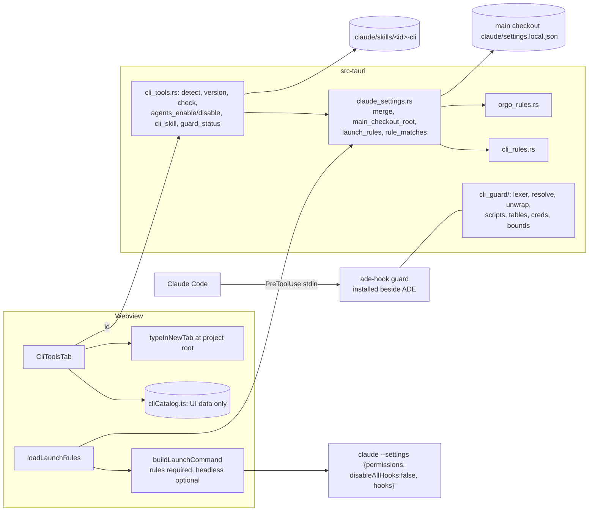
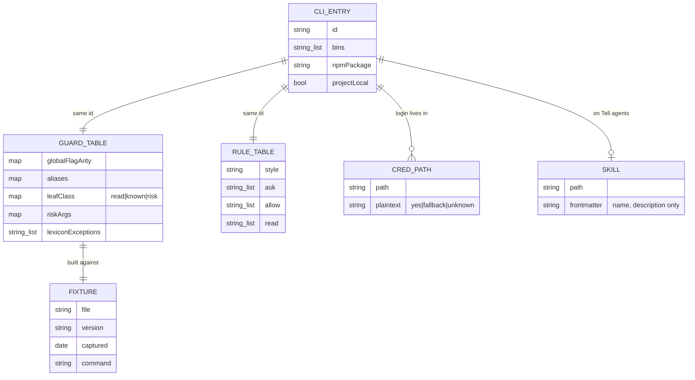

This is v1, narrowed by the owner on 2026-10-29: **gh, stripe, vercel and wrangler** behind a command guard. A PreToolUse hook that ADE ships parses each shell command before Claude Code runs it, with ask rules on top.

The plan is now a security component. Its first two stories are the guard and its launch wiring, for **gh alone**. Everything after them can stop at any story boundary.

| # | Story | Needs | Can be cut? |
|---|---|---|---|
| 1 | The guard engine, for gh (helper subcommand, parser, gh table, fixtures, corpora). Not wired to anything yet. | — | no |
| 2 | The guard on every ADE launch: one `--settings` value carrying the rules, the guard and `disableAllHooks: false`; a headless option; a Claude Code version check | 1, and Q1 (the Orgo AC11 amendment) | no |
| 3 | The CLI tools tab: detect, typed install, sign-in, credential notes | — | the tab could ship with gh alone |
| 4 | Tell agents, for gh: the guard and rules in the main checkout's root `settings.local.json`, and a skill Rust writes | 2, 3 | — |
| 5 | stripe through the guard | 4 | **recommended next cut** |
| 6 | vercel through the guard (every command asks, as the product doc says) | 4 | cuttable |
| 7 | wrangler through the guard | 4 | cuttable |
| 8 | Quarterly fixture re-capture: a named, recurring story (P6(c)) | 1 | no; it recurs |

**Recommended cut** (scope note): build Stories 1 to 4 for gh, use them, and only then decide on 5 to 7. gh is the CLI with a named project, ADE's own repository (P5).

**Dropped from this plan**, and why:
- **MCP additions** (Vercel, Chrome DevTools, Cloudflare, Figma, Atlassian, AWS Knowledge). The product doc rates them "Fits if named", and P5 is unmet until the owner names a project (Q5). Chrome DevTools also fails P2 while it floats `@latest`. The findings for them are recorded under Deferred.
- **Ask rules for the shipped MCP entries.** They belong to the queued shipped-MCP audit (product doc §7, item 10). This plan's Vercel-MCP and GitHub-MCP findings are handed to it under Deferred.

<frozen-after-approval reason="human-owned intent — do not modify unless human renegotiates">

## Intent

**Problem:** agents in ADE use command-line tools as much as MCP servers. ADE doesn't know which CLIs are installed or signed in, can't help install them, and doesn't tell agents how to use them safely. In ADE's Continuous mode, an agent can run `gh secret set`, `gh release delete`, `vercel --prod`, `stripe pay` or `wrangler deploy` without a prompt. Prefix-pattern permission rules alone miss runners, aliases, global flags, `sh -c`, absolute paths and npm scripts.

**Approach (v1: gh, stripe, vercel, wrangler):**
1. A **CLI tools** tab next to the MCP library. It detects each CLI, types its install command for the user, signs in, and tells agents about it.
2. A **command guard**: a small PreToolUse hook that ADE ships. It parses each shell command before Claude Code runs it, and asks before a command that deploys, deletes, spends money, touches keys or prints secrets. Claude Code ask rules sit on top.

## Owner's decisions

1. (2026-10-29) **Scope:** a CLI library plus more MCPs, planned separately from Orgo.
2. (2026-10-29) **CLI groups:** all four groups matter.
3. (2026-10-29) **Narrow v1 plus a stronger check.** v1 is gh, stripe, vercel and wrangler, with a PreToolUse hook that parses each Bash command, and ask rules on top. The other 15 CLIs come later on the same mechanism.
4. (2026-10-29) **The standing stance:** commands that create billable resources, delete things, touch billing or keys, or print secrets ask, even in Continuous mode where possible. Nothing is created without the user's action. No secret is kept in plain text. It covers every MCP server.
5. (2026-10-29) **ADE never runs an installer, or `curl | sh`, on its own.**
6. (2026-10-29, accepted for Orgo, applied here) **The first rules merge may reorder a settings file, keeping every value.** Key-order preservation is its own story.
7. (2026-10-30) **ADR 0012 applies:** this plan carries a Principles check.

</frozen-after-approval>

## Principles check (ADR 0012)

**P1, a job and a change: met.**
- Job: **Check**, through the harness.
- The change: in every Claude Code session ADE launches, an agent command that deletes, deploys, moves money, changes or prints credentials through gh now prompts, or is denied under `-p`. Stories 5 to 7 extend this to stripe, vercel and wrangler, however the command is written.
- Story 4 extends it to sessions the user starts in this repository on this machine.
- For the IDE half: Story 3 removes steps a person takes today to find out whether a CLI is installed and signed in, and where its credential lives.

**P2, nothing risky without the user's action: met for ADE launches through the ask rules; the guard counts in Continuous mode only after V1.**

| Action | How it is gated |
|---|---|
| Risky CLI commands (each CLI's table) | Two layers. Ask rules on the launch flag and in the root `settings.local.json`, for canonical forms; these hold in every mode (C-B3). Plus the guard, for every other form. Per ADR 0012, the guard's `ask` counts in Continuous mode **only after manual check V1** shows it prompts under `bypassPermissions`. The code reading in H6 says it does, and the review round 2 confirmed that reading for 2.1.42 and 2.1.312. Until V1 passes, the guide claims only the ask rules for Continuous mode. |
| `-p` (Orchestrator, now frozen) | The guard **denies**, and ask rules are refused under `-p` anyway. |
| Installing a CLI | Typed into a new tab at the project root; the user presses Enter. ADE never runs it. |
| Reading credentials | `gh auth token`, `gh config get oauth_token`, keychain CLIs and credential files ask (Story 1 AC6, AC7). |
| ADE's own writes (settings merges, skills) | Not counted as installs (ADR 0012). |

**P3, no secrets in plain text: met. ADE holds no CLI secret.**
- Each CLI keeps its own login: gh in the system keyring, falling back to `hosts.yml`; stripe in `~/.config/stripe`; Vercel's data dir; wrangler's keyring or file store. The card says where, and whether it is plaintext, or "unknown" until U3 is checked.
- **Who else can read them:** any process running as the user. That is why reads ask through the guard.
- **Vault tokens that override a login** (`GH_TOKEN`, `VERCEL_TOKEN`, `CLOUDFLARE_API_TOKEN`, `STRIPE_API_KEY` and the rest) are exported into every ADE terminal. That is the known exception for the vault's export. The card names each one present.
- The guard reads `STRIPE_API_KEY` from its environment only to test the `sk_live_`/`rk_live_` prefix. It never prints, logs or stores the value.

**P4, thin where a vendor does the job: met.**
- The CLIs are the vendors'. ADE finds them, types the vendor's install command, and puts rules around them.
- The guard is harness, not a copy of a vendor capability: no vendor offers a permission layer for Claude Code.
- The tab shows status only. There is no ADE UI for any vendor action.

**P5, real work needs it: met for gh; owner's choice for the other three.**
- gh: ADE's own repository, whose work lands as GitHub PRs (product doc §6).
- stripe, vercel and wrangler: the owner's own use, as the owner's choice (product doc §6). If the owner can't name a project that needs one of them now, cut that story (Q4).

**P6, provable and keepable: met.**
- **(a)** Everything ADE writes or decides is pinned by offline tests: the guard's decisions over the corpora, the launch value, the settings merges, the skill text. How Claude Code treats the hook is the named manual matrix V1 to V7. Under ADR 0009, V1, V2 and V5 gate the guide's Continuous-mode claim, not Done.
- **(b)** Each CLI's table is built against a recorded fixture with version and capture date. A test fails when any fixture command is not classified as ask, unprompted, or knowingly unprompted.
- **(c)** Story 8 is the named quarterly re-capture.

## Boundaries & Constraints (all stories)

**Always:**
- **One settings module.** `src-tauri/src/claude_settings.rs` holds the merge, `main_checkout_root`, `launch_rules()` and the test matcher. It is shared with the Orgo plan, whose Story 1 is now built at `a895c05`. This plan extends what that commit created and doesn't recreate it.
- **The webview passes a CLI id, never a rule, a hook command, a path or skill text.** Rust picks them.
- **The guard runs from outside the project.** It is ADE's installed `ade-hook` helper, and every hook entry names it by **absolute path, in shell form**: `"<abs path>" guard`. Older Claude Code drops exec-form `args` (review round 2), and a variable in the path could be overridden by a settings `env` block.
- **The guard never returns `allow`, and never rewrites a command.**
- **It fails closed:**
  - unparseable input that touches a guarded name asks;
  - a command whose name is computed asks;
  - oversized or over-deep input asks;
  - a caught panic asks;
  - a crash or timeout blocks where Claude Code supports `onFailure`.
- ADE merges settings and never deletes a rule. A file that is not a JSON object is refused and left alone. Values are kept and keys may be reordered (decision 6).
- **ADE writes only to the main checkout's root `.claude/settings.local.json`.** It never writes a tracked file (review minor 5).
- Install commands are typed into a **new tab at the project root**, never into the active pane, and are never run.
- **ADE never executes anything inside the project or a `node_modules` folder**, including during sign-in checks (review M9). Versions are probed only on click.
- The verification command is unchanged: `npx tsc --noEmit` · `npm test` · `cd src-tauri && cargo test` · `cd relay && cargo test` · `cd mobile && npx tsc --noEmit && npx jest`. Tests are offline.

**Never:**
- No CLI credential is stored by ADE or put in its vault.
- No change to `CLAUDE.md`, `relay/` or `mobile/`. No new npm or Cargo dependency.
- No Windows support in v1. On Windows, the root `settings.local.json` isn't used, Claude Code may use PowerShell, and ADR 0003 hasn't checked hooks there. The tab says so.

## Coordination with `plan/orgo-agent-computers`

Orgo was approved at `2245693`, and its Story 1 is built at `a895c05`. Its AC11 pins the launch value to exactly `{"permissions":{"ask": rules.ask}}`. This plan needs that value to carry more, and `--settings` takes one value (C-S5). So **the amendment is an owner decision (Q1)**, not something this plan can assume.

**The proposed amendment, as it would read in Orgo's AC11 and in `.ade/context/launch-settings.md`:**
> Every claude and deepseek launch from `buildLaunchCommand` carries exactly one `--settings`. Its value parses to an object with exactly these keys:
> - `permissions.ask`, equal to `rules.ask`, which is Orgo's `MCP_ASK` followed by each guarded CLI's ask rules;
> - `disableAllHooks: false`;
> - when `rules.guard` is set: `hooks.PreToolUse`, equal to exactly one entry, `{"matcher": "Bash|Monitor", "hooks": [{"type": "command", "command": "\"<abs ade-hook>\" guard", "timeout": 5, "onFailure": "block"}]}`, with `guard --headless` when `opts.headless` is true.
>
> `rules` stays required, through `loadLaunchRules()`, which caches only on success and fails closed.

What else changes on Orgo's side:
- `orgo_launch_rules()` becomes `launch_rules()` in `claude_settings.rs`, and `src/lib/orgoRules.ts` becomes `launchRules.ts`.
- `LaunchOptions` gains an optional `headless`, which only the Orchestrator sets (review M5).

**Why `disableAllHooks: false`** (review B2):
- `"disableAllHooks": true` in any user, project or local settings file turns off every non-managed hook, the launch flag's included.
- `--settings` "takes precedence over project and local settings" (hooks.md › Disable or remove hooks), so the flag's own `false` keeps hooks on.
- **The cost:** it also re-enables the user's and the project's other hooks for ADE-launched sessions, where the user had turned them off. The tab and the guide say so (Q1).

**Other shared points:**
- **Orgo 1c**, if its hold is lifted, becomes this library's `orgo` entry, on the guard. Its install form follows the product doc's open Q4: recommend typed. It passes the product doc's CLI rule once `--profile` and `ORGO_PROFILE` ask, which the guard's table can do.
- **ADR numbering:** 0010 is Orgo's, 0011 is this plan's (proposed), and 0012 is the principles ADR.

## Claude Code facts (verified 2026-10-29 and 2026-10-30)

Sources: the docs (`code.claude.com/docs/en/{hooks,permissions,permission-modes,settings,settings-reference,skills,worktrees,tools-reference,cli-reference}.md`); the 2.1.42 bundle (`/opt/node22/lib/node_modules/@anthropic-ai/claude-code/cli.js`); the 2.1.312 binary (`/opt/claude-code/bin/claude`).

**Hooks**
- **H1.** PreToolUse stdin has `tool_name`, `tool_input` (`command` for Bash), `cwd` and `permission_mode` (`default` … `bypassPermissions`).
- **H2.** A decision is exit 0 with one JSON object whose `hookSpecificOutput.permissionDecision` is `allow`, `deny`, `ask` or `defer`, with `permissionDecisionReason`. Exit 2 blocks. Empty stdout means no decision.
- **H3.** "Deny and ask rules are still evaluated regardless of what the hook returns." Among hooks, deny beats defer, which beats ask, which beats allow. **The 2.1.42 nuance** (review round 2): a hook's `ask` there is a forced decision that skips rule evaluation, deny rules included. So in 2.1.42 the guard's `ask` can't be overridden by a deny rule, though it still prompts.
- **H4.** Exit codes other than 0 or 2, a hook that can't start, a timeout or invalid JSON fail open, unless `"onFailure": "block"`, which needs Claude Code ≥ 2.1.295. **2.1.42's hook schema has no `args` and no `onFailure`** (review round 2), hence the shell form and the version check.
- **H5.** Shell form runs `command` through `sh -c` on macOS and Linux.
- **H6.** Under `bypassPermissions`, the docs are silent on a hook's `ask`. The code (2.1.42 `($!==void 0?Promise.resolve($):pX(…))`, 2.1.312 `(vt!==void 0?Promise.resolve(vt):EHe(…))`) prompts in interactive sessions. The headless callback drops it, so the guard denies there. The review confirmed both readings.
- **H7.** Settings-file hooks run inside sub-agents. Entries from every level merge. `allowManagedHooksOnly`, `--safe-mode` and a managed `disableAllHooks` turn ours off.
- **H8.** `disableAllHooks: true` outside managed settings turns off non-managed hooks after precedence. `--settings` takes precedence over project and local settings.
- **H9.** The Monitor tool "uses the same permission rules as Bash" (tools-reference › Monitor tool), so the guard's matcher is `Bash|Monitor`.
- **H10.** Hooks from settings files run before folder trust, in `-p` and with a trusted parent (permissions › What runs before you trust a folder). A tracked or symlinked `settings.local.json` is treated as repository-supplied.

**Settings and skills locations**
- **S1.** Hooks and other `.claude/settings.json` keys load from the cwd only.
- **S2.** `.claude/settings.local.json` loads from the git repository root (≥ 2.1.211; not on Windows, outside git, or at a home-directory root).
- **S3.** In a worktree, the main checkout's `settings.local.json` applies.
- **S4.** Skills load from the cwd up to the repository root. In a worktree, they come from the main checkout only when the worktree has no `.claude/skills` of its own.
- **S5.** `--settings` takes one value. Its permission lists are concatenated with the files' lists (Orgo round 4).
- **S6.** A settings `env` block can set variables for the session and its subprocesses (settings-reference › `env`). So no hook path may depend on a variable.

**Bash rules**
- **B1.** `*` is any text, and a trailing ` *` alone also matches the bare command.
- **B2.** Ask and deny rules apply per subcommand and past assignments. Only a fixed wrapper list is stripped. A rule "isn't a security boundary around the program."
- **B3.** Explicit ask rules prompt in every mode, `bypassPermissions` included.
- **B4.** `Read`/`Edit` *deny* rules also apply to the Bash file commands Claude Code recognises.

## The command guard

**The binary.** `ade-hook guard`, a subcommand of the existing helper crate (`src-tauri/ade-hook`, workspace member at `src-tauri/Cargo.toml:18`), installed beside ADE's executable (ADR 0003).
- The logic lives in `src-tauri/src/cli_guard/`, which the main crate compiles, so `cargo test` covers it.
- The core is pure: `classify(command, &Ctx) -> Verdict`. `Ctx` injects the cwd, env lookups and bounded file reads.
- It doesn't use the network, writes nothing and keeps no state.
- **A belt for older Claude Code** (review B3): when bare `ade-hook` (the status forwarder) receives a `PreToolUse` event, it runs the guard. ADE's own status hooks never register PreToolUse, so this changes nothing for them. And if a version drops `guard` from the command line, the guard still runs.

**The hook entries.** Both use shell form with an absolute path:
- **On every ADE launch** (Story 2), inside the one `--settings` value, as in the amendment.
- **In the main checkout's root `.claude/settings.local.json`** (Story 4):
  - `{"matcher": "Bash|Monitor", "hooks": [{"type": "command", "command": "\"<abs ade-hook>\" guard", "timeout": 5, "onFailure": "block"}]}`;
  - written only after checking that the path exists;
  - recognised later by its `guard` argument and the helper's file name.
  - If ADE moves (its path changes), the tab shows "Repair guard", which rewrites the path. Until then, on Claude Code ≥ 2.1.295, every Bash call there blocks (fail closed). On older versions the call goes through.
- **Both entries can run for one call.** They make the same decision, and two `ask`s are one prompt (review minor 9).

**What it decides:**
- **Risky:** `ask`, with a reason such as "ADE: gh repo delete deletes a repository".
- **Headless:** `deny`, with the same reason plus "ask the user". Headless is detected two ways (review M5):
  - the `--headless` argument, which only Orchestrator launches pass;
  - `CLAUDE_CODE_ENTRYPOINT` in `sdk-cli`, `sdk-ts` or `sdk-py` (2.1.42 sets `sdk-cli` for `-p`). A `claude` nested inside a session inherits `cli`, which is a stated limit.
- **Read, or not a guarded CLI:** no output.
- **Fail-closed cases, all `ask`:**
  - input over 256 KB;
  - nesting deeper than 64 (subshells, substitutions, `-c` strings, scripts);
  - a parse failure on text that mentions a guarded name;
  - a computed command name;
  - a caught panic.

  The lexer is iterative, with an explicit depth counter, so deep input can't overflow the stack (review M11).

**Parsing.**
1. **The lexer** handles:
   - quotes, `$'…'` with `\x`/`\u`/octal decoded, backslashes and `\`-newline;
   - quote concatenation (`g""h` → `gh`);
   - operators `&&`, `||`, `;`, `|`, `|&`, `&` and newline;
   - `( )` and `{ ; }`;
   - `$( )`, backticks and `<( )` / `>( )`;
   - redirections, herestrings (`<<<`) and here-docs;
   - in command position: control words and modifiers (`!`, `if`, `then`, `elif`, `else`, `for … in`, `select`, `while`, `until`, `do`, `case`, `coproc`, `time`);
   - **function definitions**: `f() { … }` and `function f { … }` bodies are classified as if run, and so are their call sites (review B5).
2. **Command-name resolution**:
   - A literal name, after quote removal and escape decoding, is classified.
   - A name holding unquoted `{…,…}`, `$`, `` ` ``, glob characters or `{}` (xargs `-I`) is **computed**. It is first resolved against brace expansion and literal assignments earlier on the same line (`x=g; ${x}h` → `gh`). If it still can't be resolved, it asks (Q3).
3. **Unwrapping**, repeated, both documented and fallback:
   - **Assignments**, including `export STRIPE_API_KEY=…` earlier on the line, which is tracked.
   - **Wrappers:** `env` (`-i`, `-u`, `-C`, `-S` re-parsed), `sudo`, `su -c`, `command`, `builtin`, `exec`, `nohup`, `time`, `nice`, `timeout`, `stdbuf`, `xargs` (with `-I` the command is computed), `watch`, `parallel`, `flock`, `setsid`, `script -c`, `caffeinate`, `arch`, `tmux new-session|send-keys|run-shell`, `screen`, and `ssh host CMD` (remote, still classified).
   - **`find … -exec|-execdir|-ok|-okdir CMD … ;|+`.**
   - **`git -c alias.X='!…'` and `git config alias.X '!…'`:** the shell text is re-parsed.
   - **Shells:** `sh`, `bash`, `zsh`, `dash`, `fish` with `-c STR` (also `-lc` and the like) re-parse `STR`. Fed from stdin by a literal pipeline (`echo|printf "…" | bash`), a herestring (`bash <<< "…"`) or a here-doc, the text is parsed. Fed from a script (`bash x.sh`, `sh < x.sh`, `source`/`.`), the file is read if it exists (bounded) and parsed. A shell fed by anything else (`curl … | sh`, `cat x | bash` of an unknown file) asks.
   - **`eval`:** its arguments are joined and re-parsed.
   - **Runners:**
     - `npx` (`-y`/`--yes`/`--no`/`-p`/`--package`, and `PKG@version`), plus `npx -c '…'`;
     - `npm exec|x` (plus `-c '…'`);
     - `pnpm exec|dlx`, `yarn exec|dlx`, `bunx`, `bun x`;
     - `pnpm X` and `yarn X` when `X` is a guarded bin.
   - **Scripts** (review M2): `npm run|run-script|start|test|restart`, `pnpm [run]`, `yarn [run]` and `bun run`.
     - Each also runs `pre<name>` and `post<name>`.
     - Arguments after `--` are appended.
     - Workspace selectors resolve to the selected packages' `package.json`: `npm -w/--workspace/--workspaces/--prefix`, `pnpm --filter/-F/-r/--recursive/-C/--dir`, `yarn workspace X`, `yarn workspaces foreach`. Workspaces come from `package.json` `workspaces` and `pnpm-workspace.yaml`, up to 200 packages.
     - Task runners `turbo run`, `nx run|run-many|affected` and `lerna run` classify the named script in every workspace package that defines it.
     - `npm install|ci|i`, `pnpm install|i`, `yarn` and `yarn install` classify the root package's `preinstall`, `install`, `postinstall` and `prepare` scripts.
     - Script bodies are re-parsed at most 4 levels deep. A missing `package.json`, or one that can't be read, gives no decision unless the text names a guarded bin.
   - **Paths:** an absolute or relative path gives its basename. `node …/node_modules/<pkg>/…` gives that package's bin.
   - **Bin aliases:** `vc`, `wrangler2`, `cf-wrangler`, and `@stripe/cli` → `stripe`.
   - **Fallback** (review B5): any word sequence, including re-lexed quoted strings, in which a guarded bin is followed by the words of one of its risky leaves asks. This catches wrappers the list doesn't know, at the cost of asking for an `echo` or commit message that quotes such a command (Q3).
4. **Classifying** by the CLI's table:
   - global flags and their arity, so the subcommand is found with flags before or after it;
   - subcommand aliases, gh's built-in alias `co`, and **user aliases read from gh's `config.yml`** (a `!` shell alias asks);
   - pflag combined shorts (`-at` → `-a -t`);
   - leaves classed read, known (a non-risky write) or risk, with risky flags and arguments.

   **A leaf the table doesn't know asks.**
5. **Credentials** (review M3). Each of these asks:
   - A word, redirect target or glob that, after `~`/`$HOME` expansion and tracking of an earlier `cd`, names a guarded CLI's credential file, or matches one as a glob (`~/.config/gh/h*`).
   - A credential file's folder or a parent of it, used by a copying, archiving or recursive reader: `cp -r`, `rsync`, `scp`, `tar`, `zip`, `7z`, `grep -r`, `find`.
   - `find <cred dir> -exec …`.
   - **Keychain CLIs:** `security find-generic-password`, `find-internet-password`, `dump-keychain` and `export`, and `secret-tool lookup|search`. gh keeps its token in the keyring by default (service `gh:github.com`).

**What the guard still can't see, stated in the guide and pinned in the corpora as escapes:**
- the user's shell aliases and functions defined outside the command text;
- what a program the agent runs does (`node deploy.js` calling an API; a Makefile target; a dependency's install script);
- a computed name the guard resolves to something it doesn't guard;
- runners outside the list (`deno run npm:vercel`, `mise exec`, `devbox run`);
- a `claude` nested inside a session (it inherits `cli`, so the guard asks rather than denies);
- sessions under `allowManagedHooksOnly`, `--safe-mode` or a managed `disableAllHooks`;
- sessions where another settings file sets `disableAllHooks: true`, outside ADE launches. The tab checks the files it can see and warns;
- Codex and other agents that are not Claude Code;
- Claude Code sessions started outside this repository.

**Fixtures** (in `src-tauri/src/cli_guard/testdata/`, each with its version, capture date and capture command at the top):
- **gh:** `GH_CONFIG_DIR=$(mktemp -d) gh help reference` (gh 2.89.0: 215 command headings, captured while planning), the built-in alias list (`co: pr checkout`), and the group aliases from the manual (`cs`; `ext`/`extensions`; `agent`/`agents`/`agent-tasks`).
- **stripe:** `stripe --map json` (`pkg/cmd/root.go:350`), plus the hidden `daemon` and `plugin` commands, from their sources.
- **vercel:** a **tree**, not a flat list (review M10). It holds the `name`, `aliases` and `subcommands` structure parsed from the `vercel@65.7.0` bundle, cross-checked against `vercel <command> --help` for the top level. Bins are `vc` and `vercel`.
- **wrangler:** the 479 command strings of `wrangler@4.155.0` (`wrangler-dist/cli.js`), as a tree. Bins are `wrangler`, `wrangler2` and `cf-wrangler`.

**Tests per CLI:**
- **Coverage:** every fixture leaf is classified explicitly (P6(b)).
- **Generated corpora:** for each leaf, the canonical form and every variant:
  - a global flag before and after;
  - `env`, `sh -c`, `bash -c`, `echo … | bash`, `bash <<<`, a here-doc;
  - an absolute path, `cd x &&`, `$( )`, backticks, `!`;
  - a function wrapper, `find -exec`, `xargs`, `parallel`, `git -c alias`, an unknown-wrapper fallback;
  - for npm-distributed CLIs, every runner, an npm script, a pre-script, a workspace selector and `turbo run`.

  Risky leaves must ask in every variant, and reads must give no decision.
- **Hand corpora** of tricky cases, and **pinned escapes**.
- **Lexicon** (review M1): any leaf whose words include `rm`, `delete`, `remove`, `set`, `add`, `insert`, `upsert`, `put`, `terminate`, `send`, `run`, `ssh`, `curl`, `unlock`, `deploy`, `create`, `token` or `secret` must be risk, or carry a written exception in the table with its reason.

## Ask, allow and Read rules on top

**Ask rules** (`cli_rules.rs`, compact canonical forms) are the documented floor, B3:
- prefix style (gh, stripe): `Bash(b G V *)`;
- verb style (wrangler): `Bash(b V)`, `Bash(b V *)`, `Bash(b * V)`, `Bash(b * V *)`;
- vercel: `Bash(vercel)`, `Bash(vercel *)`, `Bash(vc)` and `Bash(vc *)`. Under the guard, `vercel --version` and `help` are exempt; the ask rules still prompt for them. That is the product doc's "every vercel command asks" (review minor 7).

**`Read(…)` rules** for credential files are ask rules. **Allow rules** for reads go only to the root `settings.local.json`, with no wildcard before the subcommand and never for a leaf with a secret-printing flag.

**About 4 KB** of launch JSON in total, Orgo's rules included (U5).

## The four CLIs

| id | Bins | Install (typed into a new tab) | Sign in · status (on click) | Credential | Override env tokens | Source |
|---|---|---|---|---|---|---|
| gh | gh | macOS `brew install gh`; Windows `winget install --id GitHub.cli --source winget`; Linux: apt guide link | `gh auth login` · `gh auth status` | system keyring, else plain text `~/.config/gh/hosts.yml` | `GH_TOKEN`, `GITHUB_TOKEN`, `GH_ENTERPRISE_TOKEN`, `GITHUB_ENTERPRISE_TOKEN` | cli/cli `docs/install_*.md`; manual `gh_auth_login`, `gh_help_environment` |
| stripe | stripe | `npm install -g @stripe/cli`; macOS `brew install stripe` | `stripe login` · `stripe login list` | `~/.config/stripe/` (plaintext: U3) | `STRIPE_API_KEY` | docs.stripe.com/stripe-cli/use-cli.md; stripe/stripe-cli README |
| vercel | vercel, vc | `npm i -g vercel` | `vercel login` · `vercel whoami` | Vercel's `com.vercel.cli` data dir (U3) | `VERCEL_TOKEN` | vercel.com/docs/cli; `vercel@65.7.0` |
| wrangler | wrangler, wrangler2, cf-wrangler (project-local) | `npm i -D wrangler@latest` | `npx wrangler login` · **no check ADE runs** (M9). **Check sign-in** types `npx wrangler whoami` into a new tab. | keyring or encrypted file store (U3) | `CLOUDFLARE_API_TOKEN`, `CLOUDFLARE_API_KEY` + `CLOUDFLARE_EMAIL`, `CF_API_TOKEN`, `CF_API_KEY` | developers.cloudflare.com/workers/wrangler/{install-and-update,system-environment-variables}; `wrangler@4.155.0` |

**gh** (Stories 1 and 4)
- **Risk:**
  - repo create, delete, edit, rename, archive, sync and deploy-key; repo autolink create and delete;
  - pr merge; pr close `-d`/`--delete-branch`;
  - release create, edit, upload, delete and delete-asset;
  - secret *; variable set and delete; cache delete;
  - workflow run, enable and disable; run cancel, delete and rerun;
  - issue delete and transfer; label delete; gist create, edit and delete;
  - project delete, close, item-delete and field-delete;
  - codespace/cs (all but list and view); extension/ext install, upgrade, remove, exec and create, plus any extension command; agent-task/agent/agents create; skill install;
  - auth token, login, logout, refresh, switch and setup-git; **auth status with `-t`/`--show-token`, combined shorts included**;
  - **config get and list, unless the key is one of** `git_protocol`, `editor`, `prompt`, `prefer_editor_prompt`, `pager`, `http_unix_socket`, `browser`, `color_labels`, `accessible_colors`, `accessible_prompter` or `spinner`. **`gh config get oauth_token` asks** (review B4, verified with gh 2.89.0);
  - config set; alias set, import and delete; ssh-key *; gpg-key *;
  - **api** unless it is a provable read: GET, with no `-f`/`-F`/`--field`/`--raw-field`/`--input`, no graphql `mutation`, no graphql from a file, and **no path containing `secret-scanning`** (review minor 8). A graphql query naming `secretScanning` asks too.
- **Read:** pr view, list, diff, checks and status; issue view, list and status; run view, list and watch; workflow list and view; repo view; release list and view; search; status; auth status; label list; cache list; variable list and get; secret list; project list, view, item-list and field-list; ruleset list and view; alias list; version and help.
- **Known:** pr create, comment, edit, checkout and review; issue create, comment and edit; repo clone; browse.

**stripe** (Story 5)
- **Risk:**
  - pay, post, delete, projects (all but list, status, catalog, search and spend), provision, config, login (all but `login list`), logout, reauth, switch, sandbox, agent, tools, fixtures, events resend, daemon, plugin, listen;
  - any resource operation other than list, retrieve and search;
  - **live mode:** `--live`; `--api-key` with a live prefix; **a non-literal `--api-key "$K"`**; **`--config f`** and `-p/--project-name`, which pick another credential; and `STRIPE_API_KEY` that is live in the environment or **set by an earlier `export` on the same line**. In live mode, every command except help and version asks (review minor 3).
- **Read:** logs tail, docs, login list, version and help; resource list, retrieve and search, when not live.
- **Known:** trigger, open, completion, feedback.

**vercel** (Story 6)
- Every command asks, except `--version`, `-v`, `help` and `--help`, as the product doc's §6 says.
- The tree fixture still drives the coverage test, so a new command is named at re-capture.

**wrangler** (Story 7)
- **Risk:** the lexicon verbs, with **every leaf in the review's 25-leaf list** classified risk. Examples: flagship rm, set, rollout and split; r2 bucket cors, lifecycle and lock set; r2 domain add; vectorize insert, upsert and delete-*; workflows terminate, pause, restart and send-event; queues consumer add and pause-delivery; email send-raw; tunnel run and quick-start; containers and cloudchamber ssh and curl.
- **Conditional:** `d1 execute --remote`, and `dev` with `--remote` or with remote bindings.
  - The config is found the way wrangler finds it (review minor 4): `-c/--config`, else the nearest `wrangler.{json,jsonc,toml}` searching parent folders up to the repository root.
  - `--env X` selects that environment's bindings.
  - An unreadable config asks.
- **Read:** whoami, tail, list/get/info/logs/schema/stats leaves, types, `d1 execute` without `--remote`, help.
- **Known:** dev (local), build, check, complete, docs.

## Architecture





```mermaid
sequenceDiagram
  participant A as Agent (Continuous, ADE launch)
  participant CC as Claude Code
  participant H as ade-hook guard
  participant U as User
  A->>CC: Bash "f() { gh \"$@\"; }; f repo delete o/r --yes"
  CC->>H: stdin {command, cwd, permission_mode: bypassPermissions}
  H->>H: bounds ok → lex → function f body classified at call site
  H->>H: gh table: repo delete = risk
  H-->>CC: exit 0 {permissionDecision: ask, reason: "ADE: gh repo delete deletes a repository"}
  CC->>U: prompt [settings] "ADE: …"
  U-->>CC: No
  CC-->>A: denied with reason
```

## Failure modes

| Failure | Handling |
|---|---|
| Helper missing (dev build) | `launch_rules().guard = null`: ask rules only. The tab says "Command guard unavailable in this build". |
| Claude Code < 2.1.295 | Shell form still runs the guard, but a crash or timeout fails open. `guard_status` reads `claude --version`, from the resolved `claude` outside the project, once per app session. The tab shows "Guard runs; fails open on a crash (Claude Code 2.1.x)". |
| Claude Code without the `--settings` hooks merge (V5 fails) | The guide claims only the file hook for user-started sessions, and ask rules for ADE launches. |
| `disableAllHooks: true` in a file the tab can see | Warned on the tab. ADE launches are unaffected (flag `false`). User-started sessions lose the file guard. |
| ADE moved (path changed) | "Repair guard". Until then, Bash blocks on ≥ 2.1.295 and passes on older versions. |
| Input too large or too deep | ask |
| Settings file not a JSON object | Refused; nothing written. |
| A repo hook returns `defer` | Precedence would put `defer` over our `ask`. `defer` needs `-p`, where the guard denies, and deny beats defer. Interactive behaviour is V7. |
| Windows | No guard; the tab explains. |

## Proposed ADR 0011 (written on approval)

`0011-cli-library-guarded-by-a-command-hook.md`.
- **Context:** prefix rules can't hold, and settings files and skills load from different places.
- **Decision:**
  - A PreToolUse guard ships in ADE's helper. It is run by absolute path in shell form, from outside the project.
  - It classifies each library CLI against a fixture-backed table. It never allows, asks on risk and on the unknown, denies when headless, and fails closed.
  - It is carried on every ADE launch in the one shared `--settings` value with `disableAllHooks: false`, and in the main checkout's root `settings.local.json`.
  - Ask and Read rules sit on top.
  - Skills are rendered in Rust.
  - Installs are typed into a new tab.
  - ADE never executes project code.
- **Consequences:**
  - Each new CLI is a fixture, a table, rules, corpora and a re-capture line in Story 8.
  - The guard is a parser that must keep up, but unknown leaves and computed names ask.

**Context files:**
- `.ade/context/launch-settings.md`, shared with Orgo once Q1 is approved;
- `.ade/context/cli-guard.md`: the decision JSON, headless rules, bounds, the table format, fixture versions and the limits.

---

# Story 1: the guard engine, for gh

## Code Map (1)

- `src-tauri/ade-hook/src/main.rs`, which runs `hook_forward::main()` today.
- `src-tauri/src/hook_forward.rs`, the precedent for a module the main crate compiles.
- `src-tauri/Cargo.toml:18`.
- New: `src-tauri/src/cli_guard/{mod,lexer,resolve,unwrap,scripts,tables,creds,bounds}.rs` and its testdata.

## Design Notes (1)

- The guard as specified above, with gh's table, fixture and credential paths.
- `run(stdin, stdout, env, ctx)` is what the binary calls; tests call it too.
- `ade-hook guard` takes `--headless`.
- The forwarder's PreToolUse belt is part of this story.

## Acceptance Criteria (1)

1. **Lexer and resolution.** Each of the following is parsed, and the gh command found (resolved) or flagged computed. Unclosed quotes, `$(` and here-docs are parse failures. Covered by `cli_guard/lexer.rs` › `lexes_the_shapes_agents_write`. The shapes:
   - operators;
   - `( )`, `{ ; }`;
   - `$( )`, backticks, `<( )`;
   - `$'\x67\x68' repo view` → gh;
   - `g""h` → gh;
   - `{gh,} repo view` → gh;
   - `x=g; ${x}h repo view` → gh;
   - `printf gh | xargs -I{} {} repo view` → computed;
   - `\`-newline;
   - `bash <<'EOF' … EOF`;
   - `cat <<EOF > f` (body not a command);
   - `for`, `until`, `select`, `if`/`elif`/`else`, `! gh`, `coproc gh`, `time gh`;
   - `f() { gh "$@"; }; f …` and `function f { … }`.
2. **Unwrapping** reaches gh through each of these, and through three nested at once. Covered by `cli_guard/unwrap.rs` › `unwraps_every_documented_form`. The forms:
   - assignments, `export X=1;`;
   - `env` (`-i`, `-u`, `-S`), `sudo`, `su -c`, `command`, `exec`, `nohup`, `nice`, `timeout`, `stdbuf`, `xargs`, `watch`, `parallel`, `flock`, `setsid`, `script -c`, `caffeinate`, `arch`;
   - `tmux send-keys`, `screen`, `ssh host`;
   - `find -exec`, `-execdir`, `-ok`;
   - `git -c alias.x='!gh …' x`;
   - `sh -c`, `bash -lc`, `echo "gh …" | bash`, `printf … | sh`, `bash <<< "gh …"`;
   - `bash x.sh` and `source x.sh`, with `x.sh` in a fake fs;
   - `eval`;
   - absolute and relative paths.
3. **Coverage:** every leaf in `gh-2.89.0-reference.md` is classified explicitly, and the lexicon test passes or names its written exceptions. Covered by `cli_guard/tables.rs` › `gh_table_covers_the_reference`, `gh_lexicon`.
4. **Generated corpora:** every gh risky leaf asks in every variant of the variant set, and every read leaf gives no decision. Covered by `cli_guard` › `gh_corpus`.
5. **Hand corpus.** These ask:
   - `gh release delete-asset v1 a.zip`, `gh pr close 3 -d`, `gh project item-delete 1 --id x`, `gh agent create x`, `gh cs create`, `gh ext install o/r`;
   - `gh auth status -at`, `gh auth status --show-token`, **`gh config get oauth_token -h github.com`**, `gh config list`;
   - `gh api -X DELETE repos/o/r`, `gh api repos/o/r/issues -f t=x`, `gh api graphql -f query='mutation{…}'`, `gh api graphql --input q.graphql`, **`gh api repos/o/r/secret-scanning/alerts`**;
   - `gh myext`, a user alias `rmr: repo delete` from a fake `config.yml`, a `!` alias;
   - `tmux send-keys 'gh repo delete o/r' Enter` (the fallback);
   - `"$GH" repo view` (computed).

   These give no decision: `gh api repos/o/r`, `gh api graphql -f query='query{viewer{login}}'`, `gh auth status`, `gh config get editor`, `gh co 12`, `gh --version`, `gh pr list --search "delete button"`.

   Covered by `cli_guard` › `gh_hand_corpus`.
6. **Credentials.** These ask:
   - `cat ~/.config/gh/hosts.yml`, `cat $HOME/.config/gh/h*`, `cd ~/.config/gh && cat hosts.yml`;
   - `cp -r ~/.config/gh /tmp/x`, `tar czf x.tgz ~/.config`, `zip -r x ~/.config/gh`, `find ~/.config/gh -exec cat {} \;`, `base64 < ~/.config/gh/hosts.yml`;
   - `security find-generic-password -s gh:github.com -w`, `secret-tool lookup service gh:github.com`.

   `cat ~/.config/gh/config.yml` and `ls ~/.config` give no decision. Covered by `cli_guard/creds.rs` › `credential_reads_ask`.
7. **Fail closed and bounded:**
   - a 1 MB command and a 10,000-deep `$(…)` both ask, without a stack overflow (run in a thread with a 256 KB stack);
   - `gh repo delete "unterminated` asks;
   - `echo "unterminated` gives no decision;
   - an injected panic prints `ask` and exits 0;
   - across all corpora the guard never prints `allow` or `updatedInput`.

   Covered by `cli_guard/bounds.rs` › `bounded_and_fail_closed`.
8. **Headless:**
   - with `--headless`, or with `CLAUDE_CODE_ENTRYPOINT` in `sdk-cli`, `sdk-ts` or `sdk-py`, every `ask` becomes `deny` with the same reason;
   - with `cli` or unset, it stays `ask`.

   Covered by `cli_guard` › `headless_denies`.
9. **Helper contract.** Covered by `cli_guard` › `helper_contract`. For the docs' PreToolUse stdin example with its command replaced:
   - `run` prints exactly one H2-shaped object for a risky command, and nothing for `npm test`;
   - it prints nothing for a non-Bash, non-Monitor `tool_name`;
   - for `tool_name: "Monitor"` with a `command` field, it classifies it like Bash;
   - it prints `ask` for malformed stdin;
   - it always exits 0;
   - the bare forwarder entry point, given a PreToolUse event, produces the same output as `guard`.
10. **Speed:** `classify` on the 200 longest corpus commands is under 50 ms each in a debug build. Covered by `cli_guard` › `classify_is_fast`.
11. **Pinned escapes:** `deno run npm:x`, `mise exec -- gh repo delete o/r` (the fallback catches this one: it asks), `node deploy.js`, and a shell alias `g` used as `g repo delete` each behave as the guide states. Covered by `cli_guard` › `documented_escapes`.

## Verification (1)

The five commands, unchanged.

**Manual:** run the release helper by hand on the reviewer's probe script (`ghforms.sh`): every line asks.

## Slice (1)

`src-tauri/ade-hook/src/main.rs`; `src-tauri/src/cli_guard/**`; `lib.rs` (the module only); `.ade/context/cli-guard.md`.

---

# Story 2: the guard on every ADE launch

Depends on Story 1, and on the owner's answer to Q1.

## Code Map (2)

- `src-tauri/src/claude_settings.rs` and `orgo_rules.rs`, as built at `a895c05`.
- `src/lib/orgoRules.ts` → `launchRules.ts`.
- `src/lib/agentCommand.ts`: `claudeCommand` (:49-53), `buildLaunchCommand` (:68).
- `src/lib/agentLaunch.ts:21,42`.
- `src/components/OrchestratorTab.tsx:292`, with the `-p` added about 20 lines below.
- `src-tauri/src/pty.rs:168`.
- New: `src-tauri/src/cli_rules.rs`.

## Design Notes (2)

- **`launch_rules()`** returns `{ ask, continuousDeny, guard }`:
  - `ask` is Orgo's `MCP_ASK` followed by the gh ask rules;
  - `guard` is `{ command: "\"<abs>\" guard" }` when the helper exists beside `current_exe()`, else `null`.
- **`claudeCommand`** writes the amended value, with `disableAllHooks: false`.
- **`LaunchOptions.headless?: boolean`**: only `OrchestratorTab` sets it, and it produces `guard --headless`.
- **`guard_status()`** returns:
  - `{ helper: bool, claudeVersion, onFailureSupported: version ≥ 2.1.295, disableAllHooksFiles: [paths] }`;
  - `claudeVersion` from `claude --version`, resolved outside the project, once per app session;
  - `disableAllHooksFiles`: settings files in the project, the repository root and the user's home that set `disableAllHooks: true`.

## Acceptance Criteria (2)

1. **The amended AC11.** Covered by `src/lib/__tests__/agentCommand.test.ts` › "every Claude Code launch carries the rules, the guard and disableAllHooks:false". `buildLaunchCommand(provider, rolePath, { rules })` for claude and deepseek carries exactly one `--settings`, whose value parses to an object with:
   - `permissions.ask` equal to `rules.ask`;
   - `disableAllHooks: false`;
   - and, when `rules.guard` is set, `hooks.PreToolUse` equal to exactly the specified entry;
   - no other keys.

   `headless: true` gives `guard --headless`. Codex is unchanged. A call without `rules` is a `@ts-expect-error`.
2. The picker, `dispatchAgent` and the Orchestrator each type a command carrying the guard. Only the Orchestrator's has `--headless`. When `loadLaunchRules` rejects, nothing is typed. Covered by `agentLaunch.test.ts`, `OrchestratorTab.test.tsx`.
3. `launch_rules()` includes every gh ask rule. Every gh ask rule matches the canonical form of some gh risky leaf under `rule_matches`, and none matches a read leaf. `rule_matches` reproduces the docs' wildcard table. Covered by `claude_settings.rs` › `launch_rules_compose`, `cli_rules.rs` › `gh_rules_cover_canonical_risks`.
4. With no helper beside the executable, `guard` is `null`, and the launch value has `permissions` and `disableAllHooks` but no `hooks`. Covered by `claude_settings.rs` › `no_helper_no_hook`.
5. **`guard_status`:**
   - parses `2.1.312 (Claude Code)` and `2.1.42 (Claude Code)`, setting `onFailureSupported` true and false;
   - refuses a `claude` resolved inside the project;
   - lists a fake `.claude/settings.json` holding `disableAllHooks: true`.

   Covered by `cli_tools.rs` › `guard_status_reports_version_and_disabling_files`.
6. **The launch value fits on a shell line:** the composed value (Orgo plus gh) shell-quotes to a single line under 8 KB, with no newline. Covered by `agentCommand.test.ts` › "launch value stays a single bounded line".
7. **The context file** `.ade/context/launch-settings.md` holds the amendment text, and Orgo's `orgo-permission-rules.md` links it. This is a DoD item.

## Verification (2)

The five commands, unchanged.

**Manual matrix (owner, release helper):**
- **V1 (P2 gate):** Continuous launch from the picker, on 2.1.312. `gh repo delete o/scratch` and `bash -c 'gh repo delete o/scratch'` prompt with the ADE reason. Repeat on the oldest Claude Code ADE supports.
- **V2:** Manual and auto mode: both prompt.
- **V3:** an Orchestrator dispatch asked to delete a repository is refused with the reason.
- **V4:** with `{"disableAllHooks": true}` in the project's `.claude/settings.json`, an ADE launch still prompts.
- **V5 (P2 gate):** a project with its own PreToolUse hook: both hooks run.
- **V6:** the launch line types in zsh, bash and fish.
- **V7:** a project hook returning `defer` in an interactive session: our `ask` still prompts.

V1 and V5 gate the guide's Continuous-mode claim (ADR 0012 P2).

## Slice (2)

`claude_settings.rs` (`launch_rules`); `cli_rules.rs`; `agentCommand.ts`, `agentLaunch.ts`, `launchRules.ts`, `OrchestratorTab.tsx` and their tests; `cli_tools.rs` (`guard_status`); `lib.rs`; the context file; the guide's "Command guard" section, written without the Continuous claim until V1 and V5 pass.

---

# Story 3: the CLI tools tab

## Design Notes (3)

- **The catalog** (`src/data/cliCatalog.ts`) is UI data only: the table above.
- **`cli_detect(project, ids)`** never executes anything:
  - project-local entries read `node_modules/<pkg>/package.json`;
  - other entries use `find_command`, refusing a path inside the project or a `node_modules` folder.
- **`cli_version(id)`** and **`cli_check(id)`** run on click only, for gh, stripe and vercel, with fixed argv from Rust, stdin null and a timeout.
- **wrangler** has no ADE-run check. Its **Check sign-in** types `npx wrangler whoami` into a new tab (M9).
- **Install:** `typeInNewTab("Install <Name>", projectRoot, command)`, with no `\r`.
- **Sign in:** `runInNewTab` on click.
- **Card notes:** where the credential lives, and whether it's plaintext; env tokens present in the vault; the guard's status (`guard_status`); Windows.

## Acceptance Criteria (3)

1. Catalog ids are exactly gh, stripe, vercel and wrangler; install commands are single-line; guides are `https`; each entry has an option per OS. Covered by `cliCatalog.test.ts`.
2. With planted `node_modules/.bin/gh`, `node_modules/.bin/wrangler` and `bin/gh` (search folders pointed at the project), detection, `cli_version("gh")` and `cli_check("gh")` start **no process**, recorded by the spawn seam, and report "found in the project; not run". wrangler's version is read from its `package.json`. Covered by `cli_tools.rs` › `never_executes_project_code`.
3. `CHECKS` is exactly `gh auth status`, `stripe login list` and `vercel whoami`. `cli_check("wrangler")` errors. Each probe takes an id only, has a timeout, and gets null stdin. Covered by `cli_tools.rs` › `probes_are_fixed_and_on_click`.
4. Nothing runs on mount, and the click handlers send `{ id }` only. Covered by `CliToolsTab.test.tsx` › "nothing runs until you click".
5. Installs and wrangler's check open a new tab at the project root and type without `\r`. The active pane receives nothing. Covered by `CliToolsTab.test.tsx` › "typed into a new tab, never run, never into the active pane".
6. Every env token present in the vault is named on its card. Covered by `CliToolsTab.test.tsx` › "vault overrides are named".
7. Credential notes, and guard notes (no helper; fails open on Claude Code below 2.1.295; files that set `disableAllHooks`), render from mocked `guard_status`. Covered by `CliToolsTab.test.tsx` › "cards say where the credential lives and how the guard stands".
8. Windows shows its note and no **Tell agents**. Covered by `CliToolsTab.test.tsx`.
9. The guide's `## CLI tools` table names exactly the catalog's CLIs. Covered by `scripts/cliCatalogDocs.test.ts`.

## Verification (3)

The five commands, unchanged.

**Manual:** detection from the Dock; wrangler's version shown with nothing run.

---

# Story 4: Tell agents, for gh

Depends on Stories 2 and 3.

## Design Notes (4)

**`cli_agents_enable(project, id)`**, in order:
1. `root = main_checkout_root(project)`.
2. Validate `<root>/.claude/settings.local.json`. If it is tracked in git or a symlink, refuse: Claude Code would treat it as repository-supplied (H10).
3. Check that the helper path exists.
4. Merge into that file:
   - the gh ask, allow and `Read` rules;
   - the guard entry, once (absolute path, shell form, `Bash|Monitor`).
5. Write `<project>/.claude/skills/gh-cli/SKILL.md` from Rust's `cli_skill("gh")`, only if it is missing.

It never writes `.claude/settings.json`.

**`cli_agents_disable`** removes an unedited skill only. Rules and the hook stay.

**`cli_guard_repair(project)`** rewrites the guard entry's path when the helper has moved. It recognises ADE's entry by `guard` and the helper's file name.

**The notice and the skill** claim protection only for "Claude Code sessions started in this repository on this machine, with ADE installed". The guard runs from the absolute path, in any terminal (M4).

## Acceptance Criteria (4)

1. In a temp main checkout with a linked worktree, `cli_agents_enable(<worktree>/app, "gh")`:
   - writes the rules and the guard entry to the **main checkout's** root `.claude/settings.local.json`;
   - writes the skill under `<worktree>/app/.claude/skills/gh-cli/`;
   - leaves every tracked file byte-identical, `settings.json` included.

   Covered by `cli_tools.rs` › `writes_only_untracked_local_settings_and_the_skill`.
2. **The guard entry:**
   - is written once, with the helper's absolute path in shell form;
   - is not written when the path doesn't exist (an error);
   - keeps ADE's agent-status hooks and user hooks.

   `cli_guard_repair` updates only ADE's entry. Covered by `cli_tools.rs` › `guard_entry_is_absolute_once_and_repairable`.
3. A tracked or symlinked `settings.local.json` is refused, and nothing is written. Covered by `cli_tools.rs` › `refuses_a_repository_supplied_local_file`.
4. **Merge:** values survive (semantic equality, decision 6), rule arrays append once, and a second call is byte-identical. A file that is not a JSON object is refused with nothing written. Covered by `claude_settings.rs` › `merge_keeps_values_and_refuses_bad_files`.
5. **The skill:**
   - `cli_skill("gh")` frontmatter has exactly `name: gh-cli` and `description`;
   - it has no `allowed-tools`, `hooks`, `model`, `context` or `` !` ``;
   - it names `gh --version`, `--help`, `--json`, "Don't install", "ask the user", `gh auth token`, `gh config get oauth_token` and `hosts.yml`;
   - it scopes its claim to sessions in this repository with ADE installed;
   - it is at most 1,500 characters.

   Covered by `cli_tools.rs` › `skills_are_rendered_in_rust_and_inert`.
6. The commands take `(project, id)` only. An unknown id or `../x` writes nothing, and no write lands outside `<root>/.claude/` and `<project>/.claude/skills/`. Covered by `cli_tools.rs` › `writes_are_confined`.
7. An existing skill is kept. Disable removes only an unedited skill, and the settings stay byte-identical. Covered by `cli_tools.rs` › `skills_once_and_removed_only_unedited`.
8. **Tell agents** sends `{ project, id }` only. **Repair guard** shows when `guard_status` reports a moved path. Covered by `CliToolsTab.test.tsx`.
9. The guide states:
   - where the files go and why;
   - the Windows and outside-git exceptions;
   - that user-started Continuous agents can edit `settings.local.json`;
   - the `disableAllHooks` caveat;
   - the limits list.

   Covered by `cliCatalogDocs.test.ts`.

## Verification (4)

The five commands, unchanged.

**Manual:** `claude` started by hand in `<repo>/app` and in a worktree prompts for `gh repo delete`. `/hooks` shows the guard.

---

# Story 5: stripe through the guard

Depends on Story 4. Data, a fixture and tests, on the same mechanism.

## Acceptance Criteria (5)

1. Every leaf of `stripe --map json`, plus `daemon` and `plugin`, is classified, and the lexicon test passes. Covered by `tables.rs` › `stripe_table_covers_the_map`, `stripe_lexicon`.
2. Generated corpora pass, including `npx @stripe/cli` and global flags before and after. Covered by `cli_guard` › `stripe_corpus`.
3. **Hand corpus.** These ask:
   - `stripe pay`, `stripe provision neon/postgres`, `stripe daemon`, `stripe plugin install x`, `stripe listen --forward-to localhost:4242`;
   - `stripe customers delete cus_1`, `stripe invoices pay in_1`;
   - live mode: `stripe customers list --live`, `--api-key sk_live_x`, `--api-key "$K"`, `--config f`, `-p other`, `export STRIPE_API_KEY=sk_live_x; stripe customers list`, and env `STRIPE_API_KEY=sk_live_x`;
   - `stripe login`, `stripe config --list`.

   `stripe customers list` (test env), `stripe login list` and `stripe logs tail` give no decision. Covered by `cli_guard` › `stripe_hand_corpus`.
4. `cat ~/.config/stripe/config.toml` and `tar cf x ~/.config/stripe` ask. Covered by `creds.rs` (extended).
5. Rules, `launch_rules`, the skill and the docs tests extend to stripe. Covered by the existing tests.

## Verification (5)

The five commands. **Manual:** `stripe listen` prompts from a Continuous ADE launch.

---

# Story 6: vercel through the guard

Depends on Story 4.

## Acceptance Criteria (6)

1. The vercel **tree** fixture has every command and alias classified. Under the product doc's policy that is "ask", except `--version`, `-v`, `help` and `--help`. Covered by `tables.rs` › `vercel_tree_is_classified`.
2. These ask:
   - `vercel`, `vercel ./app`, `vc --prod`, `vercel ls`, `vercel whoami`;
   - through runners: `npx vercel --prod`, `npx -y vercel@latest --prod`, `npx --package vercel vc deploy`, `npx -c 'vercel --prod'`, `pnpm dlx vercel`, `pnpm vercel`, `yarn dlx vercel`, `bunx vercel`, `bun x vercel`, `npm exec vercel -- --prod`;
   - through scripts: `npm run deploy` (`"deploy": "vercel --prod"`), `npm run build` with `"postbuild": "vercel"`, `pnpm --filter web run ship`, `yarn workspace web deploy`, `turbo run deploy`, `npm ci` with `"prepare": "vercel pull"`, and `node node_modules/vercel/dist/vc.js`.

   `vercel --version` gives no decision. Covered by `cli_guard` › `vercel_hand_corpus`.
3. Generated corpora pass. Covered by `cli_guard` › `vercel_corpus`.
4. Rules, credential paths, the skill and the docs extend to vercel. Covered by the existing tests.

## Verification (6)

The five commands. **Manual:** `npx -y vercel@latest --prod` and `npm run deploy` prompt from a Continuous ADE launch.

---

# Story 7: wrangler through the guard

Depends on Story 4.

## Acceptance Criteria (7)

1. All 479 wrangler command strings are classified, every leaf in the review's list is risk, and the lexicon test passes. Covered by `tables.rs` › `wrangler_table_covers_the_bundle`, `wrangler_lexicon`.
2. These ask:
   - `npx wrangler deploy`, `wrangler2 deploy`, `cf-wrangler kv key put k v`, `wrangler auth token`;
   - `wrangler flagship rm x`, `wrangler r2 bucket cors set b`, `wrangler vectorize upsert i`, `wrangler workflows terminate w`, `wrangler email send-raw`, `wrangler tunnel run`, `wrangler containers ssh c`;
   - `wrangler d1 execute db --remote --command "drop table t"`, `wrangler dev --remote`;
   - `wrangler dev` with a parent-folder `wrangler.jsonc` remote binding, `wrangler dev -c other.toml` with a remote binding, `wrangler dev --env prod` where only `prod` is remote, and `wrangler dev` with an unreadable config.

   `wrangler whoami`, a local `d1 execute` and a local `dev` give no decision. Covered by `cli_guard` › `wrangler_hand_corpus`.
3. Generated corpora pass. Covered by `cli_guard` › `wrangler_corpus`.
4. Rules, credentials, the skill and the docs extend to wrangler, and the catalog has no ADE-run check for it. Covered by the existing tests.

## Verification (7)

The five commands. **Manual:** `wrangler deploy` prompts from a Continuous ADE launch.

---

# Story 8: quarterly fixture re-capture (recurring, P6(c))

Depends on Story 1. Runs every quarter, or sooner when a vendor's release notes add a command.

## Design Notes (8)

- `scripts/recaptureCliFixtures.md` lists, per CLI, the exact capture command, the package or binary version to install, and where the fixture goes. The developer runs it outside ADE's tests.
- The coverage tests then fail by name on each new command, and each one is classified in the same change.
- The journal gets a dated line per re-capture.
- The first run is scheduled one quarter after Story 1 ships.

## Acceptance Criteria (8)

1. Every fixture file starts with a header giving the version, the capture date (ISO) and the capture command. A test fails if a header is missing, or if the date is more than 120 days before a `REVIEW_BY` constant that each re-capture updates. Covered by `cli_guard` › `fixtures_carry_versions_and_are_fresh`.
2. `scripts/recaptureCliFixtures.md` names a capture command for every fixture file. Covered by `scripts/cliCatalogDocs.test.ts` › "every fixture has a capture recipe".
3. After a re-capture adds a leaf, the coverage test reports it by name. This is shown by a test with a fixture containing an invented leaf. Covered by `tables.rs` › `new_leaves_are_named`.

---

## Story order

1 → 2 (after Q1) → 3 → 4, then 5, 6 and 7 if not cut. 8 recurs from 1. Item 13 in the product doc's queue; L, smaller if cut to gh.

## Unverified

- **U1, V1:** a hook's `ask` under `bypassPermissions`, on the versions users run. The code reading is confirmed by review; the manual check is the P2 gate.
- **U2, V5:** the `--settings` hooks load alongside the project's hooks.
- **U3:** credential file formats and plaintext status for stripe, vercel and wrangler.
- **U4:** whether `Read` *ask* rules cover Bash file commands. The guard covers them either way.
- **U5, V6:** the launch line in zsh, bash and fish.
- **U6:** the oldest Claude Code version ADE supports, for V1's second run and `guard_status`'s message.
- **U7, V7:** a project hook's `defer` in interactive sessions.
- **U8:** the Monitor tool's input field name; the guard assumes `command`, and V2 checks it.

## Deferred Work

- **The other 15 CLIs**, on the guard, each named per P5 first. Round-1 research is in git at `20d5f79`. Orgo 1c is among them, once `--profile` asks.
- **MCP additions, each waiting for a named project (P5):**
  - **Vercel:** ask on the 100 non-read tools across 48 verbs, plus secret gets by name: `get_project_env`, `get_shared_env_var`, `get_edge_config_token(s)`, `get_access_to_vercel_url`, `get_bypass_ip`, `get_project_deletion_link`, `get_cert_by_id`, **`list_feature_flag_sdk_keys`** and **`get_edge_config_items`**. Plus the guard on `mcp__vercel__.*`, the inverted test over 248 tools, and the fixture at `scratchpad/web/vercel-tools.txt`.
  - **Chrome DevTools:** **pin the version** (product doc Q10), add `--isolated --no-usage-statistics --no-performance-crux` **and `--no-file-navigations`** (review M6), and make `upload_file` ask.
  - Cloudflare (`execute` asks), Figma (use_figma, send_code_to_figma, create_new_file, upload_assets, generate_*, weave_run_*) and Atlassian (unverified execute tool) are recorded for the product doc's Q7.
- **Handed to the shipped-MCP audit (product doc §7, item 10)**, from review M7:
  - GitHub's MCP uses noun-first tools with a method parameter: `issue_write`, `actions_run_trigger` (96 names at `scratchpad/web/ghmcp-tools.txt`). Ask by name for `get_secret_scanning_alert` and `list_secret_scanning_alerts`.
  - Stripe's current tools are `stripe_api_read`, `stripe_api_write`, `send_money`, `transfer_money` and `atlas_company_formation`.
  - DBHub's catalog server name is `db`.
  - Prefer the vendors' read-only modes: Supabase `?read_only=true`, DBHub's read-only option.
- Windows; key-order preservation; a Continuous deny set for money moves (product doc Q6); vendor agent setups.

## Open Questions (owner)

- **Q1. Amend Orgo's approved AC11 (built at `a895c05`).**
  - The amendment is the quoted text under Coordination: `permissions.ask` = `rules.ask`, plus `disableAllHooks: false`, plus exactly one guard entry, plus `headless`.
  - Recommend **yes**. `--settings` takes one value, and without `disableAllHooks: false` any settings file or Continuous agent can switch the guard off.
  - **The cost:** ADE launches also run the user's and the project's other hooks when a file had turned them off. The tab says so.
  - Without the amendment, Story 2 can't ship, and the guard covers only user-started sessions through the file (Story 4).
- **Q2. In Continuous mode, the guard asks.** Recommend ask, per decision 4, counted only once V1 passes. If V1 fails on a version users run, recommend `deny` under `bypassPermissions` for that version.
- **Q3. Fail closed on computed command names and on the fallback scan.**
  - Recommend yes. `"$EDITOR" f` and `"$PY" x.py` will ask, and so will an `echo` or commit message that quotes `gh repo delete …`.
  - The alternative asks only when the text names a guarded CLI, which lets `${x}h` through when `x` was set in an earlier tool call.
- **Q4. The cut.** Recommend Stories 1 to 4 for gh first, then decide on stripe, vercel and wrangler against a named need (P5).
- **Q5. P5 names for the MCP additions.**
  - Vercel MCP and Chrome DevTools are "Fits if named". Name the project, or confirm they stay deferred.
  - Recommend deferred until a project needs them. Chrome DevTools would also wait for the pinning story.
- **Q6. Vercel policy.** The approved product doc says "every vercel command asks". Round 1's Q4 proposed letting reads pass. Recommend keeping "every command asks" for v1, as approved. This is flagged as a change from round 1.
- **Q7. The shipped-MCP ask rules leave this plan** for the queued audit (item 10), with the M7 findings handed over. Recommend yes.
- **Q8. Install form** (product doc Q4). Recommend typed, for every CLI and for Orgo 1c.

## Review Triage Log

**Round 1, 2026-10-29: adversarial review of 20d5f79/8a4938e. BLOCK.** The owner chose "narrow v1 plus a stronger check". Re-planned at 4ce6272 with the guard. Round 1 recorded B1 to B6, M5 to M15 and the minors.

**Round 2, 2026-10-30: re-review of 4ce6272. BLOCK, mainly on the guard.** Closed from round 1: B1, B3, B6, M6 for stripe, M10, M11 and M15. Mostly closed: B2, B4, B5 and M5. The review confirmed the H6 code reading for 2.1.42 and 2.1.312, with the nuance in H3.

| Finding | Action |
|---|---|
| B1: no Principles check; P6(c); Chrome DevTools P2; MCP P5 | Principles check added. Story 8 is the quarterly re-capture. MCP additions dropped to Deferred, pending Q5, with Chrome DevTools' pin and flags recorded. |
| B2: `disableAllHooks` removes the guard | `disableAllHooks: false` in the launch value (amendment, Q1); `guard_status` warns about files that set it; V4. |
| B3: older Claude Code drops `args` and `onFailure` | Shell form with an absolute path everywhere; the forwarder runs the guard on PreToolUse; `guard_status` reads the version; the tab says when the guard fails open. |
| B4: `gh config get oauth_token` | config get/list are risk unless the key is on a non-secret list (Story 1 AC5). |
| B5: Bash forms and wrappers | Brace expansion, ANSI-C quoting, quote concatenation, `$x` from earlier assignments, functions, `!`/until/elif/else/select/coproc, pipes and herestrings into shells, `find -exec`, parallel, flock, setsid, `script -c`, `su -c`, ssh, tmux, screen, caffeinate, arch, `git -c alias`, the unknown-wrapper fallback, computed names asking, the `Bash|Monitor` matcher (Story 1 AC1, AC2, AC5). |
| M1: wrangler's missed leaves | Lexicon test; the 25 leaves classified risk (Story 7 AC1, AC2). |
| M2: monorepos and lifecycle scripts | Workspace selectors, task runners, pre/post, install lifecycle, `-c`, arguments after `--` (Story 6 AC2, generated variants). |
| M3: credential reads | Keychain CLIs, folders, archives, globs, cd-relative paths, `find -exec` (Story 1 AC6). |
| M4: `${ADE_GUARD_BIN:-true}` fails open | An absolute path with an existence check, and repair; claims scoped (Story 4). |
| M5: `--headless` shape | An explicit `headless` option for the Orchestrator, plus `CLAUDE_CODE_ENTRYPOINT` detection (Story 1 AC8, Story 2 AC1 and AC2). |
| M6: DevTools file navigations | Deferred with `--no-file-navigations` and a pin recorded. |
| M7: Story 7 tool names | Dropped to the audit plan, with the findings handed over (Q7). |
| M8: the AC11 amendment needs re-approval | Q1, with the exact text. |
| M9: wrangler check runs project code | No ADE-run check for wrangler; typed into a new tab instead. |
| M10: flat vercel fixture | A tree fixture; and the policy is now "every command asks" (Q6). |
| M11: unbounded input | Caps, an iterative lexer, 1 MB and 10,000-deep tests (Story 1 AC7). |
| Minor 1 | Vercel MCP secret gets added to Deferred. |
| Minor 2 | V7; `defer` needs `-p`, where the guard denies. |
| Minor 3 | stripe non-literal key, `export`, `--config`, `-p` (Story 5 AC3). |
| Minor 4 | wrangler config search, `-c`, `--env` (Story 7 AC2). |
| Minor 5 | No tracked file is written (Story 4 AC1). |
| Minor 6 | Story 1 split into engine (1) and wiring (2). |
| Minor 7 | Q6. |
| Minor 8 | `secret-scanning` paths and graphql (Story 1 AC5). |
| Minor 9 | Stated: two guard runs give one decision. |
| Scope note | gh-first cut recommended (Q4). MCP and the audit work left this plan. |
