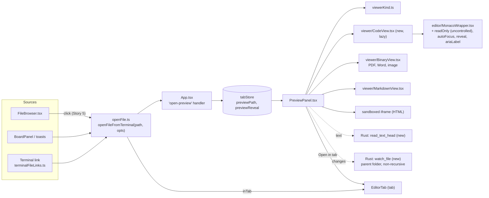
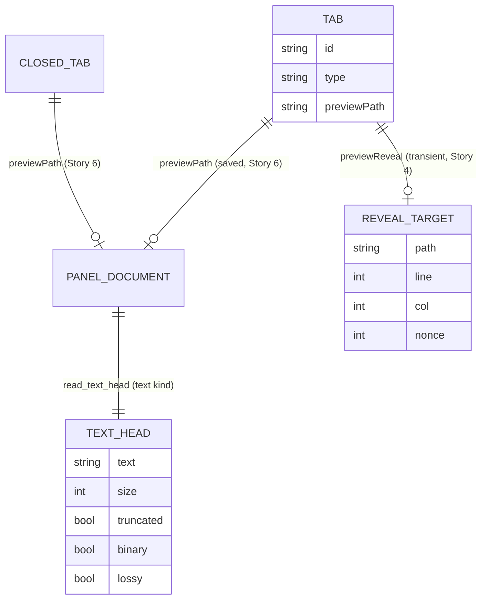
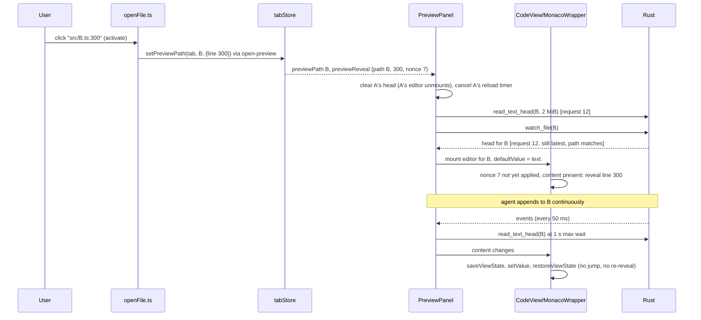

Six small stories. Order: **1** (Rust: bounded read and single-file watch) → **2** (code in the panel; terminal clicks land there) → **4** (go to line) → **3** (live follow) → **5** (file browser clicks, modifier-click for a tab). Story 4 comes before Story 3 because both edit `PreviewPanel` and `MonacoWrapper`, and Story 3 tests Story 4's reveal. **6** (the panel's file survives a restart and a reopened tab) touches only `tabStore` and can run in parallel with 2–5. Each story has its own acceptance criteria and verification. The shared intent, decisions and architecture come first.

<frozen-after-approval reason="human-owned intent — do not modify unless human renegotiates">

## Intent

**Problem:** The owner's words: "There needs to be a code viewer here", in "a panel in ADE"; asked which panel, they chose "A side panel by the terminal". Today a clicked source file always opens in a new tab, which hides the terminal the agent is working in. The Preview panel (⌘⇧B) already sits beside the terminal, but only for Markdown, HTML, PDFs and images: any other file it is given shows as a plain unhighlighted `<pre>`, and terminal clicks on code never reach it (`opensInPreview`, `src/lib/terminalFileLinks.ts:209`).

**Approach:** Grow the existing Preview panel into the code viewer rather than add a second panel beside it. Source files render in a **read-only** Monaco, through the same `MonacoWrapper` the file tab uses. Every file clicked in the terminal or the file browser opens in the panel; ⌘-click (Ctrl-click on Linux) and an *Open in tab* button open it in a tab, where it can be edited. The panel follows the file live as an agent writes it, keeping the reader's place, and a `path:line` link jumps to that line. Large files are shown truncated and binary files are refused, both decided in Rust.

## Decisions proposed for the owner (recommended defaults; see Open questions)

1. **One side panel, not two.** The Preview panel becomes the viewer for every file kind. Same place, same shortcut (⌘⇧B / Ctrl+Alt+Shift+B), same per-tab document, same resize handle. No new shortcut.
2. **Read-only in the panel.** Editing stays in the file tab (⌘S).
3. **Click lands in the panel, modifier-click in a tab**, for the terminal and the file browser. This is a default change in two places: terminal clicks on code files, and every file-browser click, used to open a tab.
4. **The panel belongs to the tab**, as `previewPath` already does: every pane of a split shares it, switching tab switches the file, and "switching project" in ADE is switching tab, so it follows too.
5. **Live by default** (the existing LIVE/STATIC toggle, which stays the user's choice), keeping the reader's scroll and cursor across reloads. When the file cannot be watched the panel says "Not live" for that file and keeps retrying; it never flips the user's toggle.
6. **Text over 2 MiB shows its first 2 MiB**; a NUL byte in the first 8 KiB means binary, not shown as text.
7. **Persisted:** the tab's panel file (fixing a gap: `previewPath` is restored on launch but never saved, and a reopened closed tab drops it). **Not persisted:** whether the panel is open, its width, scroll, target line.

## Boundaries & Constraints (all stories)

**Always:**
- One editor component: the panel uses `src/components/editor/MonacoWrapper.tsx`; no second Monaco setup, no other editor library.
- One kind dispatch: the panel picks its view with `viewerKind()` (`src/lib/viewerKind.ts`), as the file tab does. `PreviewPanel`'s private `detectMode` is removed.
- Monaco is never in `PreviewPanel`'s static import graph: `CodeView` is loaded with `React.lazy`. This keeps Monaco out of the panel's chunk and lets jsdom tests that render `PreviewPanel` (e.g. `sidePanelLayout.test.tsx`) run without Monaco mocks, since importing `monaco-editor` under jsdom throws (`document.queryCommandSupported is not a function`).
- Opening a file into the panel never moves keyboard focus into it. After a terminal click focus stays in the terminal; after a file-browser click it stays in the file browser.
- HTML keeps today's sandboxed-scripts iframe (`sandbox="allow-scripts"`, pinned by `previewSecurity.test.ts`); Markdown keeps the sanitized `MarkdownView`.
- Every message the panel shows in place of content (truncated, binary, error, deleted, not live, line past the part shown) is in an element with `role="status"` and `aria-live="polite"`.
- The verification command is unchanged.

**Never:**
- No editing, saving or dirty state in the panel.
- No new dependency or lockfile change.
- No change to `relay/`, `mobile/` or `packages/`.
- No change to how the file tab loads, edits or saves files. The only shared component whose behavior changes is `BinaryView` (Story 3: it keeps the current view while a reload is in flight instead of flashing "Loading…"), which the tab's Reload button also benefits from.
- No new keyboard shortcut.

**Known and left alone:** `@monaco-editor/react` 4.7.0 applies a changed `value` prop itself, in the child `<Editor>`'s effect, before `MonacoWrapper`'s own effect runs: with `readOnly` it calls `setValue` (cursor to line 1, scroll to top), otherwise a full-range `executeEdits`. So `MonacoWrapper`'s "keep the cursor" branch (`MonacoWrapper.tsx:62-69`) is dead code today. The panel no longer drives content through `value` (Story 2). The file tab's behavior is not changed by this plan; recorded under Out of scope.

## User flows

| Flow | Behavior |
|---|---|
| Click a file path in the terminal | Opens in the active tab's panel, opening the panel if closed. All kinds: code, Markdown, HTML, PDF, Word, images. Focus stays in the terminal. Detached windows forward the click (with its line, column and `inTab`) to the main window. |
| Click a file in the file browser (⌘B) | Story 5: opens in the panel, as above; focus stays in the file browser. Until then it still opens a tab. |
| ⌘-click / Ctrl-click | Story 5: opens a tab instead (`addEditorTab`, which focuses an existing tab for that file). |
| *Open in tab* button | Opens the panel's file in a tab, which becomes the active tab. The panel belongs to the tab, so it now shows the editor tab's own (empty) state; switching back to the terminal tab shows the file again. Hidden when the file is binary, truncated or decoded lossily, with a note saying why ("Too large to open in a tab" / "Not UTF-8 text, can't be edited in a tab"), since the tab reads the whole file as UTF-8 (`EditorTab.tsx:73`). |
| Click a file while an editor, fleet or browser tab is active | It opens in that tab's panel: the panel sits beside any tab type. |
| ⌘⇧B | Shows or hides the panel. Opening it this way moves focus into it (the editor for a code file, once Monaco has mounted; else the panel's region, `tabIndex={-1}`). Closing it with focus inside returns focus to the terminal. |
| Esc with focus in the panel | Returns focus to the terminal (the existing global handler, `useKeybindings.ts:139-148`). |
| Resize | Drag the panel's left edge (existing `useDragWidth`, 280–900 px, default 480). Not persisted. |
| Splits | The panel sits beside the whole tab. A click in any pane sets the tab's file. Zooming a pane keeps the panel. |
| Tab switch / project switch | The panel shows the new tab's file, or its empty state. A load or reload in flight for the old file is discarded. Open/closed is app-wide, as today. |
| Agent edits the file | With LIVE on, any watch event for the file schedules a re-read: 150 ms after the last event, and at most 1 s after the first while events keep coming (continuous appends). Scroll, cursor and selection are kept. |
| File or its folder deleted, then re-created (build clean of `dist/`, `git checkout`, `rm -rf` and regenerate) | The re-read fails with not-found: a "Deleted on disk" banner sits over the last content, the old watch is dropped, and the panel re-checks the file every 2 s (doubling to at most 30 s) while it is the panel's file and LIVE is on. The first successful read clears the banner, shows the new content and re-arms the watch. |
| Watch fails (e.g. a restored file that is gone) | "Not live: <reason>" for that file; the user's LIVE/STATIC choice is untouched. The panel retries the watch after its next successful read of that file (Refresh, or the 2 s re-check). Opening another file starts fresh. |
| `path:line` / `path:line:col` | Story 4: once that file's content is in the editor, the line is revealed centered with the cursor on it. Re-clicking re-reveals. A line past the end goes to the last line; a line past the truncated part shows "Line N is past the part shown (first 2.0 MB)". Rendered views (Markdown, HTML, PDF) ignore the line. |
| Large text file (> 2 MiB) | "Showing the first 2.0 MB of 48.3 MB." No promise that a tab shows more. |
| Binary file | "Binary file (3.2 MB), not shown." PDF, Word and images are not "binary" here: they have their viewers. UTF-16 text contains NULs, so it counts as binary. |
| Missing, unreadable or not a regular file | "Can't open <name>: <reason>". FIFOs, sockets and devices are refused without being opened. |
| Relative link inside Markdown shown in the panel | Opens a tab, as it does today (`MarkdownView.tsx:93`); unchanged, see Out of scope. |

## Architecture

### Components

### Rust (Story 1)

- **`read_text_head(path: String, max_bytes: u64) -> Result<TextHead, String>`** in `src-tauri/src/lib.rs`, `#[tauri::command(async)]`, registered in the handler list. The work is in a pure inner function `read_text_head_in(path, max_bytes, home)` that expands `~` with the existing `expand_tilde(path, home)`, so tests pass a home instead of mutating `HOME`. `TextHead` is `{ text: String, size: u64, truncated: bool, binary: bool, lossy: bool }`, camelCase.
  1. `std::fs::metadata` (follows symlinks); anything but `is_file()` is `Err("Not a regular file: …")`, **before any open**, so a FIFO cannot block the call.
  2. Open, read up to 8 KiB. A NUL byte there: return `binary: true`, empty text, without reading further.
  3. Otherwise continue with `take(max_bytes + 1)`; `truncated` is whether more than `max_bytes` bytes arrived; keep the first `max_bytes`.
  4. If truncated, drop an incomplete trailing UTF-8 sequence (`Utf8Error::error_len() == None` at the end). Then `String::from_utf8_lossy`; `lossy` is whether it replaced anything.
  5. `size` is `max(metadata.len(), bytes read)` when not truncated (files under `/proc` report 0), else `metadata.len()`.
- **`watch_file(path: String, on_event: Channel<WatchEvent>) -> Result<u32, String>`** in `src-tauri/src/watcher.rs`, `#[tauri::command(async)]` (off the main thread, unlike the sync `watch_directory`). It canonicalises the path (following symlinks), watches the canonical parent folder with the mode from a pure `watch_file_mode()` that returns `RecursiveMode::NonRecursive`, and sorts each event path with a pure `classify(event_path, dir, name) -> Target | Folder | Other`, comparing component by component with the existing `same_component` (case-insensitive on macOS):
  - `Target` (the file): forwarded as `changed`/`created`/`removed`, without content.
  - `Folder` (the watched folder itself: inotify's `IN_DELETE_SELF`, `IN_MOVE_SELF` and `IN_IGNORED` arrive under the folder's own path, and the watch is dead afterwards): forwarded as `removed` **for the file's path**, so the panel re-reads and, finding nothing, drops the watch and starts its re-check (below). This is the one approach chosen for N1: the folder's disappearance is reported as the file's, and recovery lives in one place, the panel, which works the same on every platform.
  - `Other`: dropped.
  - Watcher errors are sent as `error`.
  Stopped with the existing `unwatch_directory` (same `WatcherManager`). The event kind is not relied on: `watcher.rs:186-190` maps every `Modify`, renames included, to `changed`, and FSEvents can merge flags so `removed` arrives after `created`.
- **Symlinked files** are watched at their target. Retargeting the link, or an atomic rename onto the link itself, is not seen; Refresh picks it up. Out of scope.
- `read_file`, `read_file_base64` and `watch_directory` are unchanged.

### Frontend

- **`MonacoWrapper.tsx`** (Story 2, Story 4): `onChange`/`onSave` become optional; new optional props whose defaults keep the file tab's behavior byte for byte:
  - `readOnly` (default false). When true: the `<Editor>` gets `defaultValue={content}` and **no `value` prop**; options add `readOnly: true`, `domReadOnly: true`, `minimap: { enabled: false }`, `renderValidationDecorations: "off"` (no false red squiggles from a TS worker that cannot see the project); no save action is registered. A later `content` change is applied by the wrapper itself: `const vs = editor.saveViewState(); editor.setValue(content); if (vs) editor.restoreViewState(vs);`, only when `content !== editor.getValue()`.
  - The latest `content` is also kept in a ref. In `onMount`, if the editor's value differs from it (a write arrived between the first render and the asynchronous mount), the wrapper applies it.
  - `autoFocus` (default true): whether `editor.focus()` runs on mount.
  - `ariaLabel` (passed to Monaco's `ariaLabel` option). The panel passes `"<file name>, read-only"`.
  - Story 4: `reveal?: { line: number; col?: number; nonce: number }` and `onRevealed?(nonce)`. A reveal is applied once, after mount and with content in the model: clamp to `1..lineCount`, `setPosition`, `revealLineInCenter`, then `onRevealed(nonce)`.
- **`viewer/CodeView.tsx`** (new, Story 2), default export, loaded with `React.lazy` from `PreviewPanel`. Props `{ path, head: TextHead, reveal?, onRevealed?, focusOnMount, onOpenInTab }`. Renders the status messages and `MonacoWrapper` with `readOnly`, `autoFocus={focusOnMount}`, `ariaLabel`, keyed by `path` so another file is a fresh editor. It passes `reveal` on only when `reveal.path === path`. `onRevealed` calls `clearPreviewReveal(tabId, nonce)`, so a remount (tab A → B → A) finds no reveal to re-apply.
- **Focus on ⌘⇧B** (Story 2): `App` holds `previewFocusRequest`, a counter incremented **only** when ⌘⇧B (or the palette's toggle) opens the panel, and passes it to `PreviewPanel` as `focusRequest`. The panel remembers the last request it served; a new one is served once, after the lazy `PreviewPanel` and `CodeView` chunks load and Monaco mounts: as `focusOnMount` to `CodeView` for a code file, else by focusing its body region. Closing with focus inside goes through a helper `closePreviewFocus(panelEl)` in `src/lib/previewFocus.ts`, which focuses `.xterm-helper-textarea` when `document.activeElement` is inside `panelEl`.
- **`PreviewPanel.tsx`**:
  - Story 2 keeps today's `watch_directory` effect as it is, so live Markdown, HTML, PDF and image previews keep working until Story 3 replaces it; code files get no live updates until then. Story 2 dispatches on `viewerKind(filePath)`. `pdf`/`docx`/`image` → `BinaryView` (replacing the panel's own image and PDF code; adds Word). `markdown` → `MarkdownView` via `read_file`, as today. `html` → the existing sandboxed iframe via `read_file`, as today. `text` → `read_text_head(path, 2097152)` then lazy `CodeView`. Each load carries a request id; a result is applied only if it is the latest request **and** for the current `filePath`. On a `filePath` change the old head is cleared (so the old editor unmounts) and any pending reload timer is cleared. The panel root gets `role="complementary"` and `aria-label="Preview"`, and `tabIndex={-1}` on its body region. *Open in tab* rules as in User flows. The mode badge says `CODE`; the empty state and placeholder list code.
  - Story 3: live follow uses `watch_file` (the old `watch_directory` call goes). Watch health is **per-path state**, `watch: { path, status: "live" | "failed" | "off", reason? }`, separate from the user's `autoRefresh` toggle; the LIVE badge shows only when the toggle is on and `watch.status` is `"live"` for the current path, otherwise "Not live: <reason>". Rules:
    - Any event → re-read after 150 ms quiet, max wait 1 s.
    - A not-found read → "Deleted on disk" over the last content; unwatch, `status: "off"`; start the re-check (read every 2 s, doubling to 30 s) while the path is current and the toggle on.
    - A successful read clears the banner; if `status` is not `"live"`, it stops the re-check and re-arms `watch_file` (unwatching any old id first).
    - Watch error (the `invoke` rejects, or an `error` event) → `status: "failed"` with the reason, and the same re-check, so a later good read retries the watch.
    - A new path resets `watch` and the re-check timer, and tries `watch_file` at once.
    - The "unwatch on late resolve" pattern stays: if the effect was cleaned up before `watch_file` resolved, the returned id is unwatched at once.
    - Binary kinds reload by bumping `BinaryView`'s `reloadKey`.
- **`BinaryView.tsx`** (Story 3): when only `reloadKey` changes (same `path`), keep the current data on screen until the new bytes arrive; a new `path` still clears. PDF page and zoom reset on reload as they do today in both the panel and the tab (`PdfView` resets on new data); keeping them is out of scope.
- **`src/lib/terminalFileLinks.ts`**: Story 2 removes `opensInPreview`. Story 4: `findPathCandidates` returns the `line`/`col` of the `:line[:col]` suffix it already strips, and `registerFileLinks`' `open` callback takes `(path, { line?, col?, inTab? })`. Story 5 sets `inTab` from the `MouseEvent` xterm passes to `activate(event, text)`. tsc's `file(line,col)` format is out of scope.
- **`src/lib/openFile.ts`**: `openFileFromTerminal(path, opts?)`, `opts = { line?, col?, inTab? }`. `inTab` → `addEditorTab`; otherwise `open-preview` with `{ path, line, col }`. The detached-window `emitTo` payload and `listenForFileOpens` carry all three fields (Story 4 for line/col, Story 5 for `inTab`). Story 5 adds `opensInTab(e: { metaKey, ctrlKey }, mac = IS_MAC)`.
- **`src/stores/tabStore.ts`**: Story 4 adds `previewReveal?: { path: string; line: number; col?: number; nonce: number } | null`, an optional third argument `setPreviewPath(id, path, at?)` that sets it with a fresh nonce (or clears it without `at`), and `clearPreviewReveal(id, nonce)`, which clears it only when the nonce still matches. Never saved. Story 6 writes `previewPath` in both branches of `saveSession` (restore already reads it, `tabStore.ts:633`) and adds it to `ClosedTab` so `reopenClosedTab` brings it back.
- **`src/App.tsx`**: Story 4 passes `line`/`col` from `open-preview` to `setPreviewPath`. Story 2: `togglePreview` increments `previewFocusRequest` when opening and calls `closePreviewFocus` when closing (above). No layout change: the panel keeps `minWidth: 280`, so `sidePanelLayout.test.tsx`'s 1200 px budget holds.
- **`src/components/FileBrowser.tsx`** (Story 5): `handleClick(e)` opens files with `openFileFromTerminal(path, { inTab: opensInTab(e) })`.
- **Docs**: `docs/guide/files.md` and `docs/guide/terminal.md` per story; `docs/guide/shortcuts.md` and `ShortcutsOverlay` unchanged.

### Data

### Key flow: the panel shows `A.ts`; the user clicks `src/B.ts:300` while an agent writes B

### Failure modes

| Failure | Handling |
|---|---|
| Huge file | Rust reads at most 2 MiB + 1 byte; banner; no *Open in tab*. |
| Binary file | Stops after 8 KiB; message; no *Open in tab*. |
| Non-UTF-8 text | Lossy decode, safe because read-only; no *Open in tab* (the tab would fail to decode it). |
| FIFO, socket, device | Refused on metadata, never opened. |
| Library resets the view on `value` change | The panel never passes `value`; the wrapper restores the view state around `setValue`. |
| Rapid or continuous writes | 150 ms quiet or 1 s max wait; only the latest request for the current path is applied. |
| Rename-writes, merged FSEvents flags | Any event re-reads; "deleted" is decided by the read, not by the event kind. |
| Watched folder deleted, moved or re-created (the inotify watch dies) | Events on the folder itself are reported as the file's `removed`; the not-found read drops the watch and starts the 2 s re-check; the first good read re-arms. Recovery never depends on the dead watch. |
| Path spelled differently from what the OS reports (`./`, `../`, `/tmp` vs `/private/tmp`, case on macOS, symlinks) | Rust canonicalises once and matches events itself. |
| Watching a huge tree, inotify limits, main-thread stalls | One non-recursive watch of the file's folder, in an async command; both pinned by tests. |
| Watch fails | Per-path "Not live: <reason>"; the user's toggle untouched; retried after the next good read; another file starts fresh. |
| Watch resolves after the panel moved on | Its id is unwatched at once. |
| A write lands before Monaco mounts | `onMount` applies the latest content from a ref. |
| Reveal racing the load, or re-applied on remount | Pending per nonce, applied once to the editor of the matching path after content, then cleared on the tab. |
| Focus stolen | `autoFocus={false}`; tested. |
| Same file open in an editor tab with unsaved edits | The panel shows the file on disk. |

</frozen-after-approval>

---

# Story 1: Rust: bounded read and single-file watch

No UI change. Foundation for Stories 2 and 3.

## Code Map (1)

- `src-tauri/src/lib.rs:40-54` -- `expand_tilde` (pure), `expand_home`; `read_file` :369-372; handler list :443-465.
- `src-tauri/src/watcher.rs` -- `WatcherManager`, `WatchEvent`, `same_component`, `watch_directory` (sync, recursive) :152-200, `unwatch_directory`.
- `src/lib/__tests__/tauriCommandContract.test.ts` -- every `invoke` must name a registered command with matching argument names.

## Acceptance Criteria (1)

All in Rust unit tests; the developer writes each failing first. Temp files under `std::env::temp_dir()` with unique names, as `watcher.rs` tests do.

1. Small UTF-8 file: whole text, true `size`, `truncated`, `binary`, `lossy` all false. -- `lib.rs` › `read_text_head_small_file`
2. File of `max_bytes + 1` bytes: `truncated: true`; file of exactly `max_bytes`: `truncated: false`. -- › `read_text_head_truncates_only_past_the_cap`
3. A cut inside a multi-byte character (e.g. `max_bytes` = 4 over `"abc€"`): text is `"abc"`, `lossy: false`. -- › `read_text_head_cuts_on_a_character`
4. A NUL within the first 8 KiB: `binary: true`, empty text; a UTF-16 LE file (BOM + text) is binary. -- › `read_text_head_binary`
5. Invalid UTF-8 (`0xff`) mid-file: text contains U+FFFD, `lossy: true`. -- › `read_text_head_lossy`
6. `read_text_head_in("~/x.txt", n, home)` reads `<home>/x.txt` (no `HOME` mutation). -- › `read_text_head_expands_tilde`
7. Missing path, a directory, and (on unix) a FIFO made with `mkfifo` are each `Err`. The FIFO call runs on its own thread and the test waits with `recv_timeout(2 s)`, so a regression that opens the FIFO fails the test instead of hanging `cargo test`. -- › `read_text_head_refuses_non_files`
8. `watch_target` of a path given through a symlinked folder and with `./` and `../` segments returns the canonical folder and name. `classify` gives `Target` for that folder + name, `Folder` for the folder itself, `Other` for a sibling and for the same name in a subfolder; on macOS `Target` for a different case. -- `watcher.rs` › `watch_target_canonicalises`, `classify_sorts_event_paths`
9. `watch_file` on a temp file, then writing it, delivers at least one event within 2 s; writing a sibling delivers none for 500 ms; `watch_file` on a missing path is `Err`. If a `Channel` cannot be built in a unit test, the test drives the same closure through a `fn(WatchEvent)` sink extracted for it. -- › `watch_file_reports_only_its_file`
10. **Folder removal (N1), real file system, runs on macOS and Linux:** with `dir/f` watched, `rm -rf dir` (via `std::fs::remove_dir_all`) delivers a `removed` for `dir/f` within 2 s. On both platforms the child's deletion is reported before the folder's, and on Linux the folder's own events are also mapped to `removed` (pinned by 1-AC8's `Folder` case). Re-creation is deliberately not expected from the old watch, whose inotify watch is dead; recovery is the panel's job (3-AC5). -- › `watch_file_reports_the_folder_going`
11. `watch_file_mode()` returns `RecursiveMode::NonRecursive`, and `watch_file` uses it (the test reads `include_str!("watcher.rs")` and asserts the line above `pub fn watch_file` is `#[tauri::command(async)]` and that `watch_file`'s body calls `watch_file_mode()`). Making it recursive or sync fails this test. -- › `watch_file_is_async_and_non_recursive`
12. Both commands are registered; the existing contract test passes. -- `tauriCommandContract.test.ts` (existing)

**Contract (1):** add `.ade/context/side-panel-files.md`: `read_text_head` (fields, 8 KiB binary rule, lossy, regular files only) and `watch_file` (canonical, non-recursive, async, folder events reported as the file's `removed`, symlinks watched at their target, stop with `unwatch_directory`).

## Verification (1)

**Commands (the repo's verification command, unchanged):**
- `npx tsc --noEmit` -- expected: exit 0
- `npm test` -- expected: all pass
- `cd src-tauri && cargo test` -- expected: all pass, including the tests above
- `cd relay && cargo test` -- expected: all pass (no change)
- `cd mobile && npx tsc --noEmit && npx jest` -- expected: all pass (no change)

**Results (1):** _QA fills this in._

---

# Story 2: Code in the side panel; terminal clicks land there

Depends on Story 1. Code loads once per open (and on Refresh); live follow for code is Story 3. Today's `watch_directory` effect stays in place, so Markdown, HTML, PDF and image previews stay live in between.

## Code Map (2)

- `src/components/PreviewPanel.tsx` -- `detectMode` :21-28 (removed); `loadContent` :61-86; header :179-272; dispatch :326-449, `<pre>` fallback :428-448.
- `src/components/editor/MonacoWrapper.tsx` -- `handleMount` :51-60; dead restore branch :62-69; options :79-91.
- `node_modules/@monaco-editor/react` 4.7.0 -- applies a changed `value` in its own effect (`setValue` when read-only, `executeEdits` otherwise).
- `src/components/viewer/BinaryView.tsx`, `src/lib/viewerKind.ts`.
- `src/lib/openFile.ts:10-16`, `src/lib/terminalFileLinks.ts:208-211` (`opensInPreview`) and its test :58-65.
- `src/App.tsx:322` -- `togglePreview`; `src/hooks/useKeybindings.ts:139-148` -- Esc focuses `.xterm-helper-textarea`.
- `src/components/__tests__/sidePanelLayout.test.tsx` -- renders `PreviewPanel` with only Tauri and `useTerminal` mocked.

## Acceptance Criteria (2)

Component tests mock `@tauri-apps/api/core`. `MonacoWrapper`/`CodeView` tests mock `@monaco-editor/react` with a stub `Editor` that **emulates the library**: it records every prop, calls `onMount` with a fake editor, and when its `value` prop changes calls the fake's `setValue`, which resets the fake's scroll and position to the top as the real one does. `monacoSetup` is mocked (its `?worker` imports do not load in vitest).

1. With `readOnly`, the stub never receives a `value` prop on any render (initial or after `content` changes) and receives `defaultValue` equal to the first content. -- `src/components/editor/__tests__/MonacoWrapper.test.tsx` › "read-only content never goes through value"
2. With `readOnly`, a `content` change calls `saveViewState`, then `setValue`, then `restoreViewState` with the saved state, in that order, and the fake's scroll top and position afterwards equal those before. Against today's code the stub's `value` path resets them, so the test fails. -- › "a reload keeps the reader's place"
2b. A write that arrives between the first render and `onMount`: the stub calls `onMount` asynchronously (after a `content` change), and afterwards the fake editor holds the newer content. Without the ref it would hold the first. -- › "a write before mount is not lost"
3. With `readOnly`: options include `readOnly: true`, `domReadOnly: true`, `minimap.enabled: false`, `renderValidationDecorations: "off"` and the given `ariaLabel`; no action is registered; with `autoFocus={false}` `focus()` is never called. Without the new props the stub gets `value`, the original options, the save action, and `focus()`. -- › "read-only mode", "defaults are the file tab's"
4. With `previewPath` `/r/src/App.tsx` the panel calls `read_text_head` with `{ path, maxBytes: 2097152 }` and renders the editor stub (after the lazy load) with language `typescript` and `ariaLabel` "App.tsx, read-only"; no `<pre>`. -- `src/components/__tests__/PreviewPanelCode.test.tsx` › "shows source files in a read-only editor"
5. `PreviewPanel.tsx` has no static import of `CodeView`, `MonacoWrapper`, `monaco-editor` or `@monaco-editor/react` (source read), and `sidePanelLayout.test.tsx` passes unchanged, with no Monaco mock added to it. -- › "Monaco loads lazily"; `sidePanelLayout.test.tsx` (existing, unchanged)
6. Truncated head: "Showing the first 2.0 MB of 48.3 MB." and "Too large to open in a tab", no *Open in tab*. Lossy head: "Not UTF-8 text, can't be edited in a tab", no *Open in tab*. Binary head: binary message, no editor, no *Open in tab*. Plain head: *Open in tab* present and calls `addEditorTab` with the path. Every message is in a `role="status"` `aria-live="polite"` element. -- › "large, lossy and binary files", "opens the file in a tab"
7. A failed read (e.g. `Not a regular file`) shows "Can't open <name>: <reason>" in a `role="status"` element. -- › "a file that can't be read says so"
8. PDF, `.docx` and image paths render `BinaryView`; `.md` renders `MarkdownView`; `.html` renders the sandboxed iframe. `PreviewPanel.tsx` no longer contains `detectMode` and imports `viewerKind`. -- › "each kind gets its viewer"
9. Switching from `A.ts` to `B.ts` while A's read is pending: when A's read resolves after B's, A's text is never shown and B's is. -- › "a stale read never wins"
10. `openFileFromTerminal("/r/src/App.tsx")` in the main window dispatches `open-preview` with that path and adds no tab; likewise `.docx`, `.md`, `.png`. `opensInPreview` is gone. -- `src/lib/__tests__/openFile.test.ts` › "every clicked file opens in the panel"
11. Keyboard, tested on the components, not through `App`:
    - `PreviewPanel` rendered with a code file and `focusRequest` going from 0 to 1, with the lazy `CodeView` and a stub whose `onMount` fires asynchronously: the fake editor's `focus()` is called once, after mount. With a Markdown file: the body region becomes `document.activeElement`.
    - Re-rendering with the same `focusRequest` (e.g. a new `previewPath` from `open-preview`) never calls `focus()` or moves `document.activeElement`.
    - `closePreviewFocus(panelEl)` focuses `.xterm-helper-textarea` when focus is inside `panelEl`, and does nothing when it is elsewhere.
    - An Escape keydown dispatched from inside the panel, with `useKeybindings` mounted, focuses `.xterm-helper-textarea`.
    - The panel root has `role="complementary"` and `aria-label="Preview"`.
    -- `src/components/__tests__/PreviewPanelFocus.test.tsx` › "⌘⇧B focus survives the lazy mount", "opening a file never takes focus", "Esc returns to the terminal"; `src/lib/__tests__/previewFocus.test.ts` › "closing returns focus to the terminal"
12. With a `.md` file, a `changed` event from the existing `watch_directory` channel for that path still reloads it (today's live preview is not broken before Story 3). -- `PreviewPanelCode.test.tsx` › "documents stay live"
13. Existing guards still pass: `previewSecurity.test.ts`, `previewPerTab.test.ts`, `tauriCommandContract.test.ts`, `viewerKind.test.ts`, `terminalFileLinks.test.ts` (minus the removed `opensInPreview` case).

**Docs (2):** `files.md`: the Preview panel shows source code read-only with highlighting; large, non-UTF-8 and binary files; *Open in tab*. `terminal.md` Clickable files: every file opens in the panel. **Contract (2):** extend `.ade/context/side-panel-files.md`: every clicked file opens in the tab's panel; read-only; *Open in tab* rules.

## Verification (2)

**Commands:** the same five lines as Story 1; expected all pass.

**Manual checks (running app, macOS and Linux):** click a `.ts` path in the terminal: highlighted code, no red squiggles, and typing goes straight to the terminal. ⌘⇧B twice: focus goes into the panel and back. In the panel editor with no find widget open, Esc returns to the terminal (real Monaco may consume Esc; if so, record it). A 50 MB log: banner, no stall. A `.zip`: binary message. A `.docx` from the terminal renders. VoiceOver reads the editor as "<file>, read-only".

**Results (2):** _QA fills this in._

---

# Story 4: Go to line from `path:line`

Depends on Story 2. Built before Story 3.

## Code Map (4)

- `src/lib/terminalFileLinks.ts:22,32` -- `LINE_COL` matched and discarded; `PathCandidate` :10-16; `activate` :199.
- `src/hooks/useTerminal.ts:238`, `src/lib/openFile.ts`, `src/App.tsx:144-156`, `src/stores/tabStore.ts:50,83,331`.

## Acceptance Criteria (4)

1. `findPathCandidates("src/App.tsx:42:7")` gives path `src/App.tsx`, line 42, col 7; `"a.ts:9"` line 9, no col; `"a.ts"` neither; existing cases keep their paths and offsets. -- `terminalFileLinks.test.ts` › "keeps the line and column of a path:line link"
2. A link's `activate` passes line and column to `open`. -- › "a clicked link carries its line" (fake `Terminal` with one buffer line, `resolve_file_paths` mocked)
3. `openFileFromTerminal(p, { line: 42, col: 7 })` dispatches `open-preview` with `{ path: p, line: 42, col: 7 }`; from a detached window the emitted payload has the same fields; `listenForFileOpens` passes them on. -- `openFile.test.ts` › "the line travels with the file"
4. `setPreviewPath(id, p, { line: 42 })` sets `previewReveal` `{ path: p, line: 42 }` with a nonce different from the previous one, also for identical repeated calls; `setPreviewPath(id, p)` clears it; it is not in the saved session. -- `previewPerTab.test.ts` › "a target line is per open request and never saved"
4b. `clearPreviewReveal(id, n)` clears `previewReveal` when its nonce is `n` and leaves a newer one alone. -- `previewPerTab.test.ts` › "a reveal is cleared once applied, not a newer one"
5. `MonacoWrapper` with `reveal { line: 42, nonce: 1 }` calls `setPosition({ lineNumber: 42, column: 1 })` and `revealLineInCenter(42)` once content is set; a new nonce with the same line reveals again; the same nonce after a content change does not; a line past the model's end is clamped. -- `MonacoWrapper.test.tsx` › "reveals the target line once per click", "clamps a line past the end"
6. The panel shows `A.ts`; `setPreviewPath(tab, B.ts, { line: 300 })` with B's `read_text_head` resolving later: A's fake editor never gets `setPosition`/`revealLineInCenter`; B's gets line 300 after B's content is in it. -- `PreviewPanelCode.test.tsx` › "a path:line link to another file lands in that file"
7. A truncated head whose shown text has 1,000 lines and `reveal.line` 5,000: "Line 5000 is past the part shown (first 2.0 MB)" in a `role="status"` element, and the cursor goes to the last shown line. -- › "a line past the truncated part says so"
8. Markdown, HTML and PDF ignore `previewReveal` (no error, normal render). -- › "rendered views ignore the line"
9. Remount: reveal `A.ts:42` (applied), switch to tab B, back to tab A (the `CodeView` remounts): `setPosition` is not called again, because `onRevealed` cleared the tab's `previewReveal`. -- › "a remount does not re-apply an old reveal"

**Docs (4):** `terminal.md`: replace "A trailing `:line` or `:line:col` is ignored" with: it opens the file at that line in the panel.

## Verification (4)

**Commands:** the same five lines; expected all pass.

**Manual checks:** `grep -Hn useState src/App.tsx` and click a result (`-H` makes grep print the file name, which plain `grep -n` on one file omits): the panel opens at that line. Click another result in the same file: it moves. From `A.ts`, click a `B.ts:300` link: it lands in B. Click a `.md:10` link: the document renders.

**Results (4):** _QA fills this in._

---

# Story 3: Follow the file live

Depends on Stories 1, 2 and 4.

## Code Map (3)

- `src/components/PreviewPanel.tsx:104-142` -- today's `watch_directory` effect (`extensions: [ext]`, default `withContent`, errors swallowed, reloads only on `changed` with `event.path === filePath`).
- `src-tauri/src/watcher.rs:186-190` -- every `Modify`, renames included, becomes `changed`.
- `src/components/viewer/BinaryView.tsx:17-25` -- `setData(null)` on every `reloadKey` change.

## Acceptance Criteria (3)

Fake timers; `watch_file` mocked to capture the channel and return ids; `read_text_head` mocked per call.

1. The panel calls `watch_file` with the path and never `watch_directory`. -- `PreviewPanelCode.test.tsx` › "watches only its file"
2. Three events 50 ms apart cause one `read_text_head` call, 150 ms after the last. -- › "debounces bursts"
3. An event every 50 ms for 3 s causes a re-read at least every 1 s (at least 3 calls). -- › "continuous appends still refresh"
4. Each of `changed`, `created`, `removed` schedules a re-read. Sequence `removed` then `created` with the file present: no "Deleted on disk" after the re-read. Sequence `created` then `removed` with the file gone (read rejects with not-found): "Deleted on disk" in a `role="status"` element and the editor keeps its last text; a later successful read clears it. -- › "removed then created", "created then removed"
5. **Folder deleted and re-created (N1):** after a `removed` whose re-read rejects with not-found, the panel unwatches the old id and makes no further `watch_file` call while reads keep failing; it re-reads at 2 s, 4 s, 8 s… (capped at 30 s). When a read succeeds (the folder and file are back), the banner clears, the new text is shown, `watch_file` is called again, and an event on the **new** channel triggers a reload. This is platform-independent by design: recovery never relies on the old watch. -- › "a deleted folder that comes back is followed again"
6. **Per-path watch failure (N2):** `watch_file` rejects for `A` (e.g. a restored file that is gone): "Not live: <reason>" in a `role="status"` element, and the LIVE/STATIC toggle still reads LIVE (the user's choice). Opening `B`: `watch_file(B)` is called, B shows LIVE with no "Not live". Back on `A` with the file now present: the next successful read calls `watch_file(A)` again. An `error` event on a live watch behaves like the rejection. With the user's toggle on STATIC, no watch and no re-check run. -- › "a failed watch is per file and never flips the toggle"
7. Switching tab (another `previewPath`) with a re-read or re-check timer pending: the timers are cleared, the old watch is stopped with `unwatch_directory`, and no read for the old path happens. -- › "a tab switch mid-reload"
8. A `watch_file` that resolves after the panel moved to another path (or unmounted): its id is passed to `unwatch_directory` at once, and its events are ignored. -- › "a late watch is unwatched"
9. A content reload does not re-apply an earlier reveal (no `setPosition` call after the reload). -- `MonacoWrapper.test.tsx` › "a reload does not jump back to the target line"
10. `BinaryView`: changing only `reloadKey` keeps the current view rendered (no "Loading…") until the new bytes resolve; changing `path` shows "Loading…". -- `src/components/viewer/__tests__/BinaryView.test.tsx` › "a reload keeps the current view"

**Docs (3):** `files.md`: live updates, the deleted banner, "Not live".

## Verification (3)

**Commands:** the same five lines; expected all pass.

**Manual checks:** scroll halfway down a file and let an agent edit it: the view does not move. `while true; do date >> /tmp/x.log; sleep 0.05; done` with `/tmp/x.log` open: the panel updates about once a second (macOS reports `/private/tmp`). Save from vim (rename-write): updates, no lasting deleted banner. Delete the file: banner. On macOS and Linux: open `dist/x.js`, `rm -rf dist`, regenerate it: the banner shows, then clears within the re-check interval and later edits are followed live. `git checkout` a branch without the file's folder and back: same. Open a file at a repo root: no noticeable CPU or watch growth during `npm install`. A live PDF still updates.

**Results (3):** _QA fills this in._

---

# Story 5: File browser clicks land in the panel; modifier-click opens a tab

Depends on Story 4 (shares `openFile.ts` and the `open` callback's options); built after Story 3.

## Code Map (5)

- `src/components/FileBrowser.tsx:70-82` -- `handleClick` opens every file with `addEditorTab`.
- `src/lib/terminalFileLinks.ts:199` -- `activate(event, text)`.
- `src/lib/openFile.ts:32,37-39` -- `emitTo` payload, `listenForFileOpens`.
- `src/lib/shortcuts.ts:14` -- `IS_MAC`.

## Acceptance Criteria (5)

1. `opensInTab` is true for `{ metaKey: true }` on macOS and `{ ctrlKey: true }` on Linux; false for a plain click on either, Ctrl on macOS and ⌘ on Linux. -- `openFile.test.ts` › "which click opens a tab"
2. `openFileFromTerminal(p, { inTab: true })` adds an editor tab for `p` and dispatches no `open-preview`; from a detached window the emitted payload has `inTab: true`, and `listenForFileOpens` receiving it adds a tab. -- › "a modifier-click opens a tab, also from a detached window"
3. A terminal link activated with the platform modifier passes `inTab: true`. -- `terminalFileLinks.test.ts` › "a modifier-click link opens a tab"
4. Clicking a file in the file browser dispatches `open-preview` and adds no tab; ⌘-clicking (macOS) adds the tab; clicking a folder still expands it; with an editor tab active, a plain click sets that tab's `previewPath`. -- `src/components/__tests__/FileBrowserOpen.test.tsx` › "a file opens in the panel, modifier-click in a tab"

**Docs (5):** `files.md`: "Click a file in the browser and it opens in the panel beside the terminal; ⌘-click (Ctrl-click on Linux) or *Open in tab* opens it in a tab, where you can edit it." Same in `terminal.md`. Extend `.ade/context/side-panel-files.md` with the modifier rule.

## Verification (5)

**Commands:** the same five lines; expected all pass.

**Manual checks:** in the file browser click a file (panel), ⌘-click it (tab); on Linux, Ctrl-click. ⌘-click in the terminal opens a tab and does not also select text. In a detached window, ⌘-click a path: a tab opens in the main window.

**Results (5):** _QA fills this in._

---

# Story 6: The panel's file survives a restart and a reopened tab

Independent of Stories 1–5 (only `tabStore`); can be built in parallel.

## Code Map (6)

- `src/stores/tabStore.ts:520-562` -- `saveSession`: neither branch writes `previewPath`; restore reads it at :633.
- `src/stores/tabStore.ts:57-62,300-305,336-340` -- `ClosedTab`, pushing on close, `reopenClosedTab`.

## Acceptance Criteria (6)

1. `saveSession` writes `previewPath` for terminal and non-terminal tabs; save then restore gives each tab the same `previewPath`. -- `src/stores/__tests__/session.test.ts` › "the panel's file survives a restart"
2. Closing a terminal tab with a `previewPath` and reopening it with `reopenClosedTab` restores the `previewPath`. -- `session.test.ts` › "a reopened tab keeps its panel file"

## Verification (6)

**Commands:** the same five lines; expected all pass.

**Manual checks:** open a file in the panel, quit, relaunch, ⌘⇧B: it is there. Close the tab, ⌘⇧T: the reopened tab has it. Delete the file before relaunch: the panel says it can't open it.

**Results (6):** _QA fills this in._

---

## Out of scope

- Editing in the panel, or any save from it.
- The file tab's dead "keep the cursor" branch in `MonacoWrapper` (a changed `value` already reset the view in the library); the file tab's uncapped `read_file` (a 48 MB log stalls it, non-UTF-8 fails).
- Keeping a PDF's page and zoom across a live reload (they reset today in both the panel and the tab).
- Relative links in Markdown shown in the panel opening in the panel (they open a tab, as today; `MarkdownView` is shared with the tab).
- tsc's `file(line,col)` link format.
- Following a symlinked file's link itself: it is watched at its target, so retargeting the link or an atomic rename onto the link is not seen (Refresh shows it).
- Highlighting what an agent changed, "follow the end" for logs, a history of files viewed, several files inside the panel, a per-pane panel.
- Persisting the panel's open state, width or scroll.
- A setting for the default click target (Open question 7).
- Go-to-line when a file opens in a tab.
- Renaming the Preview panel (Open question 4).
- A Rendered/Source toggle for Markdown and HTML in the panel.

## Open questions for the owner

1. **Grow the Preview panel, or add a second panel?** Recommended: **grow it**. It is already the docked panel beside the terminal with a per-tab file and live updates. A second right-hand panel would compete for width with Preview and the board, and give a clicked file two destinations. If you want a separate panel anyway, ⌘⇧E / Ctrl+Alt+Shift+E is free.
2. **Should a plain click in the file browser open the panel instead of a tab?** Recommended: **yes**, with ⌘-click (Ctrl-click on Linux) for a tab. That is how your request reads ("instead of opening a new tab").
3. **Read-only or editable in the panel?** Recommended: **read-only**. One place edits a file, so no second dirty buffer races the agent's writes; it is also what makes truncated and lossily decoded views safe.
4. **Keep the name "Preview panel"?** Recommended: **keep it for now**; renaming to "Viewer" later is a small change.
5. **Large-file cap of 2 MiB?** Recommended: **yes**.
6. **Persist the panel's open state and width?** Recommended: **no**. Persist the tab's file (Story 6).
7. **A setting to keep clicks opening a tab, since this changes a default in two places?** Recommended: **no setting at first**. ⌘-click gives a tab every time, and the change is what you asked for. If it chafes in use, a single "Open clicked files in: panel / tab" option in *Settings → Terminal* is a small follow-up story: one setting read by `openFileFromTerminal` and `FileBrowser`, and one test each.

## Review Triage Log

- 2026-10-17, adversarial review of 2bc17fd: BLOCKED. Fixed in this revision:
  - B1: `@monaco-editor/react` 4.7.0 applies `value` in its own effect, so the wrapper's restore was dead and live reload would jump to the top. Read-only content is now uncontrolled (`defaultValue`, never `value`) and reloads go through `saveViewState`/`setValue`/`restoreViewState`; the test stub emulates the library (2-AC1, 2-AC2). The tab's dead branch is recorded, not fixed.
  - M1: `CodeView` is lazy; `sidePanelLayout.test.tsx` passes unchanged with no Monaco mock (2-AC5).
  - M2: reveal carries its path and nonce and is applied once, after that file's content is in its editor; A → `B.ts:300` test with async content (4-AC5, 4-AC6).
  - M3: any event re-reads; "deleted" is decided by a not-found read and cleared by a good one (3-AC4, both orders).
  - M4: Rust canonicalises and matches events itself (`watch_file`, 1-AC8, 1-AC9); the panel compares no paths.
  - M5: 1 s max wait (3-AC3).
  - M6: `watch_file` is async and non-recursive on the file's folder; a failed watch turns LIVE off visibly (1-AC9, 3-AC5).
  - M7: `read_text_head` refuses anything but a regular file before opening; `mkfifo` test (1-AC7); `size` handles `/proc`'s 0.
  - M8: wording promises nothing about the tab; *Open in tab* hidden for truncated, lossy and binary files, with the reason (2-AC6).
  - M9: keyboard into and out of the panel, `role="status"` on every message, Monaco `ariaLabel` (2-AC3, 2-AC6, 2-AC7, 2-AC11, 3-AC4, 3-AC5, 4-AC7).
  - m1: 8 KiB read first with early stop, `max + 1` read decides `truncated`, cut before decode, UTF-16 is binary (1-AC2–1-AC5). m2: pure `read_text_head_in` with a `home` argument (1-AC6). m3: moot: `watch_file` watches one file by name, so dotfiles and extensionless files need no extension rule (1-AC8). m4: tab switch mid-load and mid-reload, timer cleared (2-AC9, 3-AC6). m5: `BinaryView` keeps the view during a reload (3-AC8); page/zoom reset is pre-existing, out of scope. m6: manual check uses `grep -Hn`; tsc format out of scope. m7: `inTab` through the detached payload (5-AC2). m8: *Open in tab* activating the editor tab, and clicks with non-terminal tabs active, spelled out (User flows, 5-AC4). m9: Markdown links still open a tab, out of scope. m10: `renderValidationDecorations: "off"` (2-AC3). m11: ADR 0009 names the terminal-click change. m12: line past the truncated part (4-AC7). m13: focus claim corrected (Boundaries). m14: persistence split into Story 6, with closed-tab reopen.
  - Open question 7 added (a setting for the default click target).
- 2026-10-17, re-review of 7fa9447: B1 and M1–M9 confirmed fixed; BLOCKED on two new majors. Fixed in this revision:
  - N1: a deleted watched folder killed the Linux watch silently. Events on the watched folder itself are now reported as the file's `removed` (`classify` → `Folder`, 1-AC8); a not-found re-read drops the watch and re-checks every 2 s doubling to 30 s; the first good read re-arms `watch_file` (3-AC5). One approach, chosen because recovery then never depends on a dead watch and is the same on macOS and Linux; 1-AC10 checks on a real file system, on both, that removing the folder is reported.
  - N2: watch failure is per-path state separate from the user's LIVE toggle, retried after the next good read; opening another file starts fresh (3-AC6).
  - m-a: `watch_file_mode()` plus an `include_str!` source check for `#[tauri::command(async)]` (1-AC11). m-b: the FIFO call runs on a thread with `recv_timeout` (1-AC7). m-c: a `focusRequest` counter set only on the ⌘⇧B path, served after the lazy chunks and Monaco mount; tested on `PreviewPanel` and a `closePreviewFocus` helper, not through `App` (2-AC11). m-d: `onMount` applies the latest content from a ref; stub mounts asynchronously (2-AC2b). m-e: `onRevealed` → `clearPreviewReveal(tab, nonce)`, so a remount does not re-reveal (4-AC4b, 4-AC9). m-f: symlink retargeting documented out of scope. m-g: a late `watch_file` is unwatched at once (3-AC8). m-h: 6-AC3 dropped; 4-AC4 already covers it. m-i: Story 2 keeps today's `watch_directory` effect, tested (2-AC12). m-j: order is 1 → 2 → 4 → 3 → 5, 6 in parallel; 3-AC7 (now 3-AC9) is unconditional.
