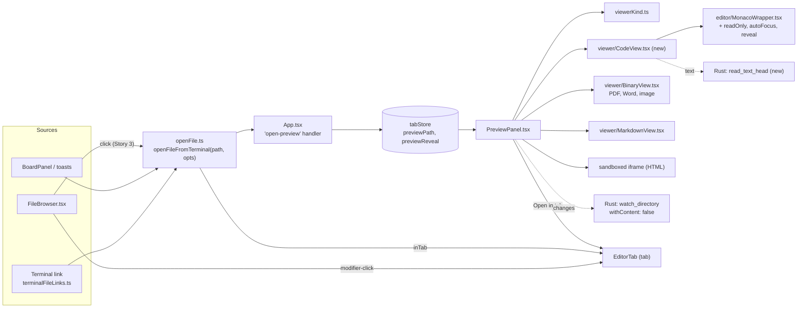
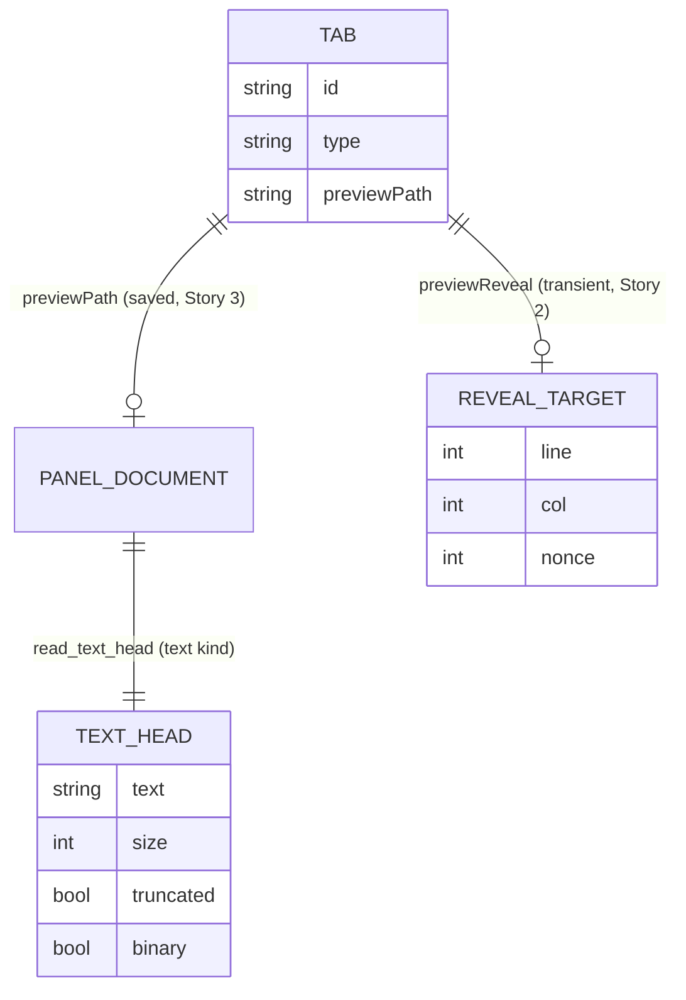
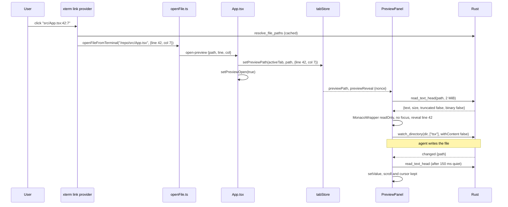

Three stories, built in order: **Story 1** (code in the side panel, terminal clicks land there), **Story 2** (go to line from `path:line`) and **Story 3** (file browser clicks land there, modifier-click opens a tab, the panel's file survives a restart). Each has its own acceptance criteria and verification. The shared intent, decisions and architecture come first.

<frozen-after-approval reason="human-owned intent — do not modify unless human renegotiates">

## Intent

**Problem:** The owner's words: "There needs to be a code viewer here", in "a panel in ADE"; asked which panel, they chose "A side panel by the terminal". Today a clicked source file always opens in a new tab, which hides the terminal the agent is working in. The Preview panel (⌘⇧B) already sits beside the terminal, but only for Markdown, HTML, PDFs and images: any other file it is given shows as a plain unhighlighted `<pre>`, and terminal clicks on code never reach it (`opensInPreview`, `src/lib/terminalFileLinks.ts:209`).

**Approach:** Grow the existing Preview panel into the code viewer rather than add a second panel beside it. Source files render in a **read-only** Monaco, through the same `MonacoWrapper` the file tab uses. Every file clicked in the terminal or the file browser opens in the panel; ⌘-click (Ctrl-click on Linux) and an *Open in tab* button open it in a tab, where it can be edited. The panel follows the file live as an agent writes it, keeping the reader's scroll position, and a `path:line` link jumps to that line. Large files are shown truncated and binary files are refused, both by one small new Rust command.

## Decisions proposed for the owner (recommended defaults; see Open questions)

1. **One side panel, not two.** The Preview panel becomes the viewer for every file kind. Same place, same shortcut (⌘⇧B / Ctrl+Alt+Shift+B), same per-tab document, same live watcher, same resize handle. No new shortcut is added.
2. **Read-only in the panel.** Editing stays in the file tab (⌘S). *Open in tab* is one click away.
3. **Click lands in the panel, modifier-click in a tab**, for both the terminal and the file browser.
4. **The panel belongs to the tab**, as `previewPath` already does: every pane of a split shares it, switching tab switches the file, and "switching project" in ADE is switching tab, so it follows too.
5. **Live by default** (the panel's existing LIVE/STATIC toggle), with scroll and cursor kept across reloads.
6. **Text files over 2 MiB show their first 2 MiB** with a banner; files with a NUL byte in their first 8 KiB are binary and not shown as text.
7. **Persisted:** the tab's panel file (fixing a gap: `previewPath` is restored on launch but never saved). **Not persisted:** whether the panel is open, its width, the scroll position, the target line.

## Boundaries & Constraints (all stories)

**Always:**
- One editor component: the panel uses `src/components/editor/MonacoWrapper.tsx`; no second Monaco setup, no other editor library.
- One kind dispatch: the panel picks its view with `viewerKind()` from `src/lib/viewerKind.ts`, the same function the file tab uses. `PreviewPanel`'s private `detectMode` is removed.
- The panel never takes keyboard focus when a file is opened into it from the terminal or the file browser: the user keeps typing in the terminal.
- HTML in the panel keeps today's sandboxed-scripts iframe (`sandbox="allow-scripts"`, pinned by `previewSecurity.test.ts`); Markdown keeps the sanitized `MarkdownView`.
- The verification command is unchanged.

**Never:**
- No editing, saving or dirty state in the panel.
- No new dependency or lockfile change.
- No change to `relay/`, `mobile/` or `packages/`.
- No change to what the file tab does or how it loads files.
- No new keyboard shortcut (decision 1).

## User flows

| Flow | Behavior |
|---|---|
| Click a file path in the terminal | Opens in the panel (opening the panel if closed) for the active tab. All kinds: code, Markdown, HTML, PDF, Word, images. Detached windows forward it to the main window, as today. |
| Click a file in the file browser (⌘B) | Story 3: opens in the panel, as above. Until then it still opens a tab. |
| ⌘-click / Ctrl-click | Story 3: opens a tab instead (`addEditorTab`, which focuses an existing tab for that file). |
| *Open in tab* button in the panel header | Opens the panel's file in a tab. Hidden for binary files the tab cannot show. |
| ⌘⇧B | Shows or hides the panel, as today. Esc behavior is unchanged. |
| Resize | Drag the panel's left edge (existing `useDragWidth`, 280–900 px, default 480). Not persisted. |
| Splits | The panel sits beside the whole tab, not a pane. A click in any pane sets the tab's file. Zooming a pane keeps the panel. |
| Tab switch / project switch | The panel shows the new tab's file, or its empty state. Open/closed is app-wide, as today. |
| Agent edits the file | With LIVE on, the panel reloads within ~150 ms of the last write, keeping scroll and cursor. A delete shows a "Deleted on disk" banner over the last content; a re-create (atomic rename-writes) reloads it. |
| `path:line` / `path:line:col` | Story 2: the panel reveals that line, centered, with the cursor on it. Re-clicking the same link re-reveals it. Rendered views (Markdown, HTML, PDF) ignore the line. |
| Large text file (> 2 MiB) | First 2 MiB shown, banner: "Showing the first 2.0 MB of 48.3 MB. Open in tab to see it all." |
| Binary file | "Binary file (3.2 MB), not shown." PDF, Word and images are not "binary" here: they have their viewers. |
| Missing or unreadable file (e.g. restored after a restart) | "Can't open <name>: <reason>", in the panel body. |

## Architecture

### Components

### What changes, by file

- **`src-tauri/src/lib.rs`** (Story 1): new command `read_text_head(path: String, max_bytes: u64) -> Result<TextHead, String>`, registered in the handler list. `TextHead` is `{ text: String, size: u64, truncated: bool, binary: bool }`, serialized camelCase. It expands `~` like `read_file`, reads at most `max_bytes`, sets `binary` when the first 8 KiB contain a NUL byte (then `text` is empty), otherwise decodes lossily (invalid UTF-8 becomes U+FFFD, which is safe because the panel never writes back), cuts a truncated read at the last whole UTF-8 character, and sets `size` from the file's metadata. A directory or missing file is an `Err`. `read_file` is unchanged.
- **`src/lib/viewerKind.ts`**: unchanged; the panel now uses it.
- **`src/components/editor/MonacoWrapper.tsx`** (Story 1, Story 2): `onChange` and `onSave` become optional; new optional props, defaults keep the file tab's behavior exactly:
  - `readOnly` (default false): sets Monaco's `readOnly` and `domReadOnly`, turns the minimap off, and registers no save action.
  - `autoFocus` (default true): whether `editor.focus()` runs on mount.
  - The content effect keeps scroll (`getScrollTop`/`getScrollLeft`, restored after `setValue`) as well as the cursor, so a live reload does not jump.
  - Story 2: `reveal?: { line: number; col?: number; nonce: number }`. When `nonce` changes, or content first arrives, it clamps the line to `1..getModel().getLineCount()`, calls `setPosition` and `revealLineInCenter`. Monaco's current-line highlight marks it.
- **`src/components/viewer/CodeView.tsx`** (new, Story 1): `{ path, head: TextHead, reveal? }`. Renders the truncation banner when `head.truncated`, the binary message when `head.binary`, else `MonacoWrapper` with `readOnly`, `autoFocus={false}` and the path (for the language).
- **`src/components/PreviewPanel.tsx`** (Story 1): dispatches on `viewerKind(filePath)`:
  - `pdf`, `docx`, `image`: `BinaryView` with a `reloadKey` bumped by the watcher (replaces the panel's own image and PDF code; adds Word).
  - `markdown`: `MarkdownView`, via `read_file` as today.
  - `html`: the existing sandboxed iframe, via `read_file` as today.
  - `text`: `CodeView`, via `read_text_head(path, 2 * 1024 * 1024)`.
  - The watch passes `withContent: false` (the panel reloads by itself; today every matching change re-reads the file in Rust and ships it over IPC for nothing) and `extensions: []` for a file with no extension (`Makefile`, `Dockerfile`; today their changes never match). Reload happens on `changed` or `created` for the path, debounced 150 ms trailing; `removed` sets the "Deleted on disk" banner.
  - The header gains *Open in tab* (`addEditorTab(filePath)`), hidden for `head.binary`. The mode badge shows `CODE` for text. The empty state lists Code among the kinds, and the path input's placeholder no longer lists only document types.
- **`src/lib/terminalFileLinks.ts`**: Story 1 removes `opensInPreview` (everything goes to the panel). Story 2 makes `findPathCandidates` return the parsed `line` and `col` from the `:line[:col]` suffix it already strips, and `registerFileLinks`' `open` callback takes `(path, { line?, col?, inTab? })`. Story 3 sets `inTab` from the click's `MouseEvent` (`activate(event, text)`).
- **`src/lib/openFile.ts`**: `openFileFromTerminal(path, opts?)` with `opts = { line?, col?, inTab? }`. `inTab` calls `addEditorTab`; otherwise it dispatches `open-preview` with `{ path, line, col }`. The detached-window `emitTo` payload carries the same fields. A helper `opensInTab(e: { metaKey, ctrlKey }, mac = IS_MAC)` (⌘ on macOS, Ctrl on Linux) lives here, used by the terminal and the file browser.
- **`src/stores/tabStore.ts`**: Story 2 adds `previewReveal?: { line: number; col?: number; nonce: number } | null` to `Tab` and an optional third argument to `setPreviewPath(id, path, at?)`, which sets `previewReveal` with a fresh nonce (or clears it when `at` is absent). Not saved with the session. Story 3 adds `previewPath` to both branches of `saveSession` (it is already read back on restore, `tabStore.ts:633`).
- **`src/App.tsx`**: the `open-preview` handler passes `line`/`col` through to `setPreviewPath` (Story 2). No layout change: the panel keeps its slot and its `minWidth: 280`, so `sidePanelLayout.test.tsx`'s 1200 px budget is untouched.
- **`src/components/FileBrowser.tsx`** (Story 3): `handleClick(e)` opens files with `openFileFromTerminal(path, { inTab: opensInTab(e) })`.
- **Docs**: `docs/guide/files.md` (Preview panel section and the "Click a file" sentence), `docs/guide/terminal.md` (Clickable files: everything opens in the panel; `:line` jumps; ⌘-click for a tab). `docs/guide/shortcuts.md` and `ShortcutsOverlay` are unchanged: no shortcut is added.

### Data

The panel's open/closed state stays in `App` (`previewOpen`), app-wide and unsaved.

### Key flow: an agent prints `src/App.tsx:42:7` and the user clicks it

### Failure modes

| Failure | Handling |
|---|---|
| Huge file (logs, bundles) | `read_text_head` caps at 2 MiB in Rust, so the webview never receives more; banner offers the tab. |
| Binary file without a viewer | NUL in the first 8 KiB: message instead of garbage; *Open in tab* hidden. |
| Non-UTF-8 text (Latin-1, mixed) | Lossy decode; shown with U+FFFD. Safe because the panel never saves. |
| Rapid agent writes | 150 ms trailing debounce; a stale read is dropped by a request counter (only the latest read's result is applied). |
| Atomic writes (temp file + rename) | `created` for the path reloads; `removed` alone shows the banner. |
| File deleted, or gone after restart | Banner over last content; on a fresh open, the error state. |
| `:line` past the end, or past the truncated part | Clamped to the last line shown. |
| Focus stolen from the terminal | `autoFocus={false}` in the panel; tested. |
| Same file open in an editor tab with unsaved edits | The panel shows the file on disk. Documented, no merge. |
| Watch of a large folder | Unchanged scope (the watch is recursive on the file's folder, as today); `withContent: false` makes each event cheap. A file with no extension watches all events in its folder and filters by path; accepted. |

</frozen-after-approval>

---

# Story 1: Code in the side panel, terminal clicks land there

## Code Map (1)

- `src/components/PreviewPanel.tsx` -- `detectMode` :21-28 (removed); `loadContent` :61-86; watcher effect :104-142 (`extensions: [ext]`, default `withContent`); header :179-272; content dispatch :326-449, including the `<pre>` fallback :428-448.
- `src/components/editor/MonacoWrapper.tsx` -- `handleMount` :51-60 (save action, `editor.focus()`); content effect :62-69 (keeps cursor, not scroll); options :79-91.
- `src/components/viewer/BinaryView.tsx` -- `{ path, reloadKey }`, PDF, Word, image.
- `src/lib/viewerKind.ts` -- `viewerKind`, `isBinaryKind`.
- `src/lib/openFile.ts:10-16` -- `openFileHere` routes by `opensInPreview`.
- `src/lib/terminalFileLinks.ts:208-211` -- `opensInPreview`; its test at `src/lib/__tests__/terminalFileLinks.test.ts:58-65`.
- `src-tauri/src/lib.rs:342-372` -- `read_file_base64`, `read_file`; handler list :443-465. `src-tauri/src/watcher.rs` -- `with_content`, extension filter :167-173.
- `src/lib/__tests__/tauriCommandContract.test.ts` -- checks every `invoke` names a registered command with matching argument names (`maxBytes` ↔ `max_bytes`).
- `src/components/__tests__/previewSecurity.test.ts`, `sidePanelLayout.test.tsx` -- existing guards on the panel.

## Acceptance Criteria (1)

Each names the test that covers it; the developer writes it failing first. Component tests mock `@tauri-apps/api/core` as `sidePanelLayout.test.tsx` does, and mock `@monaco-editor/react` with a stub `Editor` that records its props and calls `onMount` with a fake editor (plus `vi.mock` of `monacoSetup`, whose `?worker` imports vitest cannot load).

1. `read_text_head` returns the whole text, `size`, `truncated: false`, `binary: false` for a small UTF-8 file; for a file larger than `max_bytes` returns `truncated: true`, the true `size`, and text no longer than `max_bytes` that ends on a whole character when the cut falls inside a multi-byte character; returns `binary: true` and empty text for a file with a NUL in its first 8 KiB; decodes invalid UTF-8 lossily; expands `~`; and returns `Err` for a missing path and a directory. -- `src-tauri/src/lib.rs` tests › `read_text_head_*` (one test per case)
2. With `previewPath` `/r/src/App.tsx`, the panel calls `read_text_head` with that path and `maxBytes` 2097152 and renders the Monaco stub with `readOnly` true, the file's text, and language `typescript`; no `<pre>` is rendered. -- `src/components/__tests__/PreviewPanelCode.test.tsx` › "shows source files in a read-only editor"
3. `MonacoWrapper` with `readOnly` passes `readOnly: true`, `domReadOnly: true` and `minimap.enabled: false` in its options, registers no action, and with `autoFocus={false}` never calls `focus()`; without the new props its options, save action and focus are as before. -- `src/components/editor/__tests__/MonacoWrapper.test.tsx` › "read-only mode", "defaults are the file tab's"
4. A content change keeps the editor's scroll top, scroll left and cursor. -- `MonacoWrapper.test.tsx` › "a reload keeps the reader's place"
5. A truncated head shows the banner with both sizes and *Open in tab*; a binary head shows the binary message, no editor, and no *Open in tab*. -- `PreviewPanelCode.test.tsx` › "large files are truncated", "binary files are not shown"
6. PDF, `.docx` and image paths render `BinaryView`; `.md` renders `MarkdownView`; `.html` renders the sandboxed iframe, unchanged. -- `PreviewPanelCode.test.tsx` › "each kind gets its viewer"
7. The watch is started with `withContent: false`; with `extensions: ["tsx"]` for `App.tsx` and `[]` for `Makefile`. A `changed` or `created` event for the path reloads once after 150 ms of quiet (fake timers: three events 50 ms apart cause one `read_text_head` call); an event for another path does not; `removed` shows "Deleted on disk" and keeps the editor's text. When two reads overlap, only the later one's result is shown. -- `PreviewPanelCode.test.tsx` › "follows the file live", "a deleted file keeps its last content", "a stale read never wins"
8. *Open in tab* calls `addEditorTab` with the panel's path. -- `PreviewPanelCode.test.tsx` › "opens the file in a tab"
9. `openFileFromTerminal("/r/src/App.tsx")` in the main window dispatches `open-preview` with that path and does not add a tab; the same for `.docx`, `.md` and `.png`. `opensInPreview` no longer exists. -- `src/lib/__tests__/openFile.test.ts` › "every clicked file opens in the panel"
10. `PreviewPanel.tsx` no longer contains `detectMode`, and imports `viewerKind`. -- `PreviewPanelCode.test.tsx` › "uses the shared kind dispatch" (source read, like `sidePanelLayout`'s)
11. Existing guards still pass: `previewSecurity.test.ts`, `sidePanelLayout.test.tsx`, `previewPerTab.test.ts`, `tauriCommandContract.test.ts`, `viewerKind.test.ts`.

**Docs (1):** `docs/guide/files.md`: the Preview panel shows source code read-only, with highlighting, live; large and binary files. `docs/guide/terminal.md` Clickable files: every file opens in the panel. **Contract (1):** add `.ade/context/side-panel-files.md`: every clicked file opens in the tab's side panel; read-only; `read_text_head` and its 2 MiB cap and binary rule; `withContent: false` for the panel's watch.

## Verification (1)

**Commands (the repo's verification command, unchanged):**
- `npx tsc --noEmit` -- expected: exit 0
- `npm test` -- expected: all pass, including `PreviewPanelCode.test.tsx`, `MonacoWrapper.test.tsx`, `openFile.test.ts`
- `cd src-tauri && cargo test` -- expected: all pass, including `read_text_head_*`
- `cd relay && cargo test` -- expected: all pass (no change)
- `cd mobile && npx tsc --noEmit && npx jest` -- expected: all pass (no change)

**Manual checks (running app, macOS and Linux):** click a `.ts` path printed by `ls` or Claude: the panel opens with highlighted code and the terminal keeps focus (type straight away). Let an agent edit that file: the panel updates without jumping. Open a 50 MB log: banner, no stall. Open a `.zip`: binary message. Open a `.docx` from the terminal: it renders in the panel.

**Results (1):** _QA fills this in._

---

# Story 2: Go to line from `path:line`

Depends on Story 1.

## Code Map (2)

- `src/lib/terminalFileLinks.ts:22,32` -- `LINE_COL` is matched and discarded; `PathCandidate` :10-16; `registerFileLinks` :151-206 (`activate: () => open(f.abs)` :199).
- `src/hooks/useTerminal.ts:238` -- `registerFileLinks(term, …, openFileFromTerminal)`.
- `src/lib/openFile.ts` -- `open-preview` dispatch and the detached-window payload.
- `src/App.tsx:144-156` -- `open-preview` handler.
- `src/stores/tabStore.ts:50,83,331` -- `previewPath`, `setPreviewPath`.

## Acceptance Criteria (2)

1. `findPathCandidates("src/App.tsx:42:7")` gives path `src/App.tsx`, line 42, col 7; `"a.ts:9"` gives line 9 and no col; `"a.ts"` gives neither; existing cases keep their paths and offsets. -- `src/lib/__tests__/terminalFileLinks.test.ts` › "keeps the line and column of a path:line link"
2. A link's `activate` passes the line and column to `open`. -- `terminalFileLinks.test.ts` › "a clicked link carries its line" (fake `Terminal` with one buffer line, `resolve_file_paths` mocked)
3. `openFileFromTerminal(p, { line: 42, col: 7 })` dispatches `open-preview` with `{ path: p, line: 42, col: 7 }`; from a detached window the emitted payload has the same fields; `listenForFileOpens` passes them on. -- `openFile.test.ts` › "the line travels with the file"
4. `setPreviewPath(id, p, { line: 42 })` sets `previewReveal.line` 42 with a nonce different from the previous one, also when called twice with the same arguments; `setPreviewPath(id, p)` clears it; `previewReveal` is not in the saved session. -- `src/stores/__tests__/previewPerTab.test.ts` › "a target line is per open request and never saved"
5. `MonacoWrapper` with `reveal` `{ line: 42, nonce: 1 }` calls `setPosition({ lineNumber: 42, column: 1 })` and `revealLineInCenter(42)` once content is set; a new nonce with the same line reveals again; a line past the model's last line is clamped to it. -- `MonacoWrapper.test.tsx` › "reveals the target line", "clamps a line past the end"
6. The panel passes the tab's `previewReveal` to `CodeView` for text files and ignores it for other kinds. -- `PreviewPanelCode.test.tsx` › "a path:line link opens at that line"

**Docs (2):** `docs/guide/terminal.md`: replace "A trailing `:line` or `:line:col` is ignored" with: it opens the file at that line in the panel.

## Verification (2)

**Commands:** the same five lines as Story 1; expected all pass.

**Manual checks:** run `grep -n useState src/App.tsx` and click a result: the panel opens at that line, centered. Click a second result in the same file: it moves there. Click a `.md:10` link: the document renders, no error.

**Results (2):** _QA fills this in._

---

# Story 3: File browser clicks land in the panel; modifier-click opens a tab; the file survives a restart

Depends on Story 2 (shares `openFile.ts` and the `open` callback's options).

## Code Map (3)

- `src/components/FileBrowser.tsx:70-82` -- `handleClick` opens every file with `addEditorTab`.
- `src/lib/terminalFileLinks.ts:199` -- `activate` (xterm passes the `MouseEvent`).
- `src/lib/shortcuts.ts:14` -- `IS_MAC`.
- `src/stores/tabStore.ts:520-562` -- `saveSession`: neither branch writes `previewPath`; restore reads it at :633.

## Acceptance Criteria (3)

1. `opensInTab` is true for `{ metaKey: true }` on macOS and `{ ctrlKey: true }` on Linux, false for a plain click on either, and false for Ctrl on macOS and ⌘ on Linux. -- `openFile.test.ts` › "which click opens a tab"
2. `openFileFromTerminal(p, { inTab: true })` adds an editor tab for `p` and dispatches no `open-preview`. -- `openFile.test.ts` › "a modifier-click opens a tab"
3. A terminal link activated with the platform modifier passes `inTab: true`. -- `terminalFileLinks.test.ts` › "a modifier-click link opens a tab"
4. Clicking a file in the file browser dispatches `open-preview` for it and adds no tab; ⌘-clicking (macOS) adds the tab; clicking a folder still expands it. -- `src/components/__tests__/FileBrowserOpen.test.tsx` › "a file opens in the panel, modifier-click in a tab"
5. `saveSession` writes each tab's `previewPath` (terminal and non-terminal tabs), and a save-then-restore round trip gives the tab the same `previewPath`. -- `src/stores/__tests__/session.test.ts` › "the panel's file survives a restart"
6. A restored `previewPath` whose file is gone shows the panel's error state naming the file, not a blank panel. -- `PreviewPanelCode.test.tsx` › "a missing file says so"

**Docs (3):** `docs/guide/files.md`: "Click a file in the browser… and it opens in the panel beside the terminal; ⌘-click (Ctrl-click on Linux) or *Open in tab* opens it in a tab, where you can edit it." Same sentence in `terminal.md` Clickable files. Update `.ade/context/side-panel-files.md` with the modifier rule.

## Verification (3)

**Commands:** the same five lines; expected all pass.

**Manual checks:** in the file browser, click a file (panel), ⌘-click it (tab); on Linux, Ctrl-click. Quit and relaunch: ⌘⇧B shows the tab's last file. Check ⌘-click in the terminal does not also trigger xterm's own selection or a browser link.

**Results (3):** _QA fills this in._

---

## Out of scope

- Editing in the panel, or any save from it.
- Highlighting what an agent changed (diff decorations), "follow the end" for logs, or a history of files viewed.
- Several files or sub-tabs inside the panel.
- A per-pane panel, or one panel per split.
- Persisting the panel's open state, width or scroll.
- A setting to choose panel-or-tab as the default click target.
- Go-to-line when a file opens in a tab, and the file tab's own large-file behavior (`read_file` has no cap).
- Renaming the Preview panel (see Open questions).
- A Rendered/Source toggle for Markdown and HTML in the panel (the tab has it).

## Open questions for the owner

1. **Grow the Preview panel, or add a second panel beside it?** Recommended: **grow it**. It is already the docked panel beside the terminal and already holds a per-tab file with a live watcher. A second right-hand panel would compete for width with Preview and the board, and give a clicked file two possible destinations. If you want a separate panel anyway, its shortcut would be ⌘⇧E / Ctrl+Alt+Shift+E, which nothing in ADE uses.
2. **Should a plain click in the file browser open the panel instead of a tab?** Recommended: **yes**, with ⌘-click (Ctrl-click on Linux) and *Open in tab* for a tab. That is how your request reads ("instead of opening a new tab").
3. **Read-only or editable in the panel?** Recommended: **read-only**. One place edits a file, so there's no second dirty buffer racing the agent's writes and no close prompt for a panel. Editing is one click away, in a tab.
4. **Keep the name "Preview panel"?** Recommended: **keep it for now**: the shortcut list, guide and palette already use it. Renaming it to "Viewer" later is a small change.
5. **Large-file cap of 2 MiB?** Recommended: **yes**. It shows any normal source file whole and keeps a 50 MB log from stalling the window.
6. **Persist the panel's open state and width?** Recommended: **no**. Persist only the tab's file (Story 3), which fixes a gap where it was read back on launch but never saved.

## Review Triage Log

_Empty: not yet reviewed._
