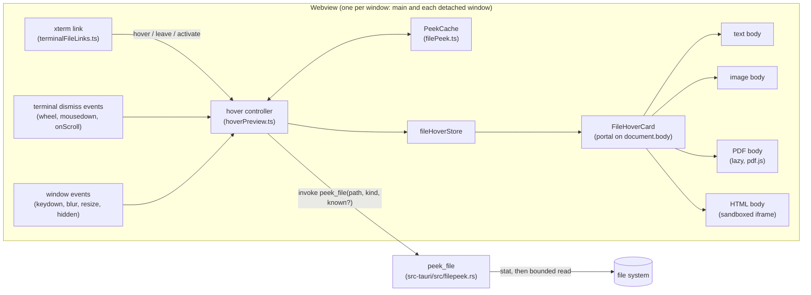
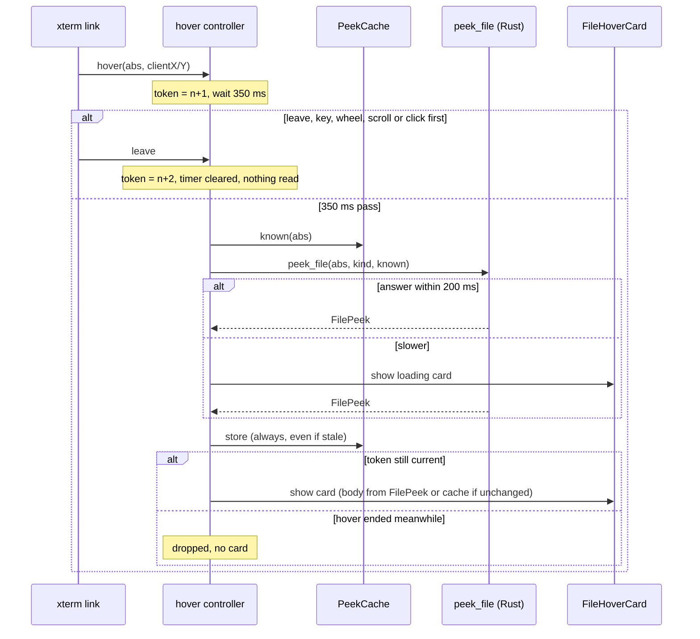

Four stories, built in order: **Story 1** is the card itself, with text, code and file details. **Story 2** adds images, **Story 3** the first page of a PDF and **Story 4** an HTML snapshot. Each later story adds one kind of body to the card from Story 1. The shared intent, contract, limits and lifecycle come first. Both files in `context` are new. The architect writes the ADR when the owner approves, and Story 1 writes the contract file.

<frozen-after-approval reason="human-owned intent — do not modify unless human renegotiates">

## Intent

**Problem:** A path in terminal output becomes a link when the file exists, and clicking it opens the file in the preview panel or a tab (`src/lib/terminalFileLinks.ts`, `src/lib/openFile.ts`). Seeing what a file holds means opening it, which takes over the preview panel or adds a tab. Agents print paths to dozens of files, and the owner wants to see a file before deciding to open it.

**Approach:** Show a small card when the pointer rests on a file link. It holds the file's name, size and modified time, plus a preview of the content: the first lines of a text or code file, an image thumbnail, the first page of a PDF, or a static snapshot of an HTML page. Clicking still opens the file as it does today. A new backend command, `peek_file`, reads the file with fixed limits, so no hover reads a whole large file. The card follows the existing viewers' safety rules: text is rendered as text, an SVG only as an ``, and HTML only inside an iframe with an empty sandbox (no scripts) and a deny-all CSP (no network).

## Owner's decisions (2026-10-29)

1. Shape: a hover card on the file paths ADE already links in terminal output. Clicking still opens the file, as today.
2. File types: all four. Images (PNG, JPEG, GIF, SVG, WebP, BMP, ICO), Markdown and text/code (first lines), PDFs (first page) and HTML (a rendered snapshot). Every card shows the file's size and modified time.

## Boundaries & Constraints (all stories)

**Always:**
- The card previews only a link's `abs`, the path `resolve_file_paths` already resolved for that link. It never resolves or guesses a path of its own.
- `peek_file` enforces every read limit (the table below). The frontend cannot ask for more.
- Nothing about the card can take focus. It has `pointer-events: none` and no `tabindex`, and its code never calls `focus()`. Keystrokes always go to the terminal. A key press closes the card and still reaches the terminal (the listener is passive and never calls `preventDefault`).
- A hover that ends before its preview loads never shows a card.
- Untrusted content stays inert. File text is rendered as React text nodes, never as HTML. An SVG is shown only as ``, never added to the DOM as markup. HTML is shown only in an `<iframe sandbox="">` whose srcdoc starts with the deny-all CSP meta (Story 4).
- Every color comes from the theme's CSS variables. The card's secondary text uses `var(--text-secondary)`, because `--text-muted` measures 2.9:1 on elevated surfaces (designer knowledge, 2026-10-15). The checkerboard behind images and the white page behind a PDF or HTML snapshot are the only fixed colors.
- The verification command is unchanged.

**Never:**
- No change to how links are found, resolved or opened. `findPathCandidates`, `stitchRows`, `resolve_file_paths`, `opensInPreview` and `openFileFromTerminal` keep their behavior.
- No change to `read_file` or `read_file_base64` behavior. Story 2 moves the base64 encoder out of `read_file_base64` into a shared function, and the output stays byte-identical.
- No `allow-scripts` and no `allow-same-origin` in the card's iframe, and no change to `tauri.conf.json` (CSP, asset protocol or capabilities).
- No new npm or Cargo dependency (images are scaled by the webview, PDFs use the bundled `pdfjs-dist`, and DOMParser is built in).
- No change to `relay/`, `mobile/` or the phone remote. No hover card for URLs (`WebLinksAddon`) or for directories (links are files only).

</frozen-after-approval>

---

# Shared design (all stories)

## Components and flow

There is no persistent data. The cache is in memory, one per window. The only stored value is the new setting.

## The `peek_file` contract (recorded in `.ade/context/file-peek.md` by Story 1)

`#[tauri::command(async)] peek_file(path: String, kind: PeekKind, known: Option<Known>) -> Result<FilePeek, String>`, in a new `src-tauri/src/filepeek.rs`. Field names are camelCase over IPC.

- `PeekKind`: `"text" | "image" | "pdf" | "html" | "meta"`. The frontend chooses it with `peekKind(path)`, which reuses `viewerKind` from `src/lib/viewerKind.ts`: `markdown` and `text` map to `text`, `docx` maps to `meta`, and the others keep their name.
- `Known`: `{ size: u64, modifiedMs: u64 }`, the values the cache holds for this path.
- `FilePeek`: `{ size: u64, modifiedMs: u64 | null, body: Body }`, where `size` and `modifiedMs` come from `std::fs::metadata` (which follows symlinks) and `modifiedMs` is milliseconds since the epoch.
- `Body`, tagged by `type`:
  - `{ type: "text", text, truncated }` for kinds `text` and `html`.
  - `{ type: "binary" }` when a NUL byte appears in the first 8 KiB (kinds `text` and `html`).
  - `{ type: "bytes", base64, width?, height? }` for kinds `image` (Story 2) and `pdf` (Story 3).
  - `{ type: "tooLarge", limit }` when the file is over its kind's cap. The file is not read.
  - `{ type: "unchanged" }` when `known` equals the file's size and mtime. The file is not read.
  - `{ type: "none" }` for kind `meta`.
- Order of work: (1) `metadata`, which errors if the path is missing and returns `Err("not a regular file")` unless `is_file()`; (2) if `known` matches, return `unchanged`; (3) check the size cap; (4) `File::open`, check that the open handle's `metadata().is_file()`, then read through `Read::take(cap)`.
- Story 1 builds `text`, `binary`, `unchanged`, `none` and the kinds `text`, `html` and `meta`. Text and HTML are never refused: they are truncated. `tooLarge` arrives with images in Story 2. Until Stories 2 and 3 land, kinds `image` and `pdf` return `none`, so a hover on them shows the file's details only. Each later story adds its own arm.

## Limits

Each limit is a Rust `const` in `filepeek.rs`, except the frontend-only ones, which are constants in `src/lib/filePeek.ts`.

| What | Limit | Why |
|---|---|---|
| Text/code read | first 16 KiB | 16 lines need only a few KiB. A minified file is one long line. |
| Binary sniff | NUL byte in first 8 KiB → `binary` | Git's heuristic. Latin-1 and other non-UTF-8 text still decodes (lossily). |
| Text shown (frontend) | 16 lines, each clipped by CSS (`white-space: pre; overflow: hidden`) | Fills the card's height. |
| HTML read | first 256 KiB as text | A truncated page still renders. |
| Raster image | 10 MiB | Base64 over IPC grows it by a third. |
| SVG | 1 MiB | Large SVGs are slow to rasterize. |
| Image pixels (frontend) | 40 megapixels; raster with unreadable dimensions is not decoded | A small file can hold a huge bitmap (a 20000×20000 PNG decodes to 1.6 GB). |
| PDF | 20 MiB, page 1 only | pdf.js parses off the main thread in its worker. |
| Cache (frontend) | 32 entries and 24 MB of content, least recently used evicted | Images are the heavy entries. PDFs keep only the rendered thumbnail. |

UTF-8 cut at the read boundary: an incomplete trailing sequence is dropped, not turned into U+FFFD. `\r\n` becomes `\n`. An empty file shows "Empty file".

## Hover lifecycle (`src/lib/hoverPreview.ts`, framework-free)

`createHoverController({ peek, cache, show, hide, enabled, delayMs = 350, loadingAfterMs = 200 })` returns `{ enter(abs, point), leave(), dismiss() }`.

- `enter` does nothing when `enabled()` is false. The value is read at every hover, so turning the setting off works immediately in open terminals. Otherwise it increments the token, clears any pending timer, hides the current card and starts the delay.
- When the delay ends, it calls `peek(abs, peekKind(abs), cache.known(abs))`. If the answer takes longer than `loadingAfterMs`, it shows a loading card, so a fast answer shows no loading flash.
- Every answer is stored in the cache, even a stale one: the work is already done. Only an answer whose token is still current is shown. An `unchanged` body is shown from the cache. An error shows "Can't preview: <message>" without a body.
- A Rust read in progress cannot be aborted. It is bounded instead, and a stale answer is dropped. Moving the pointer across many links issues no reads, because a read starts only after a link has been hovered for the full 350 ms.

**What closes the card** (all call `dismiss`): the link's `leave`; the link's `activate` (a click, which still opens the file); `mousedown` and `wheel` on the terminal's element; `term.onScroll`; a `keydown` on the window (capture phase, passive); window `blur` and `resize`; and `visibilitychange` to hidden. The terminal-side listeners come from `attachHoverDismissal(term, dismiss)`, whose returned disposer `useTerminal` calls when it disposes the terminal. xterm 6 also calls `leave` when the link's rows are redrawn or the pointer leaves the terminal (`_clearCurrentLink` in the linkifier). So while an agent streams output at the bottom of the terminal, paths scroll out from under the pointer and the card closes. In scrolled-back history the view stays put and the card stays open.

**Unfocused panes and detached windows:** hover works on any visible pane, focused or not, and in detached windows. Each window mounts its own `FileHoverCard` and has its own controller and cache.

## Card placement and look (`FileHoverCard.tsx`, `placeCard` in `filePeek.ts`)

- The card is `position: fixed` in a portal on `document.body`, with z-index 2000 (above the panes, below the toast at 2500). It is not built inside `term.element` as xterm's docs suggest, because a split pane clips its children and the card must be able to overflow it. With `pointer-events: none` nothing underneath is blocked, so xterm's `xterm-hover` class is not needed.
- `placeCard(pointer, viewport)` uses the card's maximum size, 320×340, a 12 px gap and an 8 px margin. By default the card sits right of and below the pointer (`left`/`top`). If it would cross the right edge, it is anchored by `right` on the pointer's left instead. If it would cross the bottom, it is anchored by `bottom` above the pointer. If neither side fits, it is pinned to the margin. The card stays where it opened; it does not follow the pointer.
- Layout: 320 px wide with 12 px padding. Header: the file name in `var(--text-primary)` 12 px semibold, clipped with an ellipsis. Detail line: `"12.3 KB · modified 3 min ago"` in `var(--text-secondary)` 11 px; Story 2 adds `· 1920 × 1080` and Story 3 adds `· 12 pages`. Body: 296 px wide. Surface: `var(--bg-elevated)`, a 1 px `var(--border-strong)` border, `var(--radius-lg)` corners and `var(--shadow-lg)`. Text bodies use the terminal font at 11 px on `var(--bg-primary)` with `tab-size: 4`.
- No animation, so reduced motion needs no special case. `role="tooltip"`. The card is supplementary and works by mouse only. Keyboard access is out of scope (terminal links have none today) and is deferred.
- `formatSize`: under 1000 bytes it shows `"N B"`; above that, 1000-based units with one decimal (`"12.3 KB"`, `"4.1 MB"`, `"1.2 GB"`), as Finder shows them. `formatModified(ms, now)`: under 60 s or in the future, `"just now"`; under 60 min, `"N min ago"`; under 24 h, `"N h ago"`; otherwise the local date `YYYY-MM-DD`. When `modifiedMs` is null the detail line omits it.

## Security

- **What the card reads:** only a resolved link's `abs`. `peek_file` gives the webview no new reach: `read_file` and `read_file_base64` already read any path. It does bound how much is read and refuses anything that is not a regular file. `resolve_file_paths` already rejects FIFOs and devices; `peek_file` checks again, before opening and on the open handle.
- **Symlinks:** followed, exactly as clicking the link follows them. The card shows the target's size, mtime and content. That gives the card no access beyond what a click has.
- **Text:** rendered as text nodes, so `` in a file shows up as text.
- **SVG:** an `` with a data URL runs no script and loads nothing external (the browser's secure static mode). The SVG's markup is never parsed into the app's DOM.
- **HTML (Story 4):** the srcdoc is built by `snapshotDoc(html)`. It parses with DOMParser, which loads nothing and runs nothing, and removes `script`, `iframe`, `frame`, `frameset`, `object`, `embed`, `link`, `base`, `meta[http-equiv]` (including refresh and the page's own CSP), every `on*` attribute and every `javascript:` URL. It then inserts `<meta http-equiv="Content-Security-Policy" content="default-src 'none'; style-src 'unsafe-inline'; img-src data:; font-src data:">` as the first child of `<head>`. The iframe has `sandbox=""` (no scripts, opaque origin, no top navigation, no forms), `tabIndex={-1}` and `pointer-events: none`. Network is blocked three ways: the stripped tags, the injected CSP (which the page cannot loosen, because every policy is enforced), and the app's CSP, which srcdoc frames inherit. This is stricter than `HtmlView` (`sandbox=""`, no CSP meta) and far stricter than the preview panel (`allow-scripts`).

## Setting

`fileHoverPreview: boolean` in `src/stores/settingsStore.ts`, default **true** (see open question 1), with `setFileHoverPreview`. It is a checkbox in `SettingsPanel.tsx` next to the ADE banner option: "Preview a file when hovering its path in the terminal". The controller reads `useSettingsStore.getState().fileHoverPreview` at every hover.

## Context Store and decisions

- **New contract, `.ade/context/file-peek.md`** (Story 1, extended by Stories 2 and 3): the `peek_file` signature, the `Body` variants, the limits table and the `unchanged` rule. Any later feature that reads files for a preview uses `peek_file` instead of `read_file`.
- **New ADR, `0008-file-previews-are-bounded-and-inert.md`** (Status: Accepted), written by the architect when the owner approves. Context: `read_file*` read whole files, hovers fire constantly on arbitrary agent output, and HTML from agents is untrusted. Decision: hover previews read only through `peek_file`, whose limits are enforced in Rust, and render inertly: text as text, SVG as ``, HTML in a sandbox with no tokens plus a deny-all CSP. Never `allow-scripts`. Consequences: HTML snapshots lose external CSS, images and anything built by JavaScript (open question 3); there is one more IPC command; the limits are a contract.
- Number 0008 is the next free number after 0007. ADR 0002 was used and later removed, per the architect's knowledge file.

---

# Story 1: the card, with text, code and file details

## Code Map (1)

- `src-tauri/src/filepeek.rs` (new): `peek_file`, plus pure helpers that tests can call: `peek_path(path, kind, known) -> Result<FilePeek, String>` and `decode_text(bytes, truncated) -> Body`. Tests use a temp-dir helper like the one in `usage.rs`.
- `src-tauri/src/lib.rs:1-27` gets `mod filepeek;`; `:432` `generate_handler!` gets `filepeek::peek_file`. `src/lib/__tests__/tauriCommandContract.test.ts` then checks the argument names.
- `src/lib/filePeek.ts` (new): the IPC types, `peekKind`, `formatSize`, `formatModified`, `placeCard`, `PeekCache`.
- `src/lib/hoverPreview.ts` (new): `createHoverController` and `attachHoverDismissal`.
- `src/stores/fileHoverStore.ts` (new): a zustand store holding `{ card: { abs, point, state: "loading" | "ready" | "error", content?, error? } | null }`, with `show` and `hide`.
- `src/components/FileHoverCard.tsx` (new): the portal, the header, the detail line, the text body, and the binary, empty and error states. It is mounted once in `src/App.tsx` (next to `<Toast>`, `:550`) and once in `src/DetachedApp.tsx`.
- `src/lib/terminalFileLinks.ts:151`: `registerFileLinks(term, getCwd, open, preview?)`, where the optional `preview: { enter(abs, point), leave(), dismiss() }`. At `:199` each link gains `hover: (e) => preview.enter(f.abs, { x: e.clientX, y: e.clientY })`, `leave: () => preview.leave()`, and `activate` calls `preview.dismiss()` before `open(f.abs)`. There is no `dispose` hook: xterm disposes a whole line's links when it asks for another line, and a `dispose` that closed the card could cancel the hover that just started. `leave` already covers every way the hovered link goes away. Without `preview` the links are exactly as today.
- `src/hooks/useTerminal.ts:238`: `openTerminal` passes the window's controller and calls `attachHoverDismissal(term, controller.dismiss)`. The disposer runs next to `inst.term.dispose()` (`:159`).
- `src/stores/settingsStore.ts:366,439,512` and `src/components/SettingsPanel.tsx:~612`: the setting.
- `docs/guide/terminal.md:45-57` ("Clickable files"): one bullet on hovering, the four kinds, the limits in plain words, the setting, and that output streaming at the bottom closes the card.

## Acceptance Criteria (1)

Each names the test that covers it. The developer writes it failing first.

1. A small text file gives `text` with its whole content and `truncated: false`, and the file's real `size` and `modifiedMs`. A 100 KB file gives at most 16 KiB of text, `truncated: true` and `size` 100 KB. -- `src-tauri/src/filepeek.rs` tests › `text_is_read_up_to_the_cap`
2. A NUL byte within the first 8 KiB gives `binary`. A multi-byte UTF-8 character cut at the 16 KiB boundary is dropped, with no U+FFFD at the end. Invalid UTF-8 inside the text decodes lossily. `\r\n` becomes `\n`. -- › `binary_and_utf8_edges`
3. A missing path and a directory give `Err`. On unix, a FIFO (made with `mkfifo` in the test) gives `Err("not a regular file")` without blocking, and the test finishes within 2 s. A symlink to a regular file returns the target's content. -- › `only_regular_files_are_read`
4. `known` equal to the file's size and mtime gives `unchanged`. A different size or mtime gives the full body. Kind `meta` gives `none` with size and mtime. Kinds `image` and `pdf` give `none` in this story. -- › `known_and_meta`
5. Kind `html` returns at most 256 KiB of text, with `truncated: true` past that. A sparse 1 GiB file (made with `set_len`) peeked as `text` returns 16 KiB within 1 s, which shows the read is bounded. -- › `reads_are_bounded`
6. `peekKind`: `.md`, `.ts` and `Dockerfile` give `text`; `.png` and `.svg` give `image`; `.pdf` gives `pdf`; `.html` and `.htm` give `html`; `.docx` gives `meta`. -- `src/lib/__tests__/filePeek.test.ts` › "peekKind follows viewerKind"
7. `formatSize` and `formatModified` follow the table in the shared design, including the boundaries (999 B, 1000 B, 59 s, 60 min, 24 h, a future mtime, null). -- › "formats size and modified time"
8. `placeCard` returns left/top in open space, right when the right edge would be crossed, bottom when the bottom edge would be crossed, both together in the bottom-right corner, and margin clamping in a viewport smaller than the card. -- › "places the card inside the window"
9. `PeekCache` evicts the least recently used entry beyond 32 entries or 24 MB of content, `known(abs)` returns the stored size and mtime, and a read moves an entry to most recent. -- › "cache is bounded and LRU"
10. With fake timers: there is no `peek` before 350 ms; a `leave` at 349 ms means no `peek` and no card; a `peek` answered after `leave` is cached but not shown; a second `enter` hides the first card and only the second is shown; an answer within 200 ms shows no loading card, and a slower one shows the loading card first; with `enabled()` false, `enter` calls nothing; an `unchanged` answer shows the cached content; a rejected `peek` shows an error card. -- `src/lib/__tests__/hoverPreview.test.ts` › "delays, cancels and drops stale previews"
11. `attachHoverDismissal` calls `dismiss` on `wheel` and `mousedown` on the terminal element, on `term.onScroll`, on a window `keydown` (and the event's `defaultPrevented` stays false), on window `blur` and `resize`, and on `visibilitychange` when the document is hidden. After the disposer runs, none of these calls it. -- › "every dismissal path closes the card"
12. A fake terminal (`buffer.active.getLine`, `registerLinkProvider` captured) with `invoke` mocked to resolve one path: the provided link's `hover` calls `preview.enter(abs, {x, y})` from the event's `clientX/Y`; `leave` calls `preview.leave`; `activate` calls `preview.dismiss` and then `open(abs)`. Without `preview`, the link has no `hover` or `leave`. -- `src/lib/__tests__/terminalFileLinks.test.ts` › "links drive the hover preview and still open on click"
13. `FileHoverCard` with a text body shows the name, the detail line and at most 16 lines, plus a final "…" row when `truncated` or more lines exist. `binary` shows "Binary file". `none` shows the details only. An error shows "Can't preview: …". A file containing `` adds no `img` element. -- `src/components/__tests__/FileHoverCard.test.tsx` › "renders text and details as text"
14. The card has `role="tooltip"`, `pointer-events: none` and no `tabindex` attribute, and no element inside it has one. `document.activeElement` is the same before and after the card shows. Its `left/top/right/bottom` equal `placeCard`'s result for the stored pointer. Its colors are `var(...)` values only. -- › "never takes focus and sits where placeCard says"
15. `fileHoverPreview` defaults to true, `setFileHoverPreview(false)` persists it, and a reloaded store reads false. -- `src/stores/__tests__/settingsStore.test.ts` › "file hover preview setting" (new file)
16. The existing suites still pass, including `terminalFileLinks.test.ts`, `previewSecurity.test.ts` and `tauriCommandContract.test.ts` (which now covers `peek_file`'s `path`, `kind` and `known`). -- existing

## Verification (1)

**Commands (the repo's verification command, unchanged):**
- `npx tsc --noEmit` -- expected: exit 0
- `npm test` -- expected: all files pass, including the new and extended tests above
- `cd src-tauri && cargo test` -- expected: all pass, including the `filepeek` tests
- `cd relay && cargo test` -- expected: all pass (no change)
- `cd mobile && npx tsc --noEmit && npx jest` -- expected: all pass (no change)

**Manual checks (macOS app, plus Linux WebKitGTK if available):** hover `src/App.tsx:42:7` in Claude Code output and check that the card appears after about a third of a second next to the pointer, inside the window, and over a neighboring split pane. Then check: typing closes it and the keys reach the shell; scrolling closes it; clicking still opens the file; hovering a 2 GB log shows 16 lines at once; hovering `a.zip` shows "Binary file"; with the setting off, nothing appears; the same holds in a detached window.

---

# Story 2: images

Depends on Story 1.

## Code Map (2)

- `src-tauri/src/lib.rs:342`: move the encoder out of `read_file_base64` into `pub(crate) fn base64_encode(bytes: &[u8]) -> String`. `read_file_base64` then calls it, and its output does not change.
- `src-tauri/src/filepeek.rs`: kind `image` returns `bytes` up to 10 MiB, or 1 MiB for `.svg`. `image_size(bytes) -> Option<(u32, u32)>` reads the header of PNG (IHDR), GIF (logical screen), JPEG (first SOFn marker), WebP (`VP8 `, `VP8L` and `VP8X`) and BMP. SVG and ICO have no size.
- `src/components/FileHoverCard.tsx`: the image body. It shows `` in a 296×200 box with `object-fit: contain`, over a CSS checkerboard so dark or transparent images stay visible. It reuses `imageMime` from `src/lib/viewerKind.ts`. The detail line gains `· W × H`.
- `.ade/context/file-peek.md`: the `image` arm and its caps.

## Acceptance Criteria (2)

1. `image_size` returns the right dimensions for hand-built minimal headers of PNG, GIF, JPEG (one with an APP0 segment before SOF0), WebP VP8, VP8L and VP8X, and BMP, and returns `None` for a header cut short and for random bytes. -- `filepeek.rs` tests › `image_header_sizes`
2. An image under its cap gives `bytes` whose `base64` equals `read_file_base64` of the same file, plus `width` and `height`. A sparse 11 MiB `.png` and a 2 MiB `.svg` give `tooLarge` with 10 MiB and 1 MiB respectively. -- › `images_are_capped_and_sized`
3. `base64_encode` of the bytes 0 to 255, and of inputs of length 1, 2 and 3, equals the reference strings, and `read_file_base64` of a fixture equals `base64_encode` of its bytes. -- `lib.rs` tests › `base64_encode_matches_reference`
4. A PNG body renders exactly one `img` whose `src` starts with `data:image/png;base64,` and has `decoding="async"`, and the detail line shows `"W × H"`. -- `FileHoverCard.test.tsx` › "image thumbnail"
5. An SVG body containing `<script>` renders as an `img` with `src` starting `data:image/svg+xml;base64,`. The card contains no `svg` element, and the document has no new `script` element. -- › "svg is only ever an img"
6. A raster over 40 megapixels, or with no readable size, renders no `img` and shows "Too large to preview" or "Can't read image size". A `tooLarge` body shows "Too large to preview (limit 10 MB)". -- › "big images are not decoded"
7. A cached image entry counts its base64 length toward the 24 MB cap, so three 10 MB images keep only the two most recent. -- `filePeek.test.ts` › "cache counts image bytes"

## Verification (2)

**Commands:** the same five lines as Story 1. Expected all pass.

**Manual checks:** hover a PNG, a transparent PNG, an animated GIF (it animates), a WebP, an SVG and an ICO, on Nord and on Precision. Hover an image over 10 MB and a 20000×20000 PNG: neither should freeze the app.

---

# Story 3: the first page of a PDF

Depends on Story 1.

## Code Map (3)

- `src/lib/pdf.ts` (new): `loadPdf(bytes: Uint8Array): Promise<PDFDocumentProxy>`. It holds the legacy-build import and the `?url` worker setup, moved from `src/components/viewer/PdfView.tsx:31-37` with their comments. `PdfView` calls it, and its behavior is unchanged.
- `src-tauri/src/filepeek.rs`: kind `pdf` returns `bytes` up to 20 MiB.
- `src/components/hover/HoverPdf.tsx` (new, loaded with `React.lazy` so pdf.js loads on the first PDF hover only): it runs `loadPdf`, then `getPage(1)`, then a viewport scaled to fit 296×240, multiplied by `devicePixelRatio` up to 2. It renders into a canvas, keeps `canvas.toDataURL("image/png")` and `numPages` in the cache as the PDF entry, replacing the PDF bytes held there, and shows that as an `img` on white. The detail line gains `· N pages`. On unmount it calls `renderTask.cancel()` and `loadingTask.destroy()`.
- `src/lib/hoverPreview.ts`: a cached PDF entry answers `unchanged` with its thumbnail, so pdf.js is not loaded again.
- `.ade/context/file-peek.md`: the `pdf` arm and its cap.

## Acceptance Criteria (3)

1. A PDF under 20 MiB gives `bytes`. A sparse 21 MiB `.pdf` gives `tooLarge`, and nothing is read. -- `filepeek.rs` tests › `pdfs_are_capped`
2. `loadPdf` imports the legacy build and sets `GlobalWorkerOptions.workerSrc` before `getDocument({ data })`. `PdfView` given bytes calls `loadPdf` with them, with `../../lib/pdf` mocked. -- `src/lib/__tests__/pdf.test.ts` › "loads through the legacy build with its worker"; `src/components/__tests__/PdfView.test.tsx` › "uses the shared loader" (new file)
3. With `loadPdf` mocked to a fake document of 12 pages, the card calls `getPage` exactly once, with 1. It shows one `img` with a `data:image/png` thumbnail and the detail line shows `· 12 pages`. jsdom has no canvas: the test stubs `HTMLCanvasElement.prototype.getContext` and `toDataURL`. -- `src/components/__tests__/HoverPdf.test.tsx` › "renders page one only"
4. A dismiss before the render resolves calls the render task's `cancel` and the loading task's `destroy`, and no `img` appears. -- › "a dismissed card stops pdf.js"
5. A second hover on the same unchanged PDF shows the cached thumbnail and does not call `loadPdf`. -- › "an unchanged PDF is not parsed again"
6. `loadPdf` rejecting (an encrypted or corrupt file) shows "Can't preview this PDF" with the file's details still present. -- › "a PDF that won't open still shows its details"
7. `scripts/previewPdfRender.test.ts` still passes: no `iframe`, `embed` or `object` gets a data URL. -- existing

## Verification (3)

**Commands:** the same five lines as Story 1. Expected all pass.

**Manual checks:** hover a one-page PDF, a 300-page PDF, a landscape PDF and a password-protected one. Move the pointer away mid-load: no card should appear and nothing should be left rendering. Then open the PDF by click: the panel still renders it.

---

# Story 4: an HTML snapshot

Depends on Story 1.

## Code Map (4)

- `src/lib/htmlSnapshot.ts` (new): `snapshotDoc(html: string): string`, as in the shared design's Security section. It returns `"<!doctype html>" + documentElement.outerHTML`. `isBlank(doc)` is true when the stripped `<body>` has no text after trimming and no `img`, `svg`, `canvas`, `video` or `picture` element.
- `src/components/FileHoverCard.tsx`: the HTML body is a 296×222 clip box holding `<iframe sandbox="" srcDoc={snapshotDoc(text)} title="HTML snapshot" tabIndex={-1} style={{ width: 1024, height: 768, transform: "scale(0.289)", transformOrigin: "0 0", pointerEvents: "none", border: "none", background: "#fff" }}/>`. When `isBlank`, for example a page built by JavaScript, it shows the source's first 16 lines (Story 1's text body) with the label "HTML source". A `binary` body shows "Binary file".
- No Rust: Story 1 already reads kind `html`, up to 256 KiB.

## Acceptance Criteria (4)

1. `snapshotDoc` removes `script`, `iframe`, `frame`, `object`, `embed`, `link`, `base` and `meta[http-equiv]` (refresh and the page's own CSP), every `on*` attribute, and `javascript:` in `href`, `src` and `action`. It keeps `style` elements, `style` attributes and `data:` images. -- `src/lib/__tests__/htmlSnapshot.test.ts` › "strips everything that runs or fetches"
2. The first child of the result's `<head>` is the CSP meta with exactly `default-src 'none'; style-src 'unsafe-inline'; img-src data:; font-src data:`. This holds for a document with no `<head>`, a fragment, and a page with its own CSP meta, which is removed and does not come first. -- › "the deny-all policy comes first"
3. `isBlank` is true for a script-only SPA shell and false for a page with text or only an image. -- › "detects a page with nothing to show"
4. The card's HTML body renders an `iframe` whose `sandbox` attribute is the empty string, whose `srcdoc` begins with `<!doctype html>` and contains the CSP meta, with `tabindex="-1"` and `pointer-events: none`. A blank page shows "HTML source" and the first lines as text. -- `FileHoverCard.test.tsx` › "html snapshot is sandboxed and inert"
5. A source check: every `<iframe` in `FileHoverCard.tsx` and in `src/components/hover/` has `sandbox=""`, and none of them contains `allow-`. -- `src/components/__tests__/previewSecurity.test.ts` › "hover card iframes allow nothing" (new case)

## Verification (4)

**Commands:** the same five lines as Story 1. Expected all pass.

**Manual checks:** start `python3 -m http.server 8765` in a scratch folder. Hover an HTML file that references `http://127.0.0.1:8765/` through ``, `<link rel=stylesheet>`, an `@import` in a `<style>`, a CSS `url()` and `<meta http-equiv="refresh" content="0;url=http://127.0.0.1:8765/">`. The server must log **no** request. Check this in the macOS app and on Linux WebKitGTK. Also hover a styled static page (it renders with its inline styles), a Vite `index.html` (it shows "HTML source"), and a 1 MB HTML file (no freeze).

---

## Deferred (to add to `_bmad-output/deferred-work.md` on approval)

- Keyboard access to the card, for example a shortcut that previews the link under the cursor. Terminal links have no keyboard access today.
- The same hover card in the file browser and in Markdown links.
- Previews for `.docx` (first paragraphs via mammoth), video and audio.
- A true HTML screenshot with external CSS and images, which would need an offscreen renderer and its own security review.
- Streaming large images through Tauri's asset protocol instead of base64. That needs `protocol-asset` and a scope in `tauri.conf.json`, which would widen what the webview can read.

## Open Questions (owner)

1. **Setting default.** The card is on by default, with a checkbox to turn it off. *Recommendation: on.* It is what was asked for, and the 350 ms delay keeps it out of the way.
2. **Markdown in the card.** Should the card show the raw first lines, or render them? *Recommendation: raw first lines.* Rendering would fetch the document's images and draw diagrams on every hover. The click already gives the rendered view.
3. **HTML fidelity.** With no scripts and no network, the snapshot shows only what the file holds inline. Pages styled by an external stylesheet look plain, and pages built by JavaScript show their first source lines instead. *Recommendation: accept this.* A fuller snapshot would need scripts or file access in the frame, which the owner's "at least as sandboxed as HtmlView" rules out.
4. **Hover delay.** *Recommendation: 350 ms, fixed, with no setting for it.* It can be tuned after use.

## Review Triage Log
