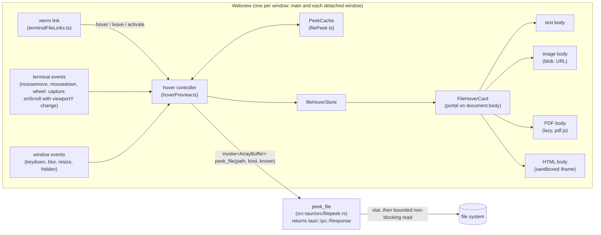

Five stories, built in order:

1. `peek_file` and its contract.
2. The card, with text, code and file details.
3. Images.
4. The first page of a PDF.
5. An HTML snapshot.

Story 1 has no visible effect. It is the bounded backend read and the frontend client, split out so Story 2 stays reviewable. Each story from 3 on adds one kind of body to Story 2's card. The shared intent, contract, limits and hover lifecycle come first.

Both files in `context` are new. The architect writes the ADR when the owner approves; Story 1 writes the contract file.

<frozen-after-approval reason="human-owned intent — do not modify unless human renegotiates">

## Intent

**Problem:** ADE already turns a path in terminal output into a link when the file exists, and clicking the link opens the file in the preview panel or a tab (`src/lib/terminalFileLinks.ts`, `src/lib/openFile.ts`). To see what a file holds, you have to open it, which takes over the preview panel or adds a tab. Agents print paths to dozens of files, and the owner wants to see a file before deciding to open it.

**Approach:** When the pointer rests on a file link, show a small card. It gives the file's name, size and modified time, and previews the content: the first lines of a text or code file, an image thumbnail, the first page of a PDF, or a static snapshot of an HTML page. Clicking still opens the file as it does today.

A new backend command, `peek_file`, reads the file with fixed limits and returns raw bytes, not base64. A hover therefore never reads a whole large file and never decodes a large string on the UI thread.

The card follows the existing viewers' safety rules. Text is rendered as text. An SVG appears only as an ``. HTML appears only as a sanitized document inside an iframe with an empty sandbox (no scripts) and a deny-all CSP (no subresource fetches).

## Owner's decisions (2026-10-29)

1. **Shape:** a hover card on the file paths ADE already links in terminal output. Clicking still opens the file, as today.
2. **File types: all four.**
   - Images: PNG, JPEG, GIF, SVG, WebP, BMP, ICO.
   - Markdown and text/code: the first lines.
   - PDFs: the first page.
   - HTML: a rendered snapshot.

   Every card shows the file's size and modified time.

## Boundaries & Constraints (all stories)

**Always:**
- The card previews only a link's `abs`: the path `resolve_file_paths` already resolved for that link. It never resolves or guesses a path of its own.
- `peek_file` enforces every read limit, size cap and pixel cap listed in the limits table below. The frontend cannot ask for more.
- Nothing in the card can take focus or sit in the tab order:
  - The card has `pointer-events: none`.
  - Its code never calls `focus()`.
  - The only `tabindex` in it is `-1` on the HTML snapshot's iframe (Story 5), which takes that iframe out of the tab order.
- Keystrokes always go to the terminal. A key press closes the card and still reaches the terminal, because the listener is passive and never calls `preventDefault`.
- A hover that ends before its preview loads never shows a card.
- Untrusted content stays inert:
  - File text is rendered as React text nodes, never as HTML.
  - An SVG is shown only through ``, never added to the DOM as markup.
  - HTML is shown only in an `<iframe sandbox="">`. Its srcdoc is a sanitized document whose `<head>` begins with the deny-all CSP meta (Story 5).
- Every color comes from the theme's CSS variables. The card's secondary text uses `var(--text-secondary)`, because `--text-muted` measures 2.9:1 on elevated surfaces (designer knowledge, 2026-10-15). The only fixed colors are the checkerboard behind images and the white page behind a PDF or HTML snapshot.
- The verification command is unchanged.

**Never:**
- No change to how links are found, resolved or opened. `findPathCandidates`, `stitchRows`, `resolve_file_paths`, `opensInPreview` and `openFileFromTerminal` keep their behavior.
- No change to `read_file`, `read_file_base64` or the existing viewers' behavior. Story 4 moves pdf.js loading into a shared function; `PdfView` keeps its options.
- No `allow-*` token in the card's iframe sandbox. No change to `tauri.conf.json` (CSP, asset protocol or capabilities).
- No new npm or Cargo dependency. The stories use only what is already present:
  - `tauri::ipc::Response` for raw bytes.
  - `libc`, already a unix dependency.
  - DOMPurify and `pdfjs-dist`, already used.
- No change to `relay/`, `mobile/` or the phone remote.
- No hover card for URLs (`WebLinksAddon`) or for directories (links are files only).

</frozen-after-approval>

---

# Shared design (all stories)

## Components and flow



```mermaid
sequenceDiagram
  participant X as xterm link
  participant C as hover controller
  participant K as PeekCache
  participant R as peek_file (Rust)
  participant V as FileHoverCard
  X->>C: hover(abs, range, event)
  alt same link already pending or open
    Note over C: no-op (cancels a running leave grace)
  else button held, or content scrolled under a still pointer
    Note over C: ignored
  else new link
    Note over C: token = n+1, hide old card, wait 350 ms
    C->>K: entry(abs), kept by this request
    C->>R: peek_file(abs, kind, entry?.stamp)
    alt answer within 200 ms
      R-->>C: frame (header JSON + payload)
    else slower
      C->>V: loading card
      R-->>C: frame
    end
    alt token still current and no grace running
      C->>V: show (unchanged → the kept entry's content)
    else
      Note over C: not shown; cached only if text/html/image
    end
  end
  X->>C: leave(abs, range)
  Note over C: 150 ms grace; a same-link hover cancels it, otherwise dismiss
```

There is no persistent data. The cache is in memory, one per window. The only stored value is the new setting.

## The `peek_file` contract (recorded in `.ade/context/file-peek.md` by Story 1)

**Signature.** `#[tauri::command(async)] peek_file(path: String, kind: PeekKind, known: Option<String>) -> Result<tauri::ipc::Response, String>`, in a new `src-tauri/src/filepeek.rs`. Field names are camelCase.

**The frame.** The response body is one frame, and the frontend receives it as an `ArrayBuffer`. No base64 is involved and no `atob` runs on the UI thread. The frame is laid out as:

1. A 4-byte big-endian header length.
2. The header: a UTF-8 JSON `FilePeek`.
3. The payload: the raw file bytes for a `bytes` body, and empty otherwise.

`frame(&FilePeek, &[u8]) -> Vec<u8>` in Rust and `unframe(ArrayBuffer) -> { peek, payload: Uint8Array }` in TypeScript are pure functions. Both are tested against the same hand-written byte vector, which is recorded in the contract file.

**Inputs.**
- `PeekKind` is one of `"text" | "image" | "pdf" | "html" | "meta"`. The frontend chooses it with `peekKind(path)`, which reuses `viewerKind` (`src/lib/viewerKind.ts`):
  - `markdown` and `text` map to `text`.
  - `docx` maps to `meta`.
  - Every other kind keeps its own name.
- `known` is the `stamp` the cache holds for this path, if any.

**`FilePeek`** is `{ size: number, modifiedMs: number | null, stamp: string, body: Body }`:
- `size` and `modifiedMs` come from `std::fs::metadata`, which follows symlinks.
- `modifiedMs` is signed milliseconds since the epoch, so a pre-1970 file is negative, not an error.
- `stamp` is an opaque string. The frontend only compares it for equality, so no 64-bit number ever crosses into JavaScript.
  - On unix it is `"{size}:{mtime_ns}:{ctime_ns}:{dev}:{ino}"`. ctime catches mtime-preserving writes and copies, which cannot set ctime. dev and ino catch a symlink retargeted or a file replaced by rename.
  - On Windows it is `"{size}:{mtime_ns}"`.

**`Body`**, tagged by `type`:
- `{ type: "text", text, truncated }` for kinds `text` and `html`.
- `{ type: "binary" }` when a NUL byte appears in the first 8 KiB, after UTF-16 handling (kinds `text` and `html`).
- `{ type: "bytes", length, width?, height? }`, whose payload holds the bytes (kinds `image` and `pdf`).
- `{ type: "tooLarge", limit }` when the file is over its kind's size cap. The file is not read.
- `{ type: "skipped", reason, width?, height? }`, where `reason` is one of:
  - `"pixels"`: over 40 megapixels.
  - `"noSize"`: a raster whose dimensions can't be read.
  - `"svgFeatures"`: see the SVG row of the limits table.
  - `"notDownloaded"`: a macOS dataless (cloud-only) file.

  No bytes are sent for any of these.
- `{ type: "unchanged" }` when `known` equals the file's stamp. The file is not read.
- `{ type: "none" }` for kind `meta`.

**Order of work.**
1. Call `metadata`. A missing path is an `Err`, and anything that is not `is_file()` gives `Err("not a regular file")`.
2. If `known` equals the stamp, return `unchanged`.
3. On macOS, check `st_flags & SF_DATALESS` (0x40000000). If set, return `skipped/notDownloaded`, so a hover never triggers an iCloud download.
4. Check the size cap.
5. Open the file with `O_NONBLOCK` on unix (`OpenOptionsExt::custom_flags(libc::O_NONBLOCK)`), so a path swapped for a FIFO after the stat cannot block the open. Then require `is_file()` on the open handle.
6. Read through `Read::take(cap + 1)`. The extra byte detects truncation even for files that report size 0, such as those in `/proc`.

**Rollout by story.** Story 1 builds every arm except the image and PDF ones. Until Stories 3 and 4 land, kinds `image` and `pdf` return `none`, so a hover on them shows the file's details only.

**Call site.** The frontend calls it from exactly one place, `peekFile()` in `src/lib/filePeek.ts`, in the literal form `invoke<ArrayBuffer>("peek_file", { path, kind, known })`. That is the form `src/lib/__tests__/tauriCommandContract.test.ts` parses, so the argument names stay checked.

## Limits

Each size cap and pixel cap is a Rust `const` in `filepeek.rs`. The display and cache limits are constants in `src/lib/filePeek.ts`. Caps shown to the user are decimal, so the card's message and `formatSize` agree: a 10,000,000-byte cap reads "10.0 MB".

| What | Limit | Why |
|---|---|---|
| Text/code read | first 16 KiB | 16 lines need a few KiB, and a minified file is one long line. |
| Binary sniff | a NUL byte in the first 8 KiB means `binary` | Git's heuristic. Latin-1 and other non-UTF-8 text decodes lossily. A UTF-16 file with a BOM is decoded as UTF-16 first. UTF-16 without a BOM shows as binary (known limit). |
| Text shown (frontend) | 16 lines, each clipped by CSS (`white-space: pre; overflow: hidden`); ANSI escape sequences removed | Fills the card's height. Logs show as plain text: escape sequences are stripped (CSI and OSC), not rendered as colors. |
| HTML read | first 256 KiB as text | A truncated page still renders. |
| Raster image | 10 MB (10,000,000 bytes) | Bounds the IPC payload and the cache entry. |
| Raster pixels | 40 megapixels, checked in Rust; no readable size means not sent | A small file can hold a huge bitmap: a 20000×20000 PNG decodes to 1.6 GB. |
| SVG | 1 MB; not previewed (`svgFeatures`) if it contains `<use`, `<image`, `feImage` or `<!ENTITY` | Screens out the known blow-ups: nested `<use>`, embedded rasters of any size, and entity expansion. **No pixel guarantee is claimed for SVG**: a heavy filter or a huge path count inside 1 MB can still be slow to rasterize. This is a known limit, accepted because the `` is rasterized at card size. |
| PDF | 20 MB; page 1 only; `maxImageSize` 40,000,000 passed to pdf.js | pdf.js parses in its worker and skips any embedded image over the pixel cap. |
| Cache (frontend) | 32 entries and 32 MB of content, least recently used evicted | See Cache below. |

UTF-8 cut at the read boundary: an incomplete trailing sequence is dropped, not turned into U+FFFD. `\r\n` becomes `\n`. An empty file shows "Empty file".

**Image dimensions** (`image_size(bytes) -> Option<(u32, u32)>`, returning the largest area the browser could decode):
- **PNG:** IHDR. APNG frames must fit inside it, per the spec.
- **GIF:** the logical screen and every image descriptor (`0x2C`), found by walking the extension and LZW sub-blocks. The maximum width and height over all of them is used. A walk that runs off the end returns `None`.
- **JPEG:** walk the segments from SOI by their lengths and take the first top-level SOFn (C0–C3, C5–C7, C9–CB, CD–CF). An SOF inside an APP1 EXIF thumbnail is skipped with its segment.
- **WebP:** `VP8 `, `VP8L` and `VP8X` (canvas size; animation frames must fit the canvas).
- **BMP:** the DIB header, with the absolute value of the height.
- **ICO:** the directory's entries. For each entry's data, a PNG signature means its IHDR is used; otherwise the BMP DIB header with half its height (the mask). The largest entry is used, so a PNG inside an ICO cannot get past the cap.

## Cache (`PeekCache` in `src/lib/filePeek.ts`)

- Entries are keyed by `abs` and hold `{ stamp, size, modifiedMs, content }`. `content` is one of:
  - text, of kind text or html;
  - an image `Blob`;
  - a PDF thumbnail (a `Blob` of a PNG of at most 592×480 pixels) with its `numPages`.
- An entry's weight is its text length (2 bytes per UTF-16 code unit) or its Blob's size. The budget is 32 entries and 32 MB. At most three images at the 10 MB cap fit. Each entry is under the 10 MB cap, so no entry is ever over budget on its own.
- **PDF bytes are never cached.** A PDF entry is created only after the card has rendered the thumbnail, so a stale PDF answer is dropped, not stored. Stale answers of the other kinds are stored, since the work is already done.
- **Race:** a request keeps a JavaScript reference to the entry whose stamp it sent as `known`. If a later answer evicts that entry while the request is in flight, an `unchanged` answer is still served from the kept reference. Without a kept entry, `known` is not sent.
- Image Blobs become `blob:` URLs (allowed by `img-src blob:`) only while a card shows them. The card revokes the URL when it unmounts.

## Hover lifecycle (`src/lib/hoverPreview.ts`, framework-free)

What xterm 6.0.0 actually does, from its source:
- **Row change.** The linkifier calls `leave` and asks again for links whenever the pointer changes row (`Linkifier.ts:93-97`), including inside one wrapped or stitched link.
- **Redraw.** On any redraw of the rows under the current link it calls `leave`, then asks again with the last mouse event and calls `hover` again with the pointer unmoved (`Linkifier.ts:301-320`; a redraw starting at row 0 clears every link).
- **Duplicate hover.** A late provider reply can call `hover` twice without a `leave` in between.
- **Scrolling.** `term.onScroll` fires for every line pushed into the scrollback, even while the user is scrolled back (`BufferService.ts:121`).

The controller is built for that.

`createHoverController({ peek, cache, show, hide, enabled, delayMs = 350, loadingAfterMs = 200, graceMs = 150 })` returns:
- `enter(link, pointer)`, where `link` is `{ abs, key }` and `key` is `abs` plus the link's buffer range;
- `leave(key)`;
- `dismiss()`;
- `pointerMoved()`;
- `contentScrolled()`.

The `pointer` argument is `{ x, y, buttons }`, taken from the xterm event.

- **`enter`**:
  - Ignored when `enabled()` is false, when `pointer.buttons !== 0` (a button is held, as in a drag-select), or while `scrolledUnder` is set (below).
  - When `key` equals the current link's key, pending or shown, it is a no-op: the card keeps its place, and a running grace timer is cancelled. This absorbs redraw churn, double hovers and row crossings inside one link.
  - Otherwise it increments the token, hides the current card and starts the delay.
- **`leave(key)`**: ignored unless `key` is the current link's. Otherwise it starts a 150 ms grace timer. When the timer ends, the card is dismissed. While the grace runs, nothing new is shown; a same-key `enter` ends the grace and shows whatever has loaded.
- **When the delay ends**, it calls `peek(abs, peekKind(abs), kept?.stamp)`. If the answer takes longer than 200 ms, a loading card shows first, so a fast answer never flashes one. Only an answer whose token is still current is shown. An error shows "Can't preview: <message>" without a body.
- **`contentScrolled()`** runs from `term.onScroll` only when `term.buffer.active.viewportY` differs from the value last seen. It dismisses the card and sets `scrolledUnder`, which `pointerMoved()` clears.
  - **At the bottom of the buffer:** each output line moves the view. The card closes, and a path that scrolls under a resting pointer opens no card until the pointer moves.
  - **Scrolled back:** the view does not move, so output leaves the card open. One exception: once the scrollback is full, xterm trims the oldest line and lowers `viewportY` to keep the view still. That counts as a change and closes the card (known limit).
- **Not cancellable:** a Rust read already in flight is not aborted. It is bounded instead, and a stale answer is dropped. Moving the pointer across many links issues no reads, because a read starts only after the full delay.

**What else closes the card** (each calls `dismiss`):
- The link's `activate`. A click still opens the file.
- `mousedown` on the terminal element.
- `wheel` on the terminal element, in the **capture** phase, because xterm's scrollable element stops wheel propagation.
- A window `keydown`, in the capture phase and passive.
- Window `blur` and `resize`.
- `visibilitychange` to hidden.

`attachHoverDismissal(term, controller)` adds the terminal-side listeners: capture `mousemove`, which calls `pointerMoved`; capture `mousedown` and `wheel`; and `onScroll` with the `viewportY` check. It returns a disposer, which `useTerminal` calls when it disposes the terminal.

**Panes and windows:** hover works on any visible pane, focused or not, and in detached windows. Each window mounts its own `FileHoverCard` and has its own controller and cache.

## Card placement and look (`FileHoverCard.tsx`, with `placeCard` in `filePeek.ts`)

**Layer.** The card is `position: fixed`, in a portal on `document.body`, at z-index 2000: above the panes, below the toast at 2500.
- It is not built inside `term.element`, because a split pane clips its children and the card must overflow its pane.
- With `pointer-events: none`, it blocks nothing underneath, so xterm's `xterm-hover` class is not needed.

**Placement.** `placeCard(pointer, viewport)` uses the card's largest size, 320×340, with a 12 px gap and an 8 px margin:
- By default the card sits right of and below the pointer (`left`/`top`).
- If it would cross the right edge, it is anchored by `right`, to the pointer's left.
- If it would cross the bottom, it is anchored by `bottom`, above the pointer.
- If neither side fits, it is pinned to the margin.
- The card stays where it opened; it does not follow the pointer.

**Layout.** The card is 320 px wide with 12 px padding.
- **Header:** the file name in `var(--text-primary)`, 12 px semibold, clipped with an ellipsis.
- **Detail line:** `"12.3 KB · modified 3 min ago"` in `var(--text-secondary)`, 11 px. Story 3 adds `· 1920 × 1080` and Story 4 adds `· 12 pages`.
- **Body:** 296 px wide.
- **Surface:** `var(--bg-elevated)`, a 1 px `var(--border-strong)` border, `var(--radius-lg)` corners and `var(--shadow-lg)`.
- **Text bodies:** the terminal font at 11 px on `var(--bg-primary)`, with `tab-size: 4`.

**Behaviour.**
- There is no animation, so reduced motion needs nothing.
- The card has `role="tooltip"`. It is supplementary and works by mouse only.
- Keyboard access is out of scope (terminal links have none today) and is deferred.

**Formats.**
- `formatSize`: under 1000 bytes it shows `"N B"`; above that, 1000-based units with one decimal: `"12.3 KB"`, `"4.1 MB"`, `"1.2 GB"`.
- `formatModified(ms, now)`:
  - under 60 s, or in the future: `"just now"`;
  - under 60 minutes: `"N min ago"`;
  - under 24 hours: `"N h ago"`;
  - otherwise the local date, `YYYY-MM-DD`.

  When `modifiedMs` is null, the date is left out.

## Security

- **Reads.** The card reads only a resolved link's `abs`. `peek_file` gives the webview no new reach, because `read_file` and `read_file_base64` already read any path. What it adds is bounds:
  - It refuses anything that is not a regular file, checking both before opening and on the open handle.
  - It opens with `O_NONBLOCK`, so a FIFO swapped in after the stat cannot hang a worker.
  - It never triggers a download of a macOS dataless file.
  - **Known limit:** a 16 KiB read on a slow network mount still blocks one async worker until it returns. The UI shows the loading card meanwhile; nothing on the UI thread waits.
- **Symlinks** are followed exactly as a click follows them, so the card has no access a click doesn't have. The stamp includes the target's dev and ino, so a retargeted link is re-read.
- **Text** is rendered as text nodes, so `` in a file shows up as text.
- **SVG** goes through an `` with a `blob:` URL, which runs no script and loads nothing external (the browser's secure static mode). Its markup is never parsed into the app's DOM. The Limits table lists the SVG features that skip the preview, and why there is no pixel guarantee.
- **HTML (Story 5).** `snapshotDoc(html)` builds the srcdoc in five steps:
  1. **Sanitize** with DOMPurify, already used by `src/lib/sanitizeHtml.ts`, with `WHOLE_DOCUMENT: true`, `USE_PROFILES: { html: true }` (no SVG or MathML), and `FORBID_TAGS` set to `script`, `noscript`, `iframe`, `frame`, `frameset`, `object`, `embed`, `link`, `base`, `meta`, `img`, `picture`, `source`, `video`, `audio`, `track`, `form`. DOMPurify also removes `on*` attributes and `javascript:` URLs.
  2. **Fixed point:** sanitize the output again, up to three passes, until it no longer changes. With no fixed point, the snapshot is abandoned and the source lines are shown. This guards against markup that changes when re-parsed (mXSS round-trips through the srcdoc re-parse).
  3. **Insert the policy:** parse the result with DOMParser, which loads nothing and runs nothing, and insert two metas as the first children of `<head>`: `<meta http-equiv="Content-Security-Policy" content="default-src 'none'; style-src 'unsafe-inline'">` and `<meta http-equiv="x-dns-prefetch-control" content="off">`.
  4. **Serialize** as `"<!doctype html>" + outerHTML`.
  5. **Verify:** parse the final string once more and confirm that the CSP meta comes first, no forbidden element exists, and no `on*` attribute exists. Otherwise, abandon the snapshot as in step 2.

  The iframe has `sandbox=""`, which means no scripts, an opaque origin, no top navigation and no form submission. It also has `tabIndex={-1}` and `pointer-events: none`.

  **What stops what, stated exactly:**
  - Subresource fetches (images, stylesheets, `@import`, `url()`, fonts) are blocked by the injected CSP. Its `default-src 'none'` leaves no image or font source, so even `data:` images are gone. The app's CSP, which srcdoc frames inherit, also applies.
  - **CSP does not govern the frame's own navigation,** and the app's `frame-src 'self' http: https:` would allow it. Navigation is stopped by:
    - the sanitizer removing every `meta` (refresh), `base`, `form` and frame element;
    - the sandbox (no scripts, no forms);
    - `pointer-events: none` (no link clicks).
  - DNS prefetch for anchors is turned off by the meta in step 3.

  This is stricter than `HtmlView` (`sandbox=""`, no sanitizing, no CSP meta), and far stricter than the preview panel (`allow-scripts`).

## Setting

- **Key:** `fileHoverPreview: boolean` in `src/stores/settingsStore.ts`, default **true** (open question 1), with `setFileHoverPreview`.
- **Control:** a checkbox in `SettingsPanel.tsx` next to the ADE banner option, labelled "Preview a file when hovering its path in the terminal".
- **When it takes effect:** the controller reads the setting at every hover, so a change applies at once in the window where it was made. An already open detached window keeps its value until it is reopened, because `settingsStore` has no cross-window sync for any setting today. Adding that sync is deferred.

## Context Store and decisions

- **New contract, `.ade/context/file-peek.md`** (Story 1, extended by Stories 3 and 4). It records:
  - the `peek_file` signature;
  - the frame layout and its test vector;
  - the `Body` variants;
  - the stamp rule;
  - the limits table.

  Any later feature that reads files for a preview uses `peek_file`, not `read_file`.
- **New ADR, `0008-file-previews-are-bounded-and-inert.md`** (Status: Accepted), written by the architect when the owner approves. Number 0008 is the next free number after 0007; ADR 0002 was used and later removed, per the architect's knowledge file.
  - **Context:** `read_file*` read whole files and return base64, hovers fire constantly on arbitrary agent output, and HTML from agents is untrusted.
  - **Decision:** hover previews read only through `peek_file`, whose size and pixel limits are enforced in Rust and whose bytes travel raw. They render inertly: text as text, SVG as ``, HTML sanitized to a fixed point inside an empty sandbox with a deny-all CSP. Never `allow-scripts`.
  - **Consequences:**
    - HTML snapshots lose external CSS, all images and anything built by JavaScript (open question 3).
    - SVG has no pixel guarantee.
    - There is one more IPC command, and its frame format and limits are a contract.

---

# Story 1: `peek_file` and its contract

Has no UI. It is the bounded read and the frontend client that Stories 2 to 5 build on.

## Code Map (1)

- `src-tauri/src/filepeek.rs` (new): `peek_file`, plus pure helpers that tests can call:
  - `peek_path(path, kind, known) -> Result<(FilePeek, Vec<u8>), String>`;
  - `open_regular(path) -> io::Result<File>`, which opens with `O_NONBLOCK` on unix and checks `is_file()` on the handle;
  - `read_bounded<R: Read>(r, cap) -> (Vec<u8>, truncated)`;
  - `decode_text(bytes, truncated) -> Body`, which handles UTF-16 BOMs, NUL sniffing and the UTF-8 tail;
  - `stamp(&Metadata) -> String`;
  - `frame(&FilePeek, &[u8]) -> Vec<u8>`.
- `src-tauri/src/lib.rs:1-27`: add `mod filepeek;`. At `:432`, add `filepeek::peek_file` to `generate_handler!`.
- `src/lib/filePeek.ts` (new): the IPC types; `peekKind`; `unframe`; and `peekFile(path, kind, known)`, which holds the one literal `invoke<ArrayBuffer>("peek_file", { path, kind, known })`.
- `.ade/context/file-peek.md` (new): the contract as above, with the image and PDF arms marked "Story 3" and "Story 4".

## Acceptance Criteria (1)

Each criterion names the test that covers it. The developer writes each test first and sees it fail.

1. A small text file gives `text` with its whole content and `truncated: false`, plus its real `size`, `modifiedMs` and a non-empty `stamp`. A 100 KB file gives at most 16 KiB of text, `truncated: true` and `size` 100 KB. Kind `html` returns up to 256 KiB. -- `src-tauri/src/filepeek.rs` tests › `text_is_read_up_to_the_cap`
2. Text decoding:
   - A NUL byte within the first 8 KiB gives `binary`.
   - A multi-byte UTF-8 character cut at the boundary is dropped, so the text does not end in U+FFFD.
   - Invalid UTF-8 inside the text decodes lossily.
   - `\r\n` becomes `\n`.
   - UTF-16 LE and BE files with a BOM decode to their text, not `binary`.

   -- › `binary_and_text_encodings`
3. `read_bounded` over an endless counting reader (`std::io::repeat` wrapped to count) returns exactly `cap` bytes with `truncated: true`, and the reader is asked for at most `cap + 1` bytes. -- › `reads_are_bounded_by_bytes`
4. A missing path and a directory give `Err`. On unix, a FIFO made with `mkfifo` gives `Err("not a regular file")`. The FIFO call runs on a spawned thread, and the test waits with `recv_timeout(5 s)`, so a regression fails the test instead of hanging `cargo test`. A symlink to a regular file returns the target's content. -- › `only_regular_files_are_read`
5. `open_regular` on a FIFO returns `Err` rather than blocking. This is the same thread and timeout pattern, calling the open step directly, which is what a FIFO swapped in after the stat would hit. -- › `open_does_not_block` (unix only)
6. Stamps:
   - `known` equal to the stamp gives `unchanged`.
   - Rewriting the same number of bytes and then restoring mtime with `File::set_modified` still changes the stamp, through ctime. This is unix only.
   - Pointing a symlink at a different file of the same size and mtime changes it, through dev and ino.
   - A pre-1970 mtime gives a negative `modifiedMs` and still matches on a second call.

   -- › `stamp_catches_rewrites_and_retargets`
7. Kind `meta` gives `none` with size and stamp. Until Stories 3 and 4, kinds `image` and `pdf` also give `none`. -- › `meta_and_pending_kinds`
8. `frame` of a fixed `FilePeek` and payload equals the byte vector in the contract file. -- › `frame_matches_the_contract_vector`
9. `unframe` of that same byte vector gives the same header and payload. -- `src/lib/__tests__/filePeek.test.ts` › "unframe reads the contract vector"
10. `peekKind` maps paths as follows:
    - `.md`, `.ts` and `Dockerfile` → `text`;
    - `.png`, `.svg` and `.ico` → `image`;
    - `.pdf` → `pdf`;
    - `.html` and `.htm` → `html`;
    - `.docx` → `meta`.

    -- › "peekKind follows viewerKind"
11. `peekFile` calls `invoke` exactly once, with `"peek_file"` and `{ path, kind, known }`. `filePeek.ts` contains exactly one `invoke` call naming `peek_file`, in the object-literal form that `tauriCommandContract.test.ts` parses. The existing contract test then passes with `peek_file`'s `path`, `kind` and `known` checked. -- › "one literal call site"; `tauriCommandContract.test.ts` (existing)

## Verification (1)

**Commands (the repo's verification command, unchanged):**
- `npx tsc --noEmit` -- expected: exit 0
- `npm test` -- expected: all files pass, including `filePeek.test.ts` and `tauriCommandContract.test.ts`
- `cd src-tauri && cargo test` -- expected: all pass, including the `filepeek` tests
- `cd relay && cargo test` -- expected: all pass (no change)
- `cd mobile && npx tsc --noEmit && npx jest` -- expected: all pass (no change)

**Manual check (macOS):** call `peek_file` from the dev console on an iCloud "Optimize Mac Storage" file that is not downloaded. It should return `skipped/notDownloaded`, and the file should stay cloud-only.

---

# Story 2: the card, with text, code and file details

Depends on Story 1.

## Code Map (2)

- `src/lib/filePeek.ts`: add `formatSize`, `formatModified`, `placeCard`, `PeekCache` and `stripAnsi`.
- `src/lib/hoverPreview.ts` (new): `createHoverController` and `attachHoverDismissal`, as described in the shared design.
- `src/stores/fileHoverStore.ts` (new): a zustand store holding `{ card: { abs, point, state: "loading" | "ready" | "error", content?, error? } | null }`, with `show` and `hide`.
- `src/components/FileHoverCard.tsx` (new): the portal; the header and detail line; the text body; and the binary, empty, details-only and error states. Mount it once in `src/App.tsx`, next to `<Toast>` (`:550`), and once in `src/DetachedApp.tsx`.
- `src/lib/terminalFileLinks.ts:151`: `registerFileLinks(term, getCwd, open, preview?)`, where `preview` is `{ enter(link, pointer), leave(key), dismiss() }`. At `:199` each link gains:
  - `hover: (e) => preview.enter({ abs, key }, { x: e.clientX, y: e.clientY, buttons: e.buttons })`;
  - `leave: () => preview.leave(key)`;
  - an `activate` that calls `preview.dismiss()` before `open(f.abs)`.

  Here `key` is `${f.abs}\0${start.x},${start.y}-${end.x},${end.y}`. There is no `dispose` hook. Without `preview`, links are exactly as today.
- `src/hooks/useTerminal.ts:238`: `openTerminal` passes the window's controller and calls `attachHoverDismissal(term, controller)`. Call its disposer next to `inst.term.dispose()` (`:159`).
- `src/stores/settingsStore.ts:366,439,512` and `src/components/SettingsPanel.tsx:~612`: the setting.
- `docs/guide/terminal.md:45-57` ("Clickable files"): one bullet, describing only what this story ships:
  - hovering a path shows its size, modified time and first lines;
  - binary files show their details only;
  - output arriving at the bottom of the terminal closes the card;
  - the setting.

  Stories 3 to 5 each extend this bullet with their own kind.

## Acceptance Criteria (2)

1. `formatSize` and `formatModified` follow the shared design, including the boundaries: 999 B, 1000 B, 10,000,000 B → "10.0 MB", 59 s, 60 minutes, 24 hours, a future mtime, a negative mtime and null. -- `src/lib/__tests__/filePeek.test.ts` › "formats size and modified time"
2. `placeCard` returns:
   - `left`/`top` in open space;
   - `right` near the right edge;
   - `bottom` near the bottom edge;
   - both in the bottom-right corner;
   - margin clamping in a viewport smaller than the card.

   -- › "places the card inside the window"
3. `PeekCache` evicts the least recently used entry past 32 entries or past 32 MB of weight (text at 2 bytes per code unit). Reading an entry makes it the most recent. -- › "cache is bounded and LRU"
4. `stripAnsi` removes CSI sequences (colors, cursor moves) and OSC sequences (titles, hyperlinks ended by BEL or ST), and keeps tabs and newlines. -- › "ANSI escapes are stripped"
5. Using fake timers, the controller's basic timing:
   - no `peek` happens before 350 ms;
   - a `leave` at 349 ms followed by an expired grace means no `peek` and no card;
   - an answer that arrives after the dismissal is cached, but no card shows;
   - an answer within 200 ms shows no loading card, and a slower one shows the loading card first;
   - with `enabled()` false, `enter` calls nothing;
   - a rejected `peek` shows an error card.

   -- `src/lib/__tests__/hoverPreview.test.ts` › "delays, cancels and drops stale previews"
6. **Redraw churn:** with the card shown, `leave(k)` then `enter(k)` within 150 ms leaves the card shown, never calls `hide`, and starts no second `peek`. With the card pending, the same sequence keeps the original timer. -- › "a redraw does not flicker the card"
7. **Double hover:** `enter(k)` twice without a `leave` shows one card and makes one `peek`. -- › "a repeated hover is a no-op"
8. **Row crossing:** `leave(k)` then `enter(k)` for a link spanning two rows, with a new pointer on the second row, keeps the card at its first position. -- › "crossing rows inside one link keeps the card"
9. **A different link:** `leave(k1)` then `enter(k2)` hides the first card and shows the second card only after its own 350 ms. A `leave(k1)` arriving after `enter(k2)` is ignored. -- › "a different link replaces the card"
10. **Held button:** `enter` with `buttons: 1` does nothing. -- › "dragging a selection shows no card"
11. **Output while scrolled back:** with a fake terminal, `onScroll` firing with `viewportY` unchanged leaves the card shown. With `viewportY` changed it dismisses. After that, `enter` of a new key is ignored until `pointerMoved()`. -- › "scrolling closes the card only when the view moves"
12. `attachHoverDismissal` calls `dismiss` for each of these:
    - `wheel` and `mousedown` dispatched to a child of the terminal element whose bubble handler calls `stopPropagation`, which shows the listeners use capture;
    - a window `keydown`, whose `defaultPrevented` stays false;
    - window `blur` and `resize`;
    - `visibilitychange` while hidden.

    `mousemove` calls `pointerMoved`. After the disposer runs, none of these do anything. -- › "every dismissal path closes the card"
13. The link wiring, tested with a fake terminal (`buffer.active.getLine`, with `registerLinkProvider` captured) and `invoke` mocked to resolve one path:
    - the provided link's `hover` calls `preview.enter` with `{ abs, key }` and `{ x, y, buttons }` from the event;
    - `leave` calls `preview.leave(key)`;
    - `activate` calls `preview.dismiss` and then `open(abs)`;
    - without `preview`, the link has no `hover` or `leave`.

    -- `src/lib/__tests__/terminalFileLinks.test.ts` › "links drive the hover preview and still open on click"
14. `FileHoverCard` bodies:
    - A text body shows the name, the detail line and at most 16 lines, with a final "…" row when `truncated` or more lines exist.
    - ANSI escapes are not shown.
    - `binary` shows "Binary file".
    - `none` shows the details only.
    - An error shows "Can't preview: …".
    - A file containing `` adds no `img` element.

    -- `src/components/__tests__/FileHoverCard.test.tsx` › "renders text and details as text"
15. Focus and placement:
    - The card has `role="tooltip"` and `pointer-events: none`.
    - No element in it has a `tabindex` other than `-1`.
    - `document.activeElement` is the same before and after the card shows.
    - Its `left`/`top`/`right`/`bottom` equal `placeCard`'s result for the stored pointer.
    - Its colors are `var(...)` values only.

    -- › "never takes focus and sits where placeCard says"
16. `fileHoverPreview` defaults to true, `setFileHoverPreview(false)` persists, and a reloaded store reads false. -- `src/stores/__tests__/settingsStore.test.ts` › "file hover preview setting" (new file)
17. The existing suites still pass, including `terminalFileLinks.test.ts` and `previewSecurity.test.ts`. -- existing

## Verification (2)

**Commands:** the same five lines as Story 1. Expected: all pass.

**Manual checks (macOS app, plus Linux WebKitGTK if available):**
- Hover `src/App.tsx:42:7` in Claude Code output. The card appears after about a third of a second, next to the pointer, inside the window, and over a neighbouring split pane.
- Hold the pointer still on a path while Claude Code redraws its prompt: the card does not flicker.
- Move along a path that wraps over two rows: the card stays open.
- Scroll back and hover while output streams: the card stays open. At the bottom, output closes it.
- Typing closes the card, and the keys reach the shell.
- A mouse-wheel scroll closes it. A drag-select over a path shows no card.
- Clicking still opens the file.
- A 2 GB log shows 16 lines at once. `a.zip` shows "Binary file".
- With the setting off, no card appears in this window.

---

# Story 3: images

Depends on Story 2.

## Code Map (3)

- `src-tauri/src/filepeek.rs`, kind `image`:
  - `tooLarge` above the cap: 10 MB for rasters, 1 MB for `.svg`.
  - Rasters: `image_size` as in the Limits section, giving `skipped/noSize` or `skipped/pixels`, otherwise `bytes` with `width`/`height`.
  - SVG: `skipped/svgFeatures` on the screen in the Limits table, otherwise `bytes`.
- `src/lib/filePeek.ts`: `PeekCache` stores the image as a `Blob` with the type from `imageMime` (`src/lib/viewerKind.ts`).
- `src/components/FileHoverCard.tsx`, the image body:
  - `` in a 296×200 box with `object-fit: contain`;
  - a CSS checkerboard behind it, so dark or transparent images stay visible;
  - the URL is revoked on unmount;
  - the detail line gains `· W × H`;
  - `skipped` and `tooLarge` show their messages and no `img`.
- `.ade/context/file-peek.md`: the `image` arm.
- `docs/guide/terminal.md`: the bullet gains images.

## Acceptance Criteria (3)

1. `image_size` returns the right dimensions for hand-built minimal headers of:
   - PNG, BMP (positive and negative height), and WebP `VP8 `, `VP8L` and `VP8X`;
   - a GIF whose logical screen is 1×1 but whose first frame descriptor is 30000×30000, giving 30000×30000;
   - a JPEG with an APP1 segment containing an SOF0 for 1×1 before the real SOF0 of 30000×30000, giving 30000×30000;
   - an ICO with a 16×16 BMP entry and a PNG entry whose IHDR says 30000×30000, giving 30000×30000.

   A cut-short header in each format, and random bytes, give `None`. -- `filepeek.rs` tests › `image_header_sizes`
2. Rasters under the caps give `bytes` whose payload equals the file, with `width` and `height`. The 30000×30000 GIF, JPEG and ICO above give `skipped/pixels` with an empty payload. A PNG with an unreadable header gives `skipped/noSize`. A sparse 10,000,001-byte `.png` gives `tooLarge` with limit 10,000,000. -- › `images_are_capped_and_sized`
3. SVG:
   - An SVG containing `<use`, `<image`, `feImage` or `<!ENTITY` gives `skipped/svgFeatures`.
   - A plain SVG under 1 MB gives `bytes`.
   - A 1,000,001-byte SVG gives `tooLarge`.

   -- › `svg_is_screened`
4. A PNG body renders exactly one `img` with a `blob:` `src` and `decoding="async"`. The detail line shows `"W × H"`. Unmounting the card calls `URL.revokeObjectURL` with that URL. jsdom has no object URLs, so the test stubs both functions. -- `FileHoverCard.test.tsx` › "image thumbnail"
5. An SVG body whose bytes contain `<script>` renders as an `img` with a `blob:` `src`. The card contains no `svg` element, and the document gains no `script` element. -- › "svg is only ever an img"
6. Messages, each with no `img`:
   - `skipped/pixels` shows "Too large to preview (30000 × 30000)";
   - `skipped/noSize` shows "Can't read image size";
   - `skipped/svgFeatures` shows "SVG not previewed";
   - `tooLarge` shows "Too large to preview (over 10.0 MB)", the limit as `formatSize` writes it.

   -- › "images that are not decoded say why"
7. With 10 MB images, four entries in the cache keep only the three most recent. A request that sent `known` for an image that a newer answer evicts in the meantime still shows that image on `unchanged`. -- `filePeek.test.ts` › "cache counts image bytes"; `hoverPreview.test.ts` › "an evicted entry is kept by its request"

## Verification (3)

**Commands:** the same five lines as Story 1. Expected: all pass.

**Manual checks:**
- Hover each of these on Nord and on Precision: a PNG, a transparent PNG, an animated GIF (it animates), a WebP, a plain SVG, a Mermaid-exported SVG (likely "SVG not previewed") and an ICO.
- Hover an image over 10 MB and a 20000×20000 PNG: neither freezes the app, and the second says "Too large to preview".

---

# Story 4: the first page of a PDF

Depends on Story 2.

## Code Map (4)

- `src/lib/pdf.ts` (new): `loadPdf(bytes: Uint8Array, options?: { maxImageSize?: number }): PDFDocumentLoadingTask`. It holds the legacy-build import and the `?url` worker setup, moved from `src/components/viewer/PdfView.tsx:31-37` together with their comments. `PdfView` calls it with no options, so its behaviour is unchanged.
- `src-tauri/src/filepeek.rs`: kind `pdf` gives `bytes` up to 20 MB, and `tooLarge` above.
- `src/components/hover/HoverPdf.tsx` (new). It is loaded with `React.lazy`, so pdf.js loads only on the first PDF hover. The render:
  1. Call `loadPdf(payload, { maxImageSize: 40_000_000 })`, then `getPage(1)`.
  2. Take a viewport scaled to fit 296×240 CSS pixels, times `devicePixelRatio` (at most 2).
  3. Render into a canvas, then `canvas.toBlob("image/png")`.
  4. Store `{ thumbnail, numPages }` in the cache. This is the only PDF content ever cached.
  5. Show the thumbnail as an `img` on white. The detail line gains `· N pages`.

  On unmount it calls `renderTask.cancel()` and the loading task's `destroy()`.
- `src/lib/hoverPreview.ts`: a PDF answer whose token is stale is dropped, never cached. An `unchanged` answer for a PDF shows the kept thumbnail without loading pdf.js.
- `.ade/context/file-peek.md`: the `pdf` arm. `docs/guide/terminal.md`: the bullet gains PDFs.

## Acceptance Criteria (4)

1. A PDF under 20 MB gives `bytes`. A sparse 20,000,001-byte `.pdf` gives `tooLarge`, and nothing is read. -- `filepeek.rs` tests › `pdfs_are_capped`
2. `loadPdf` imports the legacy build and sets `GlobalWorkerOptions.workerSrc` before `getDocument`. It passes `data` and, when given, `maxImageSize`. `PdfView`, given bytes and with `../../lib/pdf` mocked, calls `loadPdf` with those bytes and no `maxImageSize`. -- `src/lib/__tests__/pdf.test.ts` › "loads through the legacy build with its worker"; `src/components/__tests__/PdfView.test.tsx` › "uses the shared loader" (new file)
3. With `loadPdf` mocked to a fake 12-page document:
   - the card calls `loadPdf` with `maxImageSize: 40000000`;
   - it calls `getPage` exactly once, with 1;
   - it shows one `img` with a `blob:` thumbnail;
   - the detail line shows `· 12 pages`.

   jsdom has no canvas, so the test stubs `HTMLCanvasElement.prototype.getContext` and `toBlob`. -- `src/components/__tests__/HoverPdf.test.tsx` › "renders page one only, with the pixel cap"
4. A dismissal before the render resolves calls the render task's `cancel` and the loading task's `destroy`. No `img` appears, and the cache holds no entry for the file. -- › "a dismissed card stops pdf.js and caches nothing"
5. A second hover on the same unchanged PDF shows the cached thumbnail and does not call `loadPdf`. -- › "an unchanged PDF is not parsed again"
6. When `loadPdf` rejects (an encrypted or corrupt file), the card shows "Can't preview this PDF", and the file's details are still present. -- › "a PDF that won't open still shows its details"
7. A source check over `src/components/FileHoverCard.tsx` and every file in `src/components/hover/`: no `iframe`, `embed` or `object` has a `src` or `data` built from a `data:` or `blob:` URL or from a variable. Only `img` elements carry the image and PDF URLs. -- `scripts/previewPdfRender.test.ts` › "hover previews never frame a file" (new case)

## Verification (4)

**Commands:** the same five lines as Story 1. Expected: all pass.

**Manual checks:**
- Hover a one-page PDF, a 300-page PDF, a landscape PDF, a scanned PDF with a 600-dpi full-page image, and a password-protected PDF.
- Move the pointer away mid-load: no card appears, and nothing is left rendering.
- Click the PDF to open it: the panel still renders it at full quality.

---

# Story 5: an HTML snapshot

Depends on Story 2.

## Code Map (5)

- `src/lib/htmlSnapshot.ts` (new):
  - `snapshotDoc(html: string): string | null`, the five steps in the shared design's Security section. It returns `null` when there is no fixed point or verification fails.
  - `isBlank(doc: string): boolean` is true when the sanitized `<body>` holds no text after trimming. `noscript` is already removed, so an SPA shell's "enable JavaScript" message does not count, and images are removed too.
- `src/components/FileHoverCard.tsx`, the HTML body: a 296×222 clip box holding:

  ```tsx
  <iframe
    sandbox=""
    srcDoc={doc}
    title="HTML snapshot"
    tabIndex={-1}
    style={{
      width: 1024,
      height: 768,
      transform: "scale(0.289)",
      transformOrigin: "0 0",
      pointerEvents: "none",
      border: "none",
      background: "#fff",
    }}
  />
  ```

  When `snapshotDoc` returns `null` or `isBlank` is true, it shows the source's first 16 lines (Story 2's text body) labelled "HTML source". A `binary` body shows "Binary file".
- No Rust: Story 1 already reads kind `html`, up to 256 KiB.
- `docs/guide/terminal.md`: the bullet gains HTML snapshots and says what they leave out (external styles, images, scripts).

## Acceptance Criteria (5)

1. `snapshotDoc` removes `script`, `noscript`, `iframe`, `frame`, `object`, `embed`, `link`, `base`, every `meta` except its own two, `img`, `picture`, `source`, `video`, `audio`, `form`, every `on*` attribute, and `javascript:` URLs. It keeps `style` elements, `style` attributes and text. -- `src/lib/__tests__/htmlSnapshot.test.ts` › "strips everything that runs, fetches or navigates"
2. The first two children of the result's `<head>` are the CSP meta, with exactly `default-src 'none'; style-src 'unsafe-inline'`, and the `x-dns-prefetch-control` `off` meta. This holds for a document with no `<head>`, a fragment, and a page with its own CSP meta or a `meta refresh`; both of those are removed. -- › "the deny-all policy comes first"
3. Round-trip payloads that only become active when re-parsed come back inert: after `snapshotDoc`, parsing its output once more finds no `script` and no `on*` attribute. The payloads include:
   - `<noscript><p title="</noscript>">`;
   - `<svg></p><style><a id="</style>">`;
   - a `<form><math><mtext></form><form><mglyph><style></math>` nesting.

   An input crafted so that sanitizing does not reach a fixed point within three passes gives `null`. A test stub of the sanitizer forces this. -- › "survives the srcdoc re-parse"
4. `isBlank` is true for a script-only SPA shell, including one with a `<noscript>You need to enable JavaScript</noscript>`, and false for a page with text. -- › "detects a page with nothing to show"
5. The card's HTML body renders an `iframe` whose `sandbox` attribute is the empty string, with `tabindex="-1"` and `pointer-events: none`. Its `srcdoc` begins with `<!doctype html>` and contains the CSP meta. A blank page, or a `null` snapshot, shows "HTML source" and the first lines as text. -- `FileHoverCard.test.tsx` › "html snapshot is sandboxed and inert"
6. A source check: every `<iframe` in `FileHoverCard.tsx` and `src/components/hover/` has `sandbox=""`, and none contains `allow-`. -- `src/components/__tests__/previewSecurity.test.ts` › "hover card iframes allow nothing" (new case)

## Verification (5)

**Commands:** the same five lines as Story 1. Expected: all pass.

**Manual checks:**
- **No network.** Start `python3 -m http.server 8765` in a scratch folder. Hover an HTML file that references `http://127.0.0.1:8765/` through each of: ``, `<link rel=stylesheet>`, `@import` in a `<style>`, a CSS `url()`, `<meta http-equiv="refresh" content="0;url=http://127.0.0.1:8765/">`, `<base href>` with a relative image, and an `<a href>`. The server must log **no** request. Check this in the macOS app and on Linux WebKitGTK.
- **Fidelity.** Also hover:
  - a styled static page: it renders with its inline styles and without images;
  - a Vite `index.html`: it shows "HTML source";
  - a 1 MB HTML file: no freeze.

---

## Deferred (to add to `_bmad-output/deferred-work.md` on approval)

- Keyboard access to the card, for example a shortcut that previews the link under the cursor. Terminal links have no keyboard access today.
- Cross-window settings sync: an open detached window keeps old settings until it is reopened. This already applies to every setting.
- The same hover card in the file browser and for Markdown links.
- Previews for `.docx` (first paragraphs via mammoth), video and audio.
- UTF-16 text without a BOM, and ANSI colors in the text body (today they are stripped).
- An SVG preview with a real pixel bound (rasterizing off-thread with limits), and SVGs that use `<use>`.
- A true HTML screenshot with external CSS and images, which needs an offscreen renderer and its own security review.

## Open Questions (owner)

1. **Setting default.** The card is on by default, with a checkbox to turn it off. *Recommendation: on.* It is what was asked for, and the 350 ms delay keeps it out of the way.
2. **Markdown in the card.** Show raw first lines, or render them? *Recommendation: raw first lines.* Rendering would fetch the document's images and draw diagrams on every hover, and a click already gives the rendered view.
3. **HTML fidelity.** With no scripts, no network and no images, the snapshot shows only the page's text and inline styles. Pages styled by an external stylesheet look plain. Pages built by JavaScript show their first source lines instead. *Recommendation: accept this.* A fuller snapshot needs scripts, file access or image decoding in the frame, which would undo the sandboxing in this plan's design brief: at least as strict as `HtmlView`.
4. **Hover delay.** *Recommendation: 350 ms, fixed, no setting for it.* It can be tuned after use. The 150 ms leave grace and the 200 ms loading threshold are implementation constants, not owner choices.

## Review Triage Log

- 2026-10-29, adversarial review of bbacd94: BLOCKED. Every finding is fixed in this revision:
  - **B1 (blocker), the hover lifecycle.** Rewritten from xterm 6.0.0's real behaviour. A same-key `enter` is a no-op. `leave` has a 150 ms grace that a same-key re-hover cancels. Scrolling closes the card only when `viewportY` changes, and new hovers are then ignored until the pointer moves. A held button is ignored. Story 2 AC6–AC11 cover redraw churn, double hover, row crossing, link replacement, drag-select and output while scrolled back. The old "card stays open in scrolled-back history" claim is corrected, including the full-scrollback exception.
  - **M1, ways around the pixel cap.**
    - GIF frame descriptors are walked.
    - JPEG segments are walked, so an EXIF-thumbnail SOF is skipped.
    - The SVG guarantee is dropped and stated, with a screen for `<use>`, `<image>`, `feImage` and entities.
    - The HTML snapshot forbids images, and its CSP has no `img-src`.
    - pdf.js gets `maxImageSize`.
    - Story 3 AC1–AC3, Story 4 AC3 and Story 5 AC1–AC2 cover these.
  - **M2, ICO.** ICO directory entries are parsed and the largest is guarded, PNG-in-ICO included (Story 3 AC1–AC2).
  - **M3, cache.** Bytes now travel raw, so the numbers are real: three 10 MB images fit the 32 MB budget, and no entry exceeds it. PDF bytes are never cached, only thumbnails, and a stale PDF answer is dropped. An in-flight request keeps its entry, so `unchanged` always has content (Story 3 AC7).
  - **M4, HTML.** The sanitizer is now DOMPurify with `WHOLE_DOCUMENT`, run to a fixed point, then verified after serialization, with `x-dns-prefetch-control` off. The Security section now says CSP does not stop navigation and names what does. Story 5 AC3 tests round-trip-only payloads.
  - **M5, IPC.** `peek_file` returns a `tauri::ipc::Response` frame (ArrayBuffer), and images go through `blob:` URLs. No base64 and no `atob` remain on the hover path.
  - **Minor 1.** Files are opened with `O_NONBLOCK` (Story 1 AC5). macOS dataless files are skipped. Slow network mounts are recorded as a known limit.
  - **Minor 2.** The `wheel` and `mousedown` listeners use the capture phase (Story 2 AC12).
  - **Minor 3.** The boundary and Story 2 AC15 now allow only `tabindex="-1"`.
  - **Minor 4.** The frozen wording says the CSP meta begins `<head>`. Open question 3 attributes the sandbox requirement to the plan's brief, not the owner.
  - **Minor 5.** `known` is an opaque string stamp. `modifiedMs` is signed and nullable (Story 1 AC6).
  - **Minor 6.** On unix the stamp adds ctime, dev and ino (Story 1 AC6).
  - **Minor 7.** The FIFO tests run on a thread with `recv_timeout`. Boundedness is proven by bytes requested from a counting reader (Story 1 AC3–AC5).
  - **Minor 8.** Story 4 AC7 is a new source check over the hover files. Story 1 AC11 requires the literal `invoke` form.
  - **Minor 9.** Covered by B1 (held button).
  - **Minor 10.** The claim is scoped to the current window. Cross-window sync is deferred, because it is pre-existing for every setting.
  - **Minor 11.** `noscript` is removed before `isBlank` (Story 5 AC4).
  - **Minor 12.** UTF-16 with a BOM is decoded. ANSI escapes are stripped. User-visible caps are decimal, so messages match `formatSize`.
  - **Minor 13.** Each story's guide change covers only what it ships.
  - **Minor 14.** The old Story 1 is split into Story 1 (`peek_file` and contract) and Story 2 (controller and card).
