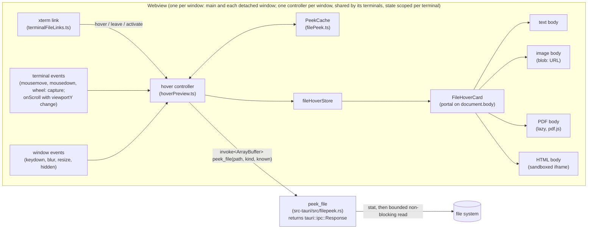

Five stories, built in order:

1. `peek_file` and its contract.
2. The card, with text, code and file details.
3. Images.
4. The first page of a PDF.
5. An HTML snapshot.

Story 1 has no visible effect. It is the bounded backend read and the frontend client, split out so Story 2 stays reviewable. Each story from 3 on adds one kind of body to Story 2's card. The shared intent, contract, limits and hover lifecycle come first.

Both files in `context` are new. The architect wrote the ADR at the owner's approval (2026-10-29); Story 1 writes the contract file.

<frozen-after-approval reason="human-owned intent — do not modify unless human renegotiates">

## Intent

**Problem:** ADE already turns a path in terminal output into a link when the file exists, and clicking the link opens the file in the preview panel or a tab (`src/lib/terminalFileLinks.ts`, `src/lib/openFile.ts`). To see what a file holds, you have to open it, which takes over the preview panel or adds a tab. Agents print paths to dozens of files, and the owner wants to see a file before deciding to open it.

**Approach:** When the pointer rests on a file link, show a small card. It gives the file's name, size and modified time, and previews the content: the first lines of a text or code file, an image thumbnail, the first page of a PDF, or a static snapshot of an HTML page. Clicking still opens the file as it does today.

A new backend command, `peek_file`, reads the file with fixed limits and returns raw bytes, not base64. A hover therefore never reads a whole large file and never decodes a large string on the UI thread.

The card follows the existing viewers' safety rules. Text is rendered as text. An SVG appears only as an ``. HTML appears only as a sanitized document inside an iframe with an empty sandbox (no scripts) and a deny-all CSP (no subresource fetches).

## Owner's decisions (2026-10-29)

1. **Shape:** a hover card on the file paths ADE already links in terminal output. Clicking still opens the file, as today.
2. **File types: all four.**
   - Images: PNG, JPEG, GIF, SVG, WebP, BMP, ICO.
   - Markdown and text/code: the first lines.
   - PDFs: the first page.
   - HTML: a rendered snapshot.

   Every card shows the file's size and modified time.
3. **The setting is on by default**, with a checkbox in Settings to turn it off.
4. **Markdown shows its raw first lines**, not a rendered view.
5. **Reduced HTML fidelity is accepted.** A snapshot shows only text and inline styles: no external CSS, no images. A page built by JavaScript falls back to its source lines.
6. **The hover delay is a fixed 350 ms**, with no setting for it.
7. **Story 1 is accepted as a non-vertical, no-UI slice:** `peek_file`, its contract and the TypeScript client, with Story 2 as the slice that makes it visible.

## Boundaries & Constraints (all stories)

**Always:**
- The card previews only a link's `abs`: the path `resolve_file_paths` already resolved for that link. It never resolves or guesses a path of its own.
- `peek_file` enforces every read limit, every size cap and the raster pixel cap listed in the limits table below. The frontend cannot ask for more. The one cap applied in the frontend is the pixel limit for images embedded in a PDF, which the card passes to pdf.js (Story 4).
- Nothing in the card can take focus or sit in the tab order:
  - The card has `pointer-events: none`.
  - Its code never calls `focus()`.
  - The only `tabindex` in it is `-1` on the HTML snapshot's iframe (Story 5), which takes that iframe out of the tab order.
- Keystrokes always go to the terminal. A key press closes the card and still reaches the terminal, because the listener is passive and never calls `preventDefault`.
- A hover that ends before its preview loads never shows a card.
- Untrusted content stays inert:
  - File text is rendered as React text nodes, never as HTML.
  - An SVG is shown only through ``, never added to the DOM as markup.
  - HTML is shown only in an `<iframe sandbox="">`. Its srcdoc is a sanitized document whose `<head>` begins with the deny-all CSP meta (Story 5).
- Every color comes from the theme's CSS variables. The card's secondary text uses `var(--text-secondary)`, because `--text-muted` measures 2.9:1 on elevated surfaces (designer knowledge, 2026-10-15). The only fixed colors are the checkerboard behind images and the white page behind a PDF or HTML snapshot.
- The verification command is unchanged.

**Never:**
- No change to how links are found, resolved or opened. `findPathCandidates`, `stitchRows`, `resolve_file_paths`, `opensInPreview` and `openFileFromTerminal` keep their behavior.
- No change to `read_file`, `read_file_base64` or the existing viewers' behavior. Story 4 moves pdf.js loading into a shared function; `PdfView` keeps its options.
- No `allow-*` token in the card's iframe sandbox. No change to `tauri.conf.json` (CSP, asset protocol or capabilities).
- No new npm or Cargo dependency. The stories use only what is already present:
  - `tauri::ipc::Response` for raw bytes.
  - `libc`, already a unix dependency.
  - DOMPurify and `pdfjs-dist`, already used.
- No change to `relay/`, `mobile/` or the phone remote.
- No hover card for URLs (`WebLinksAddon`) or for directories (links are files only).

</frozen-after-approval>

---

# Shared design (all stories)

## Components and flow



```mermaid
sequenceDiagram
  participant X as xterm link
  participant C as hover controller
  participant K as PeekCache
  participant R as peek_file (Rust)
  participant V as FileHoverCard
  X->>C: hover(abs, key, event)
  alt same link already pending or open
    Note over C: no-op (cancels a running leave wait)
  else button held, suppressed, or a new link with no pointer move
    Note over C: remembered as under the pointer, not shown
  else new link
    Note over C: token = n+1, hide old card, wait 350 ms
    C->>K: entry(abs), kept by this request
    C->>R: peek_file(abs, kind, entry?.stamp)
    alt answer within 200 ms
      R-->>C: frame (header JSON + payload)
    else slower
      C->>V: loading card
      R-->>C: frame
    end
    alt token still current and no grace running
      C->>V: show (unchanged → the kept entry's content)
    else
      Note over C: not shown; cached only if text/html/image
    end
  end
  X->>C: leave(key)
  alt pointer moved since the hover (real leave)
    Note over C: 150 ms grace; a same-link hover cancels it, otherwise hide
  else pointer still (xterm redraw)
    Note over C: keep the card up to 1000 ms for the same-link re-hover
  end
  Note over C: any dismissal (key, click, wheel, blur, content moved) suppresses until the pointer moves
```

There is no persistent data. The cache is in memory, one per window. The only stored value is the new setting.

## The `peek_file` contract (recorded in `.ade/context/file-peek.md` by Story 1)

**Signature.** `#[tauri::command] pub async fn peek_file(path: String, kind: PeekKind, known: Option<String>) -> Result<tauri::ipc::Response, String>`, in a new `src-tauri/src/filepeek.rs`. Field names are camelCase. The body awaits `tauri::async_runtime::spawn_blocking`, the same idiom as `sync_now`, so the read and the checks run on tauri's blocking pool and never hold one of the shared async workers that other commands run on.

**The frame.** The response body is one frame. On Tauri's custom-protocol IPC path, which is the normal path on every platform, the frontend receives it as an `ArrayBuffer`, with no base64 and no `atob` on the UI thread. If the webview has fallen back to postMessage IPC, the same bytes arrive as a JSON array of numbers (tauri 2.10.2 `ipc-protocol.js:57-67`, `protocol.rs:390-402`). That fallback is sticky for the session once it trips. A 20 MB payload as a `number[]` would freeze the UI for seconds, so after the first array-shaped response the window's client stops asking for byte kinds: `peekFile` sends kind `meta` for `image` and `pdf`, and those cards show the file's details only for the rest of the session. The frame is laid out as:

1. A 4-byte big-endian header length.
2. The header: a UTF-8 JSON `FilePeek`.
3. The payload: the raw file bytes for a `bytes` body, and empty otherwise.

`frame(&FilePeek, &[u8]) -> Vec<u8>` in Rust and `unframe(ArrayBuffer | Uint8Array | number[]) -> { peek, payload: Uint8Array }` in TypeScript are pure functions. `unframe` throws if the buffer is shorter than 4 bytes plus the header length, or if the header is not JSON. Both are tested against the same hand-written byte vector, which is recorded in the contract file.

**Inputs.**
- `PeekKind` is one of `"text" | "image" | "pdf" | "html" | "meta"`. The frontend chooses it with `peekKind(path)`, which reuses `viewerKind` (`src/lib/viewerKind.ts`):
  - `markdown` and `text` map to `text`.
  - `docx` maps to `meta`.
  - Every other kind keeps its own name.
- `known` is the `stamp` the cache holds for this path, if any.

**`FilePeek`** is `{ size: number, modifiedMs: number | null, stamp: string, body: Body }`:
- `size` and `modifiedMs` come from `std::fs::metadata`, which follows symlinks.
- `modifiedMs` is signed milliseconds since the epoch, so a pre-1970 file is negative, not an error.
- `stamp` is an opaque string. The frontend only compares it for equality, so no 64-bit number ever crosses into JavaScript.
  - On unix it is `"{size}:{mtime_ns}:{ctime_ns}:{dev}:{ino}"`. ctime catches mtime-preserving writes and copies, which cannot set ctime. dev and ino catch a symlink retargeted or a file replaced by rename.
  - On Windows it is `"{size}:{mtime_ns}"`.

**`Body`**, tagged by `type`:
- `{ type: "text", text, truncated }` for kinds `text` and `html`.
- `{ type: "binary" }` when a NUL byte appears in the first 8 KiB, after UTF-16 handling (kinds `text` and `html`).
- `{ type: "bytes", length, width?, height? }`, whose payload holds the bytes (kinds `image` and `pdf`).
- `{ type: "tooLarge", limit }` when the file is over its kind's size cap. The file is not read.
- `{ type: "skipped", reason, width?, height? }`, where `reason` is one of:
  - `"pixels"`: over 40 megapixels.
  - `"noSize"`: a raster whose dimensions can't be read.
  - `"svgFeatures"`: see the SVG row of the limits table.
  - `"notDownloaded"`: a macOS dataless (cloud-only) file.

  No bytes are sent for any of these.
- `{ type: "unchanged" }` when `known` equals the file's stamp. The file is not read.
- `{ type: "none" }` for kind `meta`.

**Order of work.**
1. Call `metadata`. A missing path is an `Err`, and anything that is not `is_file()` gives `Err("not a regular file")`.
2. If `known` equals the stamp, return `unchanged`.
3. On macOS, check `st_flags & SF_DATALESS` (0x40000000). If set, return `skipped/notDownloaded`, so a hover never triggers an iCloud download.
4. Check the size cap.
5. Open the file with `O_NONBLOCK` on unix (`OpenOptionsExt::custom_flags(libc::O_NONBLOCK)`), so a path swapped for a FIFO after the stat cannot block the open. Then require `is_file()` on the open handle.
6. Read through `Read::take(cap + 1)`. The extra byte detects truncation even for files that report size 0, such as those in `/proc`.

**Rollout by story.** Story 1 builds every arm except the image and PDF ones. Until Stories 3 and 4 land, kinds `image` and `pdf` return `none`, so a hover on them shows the file's details only.

**Call site.** The frontend calls it from exactly one place, `peekFile()` in `src/lib/filePeek.ts`, in the literal form `invoke<ArrayBuffer>("peek_file", { path, kind, known })`. That is the form `src/lib/__tests__/tauriCommandContract.test.ts` parses, so the argument names stay checked.

## Limits

Each size cap and pixel cap is a Rust `const` in `filepeek.rs`. The display and cache limits are constants in `src/lib/filePeek.ts`. Caps shown to the user are decimal, so the card's message and `formatSize` agree: a 10,000,000-byte cap reads "10.0 MB".

| What | Limit | Why |
|---|---|---|
| Text/code read | first 16 KiB | 16 lines need a few KiB, and a minified file is one long line. |
| Binary sniff | a NUL byte in the first 8 KiB means `binary` | Git's heuristic. Latin-1 and other non-UTF-8 text decodes lossily. A UTF-16 file with a BOM is decoded as UTF-16 first. UTF-16 without a BOM shows as binary (known limit). |
| Text shown (frontend) | 16 lines, each clipped by CSS (`white-space: pre; overflow: hidden`); ANSI escape sequences removed | Fills the card's height. Logs show as plain text: escape sequences are stripped (CSI and OSC), not rendered as colors. |
| HTML read | first 256 KiB as text | A truncated page still renders. |
| Raster image | 10 MB (10,000,000 bytes) | Bounds the IPC payload and the cache entry. |
| Raster pixels | 40 megapixels, checked in Rust; no readable size means not sent | A small file can hold a huge bitmap: a 20000×20000 PNG decodes to 1.6 GB. |
| SVG | 1 MB, and previewed only if it passes the allowlist below (no CSS, no comments, CDATA or processing instructions, no `data:`, no `url(` except a fragment-only `url(#id)`, no escapes or entities, no `use`, `image`, `feImage` or `foreignObject`, no prefixed elements); otherwise `skipped/svgFeatures` | The allowlist removes every route to an embedded raster, nested `<use>` and entity expansion found so far, including forbidden text split by comments or CDATA inside a stylesheet. A 200 KB 1-bit 40000² PNG in a `data:` URL would decode to about 6.4 GB. **No pixel guarantee is claimed for SVG**: a heavy filter or a huge path count inside 1 MB can still be slow to rasterize. This is a known limit, accepted because the `` is rasterized at card size. |
| PDF | 20 MB; page 1 only; `maxImageSize` 40,000,000 passed to pdf.js | pdf.js parses in its worker and skips any embedded image over the pixel cap. |
| Cache (frontend) | 32 entries and 32 MB of content, least recently used evicted | See Cache below. |

**SVG allowlist** (`svg_is_plain(bytes) -> bool`, in Rust). An SVG is previewed only if all of these hold. Every check is on the raw bytes, and the text checks ignore ASCII case:
- **Encoding:** the bytes are valid UTF-8, with no BOM other than UTF-8's and no NUL byte. If there is an XML declaration, its `encoding`, when present, is `utf-8`. This rules out UTF-16 and any encoding that could hide text from these checks.
- **No embedded data, and only in-document references:** the text contains no `data:`. A `url(` is permitted only as a fragment reference: optional whitespace, an optional quote (`"` or `'`), `#`, an id of one or more `[A-Za-z0-9_.:-]`, the matching quote if one opened, optional whitespace, then `)`. Any other `url(` rejects. This lets gradients, clip paths, masks, markers and filters (`fill="url(#g)"`) through. Because CSS, `data:`, entities, escapes and external references all stay banned, such a reference can only point inside the document.
- **No escapes:** the text contains no `&#` character reference, no named entity other than `&amp;`, `&lt;`, `&gt;`, `&quot;` and `&apos;`, and no `\`. This blocks hiding `data:` or `url(` behind XML character references or CSS escapes such as `u\72l(`.
- **No CSS:** no `<style` element and no `style` attribute (`style` after whitespace, then optional whitespace and `=`). A stylesheet is built from its text nodes, so comments, CDATA sections and processing instructions inside it can split `url(` or `data:` (`ur<!---->l(da<!---->ta:…)`, `ur<![CDATA[l(]]>`, `@import "da<!---->ta:…"`). Rejecting all CSS removes that route rather than trying to parse it.
- **No comments, CDATA or processing instructions:** no `<!--`, no `<![CDATA[`, and no `<?` except an XML declaration at offset 0 (after an optional UTF-8 BOM). The declaration is `<?xml` followed by whitespace, so `<?xml-stylesheet` at offset 0 is not exempt.
- **No risky elements:** no `<!ENTITY`, no `foreignObject`, and no `use`, `image` or `feImage` element.
- **No DTD defaults:** no `<!ATTLIST`, and no `[` anywhere before the first `<svg`, so there is no internal DTD subset. libxml2 applies an ATTLIST's default attributes, so a default `style` would let CSS in. A DOCTYPE with only external ids still passes.
- **No image sets:** no `image-set(`, which also covers `-webkit-image-set(`.
- **No namespace prefixes:** no element name has a namespace prefix (no `<x:` or `</x:` for any prefix), so `<svg:use>` and `<svg:image>` are rejected.
- **How names match:** an element name matches when `<name` is followed by whitespace (including a newline), `/` or `>`, so `<use\nhref=…>` and `<use/>` are caught. `<user>` is not. A name is read only up to its first non-name character, so the scan is linear in the file: 1 MB of `<` is checked in under 0.4 s in a debug build, and `svg_allowlist_is_linear` bounds 18 such shapes.

Anything else shows "SVG not previewed". This is a deliberately narrow allowlist: plain charts and icons drawn with presentation attributes (`fill="…"`, including in-document references such as `fill="url(#g)"`) pass. CSS-styled SVGs, which include most matplotlib and Mermaid output, get details only, as do sprites, embedded images and exotic encodings.

UTF-8 cut at the read boundary: an incomplete trailing sequence is dropped, not turned into U+FFFD. `\r\n` becomes `\n`. An empty file shows "Empty file".

**Image dimensions** (`image_size(bytes) -> Option<(u32, u32)>`, returning the largest area the browser could decode). A zero width or height in any header gives `None` (for example, a JPEG of height 0 that defers it to a DNL marker), so such a file is never decoded. The area is compared with the cap as `u64` (`w as u64 * h as u64`), so a 65536×65536 PNG cannot wrap around to 0.
- **PNG:** IHDR. APNG frames must fit inside it, per the spec.
- **GIF:** the logical screen and every image descriptor (`0x2C`), found by walking the extension and LZW sub-blocks. The maximum width and height over all of them is used. A walk that runs off the end returns `None`.
- **JPEG:** walk the segments from SOI by their lengths (fill bytes skipped; RSTn and TEM stand alone) up to the first SOS, and take the largest SOFn by area among them (C0–C3, C5–C7, C9–CB, CD–CF; C4 DHT, C8 JPG and CC DAC are not SOFs). Nothing after the SOS is parsed. A zero side in any SOF, no SOF before the SOS, an EOI or another SOI before the SOS, or a walk that runs off the end gives `None`. An SOF inside an APP1 EXIF thumbnail is skipped with its segment.
- **WebP:** `VP8 `, `VP8L` and `VP8X` (canvas size; animation frames must fit the canvas).
- **BMP:** the DIB header, with the absolute value of the height.
- **ICO:** the directory's entries. For each entry's data, a PNG signature means its IHDR is used; otherwise the BMP DIB header with half its height (the mask). The largest entry is used, so a PNG inside an ICO cannot get past the cap.

## Cache (`PeekCache` in `src/lib/filePeek.ts`)

- Entries are keyed by `abs` and hold `{ stamp, size, modifiedMs, content }`. `content` is one of:
  - text, of kind text;
  - HTML: the source text plus its snapshot, computed once per stamp (Story 5);
  - an image `Blob`;
  - a PDF thumbnail (a `Blob` of a PNG of at most 588×480 pixels, which is 294×240 at `devicePixelRatio` 2) with its `numPages`.
- An entry's weight is its text length (2 bytes per UTF-16 code unit) or its Blob's size. The budget is 32 entries and 32 MB. At most three images at the 10 MB cap fit. Each entry is under the 10 MB cap, so no entry is ever over budget on its own.
- **PDF bytes are never cached.** A PDF entry is created only after the card has rendered the thumbnail, so a stale PDF answer is dropped, not stored. Stale answers of the other kinds are stored, since the work is already done.
- **Race:** a request keeps a JavaScript reference to the entry whose stamp it sent as `known`. If a later answer evicts that entry while the request is in flight, an `unchanged` answer is still served from the kept reference. Without a kept entry, `known` is not sent.
- Image Blobs become `blob:` URLs (allowed by `img-src blob:`) only while a card shows them. The card revokes the URL when it unmounts.

## Hover lifecycle (`src/lib/hoverPreview.ts`, framework-free)

What xterm 6.0.0 actually does, from its source:
- **Row change.** When the pointer changes row, the linkifier calls `leave` and asks again for links (`Linkifier.ts:93-97`). This happens even inside one wrapped or stitched link.
- **Moving within a row.** Moving within the same row on the same link calls nothing (`Linkifier.ts:99-105`).
- **Redraws.** On any redraw of the rows under the current link, it calls `leave` and asks again with the last mouse event. It then calls `hover` again with the pointer unmoved (`Linkifier.ts:301-320`). A redraw starting at row 0 clears every link.
- **Late replies.** A late provider reply can call `hover` twice without a `leave` in between.
- **Scrolling.** `term.onScroll` fires for every line pushed into the scrollback, whatever the view does (`BufferService.ts:121`). How the view moves depends on whether the scrollback is full (`BufferService.ts:78-104`), and a full scrollback is normal in long agent runs (10,000 lines by default, `settingsStore.ts:427`):
  - **Scrollback not full, following output:** `viewportY` and `baseY` both increase by 1, and the text moves up.
  - **Scrollback not full, scrolled back:** `viewportY` stays put, and the text stays put.
  - **Scrollback full, following output:** `viewportY` and `baseY` stay put, but the oldest line is recycled, so every row's text moves up.
  - **Scrollback full, scrolled back:** `viewportY` drops by 1, and the visible text stays put, so its buffer `y` shifts by 1. At `viewportY` 0 it cannot drop, so the text moves.

The controller is built for that.

**Link keys are viewport-relative.** Story 2 creates each link with `key = abs + "\0" + start.x,(start.y - 1 - viewportY) + "-" + end.x,(end.y - 1 - viewportY)`, using the `viewportY` at the moment the link is provided. When a full buffer trims while the user is scrolled back, the text and its viewport row stay put, so the re-provided link keeps its key. When the text really moves, the key changes.

**Content moved.** `textMoved(prev, now)` is a pure function. `now` is `{ viewportY, baseY, length, rows, scrollback }`, and the buffer is full when `length >= rows + scrollback`. It returns true when any of these holds:
- `viewportY === baseY` (following output);
- the buffer is full and `viewportY` and the previous `viewportY` are both 0 (trimming at the top of a full buffer);
- `viewportY` changed in any way other than the full-buffer trim, where it drops by exactly 1 (a real scroll).

It returns false when `viewportY` is unchanged in a buffer that is not full, or drops by exactly 1 in a full buffer. `attachHoverDismissal` calls it on every `onScroll`.

**One controller per window, with state scoped per terminal.** Every terminal in a window feeds the same controller, including background tabs, whose xterm instances stay alive and keep receiving PTY output. xterm fires `onScroll` for every line whether or not the terminal is on screen. So every terminal-side call carries the terminal it came from, as `term: TerminalId` (the pane id). The rules:
- **Only the owning terminal can close or suppress the card.** That is the terminal that produced the card's or `hovered`'s link. `contentMoved(term)` and `resized(term)` from any other terminal are ignored, so output or a resize in another pane or tab never touches this pane's card.
- **Window-level dismissals stay global:** key press, window `blur` and `resize`, hidden, and `wheel` and `mousedown` on any terminal. There is one pointer and one keyboard.
- **A pointer event from terminal X never reopens a link from terminal Y.**
- **Removing or disposing a terminal clears what it owns.** See `forget` below.

**State.** The controller keeps three separate things:
- `hovered`: the link xterm last reported under the pointer, with the pointer and its `term`. It is set by `enter` and cleared by a `leave` from the same terminal with the same key.
- `card`: the pending, loading or shown preview, with its key and its `term`.
- `suppressed`: a flag.

It also keeps `movedSinceEnter`, which `pointerMoved()` sets and an accepted `enter` clears.

`createHoverController({ peek, cache, show, hide, enabled, delayMs = 350, loadingAfterMs = 200, graceMs = 150, redrawWaitMs = 1000 })` returns `enter(term, link, pointer)`, `leave(term, key)`, `dismiss()`, `pointerMoved(term, point)`, `pointerLeft(term)`, `contentMoved(term)`, `resized(term)` and `forget(term)`.
- `link` is `{ abs, key }`, and `pointer` is `{ x, y, buttons }` from the xterm event.
- A key is only compared together with its `term`, because two terminals can show the same path at the same viewport row.

**`enter`.** It always records `hovered`. It then does nothing more when any of these holds:
- `enabled()` is false;
- `pointer.buttons !== 0` (a button is held, as in a drag-select);
- `suppressed` is set;
- the key is new and `movedSinceEnter` is false. That means new content was drawn under a still pointer. It counts as a dismissal (see below).

When the key equals the card's key, `enter` is a no-op: the card keeps its place, and a running leave wait is cancelled. This absorbs redraw churn, double hovers and row crossings inside one link. Otherwise `enter` accepts the link: it increments the token, hides the current card and starts the 350 ms delay.

**`leave(term, key)`.** It clears `hovered` whenever `term` and `key` equal `hovered`'s, whatever the card's state, including while suppressed with no card on screen. Otherwise a suppressed hover could go stale and later open a card for a path that has gone. The rest is ignored unless `term` and `key` are the card's. Then:
- **Real leave** (`movedSinceEnter` true; the pointer moved): a 150 ms grace runs before the card is hidden, covering a row crossing inside one link. The hide does not suppress, because the pointer moved.
- **Redraw leave** (`movedSinceEnter` false; the pointer is still): the card stays for up to 1000 ms, waiting for xterm's re-hover of the same key. The long wait covers the provider's `get_pty_cwd`, which can spawn `lsof` (`pty.rs:288-296`, `378-386`).
  - A same-key `enter` keeps the card.
  - A different-key `enter` is new content under a still pointer, and it dismisses.
  - Nothing arriving within 1000 ms means the path vanished, and it dismisses.

While either wait runs, nothing new is shown.

**When the delay ends**, the controller calls `peek(abs, peekKind(abs), kept?.stamp)`.
- If the answer takes longer than 200 ms, a loading card shows first, so a fast answer never flashes one.
- Only an answer whose token is still current is shown.
- An error shows "Can't preview: <message>" without a body.

**Dismissal.** `dismiss()` hides any card, cancels the pending delay and sets `suppressed`. These all call it:
- a window `keydown` (capture phase, passive, never prevented);
- `mousedown` and `wheel` on the terminal element, in the **capture** phase (xterm's scrollable element stops wheel propagation);
- the link's `activate` (a click, which still opens the file);
- window `blur` and `resize`;
- `resized(term)` from `term.onResize` (a pane resize, after which xterm calls `leave` with the pointer unmoved), only when `term` owns the card or `hovered`;
- `visibilitychange` to hidden;
- `contentMoved(term)`, only when `term` owns the card or `hovered`, or is the terminal where the pointer last moved. That last case covers a pointer resting on a URL link (WebLinksAddon, which this controller never sees) while output follows and a file link scrolls under it;
- the redraw cases above.

So typing in Claude Code's live region, which redraws the rows under the pointer, never brings the card back. Only moving the pointer does.

**`pointerLeft(term)`** comes from a `mouseleave` on the terminal element itself. The listener acts only when `e.target === term.element`: non-bubbling `mouseleave` events for child boundaries still reach an ancestor's capture listener, and with xterm's DOM renderer (used when GPU rendering is off, past 8 GPU terminals, or after a context loss) every span or row crossing would otherwise count as leaving. It sets `movedSinceEnter` and clears `hovered` if `term` owns it. The browser fires the inner screen element's `mouseleave` (and so xterm's `leave`) before the terminal element's own, so `pointerLeft` normally follows xterm's `leave` rather than preceding it. The controller handles both orders: `leave` first takes the real-leave path when the pointer had moved, and `pointerLeft` then only clears what remains.

**`pointerMoved(term, point)`** comes from a capture-phase `mousemove` on the terminal element. It sets `movedSinceEnter` and records `term` as the terminal where the pointer last moved. If `hovered` belongs to another terminal, it clears `hovered`, because the pointer has left that terminal. A running redraw wait becomes the 150 ms grace, because the pointer is no longer still. If `suppressed` is set, it clears it. Then, only if `enabled()` is true and `hovered` belongs to `term`, it starts the delay for that link at the new point. A link accepted this way, after a dismissal, keeps `movedSinceEnter` true. This matters because xterm never re-fires `hover` for a move inside the same link (`Linkifier.ts:99-105`), so after a key press, nudging the pointer on the link brings the card back.

**Known limits:**
- A path drawn in place (not scrolled) under a parked pointer opens a card after the delay. An example is Claude Code's live region before the output first scrolls. The pointer's move to where it rests still counts as a move since the last accepted hover.
- Because `movedSinceEnter` is cleared only by an accepted hover, a redraw leave after the pointer moved inside the link is treated as a real leave. If xterm's re-hover then takes longer than 150 ms, the card hides and returns after the delay. Likewise, after a nudge reopens the card, `movedSinceEnter` stays true. Until the next accepted hover, new content drawn under the now-still pointer can open a card.
- The 150 ms and 1000 ms waits are constants to tune in the manual check.

**`forget(term)`** clears everything `term` owns: `hovered` if it is `term`'s; and, if the card is `term`'s, it hides the card, cancels its delay, grace and redraw timers, and drops the in-flight answer, so a late answer shows nothing. It does not set `suppressed`. Taking a terminal out of view fires no xterm `leave` (a keyboard tab switch, Cmd+W, detaching to another window), so `useTerminal` calls `forget(paneId)` wherever a terminal's wrapper leaves the DOM (`detachInstance`) and from the `attachHoverDismissal` disposer.

**Not cancellable:** a Rust read already in flight is not aborted. It is bounded instead, and a stale answer is dropped. Moving the pointer across many links issues no reads, because a read starts only after the full delay.

**Wiring.** `attachHoverDismissal(term, paneId, controller)` adds the terminal-side listeners, each passing `paneId`:
- capture `mousemove`, which calls `pointerMoved`;
- `mouseleave` on the terminal element, which calls `pointerLeft` only when `e.target === term.element`;
- capture `mousedown` and `wheel`;
- `term.onResize`, which calls `resized(paneId)`;
- `onScroll`, which calls the controller's `contentMoved(paneId)` when `textMoved` says the text moved.

Window-level listeners (`keydown`, `blur`, `resize`, `visibilitychange`) call the global `dismiss()`. The disposer unhooks the listeners and calls `forget(paneId)`. `useTerminal` calls it when it disposes the terminal.

**Panes and windows:** hover works on any visible pane, focused or not, and in detached windows. Each window mounts its own `FileHoverCard` and has one controller and one cache, shared by all of its terminals. The controller's state is scoped per terminal, so output, resizes and removals in one pane or tab never affect another's card.

## Card placement and look (`FileHoverCard.tsx`, with `placeCard` in `filePeek.ts`)

**Layer.** The card is `position: fixed`, in a portal on `document.body`, at z-index 2000: above the panes, below the toast at 2500.
- It is not built inside `term.element`, because a split pane clips its children and the card must overflow its pane.
- With `pointer-events: none`, it blocks nothing underneath, so xterm's `xterm-hover` class is not needed.

**Placement.** `placeCard(pointer, viewport)` uses the card's largest size, 320×340, with a 12 px gap and an 8 px margin:
- By default the card sits right of and below the pointer (`left`/`top`).
- If it would cross the right edge, it is anchored by `right`, to the pointer's left.
- If it would cross the bottom, it is anchored by `bottom`, above the pointer.
- If neither side fits, it is pinned to the margin.
- The card stays where it opened; it does not follow the pointer.

**Layout.** The card is 320 px wide with 12 px padding.
- **Header:** the file name in `var(--text-primary)`, 12 px semibold, clipped with an ellipsis.
- **Detail line:** `"12.3 KB · modified 3 min ago"` in `var(--text-secondary)`, 11 px. Story 3 adds `· 1920 × 1080` and Story 4 adds `· 12 pages`.
- **Body:** 294 px wide: 320 minus 24 px of padding minus 2 px of border, with `box-sizing: border-box`. Every body size below uses 294.
- **Surface:** `var(--bg-elevated)`, a 1 px `var(--border-strong)` border, `var(--radius-lg)` corners and `var(--shadow-lg)`.
- **Text bodies:** the terminal font at 11 px on `var(--bg-primary)`, with `tab-size: 4`.

**Behaviour.**
- There is no animation, so reduced motion needs nothing.
- The card has `role="tooltip"`. It is supplementary and works by mouse only.
- Keyboard access is out of scope (terminal links have none today) and is deferred.

**Formats.**
- `formatSize`: under 1000 bytes it shows `"N B"`; above that, 1000-based units with one decimal: `"12.3 KB"`, `"4.1 MB"`, `"1.2 GB"`.
- `formatModified(ms, now)`:
  - under 60 s, or in the future: `"just now"`;
  - under 60 minutes: `"N min ago"`;
  - under 24 hours: `"N h ago"`;
  - otherwise the local date, `YYYY-MM-DD`.

  When `modifiedMs` is null, the date is left out.

## Security

- **Reads.** The card reads only a resolved link's `abs`. `peek_file` gives the webview no new reach, because `read_file` and `read_file_base64` already read any path. What it adds is bounds:
  - It refuses anything that is not a regular file, checking both before opening and on the open handle.
  - It opens with `O_NONBLOCK`, so a FIFO swapped in after the stat cannot hang a worker.
  - It never triggers a download of a macOS dataless file.
  - **Known limit:** a 16 KiB read on a slow network mount still holds one thread of tauri's blocking pool until it returns. The shared async workers stay free, so other commands are not stalled. The UI shows the loading card meanwhile; nothing on the UI thread waits.
- **Symlinks** are followed exactly as a click follows them, so the card has no access a click doesn't have. The stamp includes the target's dev and ino, so a retargeted link is re-read.
- **Text** is rendered as text nodes, so `` in a file shows up as text.
- **SVG** goes through an `` with a `blob:` URL, which runs no script and loads nothing external (the browser's secure static mode). Its markup is never parsed into the app's DOM. The Limits table lists the SVG features that skip the preview, and why there is no pixel guarantee.
- **HTML (Story 5).** `snapshotDoc(html)` builds the srcdoc in five steps:
  1. **Sanitize** with DOMPurify, already used by `src/lib/sanitizeHtml.ts`, with `WHOLE_DOCUMENT: true`, `USE_PROFILES: { html: true }` (no SVG or MathML), and `FORBID_TAGS` set to `script`, `noscript`, `iframe`, `frame`, `frameset`, `object`, `embed`, `link`, `base`, `meta`, `img`, `picture`, `source`, `video`, `audio`, `track`, `form`. DOMPurify also removes `on*` attributes and `javascript:` URLs.
  2. **Fixed point:** sanitize the output again, up to three passes, until it no longer changes. With no fixed point, the snapshot is abandoned and the source lines are shown. This guards against markup that changes when re-parsed (mXSS round-trips through the srcdoc re-parse).
  3. **Insert the policy:** parse the result with DOMParser, which loads nothing and runs nothing, and insert two metas as the first children of `<head>`: `<meta http-equiv="Content-Security-Policy" content="default-src 'none'; style-src 'unsafe-inline'">` and `<meta http-equiv="x-dns-prefetch-control" content="off">`.
  4. **Serialize** as `"<!doctype html>" + outerHTML`.
  5. **Verify:** parse the final string once more and confirm that the CSP meta comes first, no forbidden element exists, and no `on*` attribute exists. Otherwise, abandon the snapshot as in step 2.

  The iframe has `sandbox=""`, which means no scripts, an opaque origin, no top navigation and no form submission. It also has `tabIndex={-1}` and `pointer-events: none`.

  **What stops what, stated exactly:**
  - Subresource fetches (images, stylesheets, `@import`, `url()`, fonts) are blocked by the injected CSP. Its `default-src 'none'` leaves no image or font source, so even `data:` images are gone. The app's CSP, which srcdoc frames inherit, also applies.
  - **CSP does not govern the frame's own navigation,** and the app's `frame-src 'self' http: https:` would allow it. Navigation is stopped by:
    - the sanitizer removing every `meta` (refresh), `base`, `form` and frame element;
    - the sandbox (no scripts, no forms);
    - `pointer-events: none` (no link clicks).
  - DNS prefetch for anchors is turned off by the meta in step 3.

  This is stricter than `HtmlView` (`sandbox=""`, no sanitizing, no CSP meta), and far stricter than the preview panel (`allow-scripts`).

## Setting

- **Key:** `fileHoverPreview: boolean` in `src/stores/settingsStore.ts`, default **true** (owner's decision 3), with `setFileHoverPreview`.
- **Control:** a checkbox in `SettingsPanel.tsx` next to the ADE banner option, labelled "Preview a file when hovering its path in the terminal".
- **When it takes effect:** the controller reads the setting at every hover, so a change applies at once in the window where it was made. An already open detached window keeps its value until it is reopened, because `settingsStore` has no cross-window sync for any setting today. Adding that sync is deferred.

## Context Store and decisions

- **New contract, `.ade/context/file-peek.md`** (Story 1, extended by Stories 3 and 4). It records:
  - the `peek_file` signature;
  - the frame layout and its test vector;
  - the `Body` variants;
  - the stamp rule;
  - the limits table.

  Any later feature that reads files for a preview uses `peek_file`, not `read_file`.
- **New ADR, `0008-file-previews-are-bounded-and-inert.md`** (Status: Accepted), written by the architect when the owner approves. Number 0008 is the next free number after 0007; ADR 0002 was used and later removed, per the architect's knowledge file.
  - **Context:** `read_file*` read whole files and return base64, hovers fire constantly on arbitrary agent output, and HTML from agents is untrusted.
  - **Decision:** hover previews read only through `peek_file`, whose size and pixel limits are enforced in Rust and whose bytes travel raw. They render inertly: text as text, SVG as ``, HTML sanitized to a fixed point inside an empty sandbox with a deny-all CSP. Never `allow-scripts`.
  - **Consequences:**
    - HTML snapshots lose external CSS, all images and anything built by JavaScript (owner's decision 5).
    - SVG has no pixel guarantee.
    - There is one more IPC command, and its frame format and limits are a contract.

---

# Story 1: `peek_file` and its contract

Has no UI. It is the bounded read and the frontend client that Stories 2 to 5 build on.

## Code Map (1)

- `src-tauri/src/filepeek.rs` (new): `peek_file`, plus pure helpers that tests can call:
  - `peek_path(path, kind, known) -> Result<(FilePeek, Vec<u8>), String>`;
  - `open_regular(path) -> io::Result<File>`, which opens with `O_NONBLOCK` on unix and checks `is_file()` on the handle;
  - `read_bounded<R: Read>(r, cap) -> (Vec<u8>, truncated)`;
  - `decode_text(bytes, truncated) -> Body`, which handles UTF-16 BOMs, NUL sniffing and the UTF-8 tail;
  - `stamp(&Metadata) -> String`;
  - `frame(&FilePeek, &[u8]) -> Vec<u8>`.
- `src-tauri/src/lib.rs:1-27`: add `mod filepeek;`. At `:432`, add `filepeek::peek_file` to `generate_handler!`.
- `src/lib/filePeek.ts` (new): the IPC types; `peekKind`; `unframe`; and `peekFile(path, kind, known)`, which holds the one literal `invoke<ArrayBuffer>("peek_file", { path, kind, known })`.
- `.ade/context/file-peek.md` (new): the contract as above, with the image and PDF arms marked "Story 3" and "Story 4".

## Acceptance Criteria (1)

Each criterion names the test that covers it. The developer writes each test first and sees it fail.

1. A small text file gives `text` with its whole content and `truncated: false`, plus its real `size`, `modifiedMs` and a non-empty `stamp`. A 100 KB file gives at most 16 KiB of text, `truncated: true` and `size` 100 KB. Kind `html` returns up to 256 KiB. -- `src-tauri/src/filepeek.rs` tests › `text_is_read_up_to_the_cap`
2. Text decoding:
   - A NUL byte within the first 8 KiB gives `binary`.
   - A multi-byte UTF-8 character cut at the boundary is dropped, so the text does not end in U+FFFD.
   - Invalid UTF-8 inside the text decodes lossily.
   - `\r\n` becomes `\n`.
   - UTF-16 LE and BE files with a BOM decode to their text, not `binary`.

   -- › `binary_and_text_encodings`
3. `read_bounded` over an endless counting reader (`std::io::repeat` wrapped to count) returns exactly `cap` bytes with `truncated: true`, and the reader is asked for at most `cap + 1` bytes. -- › `reads_are_bounded_by_bytes`
4. A missing path and a directory give `Err`. On unix, a FIFO made with `mkfifo` gives `Err("not a regular file")`. The FIFO call runs on a spawned thread, and the test waits with `recv_timeout(5 s)`, so a regression fails the test instead of hanging `cargo test`. A symlink to a regular file returns the target's content. -- › `only_regular_files_are_read`
5. `open_regular` on a FIFO returns `Err` rather than blocking. This is the same thread and timeout pattern, calling the open step directly, which is what a FIFO swapped in after the stat would hit. -- › `open_does_not_block` (unix only)
6. Stamps:
   - `known` equal to the stamp gives `unchanged`.
   - Rewriting the same number of bytes and then restoring mtime with `File::set_modified` still changes the stamp, through ctime. The test sleeps 50 ms after creating the file, so the rewrite falls in a later timestamp tick on every filesystem the suite runs on. This is unix only.
   - Pointing a symlink at a different file of the same size and mtime changes it, through dev and ino.
   - A pre-1970 mtime gives a negative `modifiedMs` and still matches on a second call.

   -- › `stamp_catches_rewrites_and_retargets`
7. Kind `meta` gives `none` with size and stamp. Until Stories 3 and 4, kinds `image` and `pdf` also give `none`. -- › `meta_and_pending_kinds`
8. `frame` of a fixed `FilePeek` and payload equals the byte vector in the contract file. -- › `frame_matches_the_contract_vector`
9. `unframe` of that same byte vector gives the same header and payload, whether it arrives as an `ArrayBuffer`, a `Uint8Array` or a `number[]`. This includes a `Uint8Array` that is a view at a non-zero `byteOffset`, with a `byteLength` shorter than its underlying buffer, padded with other bytes on both sides: only the view's bytes are read. It throws on a buffer shorter than 4 bytes, on a header length past the end, and on a header that is not JSON. -- `src/lib/__tests__/filePeek.test.ts` › "unframe reads the contract vector in every IPC shape"
10. `peekKind` maps paths as follows:
    - `.md`, `.ts` and `Dockerfile` → `text`;
    - `.png`, `.svg` and `.ico` → `image`;
    - `.pdf` → `pdf`;
    - `.html` and `.htm` → `html`;
    - `.docx` → `meta`.

    -- › "peekKind follows viewerKind"
11. `peekFile` calls `invoke` exactly once, with `"peek_file"` and `{ path, kind, known }`. `filePeek.ts` contains exactly one `invoke` call naming `peek_file`, in the object-literal form that `tauriCommandContract.test.ts` parses. The existing contract test then passes with `peek_file`'s `path`, `kind` and `known` checked. -- › "one literal call site"; `tauriCommandContract.test.ts` (existing)
12. After `invoke` resolves with a `number[]` once (the postMessage fallback), later `peekFile` calls for `image` and `pdf` send kind `meta`. A `text` call still sends `text`. A fresh module instance starts on the normal path again. -- › "stops asking for bytes after the IPC fallback"

## Verification (1)

**Commands (the repo's verification command, unchanged):**
- `npx tsc --noEmit` -- expected: exit 0
- `npm test` -- expected: all files pass, including `filePeek.test.ts` and `tauriCommandContract.test.ts`
- `cd src-tauri && cargo test` -- expected: all pass, including the `filepeek` tests
- `cd relay && cargo test` -- expected: all pass (no change)
- `cd mobile && npx tsc --noEmit && npx jest` -- expected: all pass (no change)

**Manual check (Linux WebKitGTK):** hover several files and check that the dev console shows no "IPC custom protocol failed" message, which would mean the fallback has tripped.

**Manual check (macOS):** call `peek_file` from the dev console on an iCloud "Optimize Mac Storage" file that is not downloaded. It should return `skipped/notDownloaded`, and the file should stay cloud-only.

**Known limit (stamp):** two same-size writes within one timestamp tick, with the mtime restored afterwards, share a ctime. The card then shows the older content until the file changes again. On ext4 a tick is a few milliseconds; on APFS it is nanoseconds.

**Results (1), QA, 2026-10-29, at a925686 (HEAD; build 8283b38, test fixes a925686), run one after another, working tree clean:**
- `npx tsc --noEmit` -- pass: exit 0.
- `npm test` -- pass on the first run: 148 files, 1649 tests passed, 0 failed (baseline 147 / 1645: +`filePeek.test.ts` with 4 tests; `tauriCommandContract.test.ts` 4 tests pass). No flaky rerun needed.
- `cd src-tauri && cargo test` -- pass: lib 465 passed, 0 failed, 1 ignored (baseline 456: +9 `filepeek::tests::*`), plus 12 and 2 in the other binaries. One warning, `which_command` never used in `platform.rs:98`, in a file this story does not touch.
- `cd relay && cargo test` -- pass: 266 passed, 0 failed across all targets (same as baseline).
- `cd mobile && npx tsc --noEmit && npx jest` -- pass: tsc exit 0; 1 suite, 6 tests passed (same as baseline).

**Manual checks -- NOT RUN.** Linux WebKitGTK console check: not run, needs the running app on Linux with a GUI; pending the owner. macOS iCloud dataless check (`skipped/notDownloaded`, file stays cloud-only): not run, needs the running app on macOS; pending the owner. Neither is claimed to pass. The `SF_DATALESS` branch of `peek_path` is therefore verified only by reading, and by the JSON-shape test of `Skipped`.

**Code review rounds:** adversarial code review of 8283b38 -- BLOCK on test strength (the AC12 fallback test passed with an inverted trigger, plus five minors). Fix round a925686 (tests only). Re-review at a925686 -- PASS: 27 Rust mutants killed, both blocking TypeScript mutants killed.

**AC coverage (read from the tests at a925686, not from the developer's table):**
1. `text_is_read_up_to_the_cap`: small file whole, `truncated: false`, `size` 12, `modifiedMs` equal to the file's mtime, stamp non-empty; 100 KB gives exactly 16 KiB, `truncated`, `size` 100 KB; `html` gives exactly 256 KiB on a 300 KB file, and `text` on the same file stops at 16 KiB.
2. `binary_and_text_encodings`: NUL at byte 8191 is `binary`, NUL at 8192 is text; a cut 3-byte and a cut 4-byte sequence are dropped, a whole one stays, an uncut broken tail is lossy; invalid UTF-8 inside is lossy; `\r\n` to `\n`; UTF-16 LE and BE with BOM decode; a UTF-16 NUL is `binary`, one past 8 KiB is not; UTF-16 cuts are dropped; also through the file read.
3. `reads_are_bounded_by_bytes`: counting wrapper over `io::repeat`: exactly `cap` bytes, `truncated`, `given <= cap + 1`; a file of exactly the cap is whole.
4. `only_regular_files_are_read`: missing path `Err`; a directory `Err("not a regular file")`; FIFO `Err("not a regular file")` on a thread with `recv_timeout(5 s)`; a symlink returns the target's content and size.
5. `open_does_not_block` (unix): `open_regular` on a FIFO gives `Err("not a regular file")` within 5 s; a plain file opens, a directory does not.
6. `stamp_catches_rewrites_and_retargets`: `known` equal gives `unchanged` with an empty payload; stale `known` reads; 50 ms sleep, same-size rewrite with mtime restored changes the stamp (unix); retargeted symlink of same size and mtime changes it (unix), and the layout is asserted against `dev` and `ino`; pre-1970 mtime gives `-86_400_000` and matches on a second call; `-1500 us` gives `-2` (floors).
7. `meta_and_pending_kinds`: `meta`, `image`, `pdf` each give `none` with size 19, a stamp and an empty payload.
8. `frame_matches_the_contract_vector`: reads the hex block of `.ade/context/file-peek.md` (`include_str!`), length 131, equal to `frame(...)`; with a payload appended it follows the header. `bodies_and_kinds_match_the_typescript_union` pins the JSON of every body and the `kind` names.
9. `filePeek.test.ts` "unframe reads the contract vector in every IPC shape": `ArrayBuffer`, `Uint8Array`, `number[]` and a padded offset view (`byteOffset` 3, shorter than its buffer), each with and without a payload; throws on 3 bytes, on a header length past the end, on a truncated vector and on a non-JSON header.
10. `filePeek.test.ts` "peekKind follows viewerKind": `.md`, `.ts`, `Dockerfile` text; `.png`, `.svg`, `.ico` image; `.pdf`; `.html`, `.htm`; `.docx` meta.
11. `filePeek.test.ts` "one literal call site": one `invoke` call with `"peek_file"` and `{ path, kind, known }`; a regex count of exactly 1 and the literal `invoke<ArrayBuffer>("peek_file", { path, kind, known })` in the source. `tauriCommandContract.test.ts` (existing, 4 tests) passes with `peek_file` registered as `filepeek::peek_file` and its `path`, `kind` and `known` parsed from the Rust signature.
12. `filePeek.test.ts` "stops asking for bytes after the IPC fallback": `ArrayBuffer` answers never switch; the call that meets the `number[]` still sends `image`; later `image` and `pdf` send `meta`; `text` and `html` unchanged; a fresh module (`vi.resetModules`) is back on the normal path.
All 12 ACs are covered by a test that asserts the criterion; none is uncovered.

**Definition of Done (.ade/rules.md section 3):**
1. Each acceptance criterion covered by an automated test -- met (map above).
2. The verification command passes, real output recorded -- met (above).
3. Change limited to the slice -- met. `git diff cb78a0d..a925686` is 6 files, 825 insertions, no deletions: `src-tauri/src/filepeek.rs` (new), `src-tauri/src/lib.rs` (`mod filepeek;` and one `generate_handler!` entry), `src/lib/filePeek.ts` and its test (new), `.ade/context/file-peek.md` (new), `.ade/knowledge/developer.md` (3 lines). No `Cargo.toml`, `Cargo.lock`, `tauri.conf.json`, `package.json` or lockfile change (`libc` and `serde_json` were already dependencies); no Story 2 to 5 code (no card, hover lifecycle, cache, setting, image or PDF arm; `image` and `pdf` return `none`). No AI attribution in the commit messages.
4. Shared contract recorded in `.ade/context/file-peek.md` -- met: command, frame, test vector, `FilePeek`, bodies, stamp, order of work and limits, with the image and PDF arms marked for Stories 3 and 4.

**Open risks:**
- The macOS code (`SF_DATALESS` check using `MetadataExt::st_flags`) and the Windows path (`stamp` as `size:mtime_ns`, no `O_NONBLOCK`) were not compiled here: only `x86_64-unknown-linux-gnu` is installed, and CI has not run on this branch. CI builds and tests `src-tauri` on macOS and Windows, so a compile or test failure there would show only after the push.
- The two manual checks above are unrun.
- The same-size, same-tick rewrite limit (known limit above) is accepted by the plan.

**Verdict (1): Done at a925686 on the four Definition of Done items alone.** The rules' Definition of Done names only the automated verification command, and the owner has not yet ruled on how manual checks gate Done; the verdict does not rest on the manual checks, which are pending the owner. The macOS/Windows compile risk stays open until CI runs.

---

# Story 2: the card, with text, code and file details

Depends on Story 1.

## Code Map (2)

- `src/lib/filePeek.ts`: add `formatSize`, `formatModified`, `placeCard`, `PeekCache` and `stripAnsi`.
- `src/lib/hoverPreview.ts` (new): `createHoverController`, `textMoved` and `attachHoverDismissal`, as described in the shared design.
- `src/stores/fileHoverStore.ts` (new): a zustand store holding `{ card: { abs, point, state: "loading" | "ready" | "error", content?, error? } | null }`, with `show` and `hide`.
- `src/components/FileHoverCard.tsx` (new): the portal; the header and detail line; the text body; and the binary, empty, details-only and error states. Mount it once in `src/App.tsx`, next to `<Toast>` (`:550`), and once in `src/DetachedApp.tsx`.
- `src/lib/terminalFileLinks.ts:151`: `registerFileLinks(term, getCwd, open, preview?)`, where `preview` is `{ enter(link, pointer), leave(key), dismiss() }`. `useTerminal` builds it with the pane id bound, for example `enter: (link, p) => controller.enter(paneId, link, p)`, so the link layer stays unaware of terminal identity. At `:199` each link gains:
  - `hover: (e) => preview.enter({ abs, key }, { x: e.clientX, y: e.clientY, buttons: e.buttons })`;
  - `leave: () => preview.leave(key)`;
  - an `activate` that calls `preview.dismiss()` before `open(f.abs)`.

  Here `key` is the viewport-relative key from the shared design. `provideLinks` reads `term.buffer.active.viewportY` synchronously at its start, together with the rows, before awaiting `getCwd` and the resolve, so a trim during those awaits cannot shift the key. xterm's own link ranges have the same race. That is why the full-scrollback manual check (`yes | head -20000`), not a unit test, is the real gate for "scrolled back, the card stays open". There is no `dispose` hook. Without `preview`, links are exactly as today.
- `src/hooks/useTerminal.ts:238`: `openTerminal` passes the window's single controller with the pane id, and calls `attachHoverDismissal(term, paneId, controller)`. Call its disposer next to `inst.term.dispose()`. `detachInstance`, where the wrapper is removed, calls `controller.forget(paneId)`.
- `src/stores/settingsStore.ts:366,439,512` and `src/components/SettingsPanel.tsx:~612`: the setting.
- `docs/guide/terminal.md:45-57` ("Clickable files"): one bullet, describing only what this story ships:
  - hovering a path shows its size, modified time and first lines;
  - binary files show their details only;
  - output arriving at the bottom of the terminal closes the card;
  - the setting.

  Stories 3 to 5 each extend this bullet with their own kind.

## Acceptance Criteria (2)

1. `formatSize` and `formatModified` follow the shared design, including the boundaries: 999 B, 1000 B, 10,000,000 B → "10.0 MB", 59 s, 60 minutes, 24 hours, a future mtime, a negative mtime and null. -- `src/lib/__tests__/filePeek.test.ts` › "formats size and modified time"
2. `placeCard` returns:
   - `left`/`top` in open space;
   - `right` near the right edge;
   - `bottom` near the bottom edge;
   - both in the bottom-right corner;
   - margin clamping in a viewport smaller than the card.

   -- › "places the card inside the window"
3. `PeekCache` evicts the least recently used entry past 32 entries or past 32 MB of weight (text at 2 bytes per code unit). Reading an entry makes it the most recent. -- › "cache is bounded and LRU"
4. `stripAnsi` removes CSI sequences (colors, cursor moves) and OSC sequences (titles, hyperlinks ended by BEL or ST), and keeps tabs and newlines. -- › "ANSI escapes are stripped"
5. Using fake timers, the controller's basic timing:
   - no `peek` happens before 350 ms;
   - a real `leave` at 349 ms followed by an expired grace means no `peek` and no card;
   - an answer that arrives after the dismissal is cached, but no card shows;
   - an answer within 200 ms shows no loading card, and a slower one shows the loading card first;
   - with `enabled()` false, `enter` calls nothing;
   - a rejected `peek` shows an error card.

   -- `src/lib/__tests__/hoverPreview.test.ts` › "delays, cancels and drops stale previews"
6. **Redraw churn:** with the card shown and no `pointerMoved` since the hover, `leave(k)` and then `enter(k)` 900 ms later leave the card shown. `hide` is never called and no second `peek` starts. With no re-hover, the card is dismissed at 1000 ms, and a later `enter(k2)` with no `pointerMoved` shows nothing. -- › "a redraw leave keeps the card; a vanished path closes it"
7. **New content under a still pointer:** with the card shown, a redraw `leave(k1)` followed by `enter(k2)` with no `pointerMoved` dismisses the card and shows nothing. With no card, `enter(k2)` after an accepted `enter(k1)` with no `pointerMoved` in between also shows nothing. -- › "content drawn under a still pointer opens no card"
8. **Real leave and row crossing:** after `pointerMoved`, a `leave(k)` followed by `enter(k)` within 150 ms keeps the card at its first position (crossing rows inside one link). A `leave(k)` with no re-hover hides it at 150 ms and does not suppress: a later `pointerMoved` followed by `enter(k2)` shows `k2` after its own 350 ms. A `leave(k1)` arriving after `enter(k2)` is ignored. `enter(k)` twice without a `leave` shows one card and makes one `peek`. -- › "real leaves, row crossings and double hovers"
9. **Every dismissal suppresses:** after a `keydown` dismissal, `leave(k)` and then `enter(k)` with no `pointerMoved` show nothing, even after 2 s. A `pointerMoved` while `k` is still hovered then starts the delay, and the card shows 350 ms later with no new `enter`. The same holds after `mousedown`, `wheel`, `activate`, `blur` and `contentMoved`. A stale hover is cleared even while suppressed: after a dismissal, `enter(k)`, then `leave(k)`, then `pointerMoved` shows no card and makes no `peek`, even after 2 s. -- › "a dismissal holds until the pointer moves, then reopens the link under it"
10. **Held button:** `enter` with `buttons: 1` does nothing. -- › "dragging a selection shows no card"
11. **`textMoved`, with a fake buffer that models both scrollback states** (`viewportY`, `baseY`, `length`, `rows`, `scrollback`):
    - Not full, following output (`viewportY` and `baseY` both increase): true.
    - Not full, scrolled back (`viewportY` unchanged): false.
    - Full, following output (`viewportY === baseY`, both unchanged): true.
    - Full, scrolled back (`viewportY` drops by 1): false.
    - Full, at `viewportY` 0 twice: true.
    - A jump of `viewportY` by 5: true.

    Wired through `attachHoverDismissal`, a full scrolled-back trim leaves the card shown, and a full following-output scroll dismisses it. -- › "content moves exactly when xterm moves the text"
12. **Viewport-relative keys:** a link provided at buffer `y` 120 with `viewportY` 100, and the same text re-provided at `y` 119 after a trim with `viewportY` 99, have the same key. The same text at `y` 120 with `viewportY` 101 has a different key. When the fake terminal's `viewportY` changes from 100 to 99 while the mocked resolve is pending, the link's key still uses 100, the value at the start of `provideLinks`. -- `src/lib/__tests__/terminalFileLinks.test.ts` › "link keys survive a scrollback trim"
13. `attachHoverDismissal`:
    - It calls `dismiss` for `wheel` and `mousedown` dispatched to a child of the terminal element whose bubble handler calls `stopPropagation`, which shows the listeners use capture.
    - It calls `dismiss` for a window `keydown`, whose `defaultPrevented` stays false.
    - It calls `dismiss` for window `blur` and `resize`, for `term.onResize`, and for `visibilitychange` while hidden.
    - `mousemove` calls `pointerMoved`, and a `mouseleave` targeted at the terminal element calls `pointerLeft`. A `mouseleave` dispatched on a child span does not call `pointerLeft`.
    - After `pointerLeft`, a `leave` of the card's key with no `mousemove` hides the card at 150 ms, not 1000 ms.
    - After the disposer runs, none of these do anything.

    -- `hoverPreview.test.ts` › "every dismissal path is wired"
14. The link wiring, tested with a fake terminal (`buffer.active.getLine`, with `registerLinkProvider` captured) and `invoke` mocked to resolve one path:
    - the provided link's `hover` calls `preview.enter` with `{ abs, key }`, where `key` is viewport-relative, and `{ x, y, buttons }` from the event;
    - `leave` calls `preview.leave(key)`;
    - `activate` calls `preview.dismiss` and then `open(abs)`;
    - without `preview`, the link has no `hover` or `leave`.

    -- `src/lib/__tests__/terminalFileLinks.test.ts` › "links drive the hover preview and still open on click"
15. `FileHoverCard` bodies:
    - A text body shows the name, the detail line and at most 16 lines, with a final "…" row when `truncated` or more lines exist.
    - ANSI escapes are not shown.
    - `binary` shows "Binary file".
    - `none` shows the details only.
    - An error shows "Can't preview: …".
    - A file containing `` adds no `img` element.

    -- `src/components/__tests__/FileHoverCard.test.tsx` › "renders text and details as text"
16. Focus and placement:
    - The card has `role="tooltip"` and `pointer-events: none`.
    - No element in it has a `tabindex` other than `-1`.
    - `document.activeElement` is the same before and after the card shows.
    - Its `left`/`top`/`right`/`bottom` equal `placeCard`'s result for the stored pointer.
    - Its colors are `var(...)` values only.

    -- › "never takes focus and sits where placeCard says"
17. `fileHoverPreview` defaults to true, `setFileHoverPreview(false)` persists, and a reloaded store reads false. -- `src/stores/__tests__/settingsStore.test.ts` › "file hover preview setting" (new file)
18. **Two terminals, one controller.** With A's card shown, output in B (B's `onScroll` with `textMoved` true) neither hides A's card nor suppresses it: a later `leave(A, k)` and `enter(A, k)` behave as if B had done nothing. A's own `contentMoved` still dismisses it. -- `hoverPreview.test.ts` › "output in another terminal leaves the card alone"
19. B's `term.onResize` (`resized(B)`) does not hide A's card. A's own `resized(A)` does. -- › "only the owning terminal's resize closes the card"
20. After a tab switch away from A, simulated by A's wrapper being removed and `forget(A)` called by the code under test, `keydown`, then `pointerMoved(B, …)` with no `enter` in B, opens no card and makes no `peek` for A's link. A `pointerMoved(B, …)` while `hovered` is A's, without any `forget`, also clears it. -- › "a pointer in one terminal never reopens another's link"
21. Disposing a terminal (its `attachHoverDismissal` disposer) while its card shows hides the card. It clears `hovered`, so a later `pointerMoved` opens nothing, and a late `peek` answer shows nothing. -- › "disposing a terminal clears its card and hover"
22. With `enabled()` false: after a card was shown and a `keydown` dismissed it, a `pointerMoved` on the same link opens no card and makes no `peek`. This covers the `enabled()` check in `pointerMoved`. -- › "a nudge opens nothing when the setting is off"
23. The existing suites still pass, including `terminalFileLinks.test.ts` and `previewSecurity.test.ts`. -- existing

## Verification (2)

**Commands:** the same five lines as Story 1. Expected: all pass.

**Manual checks (macOS app, plus Linux WebKitGTK if available):**
- Hover `src/App.tsx:42:7` in Claude Code output. The card appears after about a third of a second, next to the pointer, inside the window, and over a neighbouring split pane.
- Hold the pointer still on a path while Claude Code redraws its prompt: the card does not flicker. Repeat with GPU rendering off (the DOM renderer), to see whether WebKit sends a synthetic `mousemove` when row spans are replaced under a still pointer. If it does, a redraw would count as a pointer move; record what happens.
- Move along a path that wraps over two rows: the card stays open.
- Scroll back and hover while output streams, both before and after the scrollback fills (`yes | head -20000` fills it): the card stays open. At the bottom, output closes it, and a path scrolling under the still pointer opens no card until the pointer moves.
- Type while hovering a path in Claude Code's prompt area: the card closes and stays closed. Nudge the pointer on the path: it returns.
- Tune the 150 ms and 1000 ms waits if a card flickers on row crossing or after a slow `cwd` lookup.
- Typing closes the card, and the keys reach the shell.
- A mouse-wheel scroll closes it. A drag-select over a path shows no card.
- Clicking still opens the file.
- A 2 GB log shows 16 lines at once. `a.zip` shows "Binary file".
- With the setting off, no card appears in this window.

**Results (2), QA, 2026-10-29, at 23df0fe (HEAD; build 3ae5f6a, per-terminal scoping de3af00, resting-pointer fix 23df0fe), working tree clean, run one after another:**
- `npx tsc --noEmit` -- pass: exit 0.
- `npm test` -- pass on the first run: 151 files, 1677 tests passed, 0 failed (Story 1 baseline 148 / 1649: +`hoverPreview.test.ts` 19, `FileHoverCard.test.tsx` 2, `settingsStore.test.ts` 1, and new tests in `filePeek.test.ts` and `terminalFileLinks.test.ts`). `previewSecurity.test.ts` (19) and `tauriCommandContract.test.ts` pass unchanged. No flaky rerun needed.
- `cd src-tauri && cargo test` -- pass: lib 465 passed, 0 failed, 1 ignored (same as Story 1: this story changes no Rust), plus 12 and 2 in the other binaries. One warning, `which_command` never used in `platform.rs`, in a file this story does not touch.
- `cd relay && cargo test` -- pass: 266 passed, 0 failed across all targets (same as baseline).
- `cd mobile && npx tsc --noEmit && npx jest` -- pass: tsc exit 0; 1 suite, 6 tests passed (same as baseline).

**Manual checks -- NOT RUN.** None of the manual checks listed above was run: they need the running app on macOS (and on Linux WebKitGTK where available); pending the owner. Per the owner's ruling of 2026-10-29 (recorded as ADR 0009 on the unmerged branch `docs/claude-md-paths`), manual checks that need the running app do not gate Done unless the plan names one as a gate. This Verification section names none as a gate, and the five commands above are the whole of its "Expected: all pass". One sentence outside it, in Code Map (2) for `terminalFileLinks.ts`, calls the full-scrollback check (`yes | head -20000`, "scrolled back, the card stays open") "the real gate" for that behaviour, because xterm's own link ranges have the same trim race that no unit test can reproduce. That reads as a statement of what the tests cannot prove, not as a condition of Done, but it is the only such wording and the owner should confirm it. None of the manual checks is claimed to pass. Not run, so unproven in the real app: the card's timing and placement over a neighbouring pane; no flicker under a Claude Code redraw, on either the GPU or the DOM renderer (including whether WebKit sends a synthetic `mousemove` when row spans are replaced); the card staying open across a wrapped path; the scrolled-back and full-scrollback cases against real xterm; typing and a nudge in Claude Code's prompt; tuning of the 150 ms and 1000 ms waits; the 2 GB log and `a.zip` cases; the setting off.

**Code review rounds:** adversarial code review of 3ae5f6a -- BLOCK (one hover controller shared across terminals: output in any terminal closed every card, and a stale hover reopened in another tab). Fix round de3af00 (state scoped per terminal; plan amendments 8cbd429 and 2bf5d80 added AC18 to AC23). Re-review of de3af00 -- PASS WITH MINORS; the one behaviour minor (a pointer resting on a URL link, then a file link scrolling under it) was fixed in 23df0fe and the doc minors were synced. Developer-reported lifecycle mutants: 67 of 68 killed, one claimed equivalent. QA's own spot check on a scratch copy of 23df0fe (repo untouched): 20 further mutants, all killed by the Story 2 test files: the 23df0fe `pointerTerm` clause removed; `contentMoved` and `resized` made global; `forget` a no-op and `forget` that suppresses; `mouseleave` target check removed; another terminal's `hovered` kept; `pointerTerm` not cleared on leave; wheel listener not capturing; the `enabled()` check in `pointerMoved` removed; redraw wait 900 ms; held-button check removed; `textMoved` full-buffer trim case; `viewportY` read as 0 in the link key; `activate` not dismissing; `pointer-events: none` removed; `unchanged` not served from the kept entry; key compared without its terminal on `enter` and on `leave`; setting default false.

**AC coverage (read from the tests at 23df0fe, not from the developer's table):**
1. `filePeek.test.ts` "formats size and modified time": 0 B, 999 B, 1000 B = "1.0 KB", 12,345 = "12.3 KB", 999,999 = "1.0 MB", 10,000,000 = "10.0 MB", 1.2 GB; 59,999 ms and zero = "just now", 60 s = "1 min ago", 59 min, 60 min = "1 h ago", 23 h, 24 h = date, a future mtime = "just now", a pre-1970 date, null = null.
2. `filePeek.test.ts` "places the card inside the window": open space; exact fit on the right and four pixels short; `right` near the right edge; `bottom` near the bottom edge; both in the corner; a viewport smaller than the card pinned to the 8 px margin; neither side fits horizontally with the bottom fitting.
3. `filePeek.test.ts` "cache is bounded and LRU": 33rd entry evicts the oldest; a read makes `/f0` most recent; replacing a path adds none; 2 x 16 MB of text (8,000,000 units at 2 bytes) exactly fits and a third entry evicts the least recent; `delete`.
4. `filePeek.test.ts` "ANSI escapes are stripped": CSI colors, erase, cursor move, private modes; OSC ended by BEL and by ST; tabs and newlines kept; `ESC ( B`, `ESC 7/8/=/>`; DCS; 8-bit CSI; an OSC cut off by the read.
5. `hoverPreview.test.ts` "delays, cancels and drops stale previews": no `peek` at 349 ms, one at 350; no loading card for an answer within 200 ms, a loading card at 199 + 1 ms for a slower one; a real leave at 349 ms then expired grace gives no `peek`, no `show`, no `hide`; an answer after `dismiss()` is cached (stamp `s9`) and shows nothing; a stale answer and a stale rejection leave the next link's loading card alone; `enabled()` false calls nothing; a rejected `peek` shows an error card.
6. `hoverPreview.test.ts` "a redraw leave keeps the card; a vanished path closes it": leave then enter at 900 ms leaves `hide` uncalled and one `peek`; no re-hover hides at 999/1000 ms; a later `enter(K2)` with no move shows nothing; a move after that reopens; a `pointerLeft` after the vanished path does not lift the suppression.
7. `hoverPreview.test.ts` "content drawn under a still pointer opens no card": redraw leave then `enter(K2)` hides and shows nothing; with no card, a second `enter` with no move between makes no `peek`.
8. `hoverPreview.test.ts` "real leaves, row crossings and double hovers": row crossing keeps the card at its first point; real leave hides at 149/150 ms and does not suppress; a late `leave(K2)` after `enter(K1)` is ignored; two `enter(K1)` without a leave give one card and one `peek`. Also "a wait holds back what the card would show until the link is back" and "a move during the redraw wait makes it a real leave".
9. `hoverPreview.test.ts` "a dismissal holds until the pointer moves, then reopens the link under it": for keydown, mousedown, wheel (real events through `attachHoverDismissal`), `dismiss()` (activate), blur and `contentMoved`: `hide` once, then leave and enter stay silent for 2 s, then a move reopens after 349/350 ms with no new `enter`; a stale hover is cleared while suppressed.
10. `hoverPreview.test.ts` "dragging a selection shows no card": `buttons: 1` on `enter` gives no `peek` or `show`; a drag after a press does not lift the dismissal; release and move does.
11. `hoverPreview.test.ts` "content moves exactly when xterm moves the text": every listed case of `textMoved` (not full following, not full scrolled back, full following, full scrolled back by 1, full at 0 twice, jump of 5, drop of 2), and, through `attachHoverDismissal`, a full scrolled-back trim leaves `hide` uncalled while following output in a full buffer hides once.
12. `terminalFileLinks.test.ts` "link keys survive a scrollback trim": row 120 / view 100 equals row 119 / view 99; row 120 / view 101 differs; the view changing from 100 to 99 while the resolve is pending keeps the key `7,20-20,20` from the value read at the start of `provideLinks`.
13. `hoverPreview.test.ts` "every dismissal path is wired": `wheel` and `mousedown` on a child that stops propagation; `keydown` with `defaultPrevented` false; blur, window resize and hidden `visibilitychange` call `dismiss` (visible does not); `mousemove` calls `pointerMoved` with the event's point and buttons; `mouseleave` on the child does not call `pointerLeft`, on the element does; after `pointerLeft` a leave hides at 150 ms in either order; after the disposer nothing is called. **Wording note:** the AC says `term.onResize` calls `dismiss`; the test (and design text, AC19) has it call `resized(paneId)` and not `dismiss`. The AC13 wording was not synced to the amendment; behaviour is as the design describes.
14. `terminalFileLinks.test.ts` "links drive the hover preview and still open on click": `enter` called with `{ abs, key }` and `{ x, y, buttons }`; `leave(key)`; `activate` calls `dismiss` before `open(abs)` (call order asserted); without `preview`, no `hover` or `leave`.
15. `FileHoverCard.test.tsx` "renders text and details as text": name and detail line; 16 of 20 lines plus "…"; truncated three lines plus "…"; exactly 16 lines with a final newline and no "…"; ANSI not shown; `` stays text, no `img` or `b` element; "Empty file"; "Binary file"; `none` shows details only (no mtime, date left out); "Can't preview: permission denied"; the loading state.
16. `FileHoverCard.test.tsx` "never takes focus and sits where placeCard says": `role="tooltip"`, `pointer-events: none`, `fixed`, child of `body`; no `tabindex` other than -1; `document.activeElement` unchanged before, during and after; `left`/`top`/`right`/`bottom` equal `placeCard` at two points; every color declaration is a `var(--...)` (more than four checked).
17. `settingsStore.test.ts` "file hover preview setting": default true; `setFileHoverPreview(false)` persists to localStorage; a reloaded module reads false.
18. `hoverPreview.test.ts` "output in another terminal leaves the card alone": B's output twice hides nothing and suppresses nothing (redraw of A keeps the card; a real leave then a new link in A opens); A's own output closes it.
19. `hoverPreview.test.ts` "only the owning terminal's resize closes the card": `b.resize.fire()` leaves it; `a.resize.fire()` hides it.
20. `hoverPreview.test.ts` "a pointer in one terminal never reopens another's link": keydown, wrapper removed, `forget(A)`, move in B: one `peek` only; without any `forget`, a move in B still clears A's link; a key is compared with its terminal. **The `forget` call is made by the test, not by `useTerminal`:** the wiring in `useTerminal.ts` is checked only by reading its source (see Open risks).
21. `hoverPreview.test.ts` "disposing a terminal clears its card and hover": the disposer hides a shown card and clears `hovered`; cancels a pending delay; a late answer shows nothing; another terminal's card is not touched; forgetting is not a dismissal.
22. `hoverPreview.test.ts` "a nudge opens nothing when the setting is off".
23. The existing suites pass in the full `npm test` run above, including `terminalFileLinks.test.ts` (10 tests) and `previewSecurity.test.ts` (19).
Beyond the numbered ACs, the 23df0fe behaviour (a pointer resting on a URL link, output scrolling a file link under it) has no AC number; it is in the design text (Dismissal, `contentMoved`) and is covered by `hoverPreview.test.ts` "output under a resting pointer opens no card" (four cases) and "output in the terminal of the hovered link counts with no card". All 23 ACs are covered by a test that asserts the criterion; none is uncovered.

**Definition of Done (.ade/rules.md section 3):**
1. Each acceptance criterion covered by an automated test -- met (map above), with the one gap in kind noted under Open risks: the `useTerminal` wiring behind AC20 is covered by source checks, not by running it.
2. The verification command passes, real output recorded -- met (above).
3. Change limited to the slice -- met. `git diff 131f11b..23df0fe` is 19 files, 2,099 insertions, 36 deletions: the plan file (amendments), `.ade/context/file-hover-card.md` (new), `.ade/knowledge/developer.md` (2 lines), `docs/guide/terminal.md` (the one bullet), `src/App.tsx` and `src/DetachedApp.tsx` (mount `FileHoverCard`), `src/components/FileHoverCard.tsx` and its test (new), `SettingsPanel.tsx` (the checkbox), `src/hooks/useTerminal.ts`, `src/lib/filePeek.ts` (formats, `placeCard`, `PeekCache`, `stripAnsi`), `src/lib/hoverPreview.ts` (new), `src/lib/terminalFileLinks.ts`, `src/stores/fileHoverStore.ts` (new), `settingsStore.ts`, and the tests. Nothing under `src-tauri/`, `relay/` or `mobile/`; no `package.json`, lockfile, `Cargo.toml`, `Cargo.lock` or `tauri.conf.json` change (no new dependency); no image, PDF or HTML-snapshot code (no `Blob`, `pdfjs`, `DOMPurify`, `sandbox` or `srcdoc` in the diff; `PeekCache` holds text only, and `html` shows source lines). `find`/`resolve`/`open` behavior is untouched: `terminalFileLinks.ts` only adds the optional `preview`. No AI attribution in the commit messages.
4. Shared contract recorded -- met: `.ade/context/file-hover-card.md` (setting, link keys, per-terminal controller and its scoping rules, `pointerTerm`, `forget`, card state, 294 px body, cache). Story 2 added nothing to `.ade/context/file-peek.md` (no diff there), and none was needed: it adds no `peek_file` field, body or limit.

**Open risks:**
- `useTerminal.ts` is covered only by source-text assertions (`hoverPreview.forget(paneId)` in `detachInstance` and in the effect cleanup, the pane id bound in `enter` and `leave`, and `attachHoverDismissal(term, paneId, hoverPreview)`) and by `tsc`. No test runs it: a wrong order, a missed call site or a shared-controller mistake there would pass the suite. Source checks also break on a harmless rename.
- The manual checks above are unrun, so the behaviour against real xterm is unproven: the redraw and re-hover timing, the 150 ms and 1000 ms constants, the DOM renderer's synthetic `mousemove` question, and the full-scrollback race (see the note on "the real gate" above).
- The setting is read at each hover but does not sync to an already open detached window (the plan defers this).
- The plan's known limits stand: a path drawn in place under a parked pointer opens a card after the delay; after a nudge reopens the card, content drawn under the still pointer can open a card until the next accepted hover.
- The macOS and Windows builds of `src-tauri` are untouched by this story, but CI has not run on the branch.

**Verdict (2): Done at 23df0fe on the four Definition of Done items.** All five verification lines pass, run by QA in sequence; AC1 to AC23 are each covered by a test that asserts the criterion; the slice is clean; the contract is recorded. The verdict does not rest on the manual checks, which are not run, pending the owner, under the owner's ruling. One point for the owner to confirm: the "real gate" wording in Code Map (2) (see above). If the owner reads it as naming a gate, Done waits for that one check.

---

# Story 3: images

Depends on Story 2.

## Code Map (3)

- `src-tauri/src/filepeek.rs`, kind `image`:
  - `tooLarge` above the cap: 10 MB for rasters, 1 MB for `.svg`.
  - Rasters: `image_size` as in the Limits section, with the area in `u64`, giving `skipped/noSize` or `skipped/pixels`, otherwise `bytes` with `width`/`height`.
  - SVG: `svg_is_plain` as in the Limits section, giving `skipped/svgFeatures` unless it passes, otherwise `bytes`.
- `src/lib/filePeek.ts`: `PeekCache` stores the image as a `Blob` with the type from `imageMime` (`src/lib/viewerKind.ts`).
- `src/components/FileHoverCard.tsx`, the image body:
  - a `useObjectUrl(blob)` hook, which creates the URL in an effect, keyed on the Blob, and revokes it in the effect's cleanup, so a re-render never creates another URL;
  - `` in a 294×200 box with `object-fit: contain`;
  - a CSS checkerboard behind it, so dark or transparent images stay visible;
  - the detail line gains `· W × H`;
  - `skipped` and `tooLarge` show their messages and no `img`.
- `.ade/context/file-peek.md`: the `image` arm.
- `docs/guide/terminal.md`: the bullet gains images.

## Acceptance Criteria (3)

1. `image_size` returns the right dimensions for hand-built minimal headers of:
   - PNG, BMP (positive and negative height), and WebP `VP8 `, `VP8L` and `VP8X`;
   - a GIF whose logical screen is 1×1 but whose first frame descriptor is 30000×30000, giving 30000×30000;
   - a JPEG with an APP1 segment containing an SOF0 for 1×1 before the real SOF0 of 30000×30000, giving 30000×30000;
   - an ICO with a 16×16 BMP entry and a PNG entry whose IHDR says 30000×30000, giving 30000×30000.

   A cut-short header in each format, random bytes, a PNG with width 0, and a JPEG whose SOF0 height is 0 (the DNL form) give `None`. -- `filepeek.rs` tests › `image_header_sizes`
2. Rasters under the caps give `bytes` whose payload equals the file, with `width` and `height`. The 30000×30000 GIF, JPEG and ICO above give `skipped/pixels` with an empty payload. So does a PNG of 65536×65536, whose area wraps to 0 in `u32`. A PNG with an unreadable header gives `skipped/noSize`. A sparse 10,000,001-byte `.png` gives `tooLarge` with limit 10,000,000. -- › `images_are_capped_and_sized`
3. A plain UTF-8 SVG chart (paths, text and presentation attributes, with an XML declaration at offset 0) under 1 MB gives `bytes`. So does one with a gradient referenced as `fill="url(#g)"`, one with `url( #g )` and `url('#g')`, and one containing a `<user>` element. A 1,000,001-byte SVG gives `tooLarge`. Each of these gives `skipped/svgFeatures`:
   - `<use>`, `<image>` and `<feImage>`;
   - `<svg:use>` and `<svg:image>`, through a namespace prefix;
   - a UTF-16 LE SVG with a BOM, and a UTF-8 SVG declaring `encoding="UTF-16"` or `encoding="ISO-2022-JP"`;
   - `<foreignObject>` with a CSS background;
   - `url(data:image/png;base64,…)` in a `style` attribute (`mask-image`) and in a `<style>` element;
   - `data:` hidden behind character references (`&#100;ata:`);
   - `url(` hidden behind a CSS escape (`u\72l(`);
   - an internal `<!ENTITY>`;
   - a named entity other than the five XML ones;
   - a comment split inside a `<style>`: `rect{-webkit-mask-image:ur<!---->l(da<!---->ta:image/png;base64,…)}`;
   - a CDATA split: `ur<![CDATA[l(]]>`;
   - an `@import` split: `@import "da<!---->ta:text/css,…"`;
   - any `<style>` element, even one with no `url(`;
   - a `style="fill:red"` attribute;
   - `<use` followed by a newline before `href=`;
   - a processing instruction other than the XML declaration at offset 0;
   - `<?xml-stylesheet href="x.css"?>` at offset 0;
   - `url(data:…)`, `url(http://…)` and `url(g.svg#x)`;
   - `fill="url(#g)"` together with a `data:` elsewhere in the file.

   -- › `svg_allowlist_rejects_every_bypass`
4. A PNG body renders exactly one `img` with a `blob:` `src` and `decoding="async"`. The detail line shows `"W × H"`. Re-rendering the card with the same Blob creates no second URL. Unmounting the card calls `URL.revokeObjectURL` with that URL. jsdom has no object URLs, so the test stubs both functions. -- `FileHoverCard.test.tsx` › "image thumbnail"
5. An SVG body whose bytes contain `<script>` renders as an `img` with a `blob:` `src`. The card contains no `svg` element, and the document gains no `script` element. -- › "svg is only ever an img"
6. Messages, each with no `img`:
   - `skipped/pixels` shows "Too large to preview (30000 × 30000)";
   - `skipped/noSize` shows "Can't read image size";
   - `skipped/svgFeatures` shows "SVG not previewed";
   - `tooLarge` shows "Too large to preview (over 10.0 MB)", the limit as `formatSize` writes it.

   -- › "images that are not decoded say why"
7. With 10 MB images, four entries in the cache keep only the three most recent. A request that sent `known` for an image that a newer answer evicts in the meantime still shows that image on `unchanged`. -- `filePeek.test.ts` › "cache counts image bytes"; `hoverPreview.test.ts` › "an evicted entry is kept by its request"

## Verification (3)

**Commands:** the same five lines as Story 1. Expected: all pass.

**Manual checks:**
- Hover each of these on Nord and on Precision: a PNG, a transparent PNG, an animated GIF (it animates), a WebP, a plain SVG, a Mermaid-exported SVG (likely "SVG not previewed") and an ICO.
- Hover an image over 10 MB and a 20000×20000 PNG: neither freezes the app, and the second says "Too large to preview".

---

# Story 4: the first page of a PDF

Depends on Story 2.

## Code Map (4)

- `src/lib/pdf.ts` (new): `loadPdf(bytes: Uint8Array, options?: { maxImageSize?: number }): PDFDocumentLoadingTask`. It holds the legacy-build import and the `?url` worker setup, moved from `src/components/viewer/PdfView.tsx:31-37` together with their comments. `PdfView` calls it with no options, so its behaviour is unchanged.
- `src-tauri/src/filepeek.rs`: kind `pdf` gives `bytes` up to 20 MB, and `tooLarge` above.
- `src/components/hover/HoverPdf.tsx` (new). It is loaded with `React.lazy`, so pdf.js loads only on the first PDF hover. The render:
  1. Call `loadPdf(payload, { maxImageSize: 40_000_000 })`, then `getPage(1)`.
  2. Take a viewport scaled to fit 294×240 CSS pixels, times `devicePixelRatio` (at most 2), so the thumbnail is at most 588×480 pixels (it was 592 before the body width was corrected).
  3. Render into a canvas, then `await new Promise<Blob | null>((resolve) => canvas.toBlob(resolve, "image/png"))`. `toBlob` takes a callback, not a promise, and a `null` Blob is an error.
  4. Store `{ thumbnail, numPages }` in the cache. This is the only PDF content ever cached.
  5. Show the thumbnail as an `img` on white. The detail line gains `· N pages`.

  On unmount it calls `renderTask.cancel()` and the loading task's `destroy()`.
- **Known limit:** pdf.js's `maxImageSize` bounds only an image's declared width and height (the image dictionary's `/W` and `/H`, `pdf.worker.mjs:40549-40561`). A JPX or DCT stream that decodes larger than declared is not bounded by it. That decode happens in the pdf.js worker, off the UI thread, but it can still use a lot of memory.
- `src/lib/hoverPreview.ts`: a PDF answer whose token is stale is dropped, never cached. An `unchanged` answer for a PDF shows the kept thumbnail without loading pdf.js.
- `.ade/context/file-peek.md`: the `pdf` arm. `docs/guide/terminal.md`: the bullet gains PDFs.

## Acceptance Criteria (4)

1. A PDF under 20 MB gives `bytes`. A sparse 20,000,001-byte `.pdf` gives `tooLarge`, and nothing is read. -- `filepeek.rs` tests › `pdfs_are_capped`
2. `loadPdf` imports the legacy build and sets `GlobalWorkerOptions.workerSrc` before `getDocument`. It passes `data` and, when given, `maxImageSize`. `PdfView`, given bytes and with `../../lib/pdf` mocked, calls `loadPdf` with those bytes and no `maxImageSize`. -- `src/lib/__tests__/pdf.test.ts` › "loads through the legacy build with its worker"; `src/components/__tests__/PdfView.test.tsx` › "uses the shared loader" (new file)
3. With `loadPdf` mocked to a fake 12-page document:
   - the card calls `loadPdf` with `maxImageSize: 40000000`;
   - it calls `getPage` exactly once, with 1;
   - it shows one `img` with a `blob:` thumbnail;
   - the detail line shows `· 12 pages`.

   jsdom has no canvas, so the test stubs `HTMLCanvasElement.prototype.getContext`, and stubs `toBlob` to call its callback asynchronously. A stub `toBlob` that calls back with `null` shows "Can't preview this PDF". -- `src/components/__tests__/HoverPdf.test.tsx` › "renders page one only, with the pixel cap"
4. A dismissal before the render resolves calls the render task's `cancel` and the loading task's `destroy`. No `img` appears, and the cache holds no entry for the file. -- › "a dismissed card stops pdf.js and caches nothing"
5. A second hover on the same unchanged PDF shows the cached thumbnail and does not call `loadPdf`. -- › "an unchanged PDF is not parsed again"
6. When `loadPdf` rejects (an encrypted or corrupt file), the card shows "Can't preview this PDF", and the file's details are still present. -- › "a PDF that won't open still shows its details"
7. A source check over `src/components/FileHoverCard.tsx` and every file in `src/components/hover/`: no `iframe`, `embed` or `object` has a `src` or `data` built from a `data:` or `blob:` URL or from a variable. Only `img` elements carry the image and PDF URLs. -- `scripts/previewPdfRender.test.ts` › "hover previews never frame a file" (new case)

## Verification (4)

**Commands:** the same five lines as Story 1. Expected: all pass.

**Manual checks:**
- Hover a one-page PDF, a 300-page PDF, a landscape PDF, a scanned PDF with a 600-dpi full-page image, and a password-protected PDF.
- Move the pointer away mid-load: no card appears, and nothing is left rendering.
- Click the PDF to open it: the panel still renders it at full quality.

---

# Story 5: an HTML snapshot

Depends on Story 2.

## Code Map (5)

- `src/lib/htmlSnapshot.ts` (new):
  - `snapshotDoc(html: string): string | null`, the five steps in the shared design's Security section. It returns `null` when there is no fixed point, when verification fails, or when the input is longer than 262,144 UTF-16 code units. That cap bounds the sanitizer's work even if a future caller passes more than the 256 KiB read.
  - It is computed **once per stamp, outside render, and only for a card that will show**: when an `html` answer's token is current and no leave wait is running, the controller computes `snapshotDoc` and `isBlank` before showing the card, and stores both in the cache entry with the source text. A stale answer caches the source text only. Its snapshot is computed the first time a card for that stamp shows. An `unchanged` answer reuses a stored snapshot, and the card's render only reads it.
  - `isBlank(doc: string): boolean` is true when the sanitized `<body>` holds no text after trimming. `noscript` is already removed, so an SPA shell's "enable JavaScript" message does not count, and images are removed too.
- `src/components/FileHoverCard.tsx`, the HTML body: a 294×221 clip box (1024×768 at scale 0.287) holding:

  ```tsx
  <iframe
    sandbox=""
    srcDoc={doc}
    title="HTML snapshot"
    tabIndex={-1}
    style={{
      width: 1024,
      height: 768,
      transform: "scale(0.287)",
      transformOrigin: "0 0",
      pointerEvents: "none",
      border: "none",
      background: "#fff",
    }}
  />
  ```

  The iframe's `doc` is the cached snapshot. When it is `null` or blank, the card shows the source's first 16 lines (Story 2's text body) labelled "HTML source". A `binary` body shows "Binary file".
- No Rust: Story 1 already reads kind `html`, up to 256 KiB.
- `docs/guide/terminal.md`: the bullet gains HTML snapshots and says what they leave out (external styles, images, scripts).

## Acceptance Criteria (5)

1. `snapshotDoc` removes `script`, `noscript`, `iframe`, `frame`, `object`, `embed`, `link`, `base`, every `meta` except its own two, `img`, `picture`, `source`, `video`, `audio`, `form`, every `on*` attribute, and `javascript:` URLs. It keeps `style` elements, `style` attributes and text. -- `src/lib/__tests__/htmlSnapshot.test.ts` › "strips everything that runs, fetches or navigates"
2. The first two children of the result's `<head>` are the CSP meta, with exactly `default-src 'none'; style-src 'unsafe-inline'`, and the `x-dns-prefetch-control` `off` meta. This holds for a document with no `<head>`, a fragment, and a page with its own CSP meta or a `meta refresh`; both of those are removed. -- › "the deny-all policy comes first"
3. Round-trip payloads that only become active when re-parsed come back inert: after `snapshotDoc`, parsing its output once more finds no `script` and no `on*` attribute. The payloads include:
   - `<noscript><p title="</noscript>">`;
   - `<svg></p><style><a id="</style>">`;
   - a `<form><math><mtext></form><form><mglyph><style></math>` nesting.

   An input crafted so that sanitizing does not reach a fixed point within three passes gives `null`. A test stub of the sanitizer forces this. -- › "survives the srcdoc re-parse"
4. `isBlank` is true for a script-only SPA shell, including one with a `<noscript>You need to enable JavaScript</noscript>`, and false for a page with text. -- › "detects a page with nothing to show"
5. The card's HTML body renders an `iframe` whose `sandbox` attribute is the empty string, with `tabindex="-1"` and `pointer-events: none`. Its `srcdoc` begins with `<!doctype html>` and contains the CSP meta. A blank page, or a `null` snapshot, shows "HTML source" and the first lines as text. -- `FileHoverCard.test.tsx` › "html snapshot is sandboxed and inert"
6. A source check: every `<iframe` in `FileHoverCard.tsx` and `src/components/hover/` has `sandbox=""`, and none contains `allow-`. -- `src/components/__tests__/previewSecurity.test.ts` › "hover card iframes allow nothing" (new case)
7. With `snapshotDoc` spied on, an `html` answer computes it exactly once. Re-rendering the card and a second hover answered `unchanged` do not call it again. A stale `html` answer, arriving after the hover ended, does not call it, and a later hover of that unchanged file calls it once. Input over the cap returns `null` without calling DOMPurify. -- `hoverPreview.test.ts` › "the snapshot is computed once per stamp"; `htmlSnapshot.test.ts` › "oversized input is refused"

## Verification (5)

**Commands:** the same five lines as Story 1. Expected: all pass.

**Manual checks:**
- **No network.** Start `python3 -m http.server 8765` in a scratch folder. Hover an HTML file that references `http://127.0.0.1:8765/` through each of: ``, `<link rel=stylesheet>`, `@import` in a `<style>`, a CSS `url()`, `<meta http-equiv="refresh" content="0;url=http://127.0.0.1:8765/">`, `<base href>` with a relative image, and an `<a href>`. The server must log **no** request. Check this in the macOS app and on Linux WebKitGTK.
- **Fidelity.** Also hover:
  - a styled static page: it renders with its inline styles and without images;
  - a Vite `index.html`: it shows "HTML source";
  - a 1 MB HTML file: no freeze.
- **Timing.** On a dense 256 KiB page (a large table with inline styles), time `snapshotDoc` with `performance.now()` in the dev console of the macOS app. It must take under 100 ms. If it doesn't, stop and raise it before the story is called Done.

---

## Deferred (to add to `_bmad-output/deferred-work.md` on approval)

- Keyboard access to the card, for example a shortcut that previews the link under the cursor. Terminal links have no keyboard access today.
- Cross-window settings sync: an open detached window keeps old settings until it is reopened. This already applies to every setting.
- The same hover card in the file browser and for Markdown links.
- Previews for `.docx` (first paragraphs via mammoth), video and audio.
- UTF-16 text without a BOM, and ANSI colors in the text body (today they are stripped).
- An SVG preview with a real pixel bound (rasterizing off-thread with limits), so sprites, SVGs that use `<use>`, CSS-styled SVGs (matplotlib, Mermaid) and SVGs with embedded images can be previewed.
- A true HTML screenshot with external CSS and images, which needs an offscreen renderer and its own security review.

## Open Questions (owner)

None. The five open questions were decided by the owner on 2026-10-29, each as recommended (decisions 3 to 7).

## Review Triage Log

- 2026-10-29, adversarial review of bbacd94: BLOCKED. Every finding is fixed in this revision:
  - **B1 (blocker), the hover lifecycle.** Rewritten from xterm 6.0.0's real behaviour. A same-key `enter` is a no-op. `leave` has a 150 ms grace that a same-key re-hover cancels. Scrolling closes the card only when `viewportY` changes, and new hovers are then ignored until the pointer moves. A held button is ignored. Story 2 AC6–AC11 cover redraw churn, double hover, row crossing, link replacement, drag-select and output while scrolled back. The old "card stays open in scrolled-back history" claim is corrected, including the full-scrollback exception.
  - **M1, ways around the pixel cap.**
    - GIF frame descriptors are walked.
    - JPEG segments are walked, so an EXIF-thumbnail SOF is skipped.
    - The SVG guarantee is dropped and stated, with a screen for `<use>`, `<image>`, `feImage` and entities.
    - The HTML snapshot forbids images, and its CSP has no `img-src`.
    - pdf.js gets `maxImageSize`.
    - Story 3 AC1–AC3, Story 4 AC3 and Story 5 AC1–AC2 cover these.
  - **M2, ICO.** ICO directory entries are parsed and the largest is guarded, PNG-in-ICO included (Story 3 AC1–AC2).
  - **M3, cache.** Bytes now travel raw, so the numbers are real: three 10 MB images fit the 32 MB budget, and no entry exceeds it. PDF bytes are never cached, only thumbnails, and a stale PDF answer is dropped. An in-flight request keeps its entry, so `unchanged` always has content (Story 3 AC7).
  - **M4, HTML.** The sanitizer is now DOMPurify with `WHOLE_DOCUMENT`, run to a fixed point, then verified after serialization, with `x-dns-prefetch-control` off. The Security section now says CSP does not stop navigation and names what does. Story 5 AC3 tests round-trip-only payloads.
  - **M5, IPC.** `peek_file` returns a `tauri::ipc::Response` frame (ArrayBuffer), and images go through `blob:` URLs. No base64 and no `atob` remain on the hover path.
  - **Minor 1.** Files are opened with `O_NONBLOCK` (Story 1 AC5). macOS dataless files are skipped. Slow network mounts are recorded as a known limit.
  - **Minor 2.** The `wheel` and `mousedown` listeners use the capture phase (Story 2 AC12).
  - **Minor 3.** The boundary and Story 2 AC15 now allow only `tabindex="-1"`.
  - **Minor 4.** The frozen wording says the CSP meta begins `<head>`. Open question 3 attributes the sandbox requirement to the plan's brief, not the owner.
  - **Minor 5.** `known` is an opaque string stamp. `modifiedMs` is signed and nullable (Story 1 AC6).
  - **Minor 6.** On unix the stamp adds ctime, dev and ino (Story 1 AC6).
  - **Minor 7.** The FIFO tests run on a thread with `recv_timeout`. Boundedness is proven by bytes requested from a counting reader (Story 1 AC3–AC5).
  - **Minor 8.** Story 4 AC7 is a new source check over the hover files. Story 1 AC11 requires the literal `invoke` form.
  - **Minor 9.** Covered by B1 (held button).
  - **Minor 10.** The claim is scoped to the current window. Cross-window sync is deferred, because it is pre-existing for every setting.
  - **Minor 11.** `noscript` is removed before `isBlank` (Story 5 AC4).
  - **Minor 12.** UTF-16 with a BOM is decoded. ANSI escapes are stripped. User-visible caps are decimal, so messages match `formatSize`.
  - **Minor 13.** Each story's guide change covers only what it ships.
  - **Minor 14.** The old Story 1 is split into Story 1 (`peek_file` and contract) and Story 2 (controller and card).
- 2026-10-29, re-review of 4609a26: BLOCKED on three majors. Confirmed fixed by the reviewer: M2, M3, M4, M5 (normal path), the GIF, JPEG and ICO sizing, the FIFO open, pdf.js `maxImageSize`, and most of B1. Fixed in this revision:
  - **R1, scroll rule.** `textMoved(prev, now)` is a pure function covering all four scrollback states. Following output is always movement; a full-buffer trim while scrolled back is not; the top of a full buffer is. Link keys are viewport-relative, so a trim keeps the key. Story 2 AC11 and AC12 model both full and non-full buffers.
  - **R2, suppression.** Every dismissal sets one "suppressed until the pointer moves" flag. `pointerMoved()` restarts the delay for the link still under the pointer, because xterm does not re-fire `hover` inside the same link. A new key with no pointer move counts as a dismissal. Story 2 AC7 and AC9 cover these.
  - **R3, SVG.** The denylist is replaced by the `svg_is_plain` allowlist: UTF-8 only, with a checked encoding declaration; no `data:`, `url(`, `&#`, `\`, unknown entities, `<!ENTITY`, `foreignObject`, `use`, `image` or `feImage`; no prefixed elements. Story 3 AC3 covers each bypass. The limits table wording is corrected.
  - **Minor 1.** `unframe` accepts an `ArrayBuffer`, a `Uint8Array` or a `number[]`, and checks the header length (Story 1 AC9). ArrayBuffer is stated as guaranteed only on the custom-protocol path.
  - **Minor 2.** The area is computed in `u64`, and a zero dimension gives `None` (Story 3 AC1 and AC2).
  - **Minor 3.** The object URL is made in a `useObjectUrl` effect (Story 3 AC4). `toBlob` is wrapped in a Promise (Story 4 AC3).
  - **Minor 4.** A redraw leave, with the pointer still, keeps the card and waits 1000 ms for the re-hover, enough to cover the `get_pty_cwd` lookup. A real leave keeps the 150 ms grace. Both are tested (Story 2 AC6 and AC8). The constants are tuned in the manual check.
  - **Minor 5.** Story 1 AC6 sleeps 50 ms to cross a timestamp tick. Staleness from same-tick rewrites is recorded as a known limit.
  - **Minor 6.** The bound on JPX and DCT streams in PDFs is recorded as a known limit (Story 4).
  - **Minor 7.** The HTML snapshot is computed once per stamp, outside render, cached, and its input is capped (Story 5 AC7).
  - **Minor 8.** The frozen boundary now names the PDF image cap as the one frontend-side cap.
  - **Minor 9.** Added as owner question 5.
- 2026-10-29, third review of 52e0d82: BLOCKED on two majors; the reviewer confirmed R1 fixed in every scrollback state (alt screen and clear included), most of R2, and minors 1-9 of round 2. Fixed in this revision, with nothing changed beyond these findings:
  - **M1, SVG splitting.** The allowlist now rejects all CSS (`<style` and `style=`), comments, CDATA sections and processing instructions other than the XML declaration. Element names match only when followed by whitespace, `/` or `>`. Story 3 AC3 adds the comment, CDATA, `@import`, style-attribute and `<use`-newline cases. The table wording and the deferred item are updated.
  - **M2, stale `hovered`.** `leave(key)` clears `hovered` whenever the key matches, in any card state. Story 2 AC9 adds the case: suppressed, then `enter(k)`, `leave(k)` and `pointerMoved` give no card.
  - **Minor 1.** `viewportY` is read synchronously at the start of `provideLinks`, and Story 2 AC12 adds the change-during-resolve case. xterm's matching race is noted, and the manual check is named as the real gate.
  - **Minor 2.** `term.onResize` dismisses (Story 2 AC13).
  - **Minor 3.** A capture-phase `mouseleave` calls `pointerLeft()`, so leaving the terminal is a real leave (Story 2 AC13).
  - **Minor 4.** The known-limit wording is corrected: a parked pointer under an in-place redraw.
  - **Minor 5.** After the first array-shaped response, byte kinds are requested as `meta` (Story 1 AC12). A WebKitGTK manual check for "IPC custom protocol failed" is added.
  - **Minor 6.** `unframe` honours a `Uint8Array`'s `byteOffset` and `byteLength` (Story 1 AC9).
  - **Minor 7.** The snapshot is computed only for a card that will show (Story 5 AC7). A timing manual check on a dense 256 KiB page is added.
- 2026-10-29, final review of 2d6e2ea: PASS WITH MINORS. All four applied, nothing else changed:
  - `pointerLeft` acts only on a `mouseleave` targeted at the terminal element, so child-boundary events under the DOM renderer are ignored (Story 2 AC13).
  - SVG allows fragment-only `url(#id)`, so gradients, clip paths, masks, markers and filters pass; every other `url(` still rejects (Story 3 AC3, limits table, allowlist).
  - The XML-declaration exemption requires `<?xml` plus whitespace, so `<?xml-stylesheet` at offset 0 rejects (Story 3 AC3).
  - A manual check reruns the still-pointer redraw case with the DOM renderer (Story 2).
- 2026-10-29, owner approval at 80fff14: the plan was approved. The five open questions were answered as recommended and recorded as owner's decisions 3 to 7, inside the frozen section. Status is now approved. ADR 0008 was written. The verification command is unchanged.
- 2026-10-29, Story 2 code review of 3ae5f6a: BLOCK, traced to the plan's lifecycle wording. This is a design correction within the frozen intent ("hover works on any visible pane") and does not change any owner decision.
  - **B1.** One controller per window is fed by every terminal, background tabs included. Its state is now scoped per terminal: only the owning terminal's `contentMoved` and `resized` close or suppress the card, and window-level dismissals stay global (Story 2 AC18, AC19).
  - **M1.** `hovered` and the card carry their terminal. A pointer event from one terminal never reopens another's link. A new `forget(term)`, called by the disposer and by `detachInstance`, clears what a removed terminal owns (Story 2 AC20, AC21).
  - The `enabled()` check in `pointerMoved` gains a test (Story 2 AC22).
  - The `mouseleave` order is clarified: xterm's `leave` comes first.
  - The body width is recorded as 294 px (320 − 24 − 2, border-box). The image box, PDF fit, HTML clip and scale follow from it, and Story 4's thumbnail becomes at most 588×480.
- 2026-10-29, Story 2 re-review of de3af00: PASS WITH MINORS. The lifecycle text is synced with the code:
  - A pointer move turns a running redraw wait into the 150 ms grace.
  - A re-accept after a dismissal keeps `movedSinceEnter` true. Known limit 2 now says the same.
  - The terminal where the pointer last moved also owns `contentMoved`, which covers a pointer resting on a URL link.
  - `forget` drops the in-flight answer. The effect is unchanged.
- 2026-10-30, Story 3 re-review of 4e56074: PASS WITH MINORS. The plan text is synced with the code and `.ade/context/file-peek.md`; Story 3's approved meaning and the frontend contract are unchanged, so no owner re-approval is needed (as with the Story 2 sync in 2bf5d80):
  - `peek_file` is `#[tauri::command] pub async fn`, awaiting `spawn_blocking` like `sync_now`. The slow-mount known limit now holds a blocking-pool thread, not a shared async worker.
  - JPEG takes the largest SOF by area before the first SOS, not the first SOF; the `None` cases and the non-SOF markers (C4, C8, CC) are stated.
  - The SVG allowlist adds `<!ATTLIST`, any `[` before the first `<svg` (no internal subset) and `image-set(`, and notes that the name scan is linear.
