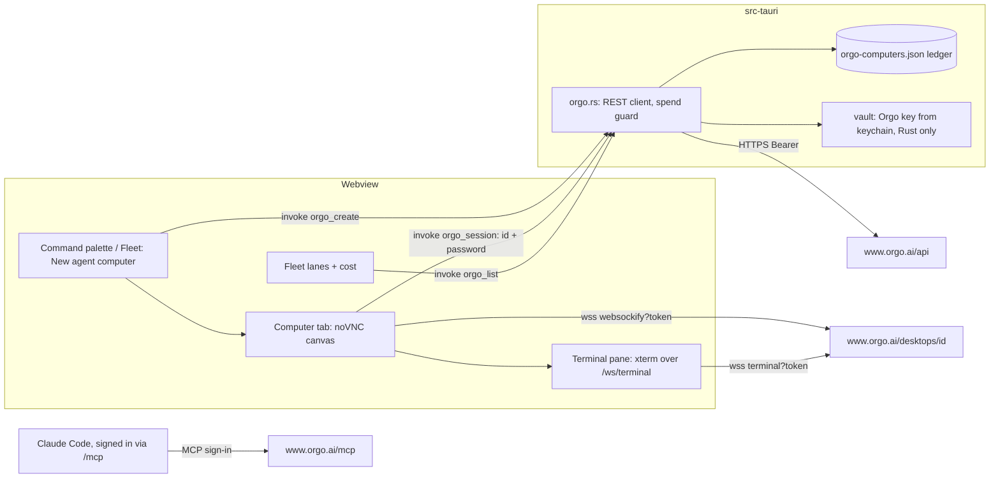
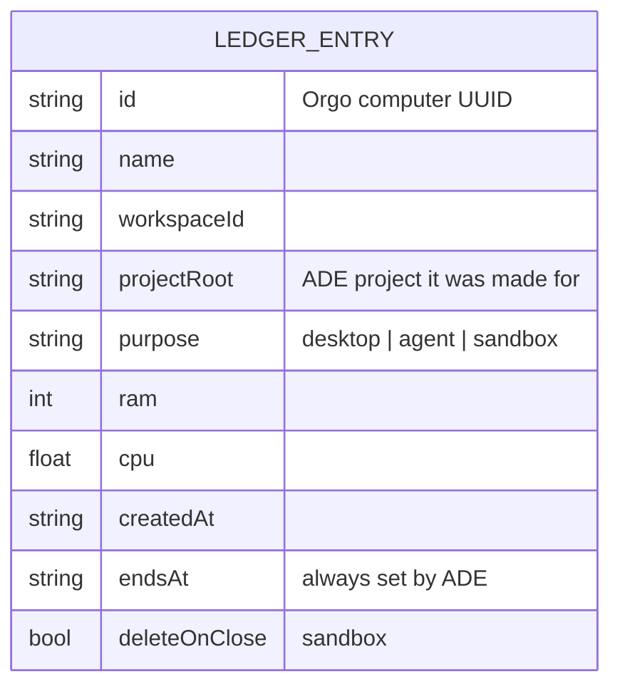
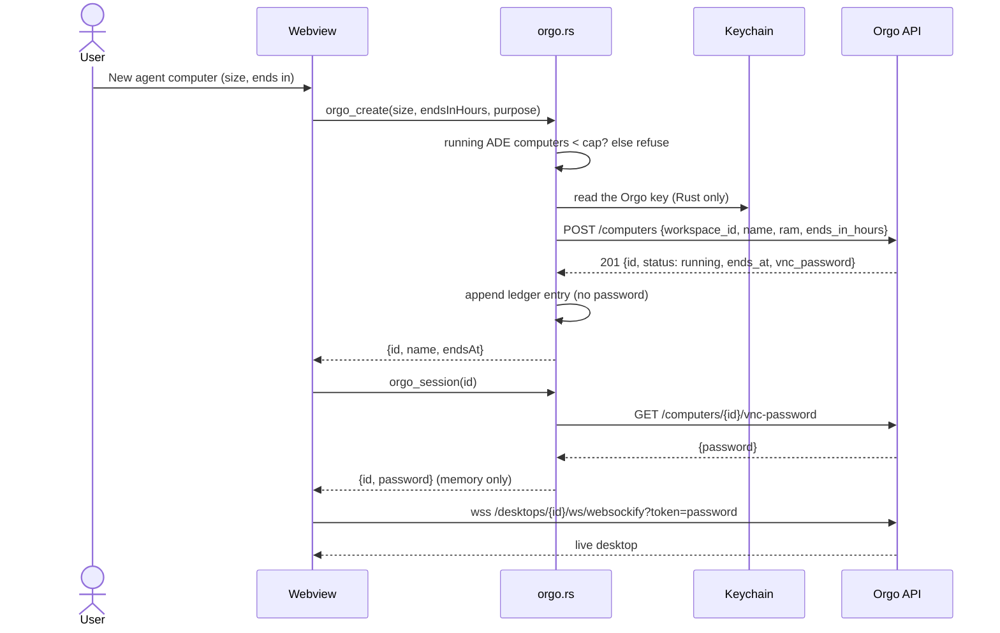

There are two steps. **Story 1** adds Orgo's hosted MCP server to the MCP library, signed in through Claude Code. It also writes Claude Code rules that ask before any computer is created, changed, stopped or deleted, in every permission mode. It is small and can be built once this plan is approved. **Stories 2 to 6** are step 2, the native panel. They are outlined only, because they need the owner's answers to the open questions at the end and a check of the unverified facts (U-list) with a real account. Shard them only after both. Shared intent, decisions, security and cost come first.

<frozen-after-approval reason="human-owned intent — do not modify unless human renegotiates">

## Intent

**Problem:** An agent working in ADE has only the user's own machine. It cannot test the UI it just built in a clean desktop and browser. It cannot run Claude Code somewhere other than the user's laptop, fan work out across several machines, or run untrusted code away from the user's files and keys. Orgo rents cloud computers made for agents to drive. ADE has no way to reach them.

**Approach:** Two steps, Orgo only.
1. Add Orgo's **hosted** MCP server (`https://www.orgo.ai/mcp`) to ADE's MCP library. The user signs in with their Orgo account through Claude Code's `/mcp`, so ADE holds no Orgo key. Installing it also adds Claude Code `ask` rules, which keep every create, copy, resize, end change, start, stop and delete behind a prompt, even in Continuous mode.
2. Later, a native panel. A click creates a computer and opens its live desktop in a tab. The panel adds lifecycle with a spend guard, a terminal that can run Claude Code remotely, and fleet lanes with cost.

## Owner's decisions (2026-10-29)

1. Purposes, all four: computer use (an agent drives a real desktop and browser, for example to test the UI it built); Claude Code running remotely from an ADE tab; a parallel fleet across several machines, shown in the fleet view with cost; a throwaway sandbox for untrusted code.
2. Depth: MCP first (Story 1), then a native panel with the live desktop, lifecycle and cost (step 2).
3. Provider: Orgo only. No provider-neutral abstraction: no `ComputerProvider` interface, no settings for a second vendor.
4. **(Q7) Story 1 uses Orgo's hosted MCP server**, `https://www.orgo.ai/mcp`, with the user signing in through Claude Code's MCP OAuth flow. There is no API key in ADE's vault for Story 1, no npx package and no local server. The reason comes from the review, which ran `orgo-mcp-server@1.1.1` and read the live spec:
   - The local server puts each computer's root VNC password into model context and transcripts.
   - It exposes `orgo_get_vnc_password`, `orgo_enable_computer_ssh`, `orgo_apply_computer_secrets`, `orgo_move_computer` and workspace edits.
   - Orgo's sign-in tool list leaves these out "so a sign-in is never sent a computer's password" (https://docs.orgo.ai/guides/mcp).
5. **Orgo tools that create, copy, resize, extend, start, stop or delete a computer always ask**, in every mode, ADE's Continuous mode (`claude --dangerously-skip-permissions`, `src/lib/agentCommand.ts:50`) included. Story 1 delivers this.
6. **(Q5) Claude Code on a remote computer signs in with a dedicated, spend-limited Anthropic Console key** that the user makes for remote machines. ADE sends it only on an explicit, confirmed action, and never copies the user's own Claude login. This is for step 2 (Story 4).
7. **(Q3) Not needed for Story 1**, since the hosted server needs no key in ADE. For step 2's native panel it stays an open question.

## Boundaries & Constraints (all stories)

**Always:**
- Orgo's own hosted MCP server, and Orgo's documented REST and WebSocket endpoints for step 2. No third-party wrapper.
- Every Orgo or Claude Code fact a story relies on is cited below. A fact marked unverified (U-list) is checked before the story that needs it is sharded.
- ADE edits `.claude/settings.json` only by merging. The user's keys and rules are kept, a file that is not valid JSON is left alone and the action is refused, and ADE never deletes a rule.
- The verification command is unchanged (see Verification).

**Never:**
- ADE never creates, starts or resizes an Orgo computer without the user's click. This holds for the native panel in every story. In the MCP path, Claude Code creates computers, and Story 1's rules make it ask first.
- ADE never sends `billing_mode: "hourly"`, never calls an Account, Clients, Billing or capacity-buying endpoint, and never adds credit.
- ADE never copies the user's Claude Code credentials, `~/.claude`, the keychain's Claude entry, SSH keys or any other vault secret to an Orgo computer. The one exception is decision 6: a dedicated key the user names, sent on a confirmed click.
- No change to `relay/` or `mobile/`. No provider abstraction.

## Security

- **No Orgo key in ADE for Story 1.** `.mcp.json` holds only `{"type": "http", "url": "https://www.orgo.ai/mcp"}`. Claude Code runs the OAuth sign-in in the browser and keeps the tokens itself. Orgo issues 1-hour access tokens with rotating refresh tokens. Nothing secret is in any file ADE writes.
- **What signing in grants** ([Orgo MCP guide](https://docs.orgo.ai/guides/mcp)):
  - The grant covers one workspace, which the user picks at sign-in. In it, Claude Code can create and manage computers, screens and files, and read the workspace.
  - It sees only Orgo's reviewed tool list. Templates, Clients, Account, Chat and Support are left out. So are creating, changing or deleting workspaces, suspend and resume, file upload, `orgo_get_vnc_password`, `orgo_apply_computer_secrets` and `orgo_move_computer`. A sign-in is never sent a computer's password and cannot put Orgo vault secrets on a computer.
  - On a paid account, a sign-in cannot launch hourly computers (`403 HOURLY_NEEDS_BILLING`, [computer ends](https://docs.orgo.ai/guides/computer-ends)).
  - To revoke: Orgo Settings → Security → Connected AI apps → Disconnect. In Claude Code, `/mcp` → Clear authentication, or `claude mcp logout orgo`.
- **Always ask (decision 5).** Install merges ten `ask` rules into the project's `.claude/settings.json` (Story 1). Each rule names the full tool `mcp__orgo__<tool>`, from Orgo's naming rule: `orgo_` plus the operationId in snake_case. The covered actions are create, clone, fork, resize, update (end), start, restart, stop, delete and enable SSH. Claude Code's documentation says:
  - "Claude Code doesn't auto-approve the following in any mode, including `bypassPermissions` … Tools matched by an explicit ask rule" ([permission modes](https://code.claude.com/docs/en/permission-modes), "Actions no mode auto-approves").
  - Rules are evaluated deny, then ask, then allow ([permissions](https://code.claude.com/docs/en/permissions)).
  - An allow rule a user saves with "Yes, and don't ask again" lands in `.claude/settings.local.json`. It "doesn't outrank an `ask` rule from a project or managed file", and `deny` and `ask` rules apply without waiting for workspace trust ([settings](https://code.claude.com/docs/en/settings)).
- **What the ask rules do not stop, stated plainly:**
  - **An agent in Continuous mode can remove them.** Bypass mode allows writes to `.claude/` ("Protected paths … `bypassPermissions`: Allowed"), and Claude Code reloads permission edits into the running session. The rules stop runaway loops and mistakes. They do not stop an agent that sets out to rewrite its own settings. Q8 proposes a hard stop that the agent cannot edit.
  - **They apply only where Claude Code reads them.** It reads `.claude/settings.json` from the session's primary working directory. A session started in a subfolder may not see them; whether it still loads `.mcp.json` there is U8. The guide says to start Claude Code at the project root.
  - **Actions on the computer are not covered.** Screenshot, mouse, keyboard, bash and Python on the remote computer still prompt in Manual mode and run unprompted in Continuous mode. That is what Continuous mode is for, and their effects stay on the remote computer.
- **Prompt injection.** Over a sign-in, screenshots always come back to the model as images. A web page shown on the computer is untrusted input that can carry instructions.
  - It can steer what the agent does on the computer. The effect is contained there, so use throwaway computers.
  - It can push the agent to create or delete computers. The ask rules catch that.
  - It can push the agent to type local data into the computer, or to act on the user's machine with local tools. Orgo's rules do not cover that. In Continuous mode those local tools run unprompted, as they already do today.
  - The guide says: use a disposable computer, don't sign in to personal accounts on it, and don't run Continuous mode while the agent browses sites you don't trust.
- **Step 2's key (Q3).** The native panel calls the REST API with an Orgo API key from the vault, read in Rust. The webview can read any vault value today through `vault_get(name)` (`src-tauri/src/vault.rs:137-140`, registered at `src-tauri/src/lib.rs:483`), so "the key never reaches the webview" is not true yet. Recommend: Story 2 first limits `vault_get` to an allowlist. Today the only caller is `DEEPSEEK_API_KEY` (`src/lib/anthropic.ts:176`).
- **The computer password (step 2) is root on that machine.** It opens the screen, `/ws/terminal` and the proxy's bash. The panel fetches it in Rust per session, passes it to the tab that uses it, and never writes it to disk, syncs it, logs it or shows it.

## Cost

- **What a computer costs** ([billing](https://docs.orgo.ai/guides/billing), [prices](https://docs.orgo.ai/guides/pricing)):
  - On a paid plan, a computer that fits the plan's remaining vCPU and RAM is included, with no marginal charge. Past that, it runs by the hour from credit, but only for a caller with Billing write. That is never an MCP sign-in.
  - On a free account, computers run by the hour from credit: $5 signup credit, Medium only.
  - Linux hourly runs $0.023/h (Small) to $0.202/h (XL), billed per second. A paid plan runs at most 50 computers.
  - GPU computers have no published price (U11). ADE never creates one.
- **A computer costs money until it is deleted, not until it is stopped.** A stopped hourly computer still pays for its disk, from $0.0017/h (Small) up. A computer whose end passes is stopped and then deleted 7 days later unless started. The guide says "delete it when you're done".
- **The real spend limit is the Orgo plan or credit, not ADE.** With a sign-in, a runaway agent on a paid plan can fill the capacity the user already pays for, up to 50 computers, and nothing beyond it. On a free account it can spend the credit balance, unless auto top-up is on, which charges the card up to 5 times in 24 hours. The guide says to leave auto top-up off.
  - Whether a sign-in on a free account can launch at all is U2.
  - Story 1's ask rules put a prompt in front of every create. They are not a cap.
- **The native panel adds ADE's own guard** (Story 2): a cap on running ADE-made computers, an end on every computer it creates (`ends_in_hours`), auto-stop when idle, and no hourly launches.
- **Nothing runs forever by default from ADE.** An Orgo computer without an end runs until stopped. ADE's panel always sends an end. The MCP path cannot force one, so the guide asks the user to tell the agent to set one.

</frozen-after-approval>

## What Orgo offers (verified 2026-10-29 against the live docs)

The search results disagreed on paths. The live docs settle it: the base URL is `https://www.orgo.ai/api`, and computers are addressed by UUID as `/computers/{id}/…`. A create takes `workspace_id`, and the older name `project_id` is still accepted. `/api/projects/{project}/computers/{name}/…` is not in the current spec.

| # | Fact | Source |
|---|---|---|
| F1 | REST auth is `Authorization: Bearer $ORGO_API_KEY`, with keys beginning `sk_live_`. Spec 2.0.0 has 86 operations. | https://docs.orgo.ai/llms.txt, https://docs.orgo.ai/api-reference/introduction |
| F2 | Hosted MCP: `https://www.orgo.ai/mcp`, streamable HTTP. Without a token it answers `401` with `WWW-Authenticate: Bearer resource_metadata=".../.well-known/oauth-protected-resource/mcp", scope="mcp:tools"`. Its OAuth metadata publishes dynamic client registration, PKCE S256 and public clients (`token_endpoint_auth_methods_supported: ["none"]`), plus a revocation endpoint. Tools are one per operation, named `orgo_` + the operationId in snake_case (`createComputer` → `orgo_create_computer`). A sign-in sees a reviewed subset (see Security). | https://docs.orgo.ai/guides/mcp; probed 2026-10-29: `POST https://www.orgo.ai/mcp`, `GET https://www.orgo.ai/.well-known/oauth-protected-resource/mcp`, `GET https://www.orgo.ai/.well-known/oauth-authorization-server` |
| F3 | Live spec groups: Workspaces 5, Computers 14, Computer Lifecycle 7, Computer Actions 10, Templates 15, Files 7, Screens 5, Account 3, Clients 15, Chat 1, Agent accounts 3, Support 1. | https://docs.orgo.ai/api-reference/openapi.json (fetched 2026-10-29) |
| F4 | Create: `POST /computers` with `workspace_id` and `name` (both required). `os` defaults to `linux`; `ram` is 4, 8, 16, 32 or 64. `billing_mode` is `plan` by default, or `hourly`. `ends_in_hours` is 1 to 720. `template_ref` is optional, for example `system/coding`, which runs `claude` and `codex`. `gpu` is `2q` or `4q`. The `201` is already `running`. | https://docs.orgo.ai/api-reference/computers/create, https://docs.orgo.ai/guides/templates/examples |
| F5 | Lifecycle: start, stop, restart, suspend, resume and delete. Stop archives the disk, releases compute and reads `frozen`. Delete is permanent. A computer with an end stops at it and is deleted 7 days later unless started. "Sleep when idle" (`auto_stop_minutes`) is off by default. | https://docs.orgo.ai/api-reference/computers/stop, …/computers/delete, https://docs.orgo.ai/guides/computer-ends, https://docs.orgo.ai/guides/instance-types |
| F6 | Billing: see Cost. | https://docs.orgo.ai/guides/billing, https://docs.orgo.ai/guides/pricing |
| F7 | Live desktop: `wss://www.orgo.ai/desktops/{id}/ws/websockify?token={vnc_password}`, any websockify client (noVNC ≥ 1.7.0). There is no origin allowlist, and an `sk_` key from a browser gets `4001`. Close codes: `4003` stopped or asleep, `4006` credential for another workspace, `4007` MFA required, `4008` idle 30 min without human input. | https://docs.orgo.ai/guides/embed-vms |
| F8 | Terminal: `wss://www.orgo.ai/desktops/{id}/ws/terminal?token=…&cols=&rows=&session=`, a full PTY with JSON `input` and `resize` frames. A named `session` survives a disconnect. Linux machines also take direct SSH with the user's public key. | https://docs.orgo.ai/api-reference/computers/terminal, https://docs.orgo.ai/guides/ssh |
| F9 | Commands: `POST /computers/{id}/bash` and `/exec` (Python). Files: upload (10 MB), export, download. | https://docs.orgo.ai/llms.txt |
| F10 | Keys: full access, or restricted (Custom, eleven groups). Scope is the account, one workspace or one computer. A workspace key sees only its workspace and cannot call billing, account or template endpoints. A restricted key calling Control on a computer that holds its own Orgo key gets `403 computer_key_held`. A template's secrets are injected only for a key with Secrets write. | https://docs.orgo.ai/api-reference/api-keys/permissions, …/api-keys/computer-keys, https://docs.orgo.ai/api-reference/authentication, https://docs.orgo.ai/guides/templates/secrets |
| F11 | Rate limits: "some endpoints" answer `429`; back off from 1 s, doubling to 60 s. No general numbers are published. | https://docs.orgo.ai/api-reference/introduction |
| F12 | The `Computer` schema, which carries `vnc_password`, is the response of `createComputer`, `getComputer` and `resizeComputer`. The review also found it in the workspace listings. | openapi.json (fetched 2026-10-29) |

**Claude Code facts this plan relies on (verified 2026-10-29):**
- A remote server in `.mcp.json` is `{"type": "http", "url": "…"}` ([MCP](https://code.claude.com/docs/en/mcp)). OAuth fields (`oauth.clientId`, `callbackPort`) are needed only for servers without automatic setup. Orgo publishes dynamic registration (F2), so none are needed. Sign-in is `/mcp` in a session, and "Clear authentication" revokes it locally.
- MCP tool permission names are `mcp__<server>__<tool>`, and ask and deny rules take globs in the tool-name position ([permissions](https://code.claude.com/docs/en/permissions)).
- Explicit ask rules prompt even in `bypassPermissions`. Deny rules block in every mode. A local allow does not outrank a project ask. Settings edits reach a running session. `.claude/settings.json` is read from the primary working directory ([permission modes](https://code.claude.com/docs/en/permission-modes), [settings](https://code.claude.com/docs/en/settings)).
- ADE's MCP library already supports remote sign-in servers: Sentry, Supabase, Notion, Linear and Stripe are `{type: "http", url}` with `oauth: true` (`src/data/mcpCatalog.ts:44-49`). The card shows a "Sign in" tag (`IntegrationsPanel.tsx:183`), and the install notice says to run `/mcp` (:83). Story 1 needs no new remote-server support.

**Unverified, to check before the story that needs it:**
- **U1.** How `GET /computers/{id}` tells plan from hourly. No `billing_mode` is in the documented response (Story 5).
- **U2.** Whether an MCP sign-in, or a Custom key without Billing write, can create on a free account, where hourly is the default (Story 1 guide wording, Story 2).
- **U3.** What a sleeping (`suspended`) computer is billed (Story 3).
- **U4.** How auto-stop is set. It is not a create parameter, it is reachable through `PATCH /computers/{id}/resize` (`auto_stop_minutes`) and `PATCH /computers/{id}/auto-stop`, and the docs disagree on whether it suspends or stops (Story 3).
- **U5.** Real rate limits on create, get and screenshot (Story 2).
- **U6.** Whether WKWebView and WebKitGTK open `wss://www.orgo.ai` from the app's origin once the CSP allows it. Needs a spike (Story 2).
- **U7.** Whether `GET /workspaces/{id}` (`desktops`) lists every computer a key can see (Story 3).
- **U8.** Whether Claude Code started in a subfolder loads the root `.mcp.json` while not reading the root `.claude/settings.json`. If so, Orgo's tools would load without their ask rules (Story 1 manual check).
- **U9.** The hosted server's exact tool names. They come from Orgo's documented naming rule and the operationIds, not from a signed-in listing, which needs an account. Whether `orgo_enable_computer_ssh`, `orgo_clone_computer` and `orgo_fork_computer` are in the reviewed list is also open. Whether an ask rule that names a tool the session doesn't have shows Claude Code's "matches no tool" startup row is not settled by the docs either (Story 1 manual check).
- **U10.** Story 2's key check reads `GET /account/capacity`. A restricted account-wide key without Account access answers `403 key_permission`, while a workspace key answers `403 workspace_scope_mismatch`. The check must branch on `code`, and the codes need confirming with real keys.
- **U11.** GPU prices (`gpu: 2q | 4q`) are not published. Reserved GPU computers go through a billing endpoint (Story 5 shows "price unknown").

**Rejected: Orgo's local server, `orgo-mcp-server` (npm, from `OrgoAI/orgo-mcp`).**
- It needs an API key in the vault, and that key reaches every new ADE terminal.
- With Control write it returns each computer's root `vnc_password` into model context and transcripts (F12).
- It registers `orgo_get_vnc_password`, `orgo_enable_computer_ssh`, `orgo_apply_computer_secrets`, `orgo_move_computer` and workspace edits.
- Pinning it would not fix the surface. Its dependencies float, and it loads the spec and the base URL at runtime.
- The hosted sign-in avoids all of this (decision 4).

**Third-party servers, not chosen:** `nickvasilescu/orgo-mcp`, `spencerkinney/computer-use-mcp` and the Composio toolkit. Orgo's own hosted server is first-party.

## How Story 1 and step 2 coexist

They use two credentials for two callers. Story 1's sign-in belongs to Claude Code: agents use it, and Claude Code stores it. Step 2's native panel uses an Orgo API key that ADE's Rust code reads from the vault (Q3). Both should reach the same Orgo workspace: the user picks it at sign-in and scopes the key to it (Q9). Then computers an agent made through MCP show in the panel as "made elsewhere" (Story 3), with Stop and Delete, and not counted against ADE's cap. Revoking one credential leaves the other working. Neither is ever handed to the other caller.

## Proposed ADR 0010 (written on approval)

`.ade/context/decisions/0010-agent-computers-are-orgo-only-and-made-on-click.md`. The next free number is 0010, because 0008 and 0009 are each used twice in history.
- **Decision:**
  - Orgo is the only provider, with no abstraction.
  - Agents reach Orgo through its hosted MCP server with the user's sign-in. ADE keeps their lifecycle tools behind Claude Code `ask` rules in every mode.
  - In the native panel, only a user's click creates, starts or resizes a computer. Every ADE create carries an end and stays under ADE's cap.
  - ADE never chooses hourly billing. It ships no credential except a dedicated key on a confirmed click.
  - ADE never sends the panel's Orgo key to the webview, and Story 2 limits `vault_get` to an allowlist so the webview cannot ask for it.
- **Consequences:** a second provider later is new work, not configuration. The MCP path's spend limit is the user's Orgo plan or credit, behind a prompt. Orgo API changes are absorbed in one Rust module (step 2).

---

# Story 1: Orgo in the MCP library, always asking

## Code Map (1)

- `src/data/mcpCatalog.ts`: `McpEntry` (:18-31), `MCP_CATALOG` (:33). The "Web & browser" entries are playwright and fetch (:108-125). Sentry (:44-49) is the precedent for an http sign-in server.
- `src/components/IntegrationsPanel.tsx`: the card (:178-209), the "Sign in" tag (:183), `install` (:73-90) with the sign-in notice (:83).
- `src-tauri/src/mcp.rs`: `mcp_install` (:44) and `mcp_remove` (:63) merge one server into `.mcp.json`; tests from :74.
- `src-tauri/src/usage.rs`: `settings_path` (:544), `merge_deny` (:651), `load_settings` (:718) and `save_settings` (:725). These form the existing merge-safe writer for `.claude/settings.json`, tested by `deny_rules_merge_into_settings` (:1377) and `deny_refuses_other_rules_and_bad_json` (:1463).
- `src/lib/agentCommand.ts:50`: Continuous mode is `claude --dangerously-skip-permissions`. Unchanged in Story 1 (see Q8).
- `docs/guide/integrations.md`: the MCP library table (:13-19) and the sign-in bullet (:25). `README.md:46`: "15 curated MCP servers".

## Design Notes (1)

**The catalog entry**, after `fetch` in "Web & browser":

```ts
{
  id: "orgo",
  name: "Orgo",
  category: "Web & browser",
  description: "Cloud computers with a desktop, browser and shell that the agent can start, see, drive and run commands on.",
  server: { type: "http", url: "https://www.orgo.ai/mcp" },
  oauth: true,
  caution: "Signing in lets Claude Code create, drive and delete computers in the Orgo workspace you choose. They cost money until deleted, and what their screens show can try to steer the agent. Claude Code will ask before any computer is created, changed, stopped or deleted, even in Continuous mode.",
  docs: "https://docs.orgo.ai/guides/mcp",
}
```

What Install writes into `.mcp.json` under `mcpServers.orgo`:

```json
{ "type": "http", "url": "https://www.orgo.ai/mcp" }
```

There are no headers, env or OAuth fields. The server key is `orgo`, so its tools are `mcp__orgo__<tool>`.

**`caution`** is a new optional field on `McpEntry`. The card renders it under the description as `<p className="mcp-caution" role="note">`, styled like `.mcp-tag[data-warn]`. Only Orgo sets it. It is not part of `matchCatalog`'s haystack. The description contains no "click", which keeps `"browser click"` → `["playwright"]`. "Cloud computers" makes `"cloud computer"` find Orgo.

**The ask rules** are a Rust constant in `src-tauri/src/mcp.rs`. The webview cannot add to the list: it only names the server it installs.

```rust
/// Orgo tools that create, copy, resize, re-time, start, stop or delete a
/// computer: Claude Code asks before each call, in every permission mode.
const ORGO_ASK_RULES: &[&str] = &[
    "mcp__orgo__orgo_create_computer",
    "mcp__orgo__orgo_clone_computer",
    "mcp__orgo__orgo_fork_computer",
    "mcp__orgo__orgo_resize_computer",
    "mcp__orgo__orgo_update_computer",   // PATCH /computers/{id}: sets or moves the end
    "mcp__orgo__orgo_start_computer",
    "mcp__orgo__orgo_restart_computer",
    "mcp__orgo__orgo_stop_computer",
    "mcp__orgo__orgo_delete_computer",
    "mcp__orgo__orgo_enable_computer_ssh",
];
```

- **The names** are derived from the live spec's operationIds by Orgo's documented rule (F2). A signed-in listing needs an account, so it is U9, checked by hand.
- **Suspend and resume** are left out: the sign-in list excludes them. A name the hosted list lacks is harmless, apart from a possible "matches no tool" row (U9).
- **Why exact names and not a glob:** `mcp__orgo__*` would also ask for every screenshot and click, which would make computer use unusable. A verb glob such as `mcp__orgo__*_computer` would also catch the read-only `orgo_get_computer`, which agents poll.

**Install, in order** (`mcp_install`, for `name == "orgo"`):
1. Read `.mcp.json` and `.claude/settings.json`. If either exists and is not valid JSON, or `permissions`/`permissions.ask` has the wrong type, refuse with the existing message and write nothing.
2. Merge the ask rules into `permissions.ask`. Keep every other key and rule in order, and add each missing rule once at the end.
3. Write `.mcp.json`.

So the server is never installed without its rules. If step 3 fails after step 2, the rules stay, which is the safe direction. Implement it by generalising `merge_deny` to `merge_rules(root, "deny" | "ask", rules)`. The existing deny callers keep their behaviour and their tests.

`mcp_install` returns the ask rules it added (`Vec<String>`, empty for other servers). The notice uses that list.

**Remove** takes Orgo out of `.mcp.json` and **leaves the ask rules**. ADE never deletes a rule, because it cannot tell one it added from the same rule the user wrote. The notice says the rules were kept.

**Notice after install:** "Orgo added to .mcp.json. Claude Code will ask before Orgo creates, changes, stops or deletes a computer (rules added to .claude/settings.json). Start Claude Code at the project root and run /mcp to sign in."

**Guide** (`docs/guide/integrations.md`): add Orgo to the "Web & browser" row and a `## Orgo cloud computers` section covering:
1. **What it does.** Claude Code can create a cloud computer, see its screen, drive its browser and run commands on it.
2. **Sign in.** Install, open a new terminal at the project root, start `claude`, approve the server, then run `/mcp` → orgo → Authenticate. Pick a workspace kept for ADE (Q9).
3. **What signing in allows.** The grant covers one workspace and Orgo's reviewed tool list. It never receives a computer's password and cannot launch hourly computers on a paid plan.
4. **Revoke.** Orgo Settings → Security → Connected AI apps, or `/mcp` → Clear authentication.
5. **Always asks.** Name the ten tools, and say it holds in Continuous mode. State that a Continuous-mode agent can edit `.claude/settings.json` and so could remove the rules.
6. **Cost.**
   - Computers are billed until deleted, and a stopped hourly computer still pays for its disk.
   - Your plan or credit is the limit.
   - Ask the agent to give each computer an end, and delete it when done.
   - Leave auto top-up off.
7. **Prompt injection.** Pages on the computer can try to steer the agent. Use throwaway computers, don't sign in to personal accounts there, and avoid Continuous mode while it browses untrusted sites.

Update **README** to "16 curated MCP servers".

**Contract:** `.ade/context/mcp-ask-rules.md` records what ADE writes into a project's `.claude/settings.json` for MCP servers: which server, which rules, when, and that removal keeps them. Later stories and the panel must agree with it.

**Failure modes:**

| Failure | Handling |
|---|---|
| `.claude/settings.json` is invalid JSON or has the wrong shape | Install is refused with the file named. Neither file changes. |
| Not signed in | Claude Code shows the server as needing authentication in `/mcp`, and the notice says to run it. |
| Session started in a subfolder | The rules may not apply (U8). The guide and the notice say to start at the project root. |
| The hosted list lacks a named tool | That rule matches nothing, possibly with a startup row (U9). No tool goes unprompted because of it. |
| A Continuous-mode agent deletes the rules | Not prevented in Story 1; stated in the guide. Q8 is the hard stop. |

## Acceptance Criteria (1)

Each names the test that covers it. The developer writes it failing first. AC10 is a regression check of existing behaviour.

1. Rendering `IntegrationsPanel` with `vault_list` empty: the Orgo card shows the "Sign in" tag and its caution as a `role="note"`, and has no secret row, no "Add to vault" button and no `npx` tag. Covered by `src/components/__tests__/IntegrationsPanel.test.tsx` (new) › "the Orgo card is a sign-in server with its caution".
2. Clicking Install on the Orgo card invokes `mcp_install` with `name: "orgo"` and a `server` whose keys are exactly `type` ("http") and `url` ("https://www.orgo.ai/mcp"). When the mocked command returns the ask rules, the status notice says Claude Code will ask, and says to start at the project root and run `/mcp`. Covered by `IntegrationsPanel.test.tsx` › "installing Orgo writes the hosted server and says how to sign in".
3. Every catalog entry with `oauth: true` has no `secrets` and `envRefs(server)` empty, and its `url` is `https:`. Covered by `src/data/__tests__/mcpCatalog.test.ts` › "sign-in servers carry no secret and use https".
4. `matchCatalog(MCP_CATALOG, "cloud computer")` returns `["orgo"]`, and `"browser click"` still returns `["playwright"]`. Covered by `mcpCatalog.test.ts` › "searches name, category and description" (extended).
5. `mcp_install` of `orgo` into a project without `.claude/settings.json` creates it with `permissions.ask` equal to `ORGO_ASK_RULES` and no other key, writes the server to `.mcp.json`, and returns the ten rules. Covered by `src-tauri/src/mcp.rs` › `orgo_install_adds_ask_rules`.
6. The existing `.claude/settings.json` holds `model`, `hooks` and `env` keys, user `allow` and `deny` rules, and an `ask` list with one user rule and one rule equal to an Orgo rule. After install:
   - every other key and rule is unchanged and in its original order;
   - each Orgo rule appears exactly once;
   - the return value lists only the nine that were added;
   - a second install leaves the file byte-identical and returns an empty list.

   Covered by `mcp.rs` › `orgo_ask_rules_merge_and_keep_the_users_rules`.
7. With `.claude/settings.json` holding `{ not json`, or `permissions.ask` set to a string, install returns an error, and both `.claude/settings.json` and `.mcp.json` are byte-identical to before. With `.mcp.json` invalid instead, install errors and `.claude/settings.json` is not created. Covered by `mcp.rs` › `orgo_install_refuses_and_touches_nothing_on_bad_files`.
8. Installing `github` creates no `.claude/settings.json` and returns an empty list. `mcp_remove` of `orgo` takes it out of `.mcp.json` and leaves every ask rule in `.claude/settings.json`. Covered by `mcp.rs` › `only_orgo_adds_rules_and_remove_keeps_them`.
9. `ORGO_ASK_RULES` equals `mcp__orgo__` + `orgo_` + snake_case(operationId) for exactly `createComputer`, `cloneComputer`, `forkComputer`, `resizeComputer`, `updateComputer`, `startComputer`, `restartComputer`, `stopComputer`, `deleteComputer` and `enableComputerSsh`. The test holds the operationIds and the conversion, so a misspelt rule fails. Covered by `mcp.rs` › `orgo_ask_rules_follow_orgos_tool_names`.
10. The deny callers behave as before after `merge_deny` becomes `merge_rules`. Covered by `src-tauri/src/usage.rs` › existing `deny_rules_merge_into_settings`, `deny_refuses_other_rules_and_bad_json` (unchanged, green).
11. The guide's MCP library table names exactly the catalog's servers. Each cell is split on commas after removing parenthesised text, and each catalog `name` has its trailing parenthesised part removed, then the two sets must be equal. So "Git" and "GitHub" are distinct, and "Databases (DBHub)" matches the "Databases (…)" cell. Covered by `scripts/mcpCatalogDocs.test.ts` (new) › "the guide's table lists exactly the catalog".
12. The guide's `## Orgo cloud computers` section names every tool in `ORGO_ASK_RULES` (the test reads them from `src-tauri/src/mcp.rs`), and mentions "Continuous", "/mcp", "until you delete" and "auto top-up". `README.md` says "<N> curated MCP servers" with N equal to `MCP_CATALOG.length`. Covered by `scripts/mcpCatalogDocs.test.ts` › "the Orgo section matches the rules ADE writes", "the README count matches the catalog".

## Verification (1)

**Commands (the repo's verification command, unchanged):**
- `npx tsc --noEmit`: expected exit 0.
- `npm test`: expected all pass, including `IntegrationsPanel.test.tsx`, `mcpCatalogDocs.test.ts` and the extended `mcpCatalog.test.ts`.
- `cd src-tauri && cargo test`: expected all pass, including the four new `mcp.rs` tests and the existing `usage.rs` deny tests.
- `cd relay && cargo test`: expected all pass (no change).
- `cd mobile && npx tsc --noEmit && npx jest`: expected all pass (no change).

**Manual checks (owner, with a real Orgo account):**
- **Sign-in and tool names (U9).** Install Orgo in a scratch git project, open a new terminal at its root, start `claude`, approve the server, then `/mcp` → orgo → Authenticate, picking a workspace for ADE. The tool list shows no `orgo_get_vnc_password`. Compare the tool names with `ORGO_ASK_RULES`, and note any rule shown as "matches no tool".
- **Manual mode.** Ask "create a small Orgo computer that ends in 1 hour and show me a screenshot". The create prompts. Answer "Yes, and don't ask again", ask for another, and it prompts again.
- **Continuous mode.** Start an agent from the picker with Continuous on, in the same project, and ask it to create a computer. Claude Code still prompts for `orgo_create_computer`, and for `orgo_delete_computer` when it cleans up.
- **Subfolder (U8).** Start `claude` in a subfolder. Note whether Orgo's tools load and whether the create still prompts.
- **Clean-up.** Delete every computer made, check the Orgo dashboard shows none, then revoke in Orgo Settings → Security → Connected AI apps.

## Slice (1)

These files only:
- `src/data/mcpCatalog.ts`, `src/data/__tests__/mcpCatalog.test.ts`
- `src/components/IntegrationsPanel.tsx`, `src/components/__tests__/IntegrationsPanel.test.tsx`, `src/index.css`
- `src-tauri/src/mcp.rs`, `src-tauri/src/usage.rs` (the merge generalised, no behaviour change)
- `scripts/mcpCatalogDocs.test.ts`, `docs/guide/integrations.md`, `README.md`
- `.ade/context/mcp-ask-rules.md`

No new dependency, and no change to `agentCommand.ts` or the CSP.

---

# Step 2: the native panel (outline; not ready to shard)

## Shape



- **`src-tauri/src/orgo.rs`** is the only ADE code that calls the Orgo REST API. It reads the panel's key (Q3) through a new internal `vault` function. Story 2 first limits `vault_get` to an allowlist (`DEEPSEEK_API_KEY` today), so the webview cannot ask for the Orgo key. It needs an HTTP client crate (`reqwest` with rustls, or `ureq`), the first new Rust dependency.
- **The ledger**, `orgo-computers.json` in app data, holds only the computers ADE created. It sits beside `vault-index.json`, is not synced, and stores no passwords.



- **The spend guard** lives in `orgo_create`, the only create path. It refuses at the cap and always sends `ends_in_hours`. It never sends `billing_mode` or `gpu`. Then it sets auto-stop (U4).
- **The live view** is noVNC (`@novnc/novnc` 1.7.0, MPL-2.0) in a new tab type, `"computer"`. The CSP's `connect-src` gains exactly `wss://www.orgo.ai`; today it has `http: https:` and no `ws`/`wss`. **Both** `scripts/csp.test.ts` and `scripts/browserTabCsp.test.ts` are updated: that one host, no `wss:` or `ws:` wildcard, and the existing frame and connect assertions still hold.
- **The Context Store** gains `.ade/context/orgo-computers.md`: commands, ledger fields and close-code handling.



## Stories (outline)

**Story 2: New agent computer, with its live desktop in a tab.** Purpose 1.
- First, `vault_get` gets an allowlist, with a test that `vault_get("ORGO_API_KEY")` is refused.
- "New agent computer" in the command palette and the fleet view opens a sheet: size (Small, Medium or Large; no GPU), ends in (Q1 default), and the workspace. On confirm, `orgo_create` runs, a computer tab opens, and noVNC connects.
- Close codes:
  - `4003`: "Stopped or asleep", with a Start button (a click).
  - `4008`: reconnect on the next input.
  - `4001`: refetch the password once.
  - `4006`: "This key is for another workspace" (Q9).
  - `4007`: "Orgo wants MFA: finish it in the browser".
- The key check calls `GET /account/capacity` and branches on `code` (U10). Success means an account-wide key; `key_permission` means restricted account-wide; `workspace_scope_mismatch` means a workspace key. ADE warns on the first two, linking the guide's key steps, and does not refuse.
- It depends on F4, F5, F7, F10, U4, U5, U6 and U10, and needs Q1 to Q4 and Q9. It adds `orgo.rs`, the ledger, the CSP change with both CSP tests, the `"computer"` tab type, `@novnc/novnc`, ADR 0010 and the context file.

**Story 3: Lifecycle, with stop, start, delete and auto-stop when idle.**
- Per computer: Stop, Start (a click) and Delete (a confirm naming the computer and saying the disk is lost). The tab says "Ends in 3h 12m" and offers "Extend 1 h" as a click.
- Auto-stop when idle uses the Q1 default, applied right after create.
- On launch, reconcile the ledger with the workspace. Computers the ledger has but Orgo does not are dropped. Computers ADE did not make, for example ones an agent made through MCP, show as "made elsewhere" with Stop and Delete, not counted against the cap.
- It depends on F5, U3, U4 and U7.

**Story 4: A terminal into the computer, running Claude Code remotely.** Purpose 2.
- A terminal pane in the computer tab: xterm.js (already a dependency) over `/ws/terminal` with `session=ade`. Optionally create from `template_ref: "system/coding"`, which has `claude` installed.
- **Claude Code's credentials (decision 6).** "Run Claude Code here" asks for a vault secret the user picks, by default `ANTHROPIC_REMOTE_API_KEY`, which should be a dedicated, spend-limited Anthropic Console key.
  - A confirm names the secret and the computer. On confirm, Rust writes it to the computer's environment, so the panel's code never reads the value.
  - The choice is not remembered, and it is never the user's own Claude login.
  - The guide says that anyone with the computer's password, and Orgo itself, can read it there, and that deleting the computer removes it.
  - ADE does not use Orgo's template-secret injection. That needs Secrets write (F10) and would take the value from Orgo's vault, not ADE's.
- **Getting code there is explicit.** The user picks a branch that is already pushed and clones it with a fine-grained, single-repo, short-lived token, or confirms a named upload. No background folder sync.
- Handle `403 computer_key_held` (F10): a computer that holds its own Orgo key cannot be driven by a restricted key. Say so, and point to the guide.
- It depends on F4, F8, F10 and F12.

**Story 5: Fleet lanes and cost.** Purpose 3.
- Each running ledger computer, and each "made elsewhere" computer, is a fleet lane, with status from `GET /computers/{id}` and an end marker.
- Cost per lane: an hourly computer is running time × the published rate, or `prepaid_cents`. A plan computer is "on plan". A GPU computer is "price unknown" (U11). A stopped computer shows its disk rate until deleted.
- "New fleet" creates N computers in one confirmed click, with N no more than the cap's remaining room.
- It depends on F6, U1 and U11.

**Story 6: A throwaway sandbox.** Purpose 4.
- "Run in a sandbox" creates a Small computer with a 1 h end and `deleteOnClose`, and opens its terminal. Closing the tab deletes it, after one confirm that can be turned off per sandbox.
- No vault secret, credential or project file is sent. The sheet says so.
- It depends on F5 and needs Q1. It reuses Stories 2 to 4.

---

## Verification (all stories)

The verification command is the repo's, unchanged: `npx tsc --noEmit` · `npm test` · `cd src-tauri && cargo test` · `cd relay && cargo test` · `cd mobile && npx tsc --noEmit && npx jest`. Step 2's REST client is tested against recorded responses behind a fake HTTP layer in `orgo.rs`, never the live API. The command stays offline and free.

## Deferred Work

- Q8's hard stop for Continuous mode, if the owner wants it as its own story.
- A vault option to give a secret only to named consumers, not to every terminal.
- Website (`docs/index.html`): mention agent computers once step 2 ships.
- Windows, macOS and iPhone Orgo computers. The panel targets Linux, the default and the only OS with SSH and every end/stop feature.

## Open Questions (owner)

Decided on 2026-10-29: Q5 (decision 6) and Q7 (decision 4). Q6 (file tools) is moot: the hosted sign-in list decides it, with no upload and with list, export, download and delete. Story 1 needs no answer here to be built. Q8 and Q9 bear on its guide wording and on a follow-up story.

- **Q1. Spend limits and the auto-stop default (step 2).**
  - Recommend: at most **3** running ADE-made computers, configurable 1 to 10.
  - Every ADE create carries an end: **2 h** by default, with 1 h, 2 h, 4 h, 8 h or 24 h offered and nothing longer.
  - Auto-stop after **30 min** idle.
  - **Small** for a sandbox, **Medium** for a desktop. No GPU and no hourly.
- **Q2. Does ADE ever create a computer without a click?**
  - Recommend: **never**, including starting a stopped one.
  - Agents get computers through MCP, behind Story 1's ask rules.
- **Q3. Where does the native panel's key live?**
  - Recommend: a vault entry, `ORGO_API_KEY`, read only in Rust, with `vault_get` allowlisted first (Story 2).
  - The key should be Custom, scoped to the same workspace the sign-in uses: Computers write, Control write, Workspaces read, everything else none.
  - The panel never uses Claude Code's MCP sign-in, and Claude Code never gets the key.
  - The vault still exports every secret into every new ADE terminal, so scripts there could use this key. The narrow scope bounds that. A per-secret "not in terminals" option is deferred.
- **Q4. What does the live view use?**
  - Recommend: noVNC 1.7.0 in the main webview, with `connect-src` widened by exactly `wss://www.orgo.ai` and both CSP tests updated.
  - Rejected alternatives:
    - Framing the Orgo dashboard needs Orgo's web login inside ADE and third-party cookies that WKWebView blocks.
    - `orgo-vnc` is a 0.x wrapper.
    - A Rust WebSocket relay adds a moving part.
  - noVNC is MPL-2.0, used unmodified alongside ADE's MIT code. Confirm that is acceptable.
  - U6 needs a spike first.
- **Q8. A hard stop for Continuous mode (new).**
  - In Continuous mode an agent can edit `.claude/settings.json`, and the edit reaches the running session, so the ask rules can be removed.
  - A CLI deny cannot be edited from inside the session. Option: when ADE launches Continuous mode in a project whose `.mcp.json` has `orgo`, it adds `--disallowedTools` for `orgo_create_computer`, `orgo_clone_computer`, `orgo_fork_computer`, `orgo_start_computer`, `orgo_restart_computer` and `orgo_resize_computer`.
  - The cost: a Continuous agent cannot make or start computers at all. The user makes them, or uses a Manual session.
  - Recommend: **yes, as Story 1b**, a separate small slice on `agentCommand.ts` and the launch path, after Story 1.
- **Q9. Which Orgo workspace (new)?**
  - Recommend: a workspace kept for ADE, chosen at sign-in and used for step 2's key, with nothing else in it.
  - The sign-in's reach and a runaway agent's reach then stop at computers made for this work.

## Review Triage Log

**Round 1, 2026-10-29: adversarial review of bcb314b, BLOCK for Story 1. Owner answered Q3, Q5 and Q7 with the findings in hand.**

| Finding | Verdict | Action |
|---|---|---|
| The local `orgo-mcp-server` puts each computer's root `vnc_password` into model context and transcripts (create, get, resize and workspace listings), and registers `get_vnc_password`, `enable_computer_ssh`, `apply_computer_secrets`, `move_computer` and workspace edits | blocking | Story 1 rewritten around the hosted sign-in server (decision 4). Local server kept as a rejected alternative with these reasons. `vnc_password` in the `Computer` schema of create, get and resize confirmed in the live spec (F12). |
| Continuous mode (`--dangerously-skip-permissions`) would let an agent create computers unprompted | blocking (owner, decision 5) | Story 1 writes ask rules merge-safely. Verified in Claude Code's docs that explicit ask rules prompt in `bypassPermissions` and deny rules hold in every mode. The residual (bypass can edit `.claude/settings.json`) stated, with Q8 as the hard stop. |
| npx pinning rationale was wrong: dependencies float, and the spec and base URL load at runtime | major | Dropped with the local server. |
| `ORGO_TAGS`, the vault key and the credentials-file fallback | n/a | Dropped from Story 1. |
| m1: cost described as "until stopped"; stopped hourly computers still pay for disk | minor | Cost now says billed until deleted, in the frozen section, the caution and the guide (AC12 pins "until you delete"). |
| m2: ACs restated spelling rather than proving behaviour | minor | ACs rewritten around behaviour. The panel renders and installs; merge, preserve, refuse and idempotence are tested on real files; the docs match the rules ADE writes. One derivation test (AC9) catches misspelt tool names. |
| AC10 substring match: "Git" passes because of "GitHub" | minor | Now exact set equality of table cells against catalog names (AC11). |
| The ADR claimed the key never reaches the webview, but `vault_get` takes any name | major | ADR reworded to "ADE never sends it". Story 2 starts with a `vault_get` allowlist, and Q3 recommends it. |
| Story 2 named only `scripts/csp.test.ts` | minor | Both CSP tests named. |
| Gaps: capacity check with restricted keys, close codes 4006 and 4007, `computer_key_held`, template secrets needing Secrets write, GPU prices | minor | Added as U10 and U11, Story 2 close codes, a Story 4 note, and a Story 5 "price unknown". |
| How the hosted sign-in and step 2's REST key coexist | minor | New section "How Story 1 and step 2 coexist", plus Q9. |
