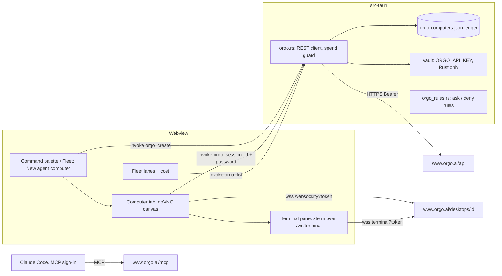
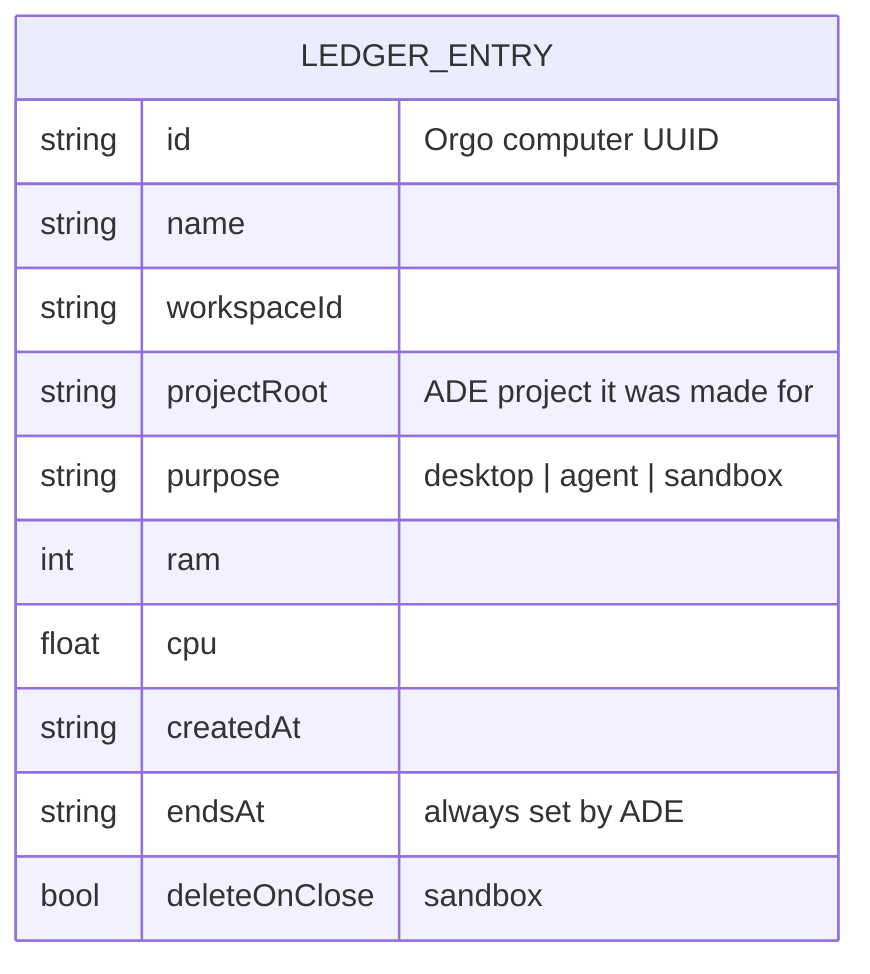
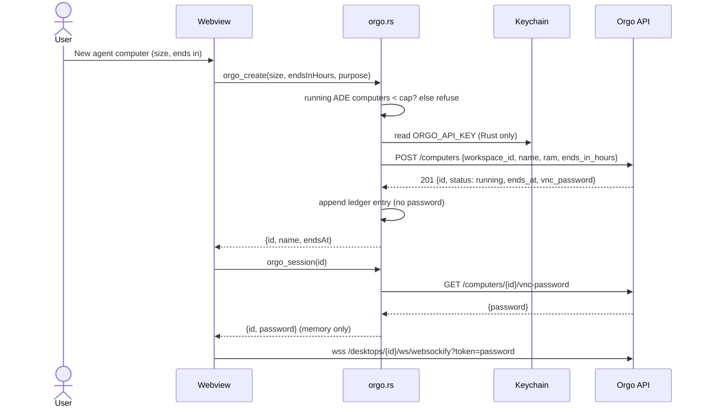

> **Status (2026-10-29): approved by the owner at f32ca1e ("Approve and build"), for Stories 1 and 1b only.** Story 1c stays on hold. Stories 2 to 6 stay an outline, deferred on P4 in the product doc (`_bmad-output/product-ide-and-harness.md`, branch `plan/product-ide-and-harness`). ADR 0010 is accepted.
>
> **Amendment 1 (2026-10-30), after the code review of a895c05 (Story 1: BLOCK).** It fixes how Story 1's code is to be corrected. It changes nothing in the frozen block, and the verification command is unchanged. Each item is marked **(CR-…)** where it lands. The triage is in the Review Triage Log.
> - CR-1: the worktree walk.
> - CR-2: wait for the shell's line editor before typing a launch line.
> - CR-m1 to CR-m8: the minor findings.
>
> Amendment 1 left one item with the owner: **CR-3, more ask globs**. The owner has since ruled yes (Amendment 2).
>
> **Amendment 2 (2026-11-01), after the review of 7a8dcdc (BLOCK on R2-1).** The reviewer confirmed CR-1 with their own Claude Code 2.1.314 probe, and confirmed that CR-2's `ICANON` signal works on Linux. It records two owner rulings and fixes the review's findings. Each item is marked **(R2-…)**:
> - **CR-3: yes.** 31 ask globs, plus `*run_template*` in Story 1b's Continuous deny list.
> - **AC11 replaced.** The launch value will carry the CLI library's guard. It carries `disableAllHooks: false` only alongside that guard (owner, 2026-11-01). This follows the CLI library plan's Q1 (owner, 2026-10-30, `plan/cli-library-and-mcps` at 5f8e35c).
> - **R2-1:** refuse an install whose root is the home folder.
> - **R2-2:** what Windows CI asserts.
> - **R2-3:** the picker's "This terminal".
> - **R2-4:** foreground process group and `get_termios`.
> - **R2-5:** `write_pty` releases the lock before writing.
> - **R2-6:** the Orchestrator handles a closed tab.
> - **R2-7:** subfolder coverage in the walk table, and `$HOME` fallback.
> - **R2-8:** a slow rc and a key-free pass condition for the gating check.
> - **R2-9:** no notice; recorded.
>
> **Amendment 3 (2026-11-01), after the re-review of 4f68b49 (BLOCK on R2-5).** The reviewer confirmed:
> - the zsh process-group claim and the bash gap;
> - `get_termios` and `process_group_leader` on the master;
> - `home_dir()` on rustc 1.97;
> - the guard shape.
>
> Changes, marked **(R3-…)**:
> - **R3-1:** `write_pty` stays sync and stops blocking. Each PTY gets its own writer thread fed by a channel, so keystrokes keep their order and no runtime worker waits on a terminal. AC24 becomes three tests, and the command path is covered.
> - **R3-2:** on unix, a missing foreground group means "not ready", not "can't know".
> - **R3-3:** one more limit, a zsh rc that leaves the terminal raw.
> - **R3-4:** the gating check's set-up leads with `~/.zshrc`.

**Step 1** is built in order:
- **Story 1:** Orgo's hosted MCP server in the MCP library, signed in through Claude Code. Claude Code asks before any computer is created, changed, stopped or deleted. Rules go in three places: every Claude Code launch ADE makes (picker, board and Orchestrator), the project's shared settings, and the main checkout's root local settings, which Claude Code reads from any subfolder and any worktree.
- **Story 1b:** a hard stop for ADE's Continuous mode, as `--disallowedTools` on the launch line.
- **Story 1c, the Orgo CLI: ON HOLD** pending the owner. The review's findings are recorded under it, unaddressed.

**Stories 2 to 6** are step 2, the native panel, outlined only. All Orgo permission rules live in one module, `src-tauri/src/orgo_rules.rs`. Shared intent, decisions, security and cost come first.

<frozen-after-approval reason="human-owned intent — do not modify unless human renegotiates">

## Intent

**Problem:** An agent working in ADE has only the user's own machine. It cannot test the UI it just built in a clean desktop and browser. It cannot run Claude Code somewhere other than the user's laptop, fan work out across several machines, or run untrusted code away from the user's files and keys. Orgo rents cloud computers made for agents to drive. ADE has no way to reach them.

**Approach:** Orgo only.
1. **MCP:** Orgo's hosted MCP server (`https://www.orgo.ai/mcp`) in ADE's MCP library, signed in with the user's Orgo account through Claude Code's `/mcp`. Claude Code asks before every tool that creates, copies, resizes, re-times, starts, resumes, stops or deletes a computer, or enables SSH. The rules match by verb across any server named like Orgo.
2. **Continuous hard stop:** when ADE launches Continuous mode, the tools and commands that create or start computers are denied on the command line, where the agent cannot edit them.
3. **CLI (on hold):** the `orgo` CLI, installed and guided, with its risky commands asking.
4. **Native panel, later:** a click creates a computer and opens its live desktop in a tab, with lifecycle, a spend guard, a remote terminal and fleet cost.

## Owner's decisions (2026-10-29)

1. **Purposes, all four:** computer use (an agent drives a real desktop and browser, for example to test the UI it built); Claude Code running remotely from an ADE tab; a parallel fleet across several machines, shown in the fleet view with cost; a throwaway sandbox for untrusted code.
2. **Depth:** MCP first, then a native panel with the live desktop, lifecycle and cost.
3. **Provider:** Orgo only. No provider-neutral abstraction.
4. **(Q7) Story 1 uses Orgo's hosted MCP server**, with the user signing in through Claude Code's MCP OAuth flow. No API key in ADE's vault, no npx package, no local server. The review found that the local server:
   - puts root VNC passwords into model context;
   - exposes `orgo_get_vnc_password`, `orgo_enable_computer_ssh`, `orgo_apply_computer_secrets`, `orgo_move_computer` and workspace edits.

   Orgo's sign-in list leaves these out "so a sign-in is never sent a computer's password" (https://docs.orgo.ai/guides/mcp).
5. **Orgo tools that create, copy, resize, extend, start, stop or delete a computer always ask**, in every mode, ADE's Continuous mode (`claude --dangerously-skip-permissions`, `src/lib/agentCommand.ts:50`) included. Story 1 delivers it as follows:
   - **Every Claude Code session ADE launches** carries the rules on its command line (`--settings`): the agent picker, the board's dispatch and the Orchestrator. `buildLaunchCommand` cannot be called without them, so a new launch path cannot leave them out. That holds in any folder and any mode, and the agent cannot edit it.
     - The Orchestrator runs `claude -p` without bypass, where a prompt cannot be shown. Its Orgo lifecycle calls are refused rather than asked, which they already were before this story.
   - **Sessions the user starts themselves** on this machine, anywhere in the repository, read the rules from `.claude/settings.local.json` at the root of the main checkout. That is also the file Claude Code reads inside a git worktree.
   - **Teammates** get them from the committed `.claude/settings.json` when they start at the root.

   Not covered:
   - a user-started session whose Continuous-mode agent deletes the rules from the files;
   - sessions outside this repository;
   - providers that are not Claude Code (Codex);
   - an organisation that sets `allowManagedPermissionRulesOnly`, under which Claude Code ignores both the launch flag's and the files' rules.
6. **(Q5) Claude Code on a remote computer signs in with a dedicated, spend-limited Anthropic Console key** that the user makes for remote machines. ADE sends it only on an explicit, confirmed action and never copies the user's own Claude login (step 2, Story 4).
7. **(Q3) Not needed for Story 1.** The panel's key stays an open question for step 2.
8. **(Q8) Yes, Story 1b.** Continuous launches pass `--disallowedTools` for the create, clone, fork, start, restart and resize tools, and the CLI's creating commands where Claude Code's pattern syntax allows. After review round 3: **always**, as server-glob patterns, not only when the project's `.mcp.json` names `orgo`. Orgo's own `claude mcp add` writes to `~/.claude.json`, and an ancestor `.mcp.json` or another server name would be missed.
9. **(Q9) A dedicated ADE workspace in Orgo.** The sign-in uses it, and so do any CLI key and step 2's key.
10. **The Orgo CLI: "install + guide, agent asks" (Story 1c).** **On hold** after review round 3: the parallel product doc recommends shipping it only as the CLI library's `orgo` entry, after Story 1 has been used with a real account. Awaiting the owner.
11. **(Q12) "Accept, fix later."** The first Orgo install may reorder a committed `.claude/settings.json`, keeping every value. Story 1's notice and guide say so. Key-order preservation becomes its own small story.
12. **Approval (2026-10-29, at f32ca1e): "Approve and build"** for Stories 1 and 1b. Story 1c remains on hold. Stories 2 to 6 remain an outline, deferred on P4. ADR 0010 is accepted with this approval.
13. **(2026-10-30) CR-3: yes.** Eight more ask globs, for 31 in all: `*suspend*`, `*destroy*`, `*terminate*`, `*move_computer*`, `*run_template*`, `*build_template*`, `*add*capacity*` and `*disable*ssh*`, each under `mcp__*orgo*__`. Story 1b's Continuous deny list gains `*run_template*`.
14. **(2026-10-30) AC11 replaced through the CLI library plan's Q1** (`_bmad-output/plan-cli-library-and-mcps.md`, approved at 5f8e35c on `plan/cli-library-and-mcps`).
    - The one `--settings` value on every ADE launch carries `permissions.ask`. Once the CLI library's Story 2 lands, it also carries that story's command guard as a PreToolUse hook.
    - **(2026-11-01 ruling) `disableAllHooks: false` goes on a launch only when a guard is on it**, meaning `rules.guard` is non-null.
      - Before the CLI library's Story 2, every ADE launch carries exactly `{"permissions":{"ask":MCP_ASK}}`.
      - Once the guard exists, `disableAllHooks: false` and the `hooks` entry come together.
    - `orgo_launch_rules()` becomes `launch_rules()`, and `orgoRules.ts` becomes `launchRules.ts`.
    - **The cost of `disableAllHooks: false`** applies only once the guard ships. From then on, a session ADE starts runs the user's and the project's other hooks even where a settings file turned hooks off. Until then, ADE launches leave hooks exactly as the user's files set them.

## Boundaries & Constraints (all stories)

**Always:**
- Orgo's own hosted MCP server, Orgo's own CLI, and Orgo's documented REST and WebSocket endpoints. No third-party wrapper.
- Every Orgo permission rule ADE writes or passes comes from `src-tauri/src/orgo_rules.rs`. The webview cannot add one.
- Every Orgo or Claude Code fact a story relies on is cited below. A fact marked unverified (U-list) is checked before the story that needs it is sharded.
- ADE edits `.claude/settings.json` and `.claude/settings.local.json` only by merging. The user's keys, values and rules are kept, and rule lists keep their order. A file that is not valid JSON is left alone and the action is refused. ADE never deletes a rule.
- The verification command is unchanged.

**Never:**
- ADE never creates, starts or resizes an Orgo computer without the user's click. This holds for the native panel in every story. In the MCP and CLI paths, Claude Code runs the call, and these stories' rules make it ask, or deny it in Continuous mode.
- ADE never sends `billing_mode: "hourly"`, never calls Account, Clients, Billing or capacity-buying endpoints, never runs `orgo billing`, and never adds credit.
- ADE never copies the user's Claude Code credentials, `~/.claude`, `~/.orgo/credentials.json`, the keychain's Claude entry, SSH keys or any other vault secret to an Orgo computer. The one exception is decision 6.
- ADE never edits `~/.claude/settings.json` or `~/.claude.json`.
- No change to `relay/` or `mobile/`. No provider abstraction.

## Security

- **No Orgo key in ADE for Story 1.** `.mcp.json` holds only `{"type": "http", "url": "https://www.orgo.ai/mcp"}`. Claude Code runs the OAuth sign-in and keeps the tokens. Orgo issues 1-hour access tokens with rotating refresh tokens.
- **What the MCP sign-in grants** ([Orgo MCP guide](https://docs.orgo.ai/guides/mcp)):
  - The grant covers one workspace, the dedicated ADE workspace. In it, Claude Code can create and manage computers, screens and files.
  - Only Orgo's reviewed tool list is offered: no templates, clients, account, chat, support, workspace create/change/delete, suspend/resume, upload, `get_vnc_password`, `apply_computer_secrets` or `move_computer`.
  - It is never sent a computer's password.
  - On a paid account, it cannot launch hourly computers (`403 HOURLY_NEEDS_BILLING`).
  - To revoke: Orgo Settings → Security → Connected AI apps, or `/mcp` → Clear authentication, or `claude mcp logout orgo`.
- **Always ask (decision 5).** The 31 `MCP_ASK` rules (23 at approval, plus 8 by decision 13) are verb globs on the tool name, with a glob in the server position, for example `mcp__*orgo*__*create*`. They go to three places:
  1. **Launch flag.** ADE passes `--settings '{"permissions":{"ask":[…]}}'` on every Claude Code launch it makes (decision 14: once the CLI guard ships, the value also carries the guard and `"disableAllHooks": false`, together; see AC11): the picker, the board and the Orchestrator. They hold in any working directory and in any mode, and a launch flag cannot be edited from inside the session.
     - The flag's lists merge with the files' lists: Claude Code collects permission rules per source and concatenates them (review round 4, Claude Code 2.1.42 and 2.1.312).
  2. **The main checkout's root `.claude/settings.local.json`.** "If you start Claude Code in a subdirectory of a git repository, it reads and writes that file at the repository root", and "in a worktree, it uses the file at the main checkout's root" ([settings](https://code.claude.com/docs/en/settings), Claude Code ≥ 2.1.211).
  3. **The project's `.claude/settings.json`**, committed for teammates who start at the root.

  The `.mcp.json` that loads Orgo is found from the working directory and every parent directory (review round 3, Claude Code's loader). `.claude/settings.json` is read only from the primary working directory. That is why the shared file alone was not enough.
- **Claude Code's guarantees** ([permission modes](https://code.claude.com/docs/en/permission-modes), [permissions](https://code.claude.com/docs/en/permissions), [settings](https://code.claude.com/docs/en/settings)):
  - "Claude Code doesn't auto-approve the following in any mode, including `bypassPermissions` … Tools matched by an explicit ask rule."
  - Rules are evaluated deny, then ask, then allow.
  - A local "don't ask again" allow "doesn't outrank an `ask` rule from a project or managed file".
  - Ask and deny rules take globs in the tool-name position. The pattern must match the whole name, and names with `*` raise no "matches no tool" warning, so the globs are silent where Orgo isn't installed.
- **What these rules cannot stop, stated plainly:**
  - **User-started sessions in Continuous or bypass mode.** The agent can edit both settings files, and Claude Code reloads them. ADE-launched sessions keep the launch-flag rules.
  - **Other clients and repositories.** Claude Code sessions outside this repository, Codex and other non-Claude Code agents, and Orgo signed in under a server name without lowercase "orgo" in it. Matching is case-sensitive, so a claude.ai connector named `Orgo` is missed.
  - **Managed-only rules.** Under an organisation policy of `allowManagedPermissionRulesOnly`, Claude Code ignores every rule outside managed settings, the launch flag's and the files' included. The guide says so.
  - **New tool names that use none of the verbs.** The globs fail open for a future tool whose name avoids all 31 verbs.
  - **The CLI and the REST API**, until Story 1c, and then only as far as Bash patterns go.
  - **Actions on a computer.** Screenshot, mouse, keyboard, bash and Python on the remote computer still prompt in Manual mode and run unprompted in Continuous mode, by design. Their effects stay on the remote computer.
- **Prompt injection.** A web page shown on a computer is untrusted input that comes back as a screenshot.
  - It can steer the agent's actions there, where they are contained, and lifecycle tools ask or are denied.
  - It can push the agent to type local data into the computer, or act locally with local tools, which Orgo's rules do not cover.
  - The guide says: use disposable computers, don't sign in to personal accounts on them, and don't run Continuous mode while the agent browses sites you don't trust.
- **Step 2's key (Q3).** The webview can read any vault value today through `vault_get(name)` (`src-tauri/src/vault.rs:137-140`, `lib.rs:483`). Story 2 first limits it to an allowlist, which today is `DEEPSEEK_API_KEY` (`src/lib/anthropic.ts:176`).
- **The computer password is root on that machine.** No ADE path shows, logs or stores it.

## Cost

- **What a computer costs** ([billing](https://docs.orgo.ai/guides/billing), [prices](https://docs.orgo.ai/guides/pricing)):
  - On a paid plan, a computer that fits the plan's remaining capacity is included. Past that, it is hourly from credit, but only for a caller with Billing write, which is never an MCP sign-in.
  - On a free account: hourly from credit, $5 signup credit, Medium only.
  - Linux hourly runs $0.023/h (Small) to $0.202/h (XL), billed per second. At most 50 computers per paid plan.
  - GPU prices are unpublished (U11). ADE never creates GPU computers.
- **A computer costs money until it is deleted.** A stopped hourly computer still pays for its disk, from $0.0017/h. A computer whose end passes is stopped, then deleted 7 days later unless started. The CLI's `computers create` has no end option.
- **The real spend limit is the Orgo plan or credit, not ADE.**
  - On a paid plan, a runaway agent can fill the capacity the user already pays for, up to 50 computers.
  - On a free account it can spend the credit, plus whatever auto top-up charges, up to 5 times in 24 hours. The guide says to leave it off.
  - The ask rules put a prompt before every create, and Continuous launches cannot create at all. Neither is a cap.
- **The native panel adds ADE's own guard** (Story 2): a cap on running ADE-made computers, an end on every computer it creates, auto-stop when idle, and no hourly launches.

</frozen-after-approval>

## What Orgo offers (verified 2026-10-29 against the live docs)

The base URL is `https://www.orgo.ai/api`, and computers are addressed by UUID as `/computers/{id}/…`. A create takes `workspace_id`, and the older name `project_id` is still accepted. `/api/projects/{project}/computers/{name}/…` is not in the current spec.

| # | Fact | Source |
|---|---|---|
| F1 | REST auth is `Authorization: Bearer $ORGO_API_KEY`, with keys beginning `sk_live_`. Spec 2.0.0 has 86 operations. | https://docs.orgo.ai/llms.txt, https://docs.orgo.ai/api-reference/introduction |
| F2 | Hosted MCP: `https://www.orgo.ai/mcp`. Unauthenticated, it answers `401` plus `WWW-Authenticate: Bearer resource_metadata=…`. Its OAuth metadata publishes dynamic client registration, PKCE S256, public clients and revocation. Tools are `orgo_` + the operationId in snake_case, and a sign-in sees a reviewed subset. | https://docs.orgo.ai/guides/mcp; probed 2026-10-29 |
| F3 | Live spec groups: Workspaces 5, Computers 14, Computer Lifecycle 7, Computer Actions 10, Templates 15, Files 7, Screens 5, Account 3, Clients 15, Chat 1, Agent accounts 3, Support 1. | https://docs.orgo.ai/api-reference/openapi.json |
| F4 | Create: `POST /computers` (`workspace_id`, `name`, `os`, `ram`, `billing_mode`, `ends_in_hours` 1 to 720, `template_ref`, `gpu`). | https://docs.orgo.ai/api-reference/computers/create |
| F5 | Lifecycle: stop archives the disk and reads `frozen`. Delete is permanent. An end stops the computer, which is deleted 7 days later. Auto-stop is off by default. | https://docs.orgo.ai/api-reference/computers/stop, https://docs.orgo.ai/guides/computer-ends |
| F6 | Billing: see Cost. | https://docs.orgo.ai/guides/billing, https://docs.orgo.ai/guides/pricing |
| F7 | Live desktop over `wss://www.orgo.ai/desktops/{id}/ws/websockify?token={vnc_password}`. Close codes `4001`, `4003`, `4006`, `4007`, `4008`. | https://docs.orgo.ai/guides/embed-vms |
| F8 | Terminal over `/ws/terminal` with a named `session`. Direct SSH on Linux. | https://docs.orgo.ai/api-reference/computers/terminal, https://docs.orgo.ai/guides/ssh |
| F9 | Commands `bash` and `exec`; files: upload (10 MB), export, download. | https://docs.orgo.ai/llms.txt |
| F10 | Keys are full or Custom, scoped to the account, one workspace or one computer. `computer_key_held`; template secrets need Secrets write. | https://docs.orgo.ai/api-reference/api-keys/permissions, …/computer-keys |
| F11 | Rate limits: "some endpoints" `429`; back off 1 s to 60 s. | https://docs.orgo.ai/api-reference/introduction |
| F12 | The `Computer` schema (with `vnc_password`) is the response of `createComputer`, `getComputer` and `resizeComputer`. The review found it in workspace listings too. | openapi.json |
| F13 | The CLI: `npm install -g orgo` or the install script, `orgo login` (device code, `~/.orgo/credentials.json`), `--json`, `orgo manifest`. | https://docs.orgo.ai/guides/cli |
| F14 | CLI 2.3.0, read from its bundle: global options `--json`, `--quiet` and `--profile`, accepted before or after the subcommand; aliases `c`, `ws`, `t`, `keys`, `rm`; undocumented `clone`, `handoff` and `egress`. See the Story 1c hold note for corrections. | `npm pack orgo@2.3.0` |

**Claude Code facts this plan relies on (verified 2026-10-29):**
- **Remote MCP servers.** A remote server is `{"type": "http", "url": "…"}`, sign-in is `/mcp`, and OAuth fields are needed only for servers without automatic setup ([MCP](https://code.claude.com/docs/en/mcp)).
- **Tool-name globs.** Ask and deny rules accept globs in the tool-name position, and "the pattern must match the full tool name". Allow rules need a literal `mcp__<server>__` prefix. "Tool names containing `_` or `*` are exempt from the [matches no tool] check" ([permissions](https://code.claude.com/docs/en/permissions)).
- **Bash patterns.** `*` can go anywhere. A trailing ` *` that is the only wildcard matches the bare command. Ask and deny rules apply to any subcommand of a compound command and match past any leading assignment. Only the listed wrappers are stripped: `env`, `npx` and absolute paths are not ([permissions](https://code.claude.com/docs/en/permissions)).
- **`--settings <file-or-json>`** takes "a settings JSON file or an inline JSON string". It applies "above your user, project, and local files and below managed settings", for that session only. "When you set the same list key, such as `permissions.allow`, in more than one file, Claude Code combines the lists" ([CLI reference](https://code.claude.com/docs/en/cli-reference), [settings](https://code.claude.com/docs/en/settings)).
  - **U13, settled in review round 4.** The flag takes one value. Permission lists are collected per source and concatenated (Claude Code 2.1.42 `Jq6`/`jM5`, 2.1.312 `To()`/`rse`), so the flag's `ask` rules add to the files' rules. No union fallback is needed.
- **Settings-file locations.**
  - `.claude/settings.json` is read from the primary working directory.
  - `.claude/settings.local.json` is read at the repository root from a subdirectory, and at the main checkout's root inside a worktree. The exceptions are outside git, at a home-directory root, on Windows, or when the root isn't owned by the user, where it stays with the start directory.
  - Settings edits reach a running session ([settings](https://code.claude.com/docs/en/settings)).
  - **(CR-1) Which folder's `settings.local.json` a worktree session reads.** Verified 2026-10-30 against Claude Code 2.1.314, the binary in the build container, in two ways.
    - **Its source.** Its `findCanonicalGitRoot` follows `<root>/.git` (`gitdir: <g>`) to `<g>/commondir` (`<c>`). It moves only when all of these hold:
      - `<g>`'s parent is `<c>/worktrees`;
      - `<g>/gitdir` points back at `<root>/.git`;
      - `<c>` is named `.git`.

      Then it uses `<c>`'s parent, with no check of `core.bare`. Before moving the file there, it falls back to the start folder when that parent is the home folder, or when it, its `.git` or its `.claude` is not owned by the current user, or on a platform without uids.
    - **Observed.** A `SessionStart` hook in each candidate file, run with `claude -p` (invalid key, unreachable base URL) in the reviewer's real-git layouts (`scratchpad/layouts`, `layouts2`). The table is in "Where the rules go".
      - The canonical root's file is read.
      - 2.1.314 also loads the start folder's own `.claude/settings.local.json`, the "legacy" file. Story 1 relies on neither the legacy file nor its absence.
  - **(CR-2) A typed line and the terminal's canonical mode.** Until a shell's line editor (zle, readline) is running, the terminal is in canonical mode. The kernel holds typed input as one line of at most `MAX_CANON` bytes: 1024 on macOS, 4096 on Linux. The rest is dropped, and the truncated line still runs.
    - Shown on Linux on 2026-10-30. `bash --rcfile <rc>` was used, where the rc sleeps 1 s. A 5,000-byte line was typed 250 ms after spawn. It ran cut at 4095 bytes.
    - The same line typed once the terminal's `ICANON` flag was clear ran whole.
    - `tcgetattr` on the PTY master returns the slave's flags. On Linux, `tty_mode_ioctl` uses `tty->link`. On macOS, pty ioctls go to the shared tty. portable-pty 0.9 exposes the master's fd (`MasterPty::as_raw_fd`).
  - `allowManagedPermissionRulesOnly` makes managed settings the only source of permission rules ([permissions](https://code.claude.com/docs/en/permissions)).
- **`--disallowedTools`** takes deny rules as separate arguments. A bare or glob tool name removes the tool from context. It takes a list, so another flag must follow it ([CLI reference](https://code.claude.com/docs/en/cli-reference)).
- **Modes.** Explicit ask rules prompt even in `bypassPermissions`, deny rules block in every mode, and bypass may write `.claude/` ([permission modes](https://code.claude.com/docs/en/permission-modes)).
- **ADE.**
  - It supports remote sign-in servers (`src/data/mcpCatalog.ts:44-49`, `IntegrationsPanel.tsx:83,183`).
  - **(Corrected in round 4.)** Three paths launch agents:
    - `AgentPicker` (`AgentPicker.tsx:151,190`), in the pane's cwd, and the board's `dispatchAgent` (`agentLaunch.ts:63-77`, called from `BoardPanel.tsx:162`). Both go through `prepareAgentLaunch` (`agentLaunch.ts:21`).
    - The Orchestrator, which calls `buildLaunchCommand(spec.provider, rolePath)` directly and runs `claude … -p '<task>'` (`OrchestratorTab.tsx:292`).
    - Two capability probes, `supportsRoleDelivery` and the task probe, also call `buildLaunchCommand` with `/dev/null` (`agentCommand.ts:156,165`). The claude and deepseek providers share `claudeCommand` (`agentCommand.ts:49-53`).
  - Projects can sit below the repo root (`IntegrationsPanel.tsx:29-31`).
  - `project_root` returns the nearest ancestor with a `.git` entry (`src-tauri/src/lib.rs:184-194`). In a git worktree, `.git` is a file, so it returns the worktree root, not the main checkout.

**Unverified, to check before the story that needs it:**
- **U1.** How `GET /computers/{id}` tells plan from hourly (Story 5).
- **U2.** Whether an MCP sign-in or a Custom key without Billing write can create on a free account (guide wording, Story 2).
- **U3.** What a sleeping (`suspended`) computer is billed (Story 3).
- **U4.** How auto-stop is set, and whether it suspends or stops (Story 3).
- **U5.** Real rate limits (Story 2).
- **U6.** Whether WKWebView and WebKitGTK open `wss://www.orgo.ai` once the CSP allows it (Story 2).
- **U7.** Whether `GET /workspaces/{id}` lists every computer (Story 3).
- **U8.** Answered in round 3: `.mcp.json` loads from parent directories, while `.claude/settings.json` does not. The design now covers both. The manual check confirms it.
- **U9.** The hosted server's exact tool names. The verb globs no longer depend on them; the manual check compares the names anyway.
- **U10.** The key check's error codes (Story 2).
- **U11.** GPU prices (Story 5).
- **U12.** Whether CLI listings print `vnc_password` (Story 1c, on hold).
- **U13.** Settled in round 4: the lists merge (see above). The manual check only confirms it.

**Rejected: Orgo's local server, `orgo-mcp-server`.** It needs a vault key, returns `vnc_password` into context (F12), and registers the password, SSH, secrets, move and workspace tools. Its dependencies float, and it loads the spec and base URL at runtime. **Third-party servers** (`nickvasilescu/orgo-mcp`, `spencerkinney/computer-use-mcp`, Composio): not chosen.

## How the pieces coexist

- **Credentials.** Claude Code's MCP sign-in serves agents. Step 2's panel key, `ORGO_API_KEY`, is read in Rust (Q3). A CLI credential belongs to Story 1c, on hold. All of them point at the dedicated ADE workspace (decision 9), and computers made by any of them appear in the panel as "made elsewhere" when ADE did not make them.
- **One rule source.** `src-tauri/src/orgo_rules.rs` holds `MCP_ASK`, `CONTINUOUS_DENY_MCP` and `CONTINUOUS_DENY_CLI`, and later `CLI_ASK` and `CLI_ALLOW`. The launch path reads them through `launch_rules()` in `claude_settings.rs` (decision 14, R2), which the CLI library plan also extends. The shared settings merge lives beside it (Q11).
- **The parallel CLI library (`plan/cli-library-and-mcps`)** reuses these lists for its `orgo` entry and must not redefine them. `.ade/context/orgo-permission-rules.md` is the shared contract.

## ADR 0010 (Accepted 2026-10-29)

Written as `.ade/context/decisions/0010-agent-computers-are-orgo-only-and-made-on-click.md`. The number is provisional and is re-checked at merge time: 0008 (hover), 0009 (manual checks), 0011 (CLI), 0012 (principles) and 0013 (the Orchestrator key) are on other unmerged branches. The summary as drafted:
- **Decision:**
  - Orgo is the only provider. Agents reach it through its hosted MCP server, and later its CLI.
  - The lifecycle rules are verb globs from one Rust module. They are passed on every ADE launch, and merged into the project's shared settings and the main checkout's root local settings.
  - Creation is denied on the command line in Continuous launches.
  - In the native panel, only a click creates, starts or resizes a computer, with an end and under ADE's cap.
  - ADE never chooses hourly billing, never runs billing commands, never edits user-level Claude Code settings, and ships no credential except a dedicated key on a confirmed click.
  - Story 2 limits `vault_get` to an allowlist.
- **Consequences:**
  - The spend limit on the agent paths is the user's Orgo plan or credit, behind a prompt.
  - Rules in files can be removed by a bypass-mode agent the user started, and launch flags cannot.
  - Bash rules are not a boundary around a program.

---

# Story 1: Orgo's MCP server in the library, always asking

## Code Map (1)

- `src/data/mcpCatalog.ts`: `McpEntry` (:18-31), `MCP_CATALOG` (:33). Sentry (:44-49) is the precedent for an http sign-in server.
- `src/components/IntegrationsPanel.tsx`: the card (:178-209), "Sign in" (:183), `install` (:73-90) and its notice (:83). The root is resolved with `project_root` (:44), which gives the git root.
- `src-tauri/src/mcp.rs`: `mcp_install` (:44), `mcp_remove` (:63).
- `src-tauri/src/usage.rs`: `settings_path` (:544), `merge_deny` (:651), `load_settings` (:718) and `save_settings` (:725), the existing settings writer. `local_settings_path` (:713) points at `.claude/settings.local.json`. The writer uses serde_json without `preserve_order`, so every write re-sorts object keys (see S1-3).
- `src/lib/agentCommand.ts`: `LaunchOptions` (:5), `claudeCommand` (:49-53), `buildLaunchCommand` (:68), and the probes (:156,165).
- `src/lib/agentLaunch.ts`: `prepareAgentLaunch` (:21) and `dispatchAgent` (:63-77). `src/components/OrchestratorTab.tsx:292` is the direct caller.
- `src-tauri/src/lib.rs:184-194`: `project_root_of`.
- **New:** `src-tauri/src/orgo_rules.rs`; `src-tauri/src/orgo_operations.json`, the fixture; `src/lib/orgoRules.ts`, which loads the rules once. **(R2, decision 14)** It is renamed `src/lib/launchRules.ts`, and the Rust command `orgo_launch_rules` (in `orgo_rules.rs` at a895c05) becomes `launch_rules` in `claude_settings.rs`.
- **(CR) At a895c05:**
  - `src-tauri/src/claude_settings.rs:50-73`: `main_checkout_root`, `linked_main_checkout`.
  - `src-tauri/src/mcp.rs`:
    - `read_config` (:14-23), which reads an unreadable file as empty;
    - `mcp_install` (:44-66);
    - `add_orgo_rules` (:76-97).
  - `src/components/IntegrationsPanel.tsx:78-84`: the notice.
  - `src/lib/orgoRules.ts:28`: the shape check.
- **(CR-2) Where launch lines are typed:**
  - `src/lib/terminalCommands.ts`: `runInNewTabPane` (:30-45) serves the picker's new tab and the board's `dispatchAgent`, and `writePty` (:5).
  - `src/components/OrchestratorTab.tsx:327-328`, the Orchestrator's own `writePty`.
  - `src-tauri/src/pty.rs`: `PtyInstance.master` (:13), `PtyInstance.pid` (:14) and `write_pty` (:203-217). `write_pty` holds the global `instances` mutex during a blocking `write_all` (R2-5).
  - `src/components/AgentPicker.tsx:203`: the "This terminal" path's direct `writePty` (R2-3).
  - `src-tauri/src/lib.rs:184-191`: `project_root_of` returns the folder itself when no ancestor has `.git`, so a terminal in `$HOME` gives `<root>` = `$HOME` (R2-1).

  ADE has no "shell ready" signal today. A pane's `ptyId` only says the PTY exists.

## Design Notes (1)

**The catalog entry**, after `fetch` in "Web & browser":

```ts
{
  id: "orgo",
  name: "Orgo",
  category: "Web & browser",
  description: "Cloud computers with a desktop, browser and shell that the agent can start, see, drive and run commands on.",
  server: { type: "http", url: "https://www.orgo.ai/mcp" },
  oauth: true,
  caution: "Signing in lets Claude Code create, drive and delete computers in the Orgo workspace you choose. They cost money until deleted, and what their screens show can try to steer the agent. Agents ADE starts always ask before a computer is created, changed, stopped or deleted, even in Continuous mode. So do Claude Code sessions you start in this project, unless the rules are removed from its settings.",
  docs: "https://docs.orgo.ai/guides/mcp",
}
```

- **What it writes.** Install writes `{"type": "http", "url": "https://www.orgo.ai/mcp"}` under `mcpServers.orgo`.
- **`caution`** is a new optional field, rendered as `<p className="mcp-caution" role="note">`, and not searched.
- **Search.** The description has no "click", so `"browser click"` still finds only Playwright, and `"cloud computer"` finds Orgo.

**`MCP_ASK`, verb globs** (S1-2, widened by S1-5). They are robust to the unverified hosted names (U9), to a server renamed `orgo-prod`, to a tool without the `orgo_` prefix, and to the REST write verbs Orgo already has that the MCP spec doesn't expose yet:

```rust
pub const MCP_ASK: &[&str] = &[
    // computer lifecycle in today's spec
    "mcp__*orgo*__*create*",            // create_computer (also create_workspace/screen/...: writes)
    "mcp__*orgo*__*clone_computer*",   // not *clone*: future iPhone-clone reads (GET /computers/{id}/clone…)
    "mcp__*orgo*__*fork*",
    "mcp__*orgo*__*resize*computer*",   // not *resize*: that catches GET get_resize_limits
    "mcp__*orgo*__*update*",            // update_computer sets or moves the end
    "mcp__*orgo*__*start*",             // start_computer, restart_computer
    "mcp__*orgo*__*resume*",
    "mcp__*orgo*__*stop*",
    "mcp__*orgo*__*delete*",
    "mcp__*orgo*__*enable*ssh*",        // not *ssh*: that catches GET get_computer_ssh
    // REST write verbs not yet in the MCP spec (S1-5)
    "mcp__*orgo*__*wake*",              // /computers/{id}/wake
    "mcp__*orgo*__*restore*",           // /backup/restore, /snapshots/{id}/restore
    "mcp__*orgo*__*launch*",
    "mcp__*orgo*__*boot*",
    "mcp__*orgo*__*extend*",
    "mcp__*orgo*__*set*end*",
    "mcp__*orgo*__*billing*",           // /computers/{id}/billing; also asks GET get_client_billing
    "mcp__*orgo*__*public*url*",        // /public-urls
    "mcp__*orgo*__*proxy*",             // /residential-proxy
    "mcp__*orgo*__*secret*",            // /secrets, /secrets/sync
    "mcp__*orgo*__*ssh*key*",
    "mcp__*orgo*__*freeze*",            // /freeze, a stop under another name
    "mcp__*orgo*__*heal_*",             // /heal, which can restart; not *heal*: that catches get_computer_health
    // Writes the round-5 list missed (code review of a895c05; owner decision 13, 2026-10-30)
    "mcp__*orgo*__*suspend*",           // suspend_computer (a stop that keeps memory)
    "mcp__*orgo*__*destroy*",           // destroy_screen; a future destroy_computer
    "mcp__*orgo*__*terminate*",         // a future terminate_computer
    "mcp__*orgo*__*move_computer*",     // move_computer; also a future remove_computer. Not *move*: that catches mouse_move
    "mcp__*orgo*__*run_template*",      // test_run_template, which runs a computer from a template
    "mcp__*orgo*__*build_template*",    // build_template, which spends build time
    "mcp__*orgo*__*add*capacity*",      // add_account_capacity. Not *capacity*: that catches GET get_account_capacity
    "mcp__*orgo*__*disable*ssh*",       // disable_computer_ssh, the pair of *enable*ssh*
];
```

- **Checked against all 86 operations of the live spec** (2026-10-29), snake-cased as `mcp__orgo__orgo_<op>`. **(R2)** Re-checked with all 31 globs against the fixture's 87 operations on 2026-10-30, with the same results.
  - **Exactly one GET matches: `orgo_get_client_billing`** (via `*billing*`). It is a billing read, outside the sign-in list, and asking for it is intended.
  - Every computer lifecycle write matches: create, clone, fork, resize, update, start, restart, resume, stop, delete and enable-SSH.
- **The REST write-verb corpus.** These are the names Orgo's naming rule would give the write paths in the [key permissions table](https://docs.orgo.ai/api-reference/api-keys/permissions): `wake_computer`, `restore_computer_backup`, `restore_snapshot`, `set_computer_billing`, `create/update/delete_public_url`, `set_residential_proxy`, `freeze_computer`, `heal_computer`, `set_computer_ssh_key`, `sync_computer_secrets`, `set_computer_end`, `extend_computer`, `launch_template`, `boot_computer`. All are matched.
- **Over-matching, recorded:**
  - The other writes they match ask too, which is the safe direction: `create_workspace/screen/client/chat_completion`, `update_workspace/client(_billing)`, `start_file_upload`, `stop_template_run`, `stop_client_billing`, `delete_file/template/workspace`.
  - **Ask-side misfires on reads, recorded and harmless (an extra prompt):**
    - `*start*` would match a future `get_computer_startup_log`;
    - `*proxy*` would match a `get_residential_proxy`;
    - `*public*url*` would match a `list_public_urls`;
    - `*secret*` would match a `list_secrets`;
    - `*billing*` matches today's `get_client_billing`;
    - `*stop*` would match a `get_auto_stop`;
    - `*delete*` would match a `get_delete_preview`.
  - **Narrowed in round 5 so reads aren't caught:** `*heal*` became `*heal_*`, so `get_computer_health` isn't matched. `*clone*` became `*clone_computer*`, so future iPhone-clone reads such as `get_computer_clone_status` aren't matched, while `clone_computer` still is, with or without the `orgo_` prefix.
  - A server named like `georgo` matches `*orgo*`.
  - Matching is case-sensitive, so `Orgo` does not match.
- **The fixture.** `src-tauri/src/orgo_operations.json` holds (method, path, operationId) from the spec, plus the REST write-verb corpus as hypothetical names marked as such, so the test runs offline.

**Where the rules go.** Install, for `name == "orgo"`:
1. Resolve the two roots.
   - `<root>` is the git root from `project_root`: the worktree root inside a worktree.
   - **(R2-1) Never the home folder.** This refusal comes before anything is read or written.
     - **The problem.** `project_root_of` returns the folder itself when no ancestor has `.git`, and a new terminal usually starts in `$HOME`. A dotfiles repository at `$HOME` gives the same `<root>`. Without the refusal, install would merge into and re-sort `~/.claude/settings.json`, Claude Code's user settings. That breaks the frozen Boundary "ADE never edits `~/.claude/settings.json`".
     - **The rule.** The Orgo install is refused when canonical `<root>` or canonical `<main>` equals the canonical `home_dir()`, or when the home folder is unknown. Nothing is created or changed.
       - `<main>` can only equal home through `<root>`, since the walk's own guard already drops a home candidate. It is checked anyway, as a second line.
     - **The error:** "Orgo wasn't added: `<root>` is your home folder, and its `.claude/settings.json` is Claude Code's own user settings. Open a project folder and install Orgo there." With no home folder known: "Orgo wasn't added: ADE couldn't find your home folder to make sure it isn't writing there."
     - **Shape, so tests can inject the home folder.**
       - `mcp_install(project, name, server)`, the Tauri command, calls `install(project, name, server, home: Option<&Path>, uid: Option<u32>)` with `home_dir()` and the effective uid (`None` off unix).
       - `install` passes `home` and `uid` to `main_checkout_root_for`.
       - Other servers ignore `home`. Their writes into `$HOME` are deferred work.
   - `<main>` comes from `main_checkout_root(<root>)`. **(CR-1, replaces round 5's walk.)** It is defined as **the folder whose `.claude/settings.local.json` Claude Code reads for a session started anywhere in `<root>`**. That is not always git's own main worktree.
     - **How it is found.** It mirrors Claude Code's `findCanonicalGitRoot` (fact CR-1) with pure file reads and no git process. Asking git would give a different answer in the bare case: `git worktree list` marks `proj` as a bare main worktree, and `git rev-parse --show-toplevel` fails there. It could also disagree with Claude Code where Claude Code's own guards fall back.
     - **The walk.** It is followed only when every step holds:
       1. `<root>/.git` is a regular file (not a link) whose trimmed content is the single line `gitdir: <g>`. A relative `<g>` (git ≥ 2.48, `worktree.useRelativePaths`) is resolved against `<root>`.
       2. `<g>/commondir` is a regular file, not a link. Its trimmed content `<c>`, if relative, is resolved against `<g>`.
       3. The canonical parent of `<g>` equals canonical `<c>` joined with `worktrees`. So `<g>` is one of `<c>`'s worktree admin folders.
       4. `<g>/gitdir` is a regular file whose trimmed content, resolved against `<g>` and canonicalised, equals canonical `<root>` joined with `.git`. The admin folder points back at this worktree.
       5. Canonical `<c>`'s file name is `.git`. The candidate is its parent. There is **no `core.bare` check**: Claude Code reads `proj/` in the bare-clone layout, so ADE writes there.
     - **The guards Claude Code applies before it moves the file.** The candidate is used only when all of these hold:
       - **Not the home folder.** It is not the canonical home folder. **(R2-7)** The home folder is `claude_settings::home_dir()`: `std::env::home_dir()` (Rust ≥ 1.87). That is `$HOME`, falling back to the user's passwd entry on unix when `$HOME` is unset, as Node's `os.homedir()` does for Claude Code. An empty result counts as unknown. When the home folder is unknown or can't be canonicalised, the candidate is not used.
       - **Owned by the user (unix only).** The candidate, `<candidate>/.git` and `<candidate>/.claude` (when present) are each owned by the current effective uid, read with `symlink_metadata`, via `libc::geteuid()` (libc is already a unix dependency).
       - **Not Windows.** On a platform other than unix, `<main>` is `<root>`, as it is for Claude Code.
       - **No backslashes (unix).** None of `<root>`, `<g>`, `<c>` or the back-pointer contains a backslash.
     - **Shape.** For tests, the walk takes the home folder and the uid as arguments: `main_checkout_root_for(root, home: Option<&Path>, uid: Option<u32>)`. `main_checkout_root(root)` passes the real ones.
     - **Every other case.** `<main>` is `<root>`, including any unreadable file.
     - **The cases, each a test (AC5).** Every row matches what Claude Code 2.1.314 was seen to read:

       | Layout | `<root>` | `<main>` | A session started in a subfolder of `<root>` reads `<main>`'s file (R2-7) |
       |---|---|---|---|
       | Normal checkout | `main` | `main` | yes |
       | Linked worktree, absolute gitdir | `wt` | `main` | yes |
       | Linked worktree, relative gitdir | `wtrel` | `main` | yes |
       | Submodule (`gitdir: ../.git/modules/sub`, no `commondir`) | `sub` | `sub` | yes |
       | A worktree of a submodule (common dir `main/.git/modules/sub`, not named `.git`) | `subwt` | `subwt` | no: Claude Code reads only the start folder's own file (the reviewer's probe, 2026-10-30) |
       | A submodule inside a linked worktree | `wtsub/sub` | `wtsub/sub` | yes |
       | `git init --separate-git-dir <store>/.git sep`: the checkout itself (no `commondir`) | `sep` | `sep` | yes |
       | A worktree of that repository (common dir `<store>/.git`) | `sepwt` | **`<store>`** | yes |
       | The same with a separate gitdir not named `.git` (`<store2>`) | `sep2wt` | `sep2wt` | no, as above |
       | `git clone --bare … proj/.git`, then `git worktree add proj/feature` | `proj/feature` | **`proj`** | yes |
       | `git init --bare repo.git` with a worktree `bw` | `bw` | `bw` | no, as above |
       | Back-pointer missing, or pointing at another folder | `wt` | `wt` | yes |
       | `<g>` not under `<c>/worktrees` | `wt` | `wt` | yes |
       | `commondir` is a symbolic link | `wt` | `wt` | yes |
       | The candidate is `$HOME` | `wt` | `wt` | no: Claude Code reads the start folder's own file |
       | The candidate, its `.git` or its `.claude` is owned by another uid | `wt` | `wt` | no: Claude Code reads the start folder's own file |
       | `.git` file without a `gitdir:` line; a gitdir that does not exist; no `.git` | itself | itself | yes for the first two (Claude Code's root is `<root>`); no `.git` is outside git, so no |

     - **Consequence, recorded for the guide.**
       - In a `--separate-git-dir` repository, the checkout (`sep`) and its worktrees (`<store>`) read different local files, as Claude Code does.
       - **(R2-7)** There are three layouts where the rules ADE writes reach only sessions started at the worktree's root, not in its subfolders. Claude Code reads each subfolder's own file there. The layouts are:
         - a worktree of a bare repository not named `.git`;
         - a worktree of a separate gitdir not named `.git`;
         - a worktree of a submodule.

         The guide lists them under "not covered for sessions started in a subfolder".
       - In every layout, ADE's own launches carry the rules on the command line.
2. Read and validate `<root>/.mcp.json`, `<root>/.claude/settings.json` and `<main>/.claude/settings.local.json`. If any is invalid or the wrong shape, refuse and write nothing.
   - **(CR-m2)** For `orgo`, a `.mcp.json` that exists but can't be read is refused the same way, with the file named: for example a directory, not UTF-8, or permission denied. `read_config` today reads every read error as an empty file. The Orgo install must not then replace the user's `.mcp.json` with one holding only Orgo.
   - Only `NotFound`, and a file that is empty or only whitespace, read as empty.
   - Other servers keep today's behaviour (Deferred Work).
3. Merge `MCP_ASK` into `permissions.ask` of `<main>/.claude/settings.local.json`. Claude Code reads that file from any subdirectory, and from inside any worktree of the repository.
4. Merge them into `<root>/.claude/settings.json`, for teammates and root sessions. Each file is saved only when rules were added to it (a no-op install rewrites nothing, CR-m8).
5. Write `<root>/.mcp.json`.

**(CR-m1) Not all-or-nothing after validation, by design.**
- Validation covers all three files before the first write, so an invalid or unreadable file writes nothing.
- After that, the writes run in this order: the local file, the shared file, then `.mcp.json`. A write that fails part-way, such as a full disk or a folder that can't be written, can leave rules without the server. It never leaves the server without the rules, which is the safe direction.
- There is no rollback: a rollback is another write that can fail. The guide and this plan say so, and installing again finishes the job.

**(CR-m4) What `mcp_install` returns.** It returns `McpInstalled { rules: Vec<String>, files: Vec<String> }`, serialised camelCase, for every server:
- `rules`: the rules added to either file, in `MCP_ASK` order. It is empty for every other server and on a repeat install.
- `files`: the absolute paths of the settings files that gained at least one rule, shared first, then local.

**Every ADE launch (S1-1, S1-4).**
- **The rules (R2, decision 14).**
  - **Rust.** `claude_settings::launch_rules()` takes no arguments and is registered as the Tauri command `launch_rules`. It replaces `orgo_launch_rules` and returns `LaunchRules { ask, continuous_deny, guard }`, serialised camelCase.
    - `ask` is `orgo_rules::MCP_ASK`. The CLI library's Story 2 appends its CLIs' ask rules after it.
    - `continuousDeny` is `[]` in Story 1. Story 1b fills it.
    - `guard` is `null` in Story 1. The CLI library's Story 2 sets it to `{ interactive, headless }`, both command strings that Rust builds (CLI plan f8309e4).
  - **TypeScript.** `src/lib/launchRules.ts` replaces `orgoRules.ts` with the same exports apart from the type:
    - `LaunchRules { ask: string[]; continuousDeny: string[]; guard: { interactive: string; headless: string } | null }`;
    - `loadLaunchRules(): Promise<LaunchRules>`, `RULES_UNAVAILABLE` and `__resetLaunchRulesForTests`.

    `loadLaunchRules` invokes `launch_rules` and caches the result **only on success** (round 5). A rejected load clears the cache, so the next launch tries again rather than being blocked for the rest of the app's life.
  - If the invoke fails, it rejects, and every caller refuses to launch with "ADE couldn't load its permission rules, so the agent was not started". It fails closed.
  - **(CR-m5)** A result counts as malformed, and is rejected and not cached like a failed invoke, when any of these holds:
    - `ask` is not an array of strings, or is empty;
    - `continuousDeny` is not an array of strings;
    - `guard` is neither `null` nor an object with both a string `interactive` and a string `headless`.

    An empty `ask` would launch agents with no rules.
  - **The guard's shape (settled by the CLI plan at f8309e4).** Rust's `launch_rules()` builds both variants. `buildLaunchCommand` picks `rules.guard.headless` when `opts.headless` is set, and `rules.guard.interactive` otherwise. TypeScript never builds a command string. Story 1's `launch_rules()` returns `guard: null`.
- **The type makes it required.** `LaunchOptions` gains `rules: LaunchRules` as a **required** field, and `buildLaunchCommand(provider, rolePath, opts: LaunchOptions)` makes `opts` required. tsc then fails on every caller that doesn't pass rules.
  - `prepareAgentLaunch` covers the picker and `dispatchAgent`. `OrchestratorTab.tsx:292` is updated to `await loadLaunchRules()` and pass them.
  - **(R2, decision 14)** `LaunchOptions` gains an optional `headless?: boolean`. Only the Orchestrator sets it, to `true`. It changes nothing while `rules.guard` is `null`.
  - The two capability probes use a module-private `PROBE_RULES`, which is not exported, so no other caller can borrow it.
  - Codex and Ollama ignore `rules`; the claude and deepseek paths emit them. Because `prepareAgentLaunch` loads the rules before building any command, **Codex and Ollama launches also wait on the load, and fail closed with it**. That is harmless, since the rules are constant and load in one local IPC call.
- **The flag (replaced by decision 14, with the 2026-11-01 ruling).** `claudeCommand` adds one `--settings`, quoted with `shellQuote` (`agentCommand.ts:26`), to every claude and deepseek launch: Manual, Continuous and `-p`. It is built as `JSON.stringify` of an object with these keys in this order:
  - `permissions: { ask: rules.ask }`, always;
  - only when `rules.guard` is non-null, both of these:
    - `disableAllHooks: false`;
    - `hooks: { PreToolUse: [{ matcher: "Bash|Monitor", hooks: [{ type: "command", command: opts.headless ? rules.guard.headless : rules.guard.interactive, timeout: 5, onFailure: "block" }] }] }`.

  Until the CLI library's Story 2, the value is exactly `{"permissions":{"ask":[…31 globs]}}`.
  - **Why `disableAllHooks: false` goes with the guard.** A `disableAllHooks: true` in a user, project or local file turns off every non-managed hook, the launch flag's included, and `--settings` outranks those files. It is needed only to keep the guard's hook on, so without a guard it is left out, and the user's hook settings stand.
  - **The cost,** once the guard ships: sessions ADE starts run the user's and the project's other hooks even where a file turned hooks off. The CLI library's guide states it. Story 1's guide says that ADE launches don't change hooks.
- **Silent and folder-independent.** Glob names are exempt from the "matches no tool" warning, so this is silent in projects without Orgo, and it does not depend on the cwd, the project, or how Orgo was installed. The flag's lists merge with the files' lists (U13, settled).
- **The Orchestrator.** It runs `claude … -p` without bypass, so an ask cannot be shown there and the call is refused. That was already true, because `-p` cannot prompt for an unapproved MCP tool. The live impact is low, but the rules now ride along.
- **(CR-2) Typing the line once the shell can take it.**
  - **The problem.** `--settings` adds 609 bytes. Measured launch lines with no task:
    - claude: 697 bytes, or 728 in Continuous mode;
    - deepseek: 1034, or 1065 in Continuous mode.

    Story 1b adds `--disallowedTools`, and an Orchestrator task has no length cap. `runInNewTabPane` and the Orchestrator type into a PTY that is ~250 ms old. A shell still reading its rc files is in canonical mode, and on macOS a line over 1023 bytes is cut and may run cut (fact CR-2).
  - **The fix.** Wait until the terminal leaves canonical mode, which is when the shell's line editor is up, and then type. In canonical mode no length is safe, and only waiting fixes every length.
  - **Rejected alternatives.**
    - Shortening the globs can't get a deepseek line with a 400-character task under 1024 bytes. It also changes the frozen list.
    - Passing the rules as a file path would let the session edit its own rules, which needs the owner.
    - Waiting for the shell's first output fails on rc files that print and on instant prompts, such as powerlevel10k, that draw a prompt before zle starts.
  - **Rust**, `src-tauri/src/pty.rs` (R2-4: the foreground check and `get_termios`):

    ```rust
    /// Whether the shell in PTY `id` is reading with its own line editor: the
    /// terminal is out of canonical mode AND the shell itself is the
    /// foreground process group, so a typed line of any length reaches it
    /// whole. None only where that can't be known at all: not unix, or an
    /// unknown id. On unix, a pid, termios or foreground group that can't be
    /// read means Some(false): not ready, and the 10 s cap applies (R3-2).
    #[tauri::command]
    pub fn pty_line_editor_ready(state: tauri::State<'_, PtyManager>, id: u32) -> Option<bool>
    ```

    - **The free function.** It is built on `fn line_editor_ready(master: &dyn MasterPty, shell: Option<u32>) -> Option<bool>`. The command passes the instance's `pid` and holds the `instances` lock only for the call.
    - **On unix:**

      ```rust
      let (Some(t), Some(fg), Some(shell)) =
          (master.get_termios(), master.process_group_leader(), shell)
      else {
          return Some(false); // R3-2: unreadable on unix is "not ready", not "can't know"
      };
      let t: libc::termios = t.into();
      Some(t.c_lflag & libc::ICANON == 0 && fg as u32 == shell)
      ```

      - The conversion uses nix's `From<Termios> for libc::termios`, so the code never names nix. There is no new dependency.
      - portable-pty's spawn makes the shell a session leader, so its pid is its process group.
    - **On other platforms** it returns `None`.
    - It is registered in `lib.rs` beside `write_pty`.
  - **(R2-5, replaced by R3-1) `write_pty` stays sync and never waits on a terminal.**
    - **The problem.** Today `write_pty` holds the `instances` mutex across a blocking `write_all`. A raw-mode reader that isn't reading can block that write once about 1 KB is unread on macOS. Every terminal's write, resize, attach and kill then waits on the mutex, and because the command is sync, so does the main thread.
    - **Why not `(async)` (Amendment 2's fix, withdrawn).**
      - Async commands are spawned as separate tokio tasks (tauri-macros 2.5.4 `wrapper.rs:344`, tauri 2.10.2 `ipc/mod.rs:375`). `useTerminal.ts:281` sends each keystroke without awaiting the last, so writes can land out of order. The reviewer saw 64 ordered tasks on a 4-worker runtime finish out of order in 174 of 200 batches.
      - A blocked write also holds a runtime worker, and each further keystroke to that terminal holds another. After about one keystroke per core, every async command in ADE stalls.
    - **The fix: one writer thread per PTY, fed by a channel.**
      - **The instance.** `PtyInstance.writer` is replaced by `input: std::sync::mpsc::Sender<Vec<u8>>`.
      - **The thread.** `PtyInstance` is built through one constructor, which `create_pty` and the tests use. It takes the writer from `master.take_writer()` and spawns a thread named `pty-writer-<id>`, with `std::thread::Builder::stack_size(64 * 1024)`.
        - The thread loops on `rx.recv()`, calling `write_all` and then `flush` for each chunk.
        - It ends when every sender is gone and the queue is empty, or on the first write error.
      - **`write_pty` stays `#[tauri::command]` (sync)** and calls `write_to(instances: &Mutex<HashMap<u32, PtyInstance>>, id, data)`:
        - it calls `input.send(data)` under the `instances` lock; an unbounded `mpsc` send never blocks;
        - an unknown id stays `Ok(())`;
        - a send to a thread that has ended gives `Err("the terminal is closed")`.
      - **Order.** Sync commands run one at a time on the main thread, in the order their IPC messages arrive, and one channel per PTY keeps that order to the terminal. Nothing waits on a terminal, so the main thread never blocks on one.
      - **`kill_pty`** removes the instance, which drops the sender. A writer thread that isn't blocked drains what is queued, sees the channel close, and ends.
    - **Limit, recorded: a writer thread blocked on a PTY that never reads is leaked.**
      - **Observed on Linux, 2026-11-01.** A 1 MiB write against `stty -icanon -echo; sleep 30` stayed blocked after the whole process group was killed. It also stayed blocked after closing the master fds and after `tcflush(TCIOFLUSH)`. macOS is not checked.
      - **The bound.** It is one parked thread per terminal closed in that state, with a 64 KiB stack, holding whatever was queued for that terminal. Nothing else waits on it: other terminals, the main thread and the async runtime are unaffected. Keystrokes don't pile up threads, only bytes in that one queue.
      - **It ends when ADE exits.** No safe way to wake it was found. Making the master fd non-blocking would also make the reader thread's reads non-blocking, because a dup shares the file status flags.
  - **TypeScript**, `src/lib/terminalCommands.ts`:
    - **`whenLineEditorReady`.** `export async function whenLineEditorReady(ptyId: number, timeoutMs = 10_000): Promise<void>` polls `invoke<boolean | null>("pty_line_editor_ready", { id: ptyId })` every 50 ms.
      - It returns after **two `true` answers in a row** (R2-4). One sample can land in the gap between two rc commands, after a child cleared `ICANON` and exited.
      - It returns at once on `null`, and on a rejected invoke, as today.
      - It returns when `timeoutMs` has passed.
      - It keeps polling on `false`, which also resets the count.
    - **`typeWhenReady`.** `export async function typeWhenReady(ptyId: number, command: string, stillOpen: () => boolean): Promise<boolean>` (R2-6):
      - it awaits `whenLineEditorReady(ptyId)`;
      - if `stillOpen()` is now false, it writes nothing and returns `false`;
      - otherwise it calls `writePty(ptyId, command + "\r")` and returns `true`;
      - a rejected `writePty` rejects, and callers keep their existing `.catch`.
    - **`runInNewTabPane`** uses `typeWhenReady` with "its tab still exists" once it has the PTY id. On `false` it returns `null`.
    - **The Orchestrator (R2-6).** `OrchestratorTab.tsx:327-328` becomes:

      ```ts
      const typed = await typeWhenReady(ptyId, cmd, () => tabExists(agentTabId)).catch(() => true);
      if (!typed) {
        updateTaskStatus(sessionId, task.id, "failed");
        return abortDispatch(`The tab for "${task.title}" was closed before its task was typed. Nothing was dispatched.`);
      }
      ```

      - `tabExists` reads `useTabStore.getState().tabs`.
      - `.catch(() => true)` keeps today's silent handling of a failed write.
      - The returned message reaches the dispatch error line as other failures do.
    - **The picker's "This terminal" (R2-3).** `AgentPicker.tsx:203` replaces `writePty(ptyId, cmd + "\r").catch(() => {})` with `typeWhenReady(ptyId, cmd, () => <the active pane still holds ptyId>).catch(() => true)`.
      - `canUseCurrent` relies on `hasActiveProcess`, which is null for a tab still reading its rc files, so that tab can be picked before its shell is up.
      - On `false`, no session is started.
  - **Limits, recorded.**
    - **A shell with no line editor** never leaves canonical mode: `sh`/dash, or `bash --noediting`. After 10 s ADE types anyway, as today, and a line over `MAX_CANON` can still be cut there.
    - **(R2-9) No notice for that wait.** The pane is visibly idle, a shell with no line editor is rare as a login shell, and a notice would need a new UI surface outside this slice. The guide says it in one sentence.
    - **(R2-4) Not proof, but much harder to fool.** Verified on Linux, 2026-11-01:
      - **zsh 5.9** runs each rc command in its own process group, so the reviewer's race rc (`stty -icanon; sleep 0.6; stty icanon`) shows "raw" with the shell not in the foreground, and the wait holds. zsh is macOS's default shell.
      - **bash** starts job control only after its startup files. Its rc commands share the shell's process group, so the same rc still releases the wait while `sleep 0.6` runs raw. Recorded, not fixed.
      - **(R3-3) zsh, too.** A zsh rc that leaves the terminal raw (`stty -icanon` with no restore) and then runs builtin work, such as loops, `typeset` or sourcing more files, keeps zsh itself in the foreground with `ICANON` clear. That passes the wait.
      - **Still undetected in any shell:**
        - a builtin that reads raw, such as a colour query through `read`;
        - an rc ending in `exec tmux`, which keeps the shell's pid;
        - a `read -q` prompt, such as oh-my-zsh's update question.

        In each, the line goes to that reader, as it did before this story.
    - **Windows** (not published) gets `None` and types at once.

**The merge and key order (S1-3; owner decision 11, "Accept, fix later").** Story 1 keeps the existing writer, and AC6 asserts semantic equality. serde_json's `preserve_order` is not enabled here. Key-order preservation is its own small story (Deferred Work).
- The writer re-sorts object keys and re-pretty-prints on its first write to a file. That is already true of ADE's settings writers today, recorded in `_bmad-output/initiative-phone-remote/deferred-work.md` (`save_settings` re-sorts `.claude/settings.local.json`).
- `preserve_order` is crate-wide. It would change every JSON map in the app. It would break at least `mcp.rs`'s test that expects `["github", "mine"]` (`mcp.rs:100`), and it would change the output of every other JSON writer. That belongs to its own story with its own review.
- What Story 1 guarantees: every key and value of the user's file survives (semantic equality), rule arrays keep their order with ADE's rules appended once, and a second install changes nothing byte for byte.
- The notice and the guide say the first install may reorder a committed `.claude/settings.json` (keys sorted, re-indented, every value kept). The deferred entry is extended with the Orgo case.

**Remove** takes Orgo out of `.mcp.json` and leaves every rule. ADE never deletes a rule.

**Notice (CR-m4, replaces the fixed text).** It is built from `McpInstalled`.
- **Each file in `files`** is shown relative to the project root when it is inside it (`.claude/settings.json`, `.claude/settings.local.json`), and absolute otherwise. A file outside the root is the local file of a worktree's `<main>`. The names are joined with " and ".
- **When `rules` is non-empty**, the notice is:

  "Orgo added to .mcp.json. Agents ADE starts will always ask before Orgo creates, changes, stops or deletes a computer. For sessions you start yourself, ask rules were added to `<names>``<where>`.`<reorder>` Run /mcp in Claude Code to sign in."

  - `<where>` is ", which Claude Code reads in this worktree" when the last file is outside the root, and empty otherwise.
  - `<reorder>` is " The first install may reorder .claude/settings.json; every setting is kept." only when the shared file is in `files`.
- **When `rules` is empty**, the existing sign-in and plain notices stand.

Examples:
- Both files at the root: "… ask rules were added to .claude/settings.json and .claude/settings.local.json. The first install may reorder .claude/settings.json; every setting is kept. Run /mcp …"
- From a worktree whose shared file already had them: "… ask rules were added to /Users/a/app/.claude/settings.local.json, which Claude Code reads in this worktree. Run /mcp …"

**Guide** (`docs/guide/integrations.md`): add Orgo to the "Web & browser" row and a `## Orgo cloud computers` section:
- what it does;
- signing in to the dedicated ADE workspace with `/mcp`;
- what the sign-in allows, and how to revoke it;
- always asks: the globs, the three places, and what they don't cover:
  - user-started bypass sessions;
  - other repositories;
  - Codex;
  - server names without lowercase "orgo";
  - `allowManagedPermissionRulesOnly` policies;
  - future tool names with none of the verbs.

  In a git worktree, the local rules live in the main checkout's `.claude/settings.local.json`;
  - **(CR-1, R2-7)** the guide names the exceptions from the table above, in two sentences.
    - In a `--separate-git-dir` repository, worktrees read the file in the folder holding the separate `.git`, not the checkout's.
    - **Not covered for sessions you start in a subfolder:** a worktree of a bare repository or of a separate gitdir not named `.git`, and a worktree of a submodule. There, the rules reach sessions started at the worktree's root only.
- **(R2-1)** that Orgo can't be installed from the home folder, and why: open a project folder;
- **(decision 14, 2026-11-01 ruling)** "Agents ADE starts carry these ask rules on their command line and nothing else, so your hooks run in them as your settings say." The CLI library's guard changes this when it ships, and its own guide section states the cost;
- **(R2-9)** "ADE waits up to 10 seconds for a new terminal's prompt before it types an agent's command. A shell with no line editor, such as `sh`, waits the full 10 seconds."
- cost: billed until deleted, stopped hourly computers still pay for disk, the plan or credit is the limit, set an end, delete when done, auto top-up off;
- prompt injection;
- that the first install may reorder a committed `.claude/settings.json`, keeping every value;
- **(CR-m1, CR-m2) failures, replacing "the install is refused and nothing is written".** The guide says:

  "If `.mcp.json` or either settings file can't be read, isn't valid JSON, or has a `permissions.ask` that isn't a list, the install is refused, the file is named, and nothing is written. If a write fails part-way, for example on a full disk, the rules may already be in your settings without the Orgo server, never the other way round. Fix it and install again."

**README:** "16 curated MCP servers".

**Contract:** `.ade/context/orgo-permission-rules.md` records the lists (31 ask globs, decision 13), the three places, `launch_rules()` (formerly `orgo_launch_rules()`), that ADE never deletes a rule, and that the CLI library reuses the lists.
- **(R2, decision 14)** It links to `.ade/context/launch-settings.md` for the shape of the launch value: `permissions` always, and `disableAllHooks: false` with the guard's `hooks` only when a guard is set. The CLI library's Story 2 creates that file. Until then, the link is marked "(created by the CLI library's Story 2)", and this plan's AC11 is the reference.
- **(CR) The fix updates it in four places:**
  1. Place 2's `<main>` is "the folder whose `settings.local.json` Claude Code reads", with the walk's five steps, its guards, and a pointer to this plan's table. The list "normal checkout, submodule, `--separate-git-dir`, bare repo's worktree" is dropped, since it was wrong for two layouts.
  2. `mcp_install` returns `McpInstalled { rules, files }`.
  3. `loadLaunchRules`, from `src/lib/launchRules.ts`, rejects an empty `ask` and a malformed `continuousDeny` or `guard`.
  4. A new section, "Typing a launch line", covers how launch lines are typed:
     - it names `pty_line_editor_ready(id) -> boolean | null`, which is true when out of canonical mode and the shell is in the foreground;
     - it names `typeWhenReady(ptyId, command, stillOpen) -> Promise<boolean>`, with two `true` answers in a row and a 10 s cap;
     - every path that types a launch line uses them: the new tab, the board, the Orchestrator and the picker's "This terminal".
  5. **(R2-1)** The Orgo install refuses a `<root>` or `<main>` that is the home folder.

**Failure modes:**
- **Any of the three files invalid or (for `.mcp.json`) unreadable:** install is refused with the file named, and nothing is written.
- **A write fails after validation (CR-m1):** the rules may be written without the server, never the reverse. The error names the file, and installing again completes it.
- **The shell's line editor never comes up (CR-2):** after 10 s the launch line is typed anyway, as before this story. A line longer than `MAX_CANON` can be cut there.
- **(R2-1) Installed from the home folder,** or from a dotfiles repository at the home folder: refused, nothing written.
- **(R2-6) The agent's tab is closed while ADE waits to type:** nothing is typed. The new-tab path returns `null`, and the Orchestrator marks the task failed with the reason.
- **(R2-5) A write to one terminal blocks:** only that terminal waits. Other terminals' writes, resizes and kills go on.
- **A session started in a subfolder:** the rules come from the launch flag (ADE) or the root local file (user-started).
- **Settings outside git, at a home-directory root, or on Windows:** `settings.local.json` stays with the start directory, so a user-started subfolder session has no file rules. ADE launches keep the flag. The guide says so.
- **A bypass-mode agent the user started deletes the file rules:** not prevented, and stated.
- **Installed from a worktree:** the local rules go to the main checkout (`<main>`), which is where Claude Code reads them. The shared file and `.mcp.json` go to the worktree, which is where they are committed from.
- **The rule invoke fails at launch:** no agent starts, and the reason is shown.
- **`allowManagedPermissionRulesOnly` is set:** none of these rules apply. Nothing in ADE can change that, and the guide says so.

## Acceptance Criteria (1)

Each names its test. The developer writes it failing first. AC10 is a regression check.

1. With `vault_list` empty, the Orgo card shows "Sign in" and its caution as a `role="note"`, with no secret row, no "Add to vault" and no `npx` tag. Covered by `src/components/__tests__/IntegrationsPanel.test.tsx` (new) › "the Orgo card is a sign-in server with its caution".
2. **(Changed, CR-m4.)** Install sends `mcp_install` with `name: "orgo"` and a server of exactly `{type: "http", url: "https://www.orgo.ai/mcp"}`. With the root `/r`, the notice built from the returned `McpInstalled` reads as follows. Every case says ADE's agents always ask and ends with "Run /mcp in Claude Code to sign in."
   - **(a) Both files.** `files` = `[/r/.claude/settings.json, /r/.claude/settings.local.json]`. The notice names ".claude/settings.json and .claude/settings.local.json", with the reorder sentence.
   - **(b) Local only.** `files` = `[/r/.claude/settings.local.json]`. It names only ".claude/settings.local.json", and has no reorder sentence and no ".claude/settings.json".
   - **(c) Shared only.** `files` = `[/r/.claude/settings.json]`. It names only ".claude/settings.json", with the reorder sentence, and has no "settings.local.json".
   - **(d) A worktree.** `files` = `[/r/.claude/settings.json, /m/.claude/settings.local.json]`. It names ".claude/settings.json and /m/.claude/settings.local.json, which Claude Code reads in this worktree".

   Covered by `IntegrationsPanel.test.tsx` › "installing Orgo writes the hosted server and says where the rules went" (extended to the four cases).
3. Every `oauth: true` entry has no `secrets`, empty `envRefs`, and an `https:` URL. Covered by `src/data/__tests__/mcpCatalog.test.ts` › "sign-in servers carry no secret and use https".
4. `"cloud computer"` finds `["orgo"]`, and `"browser click"` still finds `["playwright"]`. Covered by `mcpCatalog.test.ts` › "searches name, category and description" (extended).
5. **(Changed, CR-1, CR-m4.)** Installing `orgo` in a temp git repo with no settings files creates `.claude/settings.json` and `.claude/settings.local.json` at the repo root, each with only `permissions.ask` = `MCP_ASK`. It writes the server and returns `McpInstalled { rules: MCP_ASK, files: [<root>/.claude/settings.json, <root>/.claude/settings.local.json] }`.
   - **From a hand-built linked worktree**, absolute and relative gitdir, its admin folder holding `commondir` (`../..`) and the `gitdir` back-pointer (`<wt>/.git`):
     - install writes `settings.local.json` under `<main>/.claude/`, and `settings.json` and `.mcp.json` under `<wt>`;
     - `files` is `[<wt>/.claude/settings.json, <main>/.claude/settings.local.json]`.
   - **`main_checkout_root_for` gives `<main>` for every row of the table in "Where the rules go"**, on hand-built folders. The guard rows use the injected `home` and `uid`: the candidate passed as `home`; a uid one more than the folders' owner.
   - **Real git.** With real `git`, the rows git can build are checked: normal checkout, linked worktree, submodule, `--separate-git-dir` checkout and its worktree, the bare clone into `proj/.git` with `proj/feature`, and `repo.git` with `bw`. Each gives the table's `<main>`, including **`<store>`** for the separate-gitdir worktree and **`proj`** for the bare clone. The test fails if `git` is missing, as `sync.rs`'s tests do.

   Covered by:
   - `src-tauri/src/mcp.rs` › `orgo_install_writes_rules_to_shared_and_root_local_settings` and `orgo_install_from_a_worktree_writes_local_rules_to_the_main_checkout`, whose fixture gains the back-pointer;
   - `src-tauri/src/claude_settings.rs` › `main_checkout_root_follows_only_real_worktrees`, extended. Its `main_with_worktree_admin` gains the back-pointer, and it adds the bare-clone, separate-gitdir, submodule-worktree and guard rows;
   - `claude_settings.rs` › `main_checkout_root_matches_real_git_layouts` (new).
   - **(R2-2) Windows CI.** `backend-windows` runs `cargo test --locked`, and off unix `<main>` is always `<root>`. So `#[cfg(unix)]` goes on:
     - `main_checkout_root_follows_only_real_worktrees`;
     - `main_checkout_root_matches_real_git_layouts`;
     - `orgo_install_from_a_worktree_writes_local_rules_to_the_main_checkout`.

     Two `#[cfg(not(unix))]` twins assert the Windows behaviour instead:
     - `claude_settings.rs` › `main_checkout_root_is_the_root_off_unix`: the same hand-built linked worktree gives `<wt>`, and a normal checkout gives itself;
     - `mcp.rs` › `orgo_install_from_a_worktree_keeps_local_rules_in_the_worktree`: `settings.local.json` is written under `<wt>/.claude/`, nothing under `<main>`, and `files` names `<wt>`'s file.

     `orgo_install_writes_rules_to_shared_and_root_local_settings` runs everywhere.
6. **(Reworded for S1-3.)** Existing settings files hold `model`, `hooks` and `env` keys, user allow and deny rules, a user ask rule, and one rule equal to an Orgo glob. After install:
   - each file parsed as JSON equals the original with only `permissions.ask` changed;
   - that array is the original elements in order, followed by the missing Orgo rules in `MCP_ASK` order, each once;
   - a second install leaves both files byte-identical to after the first, and returns nothing.

   Covered by `src-tauri/src/orgo_rules.rs` › `merge_keeps_every_user_value_and_is_idempotent`.

   **(Added, CR-m8.)** Hand-formatted files that already hold every `MCP_ASK` rule are left byte-for-byte unchanged by install, which returns `rules: []` and `files: []`. "Hand-formatted" means 4-space indent, keys not sorted (`"permissions"` before `"model"`), and no trailing newline, so any re-save would change them. This covers `.claude/settings.json` and `.claude/settings.local.json`, the latter at the root and in a worktree's `<main>`. It catches an unconditional save of either file. Covered by `mcp.rs` › `orgo_install_with_every_rule_present_rewrites_nothing`. **(R2-2)** The worktree `<main>` case is a separate `#[cfg(unix)]` test, `…_in_a_worktree`, and the root cases run everywhere.
7. **(Changed, CR-m2.)** Install errors, and all three files are byte-identical to before, when any one of these holds:
   - `.mcp.json`, `.claude/settings.json` or `.claude/settings.local.json` is `{ not json`, or has a string `permissions.ask`;
   - `.mcp.json` exists but can't be read: it is a directory, or it is the bytes `[0xff, 0xfe]` (not UTF-8).

   The error names the file. A missing file stays missing. Other servers' installs are not part of this AC (Deferred Work). Covered by `mcp.rs` › `orgo_install_refuses_and_touches_nothing_on_bad_files` (extended).
8. Installing `github` writes no settings file. Removing `orgo` keeps every rule in both files. Covered by `mcp.rs` › `only_orgo_adds_rules_and_remove_keeps_them`.
9. **(S1-2, S1-5.)** Against `orgo_operations.json`, using a full-match glob matcher:
   - the only GET operation an `MCP_ASK` glob matches is `getClientBilling`;
   - each of `createComputer`, `cloneComputer`, `forkComputer`, `resizeComputer`, `updateComputer`, `startComputer`, `restartComputer`, `resumeComputer`, `stopComputer`, `deleteComputer` and `enableComputerSsh` is matched;
   - **(R2, decision 13)** each of `suspendComputer`, `moveComputer`, `destroyScreen`, `disableComputerSsh`, `testRunTemplate`, `buildTemplate` and `addAccountCapacity` is matched;
   - every name in the REST write-verb corpus is matched. **(R2)** The corpus also gains the hypothetical `destroy_computer` and `terminate_computer`;
   - the matches hold for `mcp__orgo__orgo_<op>`, `mcp__orgo-prod__orgo_<op>` and `mcp__orgo__<op>` (no prefix);
   - `mcp__github__create_issue`, `mcp__orgo__orgo_get_computer`, `mcp__orgo__orgo_list_workspaces` and `mcp__orgo__orgo_get_screenshot` are not matched;
   - the recorded misfires hold as documented:
     - matched: `mcp__georgo__…_create_computer`, and the hypothetical reads `get_computer_startup_log`, `get_residential_proxy`, `list_public_urls`, `list_secrets`, `get_auto_stop`, `get_delete_preview` and **(R2)** `get_suspend_status`;
     - not matched: `mcp__Orgo__…`, and the hypothetical reads `get_computer_health` and `get_computer_clone_status`;
     - **(R2) not matched:** the spec's `getAccountCapacity`, `mouseMove` and `resizeScreen`.
   - **(R2)** `MCP_ASK` has exactly 31 entries.

   Covered by `orgo_rules.rs` › `ask_globs_catch_every_lifecycle_write_and_no_read`.
10. The deny callers behave as before. Covered by `usage.rs` › existing `deny_rules_merge_into_settings` and `deny_refuses_other_rules_and_bad_json` (green).
11. **(S1-1, S1-4; amended 2026-10-30 by `_bmad-output/plan-cli-library-and-mcps.md` Q1, approved by the owner; amended again 2026-11-01 by the owner: `disableAllHooks` only with a guard.)** `buildLaunchCommand(provider, rolePath, { rules })` for claude and deepseek carries exactly one `--settings` argument. Its shell-unquoted value parses to an object with exactly these keys:
    - `permissions`, equal to `{"ask": rules.ask}`, where `rules.ask` is `MCP_ASK` followed by each guarded CLI's ask rules;
    - only when `rules.guard` is non-null, both:
      - `disableAllHooks`, equal to `false`;
      - `hooks`, equal to `{"PreToolUse": [{"matcher": "Bash|Monitor", "hooks": [{"type": "command", "command": C, "timeout": 5, "onFailure": "block"}]}]}`. Here `rules.guard` has the type `{ interactive: string, headless: string } | null`, both variants built by Rust's `launch_rules()`. `C` is `rules.guard.headless` when `opts.headless` is true, and `rules.guard.interactive` otherwise.

    When `rules.guard` is `null`, the value has neither `disableAllHooks` nor `hooks`.

    This holds in Manual mode, in Continuous mode, and with a `-p` task. Codex launches are unchanged. `rules` is a required property of the required `opts`, so a call without it is a type error, which `npx tsc --noEmit` enforces. Until the CLI library's Story 2 lands, `rules.guard` is `null`, so the value is exactly `{"permissions": {"ask": MCP_ASK}}`.

    Covered by `src/lib/__tests__/agentCommand.test.ts`:
    - "a launch with no guard carries only the ask rules";
    - "a launch with a guard carries the rules, the guard and disableAllHooks:false";
    - a `// @ts-expect-error` case for a call without `rules`.

    **How Story 1 meets it.**
    - `launch_rules()` returns `guard: null`. The first test asserts the exact value `{"permissions":{"ask":MCP_ASK}}`, with no `disableAllHooks` key, in all three modes.
    - The second test passes a made-up `guard: { interactive: "X", headless: "Y" }`. Without `headless`, it asserts exactly three keys:
      - `permissions`;
      - `disableAllHooks: false`;
      - the `hooks` entry with `command: "X"`.

      With `headless: true`, it asserts the same three keys with `command: "Y"`.
    - `claude_settings.rs` › `launch_rules_are_the_ask_list_with_no_guard_yet` asserts `{ ask: MCP_ASK, continuousDeny: [], guard: null }`. It replaces `orgo_rules.rs` › `launch_rules_are_the_ask_list`.
12. **(S1-1.)** Launching from `AgentPicker` with a pane cwd of `<repo>/app` invokes `launch_rules` with no arguments, and types a command containing the same `--settings` as with cwd `<repo>`. Covered by `src/components/__tests__/agentLaunch.test.ts` › "Orgo rules do not depend on the folder an agent starts in".
13. The guide's MCP table lists exactly the catalog's servers, by set equality after removing parenthesised text and splitting on commas. Covered by `scripts/mcpCatalogDocs.test.ts` (new) › "the guide's table lists exactly the catalog".
14. The Orgo guide section contains every `MCP_ASK` glob (read from `orgo_rules.rs`), and mentions "subfolder", "worktree", "Continuous", "/mcp", "until you delete", "auto top-up", "allowManagedPermissionRulesOnly", "reorder", **(CR-m1)** "part-way" and "never the other way round", and **(R2)** "home folder", "your hooks run" and "10 seconds". The README count equals `MCP_CATALOG.length`. Covered by `mcpCatalogDocs.test.ts` › "the Orgo section matches the rules ADE writes", "the README count matches the catalog".
15. **(S1-4.)** An Orchestrator dispatch types a `claude … -p '<task>'` command that contains the `--settings` with `MCP_ASK`, through `loadLaunchRules`. **(R2)** It builds the command with `headless: true`. The picker and `dispatchAgent` don't set `headless` (AC12, AC16). Covered by `src/components/__tests__/OrchestratorTab.test.tsx` (extended) › "orchestrator dispatches carry Orgo's ask rules".
16. **(S1-4.)** The board's `dispatchAgent` types a command that contains the same `--settings`. Covered by `src/lib/__tests__/agentLaunch.test.ts` › "board dispatch carries Orgo's ask rules".
17. **(S1-4.)** When the `launch_rules` invoke rejects, `prepareAgentLaunch` returns `{ ok: false }` with the "couldn't load its permission rules" message, and the Orchestrator aborts its dispatch with it. No command is typed. **(S1-6.)** If the first invoke rejects and the second resolves, the first launch is refused and the second goes through with the rules.
    - **(Added, CR-m5.)** An invoke that resolves `{ ask: [], continuousDeny: [], guard: null }` is refused the same way and is not cached. The next invoke, resolving the real rules, goes through. **(R2)** So are `continuousDeny: "x"`, and a `guard` missing either string: `{ interactive: "X" }`, `{ headless: "Y" }` and `{ interactive: "X", headless: 1 }`.

    Covered by `agentLaunch.test.ts` › "no rules, no launch", "a failed load is retried, not cached" and "an empty rule list is no rules", and `OrchestratorTab.test.tsx` › "no rules, no dispatch".
18. **(New, CR-2; amended R2-4, R2-6.)** Each case uses fake timers and a mocked `invoke`:
    - **Waits for two in a row.** `pty_line_editor_ready` answers `false`, `true`, `false`, `true`, `true`. `runInNewTabPane` writes the command plus `"\r"` exactly once, only after the fifth answer, and returns the pane id.
    - **Can't know.** It answers `null`, or the invoke rejects. The command is written after that one call.
    - **No line editor.** It always answers `false`. The command is written exactly once, at 10 s and not before.
    - **Tab closed.** The tab is closed while it answers `false`. Nothing is written, `typeWhenReady` resolves `false`, and `runInNewTabPane` returns `null`.
    - **Whole.** The written bytes are the whole command, whatever its length (a 3,000-byte command in one case).

    Covered by `src/lib/__tests__/terminalCommands.test.ts` (new) › "a launch line waits for two ready answers in a row", "types at once when readiness can't be known", "types anyway after 10 s", "a tab closed while waiting gets nothing".
19. **(New, CR-2; amended R2-2, R2-4.)** All `#[cfg(unix)]`, through `line_editor_ready(master, pid)` on a real PTY from `portable_pty::native_pty_system()`, as `pty.rs`'s tests already make them:
    - **Fresh.** A PTY running `sh -c 'sleep 3'` reads `Some(false)`.
    - **Raw, shell in front.** `sh -c 'stty -icanon; sleep 3'` reads `Some(true)` within 2 s. With no job control the shell's process group stays in the foreground.
    - **(R2-4) Raw, shell not in front.** `sh -c 'set -m; stty -icanon; sleep 3; :'` reads `Some(false)` for 2 s. With job control, `sleep` is its own foreground group, as zsh runs rc commands. Checked on Linux with dash, 2026-11-01.
    - **(R3-2) Unreadable means not ready.** `line_editor_ready(master, None)` is `Some(false)`. `None` is reserved for platforms that can't know, as the Windows twin asserts. AC18's "No line editor" case covers the 10 s cap that then applies.
    - **Long line.** `bash --noprofile --rcfile <tmp rc> -i` is spawned, where the rc runs `sleep 1` and sets `PS1='READY$ '`. The test waits for two `Some(true)` in a row, 50 ms apart, and then types `printf %s <5000 × "x"> | wc -c` and `"\r"`. The output contains `5000` within 10 s. 5,000 bytes is over both Linux's 4096 and macOS's 1024, and CI's `backend-macos` job runs this on a Mac.

    On Windows, `#[cfg(not(unix))]` `line_editor_ready_is_unknown_off_unix` spawns `cmd.exe /c ping -n 3 127.0.0.1` in a ConPTY and asserts `None`.

    Covered by `src-tauri/src/pty.rs` › `line_editor_ready_follows_canonical_mode_and_the_foreground`, `a_long_line_typed_once_the_line_editor_is_up_arrives_whole` and `line_editor_ready_is_unknown_off_unix`.
20. **(New, CR-2; amended R2-6.)** An Orchestrator dispatch whose task description is 400 characters:
    - **Typed when ready.** With `pty_line_editor_ready` answering `false`, `true`, `true`, `write_pty` is not called before the second `true`. It is then called once with the whole `claude … -p '<task>'` line plus `"\r"`, over 1024 bytes, and the task is marked `running`.
    - **(R2-6) Tab closed.** The agent tab is closed while `pty_line_editor_ready` answers `false`. `write_pty` is never called, and the task is marked `failed`. The dispatch returns "The tab for "<title>" was closed before its task was typed. Nothing was dispatched.", which shows on the dispatch error line.

    Covered by `OrchestratorTab.test.tsx` › "dispatch types the task once the shell's line editor is up" and "a tab closed before typing fails the task".
21. **(New, CR-3; final after decision 13.)** Every operation in `orgo_operations.json` passes this check:
    - **In scope:** a method other than `GET`, and a path that is `/computers` or starts with `/computers/`.
    - **Either it asks:** some `MCP_ASK` glob matches `mcp__orgo__orgo_<snake op>`.
    - **Or it is skipped on purpose:** it is in `COMPUTER_WRITES_NOT_ASKED`, a `const` in `orgo_rules.rs`'s test module, with a comment on every entry. Exactly these:
      - `mouseClick`, `mouseMove`, `mouseDrag`, `typeText`, `pressKey`, `scroll`, `wait`, `executeBash` and `executePython`, commented "actions on the computer; they prompt in Manual mode and are contained on the remote machine (Security)";
      - `resizeScreen`, commented "a screen's display size; no lifecycle or cost effect".
    - **The skip list stays honest:** every entry exists in the fixture and is matched by no `MCP_ASK` glob.

    A new `/computers` write in a refreshed fixture then fails the test until someone classifies it. Covered by `orgo_rules.rs` › `every_computer_write_asks_or_is_skipped_on_purpose`.
22. **(New, R2-1.)** `install(project, "orgo", server, home, uid)` is refused, with an error containing "Open a project folder", when `home` is the project folder: a temp folder with no `.git`, and again a temp git repository.
    - Nothing is created: no `.mcp.json` and no `.claude/`.
    - A `.claude/settings.json` placed there first is byte-identical afterwards.
    - With `home: None`, the install is refused with "couldn't find your home folder".
    - With `home` set to a different temp folder, the same project installs normally.

    Covered by `mcp.rs` › `orgo_install_refuses_the_home_folder` (runs everywhere).
23. **(New, R2-3.)** The picker's "This terminal": with an active pane holding PTY 7 and `pty_line_editor_ready` answering `false`, `true`, `true`, `write_pty` for PTY 7 is called once, after the second `true`, with the command plus `"\r"`. If the pane is closed during the wait, nothing is written and no agent session is started. Covered by `src/components/__tests__/AgentPicker.test.tsx` › "This terminal waits for the shell before typing".
24. **(New, R2-5; replaced by R3-1.)** These tests are `#[cfg(unix)]`, on real PTYs built through the constructor, calling `write_to(&instances, id, data)`:
    - **(a) Order.** PTY A runs `sh -c 'stty raw -echo; cat > <tmp file>'`. 1,000 back-to-back `write_to(A, format!("{i:04}\n"))` calls, for `i` in `0..1000`, return, and within 5 s the file reads exactly `0000\n0001\n…0999\n`.
    - **(b) Others go on.** PTY A runs `sh -c 'stty -icanon -echo; sleep 30; :'`, and a 1 MiB `write_to(A, …)` has blocked A's writer thread (wait 500 ms). Then `write_to(B, b"ok")` to a PTY B running `sh -c 'stty raw -echo; cat > <tmp file>'` lands in B's file within 1 s, and a resize of B returns within 1 s.
    - **(c) No wait.** In (b)'s state, `write_to(A, b"x")` returns `Ok` within 50 ms.

    Each test kills its PTYs at the end. A's leaked writer thread is expected, as recorded.

    **The command path.**
    - `write_pty` is the one line `write_to(&state.instances, id, data)`, so the three tests cover what it does.
    - **(d) Stays sync.** `pty.rs` › `write_pty_stays_a_sync_command` reads `include_str!("pty.rs")` and asserts that the attribute line directly above `pub fn write_pty(` is exactly `#[tauri::command]`, not `(async)`. That keeps R3-1's ordering from regressing.
    - **TypeScript.** The webview side is unchanged: `writePty` still invokes `write_pty`, and AC18, AC20 and AC23 cover its callers.

    Covered by `pty.rs` › `writes_arrive_in_order`, `a_blocked_terminal_holds_up_no_other`, `a_write_to_a_blocked_terminal_returns_at_once` and `write_pty_stays_a_sync_command`. The existing tests that build a `PtyInstance` by hand, or write through `.writer` (`pty.rs:554-574`, `:666-669`), switch to the constructor and `write_to`.

## Owner ruling: CR-3, writes no ask glob caught (ruled yes, 2026-10-30, decision 13)

**The finding.** These non-GET operations in `orgo_operations.json` matched no glob: `suspendComputer`, `moveComputer`, `destroyScreen`, `disableComputerSsh`, `testRunTemplate`, `buildTemplate` and `addAccountCapacity`. `*delete*` would also miss a future `destroy_computer` or `terminate_computer`.

**The ruling.** The eight globs are in `MCP_ASK` (Design Notes), for 31 in all. Story 1b's `CONTINUOUS_DENY_MCP` gains `mcp__*orgo*__*run_template*`.

**Checked against the 87 operations on 2026-10-30**, as `mcp__orgo__orgo_<op>`, `mcp__orgo-prod__orgo_<op>` and `mcp__orgo__<op>`:
- **Reads.** The only GET matched is still `getClientBilling`.
- **New matches.** All seven operations above.
- **Still unmatched `/computers` writes.** The nine computer actions and `resizeScreen`, on AC21's skip list.
- **New recorded misfire.** A hypothetical `get_suspend_status`.
- **Left alone outside `/computers`.**
  - `publishTemplate`, `validateTemplate` and `cancelBuild`: template edits, with no computer and no spend.
  - `reduceAccountCapacity`: lowers capacity.
  - The Clients, Files, Agent-accounts and Support writes. These are outside the sign-in list, and Boundaries already say ADE itself never calls Account, Clients or Billing endpoints.

**What it changes:**
- **Story 1:** AC9, AC21, the guide (AC14 reads the globs from the source), and the contract file ("31 ask globs").
- **Story 1b:** its deny list and AC2.
- **ADR 0010:** a dated line, added with this amendment.

## Verification (1)

**Commands:** the repo's verification command, unchanged.

**Manual checks (owner, with a real Orgo account):**
- **Sign-in (U9).** Sign in through `/mcp` to the ADE workspace. No `orgo_get_vnc_password` appears. Every lifecycle tool listed is matched by a glob.
- **Subfolder, ADE launch.** In a repo with Orgo installed, open a pane in `<repo>/app`, launch an agent from the picker, and ask it to create a computer: it prompts. Repeat with Continuous on: it prompts (1b later denies instead).
- **Subfolder, user-started.** In `<repo>/app`, type `claude` yourself and ask for a create: it prompts, from the root `settings.local.json`. `/permissions` shows the rule's source.
- **U13 (confirm).** In an ADE-launched session, `/permissions` lists the rules from both the command line and the project files.
- **Worktree.** Install from a pane inside a git worktree. `<main>/.claude/settings.local.json` gains the rules, and the notice names that path (CR-m4). A `claude` typed in a subfolder of the worktree prompts on a create.
- **(CR-2) macOS long launch lines. This check gates Done for Story 1 (ADR 0009).**
  - QA records it as "not run: needs the running app on macOS; pending the owner".
  - Story 1 is not called Done until the owner has run it and recorded a pass. A failure is raised and fixed before Done, not filed as a later bug.
  - **(R2-8, R3-4) Set-up.** On a Mac, in the owner's own zsh, with a slow rc so the run can tell the fix from luck.
    - **Preferred:** put `sleep 2` as the first line of `~/.zshrc`, restart ADE, and remove the line afterwards.
    - **Alternative, leaving `~/.zshrc` alone:**
      1. Run `ls "/Applications/Better Terminal.app/Contents/MacOS/"` to find the executable's name. `better-terminal` is expected, but use what `ls` shows.
      2. Quit ADE and start that executable from a terminal: `ZDOTDIR=/tmp/slowz "/Applications/Better Terminal.app/Contents/MacOS/<name>"`, where `/tmp/slowz/.zshrc` holds `sleep 2` then `source ~/.zshrc`.

      `open -a` would not pass `ZDOTDIR` on.
  - **Find the agent's process.** In a terminal outside ADE, run `ps -o pid=,args= -ax | grep -- --append-system-prompt-file`. `ps` shows arguments without the shell's quotes.
  - **Check:**
    1. **DeepSeek, new tab.** With DeepSeek as the provider, pick any agent with "New tab".
    2. **DeepSeek, Continuous.** The same with Continuous mode on.
    3. **Orchestrator.** Dispatch an Orchestrator task whose description is at least 400 characters and ends with the word `ZEBRA-END`.
    4. **Board.** One board dispatch, through `dispatchAgent`.
    5. **(R2-3) This terminal.** Open a new tab and, within the 2 s while its rc sleeps, pick an agent with "This terminal".
  - **Pass condition, for each of the five; no DeepSeek key needed.** Both of these hold:
    - the tab shows no `quote>`, `dquote>` or `>` continuation prompt, no bell, and no partial command left at the prompt;
    - the `ps` line for it shows the whole command: `--settings {"permissions":{"ask":[…]}}`, then `--append-system-prompt-file <path>` with the role file's full path, and for the Orchestrator, `-p` followed by the task ending in `ZEBRA-END`.

    Where no `ps` line is caught because the agent exited, the agent's own error passes instead. An auth error is fine, for example DeepSeek with no key. A shell error such as `command not found`, `parse error` or `unmatched '` fails the check.
  - **Fail.** Any continuation prompt, a cut `ps` line, or a shell error.
  - **Why it gates.** This story adds 609 bytes to every launch line. On macOS a cut line breaks the main launch paths, and no automated check runs the real app with a real user's zsh on a Mac. The CI macOS job runs AC19's Rust test, which is evidence for this check but not a substitute for it.
- **Orchestrator.** Dispatch a task that asks for a computer. The `-p` run reports the Orgo call as refused, not run.
- **Manual mode.** "Yes, and don't ask again" on a create, then another create: it still prompts.
- **Clean-up.** Delete every computer, check the dashboard is empty, and revoke the sign-in.

## Slice (1)

- `src/data/mcpCatalog.ts` and its test.
- `src/components/IntegrationsPanel.tsx` and its new test; `src/index.css`.
- `src/lib/agentCommand.ts`, `src/lib/agentLaunch.ts`, `src/lib/orgoRules.ts` (new; **renamed `src/lib/launchRules.ts` by R2**), `src/components/OrchestratorTab.tsx`, and their tests.
- **(R2)**
  - `src/components/AgentPicker.tsx` and its test (R2-3);
  - `src-tauri/src/pty.rs`'s `write_pty`, `write_to`, and the `PtyInstance` constructor with its writer thread and `input` channel (R2-5, R3-1);
  - `launch_rules` in `claude_settings.rs` with its `lib.rs` registration, which replaces `orgo_launch_rules`;
  - `home_dir()` and the `install` split in `mcp.rs` (R2-1);
  - ADR 0010's dated line, written with this amendment;
  - the deferred-work entries, written with this amendment.
- `src-tauri/src/orgo_rules.rs` (new), the shared `merge_rules` and `main_checkout_root` (in `src-tauri/src/claude_settings.rs` per Q11, unless the CLI library plan created it first), `src-tauri/src/orgo_operations.json` (new), and `lib.rs` registration.
- `src-tauri/src/mcp.rs`; `src-tauri/src/usage.rs` (calls the shared merge, no behaviour change).
- `scripts/mcpCatalogDocs.test.ts`, `docs/guide/integrations.md`, `README.md`.
- `.ade/context/orgo-permission-rules.md`, and the deferred-work entry.
- **(CR-2)**
  - `src/lib/terminalCommands.ts` and its new test `src/lib/__tests__/terminalCommands.test.ts`;
  - `src-tauri/src/pty.rs` (`pty_line_editor_ready`, `line_editor_ready` and their tests), plus its `lib.rs` registration;
  - `OrchestratorTab.tsx:327-328`, already in the slice.
- **(CR-m3, m6, m7)** These deferred-work entries are already in `_bmad-output/deferred-work.md`, written with this amendment. The developer does not add them again.

No new dependency, and no change to `Cargo.toml` features. `libc` is already a unix dependency.

---

# Story 1b: the Continuous-mode hard stop

Depends on Story 1 (`orgo_rules.rs`, `launch_rules`, the `--settings` plumbing).

## Design Notes (1b)

**The deny lists** come from `launch_rules()`'s `continuousDeny` (formerly `orgo_launch_rules()`), which still takes no arguments. Story 1 returns it empty, and 1b fills it.

- **`CONTINUOUS_DENY_MCP`, always** (1b-1):

  ```rust
  pub const CONTINUOUS_DENY_MCP: &[&str] = &[
      "mcp__*orgo*__*create*", "mcp__*orgo*__*clone_computer*", "mcp__*orgo*__*fork*",
      "mcp__*orgo*__*start*",  "mcp__*orgo*__*resume*", "mcp__*orgo*__*resize*computer*",
      // round 4 (S1-5): REST verbs that start or bring back a computer
      "mcp__*orgo*__*wake*",   "mcp__*orgo*__*restore*", "mcp__*orgo*__*launch*",
      "mcp__*orgo*__*boot*",   "mcp__*orgo*__*heal_*",
      // owner decision 13: a template run creates a computer
      "mcp__*orgo*__*run_template*",
  ];
  ```

  - A glob deny "is removed from Claude's context", and it is silent where no tool matches.
  - Always passing it covers Orgo added by `claude mcp add` (`~/.claude.json`), an ancestor `.mcp.json`, and another server name containing "orgo".
  - In Continuous sessions it also hides other "create" writes such as `create_screen` and `create_workspace`, which is acceptable for an unattended session.
  - **Deny-side misfire, recorded:** `*start*` would hide a future `get_computer_startup_log` read in Continuous sessions. It is narrowed like the ask list (`*clone_computer*`, `*heal_*`), so `get_computer_health` and iPhone-clone reads stay visible.
  - Like the ask list, it is checked against the fixture.
    - No GET is matched.
    - Every create, clone, fork, start, restart, resume and resize-computer is matched.
    - The corpus names `wake_computer`, `restore_computer_backup`, `launch_template`, `boot_computer` and `heal_computer` are matched.
- **`CONTINUOUS_DENY_CLI`, always**, with leading wildcards so the usual ways of invoking the program are caught:
  - For `G` in `computers`, `c` and `S` in `create`, `start`, `restart`, `resize`, `clone`: `Bash(*orgo G S*)`.
  - `Bash(*orgo templates run*)`, `Bash(*orgo t run*)`.
  - `Bash(*orgo -*)`: a global flag before the subcommand.
  - `Bash(*orgo computers -*)`, `Bash(*orgo c -*)`, `Bash(*orgo templates -*)`, `Bash(*orgo t -*)`: a flag before the subcommand.

  These are deny rules, so a leading wildcard is allowed and raises no warning; only allow rules warn about it.

  **What a leading `*` catches:** `env orgo …`, `/home/u/.orgo/bin/orgo …`, unversioned `npx orgo …`, and `sh -c 'orgo …'`.

  **What it misses** (round 4, corrected; the guide lists all of these):
  - **Versioned runners:** `npx orgo@2.3.0 c create`, `pnpm dlx orgo@latest …`. The `@version` breaks the contiguous `orgo c create`.
  - **Other invocations:** `node …/dist/cli.js c create`.
  - **Spacing:** doubled spaces, tabs and line continuations between words.
  - **Quoting:** `orgo "c" create`, `orgo c 'create'`.
  - **Indirection:** variables (`$O c create`), shell aliases and functions, scripts written to a file and run, `xargs -n1 orgo …`, and commands built at runtime.
  - **Out of 1b's scope:** the credit-spending `orgo agent`, `orgo run` and `orgo handoff start`. They create no computer; they wait for Story 1c.

  **What it over-matches**, also recorded: any command whose text contains the phrase is denied in Continuous mode, for example:
  - `grep "orgo c create" notes.md`, `git commit -m "… orgo c create …"`, and `echo` or heredocs that mention it;
  - `Bash(*orgo -*)` against `grep "orgo --json"`.

  **Judged tolerable, not narrowed.** Narrowing to a word boundary (`* orgo …`) would lose `sh -c 'orgo …'`, where a quote precedes the name.
  - A false deny costs one refused command in an unattended session, and the agent can rephrase it (`grep -F 'orgo c' | grep create`).
  - A false allow would let an unattended agent create a computer.
  - Agents building these stories will hit it when they grep the plan, so the context file and the guide say so.

**The launch.** With `continuous`, `claudeCommand` writes:

```
claude --dangerously-skip-permissions --settings '<ask json>' --disallowedTools '<rule>' … --append-system-prompt-file <path> [task]
```

`--disallowedTools` takes a list, so it sits before `--append-system-prompt-file`, and the task stays positional. Without `continuous` there is no `--disallowedTools`, and `--settings` remains (Story 1). Codex and Ollama are unchanged, and the guide says these rules do not bind them.

**(CR-2) Line length.** The deny list adds several hundred bytes to every Continuous launch line. 1b relies on Story 1's `typeWhenReady` (AC18 to AC20, AC23) and adds no typing path of its own. `CONTINUOUS_DENY_MCP` includes `*run_template*` (decision 13).

**What still only asks under Continuous mode:** stop, delete, update (the end) and enable SSH, through the launch-flag ask rules from Story 1, which the agent cannot remove.

## Acceptance Criteria (1b)

1. `buildLaunchCommand("claude", path, { rules, continuous: true, task: "go" })`, with `rules.continuousDeny` non-empty, orders the command as `--dangerously-skip-permissions`, `--settings …`, `--disallowedTools` with each rule shell-quoted, `--append-system-prompt-file …`, then the task. Without `continuous`, or with an empty list, there is no `--disallowedTools`. Covered by `src/lib/__tests__/agentCommand.test.ts` › "continuous launches deny Orgo creation before the role flag".
2. **(1b-1.)** `launch_rules()` returns `CONTINUOUS_DENY_MCP` and `CONTINUOUS_DENY_CLI` in `continuousDeny`, unconditionally; it takes no project. Against `orgo_operations.json`, no MCP deny glob matches a GET operation, and each of create, clone, fork, start, restart, resume, resize-computer and **(decision 13)** `testRunTemplate` is matched. `get_computer_health` and `get_computer_clone_status` are not matched, and `get_computer_startup_log` is, as recorded. Covered by `orgo_rules.rs` › `continuous_mcp_denies_are_unconditional_and_spare_reads`.
3. Under the documented semantics, re-implemented in the test:
   - **Denied:** `orgo c create --name a`, `orgo computers start a`, `orgo --json c create`, `orgo c --json resize a --ram 8`, `orgo t run hermes-agent`, `ORGO_PROFILE=x orgo c clone a`, `orgo c create --profile default`, `env orgo c create`, `/home/u/.orgo/bin/orgo c create`, `npx orgo c create`, `sh -c 'orgo c create'`.
   - **Denied, the recorded over-match:** `grep "orgo c create" notes.md` and `grep "orgo --json" x`.
   - **Not denied:** `orgo c delete a`, `orgo c list --json` and `orgo whoami`.
   - **Unmatched, the documented limits:** `orgo c 'create'`, `orgo "c" create`, `orgo  c create` (two spaces), `npx orgo@2.3.0 c create`, `pnpm dlx orgo@latest c create`, `node /x/dist/cli.js c create`, `$O c create`, `xargs -n1 orgo c create`. The test asserts these are not matched, so the guide's list stays true.

   Covered by `orgo_rules.rs` › `continuous_cli_denies_cover_creation`.
4. **(1b-2.)** Launching from `AgentPicker` with Continuous on, from a pane cwd of `<repo>/app` and of `<repo>`, invokes `launch_rules` with no path argument. Both typed commands carry identical `--disallowedTools` lists. With Continuous off, neither command has `--disallowedTools`. Covered by `src/components/__tests__/agentLaunch.test.ts` › "continuous denies are the same in every folder".

**Manual checks:**
- In an ADE Continuous session started in `<repo>/app`, with Orgo installed through ADE, `orgo_create_computer` is absent from the tools. Repeat with Orgo added through `claude mcp add` instead.
- `orgo c create` is refused, and so are `env orgo c create` and `sh -c 'orgo c create'`, run through real Claude Code, not only the test matcher.
- `orgo_delete_computer` still prompts.

**Slice (1b):** `src/lib/agentCommand.ts`, `src/lib/agentLaunch.ts`, their tests, `src-tauri/src/orgo_rules.rs`, the context file, and a paragraph in the guide.

---

# Story 1c: the Orgo CLI — ON HOLD

**Status: on hold (review round 3).** The parallel product doc (`plan/product-ide-and-harness`, `_bmad-output/product-ide-and-harness.md`) recommends trimming this story. It would ship only as the CLI library's `orgo` entry, with a typed install, after Story 1 has been used with a real account. The owner has not decided. The design below is round 2's and is **not** reworked. The review's findings are recorded here so nothing is lost, and they supersede the design wherever they conflict.

**Round-3 findings, open:**
- **1c-1, credential bypass.**
  - `orgo@2.3.0`'s `loadCredential` ignores `ORGO_API_KEY` when a profile is named, and Commander accepts global flags after the subcommand. Verified live by the reviewer: `orgo c list --json --profile default` sent the account-wide login token, and `Bash(orgo c list *)` allows it.
  - `env orgo …` is not a stripped wrapper.
  - Fixes:
    - don't offer `orgo login` alongside the vault key;
    - add ask rules `Bash(orgo *--profile*)` and `Bash(orgo *ORGO_PROFILE*)`;
    - add `env`, `exec`, absolute paths, `watch`/`setsid` and flags-after-subcommand to the unmatched list.
  - The Security claim that "`ORGO_API_KEY` overrides any `orgo login` in ADE terminals" is wrong whenever a profile is named.
  - **(Round 4.)** Users already signed in with `orgo login` should run `orgo logout`, which removes the account-wide credential from `~/.orgo/credentials.json`, before relying on the workspace key. Whenever 1c is revived, the guide and the setup flow must say so.
- **1c-2, version and fixture.** Pin `orgo@2.3.0`, and add an offline AC that classifies a recorded `orgo manifest` fixture.
- **1c-3, classification.**
  - `computers exec --file` and `computers bash` from stdin must ask.
  - `ws use`, `templates build`, `templates publish` and `files delete` must be classified.
  - `billing topup` opens a Stripe checkout; it does not buy directly.
- **Test strategy.** Add a one-time manual matrix of the risky corpus through real Claude Code, in Manual and in Continuous mode.

Story 1b's CLI denies stand on their own and do not wait for this story.

**Possible convergence (round 4, FYI from the owner).** The CLI library plan (`plan/cli-library-and-mcps`) now narrows its v1 to gh, stripe, vercel and wrangler. It adds a PreToolUse hook that parses each shell command before Claude Code runs it, handling aliases, flag order and runner forms such as `npx`, `pnpm`, `env` and `sh -c`, with ask rules on top.
- If that hook lands, a revived 1c could express Orgo's CLI rules through it. That would close most of the Bash-pattern limits listed in 1b and above, such as versioned runners, quoting, spacing and flags after the subcommand.
- Story 1b's leading-wildcard denies could later move onto it as well.
- Not redesigned now: 1b stays as written, and 1c stays on hold.

<details><summary>Round-2 design (superseded where the findings above conflict)</summary>

- **UI:** an "Orgo CLI" row under the Orgo card with three actions:
  - Set up CLI: merge `CLI_ASK` and `CLI_ALLOW`, write `.claude/skills/orgo-cli/SKILL.md` if missing, then `runInNewTab("Orgo CLI", root, "npm install -g orgo")`, never the install script;
  - Sign in (`orgo login`);
  - Use a workspace key (`ORGO_API_KEY`).
- **`CLI_ASK`:**
  - per-alias subcommands: computers create, start, restart, resize, clone, stop, delete, vnc-password and ssh; workspaces create and delete; templates run and delete; files upload;
  - whole commands: billing, api-keys, keys, secrets, ssh, run, agent, resume, handoff, egress, clone, login and logout;
  - `Bash(orgo -*)`, and per-group `Bash(orgo A -*)`;
  - `--json` listings until U12.
- **`CLI_ALLOW`:** `orgo`, whoami, manifest, help, sessions, the list commands, `ws current`, and templates show and schema.
- **The skill:** `orgo manifest` first; `--json` after the subcommand; the ADE workspace; never vnc-password, billing, api-keys or secrets unless asked; delete computers when done.
- **ACs:** a risky corpus asked; a read-only corpus allowed; the limits unmatched; merge and refusal; the skill written once; the panel row; the guide section.

</details>

---

# Step 2: the native panel (outline; not ready to shard)

## Shape



- **`src-tauri/src/orgo.rs`** is the only ADE code that calls the REST API. It reads `ORGO_API_KEY` (Q3) after Story 2 limits `vault_get` to an allowlist, and needs an HTTP client crate (`reqwest` with rustls, or `ureq`).
- **The ledger**, `orgo-computers.json` in app data, holds only ADE-made computers. It is not synced and stores no passwords.



- **The spend guard** lives in `orgo_create`, the only create path. It refuses at the cap, always sends `ends_in_hours`, and never sends `billing_mode` or `gpu`.
- **The live view:** noVNC (`@novnc/novnc` 1.7.0, MPL-2.0) in a `"computer"` tab. `connect-src` gains exactly `wss://www.orgo.ai`, and both `scripts/csp.test.ts` and `scripts/browserTabCsp.test.ts` are updated.



## Stories (outline)

**Story 2: New agent computer, with its live desktop in a tab.** Purpose 1.
- First, a `vault_get` allowlist.
- The sheet offers size (no GPU), ends in (Q1) and the ADE workspace.
- Close codes: `4003` (Start, as a click), `4008` (reconnect), `4001` (refetch once), `4006`, `4007`.
- The key check branches on `code` (U10).
- It depends on F4, F5, F7, F10, U4, U5, U6 and U10, and needs Q1 to Q4.

**Story 3: Lifecycle.**
- Stop, Start and Delete, with a confirm; "Ends in …" and "Extend 1 h"; auto-stop (Q1).
- Reconcile with the workspace, showing "made elsewhere" computers.
- It depends on F5, U3, U4 and U7.

**Story 4: A terminal, and Claude Code remotely.** Purpose 2.
- xterm over `/ws/terminal`.
- Decision 6's key: confirmed, sent per computer by Rust, never remembered, never the user's login.
- Code only by an explicit clone or a confirmed upload.
- Handle `computer_key_held`.

**Story 5: Fleet lanes and cost.** Purpose 3.
- Hourly is time × rate; plan computers are "on plan"; GPU is "price unknown"; a stopped computer shows its disk rate until deleted.
- "New fleet" stays within the cap.
- It depends on F6, U1 and U11.

**Story 6: A throwaway sandbox.** Purpose 4.
- Small, a 1 h end, deleted when its tab closes, with nothing sent to it.

---

## Verification (all stories)

The verification command is the repo's, unchanged: `npx tsc --noEmit` · `npm test` · `cd src-tauri && cargo test` · `cd relay && cargo test` · `cd mobile && npx tsc --noEmit && npx jest`. Step 2's REST client is tested against recorded responses. The rule tests check ADE's rules against Claude Code's documented matching, re-implemented in the test, and against an offline copy of Orgo's operation list. The manual checks run real Claude Code.

## Story order and dependencies

1. **Story 1**: MCP entry, `orgo_rules.rs`, the launch `--settings`, and both settings files. Depends on nothing.
2. **Story 1b**: Continuous hard stop. Depends on 1.
3. **Story 1c**: on hold. If revived, it depends on 1 and comes after real use of 1, as the CLI library's `orgo` entry.
4. **Stories 2 → 6**: the native panel, after Q1 to Q4.

## Deferred Work

- **Key-order preservation in Claude Code settings files, its own small story** (owner decision 11, "fix later").
  - ADE's settings writers re-sort keys and re-indent on first write. This is an existing entry in `_bmad-output/initiative-phone-remote/deferred-work.md`, now also hit by Orgo's install on a committed `.claude/settings.json`.
  - The options are serde_json's crate-wide `preserve_order`, which needs a check of every JSON writer and of `mcp.rs:100`'s order assertion, or a settings-only writer that edits `permissions.*` arrays without reparsing the rest.
  - The story picks one and owns the review.
- A vault option to keep a secret out of terminals.
- Website mention once step 2 ships.
- Windows, macOS and iPhone Orgo computers.
- Refreshing `orgo_operations.json` when Orgo's spec major version changes.
- **(R2) Recorded in `_bmad-output/deferred-work.md` with Amendment 2:**
  - **R2-1:** installing any other MCP server from the home folder writes `~/.mcp.json`. The token-saver deny rules (`usage.rs` `merge_deny`) write `<root>/.claude/settings.json`, which is `~/.claude/settings.json` when `<root>` is the home folder.
  - **R2-4:** bash runs its rc commands in its own process group, so a bash rc command that clears `ICANON` and keeps running releases the launch wait. Checking that the shell has no child process would close it.
- **(CR) Recorded in `_bmad-output/deferred-work.md` with this amendment:**
  - **m2:** every server but Orgo still reads an unreadable `.mcp.json` as empty and replaces it.
  - **m3:** a `.claude/settings.json` that is a symbolic link is replaced by a regular file on ADE's first write (`atomic_write` renames over the link), and the link's target is left as it was.
  - **m6:** Windows PowerShell 5.1 strips the embedded double quotes from `--settings '{"permissions":…}'`, so the JSON arrives broken. It is advisory, since Windows isn't published.
  - **m7:** the presets and Agent-status hook writers still write `<worktree>/.claude/settings.local.json`, not `<main>`'s.

## Open Questions (owner)

Decided: Q3 for Story 1 (decision 7), Q5 (6), Q7 (4), Q8 (8, widened in round 3), Q9 (9), the CLI (10, now on hold), Q12 (11). Q6 is moot. Stories 1 and 1b need no answer to be built.

- **Q1. Spend limits and the auto-stop default (step 2).** Recommend: a cap of 3 (configurable 1 to 10), a 2 h end by default, auto-stop at 30 min, Small or Medium, no GPU, no hourly.
- **Q2. Does ADE ever create a computer without a click?** Recommend: never.
- **Q3. The panel's key (step 2).** Recommend: vault `ORGO_API_KEY`, Custom, on the ADE workspace, read only in Rust, with `vault_get` allowlisted first.
- **Q4. The live view.** Recommend: noVNC 1.7.0, `connect-src` plus exactly `wss://www.orgo.ai`, and both CSP tests. Confirm MPL-2.0 is acceptable.
- **Q10. The CLI rule set beyond decision 10's list.** On hold with Story 1c.
- **Q11. Where the shared settings merge lives.**
  - Recommend a neutral `src-tauri/src/claude_settings.rs` for the merge (`merge_rules`, `load_settings`, `save_settings`) and for `main_checkout_root`. Whichever plan builds first creates it.
  - The CLI library plan currently places this code in `usage.rs` and a `rule_match.rs`. The coordinator is giving its architect the same recommendation, so both plans should converge on `claude_settings.rs`.
  - `orgo_rules.rs` keeps only Orgo's lists.
- **Q12. Closed** by decision 11 ("Accept, fix later").

## Review Triage Log

**Round 1, 2026-10-29: adversarial review of bcb314b, BLOCK for Story 1. Owner answered Q3, Q5 and Q7.**

| Finding | Verdict | Action |
|---|---|---|
| The local server puts root `vnc_password` into context, plus password, SSH, secrets, move and workspace tools | blocking | Hosted sign-in server (decision 4). Local server rejected. F12 confirmed. |
| Continuous mode creates computers unprompted | blocking (owner) | Ask rules. Bypass semantics verified. |
| npx pinning rationale wrong | major | Dropped. |
| m1 "until stopped" | minor | "Billed until deleted". |
| m2 ACs restated spelling | minor | Behavioural ACs. |
| AC10 "Git" in "GitHub" | minor | Set equality. |
| ADR "key never reaches the webview" | major | Reworded, plus a `vault_get` allowlist. |
| One CSP test named | minor | Both named. |
| Gaps (codes, `computer_key_held`, template secrets, GPU) | minor | U10, U11, story notes. |
| Sign-in vs panel key | minor | Coexistence section. |

**Round 2, 2026-10-29: owner decisions Q8 and Q9, and the CLI scope.** Story 1b added (`--disallowedTools` verified, placed before the role flag). Story 1c added (CLI read from its 2.3.0 bundle; Bash syntax verified). U12 added. U9's warning question settled. Coordination with `plan/cli-library-and-mcps`.

**Round 3, 2026-10-29: re-review of b8f00e8, BLOCK on Stories 1, 1b and 1c.**

| Finding | Verdict | Action |
|---|---|---|
| **S1-1:** `.mcp.json` loads from parent directories, but `.claude/settings.json` only from the cwd. An agent in `repo/app` gets Orgo without the rules. | blocking | Rules now also go to the repo-root `.claude/settings.local.json`, which the settings docs say is read from subdirectories, and on every ADE launch as `--settings`. The launch flag also closes "a Continuous agent can delete file rules" for ADE launches. `~/.claude/settings.json` was rejected: ADE does not edit user-level settings, and the flag already covers every ADE launch. `--settings` syntax and the list-merge rule verified, with the merge-vs-override wording kept as U13 plus a fallback. Decision 5 and the caution text rewritten to claim only what holds. AC5, AC11, AC12 and two subfolder manual checks added. |
| **S1-2:** exact names fail open silently; globs are allowed anywhere in a deny or ask tool name | major | Verb globs with a server glob. Checked against all 86 operations: `*resize*` and `*ssh*` caught GET tools (`get_resize_limits`, `get_computer_ssh`), so they became `*resize*computer*` and `*enable*ssh*`. No GET matched. AC9 runs against an offline operations fixture. |
| **S1-3:** AC6 impossible; serde_json without `preserve_order` re-sorts keys | major | AC6 reworded to semantic equality, rule arrays kept in order, a second write byte-identical. The first write's reformat is stated in the notice and guide. `preserve_order` deferred to its own story, because it is crate-wide and breaks `mcp.rs:100`'s order assertion. Q12 asks the owner to accept. |
| **1b-1:** MCP denies only when `<project>/.mcp.json` names `orgo` | blocking | Always passed, as server-glob patterns, silent and unconditional. `orgo_launch_rules()` takes no project. The CLI denies gained leading wildcards for `env`, absolute paths, `npx` and `sh -c`. |
| **1b-2:** pin how the project is resolved | minor | No project is needed any more. AC4 asserts the same denies from `<repo>` and `<repo>/app`, and that no path is passed. |
| **1c-1, 1c-2, 1c-3**, test strategy | blocking/major | **Recorded, not reworked.** Story 1c is on hold pending the owner (product doc). The Security section no longer claims `ORGO_API_KEY` overrides a login. |
| Confirmed by the reviewer: hosted OAuth, the Sentry precedent, ask and deny in bypass, `--disallowedTools` placement, merge safety | n/a | Kept. |

**Round 4, 2026-10-29: re-review of 53b1d59. Story 1 BLOCK on S1-4 only; Story 1b PASS WITH MINORS. U13 settled. Owner answered Q12.**

| Finding | Verdict | Action |
|---|---|---|
| **U13:** `--settings` takes one value, and permission lists are concatenated per source (2.1.42 `Jq6`/`jM5`, 2.1.312 `To()`/`rse`) | settled | Union fallback removed. The manual check only confirms it. |
| **S1-4:** the Orchestrator (`OrchestratorTab.tsx:292`) calls `buildLaunchCommand` directly, so "Only AgentPicker launches agents" was false. AC11 was unmeetable (sync builder, async rules). | major | `rules: LaunchRules` is a required field of now-required `LaunchOptions`, so tsc forces every caller. `loadLaunchRules()` caches the Rust invoke and fails closed. The probes use a module-private `PROBE_RULES`. The Orchestrator and `dispatchAgent` pass the rules. The facts line was corrected to list all three paths. Decision 5 now names them, and notes that `-p` refuses rather than asks (low live impact). AC11 rewritten with a `@ts-expect-error` case. AC15 (Orchestrator), AC16 (board dispatch) and AC17 (fail closed) added. |
| **S1-5:** future tool names fail open | minor | Added 13 verbs: wake, restore, launch, boot, extend, set\*end, billing, public\*url, proxy, secret, ssh\*key, plus freeze and heal from the same permissions table. Checked against the live spec: the only GET matched is `get_client_billing`, asked on purpose. AC9 now also checks a REST write-verb corpus from the key permissions page, and pins the recorded over- and under-matches: `georgo` and `get_computer_startup_log` match; `Orgo` does not, because matching is case-sensitive. 1b's deny list gained wake, restore, launch, boot and heal. |
| **Worktree:** Claude Code reads the main checkout's `settings.local.json` inside a worktree, while `project_root` (`lib.rs:184-194`) returns the worktree root | minor | Install writes the local rules to the main checkout through `main_checkout_root`, which follows the `.git` file's `gitdir` to its `commondir`. AC5 has a worktree case, and there is a manual check. |
| **Managed-only rules:** `allowManagedPermissionRulesOnly` voids both the flag's and the files' rules | minor | Stated in decision 5, Security, failure modes and the guide (AC14 checks the guide). |
| **1b over-match** (grep, commit messages, echo, heredocs, `*orgo -*`) | minor | Documented and judged tolerable: a false deny costs one refused command, a false allow an unattended create. Not narrowed, because word-boundary forms lose `sh -c '…'`. AC3 pins two over-matches. |
| **1b "npx is caught" claim** | minor | Corrected: unversioned `npx orgo` is caught; `npx orgo@2.3.0` and `pnpm dlx orgo@latest` are not. |
| **1b limits list** | minor | Added: `node …/dist/cli.js`, doubled whitespace, tabs and line continuations, `orgo "c" create`, `$O c create`, scripts, `xargs -n1`, and the credit-spending `agent`, `run` and `handoff start` (until 1c). AC3 asserts they stay unmatched. |
| **1b manual checks** | minor | `env orgo c create` and `sh -c '…'` are run through real Claude Code. |
| **1c record** | n/a | `orgo logout` advice for users already signed in. Possible convergence with the CLI plan's PreToolUse hook noted, not designed. |
| **Q12** (owner, "Accept, fix later") | decided | Decision 11. Q12 closed. The notice and guide say the first install may reorder `.claude/settings.json`. Key-order preservation is its own deferred story. |
| **Q11** home of the shared merge | open | Still recommend `src-tauri/src/claude_settings.rs`, which now also holds `main_checkout_root`. Convergence with the CLI plan's `usage.rs`/`rule_match.rs` noted. |

**Round 5, 2026-10-29: re-review of e8e7cc4. Story 1 PASS WITH MINORS; Story 1b PASS WITH MINORS.** Confirmed by the reviewer: the three `buildLaunchCommand` callers are forced, AC11's `@ts-expect-error` is checked by tsc, there is no race, Codex is untouched, and no Continuous deny matches a read in today's spec.

| Finding | Action |
|---|---|
| **S1-6:** a rejected first `loadLaunchRules()` would block every later launch | Caches only on success; a reject clears it. AC17 adds a reject-then-resolve case. |
| **S1-7:** Ollama (and Codex) launches also wait on the rules load | Stated: they fail closed with it, which is harmless (constant rules, one local IPC call). |
| **Worktree guards** | `main_checkout_root` follows the walk only when the `.git` file has a gitdir (relative resolved against the folder), `commondir` exists (resolved against the gitdir, canonicalised), the common dir is a directory named `.git`, and its parent holds it. Otherwise `<main> = <root>`. AC5 adds relative-gitdir, submodule / `--separate-git-dir` and bare-repo-worktree cases. |
| **S1-8:** `*heal*` and `*clone*` would hide future reads; ask-side misfires unrecorded | `*heal_*` and `*clone_computer*` in both the ask and deny lists, checked against the spec and the hypothetical reads. AC9 records the harmless ask-side misfires (`*proxy*`, `*public*url*`, `*secret*`, `*billing*`, `*stop*`, `*delete*`, `*start*`). 1b records `*start*` hiding a future `get_computer_startup_log`. |

**Code review of a895c05 (Story 1 as built), 2026-10-30: BLOCK. Amendment 1.**

| Finding | Verdict | Decision |
|---|---|---|
| **CR-1 (major):** `main_checkout_root` accepts any canonical common dir named `.git`. It returns `proj` for a bare clone into `proj/.git` with `proj/feature`, and `<store>` for a worktree of `git init --separate-git-dir <store>/.git sep`. The plan said a bare repo's worktree falls back to `<root>`. | **Upheld against the plan, not the code's two answers.** | `<main>` is redefined as the folder whose `settings.local.json` Claude Code reads. Claude Code 2.1.314 was read and run with hook markers in the reviewer's own layouts, and it reads **`proj`** and **`<store>`**. git itself also lists `<store>` as the main worktree. So the code's two answers were right. The proposed fix (reject `core.bare`, or require `<parent>/.git` to resolve back) was **not adopted**. It would move the rules to `proj/feature`, which Claude Code doesn't read from a subfolder, and `<parent>/.git` *is* the common dir in both layouts. The walk gains the checks Claude Code makes and the code lacked: `<g>` under `<c>/worktrees`, the `gitdir` back-pointer, the home folder, ownership, `commondir` not a link, and no Windows. Pure file reads, no git. The plan's case list and the contract were the errors and are rewritten as a table. AC5 adds every row on hand-built folders and the git-buildable rows on real git. |
| **CR-2 (major):** launch lines of 697 to 1065 bytes, plus an Orchestrator task, are typed into a PTY before the line editor is up. macOS's 1024-byte canonical limit cuts them. | upheld | ADE had no ready signal. A new `pty_line_editor_ready` reads the slave's `ICANON` through `tcgetattr` on the master's fd. `typeWhenReady` waits for it (50 ms polls, 10 s cap, then types as before) in `runInNewTabPane` and the Orchestrator. Shortening the globs doesn't fix a long task, a rules file needs the owner, and first-output waits fail on chatty rc files and instant prompts. AC18 to AC20 cover it, with a real-PTY 5,000-byte line test that CI's macOS job also runs. A named macOS manual check **gates Done** under ADR 0009. |
| **CR-3 (major):** `suspendComputer`, `destroyScreen`, `moveComputer`, `testRunTemplate`, `buildTemplate`, `addAccountCapacity` and `disableComputerSsh` match no glob, and `*delete*` misses a future `destroy_computer` | **pending the owner** (the list is frozen) | 8 globs are drafted and checked (still only `getClientBilling` among reads), with a 1b deny for `run_template`. The completeness test AC21 lands either way, with a commented skip list. See "Pending owner ruling". |
| m1: install isn't all-or-nothing after a later write fails | minor | Reworded, no rollback. All three files are validated before the first write, and the write order is local, shared, then `.mcp.json`, so a partial state is rules without the server. The guide says so, and AC14 checks it. |
| m2: an unreadable `.mcp.json` is read as empty | minor | The Orgo path refuses it, before any write (AC7). Other servers go to deferred work. |
| m3: a symlinked `settings.json` is replaced by `atomic_write` | minor | Deferred work. |
| m4: the notice names both files, even when one got the rules, and doesn't say a worktree's file is elsewhere | minor | `mcp_install` returns `McpInstalled { rules, files }`. The notice names only the files that changed, absolute when outside the root, with ", which Claude Code reads in this worktree" (AC2, four cases). |
| m5: `orgoRules.ts:28` accepts `{ask: []}` | minor | Rejected and not cached (AC17). |
| m6: PowerShell 5.1 strips the embedded quotes | advisory | Deferred work. Windows isn't published. |
| m7: presets and Agent-status hooks still write the worktree's local file | out of slice | Deferred work. |
| m8: no test catches an unconditional shared save | minor | AC6: hand-formatted files already holding every rule are byte-identical after install. |

**Review of 7a8dcdc (Amendment 1), 2026-10-30: BLOCK on R2-1. Owner rulings: CR-3 yes; AC11 replaced through the CLI plan's Q1. Amendment 2.** The reviewer confirmed CR-1 with their own probe, and that CR-2's `ICANON` signal works on Linux.

| Finding | Verdict | Decision |
|---|---|---|
| **Owner, CR-3** | decided (decision 13) | The 31 globs are in `MCP_ASK`, and `*run_template*` is in 1b's deny list. AC9 gains the seven operations, two hypothetical names, one misfire and three non-matches. AC21's skip list is final: nine computer actions and `resizeScreen`. ADR 0010 has a dated line. |
| **Owner, AC11 via the CLI plan's Q1** | decided (decision 14) | AC11 is replaced with the approved text. `launch_rules()` in `claude_settings.rs` returns `{ask, continuousDeny: [], guard: null}`, and `launchRules.ts` replaces `orgoRules.ts`. `LaunchOptions.headless` is set only by the Orchestrator. The guide states what `disableAllHooks: false` costs. The contract links to `launch-settings.md`, which the CLI library's Story 2 creates. **Left to that story:** how `headless` picks the guard's variant, since its Design Notes give `guard: { command }`. |
| **R2-1 (major):** an install from `$HOME` merges into `~/.claude/settings.json` | upheld | The Orgo install is refused when canonical `<root>` or `<main>` is the home folder, or when the home folder is unknown. `install(…, home, uid)` takes the home folder for tests (AC22). Other servers' `~/.mcp.json` and `merge_deny` go to deferred work. |
| **R2-2:** Windows CI would fail the unix-only tests | upheld | `#[cfg(unix)]` on the walk tests, the real-git test, the worktree install test, AC6's worktree case, AC19 and AC24. `#[cfg(not(unix))]` twins assert that `<main>` is `<root>`, that the worktree install writes locally, and that `line_editor_ready` is `None`. |
| **R2-3:** the picker's "This terminal" writes at once | upheld | It goes through `typeWhenReady` (AC23). |
| **R2-4:** `ICANON` alone can be fooled by rc children | **partly fixable, verified** | The check now also requires the foreground group to be the shell's pid, through `get_termios()` and `process_group_leader()`, and two ready answers in a row. On Linux this catches zsh's rc children, which run in their own groups. **It does not catch bash's**: bash starts job control after its startup files, so the reviewer's race rc still passes. Recorded and deferred, with a child-process check named as the fix. Builtin raw reads and `exec tmux` are recorded as limits. AC19 adds the `set -m` case. |
| **R2-5:** a blocked `write_pty` holds the global mutex | upheld, and worse than reported | The writer becomes an `Arc<Mutex<…>>` that is written outside the `instances` lock. `write_pty` also becomes `#[tauri::command(async)]`, because a sync command runs on the main thread and would freeze the window. A write blocked on an unread PTY stayed blocked after the child was killed on Linux: recorded, affecting only that terminal (AC24). |
| **R2-6:** the Orchestrator ignores a tab closed during the wait | upheld | `typeWhenReady` takes `stillOpen` and returns whether it typed. The Orchestrator marks the task `failed`, with the reason on the dispatch error line, and keeps its `.catch` (AC20). |
| **R2-7:** the subfolder claims were wrong for `bw`, `sep2wt` and `subwt`; `$HOME` unset | upheld | The table gains a "subfolder sessions" column, and the guide lists the three as not covered in subfolders. `home_dir()` is `std::env::home_dir()`, which falls back to the passwd entry like Node's `os.homedir()`. |
| **R2-8:** the gating check could pass without testing the fix | upheld | A slow rc (`sleep 2`) is required. The pass condition needs no key: no continuation prompt, and a whole `ps` line, or an auth error rather than a shell error. "This terminal" is added as a fifth case. |
| **R2-9 (advisory):** a silent 10 s wait for shells without a line editor | declined | No notice, since that needs a new UI surface outside the slice. One guide sentence instead (AC14 checks "10 seconds"). |

**Owner ruling, 2026-11-01: `disableAllHooks: false` only with a guard.** It goes on a launch only when `rules.guard` is non-null. Before the CLI library's Story 2, Orgo launches carry only `{"permissions":{"ask":MCP_ASK}}`. Once the guard exists, `disableAllHooks:false` and the `hooks` entry come together.

What changes in this plan:
- **Decision 14** gains the ruling.
- **AC11:**
  - the no-guard value is exactly the ask rules;
  - a made-up guard brings both keys;
  - there are two named tests.
- **The flag design note** emits both keys only with a guard.
- **The guide.** Its sentence becomes "Agents ADE starts carry these ask rules on their command line and nothing else, so your hooks run in them as your settings say". The cost moves to the CLI library's guide. AC14 checks "your hooks run" instead of "disableAllHooks".
- **The contract** describes the conditional shape.
- **The gating check's `ps` line** expects no `disableAllHooks`.
- **ADR 0010's revision note** is updated.

**Guard shape, aligned with the CLI plan at f8309e4 (2026-11-01).** That plan settled `rules.guard` as `{ interactive: string, headless: string } | null`. Rust builds both variants, and `buildLaunchCommand` picks one by `opts.headless`. TypeScript never builds a command string.

What changes in this plan:
- **AC11's hooks bullet** uses `C`, the headless variant or the interactive one.
- **AC11's made-up guard** is `{ interactive: "X", headless: "Y" }`. The test expects `command: "X"`, or `"Y"` with `headless: true`, alongside `disableAllHooks: false`.
- **AC17 and the `launchRules.ts` validation** reject a guard missing either string.
- **The launch-rules design note and the flag design note** state the type and the choice, and drop the "not decided here" caveat.

There is no other change.

**Re-review of 4f68b49 (Amendment 2 and its follow-ups), 2026-11-01: BLOCK on R2-5. Amendment 3.**

The reviewer confirmed:
- the zsh process-group claim and the bash gap;
- `get_termios` and `process_group_leader` on the master, from portable-pty 0.9.0's source;
- `home_dir()` on rustc 1.97;
- the guard shape matching the CLI plan.

| Finding | Verdict | Decision |
|---|---|---|
| **R2-5 (blocking):** an `(async)` `write_pty` runs as separate tokio tasks, so un-awaited keystrokes reorder (174 of 200 batches out of order in the reviewer's demo). A blocked write holds a worker per keystroke and stalls every async command. | upheld | **R3-1.** `write_pty` stays sync and only sends on a per-PTY `mpsc` channel. A per-PTY writer thread with a 64 KiB stack does the blocking write. This keeps order and never blocks the main thread or the runtime, and `kill_pty` drops the sender. **A writer blocked on a never-read PTY is leaked**, since kill, closing the fds and `tcflush` didn't wake it on Linux. The leak is bounded to one parked thread per such terminal, and it ends with ADE. AC24 becomes (a) order over 1,000 writes, (b) other PTYs go on, (c) the write returns within 50 ms. A source check, (d), keeps `write_pty` sync. |
| **R2-4:** on unix, no foreground group meant `None`, so the line was typed at once | upheld | **R3-2.** On unix, an unreadable pid, termios or foreground group gives `Some(false)`, and the 10 s cap applies. `None` stays for platforms that can't know, and for unknown ids. AC19 is updated. |
| A zsh rc that leaves the terminal raw and then runs builtins also passes the wait | upheld | **R3-3.** Added to Limits. |
| **R2-8:** the binary name in the alternative set-up was assumed | upheld | **R3-4.** The set-up leads with `sleep 2` in `~/.zshrc`. The `ZDOTDIR` route starts with an `ls` of the bundle's `MacOS` folder. |
