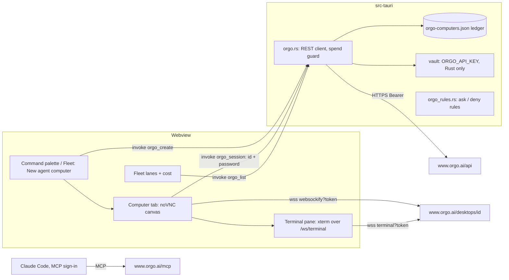
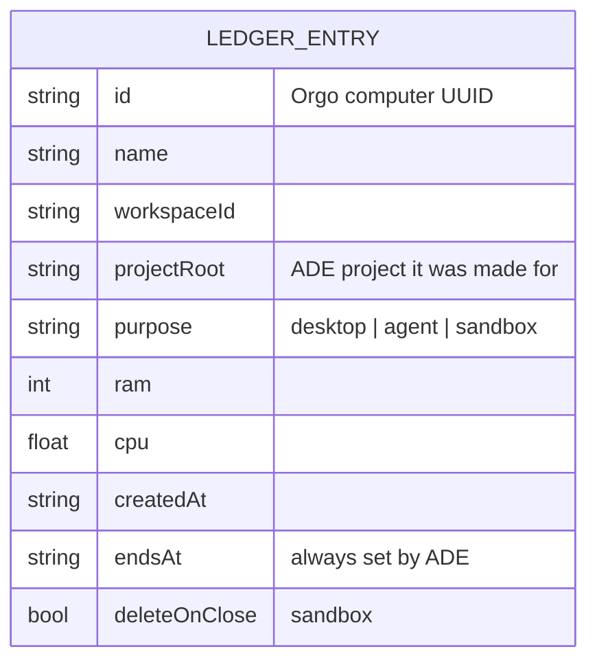
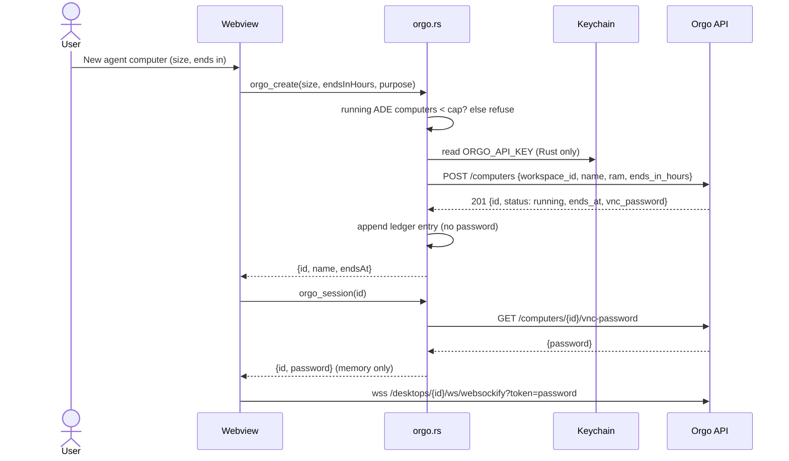

**Step 1** is built in order:
- **Story 1:** Orgo's hosted MCP server in the MCP library, signed in through Claude Code. Claude Code asks before any computer is created, changed, stopped or deleted. Rules go in three places: every Claude Code launch ADE makes, the project's shared settings, and the repo-root local settings, which Claude Code reads from any subfolder.
- **Story 1b:** a hard stop for ADE's Continuous mode, as `--disallowedTools` on the launch line.
- **Story 1c, the Orgo CLI: ON HOLD** pending the owner. The review's findings are recorded under it, unaddressed.

**Stories 2 to 6** are step 2, the native panel, outlined only. All Orgo permission rules live in one module, `src-tauri/src/orgo_rules.rs`. Shared intent, decisions, security and cost come first.

<frozen-after-approval reason="human-owned intent — do not modify unless human renegotiates">

## Intent

**Problem:** An agent working in ADE has only the user's own machine. It cannot test the UI it just built in a clean desktop and browser. It cannot run Claude Code somewhere other than the user's laptop, fan work out across several machines, or run untrusted code away from the user's files and keys. Orgo rents cloud computers made for agents to drive. ADE has no way to reach them.

**Approach:** Orgo only.
1. **MCP:** Orgo's hosted MCP server (`https://www.orgo.ai/mcp`) in ADE's MCP library, signed in with the user's Orgo account through Claude Code's `/mcp`. Claude Code asks before every tool that creates, copies, resizes, re-times, starts, resumes, stops or deletes a computer, or enables SSH. The rules match by verb across any server named like Orgo.
2. **Continuous hard stop:** when ADE launches Continuous mode, the tools and commands that create or start computers are denied on the command line, where the agent cannot edit them.
3. **CLI (on hold):** the `orgo` CLI, installed and guided, with its risky commands asking.
4. **Native panel, later:** a click creates a computer and opens its live desktop in a tab, with lifecycle, a spend guard, a remote terminal and fleet cost.

## Owner's decisions (2026-10-29)

1. **Purposes, all four:** computer use (an agent drives a real desktop and browser, for example to test the UI it built); Claude Code running remotely from an ADE tab; a parallel fleet across several machines, shown in the fleet view with cost; a throwaway sandbox for untrusted code.
2. **Depth:** MCP first, then a native panel with the live desktop, lifecycle and cost.
3. **Provider:** Orgo only. No provider-neutral abstraction.
4. **(Q7) Story 1 uses Orgo's hosted MCP server**, with the user signing in through Claude Code's MCP OAuth flow. No API key in ADE's vault, no npx package, no local server. The review found that the local server:
   - puts root VNC passwords into model context;
   - exposes `orgo_get_vnc_password`, `orgo_enable_computer_ssh`, `orgo_apply_computer_secrets`, `orgo_move_computer` and workspace edits.

   Orgo's sign-in list leaves these out "so a sign-in is never sent a computer's password" (https://docs.orgo.ai/guides/mcp).
5. **Orgo tools that create, copy, resize, extend, start, stop or delete a computer always ask**, in every mode, ADE's Continuous mode (`claude --dangerously-skip-permissions`, `src/lib/agentCommand.ts:50`) included. Story 1 delivers it as follows:
   - **Every Claude Code session ADE launches** carries the rules on its command line (`--settings`). That holds in any folder and any mode, and the agent cannot edit it.
   - **Sessions the user starts themselves** on this machine, anywhere in the repository, read the rules from the repo-root `.claude/settings.local.json`.
   - **Teammates** get them from the committed `.claude/settings.json` when they start at the root.

   A user-started session can lose the rules if a Continuous-mode agent in it deletes them from the files. Sessions outside this repository, and providers that are not Claude Code (Codex), are not covered.
6. **(Q5) Claude Code on a remote computer signs in with a dedicated, spend-limited Anthropic Console key** that the user makes for remote machines. ADE sends it only on an explicit, confirmed action and never copies the user's own Claude login (step 2, Story 4).
7. **(Q3) Not needed for Story 1.** The panel's key stays an open question for step 2.
8. **(Q8) Yes, Story 1b.** Continuous launches pass `--disallowedTools` for the create, clone, fork, start, restart and resize tools, and the CLI's creating commands where Claude Code's pattern syntax allows. After review round 3: **always**, as server-glob patterns, not only when the project's `.mcp.json` names `orgo`. Orgo's own `claude mcp add` writes to `~/.claude.json`, and an ancestor `.mcp.json` or another server name would be missed.
9. **(Q9) A dedicated ADE workspace in Orgo.** The sign-in uses it, and so do any CLI key and step 2's key.
10. **The Orgo CLI: "install + guide, agent asks" (Story 1c).** **On hold** after review round 3: the parallel product doc recommends shipping it only as the CLI library's `orgo` entry, after Story 1 has been used with a real account. Awaiting the owner.

## Boundaries & Constraints (all stories)

**Always:**
- Orgo's own hosted MCP server, Orgo's own CLI, and Orgo's documented REST and WebSocket endpoints. No third-party wrapper.
- Every Orgo permission rule ADE writes or passes comes from `src-tauri/src/orgo_rules.rs`. The webview cannot add one.
- Every Orgo or Claude Code fact a story relies on is cited below. A fact marked unverified (U-list) is checked before the story that needs it is sharded.
- ADE edits `.claude/settings.json` and `.claude/settings.local.json` only by merging. The user's keys, values and rules are kept, and rule lists keep their order. A file that is not valid JSON is left alone and the action is refused. ADE never deletes a rule.
- The verification command is unchanged.

**Never:**
- ADE never creates, starts or resizes an Orgo computer without the user's click. This holds for the native panel in every story. In the MCP and CLI paths, Claude Code runs the call, and these stories' rules make it ask, or deny it in Continuous mode.
- ADE never sends `billing_mode: "hourly"`, never calls Account, Clients, Billing or capacity-buying endpoints, never runs `orgo billing`, and never adds credit.
- ADE never copies the user's Claude Code credentials, `~/.claude`, `~/.orgo/credentials.json`, the keychain's Claude entry, SSH keys or any other vault secret to an Orgo computer. The one exception is decision 6.
- ADE never edits `~/.claude/settings.json` or `~/.claude.json`.
- No change to `relay/` or `mobile/`. No provider abstraction.

## Security

- **No Orgo key in ADE for Story 1.** `.mcp.json` holds only `{"type": "http", "url": "https://www.orgo.ai/mcp"}`. Claude Code runs the OAuth sign-in and keeps the tokens. Orgo issues 1-hour access tokens with rotating refresh tokens.
- **What the MCP sign-in grants** ([Orgo MCP guide](https://docs.orgo.ai/guides/mcp)):
  - The grant covers one workspace, the dedicated ADE workspace. In it, Claude Code can create and manage computers, screens and files.
  - Only Orgo's reviewed tool list is offered: no templates, clients, account, chat, support, workspace create/change/delete, suspend/resume, upload, `get_vnc_password`, `apply_computer_secrets` or `move_computer`.
  - It is never sent a computer's password.
  - On a paid account, it cannot launch hourly computers (`403 HOURLY_NEEDS_BILLING`).
  - To revoke: Orgo Settings → Security → Connected AI apps, or `/mcp` → Clear authentication, or `claude mcp logout orgo`.
- **Always ask (decision 5).** The ten `MCP_ASK` rules are verb globs on the tool name, with a glob in the server position, for example `mcp__*orgo*__*create*`. They go to three places:
  1. **Launch flag.** ADE passes `--settings '{"permissions":{"ask":[…]}}'` on every Claude Code launch it makes, so they hold in any working directory and in any mode. A launch flag cannot be edited from inside the session.
  2. **Repo-root `.claude/settings.local.json`.** "If you start Claude Code in a subdirectory of a git repository, it reads and writes that file at the repository root" ([settings](https://code.claude.com/docs/en/settings), Claude Code ≥ 2.1.211).
  3. **The project's `.claude/settings.json`**, committed for teammates who start at the root.

  The `.mcp.json` that loads Orgo is found from the working directory and every parent directory (review round 3, Claude Code's loader). `.claude/settings.json` is read only from the primary working directory. That is why the shared file alone was not enough.
- **Claude Code's guarantees** ([permission modes](https://code.claude.com/docs/en/permission-modes), [permissions](https://code.claude.com/docs/en/permissions), [settings](https://code.claude.com/docs/en/settings)):
  - "Claude Code doesn't auto-approve the following in any mode, including `bypassPermissions` … Tools matched by an explicit ask rule."
  - Rules are evaluated deny, then ask, then allow.
  - A local "don't ask again" allow "doesn't outrank an `ask` rule from a project or managed file".
  - Ask and deny rules take globs in the tool-name position. The pattern must match the whole name, and names with `*` raise no "matches no tool" warning, so the globs are silent where Orgo isn't installed.
- **What these rules cannot stop, stated plainly:**
  - **User-started sessions in Continuous or bypass mode.** The agent can edit both settings files, and Claude Code reloads them. ADE-launched sessions keep the launch-flag rules.
  - **Other clients and repositories.** Claude Code sessions outside this repository, Codex and other non-Claude Code agents, and Orgo signed in under a server name without "orgo" in it, or as a claude.ai connector whose name differs in case.
  - **The CLI and the REST API**, until Story 1c, and then only as far as Bash patterns go.
  - **Actions on a computer.** Screenshot, mouse, keyboard, bash and Python on the remote computer still prompt in Manual mode and run unprompted in Continuous mode, by design. Their effects stay on the remote computer.
- **Prompt injection.** A web page shown on a computer is untrusted input that comes back as a screenshot.
  - It can steer the agent's actions there, where they are contained, and lifecycle tools ask or are denied.
  - It can push the agent to type local data into the computer, or act locally with local tools, which Orgo's rules do not cover.
  - The guide says: use disposable computers, don't sign in to personal accounts on them, and don't run Continuous mode while the agent browses sites you don't trust.
- **Step 2's key (Q3).** The webview can read any vault value today through `vault_get(name)` (`src-tauri/src/vault.rs:137-140`, `lib.rs:483`). Story 2 first limits it to an allowlist, which today is `DEEPSEEK_API_KEY` (`src/lib/anthropic.ts:176`).
- **The computer password is root on that machine.** No ADE path shows, logs or stores it.

## Cost

- **What a computer costs** ([billing](https://docs.orgo.ai/guides/billing), [prices](https://docs.orgo.ai/guides/pricing)):
  - On a paid plan, a computer that fits the plan's remaining capacity is included. Past that, it is hourly from credit, but only for a caller with Billing write, which is never an MCP sign-in.
  - On a free account: hourly from credit, $5 signup credit, Medium only.
  - Linux hourly runs $0.023/h (Small) to $0.202/h (XL), billed per second. At most 50 computers per paid plan.
  - GPU prices are unpublished (U11). ADE never creates GPU computers.
- **A computer costs money until it is deleted.** A stopped hourly computer still pays for its disk, from $0.0017/h. A computer whose end passes is stopped, then deleted 7 days later unless started. The CLI's `computers create` has no end option.
- **The real spend limit is the Orgo plan or credit, not ADE.**
  - On a paid plan, a runaway agent can fill the capacity the user already pays for, up to 50 computers.
  - On a free account it can spend the credit, plus whatever auto top-up charges, up to 5 times in 24 hours. The guide says to leave it off.
  - The ask rules put a prompt before every create, and Continuous launches cannot create at all. Neither is a cap.
- **The native panel adds ADE's own guard** (Story 2): a cap on running ADE-made computers, an end on every computer it creates, auto-stop when idle, and no hourly launches.

</frozen-after-approval>

## What Orgo offers (verified 2026-10-29 against the live docs)

The base URL is `https://www.orgo.ai/api`, and computers are addressed by UUID as `/computers/{id}/…`. A create takes `workspace_id`, and the older name `project_id` is still accepted. `/api/projects/{project}/computers/{name}/…` is not in the current spec.

| # | Fact | Source |
|---|---|---|
| F1 | REST auth is `Authorization: Bearer $ORGO_API_KEY`, with keys beginning `sk_live_`. Spec 2.0.0 has 86 operations. | https://docs.orgo.ai/llms.txt, https://docs.orgo.ai/api-reference/introduction |
| F2 | Hosted MCP: `https://www.orgo.ai/mcp`. Unauthenticated, it answers `401` plus `WWW-Authenticate: Bearer resource_metadata=…`. Its OAuth metadata publishes dynamic client registration, PKCE S256, public clients and revocation. Tools are `orgo_` + the operationId in snake_case, and a sign-in sees a reviewed subset. | https://docs.orgo.ai/guides/mcp; probed 2026-10-29 |
| F3 | Live spec groups: Workspaces 5, Computers 14, Computer Lifecycle 7, Computer Actions 10, Templates 15, Files 7, Screens 5, Account 3, Clients 15, Chat 1, Agent accounts 3, Support 1. | https://docs.orgo.ai/api-reference/openapi.json |
| F4 | Create: `POST /computers` (`workspace_id`, `name`, `os`, `ram`, `billing_mode`, `ends_in_hours` 1 to 720, `template_ref`, `gpu`). | https://docs.orgo.ai/api-reference/computers/create |
| F5 | Lifecycle: stop archives the disk and reads `frozen`. Delete is permanent. An end stops the computer, which is deleted 7 days later. Auto-stop is off by default. | https://docs.orgo.ai/api-reference/computers/stop, https://docs.orgo.ai/guides/computer-ends |
| F6 | Billing: see Cost. | https://docs.orgo.ai/guides/billing, https://docs.orgo.ai/guides/pricing |
| F7 | Live desktop over `wss://www.orgo.ai/desktops/{id}/ws/websockify?token={vnc_password}`. Close codes `4001`, `4003`, `4006`, `4007`, `4008`. | https://docs.orgo.ai/guides/embed-vms |
| F8 | Terminal over `/ws/terminal` with a named `session`. Direct SSH on Linux. | https://docs.orgo.ai/api-reference/computers/terminal, https://docs.orgo.ai/guides/ssh |
| F9 | Commands `bash` and `exec`; files: upload (10 MB), export, download. | https://docs.orgo.ai/llms.txt |
| F10 | Keys are full or Custom, scoped to the account, one workspace or one computer. `computer_key_held`; template secrets need Secrets write. | https://docs.orgo.ai/api-reference/api-keys/permissions, …/computer-keys |
| F11 | Rate limits: "some endpoints" `429`; back off 1 s to 60 s. | https://docs.orgo.ai/api-reference/introduction |
| F12 | The `Computer` schema (with `vnc_password`) is the response of `createComputer`, `getComputer` and `resizeComputer`. The review found it in workspace listings too. | openapi.json |
| F13 | The CLI: `npm install -g orgo` or the install script, `orgo login` (device code, `~/.orgo/credentials.json`), `--json`, `orgo manifest`. | https://docs.orgo.ai/guides/cli |
| F14 | CLI 2.3.0, read from its bundle: global options `--json`, `--quiet` and `--profile`, accepted before or after the subcommand; aliases `c`, `ws`, `t`, `keys`, `rm`; undocumented `clone`, `handoff` and `egress`. See the Story 1c hold note for corrections. | `npm pack orgo@2.3.0` |

**Claude Code facts this plan relies on (verified 2026-10-29):**
- **Remote MCP servers.** A remote server is `{"type": "http", "url": "…"}`, sign-in is `/mcp`, and OAuth fields are needed only for servers without automatic setup ([MCP](https://code.claude.com/docs/en/mcp)).
- **Tool-name globs.** Ask and deny rules accept globs in the tool-name position, and "the pattern must match the full tool name". Allow rules need a literal `mcp__<server>__` prefix. "Tool names containing `_` or `*` are exempt from the [matches no tool] check" ([permissions](https://code.claude.com/docs/en/permissions)).
- **Bash patterns.** `*` can go anywhere. A trailing ` *` that is the only wildcard matches the bare command. Ask and deny rules apply to any subcommand of a compound command and match past any leading assignment. Only the listed wrappers are stripped: `env`, `npx` and absolute paths are not ([permissions](https://code.claude.com/docs/en/permissions)).
- **`--settings <file-or-json>`** takes "a settings JSON file or an inline JSON string". It applies "above your user, project, and local files and below managed settings", for that session only. "When you set the same list key, such as `permissions.allow`, in more than one file, Claude Code combines the lists" ([CLI reference](https://code.claude.com/docs/en/cli-reference), [settings](https://code.claude.com/docs/en/settings)).
  - The CLI reference also says values "override the same keys", so whether a `--settings` `permissions.ask` list merges with the files' lists, rather than replacing them, is U13.
  - The fallback if it replaces: ADE puts the union of the two project files' `ask` lists and `MCP_ASK` in the flag.
- **Settings-file locations.** `.claude/settings.json` is read from the primary working directory. `.claude/settings.local.json` is read at the repository root from a subdirectory, except outside git, at a home-directory root, on Windows, or when the root isn't owned by the user, where it stays with the start directory. Settings edits reach a running session ([settings](https://code.claude.com/docs/en/settings)).
- **`--disallowedTools`** takes deny rules as separate arguments. A bare or glob tool name removes the tool from context. It takes a list, so another flag must follow it ([CLI reference](https://code.claude.com/docs/en/cli-reference)).
- **Modes.** Explicit ask rules prompt even in `bypassPermissions`, deny rules block in every mode, and bypass may write `.claude/` ([permission modes](https://code.claude.com/docs/en/permission-modes)).
- **ADE.**
  - It supports remote sign-in servers (`src/data/mcpCatalog.ts:44-49`, `IntegrationsPanel.tsx:83,183`).
  - Only `AgentPicker` launches agents, in the pane's cwd (`AgentPicker.tsx:151,190`), through `prepareAgentLaunch` (`src/lib/agentLaunch.ts:21`) and `buildLaunchCommand`. The claude and deepseek providers share `claudeCommand` (`agentCommand.ts:49-53`).
  - Projects can sit below the repo root (`IntegrationsPanel.tsx:29-31`).

**Unverified, to check before the story that needs it:**
- **U1.** How `GET /computers/{id}` tells plan from hourly (Story 5).
- **U2.** Whether an MCP sign-in or a Custom key without Billing write can create on a free account (guide wording, Story 2).
- **U3.** What a sleeping (`suspended`) computer is billed (Story 3).
- **U4.** How auto-stop is set, and whether it suspends or stops (Story 3).
- **U5.** Real rate limits (Story 2).
- **U6.** Whether WKWebView and WebKitGTK open `wss://www.orgo.ai` once the CSP allows it (Story 2).
- **U7.** Whether `GET /workspaces/{id}` lists every computer (Story 3).
- **U8.** Answered in round 3: `.mcp.json` loads from parent directories, while `.claude/settings.json` does not. The design now covers both. The manual check confirms it.
- **U9.** The hosted server's exact tool names. The verb globs no longer depend on them; the manual check compares the names anyway.
- **U10.** The key check's error codes (Story 2).
- **U11.** GPU prices (Story 5).
- **U12.** Whether CLI listings print `vnc_password` (Story 1c, on hold).
- **U13.** Whether a `--settings` `permissions.ask` list merges with the files' `ask` lists. Check with `/permissions` in a session launched with the flag. Story 1 manual check; the fallback is above.

**Rejected: Orgo's local server, `orgo-mcp-server`.** It needs a vault key, returns `vnc_password` into context (F12), and registers the password, SSH, secrets, move and workspace tools. Its dependencies float, and it loads the spec and base URL at runtime. **Third-party servers** (`nickvasilescu/orgo-mcp`, `spencerkinney/computer-use-mcp`, Composio): not chosen.

## How the pieces coexist

- **Credentials.** Claude Code's MCP sign-in serves agents. Step 2's panel key, `ORGO_API_KEY`, is read in Rust (Q3). A CLI credential belongs to Story 1c, on hold. All of them point at the dedicated ADE workspace (decision 9), and computers made by any of them appear in the panel as "made elsewhere" when ADE did not make them.
- **One rule source.** `src-tauri/src/orgo_rules.rs` holds `MCP_ASK`, `CONTINUOUS_DENY_MCP` and `CONTINUOUS_DENY_CLI`, and later `CLI_ASK` and `CLI_ALLOW`. It exposes `orgo_launch_rules()` for the launch path. The shared settings merge lives beside it (Q11).
- **The parallel CLI library (`plan/cli-library-and-mcps`)** reuses these lists for its `orgo` entry and must not redefine them. `.ade/context/orgo-permission-rules.md` is the shared contract.

## Proposed ADR 0010 (written on approval)

`.ade/context/decisions/0010-agent-computers-are-orgo-only-and-made-on-click.md`. The next free number is 0010, because 0008 and 0009 are each used twice in history.
- **Decision:**
  - Orgo is the only provider. Agents reach it through its hosted MCP server, and later its CLI.
  - The lifecycle rules are verb globs from one Rust module. They are passed on every ADE launch, and merged into the project's shared settings and the repo-root local settings.
  - Creation is denied on the command line in Continuous launches.
  - In the native panel, only a click creates, starts or resizes a computer, with an end and under ADE's cap.
  - ADE never chooses hourly billing, never runs billing commands, never edits user-level Claude Code settings, and ships no credential except a dedicated key on a confirmed click.
  - Story 2 limits `vault_get` to an allowlist.
- **Consequences:**
  - The spend limit on the agent paths is the user's Orgo plan or credit, behind a prompt.
  - Rules in files can be removed by a bypass-mode agent the user started, and launch flags cannot.
  - Bash rules are not a boundary around a program.

---

# Story 1: Orgo's MCP server in the library, always asking

## Code Map (1)

- `src/data/mcpCatalog.ts`: `McpEntry` (:18-31), `MCP_CATALOG` (:33). Sentry (:44-49) is the precedent for an http sign-in server.
- `src/components/IntegrationsPanel.tsx`: the card (:178-209), "Sign in" (:183), `install` (:73-90) and its notice (:83). The root is resolved with `project_root` (:44), which gives the git root.
- `src-tauri/src/mcp.rs`: `mcp_install` (:44), `mcp_remove` (:63).
- `src-tauri/src/usage.rs`: `settings_path` (:544), `merge_deny` (:651), `load_settings` (:718) and `save_settings` (:725), the existing settings writer. `local_settings_path` (:713) points at `.claude/settings.local.json`. The writer uses serde_json without `preserve_order`, so every write re-sorts object keys (see S1-3).
- `src/lib/agentCommand.ts:49-53` `claudeCommand`, and `src/lib/agentLaunch.ts:21` `prepareAgentLaunch`.
- **New:** `src-tauri/src/orgo_rules.rs`, and `src-tauri/src/orgo_operations.json`, the fixture.

## Design Notes (1)

**The catalog entry**, after `fetch` in "Web & browser":

```ts
{
  id: "orgo",
  name: "Orgo",
  category: "Web & browser",
  description: "Cloud computers with a desktop, browser and shell that the agent can start, see, drive and run commands on.",
  server: { type: "http", url: "https://www.orgo.ai/mcp" },
  oauth: true,
  caution: "Signing in lets Claude Code create, drive and delete computers in the Orgo workspace you choose. They cost money until deleted, and what their screens show can try to steer the agent. Agents ADE starts always ask before a computer is created, changed, stopped or deleted, even in Continuous mode. So do Claude Code sessions you start in this project, unless the rules are removed from its settings.",
  docs: "https://docs.orgo.ai/guides/mcp",
}
```

- **What it writes.** Install writes `{"type": "http", "url": "https://www.orgo.ai/mcp"}` under `mcpServers.orgo`.
- **`caution`** is a new optional field, rendered as `<p className="mcp-caution" role="note">`, and not searched.
- **Search.** The description has no "click", so `"browser click"` still finds only Playwright, and `"cloud computer"` finds Orgo.

**`MCP_ASK`, verb globs** (S1-2). They are robust to the unverified hosted names (U9), to a server renamed `orgo-prod`, and to a tool without the `orgo_` prefix:

```rust
pub const MCP_ASK: &[&str] = &[
    "mcp__*orgo*__*create*",            // create_computer (also create_workspace/screen/...: writes)
    "mcp__*orgo*__*clone*",
    "mcp__*orgo*__*fork*",
    "mcp__*orgo*__*resize*computer*",   // not *resize*: that catches GET get_resize_limits
    "mcp__*orgo*__*update*",            // update_computer sets or moves the end
    "mcp__*orgo*__*start*",             // start_computer, restart_computer
    "mcp__*orgo*__*resume*",
    "mcp__*orgo*__*stop*",
    "mcp__*orgo*__*delete*",
    "mcp__*orgo*__*enable*ssh*",        // not *ssh*: that catches GET get_computer_ssh
];
```

- **Checked against all 86 operations of the live spec** (2026-10-29), snake-cased as `mcp__orgo__orgo_<op>`. **No GET operation matches.** Every computer lifecycle write matches: create, clone, fork, resize, update, start, restart, resume, stop, delete and enable-SSH.
- **The other writes they also match ask too, which is the safe direction:** `create_workspace`, `create_screen`, `create_client`, `create_chat_completion`, `update_workspace`, `update_client(_billing)`, `start_file_upload`, `stop_template_run`, `stop_client_billing`, and `delete_file`, `delete_template`, `delete_workspace`.
- **The fixture.** The list of operations is kept in `src-tauri/src/orgo_operations.json` (method, path, operationId), a copy of the spec's operation list, so the test runs offline.
- **What the globs miss:** a server whose name lacks lowercase "orgo", such as a claude.ai connector named `Orgo`. The guide says to name the server `orgo`, which is what Install does.

**Where the rules go.** Install, for `name == "orgo"`:
1. Read and validate `<root>/.mcp.json`, `<root>/.claude/settings.json` and `<root>/.claude/settings.local.json`, where `<root>` is the git root from `project_root`. If any is invalid or the wrong shape, refuse and write nothing.
2. Merge `MCP_ASK` into `permissions.ask` of `<root>/.claude/settings.local.json`. Claude Code reads that file at the repo root from any subdirectory, so it covers subfolder sessions on this machine.
3. Merge them into `<root>/.claude/settings.json`, for teammates and root sessions.
4. Write `.mcp.json`.

`mcp_install` returns the rules added to either file.

**Every ADE launch (S1-1).**
- `prepareAgentLaunch` invokes `orgo_launch_rules()`, which takes no arguments and returns `{ ask: MCP_ASK, … }`.
- `claudeCommand` adds `--settings '{"permissions":{"ask":[…]}}'`, quoted with `shellQuote` (`agentCommand.ts:26`), to every claude and deepseek launch, Manual and Continuous alike.
- Glob names are exempt from the "matches no tool" warning, so this is silent in projects without Orgo, and it does not depend on the cwd, the project, or how Orgo was installed.
- A launch flag cannot be edited by the agent. If U13 shows `--settings` replaces rather than merges the `ask` list, the flag carries the union of the two project files' `ask` lists plus `MCP_ASK` instead.

**The merge and key order (S1-3).** Recommend keeping the existing writer and **rewording AC6 to semantic equality**, rather than enabling serde_json's `preserve_order`.
- The writer re-sorts object keys and re-pretty-prints on its first write to a file. That is already true of ADE's settings writers today, recorded in `_bmad-output/initiative-phone-remote/deferred-work.md` (`save_settings` re-sorts `.claude/settings.local.json`).
- `preserve_order` is crate-wide. It would change every JSON map in the app. It would break at least `mcp.rs`'s test that expects `["github", "mine"]` (`mcp.rs:100`), and it would change the output of every other JSON writer. That belongs to its own story with its own review.
- What Story 1 guarantees: every key and value of the user's file survives (semantic equality), rule arrays keep their order with ADE's rules appended once, and a second install changes nothing byte for byte.
- The notice and the guide say the first write reformats `.claude/settings.json`. The deferred entry is extended with the Orgo case.

**Remove** takes Orgo out of `.mcp.json` and leaves every rule. ADE never deletes a rule.

**Notice:** "Orgo added to .mcp.json. Agents ADE starts will always ask before Orgo creates, changes, stops or deletes a computer, and rules were added to .claude/settings.json and .claude/settings.local.json for sessions you start yourself. The first write may reformat .claude/settings.json. Run /mcp in Claude Code to sign in."

**Guide** (`docs/guide/integrations.md`): add Orgo to the "Web & browser" row and a `## Orgo cloud computers` section:
- what it does;
- signing in to the dedicated ADE workspace with `/mcp`;
- what the sign-in allows, and how to revoke it;
- always asks: the ten globs, the three places, and what they don't cover (user-started bypass sessions, other repositories, Codex, other server names);
- cost: billed until deleted, stopped hourly computers still pay for disk, the plan or credit is the limit, set an end, delete when done, auto top-up off;
- prompt injection.

**README:** "16 curated MCP servers".

**Contract:** `.ade/context/orgo-permission-rules.md` records the lists, the three places, `orgo_launch_rules()`, that ADE never deletes a rule, and that the CLI library reuses the lists.

**Failure modes:**
- **Any of the three files invalid:** install is refused with the file named, and nothing is written.
- **A session started in a subfolder:** the rules come from the launch flag (ADE) or the root local file (user-started).
- **Settings outside git, at a home-directory root, or on Windows:** `settings.local.json` stays with the start directory, so a user-started subfolder session has no file rules. ADE launches keep the flag. The guide says so.
- **A bypass-mode agent the user started deletes the file rules:** not prevented, and stated.

## Acceptance Criteria (1)

Each names its test. The developer writes it failing first. AC10 is a regression check.

1. With `vault_list` empty, the Orgo card shows "Sign in" and its caution as a `role="note"`, with no secret row, no "Add to vault" and no `npx` tag. Covered by `src/components/__tests__/IntegrationsPanel.test.tsx` (new) › "the Orgo card is a sign-in server with its caution".
2. Install sends `mcp_install` with `name: "orgo"` and a server of exactly `{type: "http", url: "https://www.orgo.ai/mcp"}`. With rules returned, the notice says ADE's agents always ask, names both settings files, says the first write may reformat, and says to run `/mcp`. Covered by `IntegrationsPanel.test.tsx` › "installing Orgo writes the hosted server and says where the rules went".
3. Every `oauth: true` entry has no `secrets`, empty `envRefs`, and an `https:` URL. Covered by `src/data/__tests__/mcpCatalog.test.ts` › "sign-in servers carry no secret and use https".
4. `"cloud computer"` finds `["orgo"]`, and `"browser click"` still finds `["playwright"]`. Covered by `mcpCatalog.test.ts` › "searches name, category and description" (extended).
5. Installing `orgo` in a temp git repo with no settings files creates `.claude/settings.json` and `.claude/settings.local.json` at the repo root, each with only `permissions.ask` = `MCP_ASK`. It writes the server and returns the rules. Covered by `src-tauri/src/mcp.rs` › `orgo_install_writes_rules_to_shared_and_root_local_settings`.
6. **(Reworded for S1-3.)** Existing settings files hold `model`, `hooks` and `env` keys, user allow and deny rules, a user ask rule, and one rule equal to an Orgo glob. After install:
   - each file parsed as JSON equals the original with only `permissions.ask` changed;
   - that array is the original elements in order, followed by the missing Orgo rules in `MCP_ASK` order, each once;
   - a second install leaves both files byte-identical to after the first, and returns nothing.

   Covered by `src-tauri/src/orgo_rules.rs` › `merge_keeps_every_user_value_and_is_idempotent`.
7. If any one of `.mcp.json`, `.claude/settings.json` or `.claude/settings.local.json` is `{ not json`, or has a string `permissions.ask`, install errors and all three files are byte-identical to before. A missing file stays missing. Covered by `mcp.rs` › `orgo_install_refuses_and_touches_nothing_on_bad_files`.
8. Installing `github` writes no settings file. Removing `orgo` keeps every rule in both files. Covered by `mcp.rs` › `only_orgo_adds_rules_and_remove_keeps_them`.
9. **(S1-2.)** Against `orgo_operations.json`, using a full-match glob matcher:
   - no `MCP_ASK` glob matches the tool name of any GET operation;
   - each of `createComputer`, `cloneComputer`, `forkComputer`, `resizeComputer`, `updateComputer`, `startComputer`, `restartComputer`, `resumeComputer`, `stopComputer`, `deleteComputer` and `enableComputerSsh` is matched;
   - the matches hold for `mcp__orgo__orgo_<op>`, `mcp__orgo-prod__orgo_<op>` and `mcp__orgo__<op>` (no prefix);
   - `mcp__github__create_issue` and `mcp__orgo__orgo_get_computer` are not matched.

   Covered by `orgo_rules.rs` › `ask_globs_catch_every_lifecycle_write_and_no_read`.
10. The deny callers behave as before. Covered by `usage.rs` › existing `deny_rules_merge_into_settings` and `deny_refuses_other_rules_and_bad_json` (green).
11. **(S1-1.)** Every claude and deepseek launch from `buildLaunchCommand` carries exactly one `--settings` argument. Its shell-unquoted value parses to `{"permissions": {"ask": MCP_ASK}}`. This holds in Manual and in Continuous mode, and Codex launches are unchanged. Covered by `src/lib/__tests__/agentCommand.test.ts` › "every Claude Code launch carries Orgo's ask rules".
12. **(S1-1.)** Launching from `AgentPicker` with a pane cwd of `<repo>/app` invokes `orgo_launch_rules` with no path, and types a command containing the same `--settings` as with cwd `<repo>`. Covered by `src/components/__tests__/agentLaunch.test.ts` › "Orgo rules do not depend on the folder an agent starts in".
13. The guide's MCP table lists exactly the catalog's servers, by set equality after removing parenthesised text and splitting on commas. Covered by `scripts/mcpCatalogDocs.test.ts` (new) › "the guide's table lists exactly the catalog".
14. The Orgo guide section contains every `MCP_ASK` glob (read from `orgo_rules.rs`) and mentions "subfolder", "Continuous", "/mcp", "until you delete" and "auto top-up". The README count equals `MCP_CATALOG.length`. Covered by `mcpCatalogDocs.test.ts` › "the Orgo section matches the rules ADE writes", "the README count matches the catalog".

## Verification (1)

**Commands:** the repo's verification command, unchanged.

**Manual checks (owner, with a real Orgo account):**
- **Sign-in (U9).** Sign in through `/mcp` to the ADE workspace. No `orgo_get_vnc_password` appears. Every lifecycle tool listed is matched by a glob.
- **Subfolder, ADE launch.** In a repo with Orgo installed, open a pane in `<repo>/app`, launch an agent from the picker, and ask it to create a computer: it prompts. Repeat with Continuous on: it prompts (1b later denies instead).
- **Subfolder, user-started.** In `<repo>/app`, type `claude` yourself and ask for a create: it prompts, from the root `settings.local.json`. `/permissions` shows the rule's source.
- **U13.** In an ADE-launched session, `/permissions` lists the rules from both the command line and the project files.
- **Manual mode.** "Yes, and don't ask again" on a create, then another create: it still prompts.
- **Clean-up.** Delete every computer, check the dashboard is empty, and revoke the sign-in.

## Slice (1)

- `src/data/mcpCatalog.ts` and its test.
- `src/components/IntegrationsPanel.tsx` and its new test; `src/index.css`.
- `src/lib/agentCommand.ts`, `src/lib/agentLaunch.ts` and their tests.
- `src-tauri/src/orgo_rules.rs` (new), `src-tauri/src/orgo_operations.json` (new), and `lib.rs` registration.
- `src-tauri/src/mcp.rs`; `src-tauri/src/usage.rs` (calls the shared merge, no behaviour change).
- `scripts/mcpCatalogDocs.test.ts`, `docs/guide/integrations.md`, `README.md`.
- `.ade/context/orgo-permission-rules.md`, and the deferred-work entry.

No new dependency, and no change to `Cargo.toml` features.

---

# Story 1b: the Continuous-mode hard stop

Depends on Story 1 (`orgo_rules.rs`, `orgo_launch_rules`, the `--settings` plumbing).

## Design Notes (1b)

**The deny lists** come from `orgo_launch_rules()`, which still takes no arguments.

- **`CONTINUOUS_DENY_MCP`, always** (1b-1):

  ```rust
  pub const CONTINUOUS_DENY_MCP: &[&str] = &[
      "mcp__*orgo*__*create*", "mcp__*orgo*__*clone*", "mcp__*orgo*__*fork*",
      "mcp__*orgo*__*start*",  "mcp__*orgo*__*resume*", "mcp__*orgo*__*resize*computer*",
  ];
  ```

  - A glob deny "is removed from Claude's context", and it is silent where no tool matches.
  - Always passing it covers Orgo added by `claude mcp add` (`~/.claude.json`), an ancestor `.mcp.json`, and another server name containing "orgo".
  - In Continuous sessions it also hides other "create" writes such as `create_screen` and `create_workspace`, which is acceptable for an unattended session.
  - Like the ask list, it is checked against the fixture: no GET matched, and every create, clone, fork, start, restart, resume and resize-computer matched.
- **`CONTINUOUS_DENY_CLI`, always**, with leading wildcards so the usual ways of invoking the program are caught:
  - For `G` in `computers`, `c` and `S` in `create`, `start`, `restart`, `resize`, `clone`: `Bash(*orgo G S*)`.
  - `Bash(*orgo templates run*)`, `Bash(*orgo t run*)`.
  - `Bash(*orgo -*)`: a global flag before the subcommand.
  - `Bash(*orgo computers -*)`, `Bash(*orgo c -*)`, `Bash(*orgo templates -*)`, `Bash(*orgo t -*)`: a flag before the subcommand.

  A leading `*` matches `env orgo …`, `/home/u/.orgo/bin/orgo …`, `npx orgo …` and `sh -c 'orgo …'`. These are deny rules, so a leading wildcard is allowed and raises no warning; only allow rules warn about it. It still misses a quoted subcommand (`orgo c 'create'`), shell aliases and functions, variables (`$O c create`), and commands built at runtime or run from a script file.

**The launch.** With `continuous`, `claudeCommand` writes:

```
claude --dangerously-skip-permissions --settings '<ask json>' --disallowedTools '<rule>' … --append-system-prompt-file <path> [task]
```

`--disallowedTools` takes a list, so it sits before `--append-system-prompt-file`, and the task stays positional. Without `continuous` there is no `--disallowedTools`, and `--settings` remains (Story 1). Codex and Ollama are unchanged, and the guide says these rules do not bind them.

**What still only asks under Continuous mode:** stop, delete, update (the end) and enable SSH, through the launch-flag ask rules from Story 1, which the agent cannot remove.

## Acceptance Criteria (1b)

1. `buildLaunchCommand("claude", path, { continuous: true, disallowedTools: […], task: "go" })` orders the command as `--dangerously-skip-permissions`, `--settings …`, `--disallowedTools` with each rule shell-quoted, `--append-system-prompt-file …`, then the task. Without `continuous`, or with an empty list, there is no `--disallowedTools`. Covered by `src/lib/__tests__/agentCommand.test.ts` › "continuous launches deny Orgo creation before the role flag".
2. **(1b-1.)** `orgo_launch_rules()` returns `CONTINUOUS_DENY_MCP` and `CONTINUOUS_DENY_CLI` unconditionally; it takes no project. Against `orgo_operations.json`, no MCP deny glob matches a GET operation, and each of create, clone, fork, start, restart, resume and resize-computer is matched. Covered by `orgo_rules.rs` › `continuous_mcp_denies_are_unconditional_and_spare_reads`.
3. Under the documented semantics, re-implemented in the test:
   - **Denied:** `orgo c create --name a`, `orgo computers start a`, `orgo --json c create`, `orgo c --json resize a --ram 8`, `orgo t run hermes-agent`, `ORGO_PROFILE=x orgo c clone a`, `orgo c create --profile default`, `env orgo c create`, `/home/u/.orgo/bin/orgo c create`, `npx orgo c create`, `sh -c 'orgo c create'`.
   - **Not denied:** `orgo c delete a`, `orgo c list --json` and `orgo whoami`.
   - **Unmatched, the documented limit:** `orgo c 'create'`.

   Covered by `orgo_rules.rs` › `continuous_cli_denies_cover_creation`.
4. **(1b-2.)** Launching from `AgentPicker` with Continuous on, from a pane cwd of `<repo>/app` and of `<repo>`, invokes `orgo_launch_rules` with no path argument. Both typed commands carry identical `--disallowedTools` lists. With Continuous off, neither command has `--disallowedTools`. Covered by `src/components/__tests__/agentLaunch.test.ts` › "continuous denies are the same in every folder".

**Manual checks:**
- In an ADE Continuous session started in `<repo>/app`, with Orgo installed through ADE, `orgo_create_computer` is absent from the tools. Repeat with Orgo added through `claude mcp add` instead.
- `orgo c create` is refused.
- `orgo_delete_computer` still prompts.

**Slice (1b):** `src/lib/agentCommand.ts`, `src/lib/agentLaunch.ts`, their tests, `src-tauri/src/orgo_rules.rs`, the context file, and a paragraph in the guide.

---

# Story 1c: the Orgo CLI — ON HOLD

**Status: on hold (review round 3).** The parallel product doc (`plan/product-ide-and-harness`, `_bmad-output/product-ide-and-harness.md`) recommends trimming this story. It would ship only as the CLI library's `orgo` entry, with a typed install, after Story 1 has been used with a real account. The owner has not decided. The design below is round 2's and is **not** reworked. The review's findings are recorded here so nothing is lost, and they supersede the design wherever they conflict.

**Round-3 findings, open:**
- **1c-1, credential bypass.**
  - `orgo@2.3.0`'s `loadCredential` ignores `ORGO_API_KEY` when a profile is named, and Commander accepts global flags after the subcommand. Verified live by the reviewer: `orgo c list --json --profile default` sent the account-wide login token, and `Bash(orgo c list *)` allows it.
  - `env orgo …` is not a stripped wrapper.
  - Fixes:
    - don't offer `orgo login` alongside the vault key;
    - add ask rules `Bash(orgo *--profile*)` and `Bash(orgo *ORGO_PROFILE*)`;
    - add `env`, `exec`, absolute paths, `watch`/`setsid` and flags-after-subcommand to the unmatched list.
  - The Security claim that "`ORGO_API_KEY` overrides any `orgo login` in ADE terminals" is wrong whenever a profile is named.
- **1c-2, version and fixture.** Pin `orgo@2.3.0`, and add an offline AC that classifies a recorded `orgo manifest` fixture.
- **1c-3, classification.**
  - `computers exec --file` and `computers bash` from stdin must ask.
  - `ws use`, `templates build`, `templates publish` and `files delete` must be classified.
  - `billing topup` opens a Stripe checkout; it does not buy directly.
- **Test strategy.** Add a one-time manual matrix of the risky corpus through real Claude Code, in Manual and in Continuous mode.

Story 1b's CLI denies stand on their own and do not wait for this story.

<details><summary>Round-2 design (superseded where the findings above conflict)</summary>

- **UI:** an "Orgo CLI" row under the Orgo card with three actions:
  - Set up CLI: merge `CLI_ASK` and `CLI_ALLOW`, write `.claude/skills/orgo-cli/SKILL.md` if missing, then `runInNewTab("Orgo CLI", root, "npm install -g orgo")`, never the install script;
  - Sign in (`orgo login`);
  - Use a workspace key (`ORGO_API_KEY`).
- **`CLI_ASK`:**
  - per-alias subcommands: computers create, start, restart, resize, clone, stop, delete, vnc-password and ssh; workspaces create and delete; templates run and delete; files upload;
  - whole commands: billing, api-keys, keys, secrets, ssh, run, agent, resume, handoff, egress, clone, login and logout;
  - `Bash(orgo -*)`, and per-group `Bash(orgo A -*)`;
  - `--json` listings until U12.
- **`CLI_ALLOW`:** `orgo`, whoami, manifest, help, sessions, the list commands, `ws current`, and templates show and schema.
- **The skill:** `orgo manifest` first; `--json` after the subcommand; the ADE workspace; never vnc-password, billing, api-keys or secrets unless asked; delete computers when done.
- **ACs:** a risky corpus asked; a read-only corpus allowed; the limits unmatched; merge and refusal; the skill written once; the panel row; the guide section.

</details>

---

# Step 2: the native panel (outline; not ready to shard)

## Shape



- **`src-tauri/src/orgo.rs`** is the only ADE code that calls the REST API. It reads `ORGO_API_KEY` (Q3) after Story 2 limits `vault_get` to an allowlist, and needs an HTTP client crate (`reqwest` with rustls, or `ureq`).
- **The ledger**, `orgo-computers.json` in app data, holds only ADE-made computers. It is not synced and stores no passwords.



- **The spend guard** lives in `orgo_create`, the only create path. It refuses at the cap, always sends `ends_in_hours`, and never sends `billing_mode` or `gpu`.
- **The live view:** noVNC (`@novnc/novnc` 1.7.0, MPL-2.0) in a `"computer"` tab. `connect-src` gains exactly `wss://www.orgo.ai`, and both `scripts/csp.test.ts` and `scripts/browserTabCsp.test.ts` are updated.



## Stories (outline)

**Story 2: New agent computer, with its live desktop in a tab.** Purpose 1.
- First, a `vault_get` allowlist.
- The sheet offers size (no GPU), ends in (Q1) and the ADE workspace.
- Close codes: `4003` (Start, as a click), `4008` (reconnect), `4001` (refetch once), `4006`, `4007`.
- The key check branches on `code` (U10).
- It depends on F4, F5, F7, F10, U4, U5, U6 and U10, and needs Q1 to Q4.

**Story 3: Lifecycle.**
- Stop, Start and Delete, with a confirm; "Ends in …" and "Extend 1 h"; auto-stop (Q1).
- Reconcile with the workspace, showing "made elsewhere" computers.
- It depends on F5, U3, U4 and U7.

**Story 4: A terminal, and Claude Code remotely.** Purpose 2.
- xterm over `/ws/terminal`.
- Decision 6's key: confirmed, sent per computer by Rust, never remembered, never the user's login.
- Code only by an explicit clone or a confirmed upload.
- Handle `computer_key_held`.

**Story 5: Fleet lanes and cost.** Purpose 3.
- Hourly is time × rate; plan computers are "on plan"; GPU is "price unknown"; a stopped computer shows its disk rate until deleted.
- "New fleet" stays within the cap.
- It depends on F6, U1 and U11.

**Story 6: A throwaway sandbox.** Purpose 4.
- Small, a 1 h end, deleted when its tab closes, with nothing sent to it.

---

## Verification (all stories)

The verification command is the repo's, unchanged: `npx tsc --noEmit` · `npm test` · `cd src-tauri && cargo test` · `cd relay && cargo test` · `cd mobile && npx tsc --noEmit && npx jest`. Step 2's REST client is tested against recorded responses. The rule tests check ADE's rules against Claude Code's documented matching, re-implemented in the test, and against an offline copy of Orgo's operation list. The manual checks run real Claude Code.

## Story order and dependencies

1. **Story 1**: MCP entry, `orgo_rules.rs`, the launch `--settings`, and both settings files. Depends on nothing.
2. **Story 1b**: Continuous hard stop. Depends on 1.
3. **Story 1c**: on hold. If revived, it depends on 1 and comes after real use of 1, as the CLI library's `orgo` entry.
4. **Stories 2 → 6**: the native panel, after Q1 to Q4.

## Deferred Work

- serde_json `preserve_order`: ADE's settings writers re-sort keys on first write. This is an existing entry in `_bmad-output/initiative-phone-remote/deferred-work.md`, now also hit by Orgo's install on `.claude/settings.json`. It needs its own story, because it is crate-wide.
- A vault option to keep a secret out of terminals.
- Website mention once step 2 ships.
- Windows, macOS and iPhone Orgo computers.
- Refreshing `orgo_operations.json` when Orgo's spec major version changes.

## Open Questions (owner)

Decided: Q3 for Story 1 (decision 7), Q5 (6), Q7 (4), Q8 (8, widened in round 3), Q9 (9), the CLI (10, now on hold). Q6 is moot. Stories 1 and 1b need no answer to be built.

- **Q1. Spend limits and the auto-stop default (step 2).** Recommend: a cap of 3 (configurable 1 to 10), a 2 h end by default, auto-stop at 30 min, Small or Medium, no GPU, no hourly.
- **Q2. Does ADE ever create a computer without a click?** Recommend: never.
- **Q3. The panel's key (step 2).** Recommend: vault `ORGO_API_KEY`, Custom, on the ADE workspace, read only in Rust, with `vault_get` allowlisted first.
- **Q4. The live view.** Recommend: noVNC 1.7.0, `connect-src` plus exactly `wss://www.orgo.ai`, and both CSP tests. Confirm MPL-2.0 is acceptable.
- **Q10. The CLI rule set beyond decision 10's list.** On hold with Story 1c.
- **Q11. Where the shared settings merge lives.** Recommend a neutral `src-tauri/src/claude_settings.rs`, created by whichever plan builds first.
- **Q12 (new, S1-3).** Accept that the first Orgo install reformats a committed `.claude/settings.json` (keys sorted, re-indented, every value kept), with `preserve_order` deferred to its own story? Recommend yes.

## Review Triage Log

**Round 1, 2026-10-29: adversarial review of bcb314b, BLOCK for Story 1. Owner answered Q3, Q5 and Q7.**

| Finding | Verdict | Action |
|---|---|---|
| The local server puts root `vnc_password` into context, plus password, SSH, secrets, move and workspace tools | blocking | Hosted sign-in server (decision 4). Local server rejected. F12 confirmed. |
| Continuous mode creates computers unprompted | blocking (owner) | Ask rules. Bypass semantics verified. |
| npx pinning rationale wrong | major | Dropped. |
| m1 "until stopped" | minor | "Billed until deleted". |
| m2 ACs restated spelling | minor | Behavioural ACs. |
| AC10 "Git" in "GitHub" | minor | Set equality. |
| ADR "key never reaches the webview" | major | Reworded, plus a `vault_get` allowlist. |
| One CSP test named | minor | Both named. |
| Gaps (codes, `computer_key_held`, template secrets, GPU) | minor | U10, U11, story notes. |
| Sign-in vs panel key | minor | Coexistence section. |

**Round 2, 2026-10-29: owner decisions Q8 and Q9, and the CLI scope.** Story 1b added (`--disallowedTools` verified, placed before the role flag). Story 1c added (CLI read from its 2.3.0 bundle; Bash syntax verified). U12 added. U9's warning question settled. Coordination with `plan/cli-library-and-mcps`.

**Round 3, 2026-10-29: re-review of b8f00e8, BLOCK on Stories 1, 1b and 1c.**

| Finding | Verdict | Action |
|---|---|---|
| **S1-1:** `.mcp.json` loads from parent directories, but `.claude/settings.json` only from the cwd. An agent in `repo/app` gets Orgo without the rules. | blocking | Rules now also go to the repo-root `.claude/settings.local.json`, which the settings docs say is read from subdirectories, and on every ADE launch as `--settings`. The launch flag also closes "a Continuous agent can delete file rules" for ADE launches. `~/.claude/settings.json` was rejected: ADE does not edit user-level settings, and the flag already covers every ADE launch. `--settings` syntax and the list-merge rule verified, with the merge-vs-override wording kept as U13 plus a fallback. Decision 5 and the caution text rewritten to claim only what holds. AC5, AC11, AC12 and two subfolder manual checks added. |
| **S1-2:** exact names fail open silently; globs are allowed anywhere in a deny or ask tool name | major | Verb globs with a server glob. Checked against all 86 operations: `*resize*` and `*ssh*` caught GET tools (`get_resize_limits`, `get_computer_ssh`), so they became `*resize*computer*` and `*enable*ssh*`. No GET matched. AC9 runs against an offline operations fixture. |
| **S1-3:** AC6 impossible; serde_json without `preserve_order` re-sorts keys | major | AC6 reworded to semantic equality, rule arrays kept in order, a second write byte-identical. The first write's reformat is stated in the notice and guide. `preserve_order` deferred to its own story, because it is crate-wide and breaks `mcp.rs:100`'s order assertion. Q12 asks the owner to accept. |
| **1b-1:** MCP denies only when `<project>/.mcp.json` names `orgo` | blocking | Always passed, as server-glob patterns, silent and unconditional. `orgo_launch_rules()` takes no project. The CLI denies gained leading wildcards for `env`, absolute paths, `npx` and `sh -c`. |
| **1b-2:** pin how the project is resolved | minor | No project is needed any more. AC4 asserts the same denies from `<repo>` and `<repo>/app`, and that no path is passed. |
| **1c-1, 1c-2, 1c-3**, test strategy | blocking/major | **Recorded, not reworked.** Story 1c is on hold pending the owner (product doc). The Security section no longer claims `ORGO_API_KEY` overrides a login. |
| Confirmed by the reviewer: hosted OAuth, the Sentry precedent, ask and deny in bypass, `--disallowedTools` placement, merge safety | n/a | Kept. |
