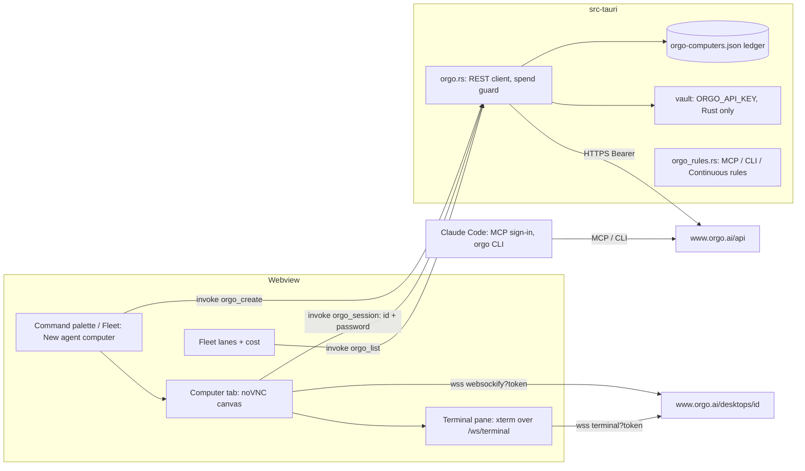
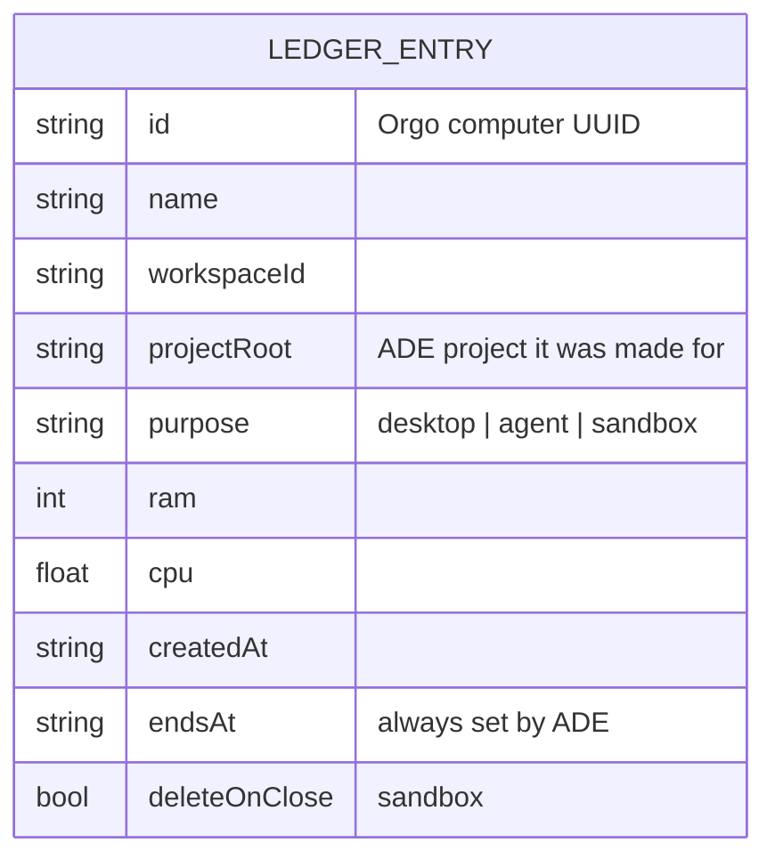
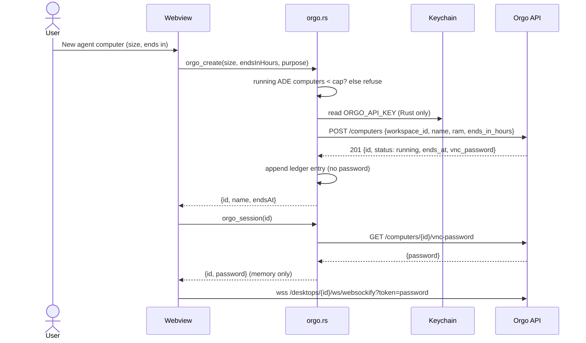

**Step 1** is three small stories, built in order, each buildable once this plan is approved:
- **Story 1:** Orgo's hosted MCP server in the MCP library, signed in through Claude Code, with `ask` rules that prompt before any computer is created, changed, stopped or deleted, in every permission mode.
- **Story 1b:** a hard stop for ADE's Continuous mode, as `--disallowedTools` on the launch line, which an agent cannot edit from inside its session.
- **Story 1c:** the Orgo CLI. ADE installs it, signs it in, tells agents how to use it, and keeps its risky commands behind `ask` rules.

**Stories 2 to 6** are step 2, the native panel. They are outlined only, because they need the owner's answers to the open questions at the end and a check of the unverified facts (U-list) with a real account.

All of Orgo's permission rules, for MCP, CLI and Continuous mode, are defined once, in `src-tauri/src/orgo_rules.rs`. Shared intent, decisions, security and cost come first.

<frozen-after-approval reason="human-owned intent — do not modify unless human renegotiates">

## Intent

**Problem:** An agent working in ADE has only the user's own machine. It cannot test the UI it just built in a clean desktop and browser. It cannot run Claude Code somewhere other than the user's laptop, fan work out across several machines, or run untrusted code away from the user's files and keys. Orgo rents cloud computers made for agents to drive. ADE has no way to reach them.

**Approach:** Orgo only.
1. **MCP:** Orgo's hosted MCP server (`https://www.orgo.ai/mcp`) in ADE's MCP library, signed in with the user's Orgo account through Claude Code's `/mcp`. Installing it adds Claude Code `ask` rules for every create, copy, resize, end change, start, stop and delete.
2. **Continuous hard stop:** when ADE launches Continuous mode, the tools and commands that create or start computers are denied on the command line, where the agent cannot edit the rules.
3. **CLI:** ADE offers to install the `orgo` CLI and sign it in, tells agents to read `orgo manifest` and use `--json`, and adds `ask` rules for its commands that create, start, delete, resize or clone computers, touch billing, API keys or secrets, print passwords, or open a shell. Read-only commands run freely.
4. **Native panel, later:** a click creates a computer and opens its live desktop in a tab. It adds lifecycle with a spend guard, a terminal that can run Claude Code remotely, and fleet lanes with cost.

## Owner's decisions (2026-10-29)

1. **Purposes, all four:** computer use (an agent drives a real desktop and browser, for example to test the UI it built); Claude Code running remotely from an ADE tab; a parallel fleet across several machines, shown in the fleet view with cost; a throwaway sandbox for untrusted code.
2. **Depth:** MCP first, then a native panel with the live desktop, lifecycle and cost.
3. **Provider:** Orgo only. No provider-neutral abstraction.
4. **(Q7) Story 1 uses Orgo's hosted MCP server**, with the user signing in through Claude Code's MCP OAuth flow. No API key in ADE's vault for Story 1, no npx package, no local server. The review found three reasons:
   - The local server puts each computer's root VNC password into model context and transcripts.
   - It exposes `orgo_get_vnc_password`, `orgo_enable_computer_ssh`, `orgo_apply_computer_secrets`, `orgo_move_computer` and workspace edits.
   - Orgo's sign-in list leaves these out "so a sign-in is never sent a computer's password" (https://docs.orgo.ai/guides/mcp).
5. **Orgo tools that create, copy, resize, extend, start, stop or delete a computer always ask**, in every mode, ADE's Continuous mode (`claude --dangerously-skip-permissions`, `src/lib/agentCommand.ts:50`) included.
6. **(Q5) Claude Code on a remote computer signs in with a dedicated, spend-limited Anthropic Console key** that the user makes for remote machines. ADE sends it only on an explicit, confirmed action and never copies the user's own Claude login (step 2, Story 4).
7. **(Q3) Not needed for Story 1.** The panel's key stays an open question for step 2.
8. **(Q8) Yes, Story 1b.** When ADE launches Continuous mode in a project whose `.mcp.json` has `orgo`, it passes `--disallowedTools` for the create, clone, fork, start, restart and resize tools. The same applies to the CLI, wherever Claude Code's tool-pattern syntax allows.
9. **(Q9) A dedicated ADE workspace in Orgo.** The sign-in uses it, and so do the CLI's key and step 2's key.
10. **The Orgo CLI: "install + guide, agent asks" (Story 1c).**
    - ADE offers to install it and run `orgo login`, and documents it for agents: `orgo manifest` and `--json`.
    - It adds project rules so agents must ask before any `orgo` command that creates, starts, deletes, resizes, clones or forks computers, touches billing, API keys or secrets, prints passwords (`vnc-password`), or opens a shell.
    - Read-only commands (list, whoami, manifest, show) run freely.
    - Story 1b's hard stop also blocks the creating commands under Continuous mode.
    - The CLI's own login is account-wide. Recommend a key scoped to the dedicated workspace, and say so in the guide.
    - Shape it so it can become the `orgo` entry of the parallel "CLI tools" library (`plan/cli-library-and-mcps`), which reuses this plan's rules rather than redefining them.

## Boundaries & Constraints (all stories)

**Always:**
- Orgo's own hosted MCP server, Orgo's own `orgo` CLI, and Orgo's documented REST and WebSocket endpoints for step 2. No third-party wrapper.
- Every Orgo permission rule ADE writes or passes comes from `src-tauri/src/orgo_rules.rs`. The webview cannot add one: it names an action, and Rust picks the rules.
- Every Orgo or Claude Code fact a story relies on is cited below. A fact marked unverified (U-list) is checked before the story that needs it is sharded.
- ADE edits `.claude/settings.json` only by merging. The user's keys and rules are kept, a file that is not valid JSON is left alone and the action is refused, and ADE never deletes a rule.
- The verification command is unchanged (see Verification).

**Never:**
- ADE never creates, starts or resizes an Orgo computer without the user's click. This holds for the native panel in every story. In the MCP and CLI paths, Claude Code runs the call, and these stories' rules make it ask first.
- ADE never sends `billing_mode: "hourly"`, never calls an Account, Clients, Billing or capacity-buying endpoint, never runs `orgo billing`, and never adds credit.
- ADE never copies the user's Claude Code credentials, `~/.claude`, `~/.orgo/credentials.json`, the keychain's Claude entry, SSH keys or any other vault secret to an Orgo computer. The one exception is decision 6.
- ADE never pipes a remote install script into a shell on the user's behalf.
- No change to `relay/` or `mobile/`. No provider abstraction.

## Security

- **No Orgo key in ADE for Story 1.** `.mcp.json` holds only `{"type": "http", "url": "https://www.orgo.ai/mcp"}`. Claude Code runs the OAuth sign-in in the browser and keeps the tokens. Orgo issues 1-hour access tokens with rotating refresh tokens.
- **What the MCP sign-in grants** ([Orgo MCP guide](https://docs.orgo.ai/guides/mcp)):
  - The grant covers one workspace, the dedicated ADE workspace (decision 9). In it, Claude Code can create and manage computers, screens and files, and read the workspace.
  - It sees only Orgo's reviewed tool list. Templates, Clients, Account, Chat, Support, workspace create/change/delete, suspend/resume, file upload, `orgo_get_vnc_password`, `orgo_apply_computer_secrets` and `orgo_move_computer` are left out.
  - It is never sent a computer's password.
  - On a paid account, it cannot launch hourly computers (`403 HOURLY_NEEDS_BILLING`).
  - To revoke: Orgo Settings → Security → Connected AI apps, or in Claude Code `/mcp` → Clear authentication, or `claude mcp logout orgo`.
- **What the CLI's login grants.** `orgo login` saves an **account-wide** credential to `~/.orgo/credentials.json`, and every CLI command can use it: billing top-up, key minting, secrets and every workspace. `ORGO_API_KEY` in the environment "skips `~/.orgo/credentials.json`" ([CLI](https://docs.orgo.ai/guides/cli)).
  - Recommended instead: a Custom key scoped to the dedicated workspace, saved in ADE's vault as `ORGO_API_KEY`. Its permissions are Computers write, Control write, Workspaces read, everything else none.
  - New ADE terminals then use that narrow key in place of any `orgo login`, and the server refuses billing, keys and secrets whatever command runs.
  - The vault puts the key in every new ADE terminal, as it does every secret. The narrow scope is what bounds that.
- **Always ask (decision 5), MCP.** Story 1 merges ten `ask` rules into the project's `.claude/settings.json`. They name `mcp__orgo__orgo_create_computer`, `…clone…`, `…fork…`, `…resize…`, `…update…` (the end), `…start…`, `…restart…`, `…stop…`, `…delete…` and `…enable_computer_ssh`. Claude Code's documentation backs this:
  - "Claude Code doesn't auto-approve the following in any mode, including `bypassPermissions` … Tools matched by an explicit ask rule" ([permission modes](https://code.claude.com/docs/en/permission-modes)).
  - Rules are evaluated deny, then ask, then allow ([permissions](https://code.claude.com/docs/en/permissions)).
  - A "Yes, and don't ask again" allow in `.claude/settings.local.json` "doesn't outrank an `ask` rule from a project or managed file", and `deny` and `ask` apply without workspace trust ([settings](https://code.claude.com/docs/en/settings)).
- **Always ask, CLI (Story 1c).** Bash `ask` rules cover the commands in decision 10, under both the full group names and their aliases (`c`, `ws`, `t`, `keys`, `rm`). They also cover any `orgo` command with a flag before its subcommand. Read-only commands get `allow` rules. Per Claude Code's docs, ask and deny rules match inside compound commands and subshells, and past any leading variable assignment.
- **The Continuous hard stop (Story 1b).** Continuous mode allows writes to `.claude/`, and Claude Code reloads settings mid-session, so a Continuous agent could delete the ask rules. Story 1b therefore passes the creating tools and commands as `--disallowedTools` deny rules on the launch line. That is outside any file, so the session cannot edit them, and "Deny rules block in every mode, including `bypassPermissions`". Stop, delete and the rest still ask through the settings rules, which a Continuous agent could still remove.
- **What these rules cannot stop, stated plainly:**
  - **Other invocations.** A Bash rule "isn't a security boundary around the program" ([permissions](https://code.claude.com/docs/en/permissions)). It does not match `npx orgo …`, `~/.orgo/bin/orgo …`, `node …/cli.js`, `sh -c 'orgo …'`, a quoted subcommand (`orgo c 'create'`), a shell alias or function, or `curl` to the REST API with a key the agent finds. The server-side limits of the narrow key are the boundary.
  - **Where Claude Code reads them.** It reads `.claude/settings.json` from the session's primary working directory (U8). The guide says to start Claude Code at the project root.
  - **Other agents.** Codex and other providers ADE launches do not read Claude Code's settings or flags. These rules bind Claude Code, and providers launched through `claude`, only.
  - **Actions on a computer.** Screenshot, mouse, keyboard, bash and Python on the remote computer prompt in Manual mode and run unprompted in Continuous mode, by design. Their effects stay on the remote computer.
  - **JSON listings (U12).** Whether `orgo computers list --json` prints `vnc_password` is unverified. The docs say workspace listings remove credential fields, while the review found the password there. Until U12 is settled, listing with `--json` asks. `ORGO_JSON=1 orgo c list` cannot be told apart from the text form, and runs unprompted in Continuous mode.
- **Prompt injection.** A web page shown on a computer is untrusted input that comes back as a screenshot.
  - It can steer the agent's actions on the computer, which are contained there, and lifecycle tools are asked or denied.
  - It can push the agent to type local data into the computer, or to act locally with local tools. Orgo's rules do not cover that, and in Continuous mode local tools run unprompted, as today.
  - The guide says: use a disposable computer, don't sign in to personal accounts on it, and don't run Continuous mode while the agent browses sites you don't trust.
- **Step 2's key (Q3).** The webview can read any vault value today through `vault_get(name)` (`src-tauri/src/vault.rs:137-140`, registered at `src-tauri/src/lib.rs:483`). Story 2 first limits `vault_get` to an allowlist, which today is just `DEEPSEEK_API_KEY` (`src/lib/anthropic.ts:176`).
- **The computer password is root on that machine.** No ADE path shows, logs or stores it. The CLI's `vnc-password` asks. The panel (step 2) fetches it in Rust per session, for the tab that uses it.

## Cost

- **What a computer costs** ([billing](https://docs.orgo.ai/guides/billing), [prices](https://docs.orgo.ai/guides/pricing)):
  - On a paid plan, a computer that fits the plan's remaining vCPU and RAM is included. Past that, it runs by the hour from credit, but only for a caller with Billing write, which is never an MCP sign-in or the narrow key.
  - On a free account, computers run by the hour from credit: $5 signup credit, Medium only.
  - Linux hourly runs $0.023/h (Small) to $0.202/h (XL), billed per second. A paid plan runs at most 50 computers.
  - GPU prices are unpublished (U11). ADE never creates GPU computers.
- **A computer costs money until it is deleted.** A stopped hourly computer still pays for its disk, from $0.0017/h. A computer whose end passes is stopped, then deleted 7 days later unless started. The CLI's `computers create` has no end option, so a CLI-made computer runs until stopped. The guide says to delete it when done.
- **The real spend limit is the Orgo plan or credit, not ADE.**
  - With the sign-in or the narrow key, a runaway agent on a paid plan can fill the capacity the user already pays for, up to 50 computers.
  - On a free account it can spend the credit, unless auto top-up is on, which charges the card up to 5 times in 24 hours. The guide says to leave it off.
  - `orgo billing topup` buys credit directly. It asks, it is denied in Continuous mode, and the narrow key refuses it server-side.
  - The ask rules put a prompt in front of every create. The hard stop removes creates from Continuous sessions. Neither is a cap.
- **The native panel adds ADE's own guard** (Story 2): a cap on running ADE-made computers, an end on every computer it creates, auto-stop when idle, and no hourly launches.

</frozen-after-approval>

## What Orgo offers (verified 2026-10-29 against the live docs)

The base URL is `https://www.orgo.ai/api`, and computers are addressed by UUID as `/computers/{id}/…`. A create takes `workspace_id`, and the older name `project_id` is still accepted. `/api/projects/{project}/computers/{name}/…` is not in the current spec.

| # | Fact | Source |
|---|---|---|
| F1 | REST auth is `Authorization: Bearer $ORGO_API_KEY`, with keys beginning `sk_live_`. Spec 2.0.0 has 86 operations. | https://docs.orgo.ai/llms.txt, https://docs.orgo.ai/api-reference/introduction |
| F2 | Hosted MCP: `https://www.orgo.ai/mcp`. Without a token it answers `401` with `WWW-Authenticate: Bearer resource_metadata=…/.well-known/oauth-protected-resource/mcp`. Its OAuth metadata publishes dynamic client registration, PKCE S256, public clients and revocation. Tools are `orgo_` + the operationId in snake_case, and a sign-in sees a reviewed subset. | https://docs.orgo.ai/guides/mcp; probed 2026-10-29 |
| F3 | Live spec groups: Workspaces 5, Computers 14, Computer Lifecycle 7, Computer Actions 10, Templates 15, Files 7, Screens 5, Account 3, Clients 15, Chat 1, Agent accounts 3, Support 1. | https://docs.orgo.ai/api-reference/openapi.json |
| F4 | Create: `POST /computers` with `workspace_id` and `name`. `os` defaults to `linux`; `ram` is 4 to 64; `billing_mode` is `plan` or `hourly`; `ends_in_hours` is 1 to 720; `template_ref` (for example `system/coding`, which runs `claude` and `codex`); `gpu` is `2q` or `4q`. | https://docs.orgo.ai/api-reference/computers/create |
| F5 | Lifecycle: stop archives the disk and reads `frozen`. Delete is permanent. An end stops the computer, which is deleted 7 days later unless started. Auto-stop (`auto_stop_minutes`) is off by default. | https://docs.orgo.ai/api-reference/computers/stop, https://docs.orgo.ai/guides/computer-ends, https://docs.orgo.ai/guides/instance-types |
| F6 | Billing: see Cost. | https://docs.orgo.ai/guides/billing, https://docs.orgo.ai/guides/pricing |
| F7 | Live desktop: `wss://www.orgo.ai/desktops/{id}/ws/websockify?token={vnc_password}`, noVNC ≥ 1.7.0, no origin allowlist. Close codes: `4001` bad credential, `4003` stopped or asleep, `4006` other workspace, `4007` MFA, `4008` idle 30 min. | https://docs.orgo.ai/guides/embed-vms |
| F8 | Terminal over `wss://…/ws/terminal?token=…&session=`, a full PTY. Direct SSH on Linux. | https://docs.orgo.ai/api-reference/computers/terminal, https://docs.orgo.ai/guides/ssh |
| F9 | Commands: `bash` and `exec`; files: upload (10 MB), export, download. | https://docs.orgo.ai/llms.txt |
| F10 | Keys: full or Custom, scoped to the account, one workspace or one computer. A workspace key cannot call billing, account or template endpoints. `403 computer_key_held`; template secrets need Secrets write. | https://docs.orgo.ai/api-reference/api-keys/permissions, …/computer-keys, https://docs.orgo.ai/guides/templates/secrets |
| F11 | Rate limits: "some endpoints" `429`; back off 1 s to 60 s. | https://docs.orgo.ai/api-reference/introduction |
| F12 | The `Computer` schema (with `vnc_password`) is the response of `createComputer`, `getComputer` and `resizeComputer`. The review found it in workspace listings too. | openapi.json |
| F13 | CLI install, sign-in and output: `npm install -g orgo` (Node ≥ 20) or `curl -fsSL https://orgo.ai/install.sh \| bash`. `orgo login` uses a device code and saves `~/.orgo/credentials.json` (0600); `ORGO_PROFILE` selects a profile. `ORGO_API_KEY` skips the credentials file. Every command takes `--json` and `--help`; `ORGO_JSON=1` forces JSON, and output is plain text with no prompts when stdout isn't a terminal. `orgo manifest` prints every command and option as JSON. | https://docs.orgo.ai/guides/cli |
| F14 | CLI 2.3.0 (npm `orgo`, repo `spencerkinney/orgo-cli`, commander 12), read from `dist/cli.js` without running it. | `npm pack orgo@2.3.0` |

**F14, the CLI's commands in detail:**
- **Global options:** `--json`, `--quiet`, `--profile <name>`. Commander accepts these before the subcommand.
- **Aliases:** `computers`=`c`, `workspaces`=`ws`, `templates`=`t`, `api-keys`=`keys`; `secrets delete` and `files delete` = `rm`.
- **`computers`:** `list create delete start stop restart resize bash exec clone rename wait vnc-password screenshot view ssh`. `create` has no end or billing option.
- **`workspaces`:** `list create use current rename delete`.
- **`templates`:** `list show run delete validate publish build schema`.
- **`billing`:** `balance topup history portal`, where `topup` buys $10 to $100.
- **`api-keys`:** `list create delete`.
- **Commands not in the docs:** `clone` (scan, data, inject, install and watch, which send a plugged-in iPhone's apps and data to an Orgo iPhone), `handoff` (start, status, cancel: give a computer an agent job), and `egress` (status, residential, custom, off, devices, pair: route a computer's traffic through a proxy or a paired machine).

**Claude Code facts this plan relies on (verified 2026-10-29):**
- **Remote MCP servers.** A remote server is `{"type": "http", "url": "…"}`. OAuth fields are needed only for servers without automatic setup, sign-in is `/mcp`, and "Clear authentication" revokes it locally ([MCP](https://code.claude.com/docs/en/mcp)).
- **Rule names and wildcards** ([permissions](https://code.claude.com/docs/en/permissions)):
  - MCP rule names are `mcp__<server>__<tool>`. Ask and deny rules take globs in the tool-name position.
  - A deny or ask name that matches no tool warns at startup, but "Tool names containing `_` or `*` are exempt from the check", which covers every `mcp__orgo__…` rule.
- **Bash patterns** ([permissions](https://code.claude.com/docs/en/permissions), "Wildcard patterns", "Wrappers", "What a Bash rule doesn't match"):
  - "A `*` can go anywhere in the rule". A trailing ` *` that is the rule's only wildcard "also matches the bare command".
  - `:*` is equivalent to a trailing ` *` and recognised only at the end.
  - Deny and ask rules apply to any subcommand of a compound command, subshell or substitution.
  - Claude Code strips the wrappers `timeout`, `time`, `nice`, `nohup` and `stdbuf`, the builtins `command` and `builtin`, and bare `xargs`. `npx` is not stripped.
  - "A deny or ask rule matches past any leading assignment". An allow rule matches only past known-safe ones.
  - Allow rules with a `*` before the subcommand warn at startup.
- **Modes.** Explicit ask rules prompt even in `bypassPermissions`, and deny rules block in every mode. Bypass allows writes to `.claude/`, and settings edits reach a running session ([permission modes](https://code.claude.com/docs/en/permission-modes), [settings](https://code.claude.com/docs/en/settings)).
- **`--disallowedTools` / `--disallowed-tools`** takes deny rules as separate arguments, for example `"Bash(git log *)" "Edit"`. A bare tool name removes the tool from Claude's context, and a scoped `Bash(…)` rule denies matching calls ([CLI reference](https://code.claude.com/docs/en/cli-reference)). It takes a list, so ADE must put another flag after it, or the positional task would be read as a rule.
- **ADE already supports remote sign-in servers** (`src/data/mcpCatalog.ts:44-49`, `IntegrationsPanel.tsx:83,183`). Only `AgentPicker` launches Continuous mode, through `prepareAgentLaunch` (`src/lib/agentLaunch.ts:21`) and `buildLaunchCommand`. `runInNewTab(name, cwd, command)` (`src/lib/terminalCommands.ts:21`) opens a terminal and runs a command.

**Unverified, to check before the story that needs it:**
- **U1.** How `GET /computers/{id}` tells plan from hourly (Story 5).
- **U2.** Whether an MCP sign-in or a Custom key without Billing write can create on a free account (guide wording, Story 2).
- **U3.** What a sleeping (`suspended`) computer is billed (Story 3).
- **U4.** How auto-stop is set, and whether it suspends or stops (Story 3).
- **U5.** Real rate limits (Story 2).
- **U6.** Whether WKWebView and WebKitGTK open `wss://www.orgo.ai` once the CSP allows it (Story 2 spike).
- **U7.** Whether `GET /workspaces/{id}` lists every computer (Story 3).
- **U8.** Whether Claude Code started in a subfolder loads the root `.mcp.json` but not the root `.claude/settings.json` (Story 1 and 1c manual checks).
- **U9.** The hosted server's exact tool names, which come from the documented naming rule, and whether clone, fork and enable-SSH are in the sign-in list (Story 1 manual check). The "matches no tool" warning is settled: names with `_` are exempt.
- **U10.** The key check's error codes, `key_permission` vs `workspace_scope_mismatch` (Story 2).
- **U11.** GPU prices (Story 5).
- **U12.** Whether `orgo computers list` / `orgo workspaces list`, as text or `--json`, print `vnc_password`. The CLI passes the API's computer records through unchanged (`{...d}`), and the docs and the review disagree on whether the API strips the field (Story 1c manual check; the rules ask on `--json` listings until settled).

**Rejected: Orgo's local server, `orgo-mcp-server`.**
- It needs an API key in the vault.
- It returns `vnc_password` into model context (F12).
- It registers the password, SSH, secrets, move and workspace tools.
- Pinning would not fix the surface: its dependencies float, and it loads the spec and base URL at runtime.

**Third-party servers** (`nickvasilescu/orgo-mcp`, `spencerkinney/computer-use-mcp`, Composio): not chosen. Orgo's hosted server is first-party.

## How the pieces coexist

- **Three credentials.**
  - Claude Code's MCP sign-in, for agents' MCP tools.
  - The CLI's credential: ideally `ORGO_API_KEY`, the narrow workspace key from ADE's vault, which overrides any `orgo login`.
  - Step 2's panel key, the same `ORGO_API_KEY`, read in Rust (Q3).

  All three reach the one dedicated ADE workspace (decision 9). Computers made by any of them show in the panel, with the ones ADE did not make marked "made elsewhere" (Story 3). Revoking one leaves the others working.
- **One rule source.** `src-tauri/src/orgo_rules.rs` holds `MCP_ASK`, `CLI_ASK`, `CLI_ALLOW`, `CONTINUOUS_DENY_MCP` and `CONTINUOUS_DENY_CLI`, together with the merge into `.claude/settings.json`. The MCP library (Story 1), the Continuous launch (1b), the CLI setup (1c) and the parallel "CLI tools" library's `orgo` entry all read from it.
- **The parallel CLI library (`plan/cli-library-and-mcps`)**, whichever lands first:
  - **If Story 1c lands first:** the library adopts its `orgo` entry (detect, install, sign in, agent doc) and calls `orgo_rules` for the rules.
  - **If the library lands first:** Story 1c becomes that library's `orgo` entry, in the library's data shape, keeping `orgo_rules.rs` and its tests.

  Either way, the rules are defined here once. The library plan should name this dependency and must not copy the rule lists. `.ade/context/orgo-permission-rules.md` is the shared contract.

## Proposed ADR 0010 (written on approval)

`.ade/context/decisions/0010-agent-computers-are-orgo-only-and-made-on-click.md`. The next free number is 0010, because 0008 and 0009 are each used twice in history.
- **Decision:**
  - Orgo is the only provider. Agents reach it through its hosted MCP server and its CLI, both behind Claude Code rules from one Rust module.
  - Creation is asked in every mode, and denied on the command line in Continuous mode.
  - In the native panel, only a click creates, starts or resizes a computer, with an end and under ADE's cap.
  - ADE never chooses hourly billing, never runs billing commands, and ships no credential except a dedicated key on a confirmed click.
  - ADE never sends the panel's key to the webview, and Story 2 limits `vault_get` to an allowlist.
- **Consequences:**
  - A second provider is new work.
  - The agent paths' spend limit is the user's Orgo plan or credit, behind a prompt, plus the narrow key's server-side refusals.
  - Bash rules are not a boundary around the program. The key's scope is.

---

# Story 1: Orgo's MCP server in the library, always asking

## Code Map (1)

- `src/data/mcpCatalog.ts`: `McpEntry` (:18-31), `MCP_CATALOG` (:33). The "Web & browser" entries are playwright and fetch (:108-125). Sentry (:44-49) is the precedent for an http sign-in server.
- `src/components/IntegrationsPanel.tsx`: the card (:178-209), the "Sign in" tag (:183), `install` (:73-90) and the sign-in notice (:83).
- `src-tauri/src/mcp.rs`: `mcp_install` (:44) and `mcp_remove` (:63); tests from :74.
- `src-tauri/src/usage.rs`: `settings_path` (:544), `merge_deny` (:651), `load_settings` (:718) and `save_settings` (:725), the existing merge-safe settings writer. Tested by `deny_rules_merge_into_settings` (:1377) and `deny_refuses_other_rules_and_bad_json` (:1463).
- **New:** `src-tauri/src/orgo_rules.rs`.
- `docs/guide/integrations.md`: the table (:13-19) and the sign-in bullet (:25). `README.md:46`.

## Design Notes (1)

**The catalog entry**, after `fetch` in "Web & browser":

```ts
{
  id: "orgo",
  name: "Orgo",
  category: "Web & browser",
  description: "Cloud computers with a desktop, browser and shell that the agent can start, see, drive and run commands on.",
  server: { type: "http", url: "https://www.orgo.ai/mcp" },
  oauth: true,
  caution: "Signing in lets Claude Code create, drive and delete computers in the Orgo workspace you choose. They cost money until deleted, and what their screens show can try to steer the agent. Claude Code will ask before any computer is created, changed, stopped or deleted, even in Continuous mode.",
  docs: "https://docs.orgo.ai/guides/mcp",
}
```

- **What it writes.** Install writes `{"type": "http", "url": "https://www.orgo.ai/mcp"}` under `mcpServers.orgo`, with no headers, env or OAuth fields, so the tools are `mcp__orgo__<tool>`.
- **`caution`** is a new optional `McpEntry` field, rendered under the description as `<p className="mcp-caution" role="note">` in the amber of `.mcp-tag[data-warn]`. It is not searched.
- **Search.** The description has no "click", so `"browser click"` still finds only Playwright, and "Cloud computers" makes `"cloud computer"` find Orgo.

**`src-tauri/src/orgo_rules.rs`** (Story 1 creates it):

```rust
/// Orgo MCP tools that create, copy, resize, re-time, start, stop or delete a
/// computer, or open SSH: Claude Code asks before each call, in every mode.
pub const MCP_ASK: &[&str] = &[
    "mcp__orgo__orgo_create_computer",
    "mcp__orgo__orgo_clone_computer",
    "mcp__orgo__orgo_fork_computer",
    "mcp__orgo__orgo_resize_computer",
    "mcp__orgo__orgo_update_computer",   // PATCH /computers/{id}: sets or moves the end
    "mcp__orgo__orgo_start_computer",
    "mcp__orgo__orgo_restart_computer",
    "mcp__orgo__orgo_stop_computer",
    "mcp__orgo__orgo_delete_computer",
    "mcp__orgo__orgo_enable_computer_ssh",
];

/// Merge `rules` into `permissions.<list>` of `<root>/.claude/settings.json`,
/// keeping every other key and rule in order. Refuses, writing nothing, when the
/// file isn't valid JSON or has the wrong shape. Returns the rules it added.
pub fn merge_rules(root: &Path, list: &str /* "ask" | "allow" | "deny" */, rules: &[&str]) -> Result<Vec<String>, String>;
```

- **One writer.** `usage.rs`'s `merge_deny` becomes a call to `orgo_rules::merge_rules(root, "deny", …)`, so ADE has one settings writer. Its behaviour and tests are unchanged. The function could move to a neutral `claude_settings.rs` instead; the developer picks the module and records it in the contract.
- **Names.** They are derived from the live spec's operationIds by Orgo's documented rule. A signed-in listing is the manual check (U9).
- **Why exact names.** `mcp__orgo__*` would ask on every screenshot and click. A verb glob would also catch `orgo_get_computer`, which agents poll.

**Install, in order** (`mcp_install`, for `name == "orgo"`):
1. Read `.mcp.json` and `.claude/settings.json`. If either is invalid or the wrong shape, refuse and write nothing.
2. Run `merge_rules(root, "ask", MCP_ASK)`.
3. Write `.mcp.json`.

The server is never installed without its rules. If step 3 fails, the rules stay, which is the safe direction. `mcp_install` returns the rules it added (`Vec<String>`, empty for other servers), and the notice uses them.

**Remove** takes Orgo out of `.mcp.json` and leaves the rules. ADE never deletes a rule, because it can't tell its own from the user's identical one.

**Notice after install:** "Orgo added to .mcp.json. Claude Code will ask before Orgo creates, changes, stops or deletes a computer (rules added to .claude/settings.json). Start Claude Code at the project root and run /mcp to sign in."

**Guide** (`docs/guide/integrations.md`): add Orgo to the "Web & browser" row and a `## Orgo cloud computers` section. Story 1 writes its first part:
- what it does;
- signing in to the dedicated ADE workspace, at the project root, with `/mcp`;
- what the sign-in allows, and how to revoke it;
- always asks, naming the ten tools, and that it holds in Continuous mode;
- cost: billed until deleted, stopped hourly computers still pay for disk, the plan or credit is the limit, set an end, delete when done, leave auto top-up off;
- prompt injection.

**README:** "16 curated MCP servers".

**Contract:** Story 1 creates `.ade/context/orgo-permission-rules.md`: the module, the lists, where each is written or passed, that ADE never deletes a rule, and that the CLI library reuses them. Stories 1b and 1c extend it.

**Failure modes:**
- **Bad settings file:** install is refused, with the file named, and nothing changes.
- **Not signed in:** `/mcp` shows it, and the notice says to sign in.
- **Session in a subfolder:** the rules may not apply (U8). The guide and the notice say to start at the project root.
- **A Continuous agent deletes the rules:** creates stay denied by Story 1b. Stop, delete and the rest lose their prompt, which the guide states.

## Acceptance Criteria (1)

Each names its test. The developer writes it failing first. AC10 is a regression check.

1. Rendering `IntegrationsPanel` with `vault_list` empty: the Orgo card shows "Sign in" and its caution as a `role="note"`, with no secret row, no "Add to vault" and no `npx` tag. Covered by `src/components/__tests__/IntegrationsPanel.test.tsx` (new) › "the Orgo card is a sign-in server with its caution".
2. Install sends `mcp_install` with `name: "orgo"` and a server whose keys are exactly `type` "http" and `url` "https://www.orgo.ai/mcp". With the rules returned, the notice says Claude Code will ask, to start at the project root, and to run `/mcp`. Covered by `IntegrationsPanel.test.tsx` › "installing Orgo writes the hosted server and says how to sign in".
3. Every `oauth: true` entry has no `secrets`, empty `envRefs`, and an `https:` URL. Covered by `src/data/__tests__/mcpCatalog.test.ts` › "sign-in servers carry no secret and use https".
4. `"cloud computer"` finds `["orgo"]`, and `"browser click"` still finds `["playwright"]`. Covered by `mcpCatalog.test.ts` › "searches name, category and description" (extended).
5. Installing `orgo` with no settings file creates `.claude/settings.json` with only `permissions.ask` = `MCP_ASK`, writes the server, and returns the ten rules. Covered by `src-tauri/src/mcp.rs` › `orgo_install_adds_ask_rules`.
6. An existing settings file holds `model`, `hooks`, `env`, user allow and deny rules, a user ask rule, and one rule equal to an Orgo rule. After install:
   - all other keys and rules are unchanged and in order;
   - each Orgo rule appears once;
   - nine are returned;
   - a second install leaves the file byte-identical and returns nothing.

   Covered by `src-tauri/src/orgo_rules.rs` › `merge_keeps_the_users_rules_and_is_idempotent`.
7. A settings file holding `{ not json`, or a string `permissions.ask`, refuses the install, and both files stay byte-identical. An invalid `.mcp.json` refuses it, and no settings file is created. Covered by `mcp.rs` › `orgo_install_refuses_and_touches_nothing_on_bad_files`.
8. Installing `github` writes no settings file. Removing `orgo` keeps every ask rule. Covered by `mcp.rs` › `only_orgo_adds_rules_and_remove_keeps_them`.
9. `MCP_ASK` equals `mcp__orgo__orgo_` + snake_case(operationId) for exactly `createComputer`, `cloneComputer`, `forkComputer`, `resizeComputer`, `updateComputer`, `startComputer`, `restartComputer`, `stopComputer`, `deleteComputer` and `enableComputerSsh`. Covered by `orgo_rules.rs` › `mcp_rules_follow_orgos_tool_names`.
10. The deny callers behave as before. Covered by `usage.rs` › existing `deny_rules_merge_into_settings` and `deny_refuses_other_rules_and_bad_json` (green, unchanged).
11. The guide's MCP table lists exactly the catalog's servers, by set equality after removing parenthesised text and splitting on commas, so "Git" ≠ "GitHub". Covered by `scripts/mcpCatalogDocs.test.ts` (new) › "the guide's table lists exactly the catalog".
12. The Orgo guide section names every `MCP_ASK` tool (read from `orgo_rules.rs`), and mentions "Continuous", "/mcp", "until you delete" and "auto top-up". The README count equals `MCP_CATALOG.length`. Covered by `mcpCatalogDocs.test.ts` › "the Orgo section matches the rules ADE writes", "the README count matches the catalog".

## Verification (1)

**Commands:** the repo's verification command, unchanged (see Verification, all stories). The new tests are in `IntegrationsPanel.test.tsx`, `mcpCatalogDocs.test.ts`, `mcpCatalog.test.ts`, `mcp.rs` and `orgo_rules.rs`, and the `usage.rs` deny tests stay green.

**Manual checks (owner, with a real Orgo account):**
- **U9.** Sign in through `/mcp` to the ADE workspace. No `orgo_get_vnc_password` appears. Compare the tool names with `MCP_ASK`.
- **Manual mode.** A create prompts. "Yes, and don't ask again" still prompts next time.
- **Continuous mode, before Story 1b.** A create still prompts (the ask rule), and so does a delete.
- **U8.** In a subfolder, note whether the tools load and whether a create prompts.
- **Clean-up.** Delete every computer, check the dashboard is empty, and revoke the sign-in.

## Slice (1)

`src/data/mcpCatalog.ts` and its test; `src/components/IntegrationsPanel.tsx` and its new test; `src/index.css`; `src-tauri/src/orgo_rules.rs` (new) and its registration in `lib.rs`; `src-tauri/src/mcp.rs`; `src-tauri/src/usage.rs` (calls the shared merge, no behaviour change); `scripts/mcpCatalogDocs.test.ts`; `docs/guide/integrations.md`; `README.md`; `.ade/context/orgo-permission-rules.md`. No new dependency.

---

# Story 1b: the Continuous-mode hard stop

Depends on Story 1 (`orgo_rules.rs`).

## Code Map (1b)

- `src/lib/agentCommand.ts`: `LaunchOptions` (:5), `claudeCommand` (:49-53). Today it builds `claude --dangerously-skip-permissions --append-system-prompt-file <path> [task]`. The deepseek provider uses the same function.
- `src/lib/agentLaunch.ts:21`: `prepareAgentLaunch(spec, cwd, opts)`, async, called by `AgentPicker.tsx:151`.
- `src-tauri/src/orgo_rules.rs`: gains the deny lists and a command.

## Design Notes (1b)

**The lists** in `orgo_rules.rs`:
- `CONTINUOUS_DENY_MCP`: `mcp__orgo__orgo_create_computer`, `…clone…`, `…fork…`, `…start…`, `…restart…`, `…resize…`. These are bare tool names, so Claude Code removes the tools from the session entirely.
- `CONTINUOUS_DENY_CLI`, Bash patterns in Claude Code's documented syntax:
  - `Bash(orgo -*)`: any `orgo` command with a global flag before the subcommand. Agents are told to put flags after it.
  - `Bash(orgo computers -*)`, `Bash(orgo c -*)`, `Bash(orgo templates -*)`, `Bash(orgo t -*)`, `Bash(orgo billing -*)`: flags between group and subcommand.
  - For `G` in `computers`, `c` and `S` in `create`, `start`, `restart`, `resize`, `clone`: `Bash(orgo G S *)`.
  - `Bash(orgo templates run *)`, `Bash(orgo t run *)`: launch from a template.
  - `Bash(orgo billing topup *)`: buy credit. This is a recommended addition to the owner's list (see Q10).

**The command.** `orgo_continuous_denies(project) -> Vec<String>` returns:
- `CONTINUOUS_DENY_MCP` when `<project>/.mcp.json` has an `orgo` server, as decision 8 says;
- **always** `CONTINUOUS_DENY_CLI`. The CLI can be installed in the middle of a session, which a launch-time check cannot see. A Bash rule that matches nothing is silent, so this costs nothing in projects that never use Orgo.

**The launch.** `prepareAgentLaunch` calls it when `continuous` is set, and passes the result as `LaunchOptions.disallowedTools`. `claudeCommand` then writes:

```
claude --dangerously-skip-permissions --disallowedTools '<rule>' '<rule>' … --append-system-prompt-file <path> [task]
```

- Each rule is quoted with `shellQuote` (`src/lib/agentCommand.ts:26`), the same quoter the task uses.
- `--disallowedTools` takes a list, so it sits **before** `--append-system-prompt-file`. That flag ends the list, and the task stays positional.
- Without `continuous`, nothing is added.
- Providers that are not launched through `claude` (Codex, Ollama) are unchanged, and the guide says these rules do not bind them.

**What it leaves to the ask rules:** stop, delete, `update` (end), enable SSH, and the CLI's other risky commands still ask under Continuous mode through Story 1's and 1c's settings rules. An agent that rewrites `.claude/settings.json` can remove those, but not these.

## Acceptance Criteria (1b)

1. `buildLaunchCommand("claude", path, { continuous: true, disallowedTools: ["mcp__orgo__orgo_create_computer", "Bash(orgo c create *)"], task: "go" })` puts `--disallowedTools` and the two shell-quoted rules after `--dangerously-skip-permissions`, then `--append-system-prompt-file`, then the task. Without `continuous`, or with an empty list, there is no `--disallowedTools`. Covered by `src/lib/__tests__/agentCommand.test.ts` › "continuous launches deny Orgo creation before the role flag".
2. `orgo_continuous_denies` on a project whose `.mcp.json` has `orgo` returns MCP and CLI denies. Without it, it returns only the CLI denies. With an invalid `.mcp.json`, it returns the CLI denies and no error. Covered by `orgo_rules.rs` › `continuous_denies_follow_the_project`.
3. Every command in the creating corpus is matched by a `CONTINUOUS_DENY_CLI` rule under Claude Code's documented semantics, and `orgo c delete a` and `orgo c list --json` are not. The corpus is `orgo c create --name a`, `orgo computers start a`, `orgo --json c create`, `orgo c --json resize a --ram 8`, `orgo t run hermes-agent`, `ORGO_PROFILE=x orgo c clone a` and `orgo billing topup --amount 10`. Covered by `orgo_rules.rs` › `continuous_cli_denies_cover_creation` (uses the test matcher described in 1c).
4. Launching from `AgentPicker` with Continuous on invokes `orgo_continuous_denies` with the project root and types a command containing `--disallowedTools`. With Continuous off, there is no such call. Covered by `src/components/__tests__/agentLaunch.test.ts` (extended) › "continuous launch carries Orgo denies".

**Manual checks:** in a Continuous session in a project with Orgo installed, `orgo_create_computer` is absent from the tools, `orgo c create` is refused, and `orgo_delete_computer` still prompts.

**Slice (1b):** `src/lib/agentCommand.ts`, `src/lib/agentLaunch.ts`, their tests, `src-tauri/src/orgo_rules.rs`, `lib.rs` registration, the context file, and a paragraph in the guide's Orgo section.

---

# Story 1c: the Orgo CLI, installed, guided, and asking

Depends on Story 1 (`orgo_rules.rs`, `merge_rules`). Story 1b supplies its Continuous denies. Coordinate with `plan/cli-library-and-mcps` (see "How the pieces coexist").

## Design Notes (1c)

**Where in the UI.** An "Orgo CLI" row under the Orgo card in the MCP library. It moves to the CLI library's `orgo` entry when that exists. The row shows:
- whether `orgo` is on PATH, via the existing `check_command_exists`;
- whether `ORGO_API_KEY` is in the vault;
- three actions:
  - **Set up CLI.** A confirm lists what happens, then `orgo_cli_setup(project)`:
    1. merges `CLI_ASK` into `permissions.ask` and `CLI_ALLOW` into `permissions.allow`, through `merge_rules`, with the same refusal rules as Story 1;
    2. writes `.claude/skills/orgo-cli/SKILL.md` only if it is missing.

    Then, if `npm` is on PATH, `runInNewTab("Orgo CLI", root, "npm install -g orgo")`. Otherwise the row shows the install-script line for the user to copy. ADE does not pipe it into a shell.
  - **Sign in** runs `runInNewTab("Orgo login", root, "orgo login")`. The device code appears there.
  - **Use a workspace key (recommended)** opens the vault with `ORGO_API_KEY` pre-filled and the key steps from the guide.

**The rule lists**, generated in `orgo_rules.rs` from one small table:

```rust
const ALIASES: &[(&str, &[&str])] = &[
    ("computers", &["computers", "c"]), ("workspaces", &["workspaces", "ws"]),
    ("templates", &["templates", "t"]), ("files", &["files"]),
];
const ASK_SUBS: &[(&str, &[&str])] = &[
    ("computers", &["create", "start", "restart", "resize", "clone", "stop", "delete", "vnc-password", "ssh"]),
    ("workspaces", &["create", "delete"]),          // delete removes its computers
    ("templates", &["run", "delete"]),              // run creates a computer
    ("files", &["upload"]),                         // sends a local file to Orgo (Q10)
];
const ASK_WHOLE: &[&str] = &["billing", "api-keys", "keys", "secrets", "ssh",
    // Q10, recommended: they spend credit, route traffic or send local data
    "run", "agent", "resume", "handoff", "egress", "clone", "login", "logout"];
```

- **`CLI_ASK`**:
  - `Bash(orgo A S *)` for every alias `A` of a group and every `S` in its `ASK_SUBS`. With a trailing ` *` as the only wildcard, this also matches the bare command.
  - `Bash(orgo W *)` for every `W` in `ASK_WHOLE`.
  - `Bash(orgo -*)`: a global flag before the subcommand (`--json`, `--quiet`, `--profile`).
  - `Bash(orgo A -*)` for every alias of computers, workspaces, templates and files: a flag before the subcommand.
  - Until U12 is settled: `Bash(orgo computers list *--json*)`, `Bash(orgo c list *--json*)`, `Bash(orgo workspaces list *--json*)`, `Bash(orgo ws list *--json*)`.

  This comes to 52 rules.
- **`CLI_ALLOW`**, the read-only commands, subcommand first, about 18 rules:
  - `Bash(orgo)`, `Bash(orgo whoami *)`, `Bash(orgo manifest *)`, `Bash(orgo help *)`, `Bash(orgo sessions *)`;
  - `Bash(orgo A list *)` for computers, workspaces, templates and files;
  - `Bash(orgo A current *)` for workspaces;
  - `Bash(orgo A show *)` and `Bash(orgo A schema *)` for templates.
  - Allow rules in a committed file wait for workspace trust ([settings](https://code.claude.com/docs/en/settings)). Until then, these commands prompt in Manual mode, which is the safe direction.
- **Precedence.** Ask beats allow, so `orgo c list --json` asks (U12) while `orgo c list` runs freely.
- **What can't be matched reliably** (the guide lists it):
  - `npx orgo …`, `~/.orgo/bin/orgo …`, `node …/dist/cli.js …`, `sh -c '…'`, `bash -c '…'`, `eval`, shell aliases and functions, and quoted subcommands (`orgo c 'create'`);
  - `xargs` with flags;
  - `ORGO_JSON=1 orgo c list`: allow rules don't match past that assignment, so it prompts in Manual mode and runs in Continuous mode;
  - commands added in a later CLI version, until the table is updated;
  - an agent reading `~/.orgo/credentials.json` and calling the REST API with `curl`.

  For all of these, the server-side limits of the narrow workspace key are the real boundary.
- **Over-matching** is in the safe direction: a computer named `create` makes `orgo c bash create …` ask. Commander does not expand abbreviated subcommands, so there are no other spellings to cover.

**The agent skill**, `.claude/skills/orgo-cli/SKILL.md`, written only if missing. Its `description` triggers on Orgo, cloud computer and `orgo` CLI. Its body says:
- run `orgo manifest` first, and work from it;
- put `--json` **after** the subcommand (`orgo computers list --json`), because a flag before the subcommand always asks;
- work in the ADE workspace (`--workspace <name>`);
- never run `orgo computers vnc-password`, `orgo billing`, `orgo api-keys` or `orgo secrets` unless the user asks;
- `computers create` has no end, so delete computers when done (`orgo computers delete <name> --yes`), or set an end through the MCP server's `orgo_update_computer`;
- a prompt will appear for creating, starting, deleting, resizing and cloning, by design.

In the CLI library, this skill becomes the entry's "tell agents" text.

**Guide:** the Orgo section gains "Orgo CLI". It covers install, sign-in, why to prefer a workspace key over `orgo login` (the login is account-wide, and `ORGO_API_KEY` overrides it in ADE terminals), what asks, what runs freely, the Continuous hard stop, and the list of what can't be matched.

## Acceptance Criteria (1c)

The tests use a matcher, `fn rule_matches(rule, cmd)` in `orgo_rules.rs` tests. It implements the documented semantics: literal text with `*` matching any text; a trailing ` *` that is the only wildcard also matches the bare command; `:*` at the end equals ` *`; and ask and deny rules match after leading `NAME=value` assignments and the stripped wrappers are removed.

1. Every command in the risky corpus is matched by some `CLI_ASK` rule. The corpus covers each `ASK_SUBS` and `ASK_WHOLE` entry under each alias, with a global flag first (`orgo --json c create`), a flag between (`orgo c --json resize a`), an env prefix (`ORGO_PROFILE=dev orgo c delete a`), `timeout 30 orgo ssh a`, and `orgo c list --json`. Covered by `orgo_rules.rs` › `cli_ask_covers_every_risky_command`.
2. Every command in the read-only corpus is matched by a `CLI_ALLOW` rule and by no `CLI_ASK` rule: `orgo`, `orgo whoami`, `orgo manifest`, `orgo computers list`, `orgo c list --workspace ade`, `orgo ws current`, `orgo templates show hermes-agent`, `orgo t list --json`, `orgo files list` and `orgo sessions`. Covered by `cli_read_only_runs_freely`.
3. The documented-limit corpus is matched by no rule, so the guide's "can't be matched" list stays true: `npx orgo c create`, `~/.orgo/bin/orgo c create`, `sh -c 'orgo c create'` and `orgo c 'create'`. Covered by `cli_limits_are_what_the_guide_says`.
4. `orgo_cli_setup` merges `CLI_ASK` and `CLI_ALLOW` into an existing settings file, keeping the user's keys and rules in order, and is idempotent. A bad file refuses it, and nothing is written. Covered by `orgo_cli_setup_merges_and_refuses_bad_files`.
5. `orgo_cli_setup` writes the skill when it is missing and leaves an existing one byte-identical. The written skill contains `orgo manifest`, `--json` after a subcommand, and `delete`. Covered by `orgo_cli_setup_writes_the_skill_once`.
6. In the panel, the Orgo CLI row shows "not installed" when `check_command_exists("orgo")` fails. **Set up CLI** invokes `orgo_cli_setup` and then opens a tab running exactly `npm install -g orgo`. **Sign in** opens a tab running `orgo login`. Without `npm`, no tab opens and the install-script line is shown. Covered by `IntegrationsPanel.test.tsx` › "the Orgo CLI row installs, signs in and never pipes a script".
7. The guide's "Orgo CLI" section names every `ASK_WHOLE` entry and every `ASK_SUBS` subcommand (read from `orgo_rules.rs`), names each limit from AC3, and recommends a key scoped to one workspace. Covered by `mcpCatalogDocs.test.ts` › "the CLI section matches the rules".

**Manual checks (owner):**
- Install, then sign in with a workspace key in the vault. `orgo whoami` names the ADE workspace.
- `orgo computers list` runs freely; `orgo c create --name t` prompts; `orgo computers vnc-password t` prompts; `orgo billing balance` prompts.
- **U12:** run `orgo computers list --json` and `orgo workspaces list --json` once by hand, and check for `vnc_password`.
- In Continuous mode, `orgo c create` is refused (1b) and `orgo c delete t --yes` prompts.

**Slice (1c):** `src-tauri/src/orgo_rules.rs` (CLI lists, `orgo_cli_setup`, the skill text), `lib.rs`, `src/components/IntegrationsPanel.tsx` and its test, `scripts/mcpCatalogDocs.test.ts`, `docs/guide/integrations.md`, and the context file. No new dependency.

---

# Step 2: the native panel (outline; not ready to shard)

## Shape



- **`src-tauri/src/orgo.rs`** is the only ADE code that calls the REST API. It reads `ORGO_API_KEY` (Q3) through an internal `vault` function, after Story 2 limits `vault_get` to an allowlist. It needs an HTTP client crate (`reqwest` with rustls, or `ureq`).
- **The ledger**, `orgo-computers.json` in app data, holds only ADE-made computers. It is not synced and stores no passwords.



- **The spend guard** lives in `orgo_create`, the only create path. It refuses at the cap, always sends `ends_in_hours`, and never sends `billing_mode` or `gpu`. Then it sets auto-stop (U4).
- **The live view:** noVNC (`@novnc/novnc` 1.7.0, MPL-2.0) in a `"computer"` tab. `connect-src` gains exactly `wss://www.orgo.ai`, and both `scripts/csp.test.ts` and `scripts/browserTabCsp.test.ts` are updated: that host, no `wss:` or `ws:` wildcard, and the existing assertions still hold.



## Stories (outline)

**Story 2: New agent computer, with its live desktop in a tab.** Purpose 1.
- First, a `vault_get` allowlist, with a test that `vault_get("ORGO_API_KEY")` is refused.
- The sheet offers size (Small, Medium or Large; no GPU), ends in (Q1) and the ADE workspace.
- Close codes:
  - `4003`: Start, as a click.
  - `4008`: reconnect on input.
  - `4001`: refetch the password once.
  - `4006`: "key is for another workspace".
  - `4007`: "finish MFA in the browser".
- The key check calls `GET /account/capacity` and branches on `code` (U10). It warns on an account-wide key and does not refuse.
- It depends on F4, F5, F7, F10, U4, U5, U6 and U10, and needs Q1 to Q4. It adds `orgo.rs`, the ledger, the CSP change with both tests, the tab type, `@novnc/novnc`, ADR 0010 and `.ade/context/orgo-computers.md`.

**Story 3: Lifecycle, with stop, start, delete and auto-stop.**
- Stop, Start (a click) and Delete (a confirm saying the disk is lost). The tab shows "Ends in …" with "Extend 1 h".
- Auto-stop uses the Q1 default.
- On launch, reconcile with the workspace. Computers ADE did not make, through MCP or the CLI, show as "made elsewhere", not counted against the cap.
- It depends on F5, U3, U4 and U7.

**Story 4: A terminal, and Claude Code remotely.** Purpose 2.
- xterm.js over `/ws/terminal`, `session=ade`. Optionally `template_ref: "system/coding"`.
- **Credentials (decision 6).** "Run Claude Code here" asks for a vault secret, by default `ANTHROPIC_REMOTE_API_KEY`, a dedicated, spend-limited Console key.
  - A confirm names the secret and the computer, and Rust writes it to the computer's environment.
  - The choice is never remembered, and it is never the user's login.
  - The guide says Orgo and anyone with the computer password can read it there, and that deleting the computer removes it.
  - No Orgo template-secret injection, which needs Secrets write (F10).
- Code goes there only by an explicit clone of a pushed branch, with a fine-grained, single-repo, short-lived token, or by a confirmed upload.
- Handle `403 computer_key_held`.
- It depends on F4, F8, F10 and F12.

**Story 5: Fleet lanes and cost.** Purpose 3.
- Lanes for ledger and made-elsewhere computers.
- Cost: hourly is time × rate, or `prepaid_cents`; plan computers are "on plan"; GPU is "price unknown" (U11); a stopped computer shows its disk rate until deleted.
- "New fleet" is N computers in one confirmed click, within the cap.
- It depends on F6, U1 and U11.

**Story 6: A throwaway sandbox.** Purpose 4.
- A Small computer with a 1 h end and `deleteOnClose`, which closing the tab deletes after a confirm.
- Nothing is sent to it.
- It reuses Stories 2 to 4.

---

## Verification (all stories)

The verification command is the repo's, unchanged: `npx tsc --noEmit` · `npm test` · `cd src-tauri && cargo test` · `cd relay && cargo test` · `cd mobile && npx tsc --noEmit && npx jest`. Step 2's REST client is tested against recorded responses behind a fake HTTP layer, never the live API. The command stays offline and free.

The rule tests check ADE's rules against Claude Code's documented matching, re-implemented in the test. They cannot run Claude Code itself, which is what the manual checks are for.

## Story order and dependencies

1. **Story 1**: MCP entry, `orgo_rules.rs` and the shared settings merge. Depends on nothing.
2. **Story 1b**: Continuous hard stop. Depends on 1.
3. **Story 1c**: Orgo CLI. Depends on 1. It is independent of 1b, but its Continuous denies come from 1b, so build 1b first or together. It is coordinated with `plan/cli-library-and-mcps`, whichever lands first.
4. **Stories 2 → 3 → 4 → 5 → 6**: the native panel. They depend on 1 for the shared workspace and contract. Story 2 needs Q1 to Q4 and U4 to U6 and U10.

## Deferred Work

- A vault option to keep a secret out of terminals, or give it only to named consumers.
- Website (`docs/index.html`): mention agent computers once step 2 ships.
- Windows, macOS and iPhone Orgo computers.
- Re-checking the CLI rule table against `orgo manifest` when the CLI's major version changes. It could later become a test against a recorded manifest.

## Open Questions (owner)

Decided on 2026-10-29: Q3 for Story 1 (decision 7), Q5 (6), Q7 (4), Q8 (8), Q9 (9) and the CLI (10). Q6 is moot. Stories 1, 1b and 1c need only Q10 to be built, and they ship with its recommended answer unless the owner says otherwise.

- **Q1. Spend limits and the auto-stop default (step 2).**
  - Recommend: 3 running ADE-made computers, configurable 1 to 10.
  - A 2 h end by default (1, 2, 4, 8 or 24 h).
  - Auto-stop after 30 min idle.
  - Small for a sandbox, Medium for a desktop. No GPU, no hourly.
- **Q2. Does ADE ever create a computer without a click?**
  - Recommend: never, including starting a stopped one.
- **Q3. The panel's key (step 2).**
  - Recommend: the same vault `ORGO_API_KEY` the CLI uses, a Custom key on the ADE workspace (Computers write, Control write, Workspaces read).
  - Rust reads it, and `vault_get` is allowlisted first.
- **Q4. The live view.**
  - Recommend: noVNC 1.7.0 in the main webview, with `connect-src` widened by exactly `wss://www.orgo.ai` and both CSP tests updated.
  - Confirm that MPL-2.0 alongside ADE's MIT code is acceptable.
  - U6 needs a spike.
- **Q10. The CLI rule set beyond decision 10's list (new).**
  - Recommend asking also for:
    - `run`, `agent`, `resume` and `handoff`, which spend AI credit;
    - `egress`, which routes the computer's traffic through proxies or a paired machine;
    - top-level `clone`, which sends a plugged-in iPhone's apps and data to Orgo;
    - `files upload`, which sends a local file;
    - `templates delete` and `workspaces create`;
    - `login` and `logout`;
    - any `--json` listing until U12 is settled.
  - Recommend Continuous mode also deny `billing topup`.
  - Each is one row in the table to drop if unwanted.
- **Q11. Who owns the shared settings merge (new, with the parallel plan).**
  - Recommend: `merge_rules` lives in one neutral module (`src-tauri/src/claude_settings.rs`), used by `usage.rs`, `orgo_rules.rs` and the CLI library.
  - Whichever plan builds first creates it, and the other reuses it.

## Review Triage Log

**Round 1, 2026-10-29: adversarial review of bcb314b, BLOCK for Story 1. Owner answered Q3, Q5 and Q7 with the findings in hand.**

| Finding | Verdict | Action |
|---|---|---|
| The local `orgo-mcp-server` puts root `vnc_password` into model context, and registers the password, SSH, secrets, move and workspace tools | blocking | Story 1 rewritten around the hosted sign-in server (decision 4). Local server kept as a rejected alternative. F12 confirmed in the live spec. |
| Continuous mode would let an agent create computers unprompted | blocking (owner, decision 5) | Ask rules, merged safely. Ask and deny under bypass verified in Claude Code's docs. The residual stated. |
| npx pinning rationale wrong | major | Dropped with the local server. |
| `ORGO_TAGS`, vault key, credentials-file fallback | n/a | Dropped from Story 1. |
| m1: "until stopped" understated cost | minor | "Billed until deleted" everywhere, pinned by AC12. |
| m2: ACs restated spelling | minor | ACs test behaviour. |
| AC10 substring "Git" in "GitHub" | minor | Exact set equality (AC11). |
| ADR claimed the key never reaches the webview | major | Reworded. Story 2 starts with a `vault_get` allowlist. |
| Story 2 named one CSP test | minor | Both named. |
| Gaps: capacity check codes, 4006 and 4007, `computer_key_held`, template secrets, GPU prices | minor | U10, U11, Story 2 close codes, Story 4 note, Story 5 "price unknown". |
| Hosted sign-in vs step 2's key | minor | "How the pieces coexist". |

**Round 2, 2026-10-29: owner decisions Q8 and Q9, and new scope (the Orgo CLI).**

| Item | Action |
|---|---|
| Q8: hard stop in Continuous mode | Story 1b. The `--disallowedTools` syntax, bare-name removal and deny-in-every-mode verified in the CLI reference and permission docs. Placed before `--append-system-prompt-file` because the flag takes a list. CLI denies always passed, because a mid-session install is invisible at launch and a Bash rule that matches nothing is silent. |
| Q9: dedicated ADE workspace | Decision 9. Used by the sign-in, the CLI key, step 2's key and the skill. |
| The Orgo CLI | Story 1c. Commands, aliases and global options read from `orgo@2.3.0`'s bundle. Undocumented `clone`, `handoff` and `egress` found and put in Q10. `computers create` has no end, which is now in Cost and the skill. |
| Bash pattern syntax | Verified: `*` anywhere, trailing ` *` matches the bare command, `:*` only at the end, ask and deny match past any assignment and inside compounds, and the listed wrappers are stripped, not `npx`. What can't be matched is listed and pinned by a test (1c AC3). |
| A `--json` listing may print `vnc_password` | U12. The CLI passes API records through, and the docs and the review disagree. Listings with `--json` ask until checked. |
| U9's "matches no tool" worry | Settled: names containing `_` are exempt from the check. |
| Coordination with `plan/cli-library-and-mcps` | One rule module (`orgo_rules.rs`), a shared contract, Q11 for the merge's home, and the dependency stated both ways. |
