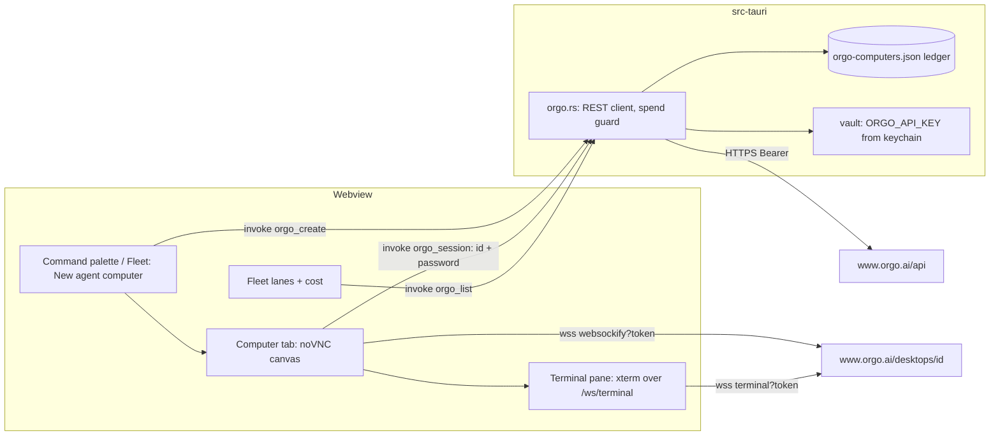
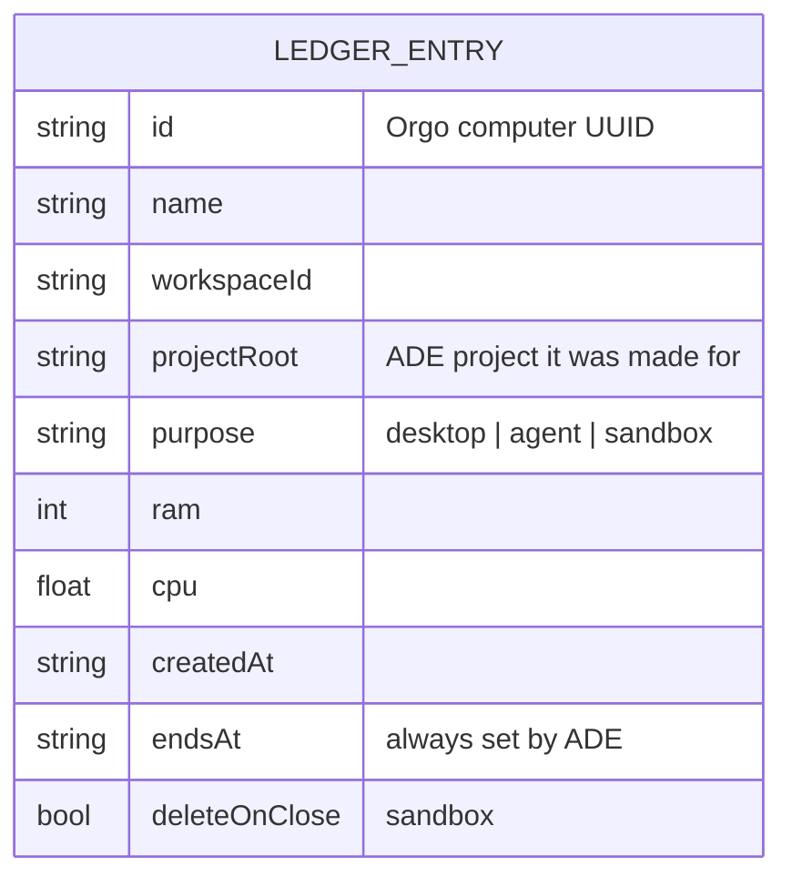
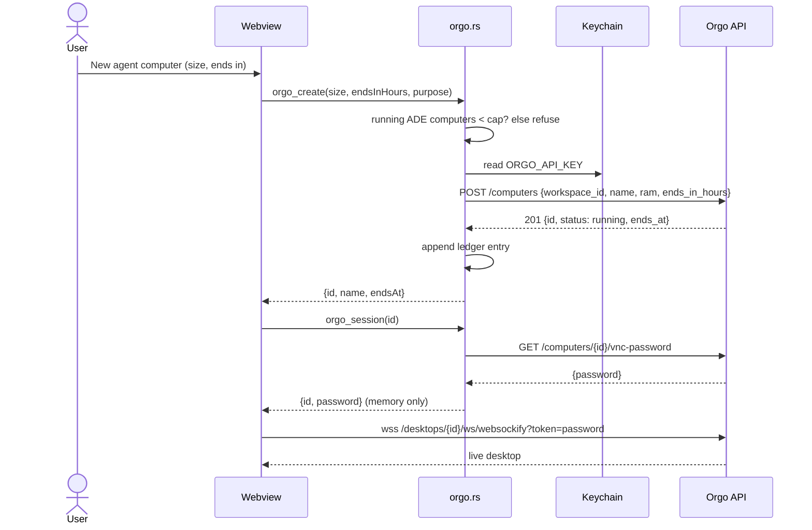

There are two steps. **Story 1** adds Orgo to the MCP library, with its key in the Secrets vault. It is small and can be built once this plan is approved. **Stories 2 to 6** are step 2, the native panel. They are outlined only, because they need the owner's answers to the open questions at the end and a check of the unverified API facts (U1 to U7) with a real key. Shard them only after both. Shared intent, decisions, security and cost come first.

<frozen-after-approval reason="human-owned intent — do not modify unless human renegotiates">

## Intent

**Problem:** An agent working in ADE has only the user's own machine. It cannot test the UI it just built in a clean desktop and browser. It cannot run Claude Code somewhere other than the user's laptop, fan work out across several machines, or run untrusted code away from the user's files and keys. Orgo rents cloud computers made for agents to drive. ADE has no way to reach them.

**Approach:** Two steps, Orgo only.
1. Add Orgo's own MCP server to ADE's MCP library. The API key goes in the Secrets vault and is referenced as `${ORGO_API_KEY}`. Claude Code can then create, see and drive a computer straight away, asking the user before each call. The tool surface is narrowed to computers, and the key the guide asks for cannot reach billing.
2. Later, a native panel: a click creates a computer and opens its live desktop in a tab. It adds lifecycle with a spend guard, a terminal that can run Claude Code remotely, and fleet lanes with cost.

## Owner's decisions (2026-10-29)

1. Purposes, all four: computer use (an agent drives a real desktop and browser, for example to test the UI it built); Claude Code running remotely from an ADE tab; a parallel fleet across several machines, shown in the fleet view with cost; a throwaway sandbox for untrusted code.
2. Depth: MCP first (Story 1), then a native panel with the live desktop, lifecycle and cost (step 2).
3. Provider: Orgo only. No provider-neutral abstraction: no `ComputerProvider` interface, no settings for a second vendor.

## Boundaries & Constraints (all stories)

**Always:**
- Orgo's own MCP server and Orgo's documented REST and WebSocket endpoints. No third-party wrapper.
- The Orgo API key lives only in the OS keychain, through the vault, as `ORGO_API_KEY`. Files hold the reference `${ORGO_API_KEY}`, never the value.
- The verification command is unchanged (see Verification).
- Every Orgo fact a story relies on is cited to a docs page below. A fact marked unverified (U1 to U7) is checked with a real key before the story that needs it is sharded.

**Never:**
- ADE never creates, starts or resizes an Orgo computer without the user's click. This holds for the native panel in every story. In the MCP path, Claude Code creates computers and asks the user before each tool call. ADE does not change that.
- ADE never sends `billing_mode: "hourly"`, never calls an Account, Clients, Billing or capacity endpoint, and never adds credit.
- ADE never copies the user's Claude Code credentials, `~/.claude`, the keychain's Claude entry, SSH keys or any other vault secret to an Orgo computer on its own.
- No change to `relay/` or `mobile/`. No provider abstraction.

## Security

- **The key stays in the keychain.** `.mcp.json` carries `"ORGO_API_KEY": "${ORGO_API_KEY}"`, and Claude Code expands it from the environment ADE gives new terminals (`src-tauri/src/vault.rs`, `env_for_terminals`). The existing catalog test already fails on a literal `sk_live` in any entry. If the vault has no `ORGO_API_KEY`, Claude Code warns in `/mcp` and `claude mcp list`, naming the variable, and passes the literal text through. The server treats that text as the key and gets `401`. It does not fall back to `~/.orgo/credentials.json`, because `orgo-mcp-server` reads that file only when `ORGO_API_KEY` is empty (checked in `build/index.js` of 1.1.1).
- **The key the guide asks for is narrow.** It is Custom, scoped to one workspace: Computers write, Control write, Workspaces read, every other group none. A workspace-scoped key "cannot call any other endpoint", so none of billing, account capacity, clients, templates or key minting. A key without Billing write cannot launch an hourly computer on a paid account (`403 HOURLY_NEEDS_BILLING`). Making a workspace key also stops Orgo from leaving an account-wide "computer key" on that workspace's machines. ADE cannot enforce which key the user pastes. Story 2 adds a check that warns when the key reaches account-wide endpoints.
- **The tool list is narrow too.** `ORGO_TAGS` exposes four spec groups, which is 36 tools in spec 2.0.0. It hides Account (`add_account_capacity`), Clients (billing, refunds), Agent accounts (signs up new Orgo accounts), Chat, Templates, Files (whose `upload_file` reads any local path and sends it to Orgo) and Screens. The server builds its tools from the live spec at start, so a new API group appears only if it carries one of these four tags. A renamed tag removes tools rather than adding them, so it fails closed.
- **Sending things to Orgo is explicit.** In the MCP path, every command, keystroke and file the agent sends is a Claude Code tool call the user approves, unless the user has allowlisted `mcp__orgo__*` or runs with permissions bypassed. The guide says not to. In the native panel, nothing is sent except what the user types into the desktop or terminal, or a named action they confirm.
- **The computer password is root on that machine.** It opens the screen, `/ws/terminal` and the proxy's bash. Step 2 fetches it per session in Rust and passes it to the tab that uses it. It is never written to disk, synced, logged or put in a URL the app shows.
- **Known gap, inherited:** the vault exports every secret into every new ADE terminal, so any program there, Claude Code's Bash tool included, can call Orgo with `ORGO_API_KEY` without going through MCP. That is the vault's existing model, the same as for `GITHUB_PERSONAL_ACCESS_TOKEN`. The narrow key above is what bounds it. A per-secret "only for these servers" option would be a vault change and is deferred.

## Cost

- **What a computer costs** ([billing](https://docs.orgo.ai/guides/billing), [prices](https://docs.orgo.ai/guides/pricing)). On a paid plan, a computer that fits the plan's remaining vCPU and RAM is included, with no marginal charge. Past that, it runs by the hour from credit, but only for a caller with Billing write. On a free account, computers run by the hour from credit: a $5 signup credit, Medium only. Linux hourly prices are $0.023/h (Small), $0.055/h (Medium), $0.11/h (Large) and $0.202/h (XL). A stopped computer pays only for its disk, from $0.0017/h. Billing is per second, and a paid plan runs at most 50 computers.
- **The worst case for a runaway agent on the MCP path, with the key above:** on a paid plan it can fill the capacity the user already pays for, up to 50 computers, and no more. On a free account it can spend the credit balance, unless auto top-up is on, which can charge the card up to 5 times a day. The guide says to leave auto top-up off. With an account-wide full-access key there is no such bound, which is why the guide asks for the narrow key. Whether a key without Billing write can launch at all on a free account is unverified (U2).
- **The native panel adds ADE's own guard** (Story 2): a cap on running ADE-made computers, an end on every computer it creates (`ends_in_hours`), auto-stop when idle, and no hourly launches.
- **Nothing runs forever by default from ADE.** An Orgo computer without an end runs until stopped. ADE always sends one. The MCP path cannot force one, so the guide asks the user to tell the agent to set one.

</frozen-after-approval>

## What Orgo offers (verified 2026-10-29 against the live docs)

The search results disagreed on paths. The live docs settle it: the base URL is `https://www.orgo.ai/api`, and computers are addressed by UUID as `/computers/{id}/…`. A create takes `workspace_id`, and the older name `project_id` is still accepted. `/api/projects/{project}/computers/{name}/…` is not in the current spec.

| # | Fact | Source |
|---|---|---|
| F1 | Auth is `Authorization: Bearer $ORGO_API_KEY` on every request, and keys begin `sk_live_`. Spec 2.0.0 has 86 operations. | https://docs.orgo.ai/llms.txt, https://docs.orgo.ai/api-reference/introduction |
| F2 | The official MCP server is npm `orgo-mcp-server`, 1.1.1, MIT. Its repo is `github.com/OrgoAI/orgo-mcp`, its homepage is the Orgo docs, and it needs Node ≥ 20.3. It runs over stdio with `npx -y orgo-mcp-server`, and the key comes from `ORGO_API_KEY`, falling back to `~/.orgo/credentials.json`. `ORGO_TAGS` limits the tools to spec groups (case-insensitive), and `ORGO_READ_ONLY` limits them to GETs. It builds one tool per operation from the live spec (cached 24 h, with a bundled snapshot offline). There is also a hosted server at `https://www.orgo.ai/mcp` (OAuth with a reviewed tool list, or Bearer). | https://docs.orgo.ai/guides/mcp; `npm view orgo-mcp-server`; the 1.1.1 tarball's `build/tools.js` (`applyPolicy`) and `build/index.js` |
| F3 | The live spec's groups: Workspaces 5, Computers 14, Computer Lifecycle 7, Computer Actions 10, Templates 15, Files 7, Screens 5, Account 3, Clients 15, Chat 1, Agent accounts 3, Support 1. | https://docs.orgo.ai/api-reference/openapi.json (fetched 2026-10-29) |
| F4 | Create: `POST /computers` with `workspace_id` and `name` (both required). `os` defaults to `linux`; `windows` needs Scale or a licence; `macos`, `android` and `ios` depend on hosts or a request. `ram` is 4, 8, 16, 32 or 64; `cpu` is optional; `billing_mode` is `plan` by default, or `hourly`. `ends_in_hours` is 1 to 720. `template_ref` is optional, for example `system/coding`, which runs `claude` and `codex`. The `201` is already `running`. | https://docs.orgo.ai/api-reference/computers/create, https://docs.orgo.ai/guides/templates/examples |
| F5 | Lifecycle: start, stop, restart, suspend, resume and delete. Stop archives the disk, releases compute and reads `frozen`. Delete is permanent. A computer with an end stops when time is up and is deleted 7 days later unless started. "Sleep when idle" (`auto_stop_minutes`) is off by default; the dashboard offers 15 min to 4 h. | https://docs.orgo.ai/api-reference/computers/stop, …/computers/delete, https://docs.orgo.ai/guides/computer-ends, https://docs.orgo.ai/guides/instance-types |
| F6 | Billing: see Cost above. A paid plan includes vCPU and RAM shared by its computers; past it, hourly from credit with Billing write; the free account is hourly from credit. | https://docs.orgo.ai/guides/billing, https://docs.orgo.ai/guides/pricing |
| F7 | Live desktop: `wss://www.orgo.ai/desktops/{id}/ws/websockify?token={vnc_password}`, from any websockify client (noVNC ≥ 1.7.0, or Orgo's `orgo-vnc` 0.3.0). There is no origin allowlist. An `sk_` key sent from a browser is refused with `4001`. The password comes from `GET /computers/{id}/vnc-password`, is root on the machine, and can change. Close code `4003` means stopped or asleep, and `4008` means idle for 30 min without human input. | https://docs.orgo.ai/guides/embed-vms |
| F8 | Terminal: `wss://www.orgo.ai/desktops/{id}/ws/terminal?token=…&cols=&rows=&session=`, a full PTY with JSON `input` and `resize` frames. A named `session` survives a disconnect. Linux machines can also take direct SSH with the user's public key. | https://docs.orgo.ai/api-reference/computers/terminal, https://docs.orgo.ai/guides/ssh |
| F9 | Run commands: `POST /computers/{id}/bash` and `/exec` (Python); `504` past the time limit. Files: `POST /files/upload` (10 MB), export and download. | https://docs.orgo.ai/llms.txt, https://docs.orgo.ai/guides/cli |
| F10 | Keys: full access, or restricted (Custom: eleven groups, each none, read or write). Scope is the account, one workspace or one computer. A workspace key sees only its own workspace, cannot create or delete workspaces, and cannot call billing, account or template endpoints. | https://docs.orgo.ai/api-reference/api-keys/permissions, …/api-keys/computer-keys, https://docs.orgo.ai/api-reference/authentication |
| F11 | Rate limits: "some endpoints" return `429`; back off from 1 s, doubling to 60 s. Key changes are limited to 30 an hour. No general per-endpoint numbers are published. | https://docs.orgo.ai/api-reference/introduction, …/api-keys/manage |
| F12 | Template secrets: Orgo writes declared secrets from the user's Orgo vault into `/root/.env` at create, and `system/coding` uses `ANTHROPIC_API_KEY` this way. | https://docs.orgo.ai/guides/templates/secrets |

**Unverified, to check with a real key before step 2 is sharded:**
- **U1.** How `GET /computers/{id}` says whether a computer is on the plan or hourly. No `billing_mode` field is documented in the response. Story 5 needs it.
- **U2.** Whether a Custom key without Billing write can create a computer on a free account, where hourly is the default.
- **U3.** What a computer that has gone to sleep (auto-stop, `suspended`) is billed. The docs say sleep keeps memory and do not give a price.
- **U4.** How to set auto-stop. It is not a create parameter. It is settable through `PATCH /computers/{id}/resize` (`auto_stop_minutes`) and a `PATCH /computers/{id}/auto-stop` listed in the permissions table. The docs disagree on whether it suspends or stops the computer.
- **U5.** Real rate limits on create, get and screenshot.
- **U6.** Whether WKWebView (macOS) and WebKitGTK (Linux), from the app's own origin, open `wss://www.orgo.ai` once the CSP allows it. Needs a spike.
- **U7.** Whether `GET /workspaces/{id}` (`desktops`) lists every computer a workspace key can see, as Story 3 needs to reconcile.

**Third-party servers, not chosen:** `nickvasilescu/orgo-mcp`, `spencerkinney/computer-use-mcp` and the Composio toolkit. Orgo's docs name `orgo-mcp-server` as theirs, it is published from the `OrgoAI` organization, and it follows the live spec. I did not evaluate the others further.

## Proposed ADR 0010 (written on approval)

`.ade/context/decisions/0010-agent-computers-are-orgo-only-and-made-on-click.md`. The next free number is 0010, because 0008 and 0009 are each used twice in history.
- **Decision:** Orgo is the only provider, with no abstraction. The MCP path uses Orgo's own server, pinned, with the key as a vault reference and four spec groups. In the native panel, only a user's click creates, starts or resizes a computer, and every ADE create carries an end and stays under ADE's cap. ADE never chooses hourly billing and never ships credentials on its own.
- **Consequences:** a second provider later is new work, not configuration. Orgo API changes are absorbed in one Rust module (step 2). The cost bound for the MCP path is Orgo's key scoping and the user's plan, not ADE.

---

# Story 1: Orgo in the MCP library

## Code Map (1)

- `src/data/mcpCatalog.ts`: `McpEntry` (:18-31) and `MCP_CATALOG` (:33). The "Web & browser" entries are playwright and fetch (:108-125). `envRefs` and `matchCatalog` stay unchanged.
- `src/data/__tests__/mcpCatalog.test.ts`: the generic catalog tests. "declares every secret a server reads, and never stores a value" already covers a new entry. "searches name, category and description" pins `"browser click"` → `["playwright"]`, so Orgo's description must not contain "click".
- `src/components/IntegrationsPanel.tsx:178-209`: the server card. Its title tags are `oauth` and `needs`, followed by the description and the secret rows with "Add to vault". `install` (:73-90) writes `e.server` through `mcp_install` and names missing secrets in the notice.
- `src/index.css:636-639`: `.mcp-tag`, `.mcp-tag[data-warn]` (amber) and `.mcp-secret`.
- `src-tauri/src/mcp.rs`: `mcp_install` merges one server into `.mcp.json` unchanged. No change.
- `src-tauri/src/vault.rs:59` `valid_name`, and its test `names_are_env_style` (:205).
- `docs/guide/integrations.md`: the MCP library table (:13-19) and the key bullets (:25-27, :33-35).
- `README.md:46`: "15 curated MCP servers".
- The component test pattern is `src/components/__tests__/AgentsTab.test.tsx:18`, which uses `vi.mock("@tauri-apps/api/core")` with `mcp_list` → `{}` and `vault_list` → `[]`.

## Design Notes (1)

**The entry**, added after `fetch` in "Web & browser":

```ts
{
  id: "orgo",
  name: "Orgo",
  category: "Web & browser",
  description: "Cloud computers with a desktop, browser and shell that the agent can start, see, drive and run commands on.",
  server: {
    command: "npx",
    args: ["-y", "orgo-mcp-server@1.1.1"],
    env: {
      ORGO_API_KEY: "${ORGO_API_KEY}",
      ORGO_TAGS: "Workspaces,Computers,Computer Lifecycle,Computer Actions",
    },
  },
  secrets: [{ name: "ORGO_API_KEY", label: "Orgo API key: Custom, one workspace, no Billing", url: "https://www.orgo.ai/settings/developers" }],
  caution: "Computers are billed to your Orgo account until stopped, and whatever the agent types or runs on one goes to Orgo. Claude Code asks before each call: keep it that way.",
  needs: "npx",
  docs: "https://docs.orgo.ai/guides/mcp",
}
```

What Install writes into `.mcp.json` under `mcpServers.orgo`:

```json
{
  "command": "npx",
  "args": ["-y", "orgo-mcp-server@1.1.1"],
  "env": {
    "ORGO_API_KEY": "${ORGO_API_KEY}",
    "ORGO_TAGS": "Workspaces,Computers,Computer Lifecycle,Computer Actions"
  }
}
```

- **The secret is named `ORGO_API_KEY`**, the variable the server reads. The vault accepts the name, because it is not in `RESERVED` or `EXECUTES`.
- **Why a local server and not the hosted URL:** the owner chose a key in the vault. `ORGO_TAGS` narrowing exists only on the local server, and an API key on the hosted URL "reaches every tool its scope allows". Step 2 needs the same key from Rust anyway, so one secret serves both. The hosted sign-in variant is Q7.
- **Why pinned (`@1.1.1`)**, unlike most entries: this server runs bash on a remote machine with a key that can create billable computers. Pinning means an upgrade is a reviewed change to one line. The tool list still follows the live spec, so pinning freezes the code, not the API. Bumping the version is a one-line change, and the test pins the format, not the number.
- **Why these four groups:** creating a computer needs `workspace_id`, so the agent needs Workspaces to list it. Computers, Computer Lifecycle and Computer Actions cover create, end, stop, delete, screenshot, mouse, keyboard, bash and Python. The other groups are excluded for the reasons under Security. Files is excluded for now (Q6).
- **`caution`** is a new optional field on `McpEntry`. The card shows it under the description as a `<p className="mcp-caution" role="note">`, in the amber of `.mcp-tag[data-warn]`. Only Orgo sets it. It is not part of `matchCatalog`'s haystack.
- **`"cloud computer"` finds Orgo** through "Cloud computers" in the description. No other entry contains both words.

**Guide** (`docs/guide/integrations.md`): add Orgo to the "Web & browser" row. Add a section, `## Orgo cloud computers`, that says:
1. What it does: Claude Code can create a cloud computer, see its screen, drive its browser and run commands on it. Computers are billed by Orgo.
2. Set up the key: in Orgo, make a workspace for ADE. Under Settings → API keys, create a **Custom** key scoped to that **one workspace**, with Computers write, Control write and Workspaces read, and everything else none. Save it in the vault as `ORGO_API_KEY`. Why: a key like this cannot buy capacity, launch hourly computers on a paid plan, or reach other workspaces.
3. What it costs: computers that fit your plan are included; on a free account they use your credit. Ask the agent to give each computer an end ("ends in 1 hour") and to delete it when done. Leave auto top-up off.
4. Stay in control: Claude Code asks before every Orgo call. Don't add `mcp__orgo__*` to allowed tools, and don't use Orgo in a session with permissions bypassed. What the agent types, runs or uploads on a computer goes to Orgo. Like every vault secret, the key is in the environment of new terminals.

Update **README** to "16 curated MCP servers".

**Failure modes:**

| Failure | Handling |
|---|---|
| Key not in the vault | The card shows "Add to vault" and the notice names `ORGO_API_KEY`. Claude Code warns in `/mcp`, and calls get `401`. |
| No Node, or Node < 20.3 | The `npx` tag is amber when `npx` is missing, as for the other entries. An old Node fails at server start in `/mcp`, and the guide names the minimum. |
| Spec unreachable at start | The server uses its cache, then its bundled snapshot (F2). |
| Orgo renames a tag | The tools under it disappear, so the surface fails closed. Fix by editing `ORGO_TAGS`. |
| Full-access key pasted anyway | Nothing in Story 1 stops it. The guide says why not to, and Story 2 adds a warning. |

## Acceptance Criteria (1)

Each names the test that covers it. The developer writes it failing first, except AC9, which pins existing behaviour and passes on its first run.

1. `MCP_CATALOG` has one entry with id `orgo`. Its name is "Orgo", its category "Web & browser", `needs` is "npx", it has no `oauth`, `docs` is `https://docs.orgo.ai/guides/mcp`, and `server` deep-equals the config in Design Notes. Covered by `src/data/__tests__/mcpCatalog.test.ts` › "Orgo runs Orgo's own server with its key from the vault".
2. The key is a reference only: `server.env.ORGO_API_KEY === "${ORGO_API_KEY}"`, `envRefs(server)` is `["ORGO_API_KEY"]`, `secrets` names only `ORGO_API_KEY` and its `url` is `https://www.orgo.ai/settings/developers`, and `JSON.stringify(entry)` contains no `sk_live_`. Covered by `mcpCatalog.test.ts` › "Orgo runs Orgo's own server with its key from the vault".
3. `ORGO_TAGS` splits on commas to exactly `["Workspaces", "Computers", "Computer Lifecycle", "Computer Actions"]`. It names none of Account, Clients, Chat, Templates, Files, Screens, Agent accounts or Support, case-insensitively. `env` has no other key. Covered by `mcpCatalog.test.ts` › "Orgo exposes computer tools only".
4. `args` is `["-y", <pkg>]`, where `<pkg>` matches `/^orgo-mcp-server@\d+\.\d+\.\d+$/`. Covered by `mcpCatalog.test.ts` › "Orgo's server version is pinned".
5. `McpEntry` has an optional `caution: string`. Orgo's caution matches `/billed/i` and `/goes to Orgo/`. Covered by `mcpCatalog.test.ts` › "Orgo says it costs money and sends work to Orgo".
6. `matchCatalog(MCP_CATALOG, "cloud computer")` returns `["orgo"]`, and `"browser click"` still returns `["playwright"]`. Covered by `mcpCatalog.test.ts` › "searches name, category and description" (extended).
7. With `vault_list` empty, the Orgo card shows its caution as a `role="note"`, the `npx` tag, `ORGO_API_KEY` and an "Add to vault" button. With `ORGO_API_KEY` in `vault_list`, it shows "in vault" instead. Covered by `src/components/__tests__/IntegrationsPanel.test.tsx` (new) › "the Orgo card shows its cost and its key".
8. Clicking Install on the Orgo card invokes `mcp_install` with `name: "orgo"` and `server` deep-equal to the catalog's. With the key missing, the status notice contains `ORGO_API_KEY`. Covered by `IntegrationsPanel.test.tsx` › "installing Orgo writes the reference, not a value".
9. `valid_name("ORGO_API_KEY")` is true. Covered by `src-tauri/src/vault.rs` › `names_are_env_style` (one name added).
10. `docs/guide/integrations.md` names every `MCP_CATALOG` entry, matched on its `name` without a trailing parenthesised part (so "Databases (DBHub)" matches "Databases"; all fifteen existing names already pass this way), has a `## Orgo cloud computers` heading, and mentions `ORGO_API_KEY`, "Custom", "one workspace" and "auto top-up". `README.md` says "<N> curated MCP servers" with N equal to `MCP_CATALOG.length`. Covered by `scripts/mcpCatalogDocs.test.ts` (new) › "the guide names every server and explains the Orgo key", "the README count matches the catalog".

## Verification (1)

**Commands (the repo's verification command, unchanged):**
- `npx tsc --noEmit`: expected exit 0.
- `npm test`: expected all pass, including the new cases in `mcpCatalog.test.ts`, `IntegrationsPanel.test.tsx` and `mcpCatalogDocs.test.ts`.
- `cd src-tauri && cargo test`: expected all pass, including `names_are_env_style`.
- `cd relay && cargo test`: expected all pass (no change).
- `cd mobile && npx tsc --noEmit && npx jest`: expected all pass (no change).

**Manual checks (owner, with a real Orgo account):**
- Install Orgo in a scratch git project before saving the key. Start `claude` in a new terminal: `/mcp` warns about `ORGO_API_KEY`, and a call fails with `401`.
- Save a restricted, workspace-scoped key as `ORGO_API_KEY`, then open a new terminal and start `claude`. Approve the project server. `/mcp` lists `orgo` with 36 tools, and no `orgo_add_account_capacity`, `orgo_upload_file` or `orgo_agent_signup`.
- Ask: "create a small Orgo computer that ends in 1 hour, open example.com in its browser and show me a screenshot". Claude Code asks before each call. The computer shows in the Orgo dashboard with an end. Ask the agent to delete it, and check it is gone.
- `.mcp.json` contains `${ORGO_API_KEY}` and no key.

## Slice (1)

These files only: `src/data/mcpCatalog.ts`, `src/data/__tests__/mcpCatalog.test.ts`, `src/components/IntegrationsPanel.tsx`, `src/components/__tests__/IntegrationsPanel.test.tsx`, `src/index.css`, `src-tauri/src/vault.rs` (test only), `scripts/mcpCatalogDocs.test.ts`, `docs/guide/integrations.md`, `README.md`. There are no new dependencies and no new contract in `.ade/context/`: the entry is data in an existing shape.

---

# Step 2: the native panel (outline; not ready to shard)

## Shape



- **`src-tauri/src/orgo.rs`** is the only code that talks to the Orgo REST API. It reads `ORGO_API_KEY` from the keychain through a new internal `vault` function, never through `vault_get`, so the key never reaches the webview. It needs an HTTP client crate (`reqwest` with rustls, or `ureq`), which is the first new Rust dependency. Each story is a command over `POST /computers`, `GET /computers/{id}`, start, stop, `DELETE`, and `GET /computers/{id}/vnc-password`.
- **The ledger**, `orgo-computers.json` in app data, holds only the computers ADE created. It sits beside `vault-index.json`, is not synced, and stores no passwords.



- **The spend guard** lives in `orgo_create`, the only create path. It refuses when the number of running ledger computers has reached the cap. It always sends `ends_in_hours` and never sends `billing_mode`. Then it sets auto-stop (U4).
- **The live view** is noVNC (`@novnc/novnc` 1.7.0, MPL-2.0) in a new tab type, `"computer"`. The CSP's `connect-src` gains exactly `wss://www.orgo.ai`; today it has `http: https:` and no `ws`/`wss`. `scripts/csp.test.ts` pins it: that one host, and no `wss:` wildcard.
- **The Context Store** gains `.ade/context/orgo-computers.md`: the command names and shapes, the ledger fields, and the close-code handling.



## Stories (outline)

**Story 2: New agent computer, with its live desktop in a tab.** Purpose 1.
- "New agent computer" in the command palette and fleet view opens a sheet: size (Small, Medium or Large), ends in (default from Q1), workspace. On confirm, `orgo_create` runs, a computer tab opens, and the tab connects with noVNC.
- Close codes: `4003` shows "Stopped or asleep" with a Start button (a click); `4008` reconnects on the next input; `4001` refetches the password once.
- Key check: on first use, a call to `GET /account/capacity` that succeeds means an account-wide key. ADE warns, linking the guide's key steps, and does not refuse.
- It depends on F4, F5, F7, F10, U4 and U6, and needs Q1 to Q4. It adds `orgo.rs`, the ledger, the CSP change with its test, the `"computer"` tab type, `@novnc/novnc`, ADR 0010 and the context file.

**Story 3: Lifecycle, with stop, start, delete and auto-stop when idle.**
- Per computer: Stop, Start (a click) and Delete (a confirm naming the computer and saying the disk is lost). Ending soon shows "Ends in 3h 12m" and an "Extend 1 h" click.
- Auto-stop when idle uses the Q1 default, applied right after create.
- On launch, reconcile the ledger with the workspace's computers. Computers the ledger has but Orgo does not are dropped. Computers Orgo has that ADE did not make are shown as "made elsewhere (for example by an agent through MCP)", with Stop and Delete but not counted against the cap. This is how computers created through MCP become visible.
- It depends on F5, U3, U4 and U7.

**Story 4: A terminal into the computer, running Claude Code remotely.** Purpose 2.
- A terminal pane in the computer tab: xterm.js (already a dependency) over `/ws/terminal`, with `session=ade` so it survives a reconnect. Optionally, create from `template_ref: "system/coding"`, which has `claude` installed.
- "Run Claude Code here" types `claude` into that terminal. Credentials follow Q5, and ADE sends none by default.
- Getting code there is explicit. The user picks a branch that is already pushed, and the agent or user clones it, or the user confirms a named upload. ADE syncs no folder in the background.
- It depends on F4 (templates), F8 and F12, and needs Q5.

**Story 5: Fleet lanes and cost.** Purpose 3.
- Each running ledger computer is a fleet lane, with a status from `GET /computers/{id}` and an end marker at `endsAt`.
- Cost per lane: for hourly computers, the running time at the published rate, or `prepaid_cents` when present. For plan computers, "on plan". The fleet header shows a total for the period.
- "New fleet" creates N computers in one confirmed click, with N no more than the cap's remaining room. Each gets its own tab or lane.
- It depends on F6 and U1. If U1 shows no way to tell plan from hourly, the lane shows the price as an estimate and says so.

**Story 6: A throwaway sandbox.** Purpose 4.
- "Run in a sandbox" creates a Small computer with a 1 h end and `deleteOnClose`, and opens its terminal. Closing the tab deletes the computer, after one confirm that can be turned off per sandbox.
- No vault secret, credential or project file is sent. The sheet says so.
- It depends on F5 and needs Q1. It reuses Stories 2 to 4.

---

## Verification (all stories)

The verification command is the repo's, unchanged: `npx tsc --noEmit` · `npm test` · `cd src-tauri && cargo test` · `cd relay && cargo test` · `cd mobile && npx tsc --noEmit && npx jest`. Step 2's REST client is tested against recorded responses (a fake HTTP layer in `orgo.rs` tests), never the live API: the command must stay offline and free.

## Deferred Work

- A hosted-sign-in variant, "Orgo (sign in)", at `https://www.orgo.ai/mcp` (Q7).
- Files in the MCP surface (Q6).
- A vault option to give a secret only to named MCP servers, not to every terminal. This would close the inherited gap under Security.
- Writing Claude Code `permissions.ask` rules for `mcp__orgo__orgo_create_computer` into the project, so a broad allow rule cannot pass it. Claude Code's handling of `ask` under bypassed permissions needs checking first.
- Website (`docs/index.html`): mention agent computers once step 2 ships.
- Windows, macOS and iPhone Orgo computers: the panel targets Linux, the default and the only OS with SSH and every end/stop feature.

## Open Questions (owner)

Each has a recommendation. Story 1 needs only Q6 and Q7, and the recommended answers are already built into it. Step 2 needs Q1 to Q5.

- **Q1. Spend limits and the auto-stop default.**
  - Recommend: at most **3** running ADE-made computers, configurable 1 to 10 in Settings.
  - Every ADE create carries an end, **2 h** by default, with the sheet offering 1 h, 2 h, 4 h, 8 h or 24 h and nothing longer.
  - Auto-stop when idle after **30 min**.
  - The default size is **Small** for a sandbox and **Medium** for a desktop.
  - ADE never chooses hourly billing. The cap counts only ADE-made computers; ones made through MCP are shown, not counted (Story 3).
- **Q2. Does ADE ever create a computer without a click?**
  - Recommend: **never**. Not on an agent's request, not to replace a stopped one, and not to resume a fleet.
  - Agents that want a computer use the MCP path, where Claude Code asks the user each time.
  - Starting a stopped computer is also a click.
- **Q3. Where does the key live?**
  - Recommend: one vault entry, `ORGO_API_KEY`, for both paths.
  - Rust reads it from the keychain for the panel and never hands it to the webview.
  - The guide asks for a Custom, one-workspace key without Billing, and Story 2 warns when the key is account-wide.
  - A second, separate key for the panel is not worth the extra setup.
- **Q4. What does the live view use?**
  - Recommend: **noVNC 1.7.0 in the main webview**, with `connect-src` widened by exactly `wss://www.orgo.ai` and pinned by the CSP test.
  - Rejected alternatives:
    - Framing the Orgo dashboard (`frame-src` already allows https) needs the user's Orgo web login inside ADE and third-party cookies that WKWebView blocks.
    - `orgo-vnc` is a thin 0.x wrapper over the same protocol.
    - A Rust WebSocket relay would keep the password out of the webview, but the webview can already read vault values (`vault_get`). The relay adds a moving part for little gain.
  - noVNC is MPL-2.0, file-level copyleft, used unmodified from npm alongside ADE's MIT code. Confirm that is acceptable.
  - U6 needs a spike first.
- **Q5. How is remote Claude Code authenticated on the machine?**
  - This is the security question: anything on the machine is readable by Orgo and by anyone holding that computer's password (root). It also survives in the disk archive of a stopped computer until it is deleted.
  - Recommend: ADE sends **nothing** by default. The terminal opens and the user signs Claude Code in there themselves, with `/login`.
  - Next, an explicit per-computer action, "Send ANTHROPIC_API_KEY…". It opens a confirm that names the secret and the computer, and is never remembered.
  - The guide recommends a dedicated Anthropic Console key with a spend limit, revoked when done.
  - Never the user's local Claude Code login. The same rule applies to a GitHub token for cloning: fine-grained, one repo, short-lived.
- **Q6. Files tools in the MCP surface?**
  - Recommend: **leave them out** for Story 1.
  - `orgo_upload_file` reads any local path the agent names and sends it to Orgo. Agents can still move code with `execute_bash`, for example `git clone` of a pushed branch, and each call is prompted.
  - To add them later, append `Files` to `ORGO_TAGS`, a one-line change.
- **Q7. Also offer the hosted sign-in server?**
  - Recommend: **not now**. The owner chose a vault key, and step 2 needs the key anyway.
  - The OAuth server is safer in one way: a sign-in cannot launch hourly computers or read computer passwords. Add it as a second entry, "Orgo (sign in)", if users ask for no-key setup.
