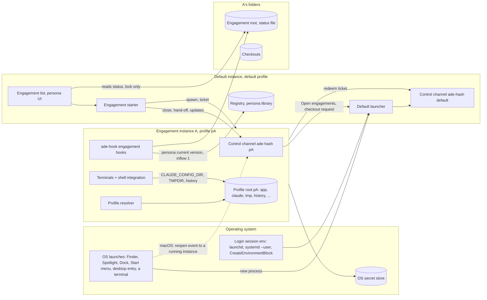
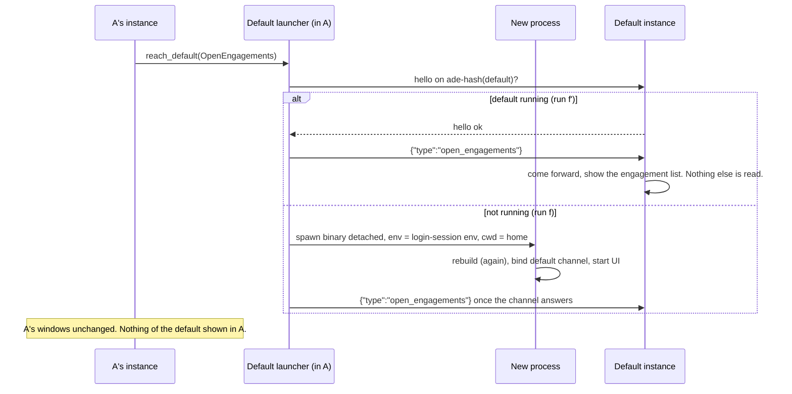
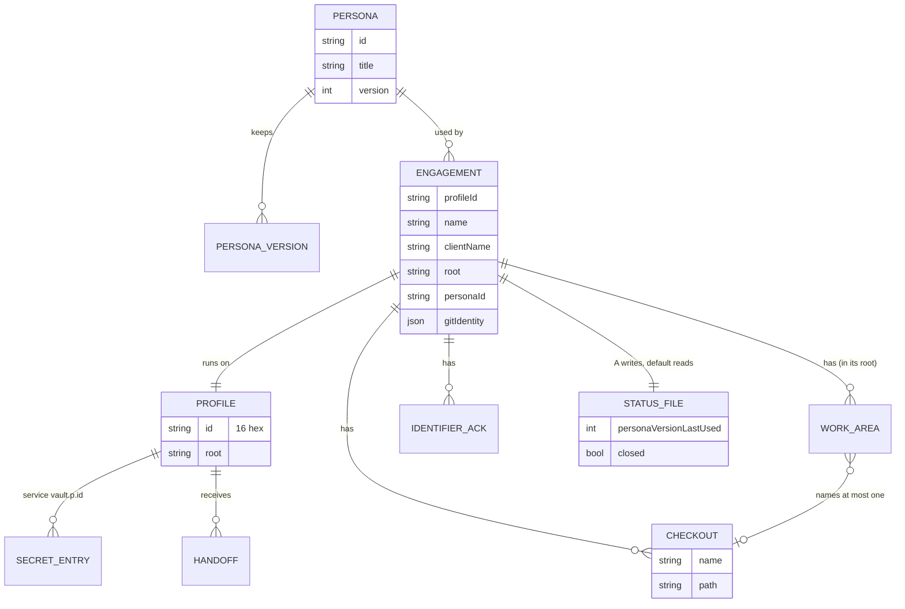

# Personas and engagements (F1): architecture

The technical design for PRD F1 (`docs/prd.md`, revision 9j, approved by the owner
on 2026-11-08). Every PRD item handed to the architect (F1.12) is settled here,
returned to the owner, or listed as an early check that is still open.

- **Status:** **approved at revision 5j, 2026-11-08.** The owner confirmed the
  slice-1 additions (revisions 5h and 5i, with ADR 0024, PRD 9k and the slice-1
  UX spec) on 2026-11-08 and asked for the eight minors of the delta check of
  5i (N1 to N7 and the brand) to be folded in; revision 5j is that fold-in
  (table below), text and rule fixes inside 5i's additions, no redesign;
  invariant L is untouched. The rest of this paragraph is the history to 5g.
  **Approved at revision 5g, 2026-11-08.** The delta review of
  revisions 5 to 5g passed on 2026-11-08; its reviewer marked minors m2 to m7
  of the text check of 5f non-blocking, and revision 5g folds them in (table
  below). Ready to shard. Revision 5g is revision 5f plus those minors, text
  fixes with no redesign; invariant L's text is unchanged. Revision 5f was
  revision 5e plus the text check of 5e:
  one major, MJ-A, about who clears `closed`, and minors 1 and 3 to 8; the
  product manager answers minor 2 in the PRD; L's text is unchanged; table
  below; revision 5e was revision 5d plus the delta review of 5d:
  three majors, MJ-1 and MJ-3 here and MJ-2 in the PRD, and minors 1 to 9,
  all text fixes in applications of invariant L, whose text is unchanged but
  for one added gap; revision 5d was revision 5c plus the text check of 5c:
  two majors, MJ-A and MJ-B, both about what "not running" rests on, and minors
  m3 to m10; section 5 now states the one liveness invariant, L, that every
  probe, lock and test cites; revision 5c was revision 5b plus the text check's one
  major, MJ-6, and its minors C1 to C3; revision 5b was revision 5a plus the
  re-delta review's one major, MJ-5, and its minors; revision 5a was revision 5 plus the delta review's
  four majors and minors; text fixes with no redesign; tables below). **The owner approved revision 4 on
  2026-11-08 with every recommendation (O1 to O9, section 18), on condition that
  the re-review's six majors and eight minors are folded in before sharding.**
  Revision 5 is that fold-in (second table below); its delta review (of revisions 5 to 5g) passed on 2026-11-08, before
  the scrum-master shards. Revision 1 was blocked by the
  adversarial review (5 blockers, 13 majors, 12 minors); revision 2 answered each.
  The re-review of revision 2 blocked on three new flaws its fixes introduced (NB1
  to NB3), with five majors and ten minors; revision 3 answered those. The
  re-review of revision 3 resolved NB1, NB2 and most of the rest, and blocked on
  two flaws in NB3's fix (B1, B2), with five majors and eight minors; revision 4
  answered those. The verification gate for F1 stories (D28) is worded in
  `docs/architecture.md`, "Verification command"; the owner approved its narrower
  form (O5), and its revision-5 wording is approved with this revision (the
  delta review of revisions 5 to 5g passed on 2026-11-08).
- **Contracts** (shared by parallel stories; read before building):
  - `.ade/context/engagement-profiles.md`: the profile id, profile root layout,
    per-profile variables, the default launcher, the engagement starter and the
    control channel.
  - `.ade/context/engagement-requests.md`: the request types on the control
    channel, Open engagements included.
  - `.ade/context/engagement-registry.md`: the registry, the persona library, the
    engagement status file and the onboarding hand-off.
- **ADRs** in `.ade/context/decisions/`, approved with the plan on 2026-11-08.
  0015 to 0021 and 0023 are Accepted (2026-11-08, the date the delta review
  passed); 0022 stays Proposed (direction only, O6), as does 0014; 0024
  (revisions 5h and 5i) is Accepted (2026-11-08, the owner's confirmation of
  the slice-1 additions). Each ADR
  keeps its revision history on a separate line:
  - 0015: process per profile, one path resolver;
  - 0016: every instance rebuilds its environment; one launcher;
  - 0017: non-persistent engagement webviews;
  - 0018: per-profile channel as lock and transport;
  - 0019: engagement Claude settings in the profile, and the merge model;
  - 0020: the isolation test's mechanics;
  - 0021: shell integration and ADE's own folder picker;
  - 0022: Windows `ade open` (direction only);
  - 0023: a split home for Claude Code's process (O1 option A, chosen by the
    owner);
  - 0024: the OS launchers' `--open-engagements` (revision 5h, G1).

  ADR 0014 (`0014-terminals-open-terminals-through-the-hook-endpoint`) keeps its
  provisional number and is cited by slug. 0015 is the next free number across all
  branches (0013 exists only on `origin/fix/anthropic-key-in-vault`, not on main;
  section 10).
- **Not here:** screens and copy (the designer); CI jobs, release, the RC-2
  build's publishing (DevOps); story slicing (the scrum-master).

**Revision 5j: the delta check of revision 5i (2026-11-08; approved by the owner
with its fold-in).** The owner confirmed 5h and 5i and asked for the check's eight
minors to be folded in, and decided that the app's on-screen name is "Better
Terminal" everywhere ("ADE" names the methodology in docs and never appears on
screen; the default profile is "your main Better Terminal"). Text and rule fixes;
no approved decision is reversed, and invariant L is untouched.

| Finding | Answer | Where |
|---|---|---|
| N1 the order inside check 3 | "contains home" is tested first, then "is a file-system or volume root", then the overlaps (app data, profiles base, runtime folder, temp folders), so `~` and `/` each get their own message | 11; `engagement-registry.md` check 3 |
| N2 the report cap | 4,096 bytes escaped six-fold is 24,576; with `{"v":1,"history":""}` that is 24,596 bytes, 32,796 in base64, over 32 KiB (32,768). The cap is **40 KiB** (40,960) | 9; 21 test map |
| N3 a missing folder and roots | a folder that does not exist is not a root: the create makes it on its parent's volume. A btrfs subvolume (its own `st_dev`) reads as a mount point and is refused; refusing is the safe side | 11; `engagement-registry.md` check 3 |
| N4 comparands canonicalised | home, app data, the runtime folder, the temp folders and the profiles base are each resolved as `P` is (longest existing prefix canonicalised, the rest appended) before `fsx::same_path`; so Fedora Silverblue's `/home` link to `/var/home` cannot slip past | 11; `engagement-registry.md` check 3 |
| N5 where the temp and runtime folders come from | from `ProfilePaths` (`profile.rs`), never a direct `temp_dir()` call, so the static path test is not tripped | 3, 11; `engagement-profiles.md`, `engagement-registry.md` |
| N6 system temp folders | refused as well (option one of two: widen the set, not narrow the reason): on macOS and Linux `/tmp` and `/var/tmp`, canonicalised (so `/private/tmp` and `/private/var/tmp` on macOS), and anything inside or containing them; on Windows the user's temp folder only | 11; `engagement-registry.md` check 3 |
| N7 a drive that is gone | in check 5, "engagements are registered in it" is tested before "its parent is missing": with `/Volumes/Work` unmounted, `/Volumes/Work/Engagements` is refused as registered (the volume may not be mounted), not as a missing parent; G2's tests gain that case | 11, 21; `engagement-registry.md` check 5 |
| Brand | copy cited here uses "Better Terminal": the hook's no-process warning, the native-title alternative, the default profile's name ("your main Better Terminal"); 4.4 says "ADE" never appears on screen | 4.4, 7, 8 |

**Revision 5h: the slice-1 gaps (2026-11-08; confirmed by the owner with revision
5j).** Raised by the starter persona draft (Q9) and the UX spec
(Q10, `docs/ux-spec.md` section 13). Additions that settle what slice 1 left open;
no approved decision is reversed, and invariant L is untouched.

| Gap | Answer | Where |
|---|---|---|
| A1 starter location | `src-tauri/resources/personas/<starter id>/persona.md`, bundled by a `tauri.conf.json` `bundle.resources` entry (e7), read through `BaseDirectory::Resource`; no persona under `docs/` | 11; `engagement-registry.md` |
| A2 starter id | the starter's folder name, a slug (`^[a-z0-9]+(-[a-z0-9]+)*$`, 3 to 64); never a 16-hex persona id | 11; `engagement-registry.md` |
| A3 `version`, `starter` | not in the bundled file; the copy step sets `version: 1` and `starter: <folder name>`; a test refuses a bundled file holding either | 11; `engagement-registry.md` |
| A4 `defaultModel` | what `claude --model` takes, alias or full id; form-checked only, passed as one quoted argument; unknown values are Claude Code's to report; malformed or empty is absent | 11; `engagement-registry.md` |
| G1 OS launchers | `--open-engagements`, a token with no value, run by the jump-list task and the desktop action; default mode only; ignored with F1 off; label "Open Engagements" | 4.1, 6; ADR 0024; `engagement-profiles.md`, `engagement-requests.md` |
| G2 engagements folder | `null` until the first create, then fixed; a create in another folder is refused; a missing folder is made, one level, at any create | 11; `engagement-registry.md` |
| G7 slice-1 history check | the slice-2 check OSC, emitted once at the first prompt with only `history`; Rust compares; no OSC in 10 s shows the warning's first sentence. **This answers the epic's Q15 differently, and is a scope change to `e27a` (revision 5i, M6):** Q15 put the OSC 7 and 7717 hooks and the start-up check in slice 2; slice 1 now has a one-shot 7717 emitter (zsh, bash; PowerShell in `e27b`), a minimal `ptysink.rs`, the 10 s timer and their tests. OSC 7 and the per-prompt check stay in slice 2. The scrum-master re-shards `e27a` and `e27b` | 9 |
| Client name in `StartInfo` | left out on purpose: A shows the engagement name only, and `StartInfo` carries only what A uses | 4.4; `engagement-requests.md` |

**Revision 5i: the review of revision 5h (2026-11-08; confirmed by the owner with
revision 5j).** The review blocked on six majors (M1 to
M6). Text and rule fixes inside 5h's additions; no approved decision is reversed,
and invariant L is untouched.

| Finding | Answer | Where |
|---|---|---|
| M1 the jump-list task in a debug build starts an F1-off process | the task is registered only in builds with F1 compiled on (`f1-forced`, `isotest-driver`), like the `.desktop` action, so its arguments are exactly `--open-engagements`; builds without F1 compiled on (release and plain debug) call no jump-list API at all; only the default registers it | 6; ADR 0024 |
| M2 an engagements folder that contains home or a root | refused when it is inside or contains (both including equal) ADE's data, the profiles base, the runtime folder or the OS temp folder, when it contains home, and when it is a file-system or volume root | 11; `engagement-registry.md` |
| M3 a check after the 10 s fallback | a per-PTY state machine: every well-formed report is evaluated, the warning only escalates (none, first sentence, full copy) and never clears until the terminal closes; a late mismatch upgrades the copy, a late match changes nothing | 9, 21 |
| M4 fish and PowerShell in slice 1 | the 10 s fallback is armed only for zsh and bash; `e27b` emits the same one-shot report from PowerShell (`HistorySavePath`), with no fallback; fish has no check until slice 2 | 9 |
| M5 when the starter is copied | at the create, once: the persona choices list a starter only while no library persona names it in `starter`; the create re-checks under the personas lock and reuses a copy | 11; `engagement-registry.md` |
| M6 Q15 answered without saying so | named in the 5h table as Q15's answer and a scope change to `e27a` (and `e27b`) | table above |
| Minor 1 | the F1-off row reads "today's start" | 6 |
| Minor 2 | release builds call no jump-list API; only the default registers; the task holds nothing of an engagement; the registration code is a real-non-start fixture of 16.1 | 6, 16.1; ADR 0024 |
| Minor 3 | ADR 0016 gains a revision line; a repeated `--open-engagements` exits 2 with F1 on | 4.1; ADRs 0016, 0024 |
| Minors 4, 5, 6 | the first-folder race is one critical section under `registry.lock`; a missing folder with engagements still registered under it is refused; `fsx::same_path` follows the volume on macOS for the part that does not exist yet | 11, 20; `engagement-registry.md` |
| Minor 8 | the report's JSON escaping, base64 without line breaks, a 32 KiB cap (40 KiB in revision 5j, N2), relative or uncanonicalisable paths as a mismatch | 9 |
| Minor 9 | no first-only rule: a report printed before ADE's own cannot pre-empt it; a forged one is not a boundary; slice 2 extends the reader | 9 |
| Minor 10 | `defaultModel`: safe in PowerShell single quotes, YAML type rule, Claude Code reports unknown names when it chooses, `e7` tests the starter's value | `engagement-registry.md` |
| Minor 11 (registry side) | the text-field rule (no Cc or Cf characters) and the engagements folder's | `engagement-registry.md` |
| Minor 14 | 4.1 names the case where the process becomes the default and shows the list | 4.1 |
| Minor 13 (brand, architect side) | titles and menus use the bundle's `productName` at run time ("Better Terminal" today); A's windows are `<engagement name> — <productName>` | 4.4 |

**Revision 5: the fold-in the owner's approval asked for (re-review of revision 4)**

| Finding | Answer | Where |
|---|---|---|
| M-A two in-process paths can interleave a hand-off | one in-process hand-off mutex per engagement, in the default and in A, locked only by top-level entry points (the writer, the default's start reconcile, the starter's reconcile, the delete flow; A's apply and leftover clean-up); reconcile and sweep are inner functions taking the held guard, so they never lock (MJ-1 of revision 5a); waits across processes go only from the default to A, with `apply_handoff` and `close` bounded; always before the registry file lock, never inside it | 11, 17, 20, 21; `engagement-registry.md` |
| M-B browser-engine writes in P1b | P1b is attributed by location like P1c: a change in a default-owned location (the per-bundle webview, cache and HTTP-storage folders included) gets the marker rule, whichever process made it; everything else must be A's or exempt | 15.2, 18 limits; ADR 0020 |
| M-C the gate | narrowed per O5: the `CI` workflow's three backend jobs (not every job) and the listed platform-only tests, which a checked-in list and a job step enforce; how the same-SHA runs are dispatched, checked and cited is written out | `architecture.md`; 18 O5, 20 |
| M-D the detector's real-Claude test; long paths | the test is part of the gate (a red or missing result is red); every walk and delete uses absolute paths, which Rust's standard library turns into `\\?\` long paths on Windows, and a Windows-only test walks and deletes a tree deeper than `MAX_PATH` | 8, 20, 21; `architecture.md`; ADR 0023 |
| M-E the walk's 8-level cap | dropped: below a cut, the walk covers the whole subtree; each name is walked once per run of A (a keyed hash of it is remembered, never the name) and re-checked at A's next start, which the residual now states; one wording of the walk everywhere | 8, 17, 18; ADR 0023 |
| M-F durability order | every durability claim uses `fsx::sync_file` and `fsx::sync_dir` (`F_FULLFSYNC` on macOS, `fsync` on Linux, `FlushFileBuffers` on Windows); step 1's record is on disk before step 2 starts | 11, 20; `engagement-registry.md` |
| Minors 1 to 8 | Windows paths compare case-insensitively (one function); junctions and every reparse point are links; the slug hash takes the unsigned absolute value, as JavaScript's `Math.abs` does, with a vector for `i32::MIN`; one wording of the walk; the nested step bounds `MCP_CONNECT_TIMEOUT_MS`, `MCP_TIMEOUT` and its own run; what approving `<marker>wrap` does, and that only the harness sets it; owed tombstones are swept (when, stated); the Windows tombstone is written through and the "A starting" scenario's step order is in the test map | 8, 11, 20, 21; contracts |
| Also | O9: quoted Claude Code internals moved to a private note outside the repository; the `openUrl` citation is `useTerminal.ts:374` | 1, 8, 16.1, 18 |

**Revision 5g: the non-blocking minors of the text check of revision 5f**

| Finding | Answer | Where |
|---|---|---|
| m2 a lost-lock A keeps writing `terminal-sessions.json` | from the moment it loses its lock, A stops the session pass and writes no more spawn records (the file is the new holder's); what it starts after that still carries `ADE_PROFILE` | 5, 11, 11 tests; `engagement-profiles.md` |
| m3 a false lost lock from a lingering binder | lost lock also needs proof that the second A is serving: the socket path names an inode other than the one A bound, or a `hello` there comes from a peer whose process id is not A's; otherwise A retries at the next pass | 5, 11 tests; `engagement-profiles.md` |
| m4 the WebView2 wait | A calls `prevent_exit` on the `ExitRequested` that Tauri raises when the last window is destroyed, so the event loop keeps running during the wait; A never calls `AppHandle::exit` and ends the process at step 5 | 5; `engagement-profiles.md` |
| m5 engagement-root evidence matches processes A did not start | stated: delete stops on any process in or naming a folder delete removes (a default-profile shell `cd`'d into A's engagement root included), and its list shows the evidence that matched each process; the PRD's AC3 is aligned by the product manager | 11, 11 tests; `engagement-registry.md` |
| m6 the start write of `closed: false` can fail | A logs it, warns the engineer in its windows and starts anyway; it retries every 60 s until the write succeeds, A closes or A loses its lock; a quit before then leaves the last close's flag, which the next start clears. Tested | 5, 11, 21; contracts |
| m7 one writer for `terminal-sessions.json` | inside A, spawn records, the session pass and the start-time prune share one mutex-guarded in-memory set, and the whole set is written under the mutex, so a pass cannot drop a concurrent spawn's record. Tested | 11, 11 tests; `engagement-profiles.md` |

**Revision 5f: the text check of revision 5e**

| Finding | Answer | Where |
|---|---|---|
| MJ-A nothing clears `closed` | A clears it: at each start, once its ticket is redeemed and before any window opens, A writes `closed: false`, `closedAt: null`, `personaId` from `StartInfo` and `updatedAt`, under `engagement-status.lock`. A, not the starter, because "start" is not an event at which the default may write in A's root (4.4, F1.1). Sweep: `closedAt` is cleared with `closed`; `personaVersionLastUsed` is meant to persist; `personaId` is rewritten at each start; `updatedAt` at every write. Test: close A, reopen it, quit it; the list shows A as not closed | 5, 11, 21; `engagement-registry.md` |
| 1 the gap entry | the per-profile variables are part of the rebuilt exec environment (4.1 step 3), so `ADE_PROFILE` is in A's start-time environment; A's own session record is cited as well. The keep-alive pass now checks the lock file first and rebinds the socket only while it holds the lock on the file at the path; it closes the window only when no second binder took the new lock file. If one did (the take fails for 5 s and the file holds another live process's lock record; a prober writes none, so a probe in progress is retried next pass), the old A has **lost its lock**: it logs the conflict, never rebinds its socket again, tells the engineer, and on quit writes nothing more into the root | 4.1, 4.4, 5, 11 tests, 17; `engagement-profiles.md` |
| 3 Claude Code's Bash tool | named in the limit, in behaviour terms (each command runs in a shell that leads a new session). Added: A's **session pass**, every 60 s and once at shutdown, records each session leader whose parent is in a recorded session, so a Bash-tool command still running at a pass, or at A's shutdown, is found by session. The shim (`exec`s, so it watches nothing) and the hooks (run at session or tool boundaries, after the shell may be gone) were weighed and not used. Current-folder and argument evidence now include A's engagement root, where agents' commands run. A macOS test documents both outcomes | 11, 11 tests, 17; `architecture.md`; `engagement-profiles.md`, `engagement-registry.md` |
| 4 a missing `terminal-sessions.json` | means no records; only a file that exists but cannot be read or parsed stops delete | 11; `engagement-registry.md` |
| 5 a missing signing identifier | on either side never confirms: the generic route. The ad-hoc identifier is the crate name plus Cargo's hash. Test with an unsigned binary | 5, 11 tests, 21 |
| 6 F1 gating | with F1 off, no instance takes a `.run/` lock or binds a channel (today's ADE has none), so F1-off builds start on any volume as today; `rfd` becomes a direct dependency (0.16.0, `default-features = false`, `gtk3`) | 5, 14, 17 |
| 7 the WebView2 wait | on a background thread, after Tauri has destroyed every webview, while the main thread keeps pumping messages; a browser process WebView2 restarts after a crash is not waited on (delete's argument evidence finds it) | 5; `engagement-profiles.md` |
| 8 background-job tests | the macOS and Linux session tests start their background job with `nohup` and `disown`, since zsh sends `HUP` to its jobs when the PTY closes | 11 tests; `architecture.md` |

**Revision 5e: the delta review of revision 5d**

| Finding | Answer | Where |
|---|---|---|
| MJ-1 on macOS `KERN_PROCARGS2` returns no environment for an Apple platform binary (`/bin/sleep`, `/bin/zsh`; measured on macOS 26.6.2) | the limit is stated exactly: on macOS a platform binary is found only by its arguments, its current folder or its session. New evidence: **session matching** on macOS and Linux. A records its own session and each terminal's session leader (`{pid, startTime}`) in `<profile root>/terminal-sessions.json`; delete matches `getsid()` against them, which finds the default shell and every job in it. A process that calls `setsid` escapes it (stated limit). The macOS test child is a cargo-built binary; a `/bin/sleep` case documents the limit. The descendant-check tests are in each platform's list | 3, 11, 11 tests, 17, 21; `architecture.md`; `engagement-registry.md`, `engagement-profiles.md` |
| MJ-2 delete's two new outcomes in the PRD | the product manager's (PRD text) | `docs/prd.md` |
| MJ-3 the shutdown wrote `closed` on a plain quit | `closed: true` is written only on a close (A's own, or the `close` request); a quit or logout saves the session and writes nothing to the status file; a test quits A and finds it not closed | 5, 21; `engagement-profiles.md` |
| 1 L's gaps | the double fault (the lock file removed by hand while the socket is also absent) is a stated gap of L, with what still stops delete; the keep-alive pass re-creates `.run/` with its checks | 5 |
| 2 "ADE's binary" | defined per platform (Linux `/proc/<pid>/exe` with the ` (deleted)` suffix and the AppImage mount; macOS the code-signing identifier; Windows the image path); descendants are checked by start time and the evidence that matched, never the executable | 5, 11 |
| 3 no lock record | the generic route: the executable's name, Task Manager, Activity Monitor or `kill` | 5 |
| 4 no `flock` | ADE does not start at all, the default included; a native message box (rfd, before any webview) says why | 5, 17 |
| 5 `deleting` | the hand-off writer, PE-12 AC1's status write and the default's start-up reconcile each refuse or skip | 11; `engagement-registry.md` |
| 6 WebView2 wait | a handle to the `BrowserProcessId` process, waited on for 5 s | 5 |
| 7 lock instance | the next listening instance is created before the lock instance serves | 5; `engagement-profiles.md` |
| 8 m6 test | the direct binder starts with a well-formed placeholder ticket | 21 |
| 9 Windows PEB | it holds the current environment, which can be changed at any time; WoW64 reads the 32-bit PEB | 11, 17 |

**Revision 5d: the text check of revision 5c**

| Finding | Answer | Where |
|---|---|---|
| (all) one invariant | section 5 states invariant L (the lock is held from before the bind and any write until the process exits; the last write precedes the exit; "not running" only from a prober that took the lock and found the endpoint absent or refusing; anything else with the lock held is "not answering"), with its gaps and what covers each. The lifecycle (start, redeem, run, close, delete, crash, OS cleaners, sleep) was checked against it once | 5; cited in 4.2, 4.4, 11, 17, 20, 21; contracts; ADR 0018 |
| MJ-A an OS cleaner removes the lock file under a long-running A | the lock file moves to `<profiles base>/.run/`, which no cleaner ages; the probe also needs A's endpoint absent or refusing (an endpoint that accepts after the lock was taken is "not answering"); A's keep-alive pass rebinds a removed socket and re-takes a removed lock file every 60 s (rebind chosen over the sticky bit: why stated); isolation exemptions and the default-owned table updated; a test unlinks a held lock file under a live A | 3, 5, 15.2, 15.4, 11 tests, 17, 21; contracts; ADR 0018 |
| MJ-B the lock's lifetime is not tied to A's process | the lock lives in a never-dropped `static` (Unix descriptor with `FD_CLOEXEC`; Windows a lock instance never closed, the next instance created before a hand-off, a replacement before a failed one is closed, handles non-inheritable); a five-step shutdown puts the last write before `exit`; A waits up to 5 s for WebView2's browser process; tests probe through the accept-error and shutdown paths | 5, 7, 11 tests, 20, 21; ADR 0018 |
| m3 | PE-12 AC1's close is a top-level entry point of A's hand-off mutex, like delete | 5, 11; `engagement-registry.md` |
| m4 | a Windows create refused is retried 2 s, then exit 2; every client request has a connect bound (1 s) and a reply bound per type; the prober's guard instance refuses connects (slice-0 check), and the bound ends any client that reaches it | 5; `engagement-requests.md` |
| m5 | the rebuild's path line is buffered and written only after the lock and the root check | 4.1, 5 |
| m6 | the foreign-listener test is split by platform; on Unix it now reads "not answering" (MJ-A's endpoint check) | 21 |
| m7 | the starter's bound includes the redeem handler's registry write in the already-used branch | 4.2, 11; `engagement-registry.md` |
| m8 | a "condition" includes `match` guards and `&&`/`||` operands, `bool::then`/`then_some` and `matches!`; shadowing false positives are accepted; other macro bodies are code-review items | `architecture.md` item 3 |
| m9 | a binder that finds no root unlinks the lock file it holds before exit 2 | 5, 11 |
| m10 | "not answering" names A's window and offers Force quit; the lock record holds the process id and start time, checked before the kill; advisory only, never liveness | 5, 11, 17; ADR 0018 |
| Sweep | processes A started can outlive it: delete's descendant check (start-time `ADE_PROFILE`, arguments, current folder) refuses while one runs, limit stated; a delete stopped part-way leaves `deleting: true`, so no start runs in a half-removed root; a volume without `flock` fails closed; sleep and the monotonic clock | 5, 11, 17; `engagement-registry.md` |

**Revision 5c: the text check of revision 5b**

| Finding | Answer | Where |
|---|---|---|
| MJ-6 (a) the ticket ends before A binds: the starter released while the child lived, and a late A wrote `logs/ade.log` into a deleted root | at the ticket's end the starter takes the ticket out of the table (a ticket already used counts as redeemed), then kills the child through its handle and waits up to 5 s for its exit, and only then releases; so its wait ends with A redeemed or A gone. An engagement instance writes nothing in its root until it holds its lock and has found its root present | 4.2, 4.4, 5, 11, 17, 21; `engagement-profiles.md`, `engagement-registry.md`, `engagement-requests.md` |
| MJ-6 (b) a `hello` timeout counted as "not running"; a failed start rotated the control key | "not running" needs positive evidence: the probe takes A's lock itself (Unix: a non-blocking `flock` on `ade-<h>.lock`; Windows: creating A's pipe with `FILE_FLAG_FIRST_PIPE_INSTANCE`). Lock held and `hello` answered in 1 s: running. Lock held and no answer: "A is not answering", and delete removes nothing, the starter spawns nothing. Delete holds A's lock until it has finished. The new control key is written to the registry by the redeem handler, so a failed start keeps the old key. Three seam tests | 4.2, 4.4, 5, 11, 17, 21; contracts |
| MJ-6 lock file and removal order | the lock file is never in the profile root: it sits beside the socket in the per-user runtime folder (moved to `<profiles base>/.run/` in revision 5d, MJ-A). Delete unlinks the socket and the lock file last, while it holds the `flock`, then closes it; a binder checks after its `flock` that the file it locked is still the one at the path | 5, 11 |
| C1 PRD revision | line 3 names revision 9f | header |
| C2 `close` refused | "times out, is refused or returns `closed: false`" in section 11 and section 17 | 11, 17 |
| C3 the static test's primitives | `is_file`, `is_dir` and `symlink_metadata` join the condition-only primitives, and `env::vars` and `env::vars_os` the always-rejected ones; a primitive's result bound by `let` and branched on later is caught within the test body, and every other flow is a code-review item | `architecture.md` item 3 |

**Revision 5b: the re-delta review of revision 5a**

| Finding | Answer | Where |
|---|---|---|
| MJ-5 delete can remove the root of an A that is starting; a starter queued behind a delete spawns A for a deleted entry | `start_engagement` takes no entry: it locks A's hand-off mutex, then reads A's entry and stops if it is gone; it holds the mutex from its reconcile through the spawn until A redeems its ticket (the default's redeem handler signals it; A binds before it redeems), the ticket's 60 s life ends, or the spawn fails or the child exits. A bounded wait, cycle-free because the redeem handler never takes the mutex. A seam test pauses A between spawn and bind while delete starts: delete waits, then sees A running and sends `close` | 4.2, 4.4, 11, 17, 20, 21; `engagement-registry.md`, `engagement-profiles.md`, `engagement-requests.md` |
| Minor 1 `hello` under the mutex | `hello` (1 s) is listed with `apply_handoff` and `close`; both instances serve each connection concurrently, and no `hello` handler waits on a hand-off mutex; a test answers every A-to-default request within 1 s while the default's mutex is held; bound tests use `tokio::time::pause` or injected bounds; the starter and the default's start join the no-self-deadlock test; the compiler enforces only the caller side, the rest is a convention that test checks | 11, 20, 21; contracts |
| Minor 2 the legacy list | enforced: a stale entry (test gone or no longer gated) fails the static test, and the entry count is held under a ceiling fixed in the test at slice 0; module entries allowed (`pty.rs`'s three gated modules); the count corrected from a measurement | `architecture.md` item 3; 20 |
| Minor 3 the no-skip rule | preconditions only through shared `require_*()` helpers that return a value or panic; the static test rejects the lookup primitives in a listed test, and code review checks other branches on the environment (why stated); the Linux precondition step runs inside the same `dbus-run-session` as `cargo test` | `architecture.md` item 3 and "Depends on"; 20 |
| Minor 4 the walk budget | retries round-robin, oldest attempt first, with a doubling, capped per-name back-off after a budget hit; the delete flow's pass has a total limit; each listing call runs under a timeout on a blocking thread, so a hung `readdir` ends as "could not check", with the left-over thread and the delete's own removal stated as limits | 8, 11, 17, 21 |
| Minor 5 the delete report | delete removes the detector's matched folders and lists each unchecked one by path, kept (the default already knows A's root); mirrored by the PM in PE-12 AC3, G3, R3 | 8, 11, 17 |
| Minors 6 and 7 the runs | `ci.yml` runs on `push` only to `main`; QA lists the SHA's runs before it dispatches and never dispatches over a run in progress; the stub story's acceptance test (a throwaway branch's `isolation.yml` printing another string) decides dispatch or the `push` fallback before slice 0 (DevOps) | `architecture.md` item 4 |
| Minor 8 ADR statuses | "Accepted on the date the delta review passes", no future date stated; revision history on its own line | ADRs 0015 to 0023 |

**Revision 5a: the delta review of revision 5**

| Finding | Answer | Where |
|---|---|---|
| MJ-1 the hand-off mutex deadlocks (non-reentrant, re-taken by sweep and reconcile) | only top-level entry points lock it; reconcile and sweep take the held guard (`&mut HandoffGuard<'_>`) and never lock; waits across processes go only from the default to A; `apply_handoff` (60 s) and `close` (120 s) bounded, with what a timeout leaves; a no-self-deadlock test under a timeout | 11, 17, 20, 21; `engagement-registry.md`, `engagement-requests.md` |
| MJ-2 a fresh dispatch gets round "no reruns" | QA lists every run on the SHA (`gh run list --commit`); every counted run must be green and all are cited; one red run needs a new commit | `architecture.md` item 4 |
| MJ-3 platform tests can pass vacuously; runner set-up unowned | listed tests never skip (a missing precondition panics; the static test rejects `return`, "skip" and `#[ignore]`); target-gated tests outside the three modules fail the static test, with pre-F1 ones frozen in a shrinking list; each backend job's set-up named, with a precondition step | `architecture.md` item 3 and "Depends on"; 20 |
| MJ-4 a new `isolation.yml` cannot be dispatched from a branch | a dispatch-only stub on `main`, a DevOps prerequisite story merged by the owner before slice 0 | `architecture.md` item 4 |
| Minors | jobs matched by display name; `pull_request` runs refused by `event`; cancel-in-progress and cancelled runs; `fsx` adds `\\?\` for raw Win32 calls, minimum Rust 1.79; `F_FULLFSYNC` fallback corrected, with a syscall seam; the walk's cut point, budget, no skipped folders and "could not check" retry; one residual wording; ADR statuses; lines run from the root and `isotest` joins the workspace; O9 wording and `MCP_CONNECT_TIMEOUT_MS` | 8, 17, 20, 21; `architecture.md`; ADRs 0015 to 0021, 0023 |

**Revision 4: where each finding of the re-review of revision 3 is answered**

| Finding | Answer | Where |
|---|---|---|
| B1 the leak detector misses subfolder slugs | Claude Code names the folder from its current folder at each write (checked, E7.6). Each pass lists the shared cache once and keeps in memory only names equal to the slug of A's root or a checkout, or starting with its first 200 characters and `-`; a longer name is kept only if a guided walk inside that folder finds the directory Claude Code would name so; everything else is dropped unseen ("keeps nothing else"). The 200-character cut and the hash are checked (E7.6) and reimplemented with test vectors. Deletes use the no-follow helper; the delete flow runs one pass | 8, E7.6, 11, 17 F4, 21; ADR 0023 |
| B2 the nested step proves nothing or never ends | the wrapper server is approved in A's user settings (`enabledMcpjsonServers`, checked, E7.6); it nests exactly once (a variable, and a create-new guard file in case the variable is filtered), from a subfolder; the nested level's `mcp-logs-<marker>srv` must exist under A's split home for that subfolder's slug, so a run where the nested level never ran, or ran unshimmed, is red | 8, 15.2, 21; ADR 0023 |
| M1 Windows names in the hook check | on Windows `is_claude` ignores a trailing `.exe` and ASCII case; "no Claude Code found" warns like a mismatch, never passes | 8, 21; ADR 0023 |
| M2 `SetConsoleCtrlHandler(NULL, TRUE)` is inherited | a handler routine that returns TRUE for Ctrl+C and Ctrl+Break (as cargo does), which children do not inherit; the test checks that the target and a child of it end on Ctrl+C while the shim survives | 8, 17, 21; ADR 0023 |
| M3 Windows-only tests outside the gate | every F1 story also needs a green run of the `CI` workflow for the same SHA, every job, `backend-macos` and `backend-windows` included; `ade-hook`'s tests are added to those jobs and to the local lines; platform-only tests are named in the plan and shown `ok` in the job log | `architecture.md`; 20 |
| M4 the hand-off reconcile is not crash-safe | A creates a flushed `<uuid>.applied` tombstone before it deletes `<uuid>/`, and only the default removes it, after its record; the reconcile checks the folder, then the tombstone, so no interleaving with a starting A drops a record; every step flushes the files and the folder (rename included) before the next record write; "A starting" is in the test map; steps 1 to 6 everywhere | 11, 17, 20, 21; `engagement-registry.md`, `engagement-requests.md` |
| M5 O1 (A)'s framing | "No PRD change: G3 holds" withdrawn. The residual is stated: an absolute-path or SDK Claude Code with no session hook still writes client-named folders to the shared cache; it is detected only under A's root and checkouts, after the write. O1 asks the owner to accept it as a recorded risk or to have G3 and R3 name it (P7) | 18 O1, P7; ADR 0023 |
| Minors 1 to 8 | a fresh start's count is 0; the first image's launcher path travels in the pipe record; the pipe is read non-blocking and `EAGAIN` means foreign; slice 0's stand-in table of default-owned locations; the per-bundle blind spot is bounded by E7.2's measurement, and the default is quiesced in P1a so the blind spot is P1c with A idle; one step numbering; delete finishes or refuses pending removals; delete runs the leak detector once | 4.1, 15.2, 15.6, 11, 8; ADR 0016, 0020; contracts |

**Revision 3: where each re-review finding is answered**

| Finding | Answer | Where |
|---|---|---|
| NB1 re-exec equality fails on every macOS start | compare the OS's start-time view (`KERN_PROCARGS2`, `/proc/self/environ`), never `environ`; canonical folders; image 1 hands image 2 a digest of what it built through a pipe, so image 2 never re-reads the login session; a mismatch rebuilds again, at most twice, then exits 2. Measured with an AppKit-linked binary, directly and through `open` (E7.5) | 4.1, E7.5, 17, 21; ADR 0016; `engagement-profiles.md` |
| NB2 P1b counts the default's shutdown writes as A's | attribution by location whenever both instances run: the default's own locations get the marker rule, everything else must be A's or exempt; S1 taken while both run, the default's quit a separate window; the blind spot stated | 15.2; ADR 0020 |
| NB3 split-home bypass leaks silently | the shim passes `PATH` on unchanged; no inherited variable: the hook checks its own Claude process (start-time `HOME` on macOS, a shim ancestor on Windows); a nested `claude mcp list` step in the scenario; a leak detector for what neither catches | 8, 15.2, 17 F4, 21, appendix B; ADR 0023 |
| M-a F1 flag lost | compiled on in `isotest-driver` and `f1-forced` builds; in debug builds carried by the rebuild pipe and by `--ade-feature-f1` on both launchers | 4.1, 4.2, 14 |
| M-b `Library/Keychains` links | every walk uses `lstat` and records a link as a link; every delete is one no-follow helper; a planted-link test | 3, 4.1, 15.3, 15.4, 17, 20, 21; ADR 0015, 0020 |
| M-c hand-off ambiguity | a record `state` (`writing`, `written`); a missing folder drops only a `writing` record; `apply_handoff` sent after the default's removal; the starter reconciles first | 11, 17; `engagement-registry.md`, `engagement-requests.md` |
| M-d exact marker comparison flakes | compare (marker, kind, location class, normalised store root), never offset, file or encoding | 15.5; `architecture.md` |
| M-e Windows shim breaks Ctrl+C | ignores console control events, child in a kill-on-close job, exit code passed back; tested with a `claude.cmd` target | 8, 21; ADR 0023 |
| Minors 1 to 10 | `#[used]` sentinel and bundle-id check; ticket never in the rebuilt environment; O8 grammar rules; Windows Known Folders corrected; ADR 0013's branch; appendix B step 6; AppImage `/proc/self/exe`; harness-home precedence; `ApplePersistenceIgnoreState`; slice 1 adds the `xfail` check | 15.1, 4.1, 4.4, 15.4, 18 O8, 15.3, header, 8, 18 O7, 7, 15.6; `architecture.md` |
| Gate notes for O5 | stated: consistent with D28, stricter in two named ways | 18 O5; `architecture.md` |

**Revision 2: where each review finding is answered**

| Finding | Answer | Where |
|---|---|---|
| B1 temporary HOME discarded | a home root compiled in under `isotest-driver` only; runs assert against it | 4.1, 15.1, 15.3, 16.2; ADR 0016, 0020 |
| B2 start-time environment visible | Unix re-execs with the rebuilt environment (measured); Windows rebuilds the PEB in place | 4.1, E7.1; ADR 0016 |
| B3 saved window state | `setRestorable: NO` on every window; `.savedState` must be absent, not exempt | 7, 15.3, 15.4, E7.2 |
| B4 slice 0's verdict | picker step moved to ADR 0021's slice; Windows `USERPROFILE`, `APPDATA`, `LOCALAPPDATA` redirected and the real Known Folders in tier 2 | 15.3, 15.6 |
| B5 O1 sweep | investigated; sweep shown unsound; O1 re-issued with a measured split-home option (A) | 8, 18 O1, E7.3; ADR 0023 |
| M1 channel impersonation | socket file in a checked 0700 folder on Linux; peer checks both ways; owner-SID DACL and `PIPE_REJECT_REMOTE_CLIENTS`; control key; profile check | 4.4, 5; ADR 0018 |
| M2 stale-socket race | `flock` on a sibling lock file around probe, unlink and bind | 5 |
| M3 WebKit and OS writes | measured on macOS; ADR 0017 corrected; grammar widened (O8); slice 0 reviews kind 4 | 7, 15.4, 15.5, 15.6, E7.2 |
| M4 determinism | two fresh runners; compare verdict and marker findings | 15.5; `architecture.md` |
| M5 A's start only marker-checked | rule check from the spawn (P1b) and for slice 6's reopen | 15.2 |
| M6 undesigned parts | PE-4 AC4 recording rules, project setup and seed at first start, sync off, restore | 4.4, 7, 9, 21 |
| M7 hand-off, backup, delete | pending removal in A's registry entry first; `.partial` clean-up; `.bak` rewritten on delete | 11, 17 |
| M8 Windows secret delete | service-first target via `new_with_target` | 10 |
| M9 AppImage | spawn `$APPIMAGE`; keep own-mount packaging variables; `XAUTHORITY` and Wayland discovery; unsupported setups declared | 4.2, 4.3 |
| M10 PowerShell `Restricted` | `-EncodedCommand` inline; profiles loaded by PowerShell's rule; refusals only in engagements | 9 |
| M11 pinned Dock icon | probe step 3b; under the fallback either way | 6, appendix A |
| M12 Windows AC13 | complement set in Claude's POSIX form; E5-W; Claude Code's Windows sandbox evaluated | 18 O2, E7.4 |
| M13 gate scope | every F1 story touching I/O runs the three platforms from slice 1; CI refuses `xfail` after slice 1 | `architecture.md` |
| Minors 1 to 12 | one-launcher reach and fixtures; breakaway retry; Linux `data_directory`; ADR drift (0014 layout, one PowerShell launch form and quoter); ADR 0013; contract wording; marker search; helper in harness; picker and check details; AC8 launches and `launchctl`; mode rules; public-repo items | 16.1, 4.2, 7, 13, 10, 15.4, 15.1, 9, 16.2, 15.7, 4.1, 18 |

## Contents

1. Evidence gathered on this machine (the early checks)
2. The shape of it: one process per profile
3. Profiles: ids, roots, what moves
4. Starting instances: the default launcher, the engagement starter, the rebuild
5. The control channel and single-instance lock
6. OS launches, the macOS Dock, and Open engagements
7. Webview storage (D19, D30)
8. Claude Code in an engagement
9. Terminals: shell integration, folder tracking, history, start-up check
10. Secrets per profile
11. The registry, persona library, status file and hand-off
12. Hooks, rules, persona and journal
13. Focus terminals, `ade open` and the Windows gap; the brain (Next)
14. The feature flag and the RC-2 build
15. The isolation test (PE-4 AC9) and the harness
16. PE-13 AC9: the one-launcher test and the behavioural runs
17. Failure modes
18. Returned to the owner, and items for the product manager
19. Principles check (ADR 0012)
20. Conventions for F1 stories
21. Testing map

---

## 1. Evidence gathered on this machine (the early checks)

F1.12 asks for four checks before slicing goes far. What could be checked without
risk was checked on macOS 26.6.2, with Claude Code 2.1.319 and ADE's locked Tauri
2.10.2 / wry 0.54.2. Nothing was installed, no real Claude session was run, and
nothing was written outside the session scratchpad except one LaunchServices
registration of a throwaway probe app, which was removed again.

### E1. PE-4 AC13: denying other engagements' roots without naming them

- **What Claude Code does.** Path rules for `Read(...)` and `Edit(...)` are compiled
  with the `ignore` library (gitignore semantics), as the 2.1.319 binary's strings
  show (the quoted evidence is in the private note, O9). Deny rules win
  over allow rules, so "deny the folder, allow my root" cannot work.
- **A negated class does not work.** In `ignore` 5.3.2, `[!a]` and `[^a]` both act
  as a plain `[a]` (tested: `[^a]*/**` denied `acme/x` and allowed `beta/x`).
- **A complement set does work.** A's folder name alone gives a set of deny
  patterns that matches every sibling folder but A's. For a folder named `acme`
  under the engagements folder `E`:
  - for each position i, the first i characters of the name, then one character
    that is not the name's i-th, then anything (`` [ -.0-@B-`b-~]*/** `` for i = 0,
    `a[ -.0-BD-bd-~]*/**` for i = 1, `ac[ -.0-LN-ln-~]*/**`, `acm[ -.0-DF-df-~]*/**`);
  - each proper prefix of the name as a whole folder (`a/**`, `ac/**`, `acm/**`);
  - the name followed by at least one more character (`acme?*/**`).
  Each class is printable ASCII without `/`, written as ranges, minus the name's
  character in **both cases**, because `ignore` matches case-insensitively by
  default. Tested for `acme`, `a1`, `zeta-corp`, `9lives` and `xy` against 17 sibling
  shapes each (`beta`, `acme2`, `acm`, `acme-old`, `.hidden`, `[a]`, `!b`, `~t`,
  space-leading, ...): **0 wrong out of 85**, own folder always allowed.
  Script: `ign3.mjs` in the session scratchpad (not kept in the repo).
- **Also found:** Claude Code 2.1.319 accepts exception rules, `Read(!pattern)` and
  `Edit(!pattern)`, which "remove paths from the rules listed before it". So
  `deny: ["Read(//E/**)", "Read(!//E/acme/**)"]` may also work, more simply. It is
  newer and its order across settings files is unverified, and a hostile checkout
  can use the same `!` form to undo any deny. The design uses the complement set
  (works with deny-only semantics on any version that uses `ignore`) and treats
  `!` rules in a checkout as an override to warn about (section 8).
- **Verdict:** works without naming other engagements, on macOS and Linux path
  forms, **confirmed against the library, not yet against a real session**. Open:
  (a) that Claude Code calls `ignore` with its default options (case-insensitive);
  (b) Windows path rules (the binary treats Windows paths separately); (c) that
  Glob and Grep honour `Read` denies. The session check (E5) closes these before
  slice 4. Costs: engagement folder names must be ASCII (letters, digits, `-`,
  `_`, `.`), at least 3 characters, unique case-insensitively in the engagements
  folder (section 11). It still does not cover checkouts outside the engagements
  folder or shell commands (R9), as the PRD says.

### E2. PE-13 AC8: a Dock-tile click versus a Finder or Spotlight launch

- **Probe.** A 30-line Cocoa app that logs every `kAEOpenApplication` and
  `kAEReopenApplication` Apple Event with its sender (`keySenderPIDAttr`, resolved
  through `NSRunningApplication`). Source kept in appendix A so the owner can
  repeat it.
- **Result.** Two instances of one bundle were started by running the binary
  directly, as the engagement starter will. Then:
  - `open <bundle>`, a LaunchServices launch, started nothing new. It delivered
    `rapp` to **one** running instance (the oldest), with the sender's PID set to
    the `open` process.
  - `osascript ... reopen` delivered `rapp` to an instance, with the sender
    resolved to `osascript`.
- **So:** a LaunchServices launch reaches *some* running instance, possibly A's,
  never a new process, and the event names who asked. Whether a **Dock-tile
  click** names the Dock (`com.apple.dock`) as sender, and Finder or Spotlight
  name themselves, could not be checked: it needs a click on the Dock, and UI
  scripting would need accessibility rights this session must not ask for.
- **Verdict:** half answered. The remaining step is one manual run of the probe
  by the owner (appendix A, two minutes): click the probe's Dock tile, open it from
  Finder, open it from Spotlight, read the log. **Before slice 1**, as F1.12 says.
  The design supports both outcomes (section 6). Until the probe says otherwise,
  slice 1 builds the D32 fallback.

### E3. Settings merge: ADE's model against Claude Code

- **Checked in the binary (2.1.319):**
  - `permissions.disableBypassPermissionsMode` is a **restrictive** key: a value
    of `"disable"` from *any* settings source wins the merge. A checkout's
    `.claude/settings.json` therefore cannot re-enable bypass mode once the
    engagement's settings disable it (PE-5 AC6, AC7). The same holds for
    `permissions.disableAutoMode`.
  - `deny` and `ask` lists are collected from every source, not overridden.
  - There is a `permissions.blockReadsOutsideWorkingDirectories` restrictive key.
    It is noted for D22's Next work, not used in the MVP.
  - Claude Code 2.1.x also ships a Windows sandbox runtime, a lead for D22's open
    Windows item. Not evaluated.
- **Not checked:** that rules are evaluated deny, then ask, then allow, so a
  checkout's `allow` for `git push` cannot beat the engagement's `ask`. That is
  the documented order but needs a real session. A real session was not run: it
  needs a signed-in config dir. Using the owner's would spend their account and
  write into their stores, and a fresh one needs an interactive sign-in.
- **Verdict:** the model's two load-bearing facts are confirmed for bypass, and
  unconfirmed for ask versus allow. Closed by the session check (E5), which the
  owner runs once.

### E4. Does Claude Code write outside its config dir, or share a sign-in?

| Store | Where (2.1.319) | Moves with | Verdict |
|---|---|---|---|
| `.claude.json` | inside `CLAUDE_CONFIG_DIR` | `CLAUDE_CONFIG_DIR` | per profile (seen in the owner's three config dirs) |
| macOS sign-in | Keychain service `Claude Code-credentials-<first 8 hex of SHA-256(config dir path)>` | `CLAUDE_CONFIG_DIR` | **per profile**: four distinct items for four config dirs, and the hashes match |
| Linux and Windows sign-in | `<config dir>/.credentials.json` (from the code; not run here) | `CLAUDE_CONFIG_DIR` | per profile; confirmed by RC-2 |
| Per-project temp folders `claude-<uid>/<path slug>/` | `CLAUDE_CODE_TMPDIR`, else `/tmp` on macOS (**ignores `TMPDIR`**), `TEMP`/`TMP` on Windows, `TMPDIR` on Linux | `CLAUDE_CODE_TMPDIR` | set per profile (section 3) |
| **MCP and error logs `claude-cli-nodejs/<cwd path slug>/mcp-logs-*`** | macOS `~/Library/Caches/claude-cli-nodejs/` from the home folder; Windows `%LOCALAPPDATA%\claude-cli-nodejs\Cache\`; Linux `$XDG_CACHE_HOME/claude-cli-nodejs/` | macOS: only `HOME`. Windows: only `LOCALAPPDATA`. Linux: `XDG_CACHE_HOME`. All read once at load (E7.3) | **outside the profile, named from client paths** (R3). Returned to the owner (section 18, O1, re-issued) |
| Installer and updater: `~/.local/share/claude/versions/*`, `~/.local/state/claude/locks/<version>[#pid].lock`, `~/.cache/claude/staging` | fixed | no | per-app, no engagement data; named exemptions by pattern |

- **Shared sign-in?** No on macOS (verified). Linux and Windows keep it in the
  config dir according to the code; RC-2 confirms. So PE-4 AC11's sign-in half
  does not return to the owner.
- **Writes outside the config dir?** Yes, one that matters: the MCP and error log
  folders, named by the session's working folder (`-Users-me-Engagements-acme-...`),
  were still being written today on this machine. On Linux the design moves them
  (`XDG_CACHE_HOME` per profile). On macOS and Windows only `HOME` or
  `LOCALAPPDATA` moves them. Changing either for the whole terminal breaks the
  engineer's tools; changing it for the Claude Code process alone and restoring it
  for Claude's children works on macOS (E7.3). That is R3, and the PRD says it
  returns to the owner (O1, re-issued with that option).

### E5. The session check (to run once, by the owner, before slice 4)

One scripted run with a real signed-in `claude`, in a throwaway config dir, on
macOS (Linux and Windows at RC-2). Steps and expected results are in appendix B.
It confirms: the AC13 complement denies with Read, Glob and Grep (and Windows
paths later); deny, then ask, then allow; the hostile checkout's `allow` and
`defaultMode`; the `!` override; and where the run wrote, by listing (section 15's
listing tool). Its result is recorded in this spec and in ADR 0019.

### E6. Two more findings that shape the design

- **On macOS, `open` passes the caller's whole environment to the app it
  starts.** A probe started with `open` from a terminal received the terminal's
  `PATH`, a hand-set marker variable, `ADE_HOOK_TOKEN`, `CLAUDE_CONFIG_DIR` and
  the rest. Only the working folder became `/`. So "start it through
  LaunchServices" is **not** a clean OS launch, and the started process's own
  rebuild (section 4) is load-bearing on macOS, not a backstop.
- **launchd exposes the login session's environment.** `launchctl print gui/<uid>`
  lists the user domain's `environment` block (here, `SSH_AUTH_SOCK`), and
  `getconf DARWIN_USER_TEMP_DIR` gives the per-user `TMPDIR`. That is what a
  Finder launch receives, so the macOS login-session path can be built without
  reading the caller.
- **wry falls back silently.** Below macOS 14, `data_store_identifier` is ignored
  and the shared default WebKit store is used (`wry-0.54.2/src/wkwebview/mod.rs`).
  This is one reason section 7 does not depend on it.
- **macOS `/etc/zshrc` sets `HISTFILE=${ZDOTDIR:-$HOME}/.zsh_history`**
  unconditionally, so a `HISTFILE` in the environment never survives a zsh start
  on macOS. Section 9 handles it.

### E7. Spikes added in revision 2 (macOS 26.6.2, this Mac)

Throwaway programs in the session scratchpad; every per-bundle folder they created
was removed afterwards, and the probe apps were unregistered from LaunchServices.

1. **The OS keeps a process's start-time environment (B2).** A C program started
   with `MARKERZQ=leakme` called `unsetenv("MARKERZQ")` and slept: `ps eww -p`
   still showed `MARKERZQ=leakme`. The same program re-exec'd itself with
   `execve` and a two-variable environment: `ps eww` showed only those two. Hence
   the re-exec (4.1).
2. **What a `WKWebView` writes per bundle id (M3, B3).** A Swift probe app (its own
   bundle id per run; a window titled with a marker; a `WKWebView` writing markers
   to localStorage and sessionStorage, drawing WebGL, animating, with a focused
   input holding a marker), run directly and quit after 6 to 12 s:
   - non-persistent store: only `$(getconf DARWIN_USER_CACHE_DIR)<id>/com.apple.metalfe/`;
     no marker anywhere under `~/Library/{Preferences,Caches,WebKit,HTTPStorages,Saved Application State,Application Support,Containers}`
     or the per-user cache and temp folders. The same when killed with `SIGKILL`;
   - default store: also `~/Library/Caches/<id>/`, `~/Library/WebKit/<id>/WebsiteData/...`
     (localStorage SQLite; the marker in UTF-16 in its `-wal`), and
     `$(getconf DARWIN_USER_TEMP_DIR)<id>/WebKit/{MediaCache,JavaScriptCoreDebug,ModelElement}/`;
   - the real ADE's per-user cache folder also holds `com.apple.metal/<n>_<n>/functions.{data,list}`;
   - **saved window state was never written**, in any variant (restorable or not,
     quit or killed, launched directly or through `open`, `NSQuitAlwaysKeepsWindows`
     on for the probe). On this Mac no app has written
     `~/Library/Saved Application State/` since July, so the write depends on the
     user's settings and session; it is prevented by design, not by this Mac
     (section 7).
   Left for Linux and Windows: the same probe built on wry (section 7).
3. **Claude Code's log folder, and a split home (B5).** In 2.1.319's bundled code,
   the cache root comes from the bundled `env-paths` package, with the home folder
   and `LOCALAPPDATA` read when the module loads; the per-project folder is the cwd
   with every non-alphanumeric character replaced by `-` (truncated with a hash
   past 200); MCP logs are `mcp-logs-<server>/<time>.jsonl` there, each line
   carrying `cwd` and `sessionId`. No variable moves it
   (`CLAUDE_CODE_DEBUG_LOGS_DIR` moves only the debug log). Run without signing
   in (`claude mcp list`, which needs no account), with a project MCP server
   that records its `HOME` and exits 1, `CLAUDE_CONFIG_DIR` and
   `CLAUDE_CODE_TMPDIR` in a temporary folder, and `HOME` set to a fake home:
   - with `"env": {"HOME": "<real home>"}` in that config dir's `settings.json`: the
     log folder `mcp-logs-<server>` appeared under the **fake** home's
     `Library/Caches/claude-cli-nodejs/<slug>/`; the real one gained nothing; the
     server saw the **real** `HOME`;
   - without it: the log under the fake home, and the server saw the fake `HOME`;
   - `security find-generic-password -s "Claude Code-credentials"`: found with the
     real `HOME`, exit 44 (not found) with a bare fake one, found again once the
     fake home has `Library/Keychains` linked to the real one.
   Not measured: a signed-in session (appendix B step 6) and Windows.
4. **Windows path rules (M12),** from strings only: 2.1.319's path-rule code
   converts Windows paths to a POSIX form and folds case before matching. That
   supports writing AC13's complement set in POSIX form on Windows; E5-W confirms
   it.
5. **Revision 3: the re-exec's comparison (NB1), start-time `HOME` (NB3), links
   (M-b).** Throwaway programs in the session scratchpad (`f1rev3/`):
   - **CoreFoundation adds to `environ`.** The reviewer's C program, linked with
     `-framework AppKit` and run under `env -i FOO=1`: `environ` held `FOO=1` and
     `__CF_USER_TEXT_ENCODING=0x1F8:0x0:0x52`; `envp` held only `FOO=1`. Without
     AppKit, both held only `FOO=1`. So revision 2's "re-exec unless the
     environment equals the built one", read through `environ` (Rust's
     `std::env::vars`), differs in every Tauri image and exits 2. E7.1's spike was
     plain C, which is why it did not show.
   - **The fixed comparison holds.** A Rust program linked against AppKit (checked
     with `otool -L`) builds an environment, re-execs into it with `chdir` to a
     folder named through the `/tmp` symlink, and in the second image compares:
     `environ` against the built set (differs: `__CF_USER_TEXT_ENCODING`);
     `KERN_PROCARGS2`'s environment against the built set (**equal**); raw
     `getcwd` against the built folder (differs: `/private/tmp/...`); both folders
     canonicalised (**equal**). With revision 2's comparison the second image
     exited 2; with the fixed one it proceeded after exactly one exec. The same
     held when started with `env -i`, from a terminal with its full environment and
     a marker variable, and as a bundle through `open` (LaunchServices; the first
     image's start-time environment then also held `__CF_USER_TEXT_ENCODING`,
     `__CFBundleIdentifier` and `XPC_SERVICE_NAME`). `KERN_PROCARGS2` held no
     strings after the environment in any run. The probe bundle was unregistered
     afterwards.
   - **A start-time variable survives a later write.** A Node process started with
     `HOME=<fake>` that then set `process.env.HOME` to another value still showed
     the fake `HOME` in `ps eww`. So the start-time `HOME` of a Claude Code process
     (which applies its settings' `env` to itself) is the one its cache folder was
     computed from, and a check can read it (section 8). `ps eww` on this
     session's own Claude Code process shows its `HOME`.
   - **Deleting does not follow a link.** Rust's `std::fs::remove_dir_all` on a
     folder holding `Library/Keychains` as a symlink to a sentinel folder removed
     the folder and the link, and the sentinel's file survived;
     `symlink_metadata` reported the link as a link.
   Not measured: the real Tauri binary (slice 1's first rebuild test, section 21),
   Linux `/proc/self/environ` (the same rule; slice 1 on the Linux runner), and
   Windows.
6. **Revision 4: Claude Code 2.1.319's cache naming and MCP approval (B1, B2),**
   read from the strings of its shipped binary (`strings -n 8`, the technique of
   E7.3; no program run). Described here, not quoted (O9); the quoted evidence is
   in the owner's private note, `~/.ade-private/better-agentic-ide/f1-claude-code-2.1.319-internals.md`,
   outside the repository.
   - **The folder follows the current folder at each write.** The base log
     folder is the cache root joined with the slug of the process's current
     folder at the moment each log path is built, not once at start. MCP logs are that folder joined with
     `mcp-logs-` and the slug of the server's name. So a Claude Code started in
     (or whose current folder is) `<root>/packages/x` writes
     `<slug of root>-packages-x/`, never `<slug of root>/`. E7.3's "named from the
     session's folder" was too narrow; revision 3's detector checked only the
     exact slugs (B1).
   - **The slug.** Every UTF-16 code unit outside `[A-Za-z0-9]` becomes `-` (a
     character outside the BMP becomes `--`). A result of at most 200 characters
     is the slug. A longer one is cut to its first 200 characters, followed by `-`
     and the base-36 digits of the absolute value of a 32-bit hash of the
     **unreplaced** path: for each UTF-16 code unit `c`, `h = (h << 5) - h + c`,
     wrapped to a signed 32-bit integer (Java's `String.hashCode`), starting at 0.
     The absolute value is taken in JavaScript, where it never overflows: for
     `-2^31` it is `2^31` (base 36 `zik0zk`). `claude_slug.rs` therefore uses
     `i32::unsigned_abs`, never `abs` (which panics in debug builds and wraps in
     release), and tests that value (minor 3 of revision 5).
     The same rule names `mcp-logs-<server>`.
   - **MCP approval.** `claude mcp list`'s help and its output say that a
     `.mcp.json` server that is not approved is shown as "Pending approval" and is
     not connected to. A server is approved when a settings source lists its name
     in `enabledMcpjsonServers` or sets `enableAllProjectMcpServers`. The user
     settings source counts; the project source does not (unless it is the same
     file as the user's), so a repository cannot approve its own servers; and
     `disabledMcpjsonServers` rejects first. So revision 3's
     nested step, which approved nothing, never started its server and passed
     vacuously (B2). A user-scope server (`claude mcp add --scope user`) needs no
     approval.
   Re-checked by running Claude Code, not only by reading it: the isolation test's
   nested step (section 8) and the leak detector's tests, with the pinned real
   Claude Code (15.1).

---

## 2. The shape of it: one process per profile

Each engagement runs as its own ADE process on its own profile. Every store ADE
and Claude Code keep is found through one resolver that answers per profile.
Processes talk only through a small, closed set of requests on a per-profile
local channel. Nothing is shared by construction (D14, D15).



**Why processes, not windows on one process.** The isolation rule is about every
store. A second set of stores inside one process would need every store, the
webview's included, to be keyed by engagement, and each missed key is a leak (the
store-by-store tagging the PRD dropped in revision 3). A separate process gets a
separate webview store, environment, temp folder and Claude config dir by
construction, and the isolation test checks the result.

---

## 3. Profiles: ids, roots, what moves

- **Profile id:** 16 lowercase hex characters from 64 random bits, made at creation
  and checked unique. It is opaque: it holds no name or path. The default profile
  has no id. It is a distinct case in the code (`Profile::Default`), never a value
  an engagement id could take.
- **Profile root:** `<profiles base>/<id>`, where the profiles base is
  - macOS: `~/Library/Application Support/com.betterterminal.dev.profiles/`
  - Linux: `$XDG_DATA_HOME/com.betterterminal.dev.profiles/` (default `~/.local/share`)
  - Windows: `%LOCALAPPDATA%\com.betterterminal.dev.profiles\` (local, **not**
    roaming: client data must not roam with a domain profile).
  It is a sibling of the default profile's app-data folder, not inside it. So the
  default's folders hold no engagement data, the rule check can tell the two apart,
  and deleting A is one folder.
- **`<profiles base>/.run/`** (macOS and Linux; revision 5d, MJ-A): the
  single-instance lock files of every profile, the default's included
  (`ade-<h>.lock`, section 5). Mode 0700. It is not a profile root (its name is
  not a 16-hex id), and no OS cleaner ages it.
- **The default profile is unchanged:** today's app-data folder and today's
  outside-app-data files, so existing users lose nothing.

**Layout of an engagement profile root** (the contract has the full table):

| Path | Holds | Replaces today's |
|---|---|---|
| `app/` | what `app_data_dir()` holds today: `state/kv`, snapshots, recordings, sync config (sync off); and `app/bin/release/ade` (ADR 0014's layout, under this profile's app data, section 13) | `<app data>/` |
| `webview/` | the webview's data folder on Windows (section 7) | OS default |
| `claude/` | `CLAUDE_CONFIG_DIR`, including `.claude.json` and the engagement's user-level `settings.json` | `~/.claude`, `~/.claude.json` |
| `claude-home/` | macOS: the `HOME` a Claude Code process starts with (O1 option A, section 8): Claude Code's own cache, MCP and error logs land in `claude-home/Library/Caches/claude-cli-nodejs/`. It holds one symlink, `Library/Keychains`, to the real one; no ADE code follows it (section 20: walks use `lstat`, deletes never follow a link) | `~/Library/Caches/claude-cli-nodejs/` |
| `claude-local/` | Windows: the `LOCALAPPDATA` a Claude Code process starts with (O1 option A) | `%LOCALAPPDATA%\claude-cli-nodejs\` |
| `shim/` | `claude` (Unix symlink) or `claude.exe` (Windows hard link) to the bundled helper, prepended to each terminal's `PATH` on macOS and Windows (O1 option A) | none |
| `tmp/` | `TMPDIR`, `TMP`, `TEMP`, `CLAUDE_CODE_TMPDIR` | system temp |
| `cache/` | `XDG_CACHE_HOME` on Linux; `cache/agent-status/` for Agent status locks and records | `~/.cache/ade`, system temp on Windows |
| `ade/images/`, `ade/roles/` | pasted images, role files | `~/.ade/images`, `~/.ade/roles` |
| `logs/ade.log` | crash log | `~/Library/Logs/ADE/ade.log`, `~/.local/state/ade/ade.log` |
| `shell/` | shell-integration files; `shell/fish-data/` for fish | none |
| `history/` | zsh, bash and PowerShell history files | `~/.zsh_history` and the others |
| `sessions/` | per-session start records for the journal (section 12) | none |
| `engagement.json` | A's own cached start info (section 4.4), written by A; never the control key | none |
| `terminal-sessions.json` | macOS and Linux: A's own session, each terminal's session leader and each new session the session pass adds (minor 3 of revision 5f), `{pid, startTime}`, for delete's descendant check (section 11; MJ-1 of revision 5e); a missing file is no records | none |
| `handoff/` | onboarding hand-offs (section 11); A removes leftover `*.partial/` folders at start | none |
| `brain/` | PE-14 (Next) | none |

**One resolver.** `src-tauri/src/profile.rs` owns a `ProfilePaths` value, made once
at start, with one method per row above. For the default profile it returns
today's paths; for an engagement, paths under the root. Every reader and writer
goes through it:
- `app.path().app_data_dir()` (state, sync, snapshots), `env_home()/.ade/...`
  (`lib.rs` pasted images, `agentSpec.ts` roles), `crashlog::log_path`,
  `usage.rs` `lock_dir`;
- every Claude Code reader (PE-4 AC5): `usage.rs`, `subagent.rs`, `sync.rs`,
  `check_claude_plugin`, `bmadRuntime/registry.ts` (through a `profile_paths`
  command).
`claude_config_dir()` is `<root>/claude` in an engagement. In the default profile
it is `CLAUDE_CONFIG_DIR` from the login session if that sets one, else
`~/.claude`. claude-mem's folder is offered only by the default profile.

**The static test (PE-4 AC5, widened).** A Rust test scans `src-tauri/src` and a
vitest scans `src/`: outside `profile.rs` and the frontend's `profilePaths.ts`,
no code may build `.claude`, `.claude-mem` or `.ade` from a home folder, call
`app_data_dir()`, `app_local_data_dir()`, `app_log_dir()` or `app_cache_dir()`, or
call `temp_dir()` outside tests. Each rule has a fixture that must be caught.
**Temp and runtime folders (revision 5j, N5).** `ProfilePaths` also answers the
OS temp folder (its one non-test `temp_dir()` call), the system temp folders
(`/tmp` and `/var/tmp` on macOS and Linux; none on Windows), the per-user runtime
folder that holds the sockets, and the profiles base. Code that needs them, such
as the engagements-folder check (section 11), asks `ProfilePaths`, never
`temp_dir()` or an environment variable.

**Agent status's lock folder per profile.** Locking across profiles is not needed:
an Agent status lock guards one project's `.claude/settings.local.json`. A
project folder belongs to at most one profile, because two engagements never share
a folder (PE-2 AC5), and the default profile refuses Agent status inside an
engagement's folders, as it refuses agent launches (PE-4 AC7).

---

## 4. Starting instances: the default launcher, the engagement starter, the rebuild

### 4.1 Modes and the rebuild

`main.rs` decides the mode before Tauri starts and before any thread exists, from
the arguments only:
- `--ade-profile <id>` present: **engagement mode**. It then needs a start ticket
  (`ADE_START_TICKET` in the first image's environment, then the rebuild pipe
  below) that the default redeems (4.4); without one it prints why and exits 2.
  It never falls back to default mode;
- `--ade-profile` absent: **default mode**, whatever started it.
- `--open-engagements` (revisions 5h and 5i, ADR 0024): a token with no value
  that only the OS launchers pass (section 6). With F1 on it is valid only in
  default mode and only once: with `--ade-profile`, as `--open-engagements=<x>`,
  or given twice, the process prints why and exits 2. A default-mode start that
  carries it then goes the usual way (section 6's first row) with one change at
  each end: if the default answers `hello`, it sends `open_engagements` in place
  of `activate` and exits; if it becomes the default itself (no default was
  running), it shows the engagement list once its main window is up (minor 14 of
  revision 5i). With F1 off it is ignored in every form, repeats included: the
  start is today's. The rebuild treats it as any other argument.

**The rebuild is a re-exec (B2).** A process's start-time environment stays
readable by the OS for its whole life: `/proc/<pid>/environ` on Linux,
`KERN_PROCARGS2` on macOS (what `ps eww` reads). `clearenv`, `setenv` and
`unsetenv` do not change it. Measured on this Mac (E7.1): a variable removed with
`unsetenv` still shows in `ps eww`; after `execve` with a new environment it does
not.

**What "already rebuilt" is compared against (NB1).** Never the process's live
`environ`: CoreFoundation adds `__CF_USER_TEXT_ENCODING` to it before `main` in any
binary that links AppKit or WebKit, as Tauri does (measured, E7.5), and Rust's
`std::env::vars` reads `environ`. The rebuild compares the **OS's start-time
view**, which is also what the PE-13 AC9 asserts read (16.2):
`KERN_PROCARGS2` of its own pid on macOS, `/proc/self/environ` on Linux, each
parsed as a set of `NAME=value` entries. Folders are compared **canonicalised**
on both sides (`realpath`), because `getcwd` resolves symlinks (`/tmp` reads back
as `/private/tmp`). If the built folder cannot be canonicalised (A's root
missing), engagement mode exits 2 naming it, and default mode uses `/`.

**The steps, on Unix, as the first act of `main`, before any thread:**
1. **Read once.** Read what ADE needs from the inherited environment into memory:
   the ticket and, in debug builds, the flag switch (section 14). Parse the
   arguments, including `--ade-rebuilt=<fd>`.
2. **If started with `--ade-rebuilt=<fd>`** (a second image): read the **rebuild
   pipe** on that fd and close it. It must be a pipe (`fstat`, `S_ISFIFO`). It is
   read **non-blocking** (minor 3 of revision 4: `O_NONBLOCK` set with `fcntl`
   before the first read) until end of file. ADE's own pipe always has its
   record and its end of file waiting, because the first image wrote the record
   and closed the write end before `execve`. A read that would block (`EAGAIN`)
   means some other process still holds the write end, so the pipe is not ADE's:
   it is treated as foreign, and a hand-run `--ade-rebuilt=<fd>` on an inherited
   pipe can no longer hang the start. The record is: a magic and version, a count
   `n` (1 or 2), a SHA-256 digest, the launcher path the first image took
   (`login-session` or `fallback`, plus `harness-home`; minor 2), and the values
   carried over (the ticket, the flag). The digest covers the start-time
   environment as a sorted set, the canonical folder and the arguments other than
   `--ade-rebuilt`. If the record is valid and the digest equals the one computed
   from this image's own start-time view, the image **proceeds**: it never reads
   a login-session source again, so a source that changed or timed out between
   two reads cannot fail a start (NB1: a 2 s `launchctl` timeout in one image
   only; autostart racing `systemctl --user` updates). It reports the launcher
   path from the record, since it built nothing itself. If the pipe is missing,
   not a pipe, would block, malformed, or the digest differs, the image treats
   itself as unrebuilt and goes on to 3 with the count it read, or **0** when it
   read no valid record. A fresh start (no `--ade-rebuilt`) also has count 0
   (minor 1).
3. **Build** the environment (4.3) and the working folder (home, or A's root),
   from the sources, **once**. In engagement mode the built set includes A's
   per-profile variables (4.4), `ADE_PROFILE` among them, so they are in the
   environment step 5 execs the second image with: A's start-time environment,
   which `/proc/<pid>/environ` and `KERN_PROCARGS2` show for A's whole life
   (minor 1 of revision 5f). On Windows the in-place rebuild sets them in the
   PEB the same way.
4. **Compare** the built set and folder with this image's start-time view
   (above). Equal: proceed with no exec (for example `reach_default`'s spawn,
   whose environment is already the built one). The built set never holds the
   ticket, so the engagement starter's spawn always differs and execs once.
   Otherwise, if the count is already 2, exit 2 naming what differed, by variable
   **name** only.
5. **Re-exec.** Create a pipe (`O_CLOEXEC` on both ends), write the record (count
   + 1, the digest of the built set, folder and arguments, the launcher path this
   image took, the ticket, the flag;
   under 1 KiB, far below any pipe buffer, so the write cannot block), close the
   write end, clear `O_CLOEXEC` on the read end only, `chdir` to the built folder
   and `execve` the process's own image with the same arguments plus
   `--ade-rebuilt=<fd>` and the built environment. Its own image is
   `/proc/self/exe` on Linux, **including in an AppImage** (the running binary in
   the process's own mount, which lives as long as this process; never
   `$APPIMAGE`, which the launchers use to start a new process, 4.2), and
   `_NSGetExecutablePath` then `realpath` on macOS.

So a normal start is exactly one exec (count 0, then 1), and the second image
proceeds on the digest alone. The count bounds the loop at two execs (0, 1, 2),
and a mismatch in the image holding count 2 is the only `exit 2`. A hand-run
`better-terminal --ade-rebuilt=3` with a foreign environment has no valid pipe on
fd 3 (none, not a pipe, one whose write end is still held open, or a malformed
record), so it is rebuilt like any other start, without blocking; it cannot skip
the rebuild. Forging a pipe with a matching digest takes a deliberate same-user
program, which is outside what the rebuild defends (as for the channel, section
5).

**Nothing ADE carries is in the rebuilt environment (minor 2, M-a).** The ticket
and the flag travel only in the pipe. So `ADE_START_TICKET` is never in the second
image's start-time environment, which every terminal of A inherits and
`ps eww` shows; it is visible only in the first image, for the milliseconds before
its exec, and is single use with a 60 s life (4.4).

**Windows** has no start-time copy: `SetEnvironmentVariableW` and
`SetCurrentDirectoryW` update the process environment block (PEB), which is what
other processes read (`NtQueryInformationProcess` to the PEB's
`ProcessParameters.Environment`). So Windows rebuilds in place, before any thread,
with no re-exec and no comparison: it reads the ticket and flag into memory,
removes every variable, sets the built ones, and sets the folder. The ticket is
gone from the PEB before any terminal can start.

This runs in every start, whoever caused it: an OS launcher, a terminal, `open -a`,
an updater relaunch, the default launcher or the starter. So the one-launcher test
is a backstop, as PE-13 AC9 requires. The rebuild records which path it took
(`login-session` or `fallback`, plus `harness-home` in harness builds), in the
instance's log and, in harness builds, to the driver. The log line is **buffered
in memory** and written only once the instance holds its lock and, in engagement
mode, has found its root (section 5, bind step 4; minor m5 of revision 5d), so
the rebuild writes nothing in a profile root; a start that exits before then
prints it to stderr. The image that proceeds
reports it: the path it built, or, after a re-exec, the path carried in the
record (minor 2).

**The harness home (B1).** Under the cargo feature `isotest-driver` only, the
rebuild takes the user's home from a root compiled into the binary,
`ADE_ISOTEST_HOME` (read with `env!` at build time; a harness build without it
fails to compile), in place of passwd, `confstr` and Known Folders. It then builds
`HOME`, `USERPROFILE`, `TMPDIR` and, on Windows, `APPDATA` and `LOCALAPPDATA`
(as `<home>\AppData\Roaming` and `<home>\AppData\Local`) from that root, and on
Linux leaves `XDG_DATA_HOME`, `XDG_CONFIG_HOME`, `XDG_CACHE_HOME` and
`XDG_STATE_HOME` unset so they default under it. **These harness-home values are
applied last (minor 8):** a launchd `environment` block, a `systemctl --user`
environment or the Windows registry block that names any of them is overridden,
and the `XDG_*` four are removed even if the session sets them. Every other part
of the login-session or fallback build is unchanged, and the record adds
`harness-home`. So the harness's processes, and every terminal and Claude Code
session under them, keep tier 1 under the test's home, and nothing in a caller's
environment decides it: runs (a) to (f') assert against that compiled value. A
release build has no such root (the feature is absent, section 15.1). The harness
home holds `Library/Keychains` as a symlink to the runner's real one on macOS:
measured, a Keychain lookup under a temporary `HOME` without it fails with
`errSecItemNotFound` (E7.3). The scanner records that link as a link and never
follows it, and the clean step deletes without following links (15.2, 15.3; M-b).

**Windows Known Folders ignore the variables (minor 4).** `APPDATA` and
`LOCALAPPDATA` move what reads the variables (Claude Code's `env-paths`, ADE's
`env_home`, which honours `USERPROFILE`). They do not move what asks Windows for a
Known Folder (`SHGetKnownFolderPath`, .NET's `Environment.GetFolderPath`), which
reads the user's registry: Tauri's own `app_data_dir()` and the `dirs` crate,
WebView2's default user-data folder, and PSReadLine's default history. So in
harness builds `ProfilePaths` takes **every** Windows base from the compiled home,
never from a Known Folder: the default's app data is
`<harness home>\AppData\Roaming\com.betterterminal.isotest`, its local app data
`<harness home>\AppData\Local\com.betterterminal.isotest`, and the profiles base
`<harness home>\AppData\Local\com.betterterminal.isotest.profiles` (in release
builds they come from the Known Folders, as today). What ADE does not route
through `ProfilePaths` (PSReadLine's default history in a **default-profile**
terminal, WebView2's own folders outside `data_directory`) lands in the real
Known Folders, which are tier 2 (15.3): marker-searched in full and rule-checked
on app-named paths. Engagement terminals set PSReadLine's `HistorySavePath`
explicitly (section 9), so A's history is in A's profile either way.

So "only the default profile starts an engagement instance" (PE-13 AC1) holds at
run time too, not only in the code scan.

### 4.2 The two code paths that start ADE's binary

`src-tauri/src/launcher/` holds both, and nothing else in ADE starts ADE's binary
(section 16):

```rust
// default_launcher.rs
pub enum DefaultRequest { Activate, OpenEngagements, Checkout(CheckoutRequest) }
pub fn reach_default(req: DefaultRequest) -> Result<Reply, LaunchError>;
//  1. If the default's channel answers Hello, send req and return.
//  2. Else spawn ADE's binary in default mode, detached, with env = the
//     login-session env (4.3) and cwd = home, never anything of the caller's;
//     wait up to 15 s for the channel; send req. A default that holds its
//     lock but does not answer makes the spawned process exit 2 (section 5,
//     bind step 1), and the wait ends in LaunchError::NotAnswering.

// engagement_starter.rs
pub struct EngagementProfile(ProfileId);   // built only from a registry entry
pub async fn start_engagement(p: &EngagementProfile)
    -> Result<Started, StartError>;
//  1. Locks A's hand-off mutex (section 11), then reads A's registry entry.
//     It takes no entry from its caller (MJ-5 of revision 5b): a start that
//     waited behind a delete finds the entry gone, returns
//     StartError::Deleted and spawns nothing; an entry marked `deleting` (a
//     delete that stopped part-way, revision 5d) returns
//     StartError::Deleting and spawns nothing.
//  2. Runs PE-2 AC5's checks and probes A (section 5, invariant L):
//     Running: releases the mutex and sends Activate; NotAnswering: returns
//     StartError::NotAnswering, spawns nothing, and the registry's control
//     key is unchanged; NotRunning: drops the probe's lock guard and goes on.
//  3. Runs the reconcile (section 11), mints a ticket and a control key (kept
//     with the ticket, not yet in the registry), spawns
//     `better-terminal --ade-profile <id>` detached, env = login-session env
//     + ADE_START_TICKET, cwd = A's root, and keeps the mutex until A has
//     redeemed the ticket or the child is gone (section 11, "the starter's
//     wait"): at most 60 s after the spawn plus the longer of the 5 s
//     kill and, for a ticket already used, the redeem handler's registry
//     write (minor m7 of revision 5d).
// Both add `--ade-feature-f1` to the spawned arguments when the running
// instance has F1 on in a debug build (section 14; M-a).
```

- `ProfileId` parses only 16 hex characters, and `EngagementProfile` has no other
  constructor. The default profile is not a `ProfileId`, so the starter's
  interface cannot name it. The one-launcher test checks those signatures.
- **Detached:** a new session (`setsid`) on Unix, and `DETACHED_PROCESS |
  CREATE_NEW_PROCESS_GROUP | CREATE_BREAKAWAY_FROM_JOB` on Windows. The started
  instance is not tied to its starter's life, process group or job. A job without
  `JOB_OBJECT_LIMIT_BREAKAWAY_OK` refuses the breakaway flag with
  `ERROR_ACCESS_DENIED`; the spawn then retries once without it, and records that
  the instance shares its starter's job.
- **What is spawned.** `current_exe()` resolved, except on a Linux AppImage
  (`APPIMAGE` is set and `APPDIR` is a prefix of `current_exe()`): there it spawns
  the file `$APPIMAGE`, so the new instance mounts its own image instead of
  running from the starter's FUSE mount, which goes away when the starter quits.
- **Never through LaunchServices or a shell.** The binary is spawned directly with
  an explicit environment (`env_clear` then set), because `open` leaks the caller's
  environment (E6).

### 4.3 The login-session environment, per platform

| Platform | Login-session path | Headless fallback (used when the left column is unavailable) |
|---|---|---|
| macOS | `HOME`, `USER`, `LOGNAME`, `SHELL` from `getpwuid_r(getuid())`; `TMPDIR` from `confstr(_CS_DARWIN_USER_TEMP_DIR)`; `PATH=/usr/bin:/bin:/usr/sbin:/sbin` (launchd's user default); plus every variable in the `environment` block of `launchctl print gui/<uid>` (for example `SSH_AUTH_SOCK`, and anything set with `launchctl setenv`) | the same without the launchd block (no `gui/<uid>` domain, for example an SSH-only login) |
| Linux | `systemctl --user show-environment`, used only if it holds `DISPLAY` or `WAYLAND_DISPLAY` (what a desktop entry receives on a systemd desktop; it carries the desktop's `XAUTHORITY` and input-method variables) | passwd `HOME`, `USER`, `LOGNAME`, `SHELL`; `PATH=/usr/local/sbin:/usr/local/bin:/usr/sbin:/usr/bin:/sbin:/bin`; `LANG=C.UTF-8`; and session services found at their standard per-user places, never read from the caller: `XDG_RUNTIME_DIR=/run/user/<uid>` if it exists and is owned by the user; `DBUS_SESSION_BUS_ADDRESS=unix:path=$XDG_RUNTIME_DIR/bus` if that socket exists; `WAYLAND_DISPLAY=<name>` for the lowest-numbered `wayland-<n>` socket in `XDG_RUNTIME_DIR` owned by the user, else `DISPLAY=:<n>` for the lowest `/tmp/.X11-unix/X<n>` owned by the user; with `DISPLAY`, `XAUTHORITY` = the first of `$XDG_RUNTIME_DIR/gdm/Xauthority`, `$XDG_RUNTIME_DIR/.mutter-Xwaylandauth.*` (the newest owned by the user) and `~/.Xauthority` that exists and is owned by the user. No input-method variables |
| Windows | `CreateEnvironmentBlock(own token, bInherit = FALSE)`: the environment Explorer builds from the registry for this user | system and user `Environment` registry values read directly, `USERPROFILE` and `TEMP` from Known Folders |

- **Working folder:** the home folder (`%USERPROFILE%` on Windows) for the default
  instance; A's root for an engagement instance.
- **Then, for the default profile:** every variable named `ADE_*`, and every
  variable ADE sets per profile (4.4), has the login session's value if the login
  session sets it, and is otherwise absent. The default's own value for each is the
  login session's or none, as PE-13 AC9 requires. (The contract says the same.)
- **Linux AppImage packaging (M9).** The shipped AppImage's `AppRun` sets
  packaging variables before it runs the binary. The rebuild keeps exactly these,
  and only when `APPDIR` is a prefix of the process's own `current_exe()` (so they
  describe this process's own mount, set by its own `AppRun`, not a caller's):
  `APPDIR`, `APPIMAGE`, `ARGV0`, `GDK_PIXBUF_MODULE_FILE`, `GIO_MODULE_DIR`,
  `GSETTINGS_SCHEMA_DIR`, `GTK_PATH`, `GTK_EXE_PREFIX`, `GTK_DATA_PREFIX`; and, for
  `PATH`, `XDG_DATA_DIRS` and `LD_LIBRARY_PATH`, only the list entries under
  `$APPDIR`, placed before the login-session value. `OWD` (the caller's folder) is
  never kept. Each kept value must lie under `$APPDIR`, or the variable is dropped.
  The exact list is pinned by a test against the `AppRun` that `release.yml` builds
  (slice 1 first check: build the AppImage, print its `AppRun` environment).
- **Declared unsupported for the login-session path:** Linux desktops without a
  systemd user manager, and SSH or X-forwarded logins. They get the fallback, which
  has no input-method variables and finds only the display and `XAUTHORITY` above.
  ADE still runs; an input method may not work in the default instance started
  from an engagement. Stated in the guide.
- **Which path CI reaches** (recorded on every run; slice 0's first runs confirm):
  Windows CI, the login-session path (the registry block exists on any logged-on
  user); macOS CI, expected to be the login-session path (GitHub's macOS runners
  have a GUI session, which `mac-smoke.yml` already uses); Linux CI, the fallback.
  So RC-2 runs the login-session path on Linux, and on macOS too if slice 0 shows
  the fallback there.
- **The CI fallback setup** (DevOps, `docs/ops.md`): Xvfb on `:99`, a
  `/run/user/<uid>` created and owned by the runner user, `dbus-daemon --session`
  at `/run/user/<uid>/bus`, and `gnome-keyring-daemon` unlocked on it. The fallback
  finds these by the rules above, so every run builds the same environment.

### 4.4 Engagement start: ticket and start info

```mermaid
sequenceDiagram
  participant U as Engineer
  participant D as Default instance
  participant S as Engagement starter
  participant A as A's process
  U->>D: Open A (engagement list)
  D->>S: start_engagement(A)
  S->>S: lock A's hand-off mutex; read A's entry (gone: stop, spawn nothing)
  S->>S: PE-2 AC5 checks; probe A (section 5, invariant L): lock taken and endpoint absent or refusing, so not running; drop the lock
  S->>S: reconcile A's hand-off records (section 11)
  S->>S: mint ticket (32 random bytes, single use, 60 s) and new control key, kept with the ticket only
  S->>A: spawn detached: --ade-profile pA, env = login env + ADE_START_TICKET, cwd = A root
  Note over S: still holds the mutex until A has redeemed or the child is gone (ticket's end: take ticket out, kill child, wait up to 5 s)
  A->>A: ticket into memory, build env + A's per-profile vars, re-exec with the ticket in the rebuild pipe, not the env (4.1)
  A->>A: take A's lock, check A's root, bind channel ade-hash(pA), then open its log (section 5, bind steps 1 to 4)
  A->>D: redeem_start_ticket {ticket} (A verifies the default's peer, section 5)
  D->>D: the redeem handler marks the ticket used, then writes the new control key to A's registry entry (registry file lock only, no hand-off mutex)
  D->>S: it signals the starter: redeemed (or failed, if the write failed: reply ok:false)
  S->>S: release A's hand-off mutex
  D-->>A: StartInfo {profile, name, root, checkouts, persona id, git identity, secret names, verdict, control key, first-start seed}
  A->>A: check StartInfo.profile == --ade-profile, else exit 2
  A->>A: status file: closed false, closedAt null, personaId (clears a close; section 11)
  A->>A: first start only: apply seed, run project setup on A's root
  A->>A: write own engagement.json (no key), open workspace
  Note over A: verdict = conflict: show it, refuse agent launches (PE-2 AC5)
```

- **Why a ticket and not a file.** The default profile may write into A's profile
  root only at the events F1.1 lists, and "start" is not one of them. The start
  info goes over the channel; A writes its own copy. The verdict at each start
  (PE-2 AC5) and the git identity (PE-2 AC1, kept in the registry) travel the same
  way.
- **No client name in `StartInfo` (revision 5h).** A's header and window titles
  show the engagement name only (PE-13 AC4 asks for the name), so A is not sent
  the client name. This is minimality, not isolation: A's own client name is not
  hidden from A (A's root and checkouts are that client's). A later story that
  shows it in A adds the field to `StartInfo` then.
- **The brand string (revision 5i, review minor 13).** The product's name in every
  title and menu is the bundle's `productName`, read at run time from Tauri's
  package info, never a literal: today "Better Terminal" (`tauri.conf.json`;
  the binary is `better-terminal`). macOS builds the app menu's About item and
  the menu title from the bundle name, so "About ADE" cannot appear without
  renaming the bundle, which F1 does not do. A's window titles are
  `<engagement name> — <productName>`; the default's windows keep today's empty
  title. ADE has no custom menu today (Tauri 2's default macOS menu): `e24` adds
  one, keeping the default items and inserting Open Engagements after About.
  **Revision 5j (the owner's decision):** the app's on-screen name is "Better
  Terminal" everywhere; "ADE" names the methodology in docs and never appears
  in a title, menu, message, notice, tab or warning. The default profile is
  called "your main Better Terminal" in copy (the designer's wording governs).
  Text not drawn by the Tauri app (the `ade-hook` helper's warnings in a
  session's context, section 8) uses the literal "Better Terminal", which a
  test checks against `tauri.conf.json`'s `productName`.
- **Control key (M1).** Each start mints a 32-byte key, kept with the ticket. The
  redeem handler writes it to A's registry entry (so a restarted default still has
  it) only once the ticket is redeemed, and before it replies with `StartInfo`,
  which carries it; so a start that fails before the redeem keeps the old key in
  the registry, and A never holds a key the registry lacks (MJ-6 of revision 5c). A keeps it
  in memory only. Every request the default sends to A that changes A
  (`registry_update`, `close`, `apply_handoff`) carries it, and A refuses one
  without it.
- **First start (PE-2 AC9, AC10, PE-6 AC1; M6).** At creation the default takes the
  settings copy of PE-2 AC10 once (exactly the keys listed there, read from its own
  `state/kv`) and keeps it in A's registry entry as `seed`, with
  `firstStartPending: true`. `StartInfo` carries `seed` only while that flag is set.
  A writes the seed into its own `state/kv`, then runs ADE's project setup on its
  root (BMAD v6, PE-6 AC1, through the same `projectMethodology.ts` code), records
  its root in **its own** `ade-project-setup-done`, and confirms on the channel
  (`first_start_done`), after which the default clears `seed` and the flag. A
  crash before the confirmation repeats both on the next start, and both are
  idempotent (setup writes missing files only). The default never runs project
  setup on A's root, so A's root never enters the default's
  `ade-project-setup-done`. Automatic project setup is forced off in every
  engagement instance (`autoProjectSetup` ignored); PE-6 AC3's upgrade runs in A,
  on its root only.
- **A's per-profile variables** (part of the set the rebuild builds, 4.1 step
  3, so they are in A's start-time environment, not added after the exec, and
  every process A starts inherits them): `ADE_PROFILE=<id>`, `CLAUDE_CONFIG_DIR=<root>/claude`,
  `CLAUDE_CODE_TMPDIR`, `TMPDIR`, `TMP` and `TEMP` all `=<root>/tmp`;
  on Linux, `XDG_CACHE_HOME=<root>/cache`. Per terminal (section 9):
  `GIT_AUTHOR_NAME`, `GIT_AUTHOR_EMAIL`, `GIT_COMMITTER_NAME` and
  `GIT_COMMITTER_EMAIL` when A has a git identity (PE-2 AC6), the shell-integration
  variables, and A's secrets (section 10). `CLAUDE_SECURESTORAGE_CONFIG_DIR`, which
  Claude Code also reads, is always removed. `ADE_START_TICKET` is never among
  them: the rebuild keeps it out of A's start-time environment, so A's terminals
  never inherit it (4.1, minor 2).

---

## 5. The control channel and single-instance lock

One local endpoint per profile. It is the single-instance lock and the only way
instances talk (ADR 0018, contract `engagement-requests.md`).

- **Name:** `ade-<h>`, where `h` is the first 16 hex characters of
  `SHA-256("ade-ctl\0" + canonical profiles base + "\0" + (profile id | "default"))`.
  It holds no engagement name or path. Because the profiles base is in the hash, a
  test run with a temporary home never meets a real ADE.
- **Endpoint (M1):**
  - macOS: a Unix socket `$(DARWIN_USER_TEMP_DIR)/ade-<h>.sock` (the per-user 0700
    folder; a socket in the profile root would exceed the 104-byte `sun_path` for
    long user names);
  - Linux: a Unix socket **file** `$XDG_RUNTIME_DIR/ade/ade-<h>.sock`, in a folder
    ADE creates with mode 0700 and checks (owned by the user, mode 0700, not a
    symlink) before every bind and connect. Not an abstract socket: abstract names
    are global to the network namespace and anyone can bind a predictable one first.
    Without `XDG_RUNTIME_DIR` (the fallback found none), the folder is
    `/tmp/ade-<uid>/`, created with `mkdir` 0700 and the same checks; a folder
    there that fails them is an error, never reused;
  - Windows: the named pipe `\\.\pipe\ade-<h>`, created with
    `FILE_FLAG_FIRST_PIPE_INSTANCE`, `PIPE_REJECT_REMOTE_CLIENTS` and a DACL that
    grants only the current user's SID (owner SID only; no Everyone, no
    Administrators, no `ANONYMOUS LOGON`).
- **Both ends check the other (M1).** The server checks the client and the client
  checks the server, before a byte of the request is sent or read:
  - macOS: `getpeereid` on the connected socket; the peer's uid must be the own uid;
  - Linux: `SO_PEERCRED`; the peer's uid must be the own uid;
  - Windows: the client calls `GetNamedPipeServerProcessId`, the server
    `GetNamedPipeClientProcessId`; each opens that process
    (`PROCESS_QUERY_LIMITED_INFORMATION`) and its token, and the token's user SID
    must equal its own. A server not running as the user (a pipe squatted by
    another account) is refused even though the name matched.
  So the name being predictable does not let another user stand in. A process of
  the same user still can; see "Who may ask what".
- **The liveness invariant (L; revision 5d).** Every lock, probe, start, close,
  delete and test in this design rests on one statement, cited elsewhere as
  "invariant L":

  > **L.** Each profile has one lock: on macOS and Linux an exclusive `flock` on
  > `<profiles base>/.run/ade-<h>.lock`; on Windows the existence of at least one
  > instance of the pipe `\\.\pipe\ade-<h>`.
  > 1. An instance takes its lock before it binds its endpoint or writes anything
  >    in its profile root, and holds it until its process exits. No code path
  >    releases it; only the kernel does, when the process exits or crashes.
  > 2. An instance's last write into its profile root comes before its exit.
  > 3. "Not running" is concluded only by a prober that has taken the lock
  >    itself and then found the endpoint absent or refusing. While the prober
  >    holds the lock, no instance of that profile can bind or write in its
  >    root. Nothing else (a timeout, a missing file, a missing socket, a
  >    process id) ever means "not running".
  > 4. A held lock with anything but a correct `hello` naming the profile within
  >    1 s is "not answering". Nothing is spawned, removed or written on it.

  L fails closed: every way it can be disturbed reads "not answering", never
  "not running". What it does not cover, and what covers it:
  - **Processes A started** (terminals and what runs in them, Claude Code,
    WebView2's browser process) can outlive A. Delete's descendant check
    (section 11) refuses while one runs.
  - **The lock file removed by something other than ADE** (an OS cleaner, a
    hand `rm`): the lock file is in a folder no OS cleaner touches (below), and
    L3's endpoint check catches the rest, since a live A still answers `hello`.
  - **The socket file removed under a live A:** A reads "not answering" until
    its keep-alive pass rebinds it (below).
  - **A stated gap: the lock file removed by hand while the socket is also
    absent** (minor 1 of revision 5e). A hand `rm` in `.run/` (no cleaner
    touches it) within the at most 60 s between a cleaner's removal of A's
    socket and the keep-alive pass that rebinds it: a prober then takes the new
    file's lock, finds no endpoint, and reads "not running" for a live A. The
    starter could start a second instance on A's root, and PE-12 AC1's close
    could write `closed: true` under a running A. Delete still stops: its
    descendant check finds A's own process by the `ADE_PROFILE` in its
    start-time environment (the rebuild execs A with it, 4.1 step 3; A is not
    an Apple platform binary, section 11) and, on macOS and Linux, by A's own
    session record (`terminal-sessions.json`, section 11). If no second binder
    took the new lock file, A's keep-alive pass re-takes it and the window
    ends within 60 s. If one did (the starter started a second A), the old A
    has **lost its lock** (keep-alive pass, below): it never rebinds over the
    new A's socket, and it tells the engineer to quit it. This takes two
    independent faults, one of them a deliberate removal in ADE's own folder
    (minor 1 of revision 5f).
  - **The lock file removed by hand while a prober holds it** (a delete, for
    minutes): a new binder could then lock a fresh file. None can run: every
    start of A goes through the starter, which waits on A's hand-off mutex that
    the prober's caller holds; a hand-run `--ade-profile` without a ticket
    exits 2 before it takes a lock (4.1), and one with a forged ticket is a
    deliberate same-user program, outside what the channel defends ("Who may
    ask what", below); and a child the starter killed runs no code again. So L3's second sentence holds for every binder ADE can
    start.
- **Where the lock and the endpoint live (MJ-6 of revision 5c; MJ-A of revision
  5d).**
  - **The lock file** is `<profiles base>/.run/ade-<h>.lock` on macOS and Linux.
    ADE creates `.run/` with mode 0700 beside the profile roots (section 3) and
    checks it before every open (owned by the user, mode 0700, not a symlink).
    `.run` is not a 16-hex id, so no code takes it for a profile root. It is
    outside every profile root, so removing A's root never removes A's lock, and
    a delete can hold A's lock across the whole removal.
  - **No OS cleaner touches it.** The cleaners age only temporary and runtime
    folders: macOS's `dirhelper` removes files older than 3 days under
    `/var/folders/` (where `DARWIN_USER_TEMP_DIR` is), daily, and holding a
    `flock` does not update a file's times; on Linux the XDG spec lets files in
    `$XDG_RUNTIME_DIR` be removed unless their atime is updated every 6 h or they
    carry the sticky bit, and `systemd-tmpfiles` ages `/tmp` (10 days).
    `~/Library/Application Support/` and `$XDG_DATA_HOME` are aged by nothing.
    Revision 5c's lock beside the socket was exposed to all three.
  - **The socket** stays in the per-user runtime folder (macOS
    `DARWIN_USER_TEMP_DIR`, Linux `$XDG_RUNTIME_DIR/ade/` or `/tmp/ade-<uid>/`):
    under `~/Library/Application Support/com.betterterminal.dev.profiles/.run/`
    the path is 98 characters before the user name, past the 104-byte
    `sun_path` for nearly every user. A cleaner may remove it; the keep-alive
    pass restores it.
  - **Windows** has no lock file: the pipe name is the lock, and nothing removes
    a pipe while a handle to an instance is open.
  - **The profiles base must be on a local volume.** If `flock` fails with
    `ENOLCK`, `EOPNOTSUPP` or `EINVAL` (some network file systems), a start
    exits 2 naming the folder, and the probe reads "not answering" (L3). The
    default's own lock is in `.run/` too, so on such a volume **ADE with F1 on
    does not start at all**, the default included (minor 4 of revision 5e). A
    GUI launch has no visible stderr, so before it exits the start shows a
    native message box naming the folder and the error: rfd's synchronous
    `MessageDialog`, called on the main thread before the Tauri builder runs,
    so before any window or webview exists: `NSAlert` on macOS, a GTK message
    dialog on Linux (rfd's GTK backend initialises GTK itself). The call goes
    through a seam, so a test plants the error and asserts the message and
    that nothing was written. **rfd becomes a direct dependency** (minor 6 of
    revision 5f): `src-tauri/Cargo.toml` gains, under
    `[target.'cfg(unix)'.dependencies]`, `rfd = { version = "0.16.0",
    default-features = false, features = ["gtk3"] }`, the version
    `tauri-plugin-dialog` already pulls in (`Cargo.lock`), so Cargo unifies
    them into one copy; the call no longer leans on a transitive dependency.
  - **Only with F1 on (minor 6 of revision 5f).** The lock, the channel, the
    `.run/` folder, the keep-alive pass and the message box above exist only
    in an instance with F1 on (section 14). With F1 off, the default takes no
    lock and binds no channel, exactly as today's ADE, which has no
    single-instance lock; F1-off builds (every release build until F1 ships)
    therefore start on a volume without `flock` as they do today. Nothing is
    lost: with F1 off there is no engagement to probe, `--ade-profile` is
    refused, and nothing calls `probe_instance`. The one mixed case is a debug
    build in which an F1-off default runs while a flagged instance calls
    `reach_default`: it finds no channel and starts a flagged default beside
    the unflagged one, two default instances as today's ADE already allows;
    debug builds only, stated.
- **Taking the lock: the bind (M2; MJ-6 of revision 5c; revision 5d).** Each
  instance, in the image that proceeds (4.1), before any window or thread that
  writes:
  1. **Take the lock.** Unix: open `.run/ade-<h>.lock` (create 0600,
     `O_NOFOLLOW`, `O_CLOEXEC`) and `flock(LOCK_EX | LOCK_NB)`. Check that
     `fstat` of the descriptor and `lstat` of the path give the same device and
     inode; if not, close, reopen and take again. Then truncate the file and
     write one line: the process id and the process's start time (the lock
     record, used only to name and end a hung A; below). Windows:
     `CreateNamedPipeW` with `FILE_FLAG_FIRST_PIPE_INSTANCE`,
     `PIPE_REJECT_REMOTE_CLIENTS`, the owner-SID DACL and a non-inheritable
     handle; it fails with `ERROR_ACCESS_DENIED` while any instance of the name
     exists. On both, the take is non-blocking and **retried for up to 2 s**
     (minor m4 of revision 5d: Windows the same as Unix), so a second start
     racing the first finds it bound and sends `activate`. Still held after
     2 s, the start exits 2.
  2. **Engagement instances: check the root.** `lstat` of the profile root: a
     folder, not a link. If it is absent, A unlinks the lock file it holds
     (Unix, and only if `lstat` of the path still gives its descriptor's inode),
     then exits 2 having written nothing else (minor m9 of revision 5d). So a
     binder that reopened after a delete's unlink leaves no lock file behind.
  3. **Bind the endpoint.** Unix: connect to `ade-<h>.sock`. Absent
     (`ENOENT`) or refused (`ECONNREFUSED`): unlink it if present, bind,
     listen. Accepted: some process of the same user listens on this profile's
     path although its lock was free. The start exits 2 naming the path (the
     probe reads this state as "not answering", L3). Windows: step 1's instance
     is the endpoint's first instance, the **lock instance**.
  4. **Only now** does A write: it opens `logs/ade.log`, writes the rebuild's
     buffered line (4.1; minor m5 of revision 5d), and redeems its ticket.
     Once the redeem has succeeded, and before any window opens, an
     engagement instance writes its status file's start fields (`closed:
     false`, `closedAt: null`, `personaId`; section 11; MJ-A of revision 5f).
     If that write fails, A logs it, warns the engineer and starts anyway,
     retrying every 60 s (section 11; minor m6 of revision 5g).
  Until step 4, crash-log lines go to stderr only. Two starts racing cannot both
  bind (step 1). A crash at any step releases the lock (L1).
- **Holding it until exit (MJ-B of revision 5d; L1, L2).**
  - **Unix.** The lock descriptor is opened once and kept in a process-wide
    `static` that is never dropped or closed. It has `FD_CLOEXEC`, so no
    terminal or other child inherits it (a child that held it would make a dead
    A read "not answering" until the child ended). The kernel releases it at
    exit.
  - **Windows.** A always holds at least one instance of its pipe:
    - the **lock instance** (step 1's) is kept in a process-wide `static` and
      never closed before exit. It serves connections like the others, in
      place: when a client connects to it, the server first creates the next
      listening instance and only then serves the connection (minor 7 of
      revision 5e), so a probe never finds every instance busy
      (`ERROR_PIPE_BUSY`). After each connection, and after an accept error, it
      is disconnected (`DisconnectNamedPipe`) and listens again. If it cannot
      be reused it stays open, unserved, and the other instances serve;
    - for every other instance, the server creates the next listening instance
      **before** it hands a connected one to its task, and on an accept error
      creates the replacement **before** it closes the failed one. A create that
      fails is retried with back-off; the lock instance holds the name
      meanwhile;
    - every handle is non-inheritable (`bInheritHandle = FALSE`), for the same
      reason as `FD_CLOEXEC`.
  - **Shutdown order** (a quit or logout, A's own close, or the `close`
    request):
    1. stop accepting requests other than `hello`;
    2. save the session; on a **close** only (A's own close, or the `close`
       request), also write `closed: true` to the status file. A quit or a
       logout writes nothing to the status file: a quit is not a close
       (PE-12 AC1; MJ-3 of revision 5e). On macOS and Linux, run the session
       pass once more (section 11; minor 3 of revision 5f), while the
       terminals and what runs in them are still alive. An A that has lost
       its lock (keep-alive pass, below) skips this step;
    3. close every window, and let the event loop run until Tauri has
       destroyed every webview; on Windows, then wait for WebView2's browser
       process to exit (below) and log the outcome. When the last window is
       destroyed Tauri raises `RunEvent::ExitRequested`; A calls
       `api.prevent_exit()` on it, so the event loop keeps running (and, on
       Windows, the main thread keeps pumping messages) through the wait and
       steps 4 and 5. A's shutdown never calls `AppHandle::exit`: the process
       ends only at step 5 (minor m4 of revision 5g);
    4. flush and close `logs/ade.log` and every other file A has open in its
       root: A's last write into its root;
    5. `std::process::exit`.
    No destructor releases the lock: `exit` runs none for statics, and the lock
    is in no value that Tauri drops. So the lock is released only after A's last
    write into its root (L2).
  - **WebView2's browser process (decision: A waits for it).** It writes
    `<root>/webview/` and can outlive its host for a moment. When a webview is
    created, A reads `ICoreWebView2::BrowserProcessId` (through Tauri's
    `with_webview`, which hands over the controller) and, for an id it has not
    seen, opens a handle to that process (`SYNCHRONIZE |
    PROCESS_QUERY_LIMITED_INFORMATION`) and keeps it until exit; the open
    handle also keeps the id from naming another process. **When and where it
    waits (minor 7 of revision 5f).** The browser process exits only after
    every controller is closed and released, which happens on the main
    thread's message loop, so a wait that blocked that thread would always
    run out. A therefore waits only after Tauri has destroyed every webview
    (step 3: the last window's `Destroyed` event), and on a background
    thread: the thread calls `WaitForMultipleObjects` (all) for up to 5 s
    while the main thread keeps pumping messages, and step 4 starts when the
    thread reports. The loop is still running then because A called
    `prevent_exit` on the `ExitRequested` raised when that last window was
    destroyed (step 3; minor m4 of revision 5g). (Minor 6 of revision 5e: the handle, chosen over the
    `BrowserProcessExited` event, needs only the controller Tauri already
    exposes and no event wiring through wry.) **Not waited on:** a browser
    process WebView2 starts again after the first one crashed, since A reads
    `BrowserProcessId` only when it creates a webview; delete's argument
    evidence finds such a process by its `--user-data-dir` (section 11).
    If a waited-on process is still running after 5 s, A logs it and exits anyway; delete's
    descendant check finds the process by the `--user-data-dir` naming A's root
    in its command line and refuses until it has gone (section 11). On macOS
    WebKit's processes are launchd XPC services that write nothing in A's root
    (section 7, E7.2). On Linux WebKitGTK's processes are A's children and carry
    `ADE_PROFILE`, which the same check finds.
  - **A crash** ends the process, so the kernel releases the lock only once A
    can no longer write.
- **The keep-alive pass (MJ-A of revision 5d; minor 1 of revision 5f).** Every
  60 s each instance on macOS and Linux checks two paths, **the lock file
  first**, because the socket may be rebound only by the holder of the lock on
  the file now at the lock path:
  - **Its lock file.** If `lstat` of the path no longer gives its descriptor's
    inode, A re-creates `.run/` if it is missing (mode 0700, then the same
    owner, mode and not-a-symlink checks; a folder that fails them is not used,
    and the pass tries again next time), opens the path anew (create,
    `O_NOFOLLOW`, `O_CLOEXEC`), takes
    `flock(LOCK_EX | LOCK_NB)` on it, writes its record, and keeps both
    descriptors. If that take fails, another process holds the new file. A
    prober holds a lock only for its probe (a prober that finds A's endpoint
    answering drops it within the 2 s of its connect and `hello` bounds; a
    delete that keeps it stops on A's own `ADE_PROFILE`) and writes no record;
    a binder writes one. So A retries the take for up to 5 s, then reads the
    new file's lock record. A has **lost its lock** only when both hold:
    - the record names a live process other than A, with the recorded start
      time (a second binder holds the file); and
    - that binder is serving (minor m3 of revision 5g): `lstat` of the socket
      path gives an inode other than the one A bound, or a connection to the
      socket path answers `hello` with A's profile from a peer whose process
      id (`LOCAL_PEERPID` on macOS, `SO_PEERCRED` on Linux) is not A's.
    Otherwise (no record; or a binder that holds the file but is not serving,
    such as one still between its take and its bind, or one lingering after a
    failed bind) A logs the failed take, touches nothing at the socket path,
    and tries again at the next pass.
    Having lost its lock, from then on A
    - logs the conflict, once;
    - never runs the socket check again, so it never unlinks or binds at the
      socket path, which may now be the new holder's endpoint (its old
      listener is left as it is);
    - never retries the take: the root has had another writer, so this A's
      in-memory state is stale whoever holds the lock later;
    - stops its session pass and writes no more spawn records to
      `terminal-sessions.json` (minor m2 of revision 5g): the file now belongs
      to the root's new holder. Processes this A starts afterwards still carry
      `ADE_PROFILE`, which delete's environment evidence finds (on macOS an
      Apple platform binary among them only by its folder or arguments, as the
      limit in section 11 states). It also stops retrying a failed start write
      (minor m6 of revision 5g);
    - shows, in every window, that this engagement was started again
      elsewhere after ADE's lock file was removed, and asks the engineer to
      quit this window;
    - on quit or close, skips the session save and the status write (shutdown
      step 2) and writes nothing more into its root but closing its log, since
      the root now has another holder.
    L3's endpoint check keeps any prober from reading "not running" while the
    old A's socket still answers; once it does not, this is L's stated gap
    (above), and it is the second A, not the first, that the lock describes.
  - **Its socket** (only while A holds the lock on the file at the lock path).
    If `lstat` of the path no longer gives the inode it bound
    (removed by a cleaner or by hand), it re-creates the runtime folder if it is
    missing (same checks; a folder that fails them is not used, and the pass
    tries again next time), unlinks whatever is at the path, binds a new
    listener there and closes the old one. A holds the lock on the current
    lock file, so no other ADE instance can be binding this name. If
    `$XDG_RUNTIME_DIR` itself is gone (logind removes `/run/user/<uid>` at the
    last logout), the pass logs it and retries until the folder is back.
  - **Why rebind, not the sticky bit and a touch every 6 h.** The sticky-bit
    and atime rule belong to the XDG runtime folder alone. macOS's `dirhelper`
    ages by its own rule, and `systemd-tmpfiles`' ageing of `/tmp/ade-<uid>/`, a
    hand `rm` and logind's removal at logout are not avoided by either. Checking
    and rebinding repairs every case the same way, with the bind code the start
    already has. Between a removal and the next pass (at most 60 s), A reads
    "not answering" (L4), which is safe.
  Windows needs no pass.
- **Is A running? The probe (MJ-6 of revision 5c; MJ-A of revision 5d; PE-12
  AC1: read from A's single-instance lock).** One function,
  `probe_instance(profile) -> Liveness`, used by the starter, the delete flow and
  PE-12 AC1's close, each under A's hand-off mutex (section 11):
  1. **Take A's lock** as a binder does (step 1 above, but writing no record).
     On Windows the prober's instance gets a DACL that grants no one the right
     to connect, so a client that opens the name while the prober holds it is
     refused at once (a slice-0 first check confirms it; if not, the client's
     own bound ends its wait, below). The take succeeds: go to 2. It is held: go
     to 3. Any other error (lock unsupported, `.run/` failing its checks): **not
     answering**.
  2. **The lock is taken.** Unix: connect to A's socket path. Absent or
     refused: **not running**, and the result carries the lock as a guard.
     Accepted: **not answering**, whatever the peer then says, and the lock is
     dropped. If the peer passes the peer check and answers `hello` naming A,
     that is a conflict L says cannot happen (A's lock file was removed under
     it), and it is logged as one. Windows: the create succeeded, so no
     instance of the name existed; the lock and the endpoint are one object,
     and "endpoint absent" holds by construction: **not running**, with the
     guard.
  3. **The lock is held.** A's endpoint connects, passes the peer check and
     answers `hello` naming A within 1 s: **running**. Anything else (no
     endpoint, between A's lock and its bind or after a cleaner; a peer that
     fails the check; no correct answer): **not answering**.
  The guard (`InstanceLockGuard`: the open descriptor, or the pipe handle) keeps
  any A from binding while it lives. The starter drops it at once, before the
  spawn, still holding A's hand-off mutex; the delete flow and PE-12 AC1's close
  keep it until they have finished (section 11). On "not answering", delete
  stops and removes nothing, the starter reports it and spawns nothing, and
  PE-12 AC1's close writes nothing. A crash releases the lock, so a crashed A
  reads as not running, and the socket file a crash leaves (refusing) does not
  matter: the next binder unlinks it under the lock. This is the counterpart of
  PE-12 AC1's reused PID: no process id decides liveness. The probe touches
  nothing of A's but the lock, the endpoint (both outside A's profile root) and
  the status file. The hand-off writer's step 6 still asks `hello` alone: there,
  no answer only means `apply_handoff` is not sent and the records wait for the
  next reconcile.
- **"Not answering" says how to end A (minor m10 of revision 5d).** The message
  names A's window title (A's engagement name, PE-13 AC4) and offers **Force
  quit**. The lock record gives the process to end: on Unix the line A wrote at
  step 1; on Windows `GetNamedPipeServerProcessId` on a connection the probe
  made, when one could be made, with that process's creation time from
  `GetProcessTimes`. Force quit, after the engineer confirms, opens the process,
  checks that its start time equals the record's (macOS `proc_pidinfo`
  `PROC_PIDTBSDINFO`; Linux `/proc/<pid>/stat` field 22 with the boot id;
  Windows `GetProcessTimes` on the opened handle) and that it runs ADE's
  binary (below), then kills it (Linux through a `pidfd`, Windows through the
  opened handle, macOS with `kill` straight after the check: a stated
  microsecond window for a reused id, same user only). Then it probes again, and
  only the probe decides (L3). The record is advisory: it names and ends a
  process, never decides liveness.
  - **"It runs ADE's binary" (minor 2 of revision 5e)** is compared with the
    default's own binary:
    - **Linux:** the target of `/proc/<pid>/exe` equals that of
      `/proc/self/exe`; a target ending in ` (deleted)` (the file replaced by
      an update while the process ran) is compared by the path before that
      suffix. On an AppImage each instance runs from its own FUSE mount
      (`/tmp/.mount_<name><random>/`), so the paths differ by design: there
      the process's start-time `APPIMAGE` (`/proc/<pid>/environ`) must equal
      the default's, and its `exe` target, relative to its start-time
      `APPDIR`, must equal the default's `current_exe()` relative to the
      default's `APPDIR`.
    - **macOS:** the running process's code-signing identifier
      (`SecCodeCopyGuestWithAttributes` with its pid, then
      `SecCodeCopySigningInformation`, `kSecCodeInfoIdentifier`) equals the
      default's own. It does not depend on the path, so an app moved or updated
      in place while A ran still matches (the identifier is the bundle id in a
      signed build, and in an ad-hoc signed build, which the linker makes on
      arm64, the crate name plus Cargo's hash, the same in every instance of
      one build). **A missing identifier never confirms** (minor 5 of revision
      5f): if either the process's or the default's own signing information
      has no `kSecCodeInfoIdentifier` (an unsigned binary: an x86_64 release
      build that was never signed has none), or either call fails, the check
      does not confirm, and the generic route below applies. Two missing
      identifiers are never "equal".
    - **Windows:** `QueryFullProcessImageNameW` on the opened handle equals
      the default's `current_exe()` under `fsx::same_path`. A running `.exe`
      cannot be overwritten in place; an installer that renamed it aside makes
      the paths differ, and the check does not confirm.
    If the check does not confirm, Force quit kills nothing and gives the
    generic route below.
  - **Processes found by delete's descendant check** (section 11) are not
    ADE's binary, so the executable is never checked for them: Force quit
    checks that the start time equals the one the check recorded when it found
    the process, and re-checks the evidence that matched (the `ADE_PROFILE`
    entry, the argument, the current folder or the session); if either
    changed, it kills nothing and the engineer retries the delete.
  - **The generic route (minor 3 of revision 5e).** With no lock record (A
    between its lock and its write; on Windows, no connection the probe could
    make, so no server process id), or when the binary check does not confirm,
    the message names A's window title and tells the engineer how to end A by
    hand: the process named after ADE's executable (the message reads the
    name from the default's `current_exe()`, so it is right for every build),
    with that window title, in Task Manager on Windows, Activity Monitor on
    macOS, or the system monitor or `kill` on Linux; then retry. ADE never
    ends a process it could not identify.
- **Frames:** one request, one reply, on a fresh connection. Each frame is a u32
  big-endian length (at most 64 KiB) and then JSON. Requests are one closed Rust
  enum with `#[serde(tag = "type", deny_unknown_fields)]`; unknown types or fields
  are refused.
- **Who may ask what:** `activate` and `hello` from anyone of the same user (they
  change nothing but focus); `open_engagements` and `redeem_start_ticket` to the
  default only. Every other request carries A's **control key** (4.4):
  `checkout_request` and `first_start_done` from A to the default (the default
  compares it with A's registry entry, in constant time), and `registry_update`,
  `close` and `apply_handoff` from the default to A (A compares it with the key
  from its `StartInfo`). A wrong or missing key is refused. This replaces revision
  1's `confirm_nonce` call-back. The key is never written by A, never logged, and
  rotated at every start of A. The channel is still not a boundary between
  processes of the same user (like ADR 0014's token): such a process can read the
  registry. It stops other users, remote clients and a same-user process that
  merely guesses a name.
- **Every client request is bounded (minor m4 of revision 5d).** Connecting
  takes at most 1 s (Unix `connect` under a timer; Windows `CreateFileW`, then on
  `ERROR_PIPE_BUSY` `WaitNamedPipeW` for what is left of the 1 s). The reply
  bound, by type: `hello` 1 s; `activate` 2 s; `open_engagements` 5 s once
  connected (plus `reach_default`'s 15 s for a default it starts);
  `redeem_start_ticket` 10 s (A then exits 2); `checkout_request` 30 s;
  `first_start_done` and `registry_update` 5 s; `apply_handoff` 60 s; `close`
  120 s. A timeout is "not answering" to the caller, never retried in a loop.
  On Windows a client that opens a pipe nobody serves (the prober's guard
  instance of A's name, if slice 0 shows that its DACL does not refuse the
  connect, or a squatted name) waits only until its own reply bound. The
  default's `hello`, `apply_handoff` and `close` to A are sent under A's
  hand-off mutex, which a guard's holder already holds, so only a request sent
  without it (`registry_update` racing A's exit, a same-user tool) can meet the
  guard, and its bound ends it. Each server reads a request within 5 s of the
  connection or closes it, so a client that connects and sends nothing holds
  no task for long.

---

## 6. OS launches, the macOS Dock, and Open engagements

| Trigger | What reaches ADE | What happens |
|---|---|---|
| Start menu (Windows), desktop entry (Linux), a second run of the binary (all) | a new process, default mode | rebuild (4.1); if the default's channel answers, send `activate` and exit; else take the default's lock and become the default instance (section 5); a default that holds its lock without answering makes this start exit 2 after 2 s |
| Jump-list task (Windows), desktop action (Linux): `better-terminal --open-engagements` (revision 5h, ADR 0024); present only in builds with F1 compiled on (revision 5i) | a new process, default mode | the same, but with F1 on it sends `open_engagements` in place of `activate`, or, when it becomes the default itself, shows the engagement list once its window is up; with F1 off, today's start (F1 off binds no channel, so there is nothing to send to; minor 1 of revision 5i) |
| Finder, Spotlight, Dock icon with no instance running (macOS) | a new process | the same |
| Finder or Spotlight with instances running (macOS) | a `rapp` Apple Event to **one** running instance (E2), maybe A's | in the default instance: come forward. In A: see below |
| A's own Dock tile, taskbar button or window | activation, or a `rapp` from the Dock (macOS) | A comes forward. Not a launch |

**In an engagement instance on macOS.** ADE installs its own handler for
`kCoreEventClass/kAEReopenApplication` (objc2, replacing tao's reopen delegate)
and reads `keySenderPIDAttr`:
- **If the probe (E2) shows that a Dock click's sender is `com.apple.dock`:** a
  reopen from the Dock brings A forward. Any other reopen (Finder, Spotlight,
  `open`) is passed on: A calls `reach_default(Activate)` and shows nothing new.
  That is run (e).
- **Otherwise, D32's fallback:** every reopen brings A forward. Run (e) on macOS
  becomes RC-2's Dock-tile step. The route home covers it.
- **A pinned Dock icon (M11).** When ADE is kept in the Dock and only A runs, the
  pinned icon *is* the running app's tile, so a click on it is a Dock reopen
  delivered to A, from the Dock, exactly like a click on A's own tile. The probe
  (appendix A, step 3b) checks this. If the two cannot be told apart, which is
  expected, a pinned-icon click brings A forward under either branch above: the
  Dock is under the fallback either way, and the engineer uses Open engagements
  (the Dock menu holds it). Only Finder, Spotlight and `open` reopens can go to the
  default, and only if the probe shows their sender is not the Dock.
- **Either way** A never starts the default as its own child with its own
  environment: the launcher spawns detached with the login-session environment,
  and the new process rebuilds anyway.

**Open engagements (PE-13 AC10)** is the `open_engagements` request, which carries
no payload. It sits in:
- macOS: the app menu (first item after About) and the Dock menu
  (`applicationDockMenu:`);
- Windows: the window's system menu (Alt+Space) and the taskbar jump list's Tasks
  category. The jump-list task runs `better-terminal --open-engagements`
  (revision 5h, ADR 0024): the default-mode route above, carrying only "show the
  list". **Revision 5i (M1, minor 2):** it exists only in builds with F1 compiled
  on (`f1-forced`, `isotest-driver`), as the Linux desktop action does, so its
  arguments are exactly that token and never need `--ade-feature-f1`. A plain
  debug build with F1 switched on at run time has no jump-list task (the system
  menu and the palette still hold Open Engagements). Builds without F1 compiled
  on contain no jump-list code (`cfg`-gated) and call no jump-list API, so a
  release build's jump list is today's. In an F1-compiled build only the
  default instance registers it, once its main window is up, through
  `ICustomDestinationList` (`BeginList`, `AddUserTasks` with one `IShellLinkW`,
  `CommitList`) under the process's AppUserModelID; engagement instances never
  call a jump-list API. The task holds only the default's `current_exe()`, the
  token, the label and the binary's icon: nothing of an engagement, so the
  shell's `CustomDestinations` file holds nothing of A (the isolation test's
  OLE-file scan, section 15, still checks it). A task left behind after an
  F1-compiled build is replaced by a release build runs the release binary with
  the token, which it ignores: today's start;
- Linux: the window menu ADE draws in its title area, and a desktop action
  `[Desktop Action engagements]` in the `.desktop` file, whose `Exec` runs the
  binary with `--open-engagements` and no field codes. It is in the bundle's template only in builds with F1 compiled on, until
  F1 ships in release builds (DevOps owns the template);
- all platforms: ADE's command palette, and the engagement header the designer
  places.



The `open_engagements` variant is a unit variant, so the type cannot carry data.
Its handler takes no arguments. A unit test asserts that it serialises to exactly
`{"type":"open_engagements"}`, and that `{"type":"open_engagements","path":"/x"}`
and any other extra field are refused (delta-check note 2). Run (f')'s asserts
check the same at run time.

---

## 7. Webview storage (D19, D30)

**Decision: engagement instances use a non-persistent webview store, and persist
their state through `state/kv` inside the profile root.** ADR 0017.

- **Why it works:** `src/lib/persistence.ts` already makes `state/kv` the source of
  truth. `hydrateFromDisk()` fills localStorage from disk before React renders,
  and a wrapped `setItem` writes every persisted key to disk within 800 ms. ADE
  uses no IndexedDB, cookies, Cache Storage or sessionStorage (searched: none in
  `src/`).
- **How:** every window of an engagement instance is created with
  `.incognito(true)`. That is WebKit's `nonPersistentDataStore` on macOS, WebView2
  InPrivate on Windows and an ephemeral context on WebKitGTK. On Windows
  `.data_directory(<root>/webview)` is also set, so the browser process's own
  files (WebView2 needs a user data folder even in InPrivate) land inside the
  profile. At shutdown A waits up to 5 s for that browser process to exit before
  its own exit (section 5, "Holding it until exit"; revision 5d), so its writes
  into `<root>/webview` come before A's lock is released. On Linux wry ignores `data_directory` when incognito is set
  (`wry-0.54.2/src/webkitgtk/mod.rs:255` builds `WebContext::new_ephemeral()` and
  never reads the attribute), so it is not passed there; what WebKitGTK and Mesa
  still write goes under `XDG_CACHE_HOME`, which is `<root>/cache` in an
  engagement (4.4), and the Linux spike measures it (below).
- **What the OS and WebKit still write per bundle id (M3), measured on this Mac
  (E7.2):** a probe app with a non-persistent `WKWebView` (localStorage,
  sessionStorage, WebGL, an animation and a focused input, each holding a marker),
  run directly and quit, created only `$(getconf DARWIN_USER_CACHE_DIR)<bundle
  id>/com.apple.metalfe/`, and wrote no marker anywhere the scan looked. The same
  probe with the default store also created `~/Library/Caches/<bundle id>/`,
  `~/Library/WebKit/<bundle id>/WebsiteData/`
  (localStorage in SQLite, its WAL holding the marker in UTF-16), and
  `$(getconf DARWIN_USER_TEMP_DIR)<bundle id>/WebKit/{MediaCache,JavaScriptCoreDebug,ModelElement}/`.
  The real ADE on this Mac also has `com.apple.metal/<n>_<n>/functions.{data,list}`
  under the per-user cache folder: the Metal shader cache, written the first time a
  given GPU pipeline compiles. These are per-app OS files, the same for every
  instance, named by bundle id and GPU build, holding no engagement data; they are
  exempt by pattern (15.4) and must still hold no marker. "Writes nothing
  persistent" (revision 1) was wrong: the store is non-persistent, but the OS
  still writes shader caches and folders per bundle id.
- **Left for the other platforms (slice 0 first checks, by the same probe built
  on wry):** Windows: what WebView2 InPrivate writes under `<root>/webview`
  and outside it (`%LOCALAPPDATA%\Microsoft\EdgeWebView\`, the GPU cache, Crashpad),
  and any `HKCU` keys. Linux: the WebKitGTK ephemeral context's writes, under
  `XDG_CACHE_HOME` (`mesa_shader_cache`, `webkitgtk/`) and `/var/tmp`. Each finding
  becomes an exemption (owner-approved, 15.4) or a fix before slice 1.
- **Every window is made in Rust.** Today Move to New Window creates a window from
  JavaScript (`src/lib/detachWindow.ts`, `new WebviewWindow(...)`), which would
  get the shared default store. A `window_create_detached` command replaces it and
  applies the profile's webview options, and `core:webview:allow-create-webview-window`
  is removed from the capabilities. The main window moves from `tauri.conf.json` to
  `.setup()` so it gets them too.
- **The default profile is unchanged** (persistent default store), so existing
  users keep their data.
- **No saved window state (B3).** tao 0.34.5 answers YES to
  `applicationSupportsSecureRestorableState` (`app_delegate.rs:219`) and never
  calls `setRestorable:`, so every window is restorable and AppKit may write its
  title and frame into the one per-bundle
  `~/Library/Saved Application State/<bundle id>.savedState/` (`windows.plist`,
  and `data.data`, which is encrypted and so cannot be searched). ADE therefore
  calls `setRestorable: NO` on every `NSWindow` it creates, in every profile,
  right after creation (objc2, through `ns_window()`). As a second guard (minor
  9), `main` registers `ApplePersistenceIgnoreState = YES` in the app's
  registration domain (`NSUserDefaults registerDefaults:`, which writes nothing to
  disk) before `NSApplication` finishes launching, in every profile, so AppKit
  neither restores nor keeps state even for a window ADE did not make. The
  `.savedState` folder is not on the exemption list: the isolation test requires it to be
  **absent** after every phase (15.4). The spike (E7.2) could not make this Mac
  write saved state for any probe (restorable or not, quit or killed, launched
  directly or through `open`, with `NSQuitAlwaysKeepsWindows` on for the probe);
  no app on this Mac has written there since July. So the write is
  setting-dependent, which is why the design prevents it rather than relying on the
  machine. Window titles keep A's name (PE-13 AC4). If the owner prefers belt and
  braces, the native title can instead read "Better Terminal" (the
  `productName`, 4.4) with A's name only inside the
  webview; not proposed, since `setRestorable: NO` removes the store.
- **D30:** no macOS minimum is needed. The non-persistent store exists on every
  macOS ADE supports. The alternative, `data_store_identifier`, needs macOS 14
  and, below it, wry silently uses the shared store (E6).
- **Cost, accepted here and to confirm with the owner (O3):** a localStorage key
  that is not in `PERSISTED_KEYS` lives only for the instance's life in an
  engagement. A static vitest lists every `localStorage.setItem` key in `src/`.
  Each must be in `PERSISTED_KEYS`/`PERSISTED_PREFIXES` or on a short
  `EPHEMERAL_KEYS` list with a reason, so no state is lost by accident.
- **PE-4 AC1's test** writes its localStorage marker under a persisted key. It is
  then in A's `app/state/kv`, inside A's profile root, absent from B's and the
  default's, and restored after a restart.
- **Sync is off in an engagement (PE-4 AC6; M6).** In engagement mode `sync.rs`'s
  commands return an error before doing anything (`Profile::Engagement` is checked
  in each), the 3-minute timer and the on-close push are never registered, and
  Settings does not show sync. A Rust test calls each sync command in an engagement
  profile and asserts the error and that no file under `app/sync*` is created.
- **Restore (PE-13 AC5; M6).** A's session save is today's serializer extended to
  the tabs of every window (D29), written to A's `state/kv` through the same
  persisted key on today's cadence (every change, flushed within 800 ms) and at
  quit. At start, A restores every saved tab into its main window, each terminal
  created through `create_pty` of A's instance (so with A's variables, secrets and
  config dir), commands not re-run. A kill loses at most the last 800 ms. The test
  kills A with `SIGKILL` / `TerminateProcess`, has the default start it again, and
  compares the tab list, pane tree, names, folders and scrollback.

---

## 8. Claude Code in an engagement

**Where the engagement's settings live.** A's user-level settings,
`<root>/claude/settings.json` (ADR 0019). It applies to every session of A's
profile in any folder, checkouts included. It never touches the client's repo, and
it is separate from the project `settings.local.json` that Agent status edits
(PE-3 AC7). A's instance writes it at creation and checks it at every start. It
keeps entries that are not ADE's and rewrites ADE's own:

```json
{
  "env": { "HOME": "<real home; macOS, O1 option A only>" },
  "permissions": {
    "disableBypassPermissionsMode": "disable",
    "ask": ["Bash(git push:*)", "Bash(gh pr create:*)", "Bash(gh pr merge:*)",
            "Bash(gh release:*)", "<each deploy command the engineer lists>"],
    "deny": ["Read(//<E>/<complement pattern>)", "...", "Edit(//<E>/<complement pattern>)", "..."]
  },
  "hooks": { "SessionStart": [ { "hooks": [ { "type": "command", "command": "\"<helper>\" engagement session-start" } ] } ],
             "SessionEnd":   [ { "hooks": [ { "type": "command", "command": "\"<helper>\" engagement session-end" } ] } ] }
}
```

- `<E>` is the engagements folder; the deny patterns come from A's own folder name
  only (E1). They are written once checkout and AC13 support land in slice 4, and
  only if E5 confirms them.
- **Effective settings model** (`src/lib/engagement/effectiveSettings.ts`, pure, no
  I/O; its inputs are file contents). Order, lowest first: user (A's
  `claude/settings.json`), project (`.claude/settings.json` of the folder and its
  ancestors up to the git root), local (`.claude/settings.local.json`), managed
  (inflow 4, read only when present on the CI machine, which it is not). Then:
  - `allow`, `ask` and `deny` lists are concatenated across sources, and a request
    is decided deny, then ask, then allow;
  - restrictive keys (`disableBypassPermissionsMode`, `disableAutoMode`) take the
    restrictive value if any source sets it (confirmed, E3);
  - `defaultMode` from the highest source, then cancelled if bypass is disabled;
  - `Read(!...)` and `Edit(!...)` remove paths from rules listed before them
    (E1), in source order.
  Path rules use the `ignore` package, added as a devDependency, with its default
  case-insensitive options. CI tests (PE-5 AC4, AC6, AC7, PE-4 AC13) run the model
  over real files in the root, each work area and each checkout. E5 and RC-2 check
  the model against Claude Code.
- **A checkout's own settings (PE-5 AC7)** load as Claude Code loads them. ADE warns
  (when the checkout is added, and at each agent launch there), naming the file and
  key, when they contain an `allow` matching an AC4 command, a `defaultMode` of
  `bypassPermissions` (or any mode that skips asking), or any `Read(!...)` or
  `Edit(!...)` rule. Bypass cannot be re-enabled by them (restrictive key). Their
  `allow` cannot beat the engagement's `ask` if the deny-ask-allow order holds,
  which E5 confirms. Their `!` rules **can** undo the AC13 denies, so they are
  warned about (item P3 in section 18).
- **No `--add-dir`** outside A's folders, and **no `--dangerously-skip-permissions`**
  in an engagement: `buildLaunchCommand` takes the profile and refuses it, and the
  agent picker hides continuous mode (PE-5 AC6).
- **Claude Code's temp and cache folders:** `CLAUDE_CODE_TMPDIR` per profile moves
  its per-project temp folders (E4). `XDG_CACHE_HOME` moves its MCP and error logs
  on Linux. On macOS and Windows they follow only `HOME` and `LOCALAPPDATA`, read
  once when Claude Code starts. Returned to the owner (O1, re-issued); the design
  below is option A, which the owner chose on 2026-11-08 (section 18).

**O1 option A: a split home for the Claude Code process (macOS and Windows).**
Measured with Claude Code 2.1.319 (E7.3): its cache paths come from the bundled
`env-paths` package, evaluated when the program loads (the home folder and
`LOCALAPPDATA` are read once, at load); its user settings' `env` block is applied
afterwards to its own environment and to every child it spawns. So:
- ADE starts every Claude Code process of A with `HOME=<root>/claude-home` (macOS)
  or `LOCALAPPDATA=<root>\claude-local` (Windows), and A's
  `<root>/claude/settings.json` carries `"env": {"HOME": "<real home>"}` (macOS) or
  `{"LOCALAPPDATA": "<real local app data>"}` (Windows), written by A with the rest
  of ADE's entries.
- Result, measured on macOS: the MCP log for a server named with a marker landed in
  `<fake home>/Library/Caches/claude-cli-nodejs/<slug>/mcp-logs-<name>/`; the real
  `~/Library/Caches/claude-cli-nodejs/` was unchanged; the MCP server process saw
  the real `HOME`. Without the settings `env`, the child saw the fake one.
- `claude-home/` holds only `Library/Keychains`, a symlink to the real folder.
  Measured: `security find-generic-password` under a bare temporary `HOME` fails
  (exit 44, not found) and succeeds with the link. Claude Code's macOS sign-in is a
  Keychain item, so without the link the engineer could not stay signed in. **No
  ADE code follows that link (M-b):** the profile's delete (PE-12 AC3), the
  isolation scanner and the clean step walk with `lstat` and remove the link
  itself, never what it points to (sections 15.3 and 20; measured, E7.5). A
  delete that followed it would wipe the engineer's Keychains.
- **How every Claude process gets it: a `claude` shim.** `<root>/shim/` holds
  `claude` (a symlink to the bundled `ade-hook`) or `claude.exe` (a hard link, a
  copy across volumes), and is prepended to `PATH` in A's terminals on macOS and
  Windows, after the shell's start-up files (the integration re-prepends it, as it
  does `ade`). `ade-hook` gains a third argv0 mode, `claude`:
  - it looks up the next `claude` (`claude.exe`, then `claude.cmd`, on Windows)
    on `PATH`, **skipping its own folder during the lookup only** (NB3 a). It
    passes `PATH` on **unchanged**, so a Claude Code started by name anywhere
    under this one (a nested `claude -p` in the Bash tool, an MCP server whose
    command is `claude`, a hook or plugin that runs `claude`) goes through the shim
    again. Revision 2 removed the folder from the `PATH` it passed on, so every
    nested call skipped the shim;
  - it sets `HOME` (macOS) or `LOCALAPPDATA` (Windows) as above, and
    `DISABLE_AUTOUPDATER=1` (an updater run under the split home would install a
    second copy into the profile). It sets **no** marker variable: revision 2's
    `ADE_CLAUDE_SPLIT` was inherited by every child of Claude and so vouched for
    processes that never went through the shim (NB3);
  - macOS: it `exec`s the target. Windows (M-e, M2 of revision 4): it registers
    a **handler routine** with `SetConsoleCtrlHandler(handler, TRUE)` that returns
    TRUE for `CTRL_C_EVENT` and `CTRL_BREAK_EVENT` and FALSE for the close, logoff
    and shutdown events, as cargo does for the programs it runs. A Ctrl+C or
    Ctrl+Break, which the console delivers to every process attached to it, then
    leaves the shim waiting while Claude Code handles it. Revision 3's
    `SetConsoleCtrlHandler(NULL, TRUE)` set the process's "ignore Ctrl+C"
    attribute, which **child processes inherit**, so Claude Code and every command
    it ran would have ignored Ctrl+C. A handler routine is not inherited: the
    target starts with the default handling. The target is not started in a new
    process group, which would also turn Ctrl+C off for it. It creates a job object with
    `JOB_OBJECT_LIMIT_KILL_ON_JOB_CLOSE`, starts the target suspended with
    inherited standard handles, assigns it to the job, resumes it, waits, and
    exits with the target's exit code. If the shim is killed, closing its job
    handle ends the target, so no Claude Code is orphaned. A `claude.cmd` target
    is started through Rust's batch-file handling, which refuses arguments it
    cannot quote safely for `cmd.exe`; the shim then prints that the argument
    cannot pass through `claude.cmd`, names the native installer as the fix, and
    exits 1 rather than pass it unsafely.
  ADE's agent launch actions run `claude` through the shell, so they go through
  the shim. Linux needs no shim: `XDG_CACHE_HOME` is per instance already and is
  inherited by every nested process.
- **The check is per process, never an inherited variable (NB3 b).** A's
  session-start hook (the helper, `engagement session-start`) finds its own Claude
  Code process with the existing `find_claude` (`src-tauri/src/hook_forward.rs:205`,
  compiled into `ade-hook`), then:
  - macOS: reads that process's **start-time** `HOME` from `KERN_PROCARGS2` (what
    its cache folder was computed from at load; Claude Code's later
    `process.env.HOME` write from the settings `env` does not change it, measured
    with Node, E7.5). It must equal `<root>/claude-home`;
  - Windows: walks up from that process. The shim, a process whose image is
    exactly `<root>\shim\claude.exe`, must be an ancestor, with no other Claude
    Code process between them (`cmd.exe` between them is allowed, for a
    `claude.cmd` target). The PEB is not used: Node's `process.env` writes change
    it.
  - **Windows names (M1 of revision 4).** `is_claude`
    (`src-tauri/src/hook_forward.rs:179`) compares process, `argv[0]` and image
    names with exactly `claude` and `node`; on Windows they are `claude.exe` and
    `node.exe`, so today it would find no Claude Code at all there. On Windows it
    compares each name with a trailing `.exe` removed and ASCII case folded
    (`Claude.EXE` is `claude`); elsewhere it is unchanged. The shim's own image
    also reads as Claude Code under that rule, which is harmless: `find_claude`
    walks up from the hook and returns the nearest match, which is the real Claude
    Code below the shim, and the shim is then the ancestor the check looks for.
  On a mismatch the hook puts a warning in the session's context and in A's
  journal entry, and A's instance shows "this session's logs are not isolated" on
  that tab. **When it finds no Claude Code process** (`find_claude` returns none
  within its five levels, or a process cannot be read), it gives the same warning
  worded "Better Terminal could not check this session's logs" (revision 5j,
  4.4); the check never passes by
  default. Nested sessions run the same hook (they load A's user settings through
  the inherited `CLAUDE_CONFIG_DIR`), so a nested Claude Code started by absolute
  path warns in its own session and the journal.
- **What neither catches, and the backstop.** A Claude Code started by absolute
  path, or by a wrapper that resets `PATH`, **and** running no session-start hook:
  `claude mcp ...` subcommands, an Agent-SDK process that loads no user settings.
  Its logs go to the real cache, and no hook speaks. So A's instance also runs a
  **leak detector** (B1 of revision 4), at start and every 60 s:
  - **Where.** The cache folder `C` an unshimmed Claude Code in A's terminals would
    use: `$HOME/Library/Caches/claude-cli-nodejs/` (macOS) or
    `%LOCALAPPDATA%\claude-cli-nodejs\Cache\` (Windows), with `HOME` and
    `LOCALAPPDATA` from A's own environment.
  - **What it looks for.** Claude Code names each log folder from its current
    folder **at each write** (E7.6), so a session in `<root>/packages/x` writes
    `<slug of root>-packages-x/`. For each watched folder `X` (A's root and each
    checkout, canonicalised as `process.cwd()` reports it), let `R` be `X` with
    every UTF-16 code unit outside `[A-Za-z0-9]` replaced by `-`, `slug(X)` Claude
    Code's slug of `X` (E7.6: `R` itself up to 200 characters, else its first 200
    and `-` and the base-36 hash), and `P` the first 200 characters of `R`.
    `claude_slug.rs` implements the rule; its tests hold vectors produced by the
    pinned Claude Code's own function (ASCII, spaces, non-ASCII, a character
    outside the BMP, exactly 200, 201 and 260 characters), plus the hash of
    `polygenelubricants`, which is `i32::MIN` and must give the suffix `zik0zk`
    (the unsigned absolute value, E7.6; minor 3).
  - **Comparing paths.** `X` and every path the walk builds are absolute, and are
    compared with `fsx::same_path` (section 20): on Windows ignoring case as NTFS
    does and ignoring a `\\?\` prefix (minor 1).
  - **One listing, nothing else kept.** Each pass lists `C` once (names only; it
    opens and stats nothing in it) and keeps in memory only the names that equal
    `slug(X)` or start with `P` followed by `-`, for some `X`. Names are compared
    ignoring ASCII case on macOS and Windows, whose default volumes ignore case.
    Every other name is dropped as it is read: never logged, stored, shown or sent
    anywhere. It keeps nothing else from the shared cache.
  - **Checked once per run of A (M-E).** A kept name that the guided walk has
    already checked in this run of A is not walked again: A remembers a keyed
    hash of it (HMAC-SHA-256 under a key drawn at A's start and never written),
    never the name, so a sibling's name does not stay in memory. A hit is also
    recorded in A's state (below). The memory is empty at A's next start, which
    re-checks every kept name. A name whose result was **"could not check"** is
    not remembered as checked (minor 5 of revision 5a): it is walked again,
    since a permission error or a budget hit (below) may not recur, by the
    retry rule under "Budget"; A remembers its keyed hash only in a separate
    "notified" set, so the notice is shown once per name per run, not every
    60 s.
  - **Whose is it.** A name equal to `slug(X)` is `X`'s. A longer name is `X`'s only
    if it names a folder **inside `X`**: a name starting with `P-` can also come
    from a sibling that extends `X`'s name (`~/Engagements/acme-2` against
    `~/Engagements/acme`, a checkout `api-v2` against `api`), which may be another
    engagement's. So A runs the **guided walk**, defined here once and cited by
    this name everywhere else (minor 4 of revision 5): starting at `X`, with the
    part of the name after `P-` as the rest to match, it lists the current folder
    with the no-follow walk (section 20: `lstat` only; a symbolic link, junction
    or other reparse point is a link and never entered) and descends into
    **every** directory whose name, with the same replacement, equals the rest or
    is a prefix of it followed by `-`, consuming that much of the rest, until the
    rest is used up (then that directory is a hit). The rest shrinks at every
    level, so this part needs no depth limit.
    **A cut name** (it ends in `-` and the hash; minor 5 of revision 5a defines
    where the cut can land). Let `u` be the uncut part of the rest: the name's
    first 200 characters with `P-` removed (empty when `R` of `X` already reaches
    199 characters or more). The walk matches `u` level by level as above, and
    at a folder `D` with `u` left, each child `c` (its name replaced, `r`):
    - **continues** if `u` starts with `r` followed by `-`: descend into `c`
      with the rest of `u` (which may be empty);
    - is a **cut point** if `r` starts with `u` (the cut landed inside `c`'s
      name, or at its end; when `u` is empty, every child is a cut point): `c`
      and **every** directory below it, at any depth (no cap; revision 4's
      8-level cap is dropped, M-E), are examined, computing each one's full slug,
      hash included, and comparing it with the name.
    A child can be both (`u` = `pack-x`, child `pack`), and then both are
    followed. Test vector: `X` of 150 characters and a subfolder path whose
    replaced form puts character 200 four characters into a folder named
    `packages` (`u` ends in `pack`): beside it, `pack`, `pack-x` and `pac`; the
    walk examines `packages`, `pack` and `pack-x` as cut points, never enters
    `pac`, and the hit is the one folder whose full slug and hash equal the
    name (also vectors for `u` empty and for a cut right after a separator).
    A hit is A's.
    **Budget (minor 5 of revision 5a; minor 4 of revision 5b).** The prefix
    part lists only matching folders, but a cut point's subtree can be the
    whole project. Each kept name may list at most **50,000 directories** and
    spend **10 s** per pass, and a pass at most **30 s** in all. In the delete
    flow, run once while the engineer waits with a progress note, each name may
    list **500,000 directories** and spend **120 s**, and the pass at most
    **300 s** in all; that total is the bound the delete flow's hand-off mutex
    relies on (section 11). A walk that reaches its budget, and a name a pass
    did not reach, end as **"could not check"**, never as "no hit".
    - **Order and retries.** Each pass first walks the kept names it has not
      yet walked in this run of A, then the "could not check" names that are
      due, **round-robin, the one whose last attempt is oldest first**, so no
      name is starved by another that always hits its budget. After each
      budget hit a name waits a **per-name back-off** before it is due again:
      1 pass, then 2, 4, 8, and so on, doubling, **capped at 32 passes** (about
      32 minutes at one pass a minute); a name that then completes leaves the
      retry set. A permission or listing error has no back-off (it costs one
      call) and is due at the next pass.
    - **A listing that hangs.** The time budget is checked between directory
      entries, so on its own it cannot stop one `readdir` (or `FindNextFileW`)
      that never returns, as on a stalled network volume. So each listing call
      runs on a blocking thread and the walk waits for it at most the time left
      in its budget; when that runs out the walk ends as "could not check" and
      **abandons** the thread, which cannot be cancelled while the kernel call
      hangs. The bound covers the walk, not the thread: at most one abandoned
      thread per name, and while that name's thread is still stuck the name is
      not retried (it counts as backing off). **Stated limit:** a volume on
      which every call hangs also hangs the delete's own removal of A's root,
      which has no bound; the engineer sees the progress note and can quit. Folders are listed breadth
    first, with `.git`, `node_modules` and `target` last at each level, so the
    common case ends early (the walk stops at the first hit). They are **not
    skipped**: Claude Code can run with its current folder inside any of them
    (a package's folder in `node_modules`, a build in `target`), and skipping
    them would turn such a leak into a silent "no hit", which the detector
    exists to prevent. No hit (a sibling, or a subfolder since removed) is
    dropped like any other name, so a sibling engagement's folder never reaches
    A's screen or journal. The walk reads only directory names inside A's own
    folders, runs on a background task, and stops at the first hit. A folder it
    cannot list (permission, or any other error), or a budget hit, makes the
    result "could not check", which A shows as a notice without the name, never
    as "no leak". **In the delete flow** (minor 5 of revision 5b) the default
    removes each matched folder and, for each kept name it could not check,
    names the folder's **full path** in delete's report ("this log folder in
    Claude Code's cache could not be checked and was kept: <path>"); that
    folder is not deleted, since it is not proven A's. Naming it reveals
    nothing new to the default, which holds A's root and checkouts in its
    registry and whose names the folder's are built from (A, by contrast, never
    shows a name it has not proven its own, because it may be a sibling
    engagement's). Because it is shown, "could not check" is not part of the
    unseen residual below.
  - **What A does with a hit.** It records the name in A's own state (so removing
    the subfolder later does not hide it), shows that Claude Code wrote this
    engagement's logs outside the profile, writes it to the journal, and offers to
    delete exactly those folders, each through the no-follow helper
    (`fsx::remove_tree_no_follow`, section 20; a link in `C` is removed as a
    link). A slug twin (`/x/a-b` and `/x/a/b`, E7.3) that exists inside `X` can
    make it warn for a folder another path also writes; the offer names the
    folder and asks.
  - **When A is not running.** The delete flow (PE-12 AC3) runs one pass from the
    default, with A's root and checkouts from A's registry entry, before it
    removes A's root (the walk needs it), under the budget above (300 s in
    all), removes the hits and lists them among what delete removed (minor 8),
    and lists each folder it could not check by path, kept (minor 5 of
    revision 5b). Between A's runs, the detector does not run.
  - **Long paths (M-D).** A folder under `C` is up to about 210 characters before
    `mcp-logs-<server>` and its files, and the guided walk goes as deep as A's
    folders do, so paths pass Windows' 260-character `MAX_PATH`. Every walk and
    delete passes **absolute** paths to Rust's standard library, which on Windows
    turns an absolute path that long into its `\\?\` form itself and deletes
    trees through handles relative to their parent, so no `MAX_PATH` limit
    applies. A Windows-only test proves it (section 21): a tree whose deepest
    path passes 400 characters, under `C` and inside `X`, is walked, its planted
    folder found, and deleted with the no-follow helper. A `\\?\` prefix is
    removed before a path is shown.
  - **What it cannot see.** It detects, it does not prevent: a folder exists from
    that Claude Code's first write until the engineer deletes it. It does not see
    (i) a Claude Code whose current folder is outside A's root and checkouts (for
    example started in the home folder): its folder name holds no A path, though
    an MCP server named after the client still gets an `mcp-logs-<name>` folder
    there; (ii) a subfolder created, used and removed between two passes, or while
    A is not running; (iii) a name the guided walk found no folder for, which
    later gains one (a removed subfolder created again and used again by an
    unshimmed Claude Code) in the same run of A: it is re-checked only at A's next
    start. These are part of O1 (A)'s residual (section 18, ADR 0023).
- **The isolation test exercises the nested path (NB3 c, B2 of revision 4).**
  Revision 3's step put `claude mcp list` itself in a project `.mcp.json`. In
  2.1.319 `mcp list` does not start a project server that is not approved (E7.6),
  so the step passed without nesting; and an approved server whose command is
  `claude mcp list` would start itself again at every level. From slice 1 on macOS
  and Windows, A's scenario instead sets up:
  1. **An approved wrapper server.** A's root's `.mcp.json` holds `<marker>wrap`,
     whose command is the harness's `nestwrap` program (built in the `isotest`
     crate) with the argument `<root>/nested-<marker>`. The scenario adds
     `"enabledMcpjsonServers": ["<marker>wrap"]` to A's user settings
     (`<root>/claude/settings.json`); A's rewrite keeps keys that are not ADE's
     (ADR 0019). The user source is one that approves (E7.6).
     **What that approval does (minor 6):** it tells every Claude Code that loads
     A's user settings, in A's root, to start the server `<marker>wrap` from that
     folder's `.mcp.json`, that is, to run `nestwrap`, without asking. It approves
     that one name and nothing else. **Only the harness sets it**, in the
     harness's A, as a scenario step. ADE's product code never writes
     `enabledMcpjsonServers` or `enableAllProjectMcpServers`: A's settings writer
     keeps whatever the engineer put there but never adds either key, and a unit
     test of the writer asserts that its own entries contain neither.
  2. **A user-scope server**, `<marker>srv`, from the existing
     `claude mcp add --scope user` step (a command that exits 1). User scope needs
     no approval.
  3. **`nestwrap <dir>`** exits 0 at once if `ADE_ISOTEST_NEST` is set. Otherwise
     it creates `<dir>/guard` with create-new semantics and exits 0 if that file
     already exists (a second bound, in case Claude Code passes a filtered
     environment to its servers). Then it sets `ADE_ISOTEST_NEST=1`, changes to
     `<dir>`, runs `claude mcp list` found **by name** on the `PATH` it inherited,
     writes that run's exit code to `<dir>/done`, and exits 0. So exactly one
     nested level runs, whatever Claude Code does with the environment.
     **Bounded (minor 5):** the nested run gets `MCP_CONNECT_TIMEOUT_MS=10000`
     and `MCP_TIMEOUT=10000` (Claude Code's MCP connection and start-up
     timeouts, in milliseconds; `MCP_TIMEOUT` is documented, while
     `MCP_CONNECT_TIMEOUT_MS` was read from the pinned binary and may not be in
     the public docs), so a server that hangs is given up after 10 s, and
     `nestwrap` itself kills the nested run after 60 s (its process group on
     macOS; a kill-on-close job on Windows) and writes `timeout` to `<dir>/done`.
     `timeout` is not 0, so the assert below fails and the step is red, never
     stalled. **The bound does not depend on those variables** (minor 10 of
     revision 5a): if a Claude Code version ignores them, `nestwrap`'s 60 s kill
     and the 180 s step limit still end the step, and a missing or non-zero
     `done` is red, never green.
  4. **The step** runs `claude mcp list` by name in A's terminal, in A's root,
     with `MCP_TIMEOUT` and `MCP_CONNECT_TIMEOUT_MS` raised to 120000 so the
     outer health check waits for the nested run (which ends within 60 s), and a
     180 s step limit, after which the driver kills the step: verdict "step could
     not run".
  5. **The asserts.** `<dir>/done` exists and holds 0, and
     `<root>/claude-home/Library/Caches/claude-cli-nodejs/<slug of dir>/mcp-logs-<marker>srv/`
     (macOS) or `<root>\claude-local\claude-cli-nodejs\Cache\<slug of dir>\mcp-logs-<marker>srv\`
     (Windows) exists. The outer level runs in A's root and writes under the slug
     of the root, so only the nested level, run in `<dir>` with A's split home,
     can make that folder. A nested level that never ran, never reached
     `<marker>srv`, or ran without the shim fails an assert, and a failed assert
     is the verdict "step could not run" (15.5), which is red. A nested level that
     bypassed the shim also writes `<slug of root>-nested-<marker>` (holding the
     client marker) under the harness home's cache (tier 1) or the harness
     `LOCALAPPDATA` (tier 1), a marker finding.
  Neither level needs an account (E7.3). Linux needs no shim, and the step is not
  run there.
- **The detector's own test** (macOS and Windows, real pinned Claude Code, no
  account). **It is part of the gate, not advisory (M-D):** from the slice that
  builds the detector, the `isolation` workflow's job fails when this test fails,
  is skipped or does not finish, and a story is green only if it passed on macOS
  and Windows (`docs/architecture.md`). It leaks on purpose, so it runs in the
  `isolation` workflow after the scenario's checks, with its own harness home,
  never inside a scenario snapshot:
  `claude mcp list` started **by absolute path** in A's root, in a subfolder, and
  in a subfolder whose canonical path's slug passes 200 characters; and the same
  in a sibling folder `<A's folder name>-2` outside A. The detector must report
  the first three (the long one by its hashed name), must not report the sibling,
  and its delete must remove a link planted inside a reported folder as a link,
  leaving the link's target intact. On Windows the subfolder's full path passes
  `MAX_PATH`, and a junction is the planted link (minor 2).
- **Side effects:** within the Claude Code process itself, anything else that
  reads the home folder at load time sees `claude-home`. Measured: only its cache
  folder appeared there. Children see the real home. The session check (E5,
  appendix B step 6) confirms a signed-in session works, the Bash tool sees the real
  `HOME` (its shell snapshot reads the real `.zshrc`), and nothing else lands in
  `claude-home`. Windows (`LOCALAPPDATA`) is not measured here; the isolation test's
  real-Claude step (15.2) and RC-2 check it.
- **It is version-dependent.** If a later Claude Code reads `HOME` lazily after
  applying settings, the logs go back to the real cache. The isolation test runs a
  pinned real Claude Code (15.2), and RC-2 runs the current one, so that is caught,
  not assumed.

---

## 9. Terminals: shell integration, folder tracking, history, start-up check

`create_pty` already builds each terminal's environment. It now also starts each
supported shell with ADE's integration, in every profile, because the default
profile also needs folder tracking (PE-4 AC7). ADR 0021.

| Shell | How ADE's integration runs after the user's start-up files | History file in an engagement |
|---|---|---|
| zsh | `ZDOTDIR=<shell dir>/zsh`; ADE's `.zshenv`, `.zprofile`, `.zshrc` and `.zlogin` each source the user's own file (from the original `ZDOTDIR` or `HOME`) with `ZDOTDIR` restored around it, then add hooks | ADE's `.zshrc` sets `HISTFILE=<root>/history/zsh_history` before sourcing the user's `.zshrc`, after `/etc/zshrc` has set its own (E6) |
| bash | `bash --init-file <shell dir>/bash/init.bash -i` (not `-l`, which ignores `--init-file`); `init.bash` sources `/etc/profile` and the first of `~/.bash_profile`, `~/.bash_login`, `~/.profile`, as a login shell would, then adds hooks | `HISTFILE=<root>/history/bash_history`, set before the user's files |
| fish | `fish -l -C 'source <shell dir>/fish/init.fish'` (`-C` runs after the configuration) | `XDG_DATA_HOME=<root>/shell/fish-data` for the fish process (fish's history folder follows only that). Side effect: programs started from that terminal see it too |
| PowerShell 7, Windows PowerShell 5.1 | `-NoLogo -NoProfile -NoExit -EncodedCommand <base64 UTF-16LE>` (M10). The integration is **inline text**, not a script file, so the `Restricted` execution policy (the Windows client default, which refuses every `.ps1`) does not stop it. It sets PSReadLine's `HistorySavePath`, clears in-memory history and loads A's, then loads the four profile scripts in PowerShell's order **under PowerShell's own rule**: only when `Get-ExecutionPolicy` allows scripts, and each through `. $path` inside `try`, so a policy or signature refusal shows PowerShell's usual error and the shell goes on, as it would without ADE. Then it adds hooks. Kept under 8 KiB of script, so the command line stays far below Windows' 32,767-character limit. An optional start-up command (ADR 0022) is appended to the same text, never a second `-Command` | `<root>\history\pwsh_history.txt` |

- **Slice 1's history check (revisions 5h and 5i, G7; `e27a` for zsh and bash,
  `e27b` for PowerShell).** Slice 1 has no OSC 7 and no per-prompt check, but
  PE-4 AC8's warning needs to know the history path the shell ended up with after
  the user's start-up files. So slice 1 emits the check OSC below, **once**, with
  only the `history` key:
  `ESC ] 7717 ; check ; <base64 of {"v":1,"history":"<value>"}> BEL`. This answers
  the epic's Q15 differently and is a scope change to `e27a` (revision 5i, M6;
  table at the top).
  - **Who emits, and when.** Engagement terminals only; the default's terminals
    emit nothing in slice 1.
    - zsh (`e27a`): a one-shot `precmd` function that ADE's `.zshrc` wrapper adds
      after sourcing the user's `.zshrc` and that removes itself, so it runs at
      the first prompt, after `.zlogin`. The value is `$HISTFILE` (empty if
      unset). Expected: `<root>/history/zsh_history`.
    - bash (`e27a`): the last line of `init.bash`, after every user file it
      sources. The value is `$HISTFILE`. Expected: `<root>/history/bash_history`.
    - PowerShell 7 and Windows PowerShell 5.1 (`e27b`, revision 5i, M4): the
      last statement of the inline integration, after the profile scripts. The
      value is `(Get-PSReadLineOption).HistorySavePath`, or empty when PSReadLine
      is not loaded (PowerShell then writes no history file). Written with
      `[Console]::Out.Write`, the escape and bell as `[char]27` and `[char]7`
      (5.1 has no `` `e ``), base64 by `[Convert]::ToBase64String` over UTF-8
      (never wrapped). Expected: `<root>\history\pwsh_history.txt`. **First
      check of `e27b`:** that ConPTY passes this OSC through to `create_pty`'s
      reader, for `pwsh` and `powershell` on the Windows CI runner. If it does
      not, `e27b` stops and returns to the architect; slice 2's check on Windows
      rests on the same passage.
    - fish: **no check in slice 1.** fish's history follows `XDG_DATA_HOME`,
      which ADE sets for the fish process; a `config.fish` that changes it is
      caught only by slice 2's check. So UX 8.2's `XDG_DATA_HOME` row is slice
      2, and a fish terminal in slice 1 shows no G7 warning of either kind.
    - Unsupported shells: the unsupported-shell warning, known from the program
      at spawn, as before; no timer.
  - **Encoding, shell side (minor 8 of revision 5i).** The JSON string escapes
    `\` as `\\`, `"` as `\"`, and each control character (U+0000 to U+001F and
    U+007F) as `\u00XX`; every other byte is written as it is. zsh and bash pipe
    the JSON through `base64 | tr -d '\r\n'` (GNU `base64` wraps at 76 columns;
    macOS's does not). A shell without `base64` sends nothing, which the 10 s
    fallback then covers.
  - **Decoding, Rust side (a minimal `ptysink.rs`, which slice 2 extends).** The
    parser takes BEL or ST as the terminator, keeps at most **40 KiB** (40,960
    bytes) of one OSC's payload (revision 5j, N2: a 4,096-byte path escaped
    six-fold is 24,576 bytes; inside `{"v":1,"history":""}` it is 24,596, which
    base64 makes 32,796, so a 32 KiB cap would refuse it; 40 KiB fits it with
    room for slice 2's extra keys) and
    discards a longer one up to its terminator, and skips ASCII whitespace inside
    the base64. A report is **well-formed** when it decodes to a UTF-8 JSON object
    whose `v` is 1 and whose `history`, if present, is a string; unknown keys are
    ignored. Anything else (over the cap, bad base64, bad UTF-8 or JSON, another
    `v`, a non-string `history`) is **malformed** and changes nothing. A
    well-formed report without `history` says nothing about history (slice 2's
    reports always carry it). A `history` value gives:
    - **empty**: OK (the shell writes no history);
    - **relative**, or with a parent folder that cannot be canonicalised:
      **mismatch**;
    - otherwise OK only when its canonical parent is `fsx::same_path` as A's
      canonical `<root>/history` (which ADE creates before the shell starts) and
      its file name equals the expected one under the same rule; else
      **mismatch**.
  - **The state machine, per PTY (revision 5i, M3).** One per engagement
    terminal that ADE started with its integration (zsh, bash, PowerShell). The
    timer is armed **only for zsh and bash** (M4): their integration is a file the
    shell sources, which a start-up file can skip by `exec`ing another shell.
    PowerShell's is the start command itself, and an unproven ConPTY passage must
    not warn every PowerShell terminal.

    | State | Event | Next state | What the tab shows |
    |---|---|---|---|
    | `Waiting` (at spawn) | first output byte (zsh, bash) | `Waiting`, 10 s timer started | nothing |
    | `Waiting` | well-formed report, OK | `Confirmed` (timer stopped) | nothing |
    | `Waiting` | well-formed report, mismatch | `Mismatch(var)` (timer stopped) | the full "start-up file" copy naming `var` |
    | `Waiting` | timer ends (zsh, bash) | `Unconfirmed` | the first sentence alone |
    | `Confirmed` | well-formed report, OK | `Confirmed` | nothing |
    | `Confirmed` | well-formed report, mismatch | `Mismatch(var)` | the full copy |
    | `Unconfirmed` | well-formed report, OK | `Unconfirmed` | the first sentence stays |
    | `Unconfirmed` | well-formed report, mismatch | `Mismatch(var)` | the full copy replaces the first sentence |
    | `Mismatch(var)` | any report | `Mismatch(var)` | unchanged |
    | any | malformed OSC | unchanged | unchanged |
    | any | the terminal closes | gone | the bar and the tab mark go |

    `var` is `HISTFILE` (zsh, bash) or `HistorySavePath` (PowerShell). The rule
    the table encodes: **every well-formed report is evaluated, and the warning
    only escalates** (nothing, then the first sentence, then the full copy),
    **never clearing** until the terminal closes, which is UX 8.1's "the mark is
    the record". It never clears because a report is unauthenticated: a program
    could print a matching report after ADE's mismatching one. Each escalation,
    and only an escalation, sends `PtyEvent::Integrity { level: "unconfirmed" |
    "mismatch", var }`; the frontend shows the bar again on each event, even if
    the engineer dismissed an earlier one (the copy changed). The timer runs on
    a clock the tests can pause. Slice 1 refuses no launch action for either
    state; slice 2 adds that.
  - **Forged reports (minor 9 of revision 5i).** Because no report is first-only,
    output printed before ADE's own report (a start-up file, a program it runs)
    cannot pre-empt it: ADE's report is still evaluated and still escalates. A
    forged report can only add a warning to its own terminal, or, if ADE's
    integration never runs and the forged report is an OK one printed within
    10 s, stop the fallback. Both need the engineer's own start-up files to print
    ADE's OSC; as for every OSC this is **not a boundary** (below, "Anyone can
    print an OSC"), and there is no nonce.
  - **Slice 2 extends this reader** (the other keys, a report at every prompt,
    "cannot confirm" refusing launches, the default profile, fish, and the timer
    for the shells where the passage is proven); it keeps this history rule:
    every report evaluated, escalation only.
- **The default profile keeps today's history.** Its zsh wrapper puts `HISTFILE`
  back to `${original ZDOTDIR:-$HOME}/.zsh_history` when `/etc/zshrc` pointed it at
  ADE's folder. bash, fish and PowerShell are left as they were.
- **Hooks the integration adds:** at each prompt, OSC 7
  (`ESC ] 7 ; file://<host><percent-encoded folder> BEL`; PowerShell reports
  `$executionContext.SessionState.Path.CurrentLocation`, so `Set-Location` is
  seen). At **every** prompt (minor 9; a command can change a variable after the
  first), an ADE-private OSC (`ESC ] 7717 ; check ; <base64 JSON> BEL`) with the
  shell's effective `CLAUDE_CONFIG_DIR`, `TMPDIR`, `TMP`, `TEMP`,
  `CLAUDE_CODE_TMPDIR`, history location (`HISTFILE`, PSReadLine's
  `HistorySavePath`, or fish's data folder), and, under O1 option A, whether
  `PATH` starts with A's `shim/` folder.
- **Rust reads them** in `ptysink.rs`, from the PTY's byte stream, so hidden
  terminals count and the frontend cannot be fooled by rendering:
  - per PTY, the last reported folder and prompt count;
  - `pty_folder_now(id)`, which the launch actions call at the moment of launch
    (PE-4 AC7: not a cached UI value);
  - `PtyEvent::FolderStatus` when the folder leaves A's root and checkouts (in A),
    or enters an engagement's (in the default, which names it). It is sent on the
    prompt's own OSC 7, well inside 5 s;
  - `PtyEvent::Integrity` from the check OSC (PE-4 AC12, AC8). A mismatch names
    the variable, and the launch actions refuse. If no check OSC arrives within 10
    s of the first output, the shell is "cannot confirm": the tab says so and, **in
    an engagement only**, the launch actions refuse (PE-4 AC7, AC8). In the default
    profile a missing integration refuses nothing (today's behaviour); the terminal's
    folder is "unknown", and PE-4 AC4's recording rules treat it as having been in
    an engagement's folders (below).
- **PE-4 AC4 in the default profile (M6).** `ptysink.rs` keeps, per PTY of the
  default instance, `been_in_engagement: bool`, set when a reported folder is inside
  any engagement's root or checkout (checked against the registry's resolved paths)
  or when the folder is unknown, and cleared only by the engineer's Clear scrollback.
  The frontend's session-save serializer, which already writes each tab's folder,
  name and scrollback, asks Rust for it per PTY at save time and then:
  - writes no folder while the PTY is inside A's folders (restore opens the home
    folder);
  - writes no scrollback while the flag is set;
  - writes a neutral tab name ("Terminal") in place of any name ADE derived while
    the flag was set: the folder-derived name and any OSC 0 or OSC 2 title (a
    shell's title often holds the folder). A name the engineer typed is kept;
  - `addRecentProject` refuses any path inside an engagement's folders (a
    `engagement_folder_of(path)` command in the default, answering only yes or no).
  Saved workspaces use the same serializer, so they inherit the rules, and sync
  pushes only what the serializer wrote.
- **Anyone can print an OSC.** A program that prints a false OSC 7 in its own
  terminal can only change that terminal's warnings. Not a boundary, as with ADR
  0014.
- `get_pty_cwd` keeps its process-based answer for terminals without
  integration.
- **ADE's folder picker (ADR 0021; minor 9).** It lists folders through a Rust
  `list_directory` command, in the webview. Its "last folder" is held in memory
  for the instance's life only, never in `state/kv` or localStorage, so the default
  profile never stores A's path through it; recent projects keep their own rule
  (above). On macOS, listing `~/Desktop`, `~/Documents`, `~/Downloads`, removable
  and network volumes triggers the OS's privacy (TCC) prompt naming ADE, once per
  folder class, the first time; the native dialog avoided that because the OS
  grants access to what the user picks. The picker starts in the home folder, lists
  a protected folder only when the engineer opens it, and shows the OS's denial as
  "no access" rather than an empty folder. The designer words that state.

---

## 10. Secrets per profile (PE-7, D20)

- **Service names:** the default profile keeps `com.betterterminal.vault`, so
  existing secrets stay where they are. An engagement uses
  `com.betterterminal.vault.p.<profile id>`, which holds no engagement name.
  Account names are the secret names, as today.
- **Same name, separate values** follows from separate services.
- **Opt-in globals (D2):** the default's vault index (in its app data) gets an
  `allEngagements` flag per secret. `StartInfo` carries the opted-in **names**. A's
  instance reads those values from the default's service when it creates a
  terminal (inflow 2), and A's own value wins on a name clash. Values never cross
  the channel and never touch disk (C6). Until PE-7 is Done, engagement terminals
  get no vault secrets at all (F1.8).
- **Delete (PE-12 AC3)** enumerates by service, so it needs no secret names (it
  must not read A's profile root):
  - macOS: `SecItemCopyMatching` (service, attributes only, match all) and
    `SecItemDelete`;
  - Linux: Secret Service search on the `service` attribute;
  - Windows (M8): keyring 3.6.3 names a credential `{user}.{service}`
    (`keyring-3.6.3/src/windows.rs:378`), so the service is a suffix, and
    `CredEnumerateW`'s filter matches a prefix only. Engagement entries on
    Windows (only there: on macOS and Linux keyring gives `target` another
    meaning) are therefore made with `Entry::new_with_target(target, service, user)` and the
    target `com.betterterminal.vault.p.<id>/<name>`, service first. Delete then
    enumerates with the filter `com.betterterminal.vault.p.<id>/*` and deletes each
    match. A test creates two entries in each of two profiles and deletes one
    profile. The default profile keeps today's `Entry::new` names, so existing
    secrets stay put.
  It also deletes Claude Code's macOS sign-in item, whose name it computes from
  A's config dir path (E4). On Linux and Windows the sign-in is a file inside the
  profile root.
- **App-only secrets (minor 5).** ADR 0013 (`0013-orchestrator-anthropic-key-is-an-app-only-vault-secret`)
  is on `origin/fix/anthropic-key-in-vault`, not on main. If it merges first,
  its `APP_ONLY` list applies per profile unchanged: an engagement's vault
  service may hold `ADE_ORCHESTRATOR_ANTHROPIC_KEY`, which is never exported to
  A's terminals, and opted-in globals (D2) never include an `APP_ONLY` name (the
  opt-in flag cannot be set on one). If F1's vault story lands first, ADR 0013's
  branch rebases onto `Profile`-aware `vault.rs` and keeps the same rule. Either
  way the rule is one line in `terminal_env`, per profile.
- **Keychain prompts:** the items are made by ADE's own binary, so its own reads do
  not prompt. The isolation harness reads B's items through the `security` CLI on a
  CI keychain whose partition list allows `apple-tool:` (section 15).

---

## 11. The registry, persona library, status file and hand-off

All four formats are in `.ade/context/engagement-registry.md`. In short:

- **Persona library:** `<default app data>/personas/<persona id>/persona.md`.
  Markdown with YAML front matter (`title`, `version`, `defaultModel`,
  `workAreas`, ...). Unknown front-matter fields are kept (PE-1 AC2). Each save
  increments `version` and keeps the previous text as
  `versions/<n>.md`. Starters ship as resources and are copied on choice (PE-1
  AC3). The library is never synced (D13): it is not in `state/kv`, and sync's
  export is pinned by a test. **Starters (revision 5h, A1 to A4):** in the
  repository at `src-tauri/resources/personas/<starter id>/persona.md`, bundled
  through `tauri.conf.json` `bundle.resources` and read with
  `BaseDirectory::Resource`; the starter id is the folder name, a slug; the
  bundled file holds neither `version` nor `starter`, which the copy sets
  (`1` and the folder name); `defaultModel` is what `claude --model` takes, an
  alias or a full id, checked for form only. **When (revision 5i, M5):** a
  starter is copied at the create that chooses it, once: the form's choices
  list a starter only while no library persona names it in `starter`, and the
  create re-checks under the personas lock and reuses an existing copy. Details
  in `engagement-registry.md`.
- **Engagement registry:** `<default app data>/engagements/registry.json`, written
  atomically (temp file, then rename in the same folder) under an advisory lock
  (`fs4`). Each entry holds: profile id, name, client name, persona id, root,
  checkouts, git identity, deploy commands, identifier acknowledgements, the
  control key, the first-start seed, pending hand-off removals, and timestamps.
  Never synced; never read by an engagement.
- **Its backup (M7).** Each successful write first copies the current file to
  `registry.json.bak`, so the backup is the state before the last write. Deleting
  an engagement (PE-12 AC3) writes the registry without A, then writes the
  backup again from the new file, so no copy keeps A after delete. A corrupt
  registry is never overwritten: ADE stops, names the file and offers the backup.
- **Engagements folder:** default `~/Engagements`, set once in the default
  profile: `engagementsFolder` is `null` until the first create sets it, then
  fixed (a create in any other folder is refused; changing it is Later), because
  PE-4 AC13's deny set is relative to one folder. A create makes a missing
  folder, one level only (its parent must exist), at the first create, or at a
  later one only while no registered engagement's root is inside it (revisions
  5h and 5i, G2, minor 5). Revision 5i (M2), ordered by revision 5j (N1): the
  folder must not contain home, must not be a file-system or volume root, and
  must not be inside or contain (either including equal) ADE's data, the
  profiles base, the runtime folder, the OS temp folder or the system temp
  folders (`/tmp`, `/var/tmp`; N6), since AC13 denies every sibling of A's root
  inside it. Every comparand comes from `ProfilePaths` (N5) and is resolved as
  the typed folder is before `fsx::same_path` (N4). A folder that does not exist
  yet is not a root (N3). When the set folder is missing and engagements are
  still registered in it, that refusal comes before a missing parent's (N7). The check of the set folder, the first set and the write are one critical
  section under `registry.lock` (minor 4). The ordered checks are in
  `engagement-registry.md`. Engagement folder names: ASCII letters, digits, `-`, `_`, `.`, 3 to 64
  characters, unique case-insensitively in that folder (from E1).
- **Engagement status file:** `<A root>/.ade/engagement-status.json`:
  `{ "schema": 1, "personaId", "personaVersionLastUsed", "closed": bool,
  "closedAt", "updatedAt" }`. A's hooks and instance write it under
  `.ade/engagement-status.lock`, atomically (read, change the named fields,
  write the whole file; a missing file is created). The default reads it to
  list A. Who writes each field (MJ-A of revision 5f):
  - **`closed: false`, `closedAt: null` and `personaId`** (from `StartInfo`):
    A, at **every start**, once its ticket is redeemed (bind step 4, section
    5) and before any window opens. This is what clears a close: close A,
    reopen it, quit it, and the list shows A as not closed (PE-12 AC2). A
    clears it, not the starter at reopen, because "start" is not one of the
    events at which the default may write in A's root (4.4, F1.1), and A's
    write is under A's own lock, so it cannot interleave with the default's
    `closed: true` (which needs A not running). A start that ends before the
    redeem leaves the file as it was; a crash between the redeem and this
    write leaves the last close's flag, and the next start clears it.
    **If the write fails** (minor m6 of revision 5g: the lock not taken within
    its bound, a full disk, a permission error), A logs the error, shows the
    engineer a notice in its windows that the engagement list may show this
    engagement as closed (naming the file), and starts anyway. It keeps the
    start fields owed and retries them every 60 s until a write succeeds, A
    closes (whose `closed: true` supersedes them) or A loses its lock (section
    5). A quit before a retry succeeds leaves the last close's flag, as a
    crash does, and the next start clears it;
  - **`closed: true` and `closedAt`**: A on a close (shutdown step 2, section
    5), or the default, only while it holds A's lock from the probe (A not
    running, section 5, invariant L) and A's hand-off mutex (PE-12 AC1's close,
    below; minor m3 of revision 5d). A quit writes nothing;
  - **`personaVersionLastUsed`**: A's session-start hook, at each session (G2).
    It is never cleared: it is the version the last session used, which a
    close and reopen do not change;
  - **`updatedAt`**: every write.
  So no field is set by one event and left for ever: `closed` and `closedAt`
  are set by a close and cleared by the next start, and the others are
  rewritten whenever they change.
- **Onboarding hand-off (inflow 8, PE-2 AC8):**
  - The default writes `<A profile>/handoff/<uuid>.partial/` (a `manifest.json` of
    the exact paths, the per-project `.claude.json` entry, and the transcript and
    memory files), then renames it to `<uuid>/`. The rename is atomic, so a
    hand-off is complete or absent.
  - Selection is by exact path. Transcripts are chosen per file by the `cwd`
    recorded in each session's JSONL lines, never by folder slug, so `/x/a-b` and
    `/x/a/b` (both slugged `-x-a-b`) never mix. A memory folder is per slug and
    cannot be split. If the slug folder holds sessions of another path, its memory
    is left in place and the engineer is told.
  - **One hand-off at a time per engagement, in each process (M-A of revision
    5).** The cross-process steps below are safe against the other process, but
    two paths **inside one instance** could interleave: in the default, the
    writer at step 1 or 2 (record `writing`, folder not yet renamed) and a
    reconcile from the starter or the delete flow, which would see neither path,
    drop the `writing` record, and let the writer then hand files off with no
    record; or two reconciles finishing the same record. So each instance holds
    one **hand-off mutex per engagement profile id** (an async mutex, held across
    the steps' awaits). It is not reentrant, so who locks it is fixed (MJ-1 of
    revision 5a):
    - **Only top-level entry points lock it**, each once, for its whole run:
      - in the default: the hand-off writer (steps 1 to 6); the reconcile at the
        default's start; the **starter**, from before it reads A's entry,
        through its reconcile and the spawn, until A redeems its ticket (below,
        "the starter's wait"; MJ-5 of revision 5b); the delete flow, from
        before its `close` to A until A's entry and root are gone, so no
        hand-off to A and no start of A happens in between; and **PE-12 AC1's
        close** (minor m3 of revision 5d), from before its probe until its
        status write (or its `close` to a running A) has returned, so a close
        never races a start or a delete of A;
      - in A: the apply (at start, and in the `apply_handoff` handler) and the
        start's leftover clean-up.
    - **The starter re-reads A's entry under the mutex (MJ-5 of revision 5b).**
      `start_engagement` takes only `&EngagementProfile` (section 4.2) and reads
      A's registry entry after it holds the mutex. A start queued behind a
      delete therefore finds the entry gone and stops, spawning nothing; a
      delete queued behind a start finds A running (below) and closes it.
    - **The starter's wait (MJ-5 of revision 5b).** Delete removes A's root, so
      it must never run while A is starting but not yet answering `hello`. The
      starter therefore holds the mutex after the spawn and releases it on the
      first of:
      - **A redeems its ticket.** The default's `redeem_start_ticket` handler,
        under the ticket table's own short lock (never the hand-off mutex),
        marks the ticket used, then (outside that lock, under the registry
        file lock only) writes the ticket's new control key to A's registry
        entry, flushed, and then signals the waiting starter (a one-shot
        channel kept with the ticket) and replies with `StartInfo`. If the
        write fails it replies `ok:false` and signals a failure (MJ-6 of
        revision 5c). A binds its channel before it redeems
        (4.4), so from the moment of the signal A answers `hello`, and a delete
        that then takes the mutex sees A running and sends `close`;
      - **the ticket's life (60 s) ends, and A is gone (MJ-6 of revision 5c).**
        The starter takes the ticket out of the table under the table's lock.
        If the redeem handler had already marked it used, the start counts as
        redeemed: the starter waits for the handler's signal (it follows only
        the handler's registry write, local file work) and releases as above.
        Otherwise no A can redeem from now on, and the starter kills the child
        through the handle it kept (`Child::kill`: `SIGKILL` on Unix,
        `TerminateProcess` on Windows; A's re-exec on Unix keeps its process
        id, 4.1) and waits up to 5 s for its exit, reaping it. Only then does
        it release. A killed process runs none of its own code again, so it
        cannot write into A's root, and it never held a key;
      - **the spawn fails, or the child exits**, or the redeem handler signals
        that its registry write failed: the ticket is taken out the same way
        (a child still alive is killed and waited for), then the starter
        releases.
      So the wait ends only with A redeemed or A gone, at most 60 s after the
      spawn plus the longer of the 5 s kill and, when the ticket was already
      used, the redeem handler's registry write (local file work under the
      registry file lock; minor m7 of revision 5d), and the registry's control key changes only at a
      redeem. If the child has not exited 5 s after the kill (the OS has not
      reaped it), the starter releases anyway and reports "A could not be
      stopped"; this is safe by invariant L (section 5): a killed A that
      holds its lock reads as "not answering", and one that does not cannot
      bind, or write in its root, while delete holds it.
    - **Reconcile and the tombstone sweep are inner functions.** They never lock;
      each takes the held guard as a parameter (`&mut HandoffGuard<'_>`, the
      mutex's guard type, which only `HandoffLocks::lock(profile_id)` creates), so
      code that does not hold the mutex cannot call them. **The compiler enforces
      only this caller side.** That an inner function never calls
      `HandoffLocks::lock` itself (which would deadlock, the mutex being
      non-reentrant) is a convention: the no-self-deadlock test below checks it
      by running every entry point through every inner function under a
      timeout. The writer calls the sweep at step 5 and after A's reply at step
      6; the start and starter entry points call the reconcile, which calls the
      sweep; the delete flow calls the reconcile (and so the sweep). None of
      these callers locks again.
    - **Across the two processes (one direction only).** No path holding a
      hand-off mutex sends a request whose handler takes the **peer's** hand-off
      mutex and could, in turn, be waiting on this one. In practice:
      - the only requests sent while a hand-off mutex is held are the default's,
        to A: `hello` (the writer at step 6, the starter and the delete flow,
        to see whether A runs), `apply_handoff` (writer step 6) and `close`
        (delete flow). `hello`'s handler in A never touches A's hand-off mutex
        and answers at once; `apply_handoff`'s and `close`'s take or wait on
        A's mutex;
      - A sends no request at all while it holds its own mutex;
      - no handler in the default of a request from A (`checkout_request`,
        `first_start_done`, `redeem_start_ticket`, `hello`, `activate`,
        `open_engagements`) takes the default's hand-off mutex; a hand-off the
        engineer starts from the onboarding a `checkout_request` shows is a new
        writer run, after the handler has replied; and the redeem handler only
        signals the starter's wait, which is how that wait stays cycle-free:
        the starter waits on A, A's redeem never waits on the default's mutex;
      - **both instances serve each connection concurrently** (one task per
        accepted connection), so a request a handler is waiting on (A's
        `apply_handoff` waiting for A's mutex) never stops the instance from
        answering `hello` or `redeem_start_ticket` on another connection.
      So a wait can only go from the default to A, and no cycle can form. A new
      request type that breaks this needs a contract change
      (`engagement-requests.md`) first.
    - **Bounded waits while the mutex is held.** Every wait a holder makes is
      bounded, so each holder releases the mutex within the sum of its own
      waits below plus its local file work (the delete flow at most: 1 s, 120 s,
      10 s and 300 s), and a path waiting for the mutex waits only for the holders
      queued ahead of it:
      - `hello`: 1 s (section 5); no answer means "A is not answering" (the
        probe, section 5), never "not running", except at the writer's step 6,
        where it only defers `apply_handoff`;
      - the probe's lock take: non-blocking; delete's wait for A to exit after
        `close` (re-taking A's lock): 10 s;
      - the starter's kill: 5 s for the child's exit;
      - `apply_handoff`: 60 s;
      - `close`: 120 s (it may wait for the engineer's running-terminal confirm
        in A);
      - the starter's wait: 60 s after the spawn (the ticket's life), ended
        earlier by the redeem, a failed spawn or the child's exit, plus the
        longer of the 5 s kill above and, for a ticket already used, the
        redeem handler's registry write (minor m7 of revision 5d);
      - PE-12 AC1's close: the probe's 1 s `hello`, or `close`'s 120 s when A
        runs, then the status file's write;
      - the delete flow's leak-detector pass: 300 s in all (section 8).
      On a timeout, or a closed connection, the default stops waiting and
      releases the mutex, and A's late reply is ignored. Nothing is lost: after
      `apply_handoff` times out, the record (if files remained) and the uuid in
      `tombstonesOwed` stay as they are, and the next reconcile (the default's
      start, the starter, the delete flow) resolves them; after `close` times out,
      is refused or returns `closed: false`, the delete flow stops having removed nothing,
      says that A did not close, and A's records stay for the next reconcile.
      The one wait not bounded is the delete's own removal of A's root on a
      volume whose calls hang (section 8, "Budget"); it holds only A's mutex,
      for an engagement being deleted.
    Lock order: the hand-off mutex first, then the registry file lock (`fs4`),
    taken and released for each registry write inside the mutex; never the
    reverse, and the file lock is never held while waiting for the mutex. Tests
    (section 21), each bound injected or run under `tokio::time::pause`, so no
    test waits out a real 60 s or 120 s:
    - a unit test drives the writer and a reconcile concurrently through test
      seams in every order and checks that no file is handed off without a
      record;
    - the **no-self-deadlock test** runs, in one default instance with one
      engagement, every default entry point back to back under a 10 s
      timeout, and fails if the timeout fires: the default's start (its
      reconcile calls the sweep), the starter (its reconcile and sweep, a
      spawn of a stand-in A that redeems), the writer (whose step 5 calls the
      sweep), then the delete flow (which calls the reconcile, which calls the
      sweep); and in A, the start's clean-up and apply, then an
      `apply_handoff`;
    - **every A-to-default request is answered within 1 s while the default's
      mutex is held** (held by a writer paused at a seam): `checkout_request`,
      `first_start_done`, `redeem_start_ticket`, `hello`, `activate`,
      `open_engagements`; and A's `hello` within 1 s while A's mutex is held;
    - **the starter and delete (MJ-5):** a seam pauses A between its spawn and
      its bind, then the delete flow starts. Delete must wait on the mutex
      (asserted still waiting while A is paused), then, once A binds and
      redeems, take it, see A answer `hello` and send `close`. The reverse
      order: a delete holds the mutex and a start queues; when the delete has
      removed A's entry, the start takes the mutex, finds no entry, returns
      `StartError::Deleted` and spawns nothing. And the ticket's end: an A that
      never redeems releases the mutex at 60 s (paused clock), and its late
      redeem is refused;
    - **the starter's kill and positive evidence (MJ-6 of revision 5c),**
      each with a stand-in A and seams:
      - a stand-in A paused before its bind past the ticket's 60 s (paused
        clock), with a delete queued on the mutex: the starter takes the
        ticket out, kills the child and reaps it before it releases; the
        delete then takes A's lock, removes A, and at the end nothing of A is
        left (no profile root, no registry entry, no `ade-<h>.lock` or
        `ade-<h>.sock`, the child's process gone), with no file under the
        root's path created after the removal;
      - a stand-in A that holds its lock and is bound, with its `hello`
        handler paused, and a delete: the probe returns "not answering" after
        1 s and delete refuses, removing nothing (root, entry and records as
        before);
      - the same stand-in, and a start: `StartError::NotAnswering`, the spawn
        seam is never called, and A's `controlKey` in the registry is byte for
        byte unchanged;
      - a start whose child exits before it redeems, and one whose redeem
        handler's registry write fails (seam): `controlKey` unchanged;
      - a redeem paused (seam) between marking the ticket used and its signal,
        while the ticket's 60 s ends: the starter counts it as redeemed, does
        not kill the child, and releases after the signal;
      - the lock file's inode check: a delete unlinks `ade-<h>.lock` while a
        stand-in binder waits on the old file; the binder, after its `flock`,
        sees another inode, reopens, takes the lock, finds no root, unlinks
        the lock file it created and exits 2, having written nothing else: at
        the end `.run/` holds no `ade-<h>.lock` (minor m9 of revision 5d);
    - **invariant L under disturbance (MJ-A, MJ-B of revision 5d),** each with
      a stand-in A built on the real channel code and a probe after every step,
      none of which may ever read "not running" while A's process exists:
      - A's lock file unlinked under a live A, then a probe: "not answering"
        (the probe takes a new file's lock, A's endpoint answers `hello`, the
        conflict is logged); after A's keep-alive pass (paused clock), A holds
        the new file too and the probe reads "running";
      - **lost lock (minor 1 of revision 5f):** A's lock file and socket both
        unlinked under a live stand-in A, then a second stand-in binder for
        the same profile takes the new file's lock and binds; then the first
        A's keep-alive pass (paused clock): it logs the conflict, its take
        fails, the socket path still names the second A's socket (same inode
        before and after the pass) and a probe reads "running" with the
        second A's `hello`; the first A shows the lost-lock message, and on
        quit writes no session and no status file (their contents and times
        unchanged); after the loss, a terminal spawned in the first A and a
        session pass (paused clock) leave `terminal-sessions.json` unchanged
        (contents and time; minor m2 of revision 5g); the same, but the new
        file held by a prober (seam: lock taken, no record) during the pass:
        A does not lose its lock, does not touch the socket path that pass,
        and re-takes the file at the next pass once the prober has dropped it;
        **a lingering binder (minor m3 of revision 5g):** the new file held by
        a stand-in binder that wrote its lock record but has not bound (seam),
        with A's socket still at the path, and again with the socket path
        empty: A does not lose its lock, does not touch the socket path, and
        re-takes the file at the next pass once the binder has exited; with
        the binder then bound and answering `hello`, the next pass finds the
        loss;
      - A's socket file unlinked under a live A: "not answering"; after the
        keep-alive pass, "running"; the same with the Linux runtime folder
        removed;
      - Windows: an accept error injected (seam) on the lock instance and on
        another instance, the stand-in paused before and after the
        replacement's create and the failed one's close; a burst of
        connections each handed off; a probe at each pause;
      - the shutdown path, paused (seam) after each of its five steps, on all
        three platforms: a probe at each pause ("running" or "not answering"),
        and "not running" only once the process is gone; the status file and
        log are never written after the probe first reads "not running";
      - the lock is not inherited: the stand-in starts a child that sleeps,
        then the stand-in is killed: the probe reads "not running" while the
        child lives (`FD_CLOEXEC`; non-inheritable pipe handles);
    - **the descendant check and the `deleting` mark (revisions 5d, 5e):** a
      child carrying `ADE_PROFILE=<id>` left by a killed stand-in A, a process
      whose current folder is in A's root, and one whose arguments name
      `<root>/webview`, each make delete stop and remove nothing, naming the
      process and its evidence. **The child is never an Apple platform binary
      on macOS** (MJ-1 of revision 5e): it is the test's own cargo-built
      binary re-run as a sleeping child. By platform:
      - **macOS:** that child is found by its environment; a `/bin/sleep`
        given `ADE_PROFILE=<id>`, started in a new session (seam), with its
        current folder outside A's roots and no root path in its arguments, is
        **not** found (the stated limit; if a later macOS returns its
        environment the test fails and the limit is revisited); a `/bin/sleep`
        left running in a stand-in terminal's session (started in `/bin/zsh`
        in a PTY as `nohup /bin/sleep 600 &` then `disown`, minor 8 of
        revision 5f, since zsh sends `HUP` to its jobs when the PTY closes;
        the stand-in then killed) is found by its session; a record whose pid
        is a live process with another start time matches nothing;
      - **macOS, a Claude Code Bash-tool command (minor 3 of revision 5f).**
        In a stand-in terminal, a cargo-built stand-in for Claude Code (not a
        platform binary) starts `/bin/zsh -c <cmd>` in a new session (as
        `setsid` does), with no root path in its arguments:
        (a) `<cmd>` is `/bin/sleep 600`, its current folder outside A's
        roots; after one session pass (paused clock) the stand-ins are
        killed: the `sleep` is found by its session;
        (b) `<cmd>` is `/bin/sleep 600 & disown`, the shell exits before any
        pass, current folder outside A's roots: the `sleep` is **not** found
        (the stated limit; an Apple platform binary shows no environment);
        (c) the same as (b) with the current folder in A's engagement root:
        found by its current folder;
      - **the session pass:** a leader whose parent is in a recorded session
        is added in one pass, and its own new-session child in the next round
        of the same pass; a leader whose parent is not in a recorded session
        is not added; the file is not rewritten by a pass that adds nothing;
        **one writer (minor m7 of revision 5g):** a pass paused (seam) after
        its scan and a terminal spawned meanwhile, then the pass resumed:
        the file holds both the spawn's record and the pass's; repeated with
        the spawn's write paused while the pass waits on the mutex;
      - **a process A did not start (minor m5 of revision 5g):** a stand-in
        shell started by the test (no `ADE_PROFILE`, outside A's sessions)
        whose current folder is A's engagement root makes delete stop, listed
        with "current folder" as its evidence;
      - **a missing `terminal-sessions.json` (minor 4 of revision 5f)** is no
        records, and delete goes on; one that exists but is not valid JSON,
        or cannot be read (mode 000), stops delete, naming it;
      - **Linux:** the environment, arguments, current-folder and session
        cases, with `/bin/sleep` as the child (the session case's job started
        with `nohup` and `disown`, as on macOS); a child that called `setsid`
        and has no `ADE_PROFILE`, whose parent exited before any session pass,
        is not found (the limit);
      - **Windows:** the environment (a 64-bit child and a WoW64 child from
        `SysWOW64`), arguments and current-folder cases; a child that removed
        `ADE_PROFILE` with `SetEnvironmentVariableW` after start is not found
        (the limit);
      - Force quit on a found process re-checks its start time and evidence:
        a process whose evidence changed (seam) is not killed;
      - a delete stopped (seam) after its first removal leaves
        `deleting: true`; a start then returns `StartError::Deleting` and
        spawns nothing; the hand-off writer, PE-12 AC1's status write and the
        default's start-up reconcile each write nothing into A's root (minor 5
        of revision 5e); finishing the delete leaves nothing of A.
  - **Durability (M-F of revision 5).** "Flushed" below means `fsx::sync_file` on
    a file and `fsx::sync_dir` on a folder (section 20): `F_FULLFSYNC` on macOS
    (`fsync`, recorded, on a volume that refuses it), `fsync` on Linux,
    `FlushFileBuffers` on Windows. Every registry write is
    `fsx::write_atomic` (temp file flushed, renamed, folder flushed), and a step
    starts only after the previous step's write has returned.
  - **Order (M7, M-c, M4 of revision 4).** Six steps, numbered the same here, in
    `engagement-registry.md` and in `engagement-requests.md` (minor 6):
    1. The default writes `pendingRemovals: [{uuid, files, claudeJsonKey, state:
       "writing"}]` into **A's registry entry** (atomic, under the registry lock),
       and the write is **on disk** (temp file and folder flushed) **before step 2
       starts** (M-F): otherwise a crash could leave a renamed `<uuid>/` with no
       record.
    2. It writes `<uuid>.partial/`, flushes each file and the folder, renames the
       folder to `<uuid>/`, and flushes `handoff/` (the rename's parent). So the
       rename is on disk before step 3 records it (M4 b). On Windows each file is
       flushed with `FlushFileBuffers`, the rename uses `MoveFileExW` with
       `MOVEFILE_WRITE_THROUGH`, and `handoff/` is then flushed too where Windows
       allows it (a folder handle opened for writing with backup semantics; if
       that is refused, the write-through rename is the guarantee, minor 8).
    3. It sets the record's `state` to `"written"` (on disk before step 4).
    4. It removes the files and the key from its own stores.
    5. In one registry write, it clears the record and adds the uuid to the
       entry's `tombstonesOwed`; or, if some files could not be removed, it keeps
       the record (`state: "written"`) with those files listed and tells the
       engineer. Then it runs the tombstone sweep (below) for that uuid.
    6. Only then, if A is running, it sends `apply_handoff`, and when A replies
       it runs the tombstone sweep again.
  - **A's apply leaves a tombstone (M4 a).** A applies a hand-off at start or on
    `apply_handoff`, under its hand-off mutex. It accepts entries and folders whose
    exact path is its root or one of its checkouts (compared with
    `fsx::same_path`, so case-insensitively on Windows, minor 1), refuses the rest
    (`mcpServers` or `allowedTools` keyed to other paths included), merges the
    `.claude.json` entry keeping every entry it already had, and moves the files
    into its config dir, each flushed, then flushes the folders it wrote. Then it
    creates the tombstone `handoff/<uuid>.applied`, empty: on macOS and Linux with
    create-new, then flushes it and `handoff/`; on Windows (minor 8) it writes
    `<uuid>.applied.tmp`, flushes it with `FlushFileBuffers`, renames it with
    `MoveFileExW(MOVEFILE_WRITE_THROUGH)` and no replace (an existing tombstone
    means it is already there), and flushes `handoff/` where allowed. Only then
    does it delete `<uuid>/`. A never deletes a tombstone.
  - **Reconcile.** At the default's start, in the starter before it spawns A, and
    in the delete flow, under the hand-off mutex its caller holds (it never locks,
    MJ-1 of revision 5a), for each record the default
    checks `<uuid>/` first, then `<uuid>.applied`:

    | `<uuid>/` | `<uuid>.applied` | `state` | Action |
    |---|---|---|---|
    | present | either | either | treat as `written`: finish steps 4 and 5 (a crash between 2 and 3, or not yet applied) |
    | absent | present | either | A applied it: finish steps 4 and 5 |
    | absent | absent | `writing` | step 2's rename never reached disk, so nothing was handed off: drop the record, removing nothing |
    | absent | absent | `written` | finish steps 4 and 5; never drop a record while files remain |

    Each reconcile then runs the tombstone sweep.
  - **Owed tombstones are swept (minor 7 of revision 5).** A tombstone outlives its
    record whenever the default clears the record (step 5) before A applies, or
    crashes between clearing it and deleting the tombstone. Such uuids are in the
    entry's `tombstonesOwed`, so the default never lists A's `handoff/` to find
    them. The **tombstone sweep**, for each owed uuid, checks `<uuid>/`, then
    `<uuid>.applied`: folder present, A has not applied yet, keep the uuid; folder
    absent and tombstone present, delete the tombstone, flush `handoff/`, then drop
    the uuid; both absent, drop the uuid. It runs after step 5, after A's reply to
    `apply_handoff`, in every reconcile (so at the default's start and in the
    starter before it spawns A), and in the delete flow, where A's whole root goes
    anyway. A tombstone therefore lives at most until A's reply or the next start
    of the default or of A. If A itself is deleted, its root, `handoff/` included,
    is removed with it.
  - **Why this order of checks closes the start race (M4 a).** Revision 3 relied
    on the starter holding A back until its reconcile, but a reconcile can also
    run while A is starting and applying (the default restarted after a crash
    while A ran, or A was started before the default's own start reconciled).
    A creates the tombstone before it deletes the folder, and the tombstone
    outlives the record. So a reconcile that sees the folder absent sees the
    tombstone, whatever A did in between; it sees neither only if the folder was
    never renamed on disk, and then A cannot have applied it. No lock between the
    two processes is needed; the in-process mutex (M-A) covers paths inside one
    instance. Each check is one `stat` of a path in A's
    `handoff/`, which the default writes itself. The paths stay inside the
    registry entry, which already holds A's paths and which delete removes, so no
    separate file in the default's app data names them.
  - **Leftovers.** A deletes any `handoff/*.partial/` and `handoff/*.applied.tmp`
    at start, after it has redeemed its ticket (so it never holds its mutex
    while sending the redeem) and before applying hand-offs (a default that crashed between writing
    and renaming, or A itself between writing and renaming a tombstone), with the
    no-follow delete (section 20).
  - **Delete with pending removals (minor 7).** PE-12 AC3's delete takes the
    hand-off mutex (waiting, if a start of A holds it, until A has redeemed its
    ticket or the start has ended: "the starter's wait", above), then probes A
    (section 5, invariant L): **not running**, it keeps the probe's lock guard;
    **running**, it sends `close` (bounded, above) and, on `closed: true`, takes
    A's lock as A exits (the probe, retried for up to 10 s, until it reads not
    running; A still holding it then: "A did not exit", nothing removed); **not
    answering**, it stops, removes nothing and says A is not answering, with
    the window title and Force quit (section 5, minor m10 of revision 5d).
    Holding A's lock, it runs the reconcile for A's records and finishes steps
    4 and 5 for each. If any record remains (files the default could not
    remove), delete stops before removing anything of A, names those files, and
    offers to retry; deleting A's entry would drop the only record of client
    data still in the default's stores.
  - **The descendant check (revisions 5d, 5e; L's gap (a), section 5).** Then,
    still holding A's lock, delete lists the user's processes and looks for
    any that A's run left behind, and for any **process in or naming a folder
    delete removes** (minor m5 of revision 5g). A process matches on any one
    piece of evidence:
    - **environment:** it holds `ADE_PROFILE=<A's id>` (every process A starts
      inherits it, 4.4; A's own process carries it too);
    - **arguments:** its command line names a path inside A's profile root
      (WebView2's browser process names `<root>\webview` as its
      `--user-data-dir`) or A's engagement root;
    - **current folder:** inside A's profile root or A's engagement root (both
      are removed by delete; agents' commands run in the engagement root,
      which matters most on macOS, where a platform binary shows no
      environment; minor 3 of revision 5f);
    - **session (macOS and Linux; MJ-1 of revision 5e):** `getsid(pid)` names a
      session A recorded (below).
    How each is read:
    - **macOS:** `KERN_PROCARGS2` (arguments and start-time environment),
      `proc_pidinfo` `PROC_PIDVNODEPATHINFO` (current folder), `getsid`.
      **Measured on macOS 26.6.2:** for an Apple platform binary (`/bin/sleep`,
      `/bin/zsh`, any binary of the sealed system volume) `KERN_PROCARGS2`
      returns the arguments and **no environment strings, with no error**; for
      other binaries (ad-hoc signed, hardened runtime, Homebrew `node` and
      `bash`, Xcode's Python, ADE itself, cargo-built test binaries) it returns
      the environment too. So **on macOS a platform binary is found only by its
      arguments, its current folder or its session**, never by its
      environment. `getsid` works for any process of any session (checked).
    - **Linux:** `/proc/<pid>/environ` (the start-time environment), `cmdline`,
      `cwd`, `getsid`.
    - **Windows:** the process's PEB (`ProcessParameters`: environment, command
      line, current folder) through `PROCESS_QUERY_LIMITED_INFORMATION |
      PROCESS_VM_READ`. The PEB holds the process's **current** environment,
      not its start-time one (minor 9 of revision 5e): a process can remove
      `ADE_PROFILE` from it at any time (`SetEnvironmentVariableW`), not only
      at exec. For a WoW64 (32-bit) process the 32-bit PEB is read (its address
      from `NtQueryInformationProcess(ProcessWow64Information)`), since that is
      the one the process's own code updates. Windows has no session match.
    - **Session records (MJ-1 of revision 5e).** A is started in a new session
      (`setsid`, section 4.2), and each terminal's shell is the leader of its
      own (the PTY child calls `setsid`). A records its own session and each
      terminal's leader as `{pid, startTime}` (start time read as for the lock
      record, section 5) in `<profile root>/terminal-sessions.json`, with
      `fsx::write_atomic`, right after each spawn. At its start, A drops the
      records whose session no process carries any more. **A missing file
      means no records** (minor 4 of revision 5f: A has never spawned, or its
      root predates the file); only a file that exists but cannot be read or
      parsed stops the delete, naming it (fail closed; the file is only ever
      written atomically). Delete reads it without following links. A
      process matches a record when `getsid(pid)` equals the record's pid and
      either no process has that pid (the leader exited: on Linux and macOS a
      process id is not reused while a session or process group still carries
      it) or the process with that pid has the record's start time (else the
      id leads a new, unrelated session). This finds the default shell
      (`/bin/zsh` on macOS) and every job started in it, background and
      `nohup` jobs included, whatever binary they run. A crash of A between a
      spawn and its record's write loses that one record.
    - **One writer inside A (minor m7 of revision 5g).** The start-time
      prune, each spawn's record and the session pass all change one
      in-memory set of records behind one mutex, and each change writes the
      whole set (`fsx::write_atomic`) before the mutex is released. A pass
      holds the mutex from merging its new records into the set until its
      write returns (its process-table scan runs before, without it), so a
      pass never writes a set that lacks a record a concurrent spawn has
      added, and two writes never interleave. A that has lost its lock stops
      changing the set (minor m2 of revision 5g).
    - **The session pass (minor 3 of revision 5f).** A program in a terminal
      can start a process in a new session of its own, and Claude Code does
      this for every command its Bash tool runs: each runs in a shell that
      leads a new session, outside every session A recorded at a spawn. So
      every 60 s (with the keep-alive pass), and once more at shutdown step 2
      while the terminals still run, A lists the user's processes (macOS
      `proc_listallpids` with `proc_pidinfo` `PROC_PIDTBSDINFO` for the parent
      and start time, and `getsid`; Linux `/proc/<pid>/stat`) and adds a
      record `{pid, startTime}` for each process that leads its own session
      (`getsid(pid) == pid`) and whose parent is in a recorded session,
      repeating until a round adds nothing (bounded by the number of
      processes). One process-table scan a minute; the file is rewritten only
      when a record is added. A Bash-tool command still running at a pass, or
      at A's shutdown, is then found by its session, with every job it
      started, whatever binary runs. **Weighed and not used:** the split-home
      shim (ADR 0023) `exec`s Claude Code on macOS, so nothing of it is left
      to watch; a session or tool hook runs only at a session or tool-call
      boundary, after a short-lived shell may already have exited, and costs a
      process per Bash call. The pass needs neither and depends on nothing
      internal to Claude Code.
    **Root evidence is not proof that A started a process** (minor m5 of
    revision 5g): the argument and current-folder evidence also match a
    process A did not start, for example a default-profile shell `cd`'d into
    A's engagement root, or an editor given a file there. Delete stops for
    these as well, since it would remove a folder they are in or name; the
    product manager aligns PE-12 AC3 to say so.
    If any is found, delete stops and removes nothing, names each process (id,
    name and the evidence that matched, so the engineer can see why a process
    A did not start is listed), and offers to end them (Force quit,
    section 5: start time and a re-check of that evidence, never the
    executable); then the engineer retries. **Limit, stated:** not found is
    a process that left A's sessions (it or a parent called `setsid`) where no
    session pass saw the new session's leader alive with its parent in a
    recorded session, names nothing in A's roots in its arguments, runs
    elsewhere, and either is an Apple platform binary on macOS or has no
    `ADE_PROFILE` in its environment (dropped at exec with `env -i` on macOS
    and Linux; removed at any time on Windows, which has no session match);
    nor is a process whose memory the user cannot read. Examples: a `tmux` or
    `screen` server or a daemon (the double fork leaves the new session's
    leader alive for an instant); and **a command run by Claude Code's Bash
    tool** whose shell exited between two passes, leaving a background job
    behind (`cmd &` in a short command), when that job runs outside A's
    roots: on macOS, if it is a system binary (`/bin/sleep`, `/usr/bin/tail`),
    it is found only by its arguments or its current folder. It could write
    into the root's path after the delete (section 17).
  - **Marked before the first removal (revision 5d).** Once every check above
    has passed, delete writes `deleting: true` into A's registry entry
    (`fsx::write_atomic`, on disk) and only then removes anything. A delete
    that stops part-way (a crash of the default, a volume error) leaves the
    mark: `start_engagement` returns `StartError::Deleting` and spawns nothing,
    PE-12 AC1's reopen refuses likewise, and the engagement list offers to
    finish the delete, which runs the same flow again (each removal is
    idempotent; an absent root is not an error). **Every other writer into A's
    root honours the mark (minor 5 of revision 5e).** Each reads A's entry
    after it takes A's hand-off mutex, and on `deleting: true` writes nothing
    into A's root: the hand-off writer refuses before its step 1 and says the
    engagement is being deleted; PE-12 AC1's status write refuses, and the
    list offers to finish the delete instead; the default's start-up reconcile
    skips A's records, which the delete flow's own reconcile resolves when the
    delete is finished. Only the delete flow writes into, or removes from, a
    root marked `deleting`.
  - **Removal.** Delete runs the leak detector's one pass (section 8; 300 s in
    all) while A's root still exists, removes the matched cache folders and the
    rest of A (sections 3, 10 and above), and reports what it removed and, by
    path, each cache folder it could not check and kept (minor 5 of revision
    5b). **Order and the lock (MJ-6 of revision 5c; revision 5d):** A's lock is
    held from the probe to the end; the lock file is outside the root (section
    5), so the order is: the cache folders, A's profile root, A's registry entry
    (and the rewritten `registry.json.bak`), then, on Unix, a left-over
    `ade-<h>.sock` in the runtime folder and `<profiles base>/.run/ade-<h>.lock`,
    unlinked while the `flock` is still held, and last the release (closing the
    descriptor, or on Windows the pipe handle), then the hand-off mutex. A
    binder that opened the old lock file before the unlink finds, after its
    `flock`, that the path no longer names it, reopens, finds no root, unlinks
    the lock file it created and exits 2 (section 5, bind step 2). A stop on any
    branch above releases the lock and removes nothing.
- **Checkout requests from A (PE-8 AC5):** `checkout_request {profile, key, op,
  path}` on the default's channel. The default checks the key against A's
  registry entry, runs the checks, updates the registry, shows onboarding in its
  own UI, and replies with the verdict only. It then pushes `registry_update`
  (with the key) to A.



---

## 12. Hooks, rules, persona and journal

- **One helper, no shell.** The engagement hooks run ADE's existing `ade-hook`
  binary by absolute path: `"<helper>" engagement session-start` and
  `session-end`. They need no bash, Git Bash or WSL (PE-3 AC6). A's instance
  rewrites the path at each start, so an app update or move does not break them.
  How Claude Code on Windows runs a hook command when Git Bash is absent is
  unverified (F2, section 17). A slice-5 first check.
- **SessionStart output (S5)**, in PE-6 AC5's order, each section headed:
  1. the shared engagement rules (PE-5 AC1, ADE's constant, never from the persona);
  2. the engagement-specific rules (`<root>/.ade/engagement-rules.md`);
  3. a pointer to `.ade/rules.md` and the constitution;
  4. the persona's current version, read by persona id from the library (inflow 1).

  Then every work area's STATE and the journal's last 3 days, capped at 200 lines
  (D8). The library's path is computed by the helper from the OS's default app-data
  location. It is never written into any file of A, so no S1 to S12 source holds it
  (PE-1 AC4). The hook records the persona version in A's status file (G2). An
  agent editing the persona text it sees edits only its context (PE-5 AC5).
- **Work-area agents** are written at creation as
  `<root>/.claude/agents/wa-<work area slug>.md`. The `wa-` prefix cannot collide
  with the reserved role names (PE-6 AC6).
- **Journal (PE-3 AC4, AC5):**
  - session-start records each folder's `HEAD` and the hashes of the STATE, ACCESS
    and memory files in `<profile>/sessions/<session id>.json`;
  - session-end computes commits reachable from the end `HEAD` and not from the
    start `HEAD` (so overlapping sessions both list a shared commit), and the files
    changed;
  - it appends the whole entry in one `write` under the journal's advisory lock;
  - sessions whose record has no end, and whose Claude process (PID plus start
    time) is gone, get their entry, marked "ended without hook", at the instance's
    next start or at its 60-second sweep.

---

## 13. Focus terminals, `ade open` and the Windows gap; the brain (Next)

- **PE-10 depends on ADR 0014 being approved.** It is listed as accepted with a
  provisional number. The PRD treats it as not yet approved; the owner settles
  which (O6).
- **Per instance by construction.** Each instance has its own hook endpoint, master
  key and per-PTY tokens (ADR 0014). A token from A's terminal fails the HMAC check
  on B's endpoint, so PE-10 AC4 holds with no extra code. In an engagement
  instance, `/open` refuses a `cwd` outside A's root and checkouts with 422 (PE-10
  AC3).
- **Where `ade` lives (minor 4).** ADR 0014's layout, unchanged, under the
  instance's own app-data folder: `<app data>/bin/release/ade` (or
  `bin/debug-<16 hex>/ade`), where `<app data>` is `<root>/app` in an engagement
  (`ProfilePaths::app_data`). Revision 1's `<profile>/bin/ade` is withdrawn. ADR
  0014's folder rules (0700, only `ade` in it, stripped when inherited) apply as
  written; the O1 shim lives in a separate folder, `<root>/shim/`, so it does not
  break "holds only `ade`".
- **`ade` on PATH on Windows** (PE-14 AC4, PE-10 AC7): `<app data>\bin\release\ade.exe`
  is a hard link to the bundled `ade-hook.exe` (a copy when the profile is on
  another volume), checked by hash at start and prepended to each terminal's
  `PATH`. ADR 0014's `mode()` already treats the argv0 `ade.exe` as the CLI.
- **The Windows mechanism (proposal, ADR 0022, needs ADR 0014 first):** on
  Windows, `/open` creates the terminal with the command appended to the
  PowerShell integration's encoded start-up text (section 9: one launch form,
  `-NoLogo -NoProfile -NoExit -EncodedCommand`, never a second `-Command`), as
  `& '<word>' '<word>'...`, instead of typing into a ready line editor. Each word
  is quoted by one PowerShell quoter, `ps_quote` in Rust (single quotes, each `'`
  doubled; refusing NUL and other control characters). ADR 0008's `shellQuote`
  stays the only quoter for POSIX shells and says it does not cover PowerShell;
  `ps_quote` is the only PowerShell one, so there are still not two quoters for one
  shell. Windows has no termios line-editor check. This changes ADR 0014's "Rust
  never spawns" for Windows only, so it is an amendment for the owner, not decided
  here.
- **The brain (PE-14, Next), direction only:**
  - storage: `<root>/brain/brain.sqlite`, SQLite FTS5 through `rusqlite` with
    bundled SQLite, `secure_delete=ON`, and a truncating WAL checkpoint after each
    removal (no copy in freed pages, WAL or SHM);
  - indexing and change detection: the existing `notify` watcher;
  - search command: the `ade search` verb of the same helper;
  - embeddings: a loopback-only endpoint.
  Specified when PE-14 is scheduled.

---

## 14. The feature flag and the RC-2 build (PE-13 AC7)

- **Compiled on** in builds with the cargo feature `isotest-driver` (the harness)
  or `f1-forced` (RC-2). They read no switch, so the isolation test and the
  `launch` suite never depend on a variable surviving the rebuild or a launcher
  (M-a).
- **Debug builds only (`cfg!(debug_assertions)`):** the first image turns F1 on
  when it sees `ADE_FEATURE_F1=1` in its inherited environment or the argument
  `--ade-feature-f1`. The rebuild carries the result in the rebuild pipe (Unix) or
  in memory (Windows), never in the rebuilt environment, which strips `ADE_*` in
  default mode (4.3). Both launchers add `--ade-feature-f1` to what they spawn when
  the running instance has F1 on, so an engagement started from a flagged default,
  and a default started from a flagged engagement, are flagged too (M-a). Revision
  2 read the variable once and lost it at the re-exec and in every launcher spawn.
- **Release builds** ignore both the variable and the argument.
- **RC-2 build:** `cargo` feature `f1-forced` compiles the flag permanently on, in a
  release-configuration build made from the release candidate's commit. It is
  never published (DevOps: `release.yml` never passes it, and a check fails the
  release if the binary contains the string `f1-forced-build`).
- **Frontend:** asks Rust `feature_f1()` once. The persona and engagement UI is
  loaded with a dynamic `import()` only when it is true.
- **Test** (slice 7): a release-profile build with the variable set and the
  argument passed shows no persona or engagement UI and refuses `--ade-profile`.
  With F1 off (a debug build without the switch), a start creates no `.run/`
  folder, takes no lock and binds no channel, and with a `flock` failure
  planted (seam) it shows no message box and starts as today (minor 6 of
  revision 5f: the lock, the channel and the keep-alive pass exist only with
  F1 on, section 5).
  From slice 1, a debug-build test starts with `ADE_FEATURE_F1=1`, checks F1 is on
  after the re-exec, starts an engagement and checks it is on there too, and
  checks the variable is absent from both start-time environments.

---

## 15. The isolation test (PE-4 AC9) and the harness

ADR 0020. A Rust crate, `src-tauri/isotest` (workspace member), holds the scanner,
the scenario runner and the verdict. CI runs it on macOS, Linux and Windows in the
`isolation` workflow (DevOps).

### 15.1 The harness and the driver (N-M3)

- **Harness build:** `cargo tauri build` with `--features isotest-driver`,
  `VITE_ADE_ISOTEST=1`, `ADE_ISOTEST_HOME=<the job's home root>` (compiled in,
  4.1), and a config override that gives the bundle identifier
  `com.betterterminal.isotest` and bundles the helper exactly as
  `tauri.release.conf.json` does (ADR 0003: `cargo build -p ade-hook` first, then
  the helper beside the binary; minor 8). Without the helper there are no hooks,
  no `ade` and no O1 shim, so the build fails fast if the helper is missing. Every
  per-bundle OS file the test touches is the test's own; a developer's real ADE is
  never touched.
- **Driver:** with that feature, ADE opens a loopback endpoint whose port and
  token go to the file `<harness home>/.isotest/driver.json` (a path derived from
  the compiled root, not from a caller's variable). Steps call the same Tauri
  commands the UI calls. Frontend steps run through `window.__adeDriver`, a module
  compiled only under `VITE_ADE_ISOTEST`. It drives real elements by `data-testid`
  and dispatches the events a user's click or keypress would.
- **Real Claude Code, no account.** The CI job installs a pinned Claude Code
  version (DevOps pins it in `docs/ops.md`; RC-2 runs the current one). The steps
  that need it never sign in: `claude mcp add --scope user <marker>srv -- <a
  command that exits 1>` and `claude mcp list`, run in A's root and, from slice 4,
  in a checkout. That writes Claude Code's real `.claude.json` entries and its real
  MCP log folders (`mcp-logs-<marker>srv`, under the slug of the folder), with no
  model call. Measured here (E7.3).
- **Never shipped:** the driver is a cargo feature and a Vite define, both absent
  from `release.yml` and the RC-2 build. `scripts/check-no-driver` (run by
  `release.yml` and by the RC-2 build, DevOps) fails if the binary contains the
  sentinel `__ade_isotest_driver_build__` or the harness bundle id
  `com.betterterminal.isotest`, or the frontend bundle contains `__adeDriver`
  (minor 1). The sentinel is a `#[used] static` byte string compiled only under
  `isotest-driver`, so the linker keeps it whatever the optimiser does. Revision 2
  searched for the name `ADE_ISOTEST_HOME`, but `env!` embeds the value (a path),
  never the name. A unit check in slice 0 builds once with the feature and once
  without and asserts the script fails and passes respectively.

### 15.2 Order, phases and attribution (N-B1)

1. **Clean:** delete every file named by the harness bundle id in the tier-2 roots
   (below), and recreate the harness home (`ADE_ISOTEST_HOME`) empty except for the
   macOS `Library/Keychains` link (4.1). Every delete uses the no-follow helper
   (section 20), so the link is removed, never the runner's Keychains (M-b).
2. **B:** create B; run B's short scenario (B's markers); quit B. Record B's
   secret entries.
3. **Baseline S0**, with no ADE process running (the harness checks).
4. **P1a, the default creates A** (A's names and paths typed through the UI). The
   driver then **quiesces** the default (minor 5 of revision 4): it has the
   default flush its state and its WebKit store once, then stops its timers (the
   snapshot timer, sync, and the 20 s session timer, `App.tsx:112`) and the
   store's further flushes, which `isotest-driver` exposes for this.
   **Snapshot S1a.**
5. **P1b, A's start (M5, NB2).** The default starts A through the engagement
   starter. The window runs from the spawn until A reports, through the driver,
   that its workspace is open and its first-start work is confirmed; no A step
   runs in it. Both instances run, with the default quiesced since P1a, so only
   the start's own files are the default's (below). **Snapshot S1b**, taken while
   both still run.
6. **P1c, the default quits.** The driver quits the default the way a user does
   (its close path runs: `saveSession()`, `flushNow()` and the WebKit store's
   flush, `App.tsx:119-127`). A stays idle. Attributed by location again.
   **Snapshot S1.**
7. **P2, A alone:** A's scenario steps for the slice (PE-4 AC9's list), each
   writing its own marker, the real-Claude steps above and the nested
   `claude mcp list` (section 8) included; then A quits. Every change is A's (or
   its sessions'), or the OS's.
8. **Snapshot S2.**
9. **P3, default again** (from slice 4): the default-profile terminal opened at A's
   root through the New tab dialog (with ADE's own picker, once ADR 0021's picker
   exists), printing a marker with `cat`; a session save; the default quits. From
   slice 6: A closed from inside, then reopened by the default: that reopen and the
   default's later quit are checked like P1b and P1c (the default quiesced and a
   snapshot before the spawn, one while both run, then attribution by location for
   the quit), then A quits alone.
10. **Snapshot S3, then the checks.**

**Attribution (NB2).** The PRD allows the default to run throughout; the harness
quits it during P2 so that every change there is A's. Revision 2 held every change
from A's spawn to A's rule, but the default quit inside that window, and its quit
writes (the session save on close, the 20 s session timer at `App.tsx:112`, the
WebKit store's flush) would have counted as A's. So:
- **Only the default runs** (P1a, the default's own steps in P3): every change is
  the default's and is held to the **marker rule**: no marker of A anywhere but
  A's registry entry and its backup (`registry.json`, `.bak`, `.lock`).
- **Only A runs** (P2): every change must be in A's allowed locations or exempt
  (**A's rule**), and markers are searched as everywhere.
- **Both run** (P1b, A's start with the default quiesced; P1c, the default's
  quit; and slice 6's reopen and the quit after it, for which the driver
  quiesces the default again before the spawn): **by location**, the same rule
  in every such window (M-B of revision 5, consistent with NB2's fix). A change
  in a **default-owned location** gets the marker rule, whichever process made
  it; every other change gets A's rule (A's allowed locations or exempt).
  - **Browser-engine writes in P1b.** A and the default share the bundle id, so
    WebKit, WebView2 and WebKitGTK name their per-bundle folders the same for
    both, and a write there cannot be told apart by process. Revision 4 held
    every P1b change outside the start's own files to A's rule, so a late flush
    by the default's persistent store into `~/Library/WebKit/<id>/` during A's
    start would have been a kind-4 finding of A's, by timing. Now such a write is
    attributed by location: in the default's persistent store's per-bundle
    folders (default-owned, below) it gets the marker rule; anywhere else the
    engine writes for the bundle id (the per-user cache's
    `<id>/com.apple.metalfe/` and `com.apple.metal/`, the per-user temp's
    `<id>/WebKit/`, WebView2's `EBWebView` folders outside the default's
    user-data folder, WebKitGTK's cache) it gets A's rule, so it must be exempt
    (15.4) or it is a finding. What that leaves unseen is the blind spot below.
  - A default write in P1b outside default-owned locations is a finding; slice
    0's kind-4 review classifies it (another write for the driver to stop, or an
    exemption for the owner).
- **Default-owned locations.** The paths `ProfilePaths` answers for the default
  profile (its app data and local app data, `state/kv`, snapshots, sync,
  `~/.ade/`, its Claude config dir, its crash log, the registry files
  `registry.json`, `.bak` and `.lock`), the default's own channel and lock files
  (`ade-<default h>.sock` in the runtime folder and
  `<profiles base>/.run/ade-<default h>.lock`; revision 5d), and the
  default's persistent webview store's per-bundle folders (macOS
  `~/Library/WebKit/<id>/`, `~/Library/Caches/<id>/` other than the exempt Metal
  cache, `~/Library/HTTPStorages/<id>*`; Windows the default's WebView2 user-data
  folder; Linux `<XDG data>/<id>/` and `<XDG cache>/<id>/` of the default). The
  list is one table in `isotest`, built from the same `ProfilePaths` code.
  **Slice 0 (minor 4):** `ProfilePaths` does not exist yet, so `isotest` holds a
  stand-in table with the same rows written out for today's code: the harness
  bundle id's app data and local app data, `~/.ade/`, `~/.claude/` and
  `~/.claude.json`, today's crash log path, the stand-in registry file (15.6),
  and the per-bundle webview folders above. Slice 1 replaces it with the table
  built from `ProfilePaths`, and a test asserts that the new table's
  default-profile rows cover every stand-in row, so the table cannot shrink
  unseen.
- **The blind spot that remains:** an **unmarked** write by A's process into a
  default-owned location while both run (P1b, A starting; P1c, A idle and the
  default quitting) passes, because it is indistinguishable by location from the
  default's own. What bounds it differs by location:
  - **ADE's own paths** (app data, `state/kv`, `~/.ade/`, the Claude config dir,
    the crash log, the registry): A's code cannot name a default-owned path
    (`ProfilePaths` answers per profile, and the static path test bans building
    one elsewhere).
  - **The per-bundle webview, cache and HTTP-storage folders** (macOS
    `~/Library/WebKit/<id>/`, `~/Library/Caches/<id>/`,
    `~/Library/HTTPStorages/<id>*`; their Windows and Linux counterparts): the OS
    and WebKit name them from the bundle id, which A shares with the default, so
    "A's code cannot name them" is no bound (minor 5). The bound is **E7.2's
    measurement**: a non-persistent store wrote only the per-user cache's
    `com.apple.metalfe/` folder, never those three. Slice 0's probe repeats that
    measurement on each CI platform (section 7), and a change in it is a slice-0
    finding.
  - A write A repeats (timers, session saves, its engine's flushes) recurs in P2,
    where only A runs and A's rule applies; P1b holds only A's start, and P1c no
    A step, with A idle.
  A **marked** write by A into a default-owned location still fails (marker
  rule). A per-process attribution (`fs_usage`, fanotify, ETW) would close it, at
  the cost of a privileged tracer on three platforms; not proposed. Stated for the
  owner in section 18.

### 15.3 Where it looks: two tiers (N-B1, N-B2)

- **Tier 1, redirected:** the compiled harness home (4.1). On macOS and Linux,
  ADE's app data, profile roots, `~/.ade`, `~/.cache`, shell history, Claude Code's
  config, the Linux recent list (`~/.local/share/recently-used.xbel`), gvfs
  metadata and gnome-keyring's files all land there. On Windows (B4), the harness
  home is `USERPROFILE`, and `APPDATA` and `LOCALAPPDATA` point under it for every
  process ADE starts: so what reads those **variables** lands in tier 1: `.ade\`,
  `.claude\`, today's crash log (`%USERPROFILE%\.local\state\ade\ade.log`,
  `crashlog.rs:15`, because `env_home` honours `USERPROFILE`, `platform.rs:28`),
  Claude Code's `LOCALAPPDATA` cache, and every `ProfilePaths` location (4.1:
  in harness builds its Windows bases come from the compiled home). What asks
  Windows for a **Known Folder** does not follow the variables (minor 4;
  revision 2 said otherwise): on today's code (slice 0) Tauri's app data and
  WebView2's default folder, and in every slice PSReadLine's default history in a
  default-profile terminal, land in the real `%APPDATA%` and `%LOCALAPPDATA%`,
  which are tier 2. **Rule check:** by phase (15.2): A's rule where only A runs,
  by location where both run, the marker rule where only the default runs.
- **Links (M-b).** The scanner walks with `lstat` (`symlink_metadata`) only. A
  symbolic link, junction or reparse point is recorded as a link (its path and
  its target string, which is searched for markers like any name) and never
  followed, so the harness home's `Library/Keychains` link to the runner's login
  keychain, which changes constantly, never enters tier 1. A unit test plants a
  link to a sentinel folder holding a marker: the scan records the link, does not
  report the sentinel's marker, and the clean step leaves the sentinel intact.
- **Tier 2, real per-user and system roots** (what Known Folders, the OS and
  services write regardless of variables). Only paths created or changed between
  S0 and the last snapshot are read:

| Platform | Roots |
|---|---|
| macOS | `~/Library/Preferences/<harness id>.plist` (also read through `defaults export`, which sees cfprefsd's unflushed values), `~/Library/Saved Application State/<harness id>.savedState/` (must be **absent**), `~/Library/Caches/<harness id>/`, `~/Library/WebKit/<harness id>/`, `~/Library/HTTPStorages/<harness id>*`, `~/Library/Application Support/com.apple.sharedfilelist/` (the OS's recent lists), the real `~/Library/Caches/claude-cli-nodejs/`, `$(getconf DARWIN_USER_TEMP_DIR)` and `$(getconf DARWIN_USER_CACHE_DIR)`, `/tmp` and `/private/var/tmp`, and the CI keychain's item attributes |
| Windows | all of `HKCU`, walked with `winreg` (including `RecentDocs`, `ComDlg32\*MRU`, `UserAssist` decoded from ROT13, `MuiCache`, `Shell\Bags*`, `Search\JumplistData`); the **real** `%USERPROFILE%` tree (changed files only); the real `%APPDATA%` and `%LOCALAPPDATA%` trees (Known Folders: Tauri's app data, the profiles base, WebView2, `Microsoft\Windows\Recent\` with `AutomaticDestinations` and `CustomDestinations`, `Microsoft\Windows\PowerShell\PSReadLine\`, `claude-cli-nodejs\`); the real `%TEMP%`; Credential Manager entries |
| Linux | `/tmp`, `/var/tmp`, `/run/user/<uid>` (the channel's `ade/` folder included), the Secret Service items |

- **Rule check in tier 2:** only on paths attributable to the app. A path is
  attributable when one of its components equals, or starts with, the harness
  bundle id, `better-terminal`, `claude`, `claude-cli-nodejs`, or matches
  `^ade(-[0-9a-f]{16}(\.sock|\.lock)?)?$` (minor 7: components, not substrings,
  so `upgrade-` and `facade-` are not ADE's), or when it lies under a folder ADE
  created in that run. Other tier-2 changes are OS and other programs' noise. They
  are **not** rule-checked, but they **are** marker-searched in full. A marker of
  A in OS noise still fails the test, so excluding noise never hides an ADE write
  that carries engagement data. What it can miss, an ADE write *without* a marker
  to a tier-2 path not named after the app, is the accepted limit, alongside the
  PRD's "created and removed before the check".
- **Not scanned, stated:** OS-wide search indexes (Spotlight, Windows Search,
  tracker), which index the engineer's folders whatever ADE does. The harness keeps
  them off its temporary folders (`.metadata_never_index`, the Windows
  not-content-indexed attribute).

### 15.4 How a marker is found (N-B2)

Markers are lowercase ASCII letters and digits. The search folds ASCII case on the
haystack and looks for each marker as:
- raw bytes (which also covers ordinary JSON, since markers need no escaping);
- JSON `\uXXXX`-escaped, per character, in either hex case (minor 7);
- UTF-16LE and UTF-16BE;
- base64 and base64url at all three alignments (minor 7);
- ROT13 (UserAssist).
It searches in:
- **every file's raw bytes**, and **every file and folder name**, and every
  registry key name, value name and value (strings decoded from UTF-16, binary
  searched as bytes);
- **Snappy:** LevelDB `.ldb` and `.sst` tables are read block by block and each
  Snappy block decompressed before the search. `.log` files are searched raw, and
  as log records. Chromium localStorage values have a 0/1 prefix byte (UTF-16LE or
  Latin-1), and both are covered;
- **gzip, zlib and brotli** streams detected by header (WebView2 caches);
- **SQLite:** the main file, `-wal` and `-shm` raw, freed pages included. The
  database is also opened read-only (`immutable=1`) and every TEXT and BLOB cell is
  searched in its stored encoding. (Measured: WebKit's default store keeps a
  localStorage value as UTF-16 in `localstorage.sqlite3-wal`, E7.2);
- **plists:** binary and XML plists parsed with the `plist` crate, all strings and
  data searched, including NSKeyedArchiver-encoded `.sfl*` recent lists; also raw;
- **OLE compound files** (jump lists): every stream searched raw and in UTF-16LE.
- **Encrypted stores, a stated limit (minor 7):** a file the scanner cannot
  decrypt (for example `savedState`'s `data.data`, Keychain item data, DPAPI
  blobs, WebView2's encrypted cookie values) cannot be searched. Such a file must
  either be absent (savedState) or hold only what ADE's own code put there by
  design (secret values in the OS store, PE-7), which the secret-entry checks
  cover by attributes and names. No exemption covers an encrypted file.

**Exemptions (M3: the grammar, flagged for the owner's approval).** In
`isotest/exemptions.toml`, each entry has a reason, a platform and one of:
- `file`: an exact path, starting at a named root (`$CACHE`, `$TEMP`, `~`,
  `%LOCALAPPDATA%`, `<harness home>`, ...);
- `pattern`: a path starting at a named root, where each segment is a literal or
  a glob limited to that segment, with these placeholders: `<id>` (the harness
  bundle id), `<hex>` (one or more hex digits), `<n>` (one or more decimal
  digits), `*` (any characters but the separator). No `**`: an exemption never
  covers a whole tree. Two more rules (minor 3), checked when the file loads:
  every pattern contains `<id>` or an **app-specific literal** segment (one of a
  fixed list in `isotest`: `com.apple.metal`, `com.apple.metalfe`, `EBWebView`,
  `claude`, `ade-<hex>.sock`, `ade-<hex>.lock`, and any the owner adds with an
  exemption; generic words such as `versions` or `Cache` do not count), so no
  pattern can match another app's files;
  and `*` is never the **first segment after the root**, so `$CACHE/*/x` is
  refused while `$CACHE/<id>/*` is allowed;
- `registry`: a key path under `HKCU` with the same segment grammar, plus a
  value-name pattern, or `*` for the key's values (never its subkeys).
An exempt path or value must still hold no marker: a marker inside one fails. The
starting list, each to be confirmed by slice 0's runs:
- macOS: `$CACHE/<id>/com.apple.metal/<n>_<n>/functions.data` and
  `functions.list`, `$CACHE/<id>/com.apple.metalfe/*` (the Metal shader cache,
  E7.2); `$TEMP/<id>/WebKit/MediaCache`, `JavaScriptCoreDebug`, `ModelElement`
  (empty WebKit folders; seen for the default store, not for the non-persistent
  one); the harness plist `~/Library/Preferences/<id>.plist`;
- the control channel's `ade-<hex>.sock` (macOS `$TEMP`, Linux
  `$XDG_RUNTIME_DIR/ade/`) and the lock file `<profiles base>/.run/ade-<hex>.lock`
  (macOS and Linux; moved there in revision 5d, MJ-A; `<profiles base>` is a
  named root, and `.run` with `ade-<hex>.lock` is app-specific). A lock file
  holds a process id and a start time, never a marker;
- Claude Code's installer `versions/*` and `locks/<version>[#pid].lock`;
- Windows: WebView2's `EBWebView\Crashpad\settings.dat`, and whatever slice 0's
  Windows run lists (expected: `HKCU\...\MuiCache` values naming the harness exe,
  `GPUCache` files), each added with the owner's approval.
`savedState` is **not** exempt: it must be absent.

### 15.5 The checks and the one verdict

The test computes every check and reports all findings. It prints **one verdict**,
the first failing check in this fixed order:

| Order | Verdict | Meaning |
|---|---|---|
| 1 | `step could not run` | a scenario step errored or timed out |
| 2 | `scanner blind` | a marker the scenario wrote was found nowhere (the scanner or a step is broken) |
| 3 | `marker of A found outside A's allowed locations` | the isolation failure |
| 4 | `write outside A's allowed locations` | a change, while A's process existed, with no marker, outside A's locations and not exempt |
| 5 | `B changed` | B's files or secret entries differ byte for byte |
| 6 | `marker not in A` | a marker was found, but not in A's allowed locations (positive control) |
| - | `pass` | none of the above |

On today's code all steps run (1 holds), every marker lands somewhere (2 holds),
and markers land in the default's shared stores, so the verdict is 3. Findings of
kinds 4 and 6 also exist on today's code, by construction. The precedence makes
the verdict deterministic and is the same in every slice. The report lists every
finding of every kind with path, encoding and offset, as a JSON artifact, and the
job summary prints the count of each kind and every kind-4 path (M3: the verdict's
order hides kind 4 behind kind 3; the summary does not).

**Deterministic (M4):** the job runs the scenario on **two fresh runners** per
platform (a matrix of two), never twice on one, because OS writes made only on a
machine's first run (the Metal cache, `MuiCache`, LaunchServices registration)
would make a second run on the same runner differ. The two runs must give the same
verdict and the same set of marker-finding **keys** (M-d). A key is:
- the marker (its role in the scenario, such as "A's client name", not the
  per-run value);
- the finding's kind as the report labels it (a marker outside A's allowed
  locations, kind 3; or a marker found inside them, which feeds kind 6's positive
  control);
- the location class: A's allowed, exempt, or neither;
- the **normalised store root**: for a finding inside a recognised store, the
  store, not the file (a LevelDB folder, not its `.ldb`, `.log` or
  `MANIFEST-<n>`; a SQLite database's main path, standing for its `-wal`,
  `-shm` and journal; a plist's path); else the file's path. The harness home,
  profile ids, per-run ids and numeric file sequence numbers are replaced by
  placeholders.
Offsets, the file within a store and the encoding (raw, Snappy, UTF-16) are
reported but never compared: which `.ldb` table or WAL frame holds a value depends
on compaction and checkpoints, which differ between machines. Kind-4 findings are
reported for both and not compared, because a slow OS writer can differ between
machines; from slice 1 there must be none in either run anyway (the verdict must
be `pass`). A difference in verdict or marker-finding keys is red
(`nondeterministic`).

### 15.6 Slice 0: stand-ins, the expected-to-fail mark and the kind-4 review (N-M2)

- **Stand-ins** (harness code, not ADE): "create A" makes A's root at
  `<harness home>/Engagements/<client marker>-<name marker>/` and an empty
  stand-in profile root, and records A's names in a stand-in registry file in the
  default's app data (so the registry exemption is exercised). "Start A's
  instance" starts today's harness binary normally, with the driver attached:
  today's code has one profile, so "A's instance" uses the default stores. B is
  made the same way. Every other slice-1 step runs through today's code (today's
  terminals, Scratchpad, notes, drafts, Orchestrator, roles, paste, recording,
  saved workspace, snapshot, crash log, temp variables, Agent status where offered,
  and the real-Claude `mcp add` and `mcp list` steps).
- **Default-owned locations in slice 0 (minor 4 of revision 4):** a stand-in
  table written out for today's code, replaced in slice 1 by the table built from
  `ProfilePaths` (15.2).
- **No folder-picker step in slice 0 (B4).** Today's New tab dialog uses the
  native dialog (`NewTabDialog.tsx:2`, `@tauri-apps/plugin-dialog`), which a DOM
  driver cannot operate, so the step could only give verdict 1. The step is added
  in the slice that builds ADE's own picker (ADR 0021).
- **Windows is not blind (B4).** With `USERPROFILE`, `APPDATA` and
  `LOCALAPPDATA` redirected and the real Known Folders in tier 2 (15.3), today's
  crash log, images, roles, `.claude` and PSReadLine history are all found, so the
  verdict on Windows is 3, not 2.
- **The mark:** `src-tauri/isotest/EXPECTED` holds one line, `xfail: marker of A
  found outside A's allowed locations`. The CI job is **green** when both runs'
  verdicts equal that line exactly and their marker findings match, and **red**
  when it passes, fails with any other verdict, the runs differ, or it does not
  finish. Slice 1 replaces the line with `expect: pass`, and from then CI refuses an
  `EXPECTED` holding any `xfail` line (`docs/architecture.md`, M13). That refusal
  is **added by slice 1's story**, in the same commit that replaces the line, not
  by slice 0's workflow, so slice 0's own runs, which need the `xfail` line, are
  not refused (minor 10).
- **The kind-4 review (M3).** Slice 0's Verification section lists, per platform,
  every kind-4 finding of its runs, each marked by the architect as "exempt, owner
  to approve" (with the pattern), "ADE write, fixed in slice N", or "OS noise
  misattributed, rule refined". Slice 0 is not Done until that list is complete and
  the owner has approved the new exemptions. So slice 1 does not discover them.
- **The CI job's summary** prints the commit SHA, the platform, the verdict, the
  launcher path taken (`login-session` or `fallback`, with `harness-home` in harness builds), the count of
  each finding kind, the kind-4 paths, and the artifact link. These are what a
  story's Verification section records.

### 15.7 RC-2's listing procedure (N-M5)

The same crate builds `isotest-list`. The owner runs, per platform, on the RC-2
build:

1. Start the default instance **through the default launcher**: open ADE from the
   OS (Finder, Start menu, desktop entry) on a machine with a desktop login
   session. Then create or open B, and quit it. This step also serves the
   login-session runs, including (f'), which needs the default running first
   (delta-check note 1).
2. Plant the read-side markers in the default's and B's user-level `CLAUDE.md`,
   rules, agents, skills and MCP configuration (`isotest-list plant --read-side`).
3. `isotest-list snapshot --out before.json`: the same two tiers, with the real
   bundle id. The output shows the root list it used, and the launcher path the
   default took. On macOS, the login-session path parses `launchctl print
   gui/<uid>`, whose output Apple does not document as stable (minor 10): the
   parser accepts only the `environment = { ... }` block in the form seen on
   macOS 26, and on anything else records `fallback (launchd block unreadable)`.
   RC-2 checks which it was on the owner's Mac.
4. Open A; in A's terminal run the RC-2 session (sign in, a prompt, a file edit,
   `claude mcp add`, exit).
5. Quit A. Run `isotest-list snapshot --out after.json`.
6. `isotest-list diff before.json after.json --engagement A`: prints every
   created or changed path outside A's allowed locations and not exempt, every
   marker of A outside A, and the Claude Code Keychain or credential entries
   created. It exits 0 only when there are none.
7. Check the read side from the session's `/context` listing and its
   `--debug` log of loaded files (no planted marker; A's persona and rules
   present). Then the hostile checkout. Then, where E2 left the fallback in place,
   the Dock step.
8. Paste the `diff` output and the step results into the release notes, and sign.

---

## 16. PE-13 AC9: the one-launcher test and the behavioural runs

### 16.1 The one-launcher test (static; `src-tauri/tests/one_launcher.rs`, in `cargo test`)

- **Allowlist:** only `src-tauri/src/launcher/default_launcher.rs` and
  `engagement_starter.rs` may start ADE's binary. `launcher/rebuild.rs`, which
  `main.rs` calls first, may only `execve` the current process's own image (4.1):
  the test allows exactly one `execve`/`execvpe` call there and no spawn, which is a
  replacement of the running process, not a start of another.
- **Scanned:** every `.rs` file under `src-tauri/src` and `src-tauri/ade-hook/src`,
  and every `.ts` and `.tsx` file under `src/`. Excluded: `#[cfg(test)]` modules,
  `tests/` and `__tests__/`, where `current_exe` is the test binary
  (`usage.rs:1874`).
- **What "starts ADE's binary" means (minor 1).** A value is an **own-binary
  path** when it comes from any of: `std::env::current_exe()`,
  `tauri::process::current_binary`, `tauri::utils::platform::current_exe`, a
  literal `/proc/self/exe`, `GetModuleFileNameW` with a null module,
  `_NSGetExecutablePath`, `NSBundle.mainBundle` (`bundlePath`, `executablePath`),
  or the `APPIMAGE` variable. The test follows such a value **across functions in
  the crate**: through `let` bindings, struct fields, function returns and
  arguments (an intra-crate data-flow pass over `syn` ASTs, conservative: a value
  it cannot follow is treated as own-binary). It stops following a value only when
  it passes through `.parent()`, `.with_file_name(<literal not naming ADE>)`,
  `.join(<literal not naming ADE>)` or `.set_file_name(..)`, which make it another
  binary's path, as `agent_status.rs:387` (`helper_beside_exe`) does.
- **Flagged outside the allowlist:**
  - (R1) an own-binary path reaching `Command::new`, `spawn`, `posix_spawn`,
    `execv*`, `CreateProcess*` or `ShellExecute*`;
  - (R2) `open` (the command) with an own-binary path, a bundle path, or `-a`,
    `-b` or `-n` naming ADE, **or `open` of a path ending in `.app` without `-a`**;
    `NSWorkspace` launch and open APIs, `LSOpen*`;
  - (R3) `ShellExecute*`, `xdg-open`, `gio launch`, `gtk-launch` or
    `opener::open`/`opener::open_path`/`tauri_plugin_opener` (`open_path`,
    `open_url`) with an own-binary path or a literal naming ADE (the bundle id, the
    product name, `better-terminal`, `.app`, `.desktop`);
  - (R4) `tauri::process::restart`, `AppHandle::restart`, `relaunch(` from
    `@tauri-apps/plugin-process`, any updater `install`/`relaunch`;
  - (R5) frontend `openUrl`/`openPath` (`@tauri-apps/plugin-opener`) with a
    literal naming ADE.
- **Signatures:** the test also parses `engagement_starter.rs`, and fails unless
  `start_engagement` takes `&EngagementProfile` and `EngagementProfile` has exactly
  one constructor, from a registry entry.
- **Planted violations, one per rule (minor 1):** `src-tauri/tests/fixtures/one_launcher/`
  holds one fixture per rule and source: R1 by `current_exe` passed through two
  functions and a struct field, R1 by `current_binary`, by
  `tauri::utils::platform::current_exe`, by `/proc/self/exe`, by
  `GetModuleFileNameW`; R2 by `open -a`, by `open <bundle>.app` without `-a`; R3
  by `opener::open_path`, by `xdg-open` of the `.desktop`; R4 by
  `AppHandle::restart` and by `relaunch()` (`.ts`); R5 by `openPath` (`.ts`). The
  test must flag every one; a run that misses any is red. It also runs on fixture
  copies of the real non-starts (`helper_beside_exe`, `agent_status.rs:387`; the
  test binary, `usage.rs:1874`; and, from revision 5i, the jump-list
  registration, which puts `current_exe()` into `IShellLinkW::SetPath` and
  commits it through `ICustomDestinationList`, section 6), and a run that flags
  any is red. Storing the path in a shell link is not a start; the rule stays
  that it must never reach `ShellExecute*` or any R1 sink.
- **What it cannot see:** starts whose target is only known at run time
  (`useTerminal.ts:374`'s `openUrl`). The rebuild (4.1) covers them.

### 16.2 The behavioural runs (a) to (f') (in the `isolation` workflow, `launch` suite)

The harness binary is run directly, as a child of a shell, for runs (a) to (c). The
set-up in the launching terminal follows PE-13 AC9: `cd` into A's root; a marker
variable (name and value) exported; from slice 3, A's secret; from slice 4, A's
identity, and every run twice (root and checkout).
- (a) and (b): from a terminal of A's instance, through the driver typing the
  binary's path;
- (c): from a plain shell the harness starts with the same folder and marker
  variable;
- (d): PE-8 AC5's request (from slice 6);
- (e): macOS, `open` of the harness bundle while A runs and the default does not,
  only if E2 confirmed the sender check; Linux and Windows, a second run of the
  binary (the OS never delivers to A there, which the run shows);
- **PE-13 AC8's OS launches (minor 10),** from slice 1, as the OS's own launchers
  do them: Windows, a Start-menu shortcut (`.lnk` to the harness executable, made by
  the harness in the harness home's Start-menu folder) started through
  `ShellExecuteExW` with the `open` verb, which is what Explorer and the Start menu
  call; Linux, the harness's `.desktop` file started with `gio launch` (GLib's
  `g_desktop_app_info_launch`, which desktop shells use); each with A running and
  the default not, then with both running. macOS Finder and Spotlight are RC-2 steps
  under the fallback (PE-13 AC8);
- (f) and (f'): the driver invokes Open engagements through the same command the
  menus call.

After each launch, the driver opens B from the default. The asserts read
`/proc/<pid>/environ` (Linux), `KERN_PROCARGS2` through `sysctl` (macOS, what
`ps eww` shows) and the PEB through `sysinfo` (Windows) for the default instance
and for terminals opened after the launch. These are the OS's views, which the
re-exec (4.1) makes clean on Unix; on Windows the in-place rebuild updates the PEB
the assert reads. They also read the process working folder, and a commit's author
from each terminal. Each run prints the launcher path taken. The asserts compare
the default's home and working folder with the compiled harness home (4.1), so a
run cannot pass by inheriting a temporary home from its caller.

---

## 17. Failure modes

| Failure | Handling |
|---|---|
| A crashes | The kernel releases A's lock only when the process is gone (the Windows pipe's last instance closes; on macOS and Linux its `flock` is released), so the probe takes A's lock, finds the left-over socket refusing, and A reads as not running (section 5, invariant L). Processes A started may live on; delete's descendant check refuses while one runs (section 11). The default can close it (writes `closed`) and reopen it (PE-12 AC1). Pending journal entries are recovered at A's next start (PE-3 AC4) |
| The default crashes during a hand-off | The pending removal is in A's registry entry, with `state: "writing"`, before anything is written, and the renamed folder is flushed before `written` is recorded (section 11). At the default's next start, in the starter before it spawns A, and in the delete flow, the reconcile checks `<uuid>/`, then `<uuid>.applied`: a record is dropped only when neither exists and it is still `writing`; otherwise it is finished (removal, then the record cleared) or the files it cannot remove are reported and the record kept. `apply_handoff` goes to A only after the removal (M-c). A deletes leftover `.partial/` folders at its start |
| Two paths in one instance touch the same hand-off (the writer and a reconcile from the starter or delete; two reconciles) (M-A of revision 5) | One hand-off mutex per engagement in each instance, locked once by each top-level entry point (the writer, the start and starter reconciles, the delete flow, and A's apply and clean-up), before the registry file lock; reconcile and sweep take the held guard and never lock, so no path locks it twice (MJ-1 of revision 5a); a reconcile never runs between the writer's step 1 and step 3 |
| A does not answer `hello`, `apply_handoff` or `close` while the default holds the hand-off mutex (MJ-1 of revision 5a; minor 1 of revision 5b) | 1 s, 60 s and 120 s bounds; with A's lock held, no `hello` means "A is not answering", never "not running" (section 5): delete removes nothing and the starter spawns nothing; the default releases the mutex, records and owed tombstones stay, and the next reconcile resolves them; a delete whose `close` times out, is refused or returns `closed: false` removes nothing. Both instances serve each connection concurrently, and no `hello` handler waits on a hand-off mutex (section 11) |
| Delete starts while A is starting (spawned, not yet answering `hello`) (MJ-5 of revision 5b) | The starter holds A's hand-off mutex from before it reads A's entry until A redeems its ticket (A binds first), the ticket's 60 s ends, or the spawn fails or the child exits; delete waits for the mutex, then sees A answer `hello` and sends `close`, so it never removes the root of a starting A. If the ticket ends first, the starter takes the ticket out, kills the child and waits up to 5 s for it before it releases (MJ-6 of revision 5c); delete then removes A only while holding A's lock, and A writes nothing in its root before it holds that lock (sections 5, 11) |
| A holds its lock but does not answer `hello` (paused, hung, between lock and bind) (MJ-6 of revision 5c) | "A is not answering" (invariant L4): delete stops and removes nothing; the starter reports it, spawns nothing and leaves the control key as it was; PE-12 AC1's close writes nothing. The message names A's window and offers Force quit, which ends the process named by the lock record only after checking its start time and that it runs ADE's binary (defined per platform), then probes again; with no record, or no confirmation, it names the executable and Task Manager, Activity Monitor or `kill` instead (section 5, minor m10 of revision 5d, minors 2 and 3 of revision 5e) |
| An OS cleaner or a hand `rm` removes A's socket or lock file while A runs (MJ-A of revision 5d) | The lock file is in `<profiles base>/.run/`, which no cleaner ages; the socket is in the runtime folder, which `dirhelper`, the XDG rule and `systemd-tmpfiles` may clean. Either removal alone reads "not answering", never "not running": with the lock file gone the prober takes a new file's lock but finds A's endpoint answering, and with the socket gone the lock is still held (L3, L4). A's keep-alive pass rebinds the socket and re-takes a removed lock file (re-creating `.run/` if needed) within 60 s (section 5). **Both at once** (a hand `rm` of the lock file within 60 s of a cleaner's removal of the socket) reads "not running" for a live A: a stated gap of L; delete still stops on A's own `ADE_PROFILE` (in its start-time environment, which the rebuild execs it with) and A's own session record (section 5, minor 1 of revision 5e). If a second A then takes the new lock file, the first has lost its lock: it never rebinds the socket path, tells the engineer to quit it, and writes nothing more in the root (minor 1 of revision 5f) |
| A's endpoint folder cannot be re-created (logind removed `/run/user/<uid>` at logout while A lives on) | A reads "not answering" until the folder is back; the keep-alive pass retries every 60 s (section 5) |
| The profiles base is on a volume without `flock` (`ENOLCK`, `EOPNOTSUPP`, `EINVAL`) | With F1 on: starts exit 2 naming the folder, the default's included, so ADE does not start at all; a native message box (rfd, shown before any webview exists) names the folder and the error, since a GUI launch shows no stderr; the probe reads "not answering". Never run unlocked (section 5). With F1 off, nothing locks, as today (minor 6 of revision 5f) |
| Processes A started outlive it (a background job in a terminal, Claude Code, WebView2's browser process) (revisions 5d, 5e) | A waits up to 5 s for WebView2's browser process at shutdown, off the main thread, once the webviews are destroyed (one restarted after a crash is not waited on). Delete's descendant check finds any process with `ADE_PROFILE=<A's id>` in its environment, A's profile or engagement root in its arguments, its current folder in either root, or (macOS and Linux) a session A recorded for itself, a terminal, or a new session whose leader A's 60 s session pass saw with its parent in a recorded session (Claude Code's Bash-tool commands included), and stops, naming them, with Force quit (start time and evidence re-checked). On macOS an Apple platform binary (`/bin/sleep`, `/bin/zsh`) shows no environment, so it is found only by arguments, folder or session. Not found: a process that left A's sessions (`setsid`) unseen by a session pass (a daemon's double fork; a background job left by a short Bash-tool command), names nothing in A's roots, runs elsewhere, and is a macOS platform binary or has no `ADE_PROFILE` (dropped at exec; on Windows removable at any time, the PEB holding the current environment); or whose memory the user cannot read. It could write into the root's path after delete (stated limit, section 11) |
| The default crashes, or a volume fails, part-way through a delete (revision 5d) | Delete wrote `deleting: true` into A's entry before its first removal; a start returns `StartError::Deleting` and spawns nothing, and the engagement list offers to finish the delete, which runs again and is idempotent (section 11) |
| The machine sleeps during a start, probe or request | Locks survive sleep (kernel objects). Bounds use the monotonic clock: on macOS and Linux it stops during sleep; on Windows it counts sleep, so a ticket's 60 s can end at wake, and the starter then kills the child before it redeems, which invariant L makes safe; a `hello` cut by sleep reads "not answering". The keep-alive pass runs within 60 s of wake |
| A start fails before the redeem (spawn error, child exit, ticket end) (MJ-6 of revision 5c) | The new control key was kept only with the ticket; the registry keeps the old one, which a still-live A would hold. The redeem handler writes the key, then replies; a failed write replies `ok:false` and the starter kills the child (section 4.4, 11) |
| A start queued behind a delete (MJ-5 of revision 5b) | `start_engagement` reads A's entry only after it holds the mutex; the entry is gone, so it returns `StartError::Deleted` and spawns nothing (section 4.2) |
| A tombstone outlives its record (the record cleared before A applied, or a crash before the tombstone's delete) (minor 7 of revision 5) | The uuid is in `tombstonesOwed`; the tombstone sweep deletes it after A's reply to `apply_handoff`, at every reconcile and at delete (section 11) |
| A crash right after a registry write (M-F of revision 5) | Every registry and hand-off write is flushed (`F_FULLFSYNC` on macOS) with its folder before the next step starts, so the on-disk order is the step order |
| A Windows path differs only in case, or carries `\\?\` (minor 1 of revision 5) | Paths are compared with `fsx::same_path`, case-insensitively on Windows |
| A path passes `MAX_PATH` on Windows (M-D of revision 5) | Absolute paths only; the standard library uses the long form; tested past 400 characters |
| The default reconciles while A is starting and applying a hand-off (M4) | A creates and flushes `<uuid>.applied` before it deletes `<uuid>/`, and only the default removes the tombstone, after the record. So a reconcile that finds the folder gone finds the tombstone, and never drops the record of an applied hand-off |
| A crashes while applying a hand-off | A applies by copy, merge, then tombstone, then delete. Each file is moved with rename; the `.claude.json` merge is atomic (temp file, flush, rename). The next start re-applies, and re-applying is idempotent (exact-path keys) |
| Delete while a removal is pending (PE-12 AC3) | Delete reconciles first; if files remain in the default's stores, it removes nothing of A and names the files (section 11) |
| Delete's leak pass cannot check a cache folder (PE-12 AC3; minor 5 of revision 5b) | The folder is kept and delete's report names its full path; matched folders are removed; the pass is limited to 300 s in all (section 8) |
| Two starts of A at once | The starter is the only path, and runs in the default. The second `start_engagement` waits for A's hand-off mutex, which the first holds until A has redeemed (and so bound its channel) or the child is gone; its probe then finds A running and sends `activate`. If the first start failed, its child is gone, the probe takes A's lock, and the second starts A itself |
| The ticket is replayed or expired | Refused by the default, single use, 60 s. A exits 2 with the reason |
| The default is not running when A asks something | `reach_default` starts it (PE-8 AC5, PE-13 AC10) |
| The login-session source is unavailable or slow (`launchctl`, `systemctl --user`) | 2 s timeout, then the fallback, and the path taken is recorded |
| A start-up file changes `CLAUDE_CONFIG_DIR`, `TMPDIR` or the history path | The check OSC shows the mismatch; warning and launch refusal (PE-4 AC12, AC8) |
| An unsupported shell (`nu`, `xonsh`, `cmd.exe`) | No integration: "folder unknown" and "history not isolated" warnings; launch actions refuse (PE-4 AC7, AC8) |
| The registry is corrupt | Read fails closed: no engagement opens, a message names the file, and the engineer may restore `registry.json.bak` (the state before the last write; rewritten after a delete so it never keeps a deleted engagement) |
| macOS below 14 | Nothing depends on 14 (section 7) |
| The re-exec's second image does not match | A login-session source that changed or timed out between two reads can no longer cause this: the second image reads no source and checks a digest of its start-time view (`KERN_PROCARGS2`, `/proc/self/environ`) and canonical folder that the first image passed through the rebuild pipe (4.1, NB1). A missing or wrong pipe means rebuild again; the count stops at two execs, and only a third mismatch exits 2, naming the differing variables by name |
| CoreFoundation adds `__CF_USER_TEXT_ENCODING` to `environ` before `main` (macOS, AppKit) | Not compared: the rebuild compares the OS's start-time view, never `environ` (E7.5) |
| A Windows job forbids breakaway | The spawn retries without `CREATE_BREAKAWAY_FROM_JOB` and records it (4.2) |
| ADE runs as a Linux AppImage | The launcher spawns `$APPIMAGE`; the rebuild keeps only the packaging variables of the process's own mount (4.3) |
| Another user squats a channel name | Both ends check the peer's uid or SID; a foreign server is refused. On macOS and Linux the lock file is in the user's 0700 `.run/` folder, so another user cannot hold it. On Windows a squatted pipe name makes the probe's create fail and the peer check fail, so A reads as "not answering": nothing is spawned or removed, and the message names the squatted channel (section 5) |
| A wrong or missing control key | The request is refused; nothing changes (section 5) |
| F4. A `claude` started outside the shim (O1 option A) | Started by name, even nested inside a session, it goes through the shim, because the shim passes `PATH` on unchanged. Started by absolute path or under a `PATH` reset: its logs go to the real cache. If it runs A's session-start hook, the hook checks that process itself (start-time `HOME` on macOS, a shim ancestor on Windows, `.exe` names matched; no inherited variable) and warns in the session, the journal and A's tab; finding no Claude Code process also warns. If it runs no hook (`claude mcp ...`, an SDK process without user settings), A's 60 s leak detector finds the folder when its current folder was A's root, a checkout or a subfolder of one (B1), warns, and offers to delete it. Not found: (i) a Claude Code whose current folder is outside A's folders; (ii) a subfolder created, used and removed between passes, or while A is not running; (iii) a name with no folder when first walked that gains one later in the same run of A. A budget hit or an unlistable folder is shown as "could not check". Detected, not prevented; the residual is O1's (sections 8, 18) |
| The leak detector meets a name that extends A's (`acme-2` beside `acme`) | Kept only if the guided walk (section 8) finds the folder it names inside A's root or a checkout; otherwise dropped unseen, so another engagement's folder never reaches A. Each name is walked once per run of A; the walk has no depth cap but a budget (50,000 directories and 10 s per name per pass, 30 s per pass; 500,000 and 120 s per name and 300 s in all in the delete flow), and a folder it cannot list, a budget hit or a listing call that hangs past the budget gives "could not check", never "no leak", retried round-robin, oldest attempt first, with a doubling back-off capped at 32 passes after each budget hit (section 8) |
| The nested `claude mcp list` hangs on a server (minor 5 of revision 5) | 10 s MCP connect and start-up timeouts at the nested level, `nestwrap`'s 60 s kill, the outer 180 s step limit: red, never stalled |
| The Windows shim gets Ctrl+C, or is killed | Its handler routine returns TRUE, so the shim keeps waiting while the target handles the event; the handler is not inherited, so the target and its children get Ctrl+C normally (M2 of revision 4); the target runs in a kill-on-close job, so killing the shim ends it; the target's exit code is the shim's (M-e) |
| The rebuild pipe's write end is held open by a caller (a hand-run `--ade-rebuilt=<fd>`) | Read non-blocking: `EAGAIN` reads as a foreign pipe, and the start rebuilds instead of hanging (4.1) |
| A profile root or the harness home holds a link to a folder outside it (`Library/Keychains`, or a Windows junction) | Every walk uses `lstat` and records the link; on Windows every reparse point, junctions included, is a link (minor 2 of revision 5); every delete removes the link, never its target (sections 15.3, 20; M-b) |
| F5. Claude Code's Bash tool on Windows derives `TEMP` from `LOCALAPPDATA` (a Git Bash snippet in 2.1.319) | Unverified whether it overrides an existing `TEMP`; if it does, PE-4 AC11 on Windows depends on it. A slice-1 first check on the Windows runner (a `claude` Bash-tool run is not possible without sign-in, so the check runs the snippet itself under Git Bash with A's variables); RC-2 confirms |
| The isolation test is flaky | Two runs on two fresh runners per platform; a different verdict or marker set is red, never retried into green |
| F1. A hostile checkout's `Read(!...)` | Warned (section 8); returned to the PM for PE-5 AC7's wording (P3) |
| F2. Claude Code on Windows needs Git Bash for hook commands | Unverified; a slice-5 first check. If so, PE-3 AC6 returns to the owner |
| F3. PSReadLine loads the default history before ADE sets the path | `-NoProfile` start, path set before any profile, in-memory history cleared and reloaded; PE-4 AC8's PowerShell tests catch a regression |

---

## 18. Returned to the owner, and items for the product manager

**Decided by the owner on 2026-11-08, with the approval of revision 4: every
recommendation below.** O1: option (A) now, (C) requested from Anthropic in
parallel, and the residual written into G3 and R3 (P7, the product manager's
edit). O2: as stated. O3: the non-persistent store, no macOS 14 minimum. O4:
`disableAutoMode` (P8). O5: the narrower gate (the three backend jobs and the
listed platform-only tests, not every `CI` job; no reruns), worded in
`docs/architecture.md`. O6: ADR 0014 stays proposed. O7: the owner runs appendix
A (with the pinned-icon step) before slice 1, and appendix B before slice 4, plus
E5-W on Windows. O8: the grammar as written. O9: public docs describe Claude
Code's behaviour only; quoted internals are in a private note outside the
repository. The stated limits are accepted. The items are kept below as they
were put, for the record, with revision 5's changes marked.

**For the owner (decisions the PRD says come back):**

- **O1 (re-issued). R3 hit: Claude Code's MCP and error logs (PE-4 AC3, G3, RC-2).**
  On macOS (`~/Library/Caches/claude-cli-nodejs/<path slug>/`) and Windows
  (`%LOCALAPPDATA%\claude-cli-nodejs\Cache\<path slug>\`), Claude Code writes
  per-project log folders named from the process's current folder at each write
  (so the client's name, E7.6),
  and `mcp-logs-<server name>` folders inside them (an MCP server named after the
  client is a second marker). Linux is solved (`XDG_CACHE_HOME` per instance).
  Investigated this revision (E7.3): Claude Code 2.1.319 has **no variable** for
  this folder (`CLAUDE_CODE_DEBUG_LOGS_DIR` moves only the debug log, which is in
  the config dir already); the folder comes from `env-paths`, evaluated at load
  from `HOME` (macOS) or `LOCALAPPDATA` (Windows); each log line records `cwd` and
  `sessionId`. Options:
  - **(A) Split home for the Claude process (recommended).** Section 8: a `claude`
    shim on A's `PATH` starts Claude Code with `HOME` (macOS) or `LOCALAPPDATA`
    (Windows) pointing into A's profile, and A's Claude settings put the real value
    back for everything Claude starts. Measured on macOS: the logs land in the
    profile, the real cache is untouched, children see the real home, and the
    Keychain sign-in stays reachable through one symlink. Every Claude Code
    started **by name** in A, nested ones included, is covered, and the isolation
    test proves the nested case (section 8).
    **The residual, stated (M5 of revision 4).** Revision 3 said "No PRD change: G3
    holds as written". That was not accurate. A Claude Code started in A **by
    absolute path**, under a wrapper that resets `PATH`, or through the Agent SDK,
    bypasses the shim. If it runs no session-start hook (a `claude mcp ...`
    subcommand, an SDK process that loads no user settings), it writes folders
    named after A's paths (the client's name), and `mcp-logs-<server>` folders, to
    the shared cache, exactly as without (A). ADE does not prevent that. It
    detects it, after the write, and only when that process's current folder was
    A's root, a checkout or a folder inside one, while A runs or at delete (the
    leak detector, section 8); a bypass whose current folder is elsewhere is not
    detected at all. With a hook, the per-process check warns at session start,
    also after the cache path is fixed. So under (A), G3 holds for what ADE and
    Claude Code do on their own and for every `claude` the engineer starts by
    name, **not** for an engineer-started bypass, which the isolation test does
    not exercise as a pass condition (the detector's test leaks on purpose).
    **The owner decides one of:** accept this as a recorded risk with no PRD
    change (in the approval record and ADR 0023), or have the product manager add
    an explicit clause to G3 and R3 (P7). Other costs: it depends on Claude Code
    reading its cache folder at load (version-dependent, caught by the isolation
    test's pinned real Claude and by RC-2); on Windows the shim stays as a waiting
    parent process (Ctrl+C, kill and exit code handled), and Windows is unmeasured
    until slice 1's Windows run; the session check (appendix B) must confirm a
    signed-in session, the Bash tool and a nested `claude -p`.
  - **(B) A sweep, made as sound as it can be.** Logs could be matched by the `cwd`
    and `sessionId` in their lines (A knows its session ids from its session-start
    records), not by slug, so the default's logs for a same-slug path are never
    moved; the sweep would run at A's start (catching a crash's leftovers) and at
    each session end. But the folder name (the client's path) and the server-name
    folder exist in the shared cache for the whole session, and until the next
    start after a crash: the leak happens and is only shortened. Reading other
    files in a shared folder to find A's is a read of the default's data. And a
    test that snapshots only after quit would pass while the leak happens, which is
    the PRD's accepted blind spot used as cover. So the isolation test would
    snapshot during P2 too, and with that honest check (B) is **red**. (B) needs a
    PRD change to G3 (an allowed, time-limited exemption), which the architect
    does not recommend.
  - **(C) Ask Anthropic** for a cache-dir variable, or for these logs to follow
    `CLAUDE_CONFIG_DIR`. Recommended in parallel with (A) in any case; when it
    ships, (A)'s shim is replaced by that variable.
  - **(D) Accept the leak as a named exemption.** A PRD change to G3 and R3. Not
    recommended: the folder names hold client names in a store the default profile
    and every other engagement share.
  - Rejected: a full per-session `HOME` without the settings restore (revision 1's
    (c)). Measured: the Keychain is unreachable under a bare temporary `HOME`
    (lookup exit 44), and every tool the agent runs would see the wrong home.

  **Recommendation: (A) now, and (C) in parallel, with the residual written into
  G3 and R3 (P7)** rather than only accepted as a risk. The clause costs one
  sentence, and it keeps the PRD's isolation claim exactly as true as the build;
  (C) is the only option that removes the residual. Slice 1 is red on macOS and
  Windows until the owner decides, because the isolation test's real-Claude step
  writes these logs. So approval of the plan must decide O1 at the same time.
  (Decided 2026-11-08: (A) and (C), with the residual in G3 and R3.)
- **O2. PE-4 AC13 works without naming other engagements** (E1), so it does not
  return to the owner. It does cost a rule on engagement folder names (ASCII, 3+
  characters); see P2. It is confirmed by E5 before slice 4. **Windows (M12):**
  the same complement set, written in the POSIX form Claude Code converts Windows
  paths to before matching (`//c/Users/...`; 2.1.319 converts and case-folds
  Windows paths before matching, E7.4), and case-folded as on macOS, which suits
  NTFS. ADE's model computes it with the same
  code. It is confirmed by **E5-W**, appendix B run once on Windows (a Windows
  machine or VM of the owner's, before slice 4). Claude Code's Windows sandbox
  runtime fences **shell commands**, which AC13 does not cover (R9), and by its
  own stated caveat does not fence localhost; it is a lead for D22's Next work,
  not used for AC13. If E5-W fails, PE-4 AC13 on Windows returns to you before
  slice 4, with that sandbox as the first option to evaluate.
- **O3. D19 is met without macOS 14** (section 7): a non-persistent webview store
  with state in `state/kv`. D30's minimum is not needed. The cost is that
  localStorage keys outside `PERSISTED_KEYS` do not survive a restart in an
  engagement; a static test keeps that list honest. **Recommendation:** confirm
  the mechanism.
- **O4. Auto mode.** Claude Code 2.1.x has an auto mode with its own restrictive
  `disableAutoMode` key. PE-5 AC6 disables bypass only. Whether an `ask` rule still
  asks under auto mode is not verified. **Recommendation:** engagements also set
  `disableAutoMode: "disable"`. This is a PRD addition to PE-5 AC6.
- **O5. The verification gate** (`docs/architecture.md`) extends D28's
  CI-links rule to PE-13 AC9's behavioural runs, which also need the app on three
  platforms. It adds `cargo test -p isotest` to the local lines. It needs approval
  as a change to the verification command. **It is consistent with D28 but
  stricter, in two ways you should approve knowingly:**
  - **slice 0** is green only with **two fresh runners per platform** whose
    verdicts both equal the `xfail` line and whose marker-finding keys match
    (15.5), not one run giving the expected failure; and its kind-4 findings must
    be classified and new exemptions approved before it is Done;
  - **from slice 1**, the three-platform CI runs are required for **every F1 story
    whose change touches I/O**, not only for the slices D28 names, and the
    `launch` suite's runs count as well as the isolation verdict;
  - **every F1 story** also needs a green run of the `CI` workflow (`ci.yml`) for
    its own SHA (M3 of revision 4). **As approved (revision 5, M-C):** the three
    backend jobs (`backend`, `backend-macos`, `backend-windows`), not every job,
    plus each listed platform-only test shown `ok` in its job; no reruns. The shim's Ctrl+C, job and `claude.cmd` tests, the Windows hook
    check, the PEB rebuild and the macOS start-time checks are compiled only on
    their platform, so no local line on a Mac runs the Windows ones and the
    isolation runs do not unit-test them. A platform-only test that is compiled
    out passes by not existing, so the story's plan names each one, and its
    Verification section quotes the job log line showing it `ok`. `ade-hook`'s
    tests, which no CI job runs today, are added to the three backend jobs and to
    the local lines (DevOps, slice 0).
  Cost: two macOS, two Linux and two Windows runners per gated story, a `ci.yml`
  run per F1 story, and a slower Done for I/O stories. **Recommendation:** approve
  as written; the stricter slice-0 rule is what makes "fails for the right
  reason" reproducible, the I/O scope is what keeps a later story from breaking
  isolation unseen, and the `ci.yml` rule is what makes Windows code count.
- **O6. ADR 0014's status:** the ADR says accepted, with a provisional number; the
  PRD says proposed. PE-10 depends on it, and its Windows half on ADR 0022.
  **Recommendation:** settle 0014 as proposed until its branch merges, and
  schedule PE-10 after it; ADR 0022 stays a Windows amendment for you to decide
  then.
- **O7. Manual first checks for you:** E2's Dock probe (appendix A, with the new
  pinned-icon step, before slice 1), E5's session check (appendix B, before slice 4;
  it spends one short session of your account; with O1 (A) it gains step 6), and
  E5-W on Windows (O2). Revision 3 adds a nested `claude -p` to step 6 (NB3).
  **Recommendation:** run the Dock probe before slice 1 is sharded, since slice 1
  builds whichever branch of section 6 it selects.
- **O8. The exemption grammar (M3).** Section 15.4 widens exemptions from named
  files to per-segment patterns with `<id>`, `<hex>` and `<n>` placeholders and
  `HKCU` value patterns, never a whole tree. Revision 3 tightens it (minor 3):
  every pattern holds `<id>` or an app-specific literal, and `*` is never the first
  segment after the root, so no pattern can match another app's files. Every
  exemption added after slice 0's kind-4 review is listed for your approval.
  **Recommendation:** approve the grammar.
- **O9. Publishing strings from the Claude Code binary (minor 12).** Done in
  revision 5: the identifiers and code fragments quoted from the binary are in
  the owner's private note
  `~/.ade-private/better-agentic-ide/f1-claude-code-2.1.319-internals.md`,
  outside the repository; this design keeps behavioural descriptions, public
  variable and settings names, and folder names. As put: revision 4 quoted
  identifiers and short code fragments found in Claude Code 2.1.319's
  shipped binary (E1, E3, E4, E7.3). The repository and `docs/` site are public.
  Whether quoting them publicly is acceptable is your call; if not, the design's
  copy can keep only the conclusions, with the evidence in a private note.
  **Recommendation:** keep the names that are already public behaviour (variables,
  settings keys, folder names), which a reader needs to re-run the checks, and
  move the quoted code fragments to a private note before the design is merged. Revision 4's own findings from the binary
  (E7.6) are described in words, not quoted.

**Limits stated for the owner's knowing approval** (no new decision; each is part
of the plan the owner approves):

- **O1 (A)'s residual** (above): an absolute-path, `PATH`-reset or SDK Claude Code
  with no session hook writes client-named folders to the shared cache; detected
  only under A's folders, after the write, and a name whose folder was gone when
  first checked is re-checked only at A's next start (section 8, (iii)).
- **The isolation test's blind spot** (15.2): an unmarked write by A into a
  default-owned location while both run (P1b, A starting; P1c, A idle and the
  default quitting) passes; revision 5 makes P1b by location too (M-B). ADE's own paths are bounded by `ProfilePaths`
  and the static test; the per-bundle webview, cache and HTTP-storage folders,
  which A shares with the default by bundle id, are bounded only by E7.2's
  measurement, repeated by slice 0's probe on each platform. A marked write still
  fails.
- **The rebuild pipe can be forged by the same user** (4.1): a deliberate program
  of the same user that builds a pipe with a matching digest can make an image
  skip the rebuild. The same user can already run anything as that user, so this
  is outside what the rebuild defends, as for the control channel (section 5).

**For the product manager (PRD wording, no change of intent):**

- **P1.** PE-4 AC9's scenario step "a folder chosen through the OS's native folder
  picker", and PE-4 AC4's test "picked through the New tab dialog's folder picker".
  The design replaces the OS picker with ADE's own (ADR 0021): the native one
  writes the chosen path into per-app and OS recent stores (N-B2), which G3
  forbids, and no setting stops it on all three platforms. The step should read
  "ADE's folder picker". The designer owns the picker's screens.
- **P2.** PE-2 AC1: engagement root folder names are ASCII letters, digits, `-`,
  `_` and `.`, 3 to 64 characters, unique case-insensitively in the engagements
  folder (needed by E1). The client-name marker in the path is unaffected.
- **P3.** PE-5 AC7 protects AC4, AC6, the rules, the persona and S5 from a
  checkout's settings, but not AC13's denies, which a checkout's `Read(!...)` rule
  can undo. Add AC13 to that list, with the same warning.
- **P4.** PE-4 AC8: fish history isolation sets `XDG_DATA_HOME` for fish terminals
  of an engagement, so other programs started there keep their data in the profile
  too. On Linux, `XDG_CACHE_HOME` is set per engagement for O1. Under O1 (A),
  `claude` in an engagement terminal on macOS and Windows is ADE's shim. All are
  side effects worth one line in the guide.
- **P5.** PE-13 AC9's one-launcher bullet cites `src-tauri/src/agent_status.rs:371`
  for the helper lookup; it is now `:387` (`helper_beside_exe`).
- **P6.** PE-4 AC9's slice-0 scenario includes the folder-picker step, which
  cannot run on today's native dialog (B4). The step starts in the slice that
  builds ADE's picker. A wording note on F1.8's slice-0 list, no change of intent.
- **P7.** O1. Under (B) or (D), G3 and R3 change as described there. Under (C)
  alone, no change. **Under (A), recommended**, unless the owner instead records
  the residual as an accepted risk, add to G3: "Under the split home of O1 (A), a
  Claude Code the engineer starts in an engagement by absolute path, under a reset
  `PATH`, or through the Agent SDK, and that runs no session hook, can write
  folders named after the engagement's paths to Claude Code's shared cache on
  macOS and Windows. ADE detects such folders under the engagement's root and
  checkouts and offers to delete them; it does not prevent them, and the isolation
  test does not cover them." R3 gains the same as a named residual, under its
  mitigation. Both are the product manager's wording to settle, with the owner.
- **P8.** If the owner accepts O4, PE-5 AC6 adds `disableAutoMode`.

---

## 19. Principles check (ADR 0012)

ADR 0012 (`0012-ade-is-an-ide-plus-a-harness-principles-p1-p6`) is on
`origin/plan/product-ide-and-harness`, not on main. Answered anyway:

- **P1, a job and a change:** J1 to J5; the change is a separate, checked ADE per
  client in place of hand-copied folders. Met.
- **P2, nothing risky without the user's action:** engagements add `ask` rules and
  disable bypass. ADE makes no outward action (G4). Delete and Move need
  confirmation (PE-2 AC8, PE-12). Met.
- **P3, no secrets in plain text:** values stay in the OS secret store, per profile.
  StartInfo carries names only. Who else can read them is disclosed (PE-4 AC10,
  R2). The vault's terminal export remains ADR 0012's listed exception. Met, with
  that exception.
- **P4, thin where a vendor does the job:** Claude Code's own config dir, settings,
  hooks and Keychain items are used, not copied; O1's shim is a stopgap until the
  vendor offers a variable (C). Met.
- **P5, real work needs it:** the owner's own per-client setup (F1 source). Met.
- **P6, provable and keepable:** the isolation test on three platforms, with a
  positive control, the one-launcher test and RC-2. Met, with E2 and E5 still open.

---

## 20. Conventions for F1 stories

The project's "Coding standards" section in `CLAUDE.md` is empty. Until it is
filled (separately, with the owner), F1 stories follow these:

- **Paths only through `ProfilePaths`** (Rust) or `profilePaths.ts` (frontend). The
  static test enforces it.
- **Starting ADE's binary only in `launcher/`.** The one-launcher test enforces it.
- **Nothing reads the inherited environment after the rebuild.** `main.rs` reads
  the few values it needs first; the rest of the code sees only the rebuilt one.
- **Control-channel requests are one closed enum** with `deny_unknown_fields`. A new
  request needs a contract update in `engagement-requests.md` first.
- **Invariant L binds liveness code (section 5; revision 5d).** "Not running" is
  returned only by `probe_instance`, only after it has taken the lock and found
  the endpoint absent or refusing. The lock descriptor or lock instance lives in
  a process-wide `static`, `FD_CLOEXEC` or non-inheritable, and no code closes
  it; shutdown ends in `std::process::exit` after the last write into the
  root. No other code infers liveness from a timeout, a file or a process id.
  Every client request has a connect and a reply bound (section 5).
- **Links are never followed** (M-b). Every walk over a profile root, the harness
  home, a hand-off, the leak detector's cache folder or A's folders is the
  **no-follow walk**: `fsx::walk_no_follow`, which uses `symlink_metadata` only
  and treats as a link, recorded and never entered, every symbolic link and, on
  Windows, **every reparse point**, junctions (mount points) included (minor 2
  of revision 5). Every delete goes through one helper,
  `fsx::remove_tree_no_follow` (built on `std::fs::remove_dir_all`, which
  removes a link or junction, not its target, measured for links in E7.5), with
  a test that plants a link to a sentinel folder, and on Windows a junction too.
- **Long paths (M-D of revision 5; minor 3 of revision 5a).** `fsx` functions
  take absolute paths only (a relative path is a programming error, refused). On
  Windows the standard library converts such paths to their `\\?\` form when
  they are long (std's internal `maybe_verbatim`, applied to its own file calls
  since about Rust 1.58), so walks and deletes through std work past `MAX_PATH`. For
  every **raw Win32 call** `fsx` makes itself (`MoveFileExW` for write-through
  renames, `CreateFileW` for the folder flush), std does not help, so `fsx`
  builds the path itself: `std::path::absolute`, then `\\?\` (or `\\?\UNC\`
  for a `\\server\share` path) unless it already has one. **Minimum Rust:
  1.79** (`std::path::absolute`); slice 0 sets `rust-version = "1.79"` in each
  F1 crate's `Cargo.toml`. A Windows-only test proves it past 400 characters: a
  walk, a no-follow delete and a write-through rename with folder flush.
  `\\?\` is removed before a path is shown or compared.
- **Path equality (minor 1 of revision 5)** is one function, `fsx::same_path`:
  both paths absolute and canonicalised where they exist; on Windows, a `\\?\`
  or `\\?\UNC\` prefix removed and the rest compared case-insensitively
  (ordinal, ignoring case, as NTFS does: `CompareStringOrdinal` with
  `bIgnoreCase`); on macOS and Linux, byte-equal. **Revision 5i (minor 6):**
  that holds for the canonicalised part, and macOS's `realpath` returns an
  existing path's on-disk case (checked). The part that does not exist yet (a
  history file before its first write, a folder a create will make) is compared
  ignoring case on Windows, on macOS ignoring case only when
  `pathconf(<deepest existing folder>, _PC_CASE_SENSITIVE)` is 0 (APFS's
  default), and byte-equal on Linux. Every path comparison in F1
  code (hand-off acceptance, checkouts, `ProfilePaths` checks, `isotest`'s
  location classes, the leak detector) uses it.
- **Durable writes (M-F of revision 5).** Wherever this design claims something is
  on disk before a later step (the registry, the hand-off and its tombstone, A's
  `.claude.json` merge and moved files), it uses `fsx::sync_file` and
  `fsx::sync_dir` (minor 4 of revision 5a corrects revision 5 here):
  - **On Linux and Windows** `sync_file` is Rust's `File::sync_all` (`fsync`;
    `FlushFileBuffers`). `sync_dir` opens the folder read-only and `fsync`s it
    (Linux), or calls `FlushFileBuffers` on a folder handle opened for writing
    with backup semantics (Windows; where that is refused, the write-through
    rename is the guarantee).
  - **On macOS** Rust's `sync_all` and `sync_data` already issue
    `fcntl(F_FULLFSYNC)`, with no fallback: if the volume refuses it they return
    the error. `fsx` therefore calls `fcntl(F_FULLFSYNC)` itself, on the file or
    the read-only folder descriptor (measured to work on an APFS folder), **only
    to get a fallback**: when it fails with `ENOTSUP`, `EINVAL` or `ENOTTY` (a
    volume or file system that does not support it, such as some network and
    FUSE volumes), `fsx` calls `fsync` and records the fallback once per volume
    in the instance's log and journal ("durable writes on this volume use
    `fsync` only"). On such a volume the durability claim of section 11 drops to
    `fsync`'s: the data reached the drive, not necessarily its platter. Any
    other error is returned as an error.
  - **A syscall seam.** `fsx` issues these calls through a small trait
    (`fsx::Sys`: `full_fsync`, `fsync`, `flush_file_buffers`, `move_file_ex`),
    with the real implementation in production and a recording one in tests, so
    the `macos_only` test can assert which call was issued (`F_FULLFSYNC` for
    `sync_file` and `sync_dir`, and `fsync` after a planted `ENOTSUP`, `EINVAL`
    or `ENOTTY`), and the order tests of section 21 can assert the order.
- **Atomic writes** (`fsx::write_atomic`: temp file in the same folder, synced,
  renamed, then the folder synced; on Windows `MoveFileExW` with
  `MOVEFILE_WRITE_THROUGH`) for the registry, the status file, `.claude.json`
  merges, A's settings and hand-offs. Advisory locks use `fs4`, as `usage.rs`
  does.
- **The hand-off mutex (M-A of revision 5)** is taken before the registry file
  lock, never after it, and only by top-level entry points (the starter
  included, which reads A's entry only once it holds it); reconcile and the
  tombstone sweep take `&mut HandoffGuard<'_>` and never lock (the compiler
  checks the callers; the no-self-deadlock test checks that the inner
  functions never lock); no request is sent under it except the default's
  bounded `hello`, `apply_handoff` and `close` to A; every channel server
  handles each connection on its own task, and no `hello` or
  `redeem_start_ticket` handler takes a hand-off mutex (section 11, MJ-1 of
  revision 5a, MJ-5 and minor 1 of revision 5b). Every bound is a value the
  tests can inject or a `tokio::time` timer they run paused.
- **Never log** a marker-bearing value (names, paths, identity) from the default
  profile's code paths except into the registry. Crash-log messages in an
  engagement stay in that engagement's log.
- **Tests first,** per the rules; each acceptance criterion maps to a named test.
  Platform-specific code has a test on that platform's `ci.yml` backend job (all
  three already run `cargo test`; `ade-hook`'s and `isotest`'s tests are added,
  slice 0). **Platform-only tests (M-C of revision 5)** live in a module named
  `windows_only`, `macos_only` or `linux_only` under the matching `#[cfg]`, and
  each is listed in `src-tauri/platform-tests.txt` (`<platform> <crate>
  <test path>`). A static test, run on every platform, fails if a test in such a
  module is missing from the list; if a target-gated test or test module lies
  outside those modules (pre-F1 ones are frozen in
  `src-tauri/platform-tests-legacy.txt`, which only shrinks: a stale entry
  fails the test, and the entry count is held under a ceiling fixed in the
  test at slice 0); and if a listed test has a `return`, a "skip" message or
  `#[ignore]`, or calls a precondition lookup itself: a listed test never
  skips, it gets each precondition from a shared `require_*()` helper that
  returns the value or panics naming what is missing (MJ-3 of revision 5a,
  minors 2 and 3 of revision 5b). The
  backend job for each platform fails if a listed test of its platform is not
  `ok` in its own output (`docs/architecture.md`, item 3, which also names each
  job's runner set-up).
- **Errors** are `Result<_, String>` at Tauri command boundaries, as today, and
  typed enums inside `launcher/` and `profile.rs`.

---

## 21. Testing map

| PRD | Where it is proved |
|---|---|
| PE-4 AC1, AC2, AC6, AC9, AC11 (temp files), PE-7 AC4, PE-12 AC5 | isolation test (CI, three platforms), slice by slice |
| PE-4 AC5 | profile-path static tests (Rust and vitest); Usage and sub-agent tests per profile |
| PE-4 AC7, AC8, AC12 | per-shell integration tests (Rust, real shells on each CI platform: zsh, bash and fish on macOS and Linux; pwsh and powershell on Windows) |
| PE-4 AC13, PE-5 AC4, AC6, AC7 | effective-settings model tests (vitest) over real files; E5 once; RC-2 |
| PE-13 AC1 to AC4, AC8, AC10 | launcher unit tests; channel tests (lock, stale socket, foreign listener, `hello`); the `launch` suite |
| PE-13 AC9 | one-launcher test (`cargo test`); runs (a) to (f') (`launch` suite) |
| `open_engagements` carries nothing | unit test on the request enum (section 6) plus run (f') |
| PE-12 AC1 | lock-based probe tests (MJ-6 of revision 5c; invariant L, revision 5d): A killed (lock free, socket refusing: not running), a stale socket with the lock free (not running), lock held with `hello` paused (not answering, never not running). **A foreign listener, by platform (minor m6 of revision 5d):** Unix, a same-user listener at A's socket path with A's lock free reads "not answering" (L3: the endpoint accepts), the starter spawns nothing, and a binder for A started directly, with a well-formed placeholder ticket so that it passes the ticket check (4.1) and reaches the lock (the ticket is never redeemed, as the bind fails first; minor 8 of revision 5e), exits 2 naming the path; Windows, a squatted pipe name (another account on the runner, and a same-user server that does not answer) reads "not answering". The `flock` inode check, and a no-root binder leaving no lock file (m9). The disturbance tests of section 11: lock file unlinked under a live A, socket unlinked, the Windows accept-error paths, the shutdown path probed after each step, the lock not inherited by a child. PE-12 AC1's close under A's hand-off mutex: a close queued behind a start waits, then finds A running and sends `close`; Force quit refuses a process whose start time differs from the record's (m10), and one that does not run ADE's binary (per platform: Linux `exe` with the ` (deleted)` suffix and an AppImage's own mount, macOS the code-signing identifier, Windows the image path), giving the generic route instead (minors 2, 3 of revision 5e); on macOS, a target that is an unsigned binary (no identifier; built with `-Wl,-no_adhoc_codesign`) and, through the signing seam, a default with no identifier, each give the generic route, never a kill (minor 5 of revision 5f). **A quit is not a close (MJ-3 of revision 5e):** A is quit (not closed), then the default's engagement list shows A as not closed and the status file is unchanged since before the quit; A closed from inside, and A closed by the `close` request, each show it closed. **A close is cleared by the next start (MJ-A of revision 5f):** A closed, reopened, then quit: the list shows A as not closed, and the status file holds `closed: false` and `closedAt: null`; the same with the close written by the default (A not running) before the reopen; **a failed start write (minor m6 of revision 5g):** A closed, then reopened with the start write failing (seam): A logs the error, shows the notice and opens its windows; with the seam lifted, after the next 60 s tick (paused clock) the file holds `closed: false` and `closedAt: null`; with the seam kept and A quit, the file still holds `closed: true`, and the next start clears it; a start whose child exits before it redeems leaves `closed: true`. **The WebView2 wait (Windows; minor 7 of revision 5f):** a stand-in A with one webview quits; its log records the browser process gone within the 5 s, not a timeout, and the wait ran off the main thread (seam) |
| PE-2 AC8 | hand-off tests: exact path (case-insensitive on Windows), slug twins, idempotent apply; a crash at each of steps 1 to 6 with A running, not running, and **starting**, never leaves a file in the default's stores without a record (M-c, M4); the tombstone is removed only after the record; the starter reconciles before it spawns A; delete with a pending removal finishes it or refuses (minor 7). **The "A starting" scenario, in this order** (minor 8 of revision 5): (1) the default runs steps 1 to 3 and stops (seam); (2) A starts, applies, creates and flushes the tombstone, and pauses (seam) before deleting `<uuid>/`; (3) the reconcile `stat`s `<uuid>/` (present) and pauses (seam); (4) A deletes `<uuid>/`; (5) the reconcile `stat`s `<uuid>.applied` (present) and finishes steps 4 and 5; repeated with A's pause moved to each point (before the tombstone, between tombstone and delete, after the delete) against the reconcile's pause before, between and after its two `stat`s: in every order the record is finished, never dropped. **In-process (M-A):** the writer and a reconcile in one instance, interleaved through seams at each step boundary: a reconcile waits for the mutex and never drops a `writing` record of a writer still running; two reconciles of one record run one after the other; **no self-deadlock (MJ-1 of revision 5a; minor 1 of revision 5b):** the default's start, the starter (with a stand-in A that redeems), the writer (its step 5 calls the sweep), then the delete flow (it calls the reconcile, which calls the sweep), and in A its start's clean-up and apply and an `apply_handoff`, in one instance each under a 10 s timeout; `hello`, `apply_handoff` and `close` to an A that never replies end at their bounds (paused clock or injected bounds) with the mutex released and the records unchanged; with the default's mutex held, every A-to-default request (`checkout_request`, `first_start_done`, `redeem_start_ticket`, `hello`, `activate`, `open_engagements`) is answered within 1 s, and A's `hello` within 1 s with A's mutex held. **Starter and delete (MJ-5 of revision 5b):** a seam pauses A between spawn and bind, then delete starts: delete waits on the mutex while A is paused, then, once A binds and redeems, sees A answer `hello` and sends `close`; a start queued behind a delete that removed A's entry returns `StartError::Deleted` and spawns nothing; an A that never redeems releases the starter's mutex at the ticket's 60 s (paused clock) and its late redeem is refused. **The starter's kill and positive evidence (MJ-6 of revision 5c):** an A paused before bind past 60 s, with a delete: the child is killed and reaped before the starter releases, and nothing of A is left; an A holding its lock with `hello` paused, with a delete: delete refuses and removes nothing; the same, with a start: no spawn and `controlKey` unchanged; a failed start or failed key write leaves `controlKey` unchanged; a redeem racing the ticket's end counts as redeemed (section 11). **Owed tombstones (minor 7):** cleared before A applies, then A applies: the sweep after A's reply deletes the tombstone; a crash between clearing and deleting: the next reconcile deletes it. **Durability (M-F):** a test `fsx` backend records the sync calls and asserts their order (step 1's file and folder synced before step 2's first write; each step's sync before the next); on macOS a `macos_only` test asserts, through `fsx`'s syscall seam, that `sync_file` and `sync_dir` issue `F_FULLFSYNC`, and `fsync` (with the fallback recorded) after a planted `ENOTSUP`, `EINVAL` or `ENOTTY`. **Windows (minor 8):** a `windows_only` test of the tombstone's write-through rename (no replace) and folder flush |
| G7, slice 1's history check (revision 5i, M3, M4, minors 8 and 9; revision 5j, N2; `e27a`, `e27b`) | the state machine, every row, on a paused clock: a report at 9.9 s and at 10.1 s (a late mismatch upgrades the copy, a late OK keeps the first sentence), an OK report printed before ADE's mismatching one ends in `Mismatch`, a mismatch never clears; a report whose `history` is 4,096 bytes of control characters (32,796 bytes of base64) is well-formed (N2); malformed reports change nothing (over 40 KiB, bad base64, bad JSON, `v` 2, a non-string `history`); base64 with line breaks decodes; a relative `HISTFILE` and one whose parent cannot be canonicalised are mismatches; PowerShell and fish PTYs never arm the timer; a dismissed bar shows again on an escalation. Real shells: a `HISTFILE` holding `"`, `\`, a tab and a line break gives a well-formed report and a mismatch naming `HISTFILE`; a `.zshrc` that `exec`s `sh` gives the first sentence after 10 s; `pwsh` and `powershell` with a profile that moves `HistorySavePath` give a mismatch naming it (`e27b` (3)), and with PSReadLine removed, no warning |
| G2, the engagements folder (revision 5i, M2, minors 4 and 5; revision 5j, N1, N3, N4, N6, N7; `e8`) | refusals, each naming the path: `~` itself (the "contains home" message, N1), `/` (the "root" message, not "contains home"; and a drive root on Windows), a mount point, a missing folder under an existing parent is made, not refused as a root (N3), a home reached through a link (a temporary home whose path is a symlink to the real folder, as Silverblue's `/home` to `/var/home`; N4) and a folder containing it, `/tmp`, `/private/tmp`, `/var/tmp` and a folder inside each (macOS and Linux, N6), the set folder `/Volumes/<x>/Engagements` (a temporary stand-in on Linux) with `<x>` missing and an engagement registered in it, refused as registered, not as a missing parent (N7), a folder containing home, `<default app data>` and a folder containing it, `<profiles base>`, its `.run/`, the runtime folder, the OS temp folder and a folder inside it, a path with U+202E or U+200B; a missing set folder with an engagement still registered under it is refused and nothing is made, while after every engagement is deleted it is made again; two creates racing on a `null` folder with different paths (seam inside the lock): one sets it, the other is refused naming it. Text fields: U+202E, U+200B and U+FEFF in each field are refused |
| `fsx` (minors 1, 2; M-D of revision 5) | `same_path` vectors (case, `\\?\` and `\\?\UNC\` prefixes, non-ASCII) on every platform; `macos_only` (revision 5i): a not-yet-existing file name differing in case is equal on a case-insensitive volume and different on a case-sensitive disk image; `windows_only`: a junction to a sentinel folder is recorded and not entered by the walk and removed as a link by the delete; a tree whose deepest path passes 400 characters is walked and deleted |
| PE-3 AC4, AC5 | helper tests: N concurrent appends, overlapping commits, ended without hook |
| PE-7 | vault tests per service, opt-in, name clash, delete by enumeration (per platform) |
| PE-13 AC7 | release-profile flag test (slice 7) |
| PE-4 AC4 (session save, scrollback, recent projects, tab names incl. OSC 0/2) | serializer tests with a PTY flagged `been_in_engagement` (folder, scrollback, ADE-derived and OSC titles, typed names kept); `addRecentProject` refusal test; the isolation test's P3 (from slice 4) |
| PE-4 AC6 (sync off) | Rust test: every sync command errors in an engagement profile and creates nothing; no timer registered |
| PE-2 AC9, PE-6 AC1 (project setup) | first-start test: A's root set up by A, recorded in A's `ade-project-setup-done`, absent from the default's; default refuses setup of A's root and its parent |
| PE-2 AC10 (settings seed) | seed test: listed keys equal the default's at creation, others built-in, `autoProjectSetup` off, later theme change not copied; seed cleared after `first_start_done` |
| PE-13 AC5 (restore) | kill-and-restart test of A's workspace (tabs of every window into the main window, panes, names, folders, scrollback) |
| Section 5 (channel security) | peer-check tests per platform (a listener of another uid or SID is refused, simulated through a test seam on Unix and a second account on the Windows runner), the `flock` race test (two binds at once, one wins), the Windows create race (two creates at once, one wins; the loser retries 2 s and exits 2), control-key refusal tests; `.run/`'s 0700, owner and not-a-symlink checks; every client request ends at its bound against a server that accepts and never replies (paused clock); a server closes a connection that sends nothing within 5 s |
| Section 4.1 (re-exec) | Unit tests of the comparison and the rebuild pipe (digest, count from 0, a missing, foreign or malformed pipe, a pipe whose write end the test keeps open, which must read as foreign without blocking, the launcher path carried and reported, the bound). **With the real app binary** (slice 1's first rebuild test, NB1): the harness build, which links AppKit and WebKit, started (i) under `env -i`, (ii) from a shell with a marker variable and a working folder named through a symlink (`/tmp` on macOS), (iii) on macOS through `open` of the bundle, (iv) by each launcher, (v) by hand with `--ade-rebuilt=3`; each must start, record exactly one exec (none for (iv)'s default spawn when already clean), and show no marker, ticket or `ADE_FEATURE_F1` in its `KERN_PROCARGS2` / `/proc/<pid>/environ`. Windows test: the PEB lacks them |
| O1 (A), chosen | shim tests: finds the next `claude` and never itself, passes `PATH` on unchanged, sets no marker variable; the hook's per-process check (a Claude process with and without the split `HOME`, a nested one by absolute path, on Windows with and without a shim ancestor; no Claude Code found warns); `is_claude` on Windows-shaped names (`claude.exe`, `Claude.EXE`, `node.exe` with `cli.js`), pure, on every platform, and the live walk on the Windows job; Windows, in a console the test allocates: Ctrl+C ends a target that installs no handler and a child it started (exit `STATUS_CONTROL_C_EXIT`), while the shim survives and returns that code (M2), killing the shim ends the target, the exit code passes back, and a `claude.cmd` target with arguments holding spaces, quotes, `%`, `^` and `&` either receives them exactly or is refused with the message (M-e); `claude_slug.rs` against vectors from the pinned Claude Code (E7.6), including the `i32::MIN` hash (`polygenelubricants`, suffix `zik0zk`; minor 3); the leak detector's unit tests (a listing with the exact slug, a subfolder slug, a sibling `acme-2` with and without a matching subfolder inside A, a cut name with its hash whose matching folder is more than 8 levels below the cut (M-E), a name walked once per run (a second pass does not walk it again; a new start does), an unlistable folder giving "could not check", a cut landing inside a folder name (`packages` against `pack`, `pack-x`, `pac`), at a separator and with `u` empty (minor 5 of revision 5a), a budget hit giving "could not check" and the name walked again when due with the notice shown once; retries round-robin, oldest attempt first, with the back-off doubling to its cap of 32 passes; a listing call that never returns (a seam) ending the walk as "could not check" within its budget, the name not retried while its thread is stuck; the delete pass's 300 s total; delete's report naming each unchecked folder's path and keeping it, a link and on Windows a junction in the cache, names kept in memory only when matched) and its real-Claude test (section 8; part of the gate, M-D); the settings writer never adds `enabledMcpjsonServers` or `enableAllProjectMcpServers` (minor 6); the nested step's bound (a wrapper server that never answers ends the step red within 180 s, minor 5); the delete flow's one pass; the isolation test's real-Claude and nested `claude mcp list` steps, with the nested folder asserted under A's split home (B2); appendix B step 6 |
| Links (M-b) | a planted link to a sentinel folder: the scanner records it and does not follow it, the clean step, the profile delete and the hand-off clean-up leave the sentinel intact |

---

## Appendix A: the Dock probe (E2), for the owner

Build and run on a Mac (Xcode command-line tools), from any empty folder:

```swift
// main.swift: logs who sent each open/reopen Apple Event
import Cocoa
let log = CommandLine.arguments.count > 1 ? CommandLine.arguments[1] : NSTemporaryDirectory() + "aeprobe.log"
func w(_ s: String) { if let h = FileHandle(forWritingAtPath: log) { h.seekToEndOfFile(); h.write((s + "\n").data(using: .utf8)!); h.closeFile() } else { try? (s + "\n").write(toFile: log, atomically: true, encoding: .utf8) } }
class D: NSObject, NSApplicationDelegate {
  @objc func handle(_ e: NSAppleEventDescriptor, withReplyEvent r: NSAppleEventDescriptor) {
    let pid = e.attributeDescriptor(forKeyword: AEKeyword(keySenderPIDAttr))?.int32Value ?? -1
    let app = NSRunningApplication(processIdentifier: pid)
    w("me=\(getpid()) event=\(e.eventID == kAEReopenApplication ? "rapp" : "oapp") sender=\(pid) \(app?.bundleIdentifier ?? "nil")")
  }
  func applicationWillFinishLaunching(_ n: Notification) {
    let m = NSAppleEventManager.shared()
    for id in [kAEReopenApplication, kAEOpenApplication] {
      m.setEventHandler(self, andSelector: #selector(handle(_:withReplyEvent:)), forEventClass: AEEventClass(kCoreEventClass), andEventID: AEEventID(id))
    }
  }
}
let a = NSApplication.shared; let d = D(); a.delegate = d; a.setActivationPolicy(.regular); a.run()
```

1. Make `AEProbe.app/Contents/MacOS/`, put an `Info.plist` with
   `CFBundleIdentifier` `dev.local.aeprobe`, `CFBundleExecutable` `AEProbe` and
   `CFBundlePackageType` `APPL`, then
   `swiftc main.swift -o AEProbe.app/Contents/MacOS/AEProbe`. Copy the app to
   `~/Applications` so Spotlight finds it.
2. Start two instances directly:
   `~/Applications/AEProbe.app/Contents/MacOS/AEProbe /tmp/p1.log &`, then the same
   with `/tmp/p2.log`.
3. Click the **second** instance's Dock tile. Open the app from **Finder**
   (double-click). Open it from **Spotlight**.
   3b. **Pinned icon (M11).** Right-click the first instance's tile, Options, Keep
   in Dock. Quit both. Start one instance directly (as in step 2, `/tmp/p3.log`),
   standing in for A with no default running. Note whether the Dock shows one tile
   (the pinned one) or two. Click the pinned icon, then read `/tmp/p3.log`: record
   whether a `rapp` arrived there and with which sender. Afterwards, remove the
   icon from the Dock.
4. Read `/tmp/p1.log` and `/tmp/p2.log`. **The question is answered yes** if the
   Dock click's `rapp` names `com.apple.dock` and arrives at the instance whose tile
   was clicked, and the Finder and Spotlight `rapp`s name `com.apple.finder` and
   Spotlight (or anything other than the Dock).
5. Quit both. Run `lsregister -u ~/Applications/AEProbe.app` and delete it.

## Appendix B: the session check (E5), for the owner, before slice 4

In an empty temporary folder `T` (no `CLAUDE.md` above it):

1. `export CLAUDE_CONFIG_DIR=$T/cfg CLAUDE_CODE_TMPDIR=$T/tmp`, then `claude`, and
   sign in (a fresh config dir; a new Keychain item `Claude Code-credentials-<hash>`
   appears, the default's is untouched). Exit.
2. Make `$T/E/acme/a.md` and `$T/E/beta/b.md`, each holding a distinct word. Write
   `$CLAUDE_CONFIG_DIR/settings.json` with the complement denies for `acme` (from
   `E1`, `Read` and `Edit`), `ask: ["Bash(git push:*)"]` and
   `disableBypassPermissionsMode: "disable"`.
3. In `$T/E/acme`: `claude -p "Read ../beta/b.md and print its word; then use Grep
   for that word under $T/E; then read a.md" --output-format json`. Expected:
   `beta` refused for Read and Grep, `a.md` read.
4. Make `$T/E/acme/co` a git repo whose `.claude/settings.json` has
   `allow: ["Bash(git push:*)"]` and `defaultMode: "bypassPermissions"`. In it,
   `claude --permission-mode bypassPermissions -p "run git push"`. Expected:
   bypass refused, and `git push` asks (in `-p`, it is denied for lack of an
   answer, not run).
5. Add `Read(!//$T/E/**)` to that checkout's `deny` and repeat step 3 from `co`.
   Record whether `beta` becomes readable (it is expected to: that is P3).
6. **(O1 option A, chosen.)** Make `$T/claude-home/Library/` with a symlink
   `Keychains` to `~/Library/Keychains`, and add `"env": {"HOME": "$HOME"}` to
   `$CLAUDE_CONFIG_DIR/settings.json`. Run `HOME=$T/claude-home claude` in
   `$T/E/acme`: the session is still signed in; ask it to run `echo $HOME` and
   `ls ~/.zshrc` with the Bash tool (expected: the real home, and the file found);
   add an MCP server `acmelog` that exits 1, run `/mcp`, exit. Expected: an
   `mcp-logs-acmelog` folder under `$T/claude-home/Library/Caches/claude-cli-nodejs/`,
   none under the real `~/Library/Caches/claude-cli-nodejs/` for `$T`'s slug, and
   nothing else new in `$T/claude-home`. **Nested (NB3):** put a shim in front of
   `PATH` for this step (`$T/shim/claude`, a script that sets
   `HOME=$T/claude-home` and execs the real `claude` found after `$T/shim` on
   `PATH`, passing `PATH` on unchanged), then ask the session to run, with the
   Bash tool, `claude -p "say hi" & sleep 3; ps eww -p $! | tr ' ' '\n' | grep '^HOME='; wait`
   (the shim `exec`s, so `$!` is the nested Claude Code). Expected: the nested
   session answers (still signed in) and the line printed is
   `HOME=$T/claude-home`.
7. Record the results here and in ADR 0019 (and ADR 0023 for step 6), then delete
   `T` and the new Keychain item.
8. **E5-W (Windows, O2):** steps 1 to 5 with Windows paths (`%T%\E\acme`), and
   step 6 with `LOCALAPPDATA=%T%\claude-local` and the settings `env` restoring the
   real `LOCALAPPDATA`.
