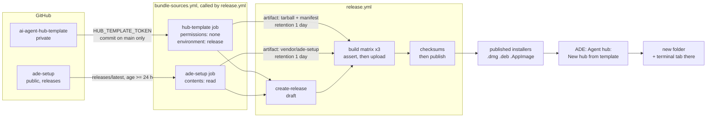

# Bundle the latest ade-setup and the agent hub template in every installer

- Date: 2026-11-09 (revision 2, same day: answers the adversarial review that
  blocked revision 1; the findings and answers are tabled at the end)
- Owner: architect
- Status: **Proposed** (not yet approved; not built)
- ADR: `.ade/context/decisions/0025-bundle-at-release-private-template-via-read-only-token.md`
- Contract: `.ade/context/bundled-sources.md`
- Related: ADR 0021 (ADE's own folder picker, no native dialog), Accepted
  2026-11-08 on main (PR #80).

## Goal

Every ADE release ships, inside its installers, (a) the newest released
**ade-setup** and (b) a clean copy of the **agent hub template**
(`github.com/alvin-reyes/ai-agent-hub-template`, a private repo), so nothing is
downloaded after install. ADE gets one small command that turns the bundled
template into a new hub folder.

Owner decisions (2026-11-09), taken as given:

- Bundle the latest **at release time**. ADE never fetches either at runtime.
- The template may go into the public installers. Its files are readable by
  anyone who unpacks an installer; the owner accepts this. The GitHub repo
  stays private.
- "Latest" ade-setup, not a reviewed pin, is what ships (kept in revision 2,
  with the guards of section 1.3).

New owner confirmations this revision asks for are listed in "Owner
checklist" near the end.

## Where things stand (origin/main, f9efae4)

- ade-setup is vendored by `npm run sync:agents` (`scripts/syncAgents.mjs`)
  into `vendor/ade-setup/{agents,templates}`, pinned in
  `vendor/ade-setup/VERSION` (`repo`, `release: v1.0.4`, `ref: c0c9c44…`,
  `vendored`). The script today clones with `--depth 1 --branch <ref>`, so it
  copies whatever the tag names at clone time. The files are compiled into the
  JS bundle (`src/data/roles.ts` `import.meta.glob`,
  `src/lib/projectMethodology.ts` `?raw`). They already ship in every
  installer, at main's pin.
- Guards: `scripts/agentSource.test.ts`, `scripts/subAgentSource.test.ts`,
  `src/lib/__tests__/agentComposition.test.ts`,
  `src/data/__tests__/pickerItems.test.ts`.
- Tauri resources: `src-tauri/tauri.conf.json` `bundle.resources` is an
  **object map** (four entries: `resources/bmad/`, `resources/bmad-v6/`,
  `resources/ade-runtime.mjs`, `../claude-plugin/`).
  `src-tauri/tauri.release.conf.json` (`externalBin` only) is merged by
  `release.yml` through `--config`.
- `.github/workflows/release.yml` (`permissions: contents: write` at the top):
  `create-release` (tag and version checks; creates a **published** release)
  → `build` matrix (macOS arm64, macOS x64, Linux x64; uploads with
  `gh release upload --clobber`) → `checksums` (uploads `SHA256SUMS
  --clobber`). It runs on `v*` tag pushes and on `workflow_dispatch` with one
  input, `tag`; a dispatch runs on the branch ref and the release creates the
  tag. A second run for the same tag today **replaces** its installers and
  `SHA256SUMS` in place. It never runs on pull requests.
- ADR 0021 (Accepted): ADE replaces the OS's native folder picker with its own
  in-webview picker wherever it picks folders, because the native one writes
  the chosen path into OS recent stores. **That picker is not built yet**, and
  its slice is not stated (F1 epic question Q8, open). `NewTabDialog.tsx`
  still calls `@tauri-apps/plugin-dialog` `open()` today.
- The template (main `0486568`): 531 tracked files, executables in `bin/` and
  `.githooks/`, no symlinks, many dotfiles. No LICENSE file. It tracks
  `.ade/session.md`, `.ade/knowledge/{README,developer,scrum-master}.md` and
  `memory/MEMORY.md` (an empty index). `bin/init --dest <dir>` **requires
  `<dir>` not to exist** (`[ -e "$DEST" ] && exit 2`), then copies the
  template into it leaving out `.git`, `hub.conf`, `repos/`, `_bmad-output/`.
  It is macOS-first (launchd, Keychain).

## Design



There is no data model change (no ER diagram): two files ship as resources and
two commands read them.

### 1. ade-setup: re-vendored in CI at release time, by sha

**Decision: vendor ephemerally in the release run; do not commit back.**

#### 1.1 The `ade-setup` job

In `.github/workflows/bundle-sources.yml` (reusable: `workflow_call`, and
`workflow_dispatch` for a dry run). `permissions: contents: read`. It never
sees `HUB_TEMPLATE_TOKEN` and never sees the template.

1. **Resolve.** If the input `ade_setup_ref` is empty:
   `GET /repos/alvin-reyes/ade-setup/releases/latest` with `github.token`
   (`GH_TOKEN: ${{ github.token }}`, `gh api`), not anonymously: anonymous
   calls share a 60-per-hour limit per runner IP. Output: `tag_name`,
   `published_at`. Then the tag's commit sha:
   `git ls-remote origin "refs/tags/<tag>^{}"` (annotated) or
   `refs/tags/<tag>` (lightweight).
   `releases/latest` is **GitHub's "Latest" flag** (the newest non-draft,
   non-prerelease release by creation date unless a maintainer marked another
   one), **not the highest semver** (N8). So the job also fails if the
   resolved tag is semver-lower than main's committed `release:` (a downgrade
   is never shipped by accident; pinning with `ade_setup_ref` is the way to
   ship an older one on purpose).
   If `ade_setup_ref` is set: it must be a 40-hex sha that a release tag of
   ade-setup points to (checked with `git ls-remote --tags`); the tag found is
   the `release:` line.
2. **Age rule (M4; owner confirmation O1).** Unless `ade_setup_ref` is set,
   fail when the release's `published_at` is less than **24 hours** before
   the run:
   `::error::ade-setup <tag> was published <n> h ago; releases ship only after
   24 h. Wait, or pin a release with ade_setup_ref=<sha>.`
   The override is the pin input, which is a deliberate human choice recorded
   in the run.
3. **Fetch by sha (M3).** `npm run sync:agents -- --sha <sha> --release <tag>`.
   With `--sha`, the script does `git init <tmp>`,
   `git -C <tmp> fetch --depth 1 <origin> <sha>`, `git -C <tmp> checkout
   --detach FETCH_HEAD`, and checks `git rev-parse HEAD` equals `<sha>`.
   `<origin>` is `ADE_SETUP_REPO` when set (a local repo path, used as a
   remote; this is how the test drives it) and the GitHub URL otherwise. A
   tag moved after step 1 cannot change what is copied, because the tag name
   is never fetched. It then writes `VERSION` with `release`, `ref`, a new
   `checksum: sha256:<hex>` line (definition in `bundled-sources.md`) and
   `vendored`. Without `--sha`, the script keeps today's behaviour (local
   development).
4. **Diff against main's pin (M4).** Before overwriting, the job copies the
   committed `vendor/ade-setup/` aside; after the sync it runs
   `git diff --no-index --stat` and the full `git diff --no-index` between the
   two. The **full diff goes into the job summary** (`$GITHUB_STEP_SUMMARY`)
   and is an output for the release notes ("Bundled" section, in a collapsed
   `<details>` block; cut at 60,000 characters with a pointer to the job
   summary, since release bodies are limited to 125,000). An empty diff says
   "same as main's pin <release>". This is how a human sees, after the fact,
   the prompt text that shipped without review.
5. **Test.** `npm ci`, then the **whole** `npm test`. A red run fails before
   the GitHub release exists.
6. **Notice.** If the shipped ref differs from main's `VERSION`, emit
   `::notice::main pins <a>, this release ships <b>; run npm run sync:agents
   in a PR`. Main keeps being updated by reviewed `sync:agents` PRs.
7. **Hand off.** Upload `vendor/ade-setup/` as the artifact
   `bundled-ade-setup`, `retention-days: 1`. Outputs: tag, sha, checksum,
   published_at, diff stat.

#### 1.2 Why not commit back via PR

- It does not make the tag reproducible: the tag exists before the run
  (push) or is made by the run (dispatch); a re-vendor PR lands after it.
- It puts a merge in the middle of a release (auto-merge bypasses review;
  waiting blocks the release), and it needs a write-scoped bot token on main.

What the release records instead: the "Bundled" section of the release notes
(ade-setup tag, sha, checksum, published time, the diff; template sha and
tarball sha256) and the `hub-template.json` manifest in the installer.

#### 1.3 The trade-off of shipping "latest" (M4)

Shipping the newest ade-setup release means **the agent prompt text in an ADE
release has had no human review in this repository**. Today every change to
the vendored roles goes through a `sync:agents` PR that a person reads; with
"latest", a change reaches users if it passes `npm test`, and `npm test`
checks structure (front matter parses, roles compose, the picker lists them),
not whether the words are right or safe. ade-setup is the owner's own repo,
so the review that remains is the one done there when a release is cut.

The guards, together:

- the 24-hour age rule: a release that turns out bad can be withdrawn (or
  un-marked "Latest") before any ADE release picks it up;
- the full vendored diff in the job summary and the release notes: what
  shipped is visible and attributable;
- the downgrade check and the pin input: a bad release can be held back by
  pinning the previous one;
- `npm test` over everything the roles feed.

The owner chose "latest" with this understood; this plan keeps it.

#### 1.4 Line endings (N4)

`.gitattributes` gains `vendor/ade-setup/** text eol=lf`. The checksum is over
bytes; a Windows checkout with `core.autocrlf` would otherwise compute a
different checksum and fail `agentSource.test.ts`. The files are LF today, so
the rule changes no bytes.

### 2. The template: private checkout, main only, clean tarball, scanned, fail closed

#### 2.1 The secret and its environment (M2)

`HUB_TEMPLATE_TOKEN`: a fine-grained PAT with **Contents: Read** on
`alvin-reyes/ai-agent-hub-template` only. It is an **environment secret** of a
GitHub Environment named `release`, not a repository secret, so only jobs that
declare `environment: release` can read it.

- Deployment rule of `release`: selected refs only, **tags `v*` and the branch
  `main`**. `main` is included because a `workflow_dispatch` run (a dispatched
  release, or a dry run) runs on the branch ref, not on a tag; without it,
  neither could read the template. Any other branch's run (where workflow
  code could be changed in an unreviewed push) is refused the environment.
  This rests on `main` requiring a reviewed PR and on `v*` tags being
  pushable only by the owner; both are owner settings (checklist O5).
- **The PAT reads every branch** of the template, not just main: Contents:
  Read has no branch scope. What limits what can ship is the main-ancestry
  rule (2.2 step 3), not the token.

#### 2.2 The `hub-template` job

Also in `bundle-sources.yml`. `permissions: {}` (the job's `GITHUB_TOKEN` has
no scopes), `environment: release` (the reusable workflow passes the
environment name as an input of type `choice`, default `release`; see V1). No
`npm ci`, no `setup-node`, no third-party npm code: the only actions are
`actions/checkout` and `actions/upload-artifact` (both pinned by commit sha),
and the scripts are bash plus one Node script that imports `node:` modules
only (Node is preinstalled on `ubuntu-latest`; a test enforces the import
rule).

Inputs reach scripts through `env:`, never through `${{ }}` inside `run:`
(N7); a structure test enforces it for both bundle workflows.

1. **Fail closed.** A step with `env: TOKEN_SET: ${{ secrets.HUB_TEMPLATE_TOKEN
   != '' }}` fails unless it is `true`:
   `::error::HUB_TEMPLATE_TOKEN is not set in the release environment: release
   builds must bundle the agent hub template (see
   docs/superpowers/specs/2026-11-09-…)`.
2. **Check out** ADE itself (for the scripts; public repo,
   `persist-credentials: false`) and the template: `repository:
   alvin-reyes/ai-agent-hub-template`, `token: ${{
   secrets.HUB_TEMPLATE_TOKEN }}`, `path: .hub-src`, `fetch-depth: 0` (needed
   for the ancestry check), `persist-credentials: false`, `ref:` the input
   `hub_template_ref` when set, else `main`. A 401/404 fails with a hint
   (token expired or lacks Contents: Read).
   These two lines are **the only places the secret is referenced** in any
   workflow (M7).
3. **Main only (B1).** `scripts/hub-template/bundle.sh` requires the commit to
   be on the template's main: `HUB_TEMPLATE_REF` (from `env:`) must be empty
   or 40-hex, and `git -C .hub-src merge-base --is-ancestor HEAD origin/main`
   must succeed, else
   `::error::hub_template_ref <sha> is not on the template's main; only
   commits reachable from main can be bundled`. A branch name is never
   accepted. So a dispatch (dry run or release) cannot publish another
   branch's content. Main's content is what the owner already accepted as
   public at the next release.
4. **Archive (M1).**
   `git -C .hub-src archive --format=tar HEAD -- . <excludes> | gzip -n -9`.
   Excludes are `:(exclude,glob)` pathspecs, which **match at any depth**
   (a plain `:(exclude)x` is anchored at the root, so `sub/.env` would ship;
   checked with git 2.x on 2026-11-09: `**/` also matches the root):
   - `:(exclude,glob)**/.env*`
   - `:(exclude,glob)**/hub.conf`
   - `:(exclude,glob)**/.ade/session.md`
   - `:(exclude,glob)**/.claude/settings.local.json`
   - `:(exclude,glob)**/.claude/worktrees/**`
   - `:(exclude,glob)repos/**`, `:(exclude,glob)_bmad-output/**`,
     `:(exclude,glob).local/**` (root-level working areas, as `bin/init`)
   - the knowledge and memory rule (2.3): every file under any
     `.ade/knowledge/` or `memory/` except `README.md` and `MEMORY.md`
     respectively. A pathspec cannot exclude a folder and keep one file in it
     (an exclude always wins), so the script lists the tracked files
     (`git ls-files -z`), runs them through the matcher, and passes each hit
     as `:(exclude,literal)<path>`.
   One matcher, `scripts/hub-template/excludes.mjs` (plain data plus a match
   function, no imports; Rust's `hubtemplate.rs` mirrors its list), is the single source for the glob list, the
   literal list and the check in step 6.
   `git archive` ships tracked files of one commit only (no `.git`, no
   untracked or ignored files, no history), honours `export-ignore`, keeps
   modes and dotfiles.
5. **Manifest.** `hub-template.json`: `repo`, `ref` (40-hex), `committed`,
   `bundled`, `files`, `sha256` of the tarball, `excluded` (count).
6. **Check** (`node scripts/hub-template/check.mjs`; `node:` imports only; a
   small ustar/pax reader over `node:zlib`). Fails unless:
   - the sha256 equals the manifest's, and the tarball is under 5 MB;
   - `bin/init` is present and a regular file with mode 755;
   - **no entry matches an excluded name at any depth**, by basename or
     trailing path (`.env*`, `hub.conf`, `.ade/session.md`,
     `.claude/settings.local.json`, `.claude/worktrees/`, and the knowledge
     and memory rule), using the same matcher as step 4;
   - no entry is absolute, contains `..`, or is anything but a regular file or
     directory (pax `g`/`x` headers aside, which `git archive` writes and the
     reader consumes as metadata).
7. **Secret scan (M1).** Unpack the tarball into a new empty directory and run
   **gitleaks v8.30.1** (published 2026-03-21; the binary is downloaded from
   its GitHub release and verified against a sha256 pinned in the workflow):
   `gitleaks dir <unpacked> --redact --no-banner --exit-code 1`. A finding
   **fails the job**. It scans files on disk, so it covers what actually
   ships, not the template's history. The template's own pre-commit hook is a
   first line; this is the gate.
8. **Hand off (B1).** Upload artifact `bundled-hub-template` with
   `retention-days: 1`: in a release run, the tarball and the manifest; in a
   **dry run** (the workflow dispatched directly, or `dry_run: true`), the
   **manifest only**. Workflow artifacts of a public repo can be downloaded by
   any signed-in GitHub user, so the tarball exists as an artifact only
   inside a release run, for one day at most, and only for a main commit. A
   final `cleanup` job of `release.yml` (`if: always()`,
   `permissions: actions: write`) deletes the run's artifacts once the
   release is published or the run has failed.

#### 2.3 What ships of `.ade/knowledge/` and `memory/` (M1; owner may override, O3)

**Decision: ship the two scaffolds, not their entries.**

- Ship `.ade/knowledge/README.md` (it explains the convention to a new hub's
  agents) and `memory/MEMORY.md` (the empty index the hub's memory needs).
- Do not ship any other file under `.ade/knowledge/` or `memory/`. Today that
  is `.ade/knowledge/developer.md` and `.ade/knowledge/scrum-master.md`.

Why: these files hold what the template's *own maintainers* learned while
building the template (for example "never source tests/helpers.sh from the
zsh tool shell"). In a new hub they describe the wrong project, and the
README's own rule is that "a stale note is worse than no note, because it is
believed". They are also the most likely place for something personal or
machine-specific to land, since they are written by agents as they work. The
matcher keeps the rule general: any future `.ade/knowledge/<role>.md` or
`memory/<entry>.md` is left out without a list update.

#### 2.4 Why a tarball, not a resource directory

A directory of 531 files would rely on Tauri's resource copy and each packer
(dmg, deb, AppImage) to keep dotfiles and the executable bit; nothing checks
that today, and `.claude/`, `.ade/`, `.githooks/` and `bin/*` are the
template's core. One file sidesteps both, is one sealed resource for macOS
signing, and is what the checksum describes.

#### 2.5 Build wiring

`tauri.release.conf.json` gains
`"resources": {"resources/hub-template.tar.gz": "resources/hub-template.tar.gz",
"resources/hub-template.json": "resources/hub-template.json"}` inside
`bundle`. It is **not** in the base `tauri.conf.json`: tauri-build fails on a
missing resource, and `cargo test`, `tauri dev` and PR CI must work without
the private template. A release build with no tarball fails at compile time:
a second fail-closed layer.

The merge is RFC 7396 (JSON merge patch) and the base `resources` is an object
map, so the two keys are added beside the base four. If the base ever became
an array, a merge patch would **replace** it and silently drop
`resources/bmad*`. A cheap pre-release check (N9) catches that in every PR:
`scripts/bundledSources.test.ts` applies an RFC 7396 merge of the release conf
onto the base conf and asserts the merged `bundle.resources` holds all six
keys and the base one is an object. V2 then proves the real merge on the first
release.

**Local and PR builds skip, clearly.** Both files are gitignored.
`npm run bundle:hub-template` with no `HUB_TEMPLATE_SRC` prints `hub template:
no source (set HUB_TEMPLATE_SRC to a checkout); this build will not include
it. Release builds bundle it.` and exits 0; `--require` makes it fail. A debug
build also looks for the files in `src-tauri/resources/`.

#### 2.6 Release order: draft, assert, upload, checksum, publish (N1, N2, M3)

- `create-release` needs both bundle jobs and creates the release as a
  **draft** (`draft: true`), with the "Bundled" section. Drafts are invisible
  to `releases/latest`, so `install.sh` never sees a half-built release.
- **Rebuild policy (M3; owner confirmation O2): a published tag is never
  rebuilt.** `create-release` fails if a **non-draft** release already exists
  for the tag: `::error::<tag> is already published; releases are immutable.
  Ship a new patch version instead.` A leftover **draft** from a failed run
  is reused (its assets are replaced; nothing was public). The alternative,
  allowing it, would silently replace installers and `SHA256SUMS` that users
  and `install.sh` may already have verified.
- In each `build` job, after `tauri build` and **before** the upload step, the
  in-installer assertion runs against **every** installer the job made:
  - macOS: the `.app` in the bundle directory, and the **`.dmg`** itself
    (`hdiutil attach -readonly -nobrowse -mountpoint <tmp>`, inspect
    `*.app/Contents/Resources/resources/`, `hdiutil detach`);
  - Linux: the **`.deb`** (`dpkg-deb -x` into a temp dir; the resources sit
    under `usr/lib/<product>/resources/`) and the AppImage
    (`--appimage-extract`).
  Each must hold `hub-template.tar.gz` and `hub-template.json`, the tarball's
  sha256 must equal the manifest's and the manifest's `ref` the resolved one,
  `bin/init` must be listed with mode 755, and no entry may start with
  `.git/`. A red assertion means nothing is uploaded.
- `checksums` computes `SHA256SUMS` from the draft's assets, checks that every
  expected installer (3 platforms: 2 `.dmg`, 1 `.deb`, 1 `.AppImage`) is
  listed, uploads it, and only then **publishes** the release
  (`gh release edit <tag> --draft=false`). For a dispatched release the tag is
  created at that moment, on `target_commitish` (the existing tag check
  still runs first).

#### 2.7 Determinism (M3)

Claim downgraded: for one template sha, **on the same runner image** (same
`git` and `gzip`), the tarball's sha256 is the same. Across runner images it
may differ (git archive's tar and gzip's output are not promised stable across
versions). Installers are not byte-reproducible at all. The pin inputs exist
to hold back a bad input or to repeat a dry run for comparison, not to
reissue a tag.

```mermaid
sequenceDiagram
  participant T as Tag push / dispatch
  participant HJ as hub-template job (env release, no perms)
  participant AJ as ade-setup job (contents: read)
  participant CR as create-release
  participant B as build (x3)
  participant CS as checksums
  T->>HJ: start (inputs via env)
  T->>AJ: start
  HJ->>HJ: token set? else fail closed
  HJ->>HJ: checkout template, ref on main? else fail
  HJ->>HJ: git archive with glob excludes, check, gitleaks dir
  HJ-->>CR: artifact tarball + manifest (1 day)
  AJ->>AJ: releases/latest (github.token); age >= 24 h? not a downgrade?
  AJ->>AJ: fetch by sha, VERSION + checksum, diff vs main's pin
  AJ->>AJ: npm ci, npm test
  AJ-->>CR: artifact vendor/ade-setup (1 day), diff
  CR->>CR: tag already published? fail. Else draft release + Bundled notes
  CR->>B: start
  B->>B: unpack artifacts; tauri build --config release
  B->>B: assert in .app/.dmg or .deb/.AppImage, then upload
  B->>CS: done
  CS->>CS: SHA256SUMS complete? upload, then publish draft
```

### 3. In ADE: "Agent hub: New hub from template…"

Split into a Rust story (S4a) and a UI story (S4b, needs the designer).

#### 3.1 Rust: `src-tauri/src/hubtemplate.rs` (S4a, M6)

New dependency: **`tar` 0.4.46** (published 2026-05-18, so older than the
two-week rule; `flate2` 1.1.9 is already locked).

`hub_template_info() -> Option<HubTemplateInfo>`: the manifest, or `None`
when the resource is absent (local, PR and debug builds without a source).

`hub_template_create(dest: String) -> {dest, files, ref}`:

1. `dest` must be absolute and **must not exist**; its parent must exist and
   be a directory. This is `bin/init --dest`'s rule exactly (revision 1
   wrongly said "empty"); "never overwrites" follows from it.
2. Read the whole tarball, verify its sha256 against the manifest.
3. **Validate every entry first, before writing anything.** Accept only
   regular files and directories (pax `g`/`x` headers are metadata). Reject,
   naming the entry: symlinks, **hardlinks**, character and block devices,
   FIFOs, GNU sparse and any other type; absolute paths, `..`, empty
   components, Windows drive or UNC prefixes; and anything the shared
   exclusion rule matches (defensive; the release check already refuses
   them). Any rejection ends the command with nothing written.
4. Extract into a **temporary sibling**,
   `<parent>/.<name>.ade-tmp-<random>`, writing each file's mode as
   `mode & 0o777` (no setuid, setgid or sticky bits; `#[cfg(unix)]`, Windows
   has no mode). The tar crate's `unpack` is not used for the final path;
   entries are written one by one so the mask and the type rules are ours.
5. `rename(tmp, dest)`. On **any** error from step 4 or 5 the temporary
   directory is removed (`remove_dir_all`, which does not follow links) and
   `dest` is never created. If `dest` appeared between steps 1 and 5, the
   rename fails on a non-empty `dest` and the temp is removed; only an
   *empty* directory created in that instant could be replaced (POSIX
   `rename`), which loses nothing.

Windows: the module compiles and its non-mode tests run there (CI's Windows
backend job), mode tests are `#[cfg(unix)]`, and the palette entry is
**hidden on Windows** (no Windows installer exists, and the template is
macOS-first).

#### 3.2 UI: palette entry and dialog (S4b; designer input required)

One Command Palette entry, category Project, id `hub-template-new`.

**Folder choice (M5): no native dialog.** ADR 0021 forbids the OS picker
wherever ADE picks folders. ADE's own picker is not built and has no slice
yet, so S4b does **not** depend on it: S4b uses a **typed path field** in a
small dialog ("New hub folder", for example `~/hubs/acme`; `~` expanded by
Rust), with inline errors from the rules of 3.1 step 1 ("already exists",
"parent folder does not exist"). When ADR 0021's picker is built, its story
replaces the field with the picker's "choose a parent, name a new folder"
mode; the Rust command does not change. The designer owns the dialog's layout
and copy.

After a successful create: a terminal tab opens in `dest`
(`addTab("Agent hub", dest)`) and a one-button notice says "Copied the agent
hub template (<short ref>) to <dest>. Next, in that terminal: `bin/init
--list`, then `bin/init --persona <slug> --client "<name>" --owner
"<name>"`." Errors show in the dialog and open no tab. With
`hub_template_info() == None` the entry still appears (except on Windows) and
says "This build has no bundled agent hub template. Release builds include
it."

Out of scope: a form for `bin/init`'s options, running `bin/init`,
`gh repo create`, updating an existing hub, runtime downloads, Windows,
`bin/init` on Linux, showing versions in Settings or About, vendoring more of
ade-setup than `agents/` and `templates/`, and building ADR 0021's picker.

## Visibility, licensing, size

- **Visibility (owner accepted, 2026-11-09).** Anyone who downloads an
  installer can read every bundled file. History, authors and commit messages
  do not ship. **Whatever is on the template's `main` becomes public at the
  next ADE release**; only main can ship (B1). Treat main as publishable. The
  gitleaks gate (2.2 step 7) and the exclusion matcher are gates for known
  patterns and names, not a guarantee.
- **Licensing (owner decision O4).** ADE is MIT. The template has no LICENSE,
  so it ships "all rights reserved": readable, not licensed for reuse, and a
  hub made from it has no stated licence. The owner should add a LICENSE or a
  short NOTICE to the template. Not a blocker for bundling. The template's
  BMAD content is MIT, as ADE's own `resources/bmad-v6/` is.
- **Size.** ade-setup: no change. Template: about +0.9 MB per installer.
  The check fails over 5 MB.

## Tests

CI and scripts (vitest, in `npm test`; npm test runs on Linux in CI and on
developers' macOS machines):

- `scripts/agentSource.test.ts`: `VERSION` has `release: v…` and `checksum:
  sha256:` lines, and the checksum equals one recomputed over
  `vendor/ade-setup/{agents,templates}`.
- `scripts/vendorChecksum.test.ts`: order-independent; changes when any byte
  or path changes.
- `scripts/syncAgents.test.ts` (fixture repo in a temp dir, `ADE_SETUP_REPO`
  pointing at it, `uploadpack.allowReachableSHA1InWant` set on the fixture):
  `--sha <c1>` vendors `c1`'s bytes even after the fixture's tag is moved to
  `c2` (the fetch is by sha); a sha absent from the fixture fails; `VERSION`
  records `--release`, the sha and the checksum.
- `scripts/hubTemplate.test.ts` (fixture repo holding root and **nested**
  `.env`, `sub/.env.local`, `sub/hub.conf`, `x/.ade/session.md`,
  `sub/.claude/settings.local.json`, `.ade/knowledge/{README,dev}.md`,
  `memory/{MEMORY,note}.md`, `repos/x`, an exec `bin/init`, dotfiles):
  - every excluded name is absent at every depth; the two scaffolds are
    present, `.ade/knowledge/dev.md` and `memory/note.md` are not;
  - no `.git/`; `bin/init` mode 755; dotfiles present; manifest `ref` equals
    the fixture sha; two runs on one machine give the same sha256;
  - a commit on a side branch (not an ancestor of main) is refused, and a
    branch name as `HUB_TEMPLATE_REF` is refused (B1);
  - `check.mjs` rejects a tarball with a nested `.env` (built by hand, as
    `git archive` would never produce it), a symlink, a hardlink, `..`, an
    oversize file, and a sha256 mismatch;
  - `check.mjs` imports only `node:` modules;
  - no source → exit 0 with the skip message; `--require` → non-zero.
- `scripts/bundledSources.test.ts` (string assertions over the workflow
  files; no YAML parser is in the tree, and none is added):
  - `.gitignore` ignores both resource files and `git ls-files` lists
    neither; base conf does not name them; release conf does;
  - the RFC 7396 merge of the two confs holds all six resource keys (N9);
  - `release.yml` calls `bundle-sources.yml`, and `create-release` needs both
    bundle jobs; the release is created with `draft: true` and published only
    in `checksums`; `create-release` has the "already published" refusal;
  - the `hub-template` job has `permissions: {}` and `environment:`, and no
    `npm ci`/`setup-node`; the `ade-setup` job has `contents: read`, runs
    `npm test` after `sync:agents`, and does not mention the secret;
  - `HUB_TEMPLATE_TOKEN` appears **only** in the fail-closed check's `env:`
    and the template checkout's `token:` (M7), and `persist-credentials:
    false` is on both checkouts of that job;
  - every `upload-artifact` in the bundle workflow sets `retention-days: 1`;
    the dry-run path uploads only `hub-template.json`;
  - `release.yml`'s `workflow_dispatch` has `ade_setup_ref` and
    `hub_template_ref` inputs and passes them to `bundle-sources.yml`;
  - no `run:` block in either workflow contains `${{ inputs.` or
    `${{ github.event.inputs` (N7);
  - the in-installer assertion step comes before the upload step.
- `actionlint` (v1.7.12): recommended as a step in `ci.yml` (DevOps owns
  `ci.yml`; noted for `docs/ops.md`). It is not part of the verification
  command; S3's developer runs it locally and pastes the output in the story.

App:

- Rust (`hubtemplate.rs`, fixture tarballs built with the `tar` crate's
  builder and one made by real `git archive`, so pax headers are exercised):
  unpacks without `.git/` and excluded names even when the tarball has them;
  keeps dotfiles; refuses an existing `dest` (empty or not) and a missing
  parent; refuses `..`, absolute paths, a symlink, a hardlink, a device
  entry, each with nothing written; a sha256 mismatch is an error;
  **mid-stream failure** (a tarball truncated after some entries, and a
  write error injected through a test seam) leaves neither `dest` nor any
  `.ade-tmp-` sibling; no resource → `hub_template_info` is `None`.
  `#[cfg(unix)]`: `bin/init` gets 755; an entry with mode `0o4755` is written
  as `0o755` (mask).
- Vitest (`CommandPalette.test.tsx`, dialog test): the entry exists (and not
  on Windows); it opens the path dialog, never `plugin-dialog`'s `open`; a
  submitted path invokes `hub_template_create`, then `addTab("Agent hub",
  dest)`, and the notice names `bin/init`; an error shows in the dialog and
  opens no tab; with no bundled template it says so.

## Stories (for the scrum-master)

S1 and S2 are independent. S3 needs both. S4a needs only S2's format; S4b
needs S4a and the designer's dialog.

**S1. ade-setup pin: fetch by sha, record release and checksum.**
`scripts/syncAgents.mjs` (`--sha`, `--release`, fetch by sha, `checksum:`),
`.gitattributes` line, re-vendor v1.0.4 (only `VERSION` changes).
1. `VERSION` records `release`, 40-hex `ref` and `checksum` → agentSource.
2. The checksum matches the vendored files → agentSource.
3. Order-independent and byte-sensitive → vendorChecksum.
4. `--sha` copies that commit even if the tag moved; an unknown sha fails →
   syncAgents tests on the `ADE_SETUP_REPO` fixture.
5. `vendor/ade-setup/**` is `eol=lf` → bundledSources string test.

**S2. Hub template bundler and check.** `scripts/hub-template/bundle.sh`,
`excludes.mjs`, `check.mjs`, `npm run bundle:hub-template`, gitignore lines,
manifest format.
1. Tracked files only; excluded names absent at any depth, nested fixtures →
   hubTemplate tests.
2. Knowledge and memory: scaffolds in, entries out → hubTemplate test.
3. Modes and dotfiles survive; deterministic on one machine → tests.
4. Only main ancestors bundle; branch names refused → two tests.
5. `check.mjs` rejects nested excluded names, links, `..`, oversize,
   mismatch; imports only `node:` → tests.
6. No source: skip (exit 0); `--require`: fail → two tests.
7. Never committed → bundledSources gitignore/ls-files test.
(gitleaks runs in the workflow, S3; it is not a vitest dependency.)

**S3. Release workflow: split jobs, environment, draft-then-publish.**
`.github/workflows/bundle-sources.yml` (jobs `hub-template` and `ade-setup`;
`workflow_call` and `workflow_dispatch` dry run with an `environment` choice
input `release` | `no-secret`), `release.yml` changes (dispatch inputs and
pass-through, draft release, published-tag refusal, assertion before upload
in all installers, publish in `checksums`, `cleanup` job),
`tauri.release.conf.json` resources, release-notes "Bundled" section with
the diff, age and downgrade rules, gitleaks step.
1. Job structure, permissions, environment, retention, dry run manifest-only,
   draft and publish order, assertion before upload → bundledSources tests.
2. Secret only in the fail-closed check and the checkout → bundledSources.
3. Dispatch inputs exist and pass through; inputs only via `env:` →
   bundledSources.
4. Release conf merge keeps all six resources → bundledSources.
5. Manual V1 (owner, recorded in the story with run URLs), dry runs
   dispatched from `main`:
   a. `environment: release`, no refs: green; the artifact holds only
      `hub-template.json`; the summary shows the ade-setup diff.
   b. `environment: no-secret` (an environment the owner creates with no
      secrets and the same deployment rule): red at the fail-closed step with
      its message.
   c. `hub_template_ref` = a commit on a template side branch: red with the
      main-only message.
   d. `ade_setup_ref` empty while the newest ade-setup release is under 24 h
      old (or simulated by a test release): red with the age message; the
      same run with `ade_setup_ref` set: green.
6. Manual V2: the first release after merge: the assertion passes in every
   installer, the release stays a draft until `SHA256SUMS` is uploaded, and
   then publishes; the owner records the run URL. A second run for that
   published tag fails with the immutable-release message.

**S4a. Hub template commands (Rust).** `hubtemplate.rs`
(`hub_template_info`, `hub_template_create`), `tar` 0.4.46.
1. Copies without `.git` and excluded names, keeping dotfiles → Rust tests.
2. Refuses an existing `dest` and a missing parent → Rust tests.
3. Validates all entries first: links (sym and hard), devices, `..`,
   absolute paths refused with nothing written → Rust tests.
4. Temp sibling then rename; a mid-stream failure leaves nothing → Rust
   tests.
5. Mode masked to `0o777`, `bin/init` 755 → `#[cfg(unix)]` Rust tests.
6. Checksum mismatch and absent resource → Rust tests.

**S4b. "Agent hub: New hub from template…" (palette and dialog).** Needs the
designer's dialog and notice copy (`docs/ux-spec.md` section to be added).
1. Entry exists in category Project, hidden on Windows → palette test.
2. Typed path dialog, never the native picker → test asserts
   `plugin-dialog`'s `open` is not called.
3. Success opens a tab in `dest` and shows the `bin/init` hint → test.
4. Errors show in the dialog, no tab → test.
5. No bundled template: says so → test.

## Verification command

Unchanged: the lines approved on 2026-11-02
(`2026-11-02-open-terminals-from-a-terminal-design.md`, "Verification
command", indexed in `docs/architecture.md`). Each must exit 0:

```
npx tsc --noEmit
npm test
cd src-tauri && cargo test
cd relay && cargo test
cd mobile && npx tsc --noEmit && npx jest
cd src-tauri && cargo check -p ade-hook
```

Green means every vitest (S1, S2, S3's structure tests, S4b) and every Rust
test (S4a) passes and the app type-checks. Workflow behaviour cannot run under
this command, which is why S3 has the manual checks V1 and V2, recorded by
the owner. No new line is proposed; changing it needs the owner's approval.

## Owner setup

### The token and the `release` environment

1. GitHub → Settings → Developer settings → Personal access tokens →
   **Fine-grained tokens** → Generate new token. Name `ADE release: hub
   template read`; owner `alvin-reyes`; an expiry you accept, with a reminder
   a week before.
2. Repository access: **Only select repositories** →
   `alvin-reyes/ai-agent-hub-template`. Permissions: **Contents: Read-only**
   (Metadata is added automatically). Nothing else. Note: this reads **every
   branch** of the template; only main can ship (B1).
3. On `alvin-reyes/better-agentic-ide`: Settings → Environments → New
   environment `release`. Deployment branches and tags: **Selected branches
   and tags** → add tag rule `v*` and branch rule `main`. Add environment
   secret `HUB_TEMPLATE_TOKEN` (or `gh secret set HUB_TEMPLATE_TOKEN --env
   release -R alvin-reyes/better-agentic-ide`).
4. Create environment `no-secret` with the same deployment rule and **no
   secrets** (used by V1 b only).
5. If a repository secret `HUB_TEMPLATE_TOKEN` was created for revision 1,
   delete it.
6. When the token expires, release runs fail at the checkout with the hint;
   repeat 1 to 3.

## Owner checklist (decisions and confirmations this revision needs)

- **O1. Age rule.** ade-setup releases ship only when at least 24 hours old,
  overridable only by pinning a release sha. Confirm 24 h (or name another
  value).
- **O2. Rebuild policy.** A published tag is never rebuilt; a bad release is
  replaced by a new patch version. Recommended. Confirm (the alternative
  silently replaces installers and `SHA256SUMS`).
- **O3. Knowledge and memory.** Ship `.ade/knowledge/README.md` and
  `memory/MEMORY.md` only; per-role knowledge and memory entries never ship
  (2.3). Confirm or override.
- **O4. Licence.** Add a LICENSE or NOTICE to the template (not a blocker).
- **O5. Environment rule.** `release` allows `v*` tags and `main`. This is
  sound only if `main` requires a reviewed PR and `v*` tags can be pushed
  only by the owner (a tag ruleset). Confirm both settings.
- **O6. Folder choice.** S4b ships a typed path field (no native dialog, per
  ADR 0021) until ADE's own picker exists. Confirm; the designer owns its
  copy.
- **O7. Draft releases.** Releases stay drafts until `SHA256SUMS` passes;
  a dispatched release's tag is created at publish time. Confirm.

## Risks

- A new ade-setup release breaks a test → the release fails. Intended; pin
  the last good release with `ade_setup_ref`.
- Prompt text ships without review in this repo (1.3); bounded by the age
  rule, the diff in the notes, and the pin.
- Something sensitive committed to the template's main ships publicly →
  gitleaks gate and matcher catch known patterns and names only; main is
  publishable by rule.
- The environment rule includes `main`, so a merged workflow change on main
  can read the token; that is the same trust as any reviewed code on main.
- The tarball is a downloadable workflow artifact for up to one day inside a
  release run; its content is main's, which ships publicly in that release.

## Adversarial review: findings and answers

| Finding | Answer in this revision |
|---|---|
| **B1** Dispatch or dry run could publish any private template branch as a public workflow artifact. | Only commits reachable from template `main` bundle (`git merge-base --is-ancestor HEAD origin/main`; branch names refused); every artifact has `retention-days: 1`; a dry run uploads the manifest only; a `cleanup` job deletes run artifacts. Section 2.2 steps 3 and 8; rule written into ADR 0025; tests in S2 and S3. |
| **M1** `:(exclude)x` is root-anchored, so nested `sub/.env` ships. | `:(exclude,glob)**/…` for `.env*`, `hub.conf`, `.ade/session.md`, `.claude/settings.local.json`, `.claude/worktrees/` (checked locally: `**/` also matches the root). `check.mjs` matches names at any depth with the same matcher; nested fixtures in tests. `gitleaks dir` on the unpacked tarball fails the job. Knowledge and memory: scaffolds ship, entries do not (2.3, O3). |
| **M2** One job mixed the secret, npm code and private source. | Split: `hub-template` (`permissions: {}`, environment `release`, only `actions/checkout` and `upload-artifact`, bash plus a `node:`-only check, gitleaks, no `npm ci`, uploads tarball and manifest only) and `ade-setup` (`contents: read`, sync and `npm test`). Token is an environment secret with a `v*` tag rule (plus `main`, needed for dispatch runs; O5). PAT reads all branches, stated. The "exactly one step" claim and its test are gone (replaced by M7's rule). |
| **M3** Pin inputs absent from `release.yml`; tag-based clone; rebuild replaces assets; overstated determinism. | `release.yml` dispatch gains `ade_setup_ref` and `hub_template_ref`, passed through. `syncAgents` fetches by sha (`git init`; `git fetch --depth 1 <origin> <sha>`), tested on the `ADE_SETUP_REPO` fixture with a moved tag. Rebuilding a published tag is refused; ship a new patch tag (2.6, O2). Determinism downgraded to "same runner image" (2.7). |
| **M4** "Latest" ships unreviewed prompt text. | Trade-off stated (1.3). Guards: full vendored diff vs main's pin in the job summary and release notes; 24-hour age rule with a pin override (O1); `github.token` for the releases API; downgrade check because `releases/latest` is GitHub's flag, not highest semver (N8). "Latest" kept, as the owner chose. |
| **M5** Native folder dialog contradicts ADR 0021. | No native dialog. ADE's picker is not built and has no slice, so S4b uses a typed path field and does not depend on it; the picker's story swaps it in later (3.2, O6). |
| **M6** Unsafe or partial extraction; wrong `bin/init --dest` claim. | Validate all entries first; reject symlinks and hardlinks explicitly (and devices, FIFOs, sparse); extract to a temp sibling, rename into place, remove on any error; modes `& 0o777`. Rust tests for mid-stream failure and the mask. Corrected: `bin/init --dest` requires the destination **not to exist**, and so does `hub_template_create` (3.1). |
| **M7** AC on the secret was loose; no negative run. | AC: the secret is referenced only by the fail-closed check's `env:` and the checkout's `token:` (structure test). V1 b runs the dry run in a `no-secret` environment and expects the fail-closed error. `actionlint` recommended for `ci.yml` (DevOps) and run by S3's developer. |
| **N1** Assertion after upload; release public before checksums. | Assertion runs before upload; release is a draft until `SHA256SUMS` is uploaded and complete, then published (2.6, O7). |
| **N2** Only the `.app` and AppImage were asserted. | `.dmg` (hdiutil attach, read-only) and `.deb` (`dpkg-deb -x`) asserted too (2.6). |
| **N3** Windows. | Mode tests `#[cfg(unix)]`; the module compiles and its other tests run on Windows CI; the palette entry is hidden on Windows (3.1, 3.2). |
| **N4** CRLF would break the checksum on Windows checkouts. | `.gitattributes` `vendor/ade-setup/** text eol=lf` (1.4, S1). |
| **N5** `tar` crate version unnamed. | `tar` 0.4.46, published 2026-05-18, meets the two-week rule (3.1). |
| **N6** S4 mixed Rust and UI needing design. | Split into S4a (Rust) and S4b (palette and dialog, needs the designer). |
| **N7** `${{ }}` inside `run:` is an injection path. | Inputs reach scripts via `env:` only; structure test forbids `${{ inputs.` and `${{ github.event.inputs` in `run:` blocks (2.2). |
| **N8** `releases/latest` is not highest semver. | Stated; downgrade check against main's pinned release (1.1 step 1). |
| **N9** The `--config` merge was only assumed. | Cheap PR-time check: RFC 7396 merge of the two confs must hold all six resource keys, with the base an object (2.5). V2 proves the real merge. |
| **N10** Licence question buried. | On the owner checklist as O4. |
