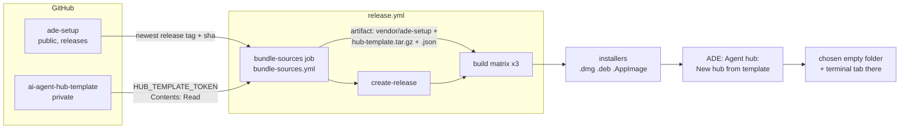

# Bundle the latest ade-setup and the agent hub template in every installer

- Date: 2026-11-09
- Owner: architect
- Status: **Proposed** (not yet approved; not built)
- ADR: `.ade/context/decisions/0025-bundle-at-release-private-template-via-read-only-token.md`
- Contract: `.ade/context/bundled-sources.md`

## Goal

Every ADE release ships, inside its installers, (a) the newest released
**ade-setup** and (b) a clean copy of the **agent hub template**
(`github.com/alvin-reyes/ai-agent-hub-template`, a private repo), so nothing is
downloaded after install. ADE gets one small command that turns the bundled
template into a new hub folder.

Owner decisions (2026-11-09), taken as given:

- Bundle the latest **at release time**. ADE never fetches either at runtime.
- The template may go into the public installers. Its files are readable by
  anyone who unpacks an installer; the owner accepts this. The GitHub repo
  stays private.

## Where things stand (origin/main, 644773f)

- ade-setup is vendored by `npm run sync:agents` (`scripts/syncAgents.mjs`)
  into `vendor/ade-setup/{agents,templates}`, pinned in
  `vendor/ade-setup/VERSION` (`repo`, `release: v1.0.4`, `ref: c0c9c44…`,
  `vendored`). It is compiled into the JS bundle (`src/data/roles.ts`
  `import.meta.glob("../../vendor/ade-setup/agents/*.md")`,
  `src/lib/projectMethodology.ts` `?raw` import). It already ships in every
  installer, but at whatever pin main had when the tag was cut, which can be
  behind the newest ade-setup release. Only `agents/` and `templates/` are
  vendored; widening that is not part of this plan.
- Guards: `scripts/agentSource.test.ts` (VERSION has a 40-hex `ref:` and a
  `repo:`; every definition parses), `scripts/subAgentSource.test.ts`,
  `src/lib/__tests__/agentComposition.test.ts`, `src/data/__tests__/pickerItems.test.ts`.
- Tauri resources: `src-tauri/tauri.conf.json` `bundle.resources` maps
  `resources/bmad/`, `resources/bmad-v6/`, `ade-runtime.mjs` and the Claude
  plugin. Rust resolves them with
  `app.path().resolve("resources/bmad-v6", BaseDirectory::Resource)`
  (`src-tauri/src/bmadv6.rs`). `src-tauri/tauri.release.conf.json` is merged
  only by `release.yml` (`--config`), today for `externalBin`.
- `.github/workflows/release.yml`: `create-release` (tag/version checks, makes
  the GitHub release) → `build` matrix (macOS arm64, macOS x64, Linux x64) →
  `checksums`. It runs on `v*` tag pushes and on `workflow_dispatch` (which
  creates the tag). It never runs on pull requests.
- The template (origin/main `1a22633`): 523 tracked files, 21 executable
  (`bin/*`, `.githooks/*`), no symlinks, many dotfiles (`.claude/` holds 436
  files, `.ade/`, `.githooks/`, `.gitignore`). `git archive` is 3.8 MB
  unpacked, **0.9 MB gzipped**. No LICENSE file. `bin/init` initializes in
  place, or with `--dest` copies the template first, leaving out `.git`,
  `hub.conf`, `repos/`, `_bmad-output/`. It is macOS-first (launchd, Keychain).

## Design



There is no data model change (no ER diagram): two files ship as resources and
two read-only commands read them.

### 1. ade-setup: re-vendored in CI at release time

**Decision: vendor ephemerally in the release run; do not commit back.**

A new job, `bundle-sources`, runs before `create-release`:

1. Resolve the newest ade-setup release once:
   `GET https://api.github.com/repos/alvin-reyes/ade-setup/releases/latest`
   (public repo; drafts and prereleases are skipped by that endpoint) → tag,
   then the tag's commit sha. A `workflow_dispatch` input `ade_setup_ref`
   overrides it (to rebuild an old tag, or to hold back a bad ade-setup).
2. `npm run sync:agents -- <tag>`; the script checks the cloned HEAD equals the
   resolved sha (a moved tag fails the run) and writes `VERSION` with a new
   line, `checksum: sha256:<hex>`, over the vendored files (definition in
   `.ade/context/bundled-sources.md`). A tree checksum, not the GitHub
   tarball's: GitHub does not promise stable tarball bytes, and a tree
   checksum can be recomputed by a test offline.
3. Run the **whole** `npm test` (not only `agentSource`): the roles feed the
   picker, the sub-agents, the composition and the methodology tests, and a
   new ade-setup can break any of them. **A red run fails the release before
   the GitHub release exists**, so no empty release is left behind.
4. If the resolved ref differs from the committed `VERSION`, emit a
   `::notice::` ("main pins v1.0.4, this release ships v1.0.5; run
   `npm run sync:agents` in a PR"). Main keeps being updated by the existing
   reviewed `sync:agents` PRs (as PR #79 did).
5. Pack `vendor/ade-setup/` with the template outputs (below) into one
   `bundled-sources.tgz` workflow artifact. Every build job downloads and
   unpacks it before `npm ci`, so **all three platforms ship the same bytes**
   (resolving per job could straddle a new ade-setup release).

Why not commit back via PR:

- It does not buy tag reproducibility. The tag is cut before the run (push)
  or by the run's first job (dispatch); a re-vendor PR lands after it, so the
  tag's tree would still not hold what shipped.
- It puts a merge in the middle of a release: auto-merge bypasses review, and
  waiting for review blocks the release.
- It needs a write-scoped token on main for a bot.

What makes a tag reproducible instead: the release records the exact inputs.
`bundle-sources` writes them into the GitHub release notes (a "Bundled"
section: ade-setup tag, sha and checksum; template sha and tarball sha256),
and the installer carries `hub-template.json` (`VERSION` itself is not
imported into the JS bundle, so for ade-setup the release notes are the
record). Rebuilding tag `vX` = dispatch the workflow for `vX` with
`ade_setup_ref=<recorded sha>` and `hub_template_ref=<recorded sha>`; the
checksums prove the rebuild matches. The cost: main's committed pin can lag
the shipped one, and local/PR CI test the committed pin. The release's own
`npm test` covers what actually ships, so the lag is a notice, not a risk.

### 2. The template: private checkout, clean tarball, fail closed

**Secret:** `HUB_TEMPLATE_TOKEN`, a fine-grained PAT with **Contents: Read**
on `alvin-reyes/ai-agent-hub-template` only (Metadata: Read is implied). It is
read in one step of `bundle-sources` and nowhere else.

Steps in `bundle-sources`:

1. **Fail closed.** If `HUB_TEMPLATE_TOKEN` is empty, fail with
   `::error::HUB_TEMPLATE_TOKEN is not set: release builds must bundle the
   agent hub template (see docs/superpowers/specs/2026-11-09-…)`. Every run
   of `release.yml` is a tag build (tag push or a dispatch that makes a tag),
   so this is unconditional there. Pull-request CI (`ci.yml`) never bundles
   the template and never sees the secret.
2. `actions/checkout@v4` with `repository: alvin-reyes/ai-agent-hub-template`,
   `ref: ${{ inputs.hub_template_ref || 'main' }}`,
   `token: ${{ secrets.HUB_TEMPLATE_TOKEN }}`, `path: .hub-src`,
   `fetch-depth: 1`, `persist-credentials: false`. A 401/404 here fails with a
   hint: token expired, or it lacks Contents: Read on that repo.
3. `node scripts/bundleHubTemplate.mjs .hub-src src-tauri/resources` builds:
   - `hub-template.tar.gz`: `git archive --format=tar HEAD` with pathspec
     excludes, piped through `gzip -n`. `git archive` ships **tracked files
     only** at that commit, so `.git`, `.claude/worktrees/`, untracked and
     ignored files can never get in; it honours `export-ignore` in the
     template's `.gitattributes`; it keeps file modes and dotfiles; and for
     one sha it is byte-deterministic (mtimes are the commit time).
   - Excluded even if someone commits them (pathspec `:(exclude)`):
     `.ade/session.md` (a hub starts its own journal), `hub.conf`, `repos/`,
     `_bmad-output/`, `.local/`, `.claude/worktrees/`,
     `.claude/settings.local.json`, `.env*`. Same list as `bin/init --dest`
     plus the dev-only state. `tests/`, `docs/`, `.ade/context/` and
     `.ade/rules.md` stay: they are what `gh repo create --template` gives.
   - `hub-template.json`: the manifest (`repo`, `ref` 40-hex, `committed`,
     `bundled`, `files`, `sha256` of the tarball).
   - Then `--check` re-reads both and fails unless: `bin/init` is present and
     mode 755, no excluded path is in the tar, no entry is absolute, has `..`,
     or is a link, and the sha256 matches.
4. The tarball and manifest join `bundled-sources.tgz`.

**Why a tarball, not a resource directory.** A directory of 523 files would
rely on Tauri's resource copy and on each packer (dmg, deb, AppImage) to keep
dotfiles and the executable bit; neither is checked anywhere today, and
`.claude/`, `.ade/`, `.githooks/` and `bin/*` are the template's core. One
file sidesteps both, is one sealed resource for macOS signing, and is what the
checksum describes.

**Build wiring.** `tauri.release.conf.json` gains
`"resources": {"resources/hub-template.tar.gz": "resources/hub-template.tar.gz",
"resources/hub-template.json": "resources/hub-template.json"}` (merged into the
base object by `--config`). It is **not** in the base `tauri.conf.json`:
tauri-build fails on a missing resource, and `cargo test`, `tauri dev` and PR
CI must keep working without the private template. As a result a release
build with no tarball fails at compile time too: a second fail-closed layer.

**Local and PR builds skip, clearly.** Both files are gitignored (a private
file must never be committed to this public repo). `npm run
bundle:hub-template` with no `HUB_TEMPLATE_SRC` prints `hub template: no
source (set HUB_TEMPLATE_SRC to a checkout); this build will not include it.
Release builds bundle it.` and exits 0. A debug build looks for the files in
`src-tauri/resources/` as well, so a developer with a checkout can try the
command.

**In-installer assertion** (each build job, after `tauri build`): find
`hub-template.tar.gz` and `hub-template.json` in the bundle output (`.app`
Resources; the AppImage via `--appimage-extract`), and fail unless the
tarball's sha256 equals the manifest's, the manifest `ref` equals the
resolved one, `tar -tzvf` lists `bin/init` as executable, and no entry starts
with `.git/`. This is the check the matrix cannot otherwise make.

```mermaid
sequenceDiagram
  participant T as Tag push / dispatch
  participant BS as bundle-sources
  participant AS as ade-setup (public)
  participant HT as hub template (private)
  participant CR as create-release
  participant B as build (x3)
  T->>BS: start
  BS->>AS: releases/latest -> tag, sha
  BS->>BS: sync:agents <tag>; VERSION gets release, ref, checksum
  BS->>BS: npm test (whole suite)
  alt tests red
    BS-->>T: fail (no GitHub release created)
  end
  BS->>BS: HUB_TEMPLATE_TOKEN set?
  alt missing
    BS-->>T: fail closed
  end
  BS->>HT: checkout (Contents: Read, no persisted creds)
  BS->>BS: git archive -> hub-template.tar.gz + .json; --check
  BS->>CR: outputs (tags, shas, checksums)
  CR->>CR: release notes gain "Bundled" section
  CR->>B: start
  B->>B: unpack bundled-sources.tgz; tauri build --config release
  B->>B: assert resource in installer, sha256 + ref match
```

### 3. In ADE: one command, "Agent hub: New hub from template…"

The smallest useful UI. One Command Palette entry (category Project):

1. Opens the folder picker (`@tauri-apps/plugin-dialog`, directory mode).
   Cancel does nothing.
2. Calls `hub_template_create(dest)` (Rust, new `src-tauri/src/hubtemplate.rs`):
   - refuses a `dest` that is not empty (ignoring `.DS_Store`); it never
     overwrites, matching `bin/init --dest`'s rule;
   - verifies the tarball against the manifest sha256;
   - unpacks with the `tar` crate (new dependency; `flate2` is already in the
     lock), rejecting absolute paths, `..`, links and device entries, and
     skipping `.git/` and the exclusion list defensively; modes are kept;
   - returns `{dest, files, ref}`.
3. Opens a terminal tab in `dest` (`addTab("Agent hub", dest)`) and shows a
   one-button notice: "Copied the agent hub template (<short ref>) to <dest>.
   Next, in that terminal: `bin/init --list`, then `bin/init --persona <slug>
   --client "<name>" --owner "<name>"`." Errors show in the same notice.
4. `hub_template_info()` returns the manifest or `null`. With `null` (local
   or PR builds) the command still appears and says "This build has no
   bundled agent hub template. Release builds include it."

Out of scope: a form for `bin/init`'s options, running `bin/init` for the
user, `gh repo create`, updating an existing hub from a newer template,
runtime downloads, Windows, making `bin/init` work on Linux (the template is
macOS-first; on Linux the copy works and `bin/init` behaves as the template
does there), showing the bundled versions in Settings or About, and vendoring
more of ade-setup than `agents/` and `templates/`.

## Visibility, licensing, size

- **Visibility (owner accepted, 2026-11-09).** Anyone who downloads an
  installer can read every bundled template file. The template's git
  history, authors and commit messages do not ship (`git archive` of one
  commit). Consequence for the template's maintainers: **whatever is on the
  template's `main` becomes public at the next ADE release.** Treat it as
  publishable: no client names, secrets or internal notes. The template's own
  gitleaks pre-commit hook helps; the exclusion list is a backstop, not a
  scanner.
- **Licensing.** ADE is MIT. The template has no LICENSE file, so it ships
  "all rights reserved", readable but not licensed for reuse. That matches
  "the repo stays private" but means a hub made from it has no stated
  licence. **Open question for the owner:** add a LICENSE (or a short NOTICE
  stating the terms of use with ADE) to the template. Not a blocker for
  bundling. The template's BMAD content (`_bmad/`, `.claude/skills/bmad*`) is
  MIT, as ADE's own `resources/bmad-v6/` already is.
- **Size.** ade-setup: no change (already in the JS bundle, 96 KB source).
  Template: about +0.9 MB per installer (gzip tarball; the dmg and AppImage
  recompress it, so expect little further gain), +3.8 MB on disk only in hubs
  people create. The check fails the release if the tarball exceeds 5 MB, so
  a stray large file in the template is caught.

## Tests

CI and scripts (vitest, in `npm test`):

- `scripts/agentSource.test.ts`: `VERSION` has a `release: v…` line and a
  `checksum: sha256:` line, and the checksum equals one recomputed over
  `vendor/ade-setup/{agents,templates}`.
- `scripts/vendorChecksum.test.ts`: the checksum is order-independent and
  changes when any byte or path changes.
- `scripts/bundleHubTemplate.test.ts` (fixture git repo built in a temp dir,
  holding `.ade/session.md`, `hub.conf`, `repos/x`, `.env`, an exec `bin/init`
  and dotfiles): excluded paths absent; no `.git/`; `bin/init` mode 755;
  dotfiles present; manifest `ref` equals the fixture sha; two runs give the
  same sha256; no source and no `HUB_TEMPLATE_SRC` → exit 0 with the skip
  message; `--require` with no source → non-zero.
- `scripts/bundledSources.test.ts`: `.gitignore` ignores both resource files
  and `git ls-files` lists neither; base `tauri.conf.json` does not name them;
  `tauri.release.conf.json` does; `release.yml` runs `bundle-sources` before
  `create-release`; the workflow reads `HUB_TEMPLATE_TOKEN` in exactly one
  step, with `persist-credentials: false`; the fail-closed step exists;
  `npm test` follows `sync:agents` in that job. (String assertions: no YAML
  parser is in the tree, and none is added for this.)
- In the workflow itself: the in-installer assertion (section 2).

App:

- Rust (`hubtemplate.rs` unit tests, fixture tarball built with the `tar`
  crate's builder): unpacks without `.git/` even when the tarball has it;
  keeps dotfiles and the exec bit; refuses a non-empty `dest`; refuses an
  entry with `..`, an absolute path or a symlink; a sha256 mismatch is an
  error; no resource → `hub_template_info` is `None` and `create` errors with
  the "no bundled template" text.
- Vitest (`CommandPalette.test.tsx`): the entry exists; it opens the picker;
  cancel invokes nothing; a choice invokes `hub_template_create` with it, then
  `addTab("Agent hub", dest)`, and the notice names `bin/init`; an error
  shows in the notice and opens no tab.

## Stories (for the scrum-master)

S1 and S2 are independent. S3 needs both. S4 needs only S2's file format.

**S1. ade-setup pin records its release and a checksum.**
`scripts/syncAgents.mjs`: accepts `--latest` (resolve via the releases API)
and a sha; checks the clone's HEAD equals the resolved sha; writes
`checksum:`. Re-vendor v1.0.4 so `VERSION` gains the line (no other vendored
change).
1. `VERSION` records `release`, 40-hex `ref` and `checksum` → agentSource
   "pinned to a resolved ref" (extended).
2. The checksum matches the vendored files → agentSource "checksum matches".
3. Checksum is order-independent and byte-sensitive → vendorChecksum tests.
4. A tag whose commit differs from the expected sha fails the sync →
   vendorChecksum/sync test with a local fixture repo (`ADE_SETUP_REPO`).

**S2. Hub template bundler.** `scripts/bundleHubTemplate.mjs`,
`npm run bundle:hub-template`, gitignore lines, the manifest format.
1. Tarball holds tracked files only, minus the exclusion list → "excluded
   paths absent", "no .git".
2. Modes and dotfiles survive → "bin/init 755", "dotfiles present".
3. Manifest records the commit and sha256; output is deterministic →
   "manifest ref", "same sha256 twice".
4. No source: skip with message (exit 0); `--require`: fail → two tests.
5. `--check` rejects a tampered or oversize tarball → two tests.
6. Never committed → bundledSources gitignore/ls-files test.

**S3. Release workflow bundles both, fail closed.**
`.github/workflows/bundle-sources.yml` (`workflow_call` and
`workflow_dispatch`, a dry run with no release), wired into `release.yml`;
`tauri.release.conf.json` resources; artifact hand-off; release-notes
"Bundled" section; in-installer assertion.
1. bundle-sources runs before create-release, re-vendors, then `npm test` →
   bundledSources workflow-structure tests.
2. Token read in one step, no persisted credentials, missing token fails →
   bundledSources tests.
3. Release conf names both resources; base conf does not → bundledSources.
4. Manual V1 (owner, recorded in the story): dispatch `bundle-sources` once
   with the secret set (green, artifact holds both) and once with a bogus
   ref (red with the hint).
5. Manual V2: the first release after merge passes the in-installer
   assertion on all three jobs; the owner records the run URL.

**S4. "Agent hub: New hub from template…".** `hubtemplate.rs`
(`hub_template_info`, `hub_template_create`), `tar` crate, palette entry,
notice.
1. Copies the template without `.git`, keeping dotfiles and modes → Rust
   tests.
2. Never writes into a non-empty folder → Rust test.
3. Rejects unsafe entries and a checksum mismatch → Rust tests.
4. Opens a tab in the folder and shows the `bin/init` hint → palette test.
5. Without a bundled template, says so → Rust `None` test + palette test.

## Verification command

Unchanged: the lines approved on 2026-11-02
(`2026-11-02-open-terminals-from-a-terminal-design.md`, "Verification
command"). Each must exit 0:

```
npx tsc --noEmit
npm test
cd src-tauri && cargo test
cd relay && cargo test
cd mobile && npx tsc --noEmit && npx jest
cd src-tauri && cargo check -p ade-hook
```

Green means every vitest (S1, S2, S3's structure tests, S4's palette test) and
every Rust test (S4) passes and the app type-checks. Workflow behaviour itself
cannot run under this command, which is why S3 adds manual checks V1 and V2,
recorded by the owner. No new verification line is proposed; changing it
needs the owner's approval.

## Owner setup: the token

1. GitHub → Settings → Developer settings → Personal access tokens →
   **Fine-grained tokens** → Generate new token.
2. Name `ADE release: hub template read`; Resource owner `alvin-reyes`;
   Expiration: the longest you accept (for example 1 year), and put a
   reminder a week before it.
3. Repository access: **Only select repositories** →
   `alvin-reyes/ai-agent-hub-template`.
4. Permissions → Repository permissions → **Contents: Read-only** (Metadata:
   Read-only is added automatically). Nothing else.
5. Generate, copy the token.
6. Store it on this repo:
   `gh secret set HUB_TEMPLATE_TOKEN -R alvin-reyes/better-agentic-ide`
   (paste when prompted), or Settings → Secrets and variables → Actions →
   New repository secret, name `HUB_TEMPLATE_TOKEN`.
7. When it expires, releases fail at the checkout step with the hint; repeat
   1 to 6.

(A read-only deploy key on the template repo would also work and does not
expire; the PAT is chosen because the owner asked for it and
`actions/checkout`'s `token:` is simpler to reason about. Switching later
changes one step.)

## Risks

- A new ade-setup release breaks a test → the release fails. Intended;
  dispatch with `ade_setup_ref` set to the last good release to ship anyway.
- Something sensitive committed to the template's main ships publicly →
  standing rule above; the exclusion list catches only known names.
- `--config` merge of `bundle.resources` (RFC 7396 merge of objects) is
  assumed; the in-installer assertion (V2) proves it on the first release.
