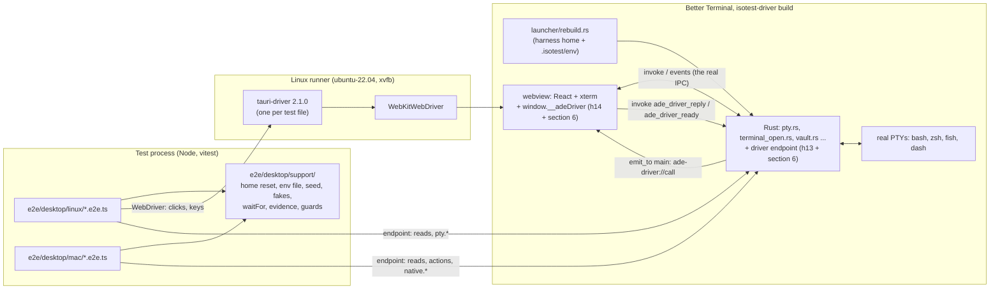
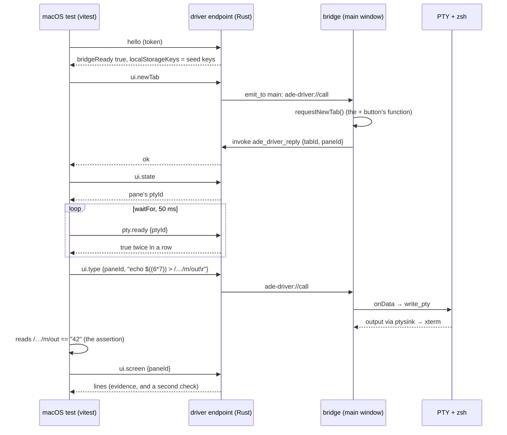

# Desktop app end-to-end tests: technical design

- **Status:** Proposed, revision 2 (2026-11-09). Revision 1 was merged to `main` before
  review (PR #105, merge `ef77558`); its adversarial review came back BLOCKED (B1 to B4,
  M1 to M10, minors 1 to 12). This revision answers every finding (section 0). Not
  approved. Nothing here changes the verification command.
- **Owner:** architect.
- **ADR:** `.ade/context/decisions/0030-desktop-e2e-webdriver-on-linux-and-a-compiled-out-test-channel.md`
  (file name kept so links hold; its title now says what it decides).
- **Builds on:** F1's harness driver (ADR 0020; F1 design 4.1 and 15.1; harness stories
  h13, h14, h15 and h16 in
  `_bmad-output/initiative-personas-and-engagements/epic-harness/tickets.toml`) and ADR
  0016's harness home. This design adds no second test feature, bridge, release check or
  bundle id (B1).
- **Contract:** at approval the architect writes `.ade/context/isotest-driver.md` from
  section 6 (the calls isotest and the e2e layers share), so the h13 to h15 stories and
  the e2e stories build against one file (minor 11).
- **Scope:** how the owner's flows in the desktop app (Better Terminal, `src-tauri` +
  `src/`) are tested end to end against the real built app: real Rust backend, real
  PTYs, real webview. It does not replace the isolation test (`isotest`, gate D28),
  which answers a different question (where an engagement's writes land).
- **Shard nothing yet.** Section 13 lists the slices for the scrum-master after approval.

## 0. Revision 2: what the review found and what changed

| Finding | Change | Where |
|---|---|---|
| **B1** a second, uncited test channel | Dropped: no `e2e` feature, `__adeE2E`, `ADE_E2E_SOCKET`, `check-e2e-absent.sh` or `com.betterterminal.e2e`. Both layers drive F1's `isotest-driver` build: its loopback endpoint (h13), its `window.__adeDriver` (h14), its `check-no-driver` (h15), its bundle id and config (h16). This design only adds calls to that endpoint and that bridge, and patterns to that script. One new point is surfaced, not hidden: `isotest-driver` compiles F1 on (F1 design 14); Q9 proposes moving that to `f1-forced` | 3, 5, 6, 7; ADR 0030; Q9 |
| **B2** ADR 0016's rebuild drops the test environment | The home is ADE_ISOTEST_HOME, compiled in, as for isotest; the harness recreates it empty before each file. The rest of the environment comes from `<compiled home>/.isotest/env` (closed list of names, never `HOME`, `TMPDIR` or `XDG_*_HOME`), applied last by the rebuild under the feature, plus a closed pass-through of WebDriver's own variables. Amends ADR 0016's harness-home clause (Q10). S2 reads the app's start-time environment (`/proc/<pid>/environ`, `ps eww`) and the shell's | 8.1, 8.2, 12 (S2); Q10 |
| **B3** macOS stores in the real `~/Library`; hydrate copies a shared `localStorage` into each home | The e2e config makes the main window `incognito: true` (Tauri 2 `WindowConfig.incognito`; a non-persistent WKWebsiteDataStore, ADR 0017's mechanism). `hello` asserts `localStorage` holds exactly the seeded keys. The real-home guard covers `~/Library/{WebKit,Preferences,Saved Application State,Caches,HTTPStorages}/com.betterterminal.isotest*`. The saved-state guard needs ADR 0017's `setRestorable: NO` (Q7) | 5, 8.3 |
| **B4** S8 asserts a close dialog that does not exist; Quit runs no JS save | S8 rewritten to the real behaviour: window close shows no prompt and saves (`App.tsx:129-141`); `terminate:` goes through `applicationWillTerminate` to `LoopDestroyed` with no `CloseRequested`, so Quit skips the JS save. Both asserted with a marker printed after `quiesce` (h13), which only the close path can save. No product change | 12 (S8) |
| **M1** 7.1 forbade the word `e2e` in `release.yml` | Forbids specific patterns (feature names, defines, config files, `--cfg feature=`) | 7.1 |
| **M2** nothing makes the tests count; `cargo test` never compiles feature code | Each slice states its lines: `cd src-tauri && cargo test --features isotest-driver`, and, for scenario slices, a green `desktop-e2e` job on the story's SHA. Proposed, not decided | 13, 14; Q11 |
| **M3** Linux cannot read `lineEditorReady` or pids | The endpoint is on in every `isotest-driver` build (h13), Linux included; both layers read through it | 4, 6 |
| **M4** tauri-driver passes only binary and args, drops the driver's stdout | One tauri-driver per test file, started with that file's allowlisted environment; free ports checked; process-group kill; evidence from files the app writes (`stdio.log`, `ade.log`, the transcript), never from app stdout | 8.4, 9 |
| **M5** caller expands `$((…))`; fish has neither `$((…))` nor `$?`; dash caller never ready | Commands are quoted so the sub-terminal computes (`-- sh -c '…'`), assertions are on marker files, fish lines use `$status`, and S4 uses a marker round trip for readiness | 9, 12 |
| **M6** first-launch settings | The harness seeds `askOnNewTab: false`, `autoProjectSetup: false` and `better-terminal-tour-done` before launch; the bridge's `newTab` calls `requestNewTab` exactly as the button does | 8.5, 6 |
| **M7** vault service fixed as `com.betterterminal.vault` | Under the feature the service is `com.betterterminal.isotest.vault`; locally no scenario touches a keychain; teardown deletes by the test service only, and refuses any other | 8.6; Q12 |
| **M8** `path_helper` reorders `PATH`; the opener calls `/usr/bin/open` | rc files re-prepend the fakes after `/etc/zprofile` and `/etc/profile`; preflight checks every faked name in every shell; the opener plugin is stubbed under the feature | 8.7, 8.8; Q12 |
| **M9** S7's `find_command("e2etool")` cannot be reached | S7 uses the provider binary `codex`, placed only in `$HOME/loginbin` (a folder only the login `.zprofile` adds), with a preflight that `find_command`'s fixed folders lack it | 12 (S7) |
| **M10** event queueing, hydrate order, one window, leaked environment | Bridge-ready signal; bridge imported after `hydrateFromDisk`; `emit_to("main")`; launch through `env -i` plus named variables | 6, 8.2 |
| Minor 1 | `objc2 =0.6.3`, `objc2-app-kit =0.3.2`, `objc2-web-kit =0.3.2`, optional, macOS only, enabled by the feature | 5 |
| Minor 2 | `tauri.e2e.conf.json` repeats the whole window entry | 5 |
| Minor 3 | The CI absence check runs on `npx vite build`'s `dist/` | 7.3 |
| Minor 4 | The static check scans every workspace manifest and `--cfg feature=` in RUSTFLAGS; the binary is grepped for the Rust-side bridge names and the bundle id | 7.1, 7.3 |
| Minor 5 | Draft-until-checked release proposed to DevOps; ops not changed here | 7.3; Q8 |
| Minor 6 | A build without the feature, started with the harness files and variables present | 7.4, S2 |
| Minor 7 | `externalBin` for `ade-hook`, as release | 5 |
| Minor 8 | Q4 states path-filtered commits, PR-run flakes, and an empty quarantine for all 20 runs | 14; Q4 |
| Minor 9 | Linux `SHELL`, the bash, fish and dash rc files and `PS1` | 8.7 |
| Minor 10 | The bridge's own tests are exempt from "nothing else imports"; the define is declared in `vite-env.d.ts` and pinned in `vitest.config.ts` | 7.2 |
| Minor 11 | Context file written at approval | header |
| Minor 12 | Linux release builds already accept WebDriver under `TAURI_WEBVIEW_AUTOMATION=true`; xterm likely uses the DOM renderer under xvfb | 2, 15 |

## 1. What exists, and the gap

| Layer | What it proves | What it cannot see |
|---|---|---|
| vitest, about 1,965 tests (`npm test`) | components, stores and hooks with Tauri mocked | the real backend, real PTYs, real xterm, the IPC between them |
| `cargo test` in `src-tauri`, including `tests/bmadv6_e2e.rs`, `tests/bmadswitch_e2e.rs` | Rust modules; scaffolds on disk | the window, the frontend store, the webview |
| `relay/e2e` | the relay with real clients | the desktop app |
| `terminal_open_e2e.rs` (PR #100, story 9, open) | `ade open` end to end with a real endpoint, real PTYs, real bash; a test thread stands in for the window | the Tauri window, the frontend store, a real `"$ADE_HOOK_BIN"` expansion (its manual checks M1 to M5) |
| `.github/workflows/mac-smoke.yml` (manual dispatch) | the app builds, starts, stays up two minutes | assertions: typing goes through `osascript`, which needs Accessibility permission |
| F1's `isotest` (planned, slice 0) | where an engagement's writes land, through the `isotest-driver` build | ordinary flows: tabs, typing, `ade open`, close and quit |

The gap is the **seam between the webview and the backend**, exercised through the UI:
a tab is clicked, keys reach xterm, `write_pty` reaches the shell, output comes back
through `ptysink` into xterm, and the store shows the right tabs and sub-terminals.

## 2. Constraints that shape everything

- macOS's WKWebView has no WebDriver. `tauri-driver` works on Linux (`WebKitWebDriver`,
  webkit2gtk) and Windows. Third-party macOS routes are in section 11.
- F1 has already decided, and the owner approved, how a test build of this app is made
  and kept out of releases (ADR 0020, F1 design 15.1). A second mechanism would need a
  case against ADR 0020; there is none, so this design extends that one.
- ADR 0016: from F1 slice 1, every instance rebuilds its environment from the login
  session and re-execs before Tauri starts. A test that sets `HOME` or `PATH` on the
  launch command loses it. Only what the feature compiles in, or reads from a place
  derived from the compiled home, survives.
- `NSHomeDirectory()` ignores `HOME`. WKWebView's persistent store, `NSUserDefaults`,
  saved window state and per-bundle caches live under the real `~/Library` whatever the
  test sets.
- **Already true, not added here (minor 12):** wry enables WebKitGTK's automation when
  the process has `TAURI_WEBVIEW_AUTOMATION=true`, in any build, release included. So a
  Linux release build can be driven by WebDriver by anyone who can start it with that
  variable. The Linux layer relies on this; it adds nothing to it. After F1 slice 1 the
  rebuild drops a caller's variables in release builds, which narrows it to the login
  session. Recorded for the owner as a fact, not a finding against this design.

## 3. Decision in one paragraph

Keep the owner's three layers on **one test build: F1's `isotest-driver` build**. Its
loopback endpoint (h13) gains a small set of calls; its `window.__adeDriver` (h14)
gains reads of xterm buffers and the store, and a few store actions; its release check
(h15) gains patterns for those additions and a `present` mode. **One runner**: both
layers are vitest suites in Node, the Linux one using `webdriverio` as a library against
`tauri-driver` for real clicks and keys, and both reading through the endpoint. **macOS
native actions call AppKit's own entry points** (`-[NSWindow performClose:]`,
`-[NSApplication terminate:]`). The test home is the compiled `ADE_ISOTEST_HOME`; the
rest of the test environment survives the rebuild through a feature-only file under it.

## 4. Architecture



### 4.1 Components

| Component | Where | Responsibility | Exists in |
|---|---|---|---|
| Driver endpoint | h13's module in `src-tauri/src` (the h13 plan names it), plus `native_macos.rs` beside it | h13's calls, plus section 6's; forwards `ui.*` to the bridge and waits for its reply; answers `pty.*` from `PtyManager`; runs `native.*` on the main thread on macOS | `isotest-driver` builds |
| Bridge | h14's module (`window.__adeDriver`), plus section 6's reads and actions | reads the store and xterm buffers; runs the store actions the buttons run; signals ready | `VITE_ADE_ISOTEST=1` builds |
| Harness environment | `launcher/rebuild.rs`, feature-only branch | applies `<home>/.isotest/env` and the WebDriver pass-through last (8.2) | `isotest-driver` builds, from F1 slice 1 |
| Linux suite | `e2e/desktop/linux/` | real input through WebDriver; reads through the endpoint | test tree |
| macOS suite | `e2e/desktop/mac/` | actions and reads through the endpoint; Mac-only behaviour | test tree |
| Support | `e2e/desktop/support/` | `resetHome()`, `writeEnvFile()`, `seed()`, `installFakes()`, `launchApp()`, `waitFor()`, `evidence()`, `realHomeGuard()`, a `Driver` interface with a WebDriver and an endpoint implementation | test tree |

There is no data model; nothing persists beyond the compiled home, which is recreated
for each test file, so there is no ER diagram.

### 4.2 Why a bridge on Linux too

WebDriver gives real clicks and keys, so Linux acts through WebDriver. It cannot read
terminal text: xterm may draw on a WebGL canvas (`useTerminal.ts` loads `WebglAddon`).
The bridge reads xterm's buffer instead, which does not depend on the renderer. The
bridge has **no arbitrary-JavaScript eval**, only the fixed calls of section 6.

## 5. Build for tests

One recipe, `npm run build:e2e-app`, on both platforms:

```
cargo build --release --manifest-path src-tauri/Cargo.toml -p ade-hook
cp target/release/ade-hook src-tauri/binaries/ade-hook-<target triple>   # as release.yml
ADE_ISOTEST_HOME=<home> VITE_ADE_ISOTEST=1 \
npx tauri build --features isotest-driver \
  --config src-tauri/tauri.isotest.conf.json --config src-tauri/tauri.e2e.conf.json \
  --no-bundle     # Linux
  --bundles app   # macOS: a real .app, so NSBundle, menus and Info.plist are real
```

- **The feature and config are F1's.** `tauri.isotest.conf.json` (h16) gives the bundle
  id `com.betterterminal.isotest` and `bundle.externalBin: ["binaries/ade-hook"]`, exactly
  as `tauri.release.conf.json` does (minor 7), so the helper lands beside the executable
  (macOS: `Contents/MacOS/`; Linux `--no-bundle`: Tauri's build is expected to copy
  `externalBin` beside the executable, which the slice confirms, else the build script
  copies it there). `launchApp()` refuses to start if the helper is not beside
  the executable.
- **`src-tauri/tauri.e2e.conf.json`** patches only `app.windows`. Tauri's `--config` is a
  JSON merge patch and replaces arrays, so it repeats the whole entry (minor 2):
  `title: ""`, `width: 1200`, `height: 800`, `resizable: true`, `fullscreen: false`,
  `maximized: false`, `decorations: true`, `titleBarStyle: "Overlay"`, plus
  `incognito: true` (B3). A static test (7.1) checks that every key of the main window in
  `tauri.conf.json` is present in it, so a later change to the real window cannot
  silently drop out of the test build. Isotest does not use this file: it needs the
  default profile's persistent store (ADR 0020's attribution of per-bundle folders).
  The slice confirms tauri-cli 2 merges two `--config` values in order; if not, the
  build script writes one merged file into `target/` and passes that.
- **`ADE_ISOTEST_HOME`** is chosen by the build script: on CI the job's home root; locally
  `$TMPDIR/ade-e2e-<uid>/home`. The script writes the value to
  `e2e/desktop/.build/home` (ignored by git); `hello` returns the compiled value and the
  harness aborts if they differ ("the binary's compiled home is not this harness's").
- **Release profile with the feature**, not `--debug`.
- **Vite**: `VITE_ADE_ISOTEST=1` as h14 defines it; with it absent, the bridge's dynamic
  import sits in a branch Vite replaces with `false`, and no bridge chunk is emitted
  (proved in 7.3, not assumed).
- **Cargo (minor 1)**: the feature gains the macOS-only optional dependencies the native
  calls need, pinned to the versions in `Cargo.lock` today:

  ```toml
  [features]
  isotest-driver = ["dep:objc2", "dep:objc2-app-kit", "dep:objc2-web-kit"]
  [target.'cfg(target_os = "macos")'.dependencies]
  objc2 = { version = "=0.6.3", optional = true }
  objc2-app-kit = { version = "=0.3.2", optional = true }
  objc2-web-kit = { version = "=0.3.2", optional = true }
  ```

  `default` is unchanged and never lists the feature.

## 6. The driver endpoint and bridge: additions (contract)

Transport, token, `driver.json` and framing are h13's: loopback, a random port, a random
token, written to `<compiled home>/.isotest/driver.json`. Every request carries the token;
one without it is refused and changes nothing (h13 acceptance 2). This section adds calls.
Calls are a closed set; an unknown call is an error.

| Call | Args | Value | Path inside the app | Used by |
|---|---|---|---|---|
| `hello` (h13, extended) | | `{sentinel, version, pid, home, bridgeReady, f1, localStorageKeys}` | Rust; `localStorageKeys` from the bridge's ready signal | both |
| `quiesce` (h13) | | `null` | h13 | S8 |
| `ui.state` | | tabs, panes, sub-terminals (`name`, typed/spinner flags), active ids, open dialogs (title, buttons) | bridge | both |
| `ui.screen` | `paneId` | `string[]`, the xterm buffer, trailing blanks trimmed | bridge | both |
| `ui.type` | `paneId`, `text` | `null` | bridge: `term.input(text, true)` → `onData` → `write_pty` | macOS |
| `ui.newTab` | | `{tabId, paneId}` once the store has it | bridge: `requestNewTab()`, the function the + button calls (`src/lib/newTab.ts:17`) | macOS |
| `ui.closeTab` | `tabId` | `null` | bridge: the tab bar's close action through `useGuardedClose` | macOS |
| `ui.click` | `testId` | `null` | bridge: h14's click (pointer events) | macOS |
| `pty.ready` | `ptyId` | bool or null | Rust: `pty::line_editor_ready` for the pane's PTY, the code behind `pty_line_editor_ready` | both (M3) |
| `pty.pid` | `ptyId` | int | Rust: `PtyManager`'s shell pid | both |
| `pty.alive` | `pid` | bool | Rust: `kill(pid, 0)` | both |
| `native.performClose` | | `null` | macOS main thread: `-[NSWindow performClose:]` on the main window | S8 |
| `native.terminate` | | `null` (the connection then closes) | macOS main thread: `-[NSApplication terminate:]` | S8 |
| `native.snapshot` | `path` | `path` | macOS: `-[WKWebView takeSnapshotWithConfiguration:…]` written as PNG; evidence only | macOS |

`paneId` maps to a PTY id through the store (the bridge answers `ui.state` with each
pane's `ptyId`); the Rust calls take the PTY id the harness read from `ui.state`.

- **Bridge load (M10):** `src/main.tsx` imports the bridge only inside its existing
  post-`hydrateFromDisk()` path (lines 19 to 23 today: `App` is lazy-loaded after
  hydrate), in a branch on `import.meta.env.VITE_ADE_ISOTEST === "1"`. So the bridge
  reads the restored stores, never pre-hydrate values.
- **Ready signal (M10):** Tauri does not queue events sent before a listener exists. The
  bridge, once its listener is registered, invokes `ade_driver_ready` with its
  `localStorage` key list. Until then the endpoint answers every `ui.*` call with
  `error: "bridge not ready"` and `hello` reports `bridgeReady: false`. The harness's
  first wait is for `bridgeReady: true`.
- **One window (M10):** Rust sends `ade-driver://call {id, call, args}` with
  `emit_to("main", …)`, never a broadcast, so a detached window cannot answer for the
  main one. The bridge replies with `invoke("ade_driver_reply", {id, ok, value|error})`;
  past 5 s the endpoint replies `error: "bridge did not answer in 5 s"`.
- **Sentinels and names** (what 7.3 greps): the Rust side holds h13's `#[used]` sentinel
  `__ade_isotest_driver_build__`, the command names `ade_driver_reply` and
  `ade_driver_ready`, and the event name `ade-driver://call`; the frontend holds
  `__adeDriver`. No new sentinel is introduced.
- **Evidence file (M4):** under the feature, the image that proceeds after the rebuild
  points its stdout and stderr (`dup2`) at `<compiled home>/.isotest/stdio.log` before
  Tauri starts, so app output survives whatever launched it.



## 7. Proving release builds do not contain the driver

One feature, one bridge, one release check (B1). Every check is able to fail.

1. **Static test in `cd src-tauri && cargo test`** (already under the verification
   command), extended from h13/h15 (M1, minor 4):
   - every workspace manifest (`src-tauri/Cargo.toml`, `ade-hook`, `isotest`): no
     `default` list contains `isotest-driver`, and no dependency entry enables it;
   - every `feature = "isotest-driver"` in `src-tauri/src` is inside the driver's module
     or one of the named lines in `lib.rs` (the `mod`, the `setup` call, the opener and
     vault substitutions of 8.6 and 8.8, the stdio redirect) and the rebuild's
     feature-only branch;
   - `release.yml`, `ci.yml`'s frontend job, `.cargo/config.toml` (if any) and any
     `RUSTFLAGS` set in a workflow contain none of these patterns: `isotest-driver`,
     `f1-forced`, `VITE_ADE_ISOTEST`, `ADE_ISOTEST_HOME`, `tauri.isotest.conf.json`,
     `tauri.e2e.conf.json`, `--cfg feature=`. `release.yml` may mention
     `check-no-driver`; the pattern list, not a word, is what is forbidden;
   - `tauri.e2e.conf.json` repeats every key of the real main window (5);
   - a planted violation per rule, in fixture strings, proves each rule fires.
2. **Static test in `npm test`** (minor 10): `src/main.tsx` imports the bridge only under
   `import.meta.env.VITE_ADE_ISOTEST === "1"` and only after `hydrateFromDisk`; nothing
   imports the bridge module **except** `src/main.tsx` and the bridge's own test files;
   `src/vite-env.d.ts` declares `VITE_ADE_ISOTEST?: "1"` in `ImportMetaEnv`; and
   `vitest.config.ts` pins it (`define` of `import.meta.env.VITE_ADE_ISOTEST` to
   `undefined`), so a developer's shell cannot turn it on in `npm test`; the bridge's own
   tests set it per test with `vi.stubEnv`.
3. **Artifact check: h15's `scripts/check-no-driver.sh`, extended, one script.**
   `check-no-driver.sh --expect absent|present <executable> <dist dir>`:
   - the executable (`grep -a -c`) for `__ade_isotest_driver_build__`,
     `com.betterterminal.isotest`, `ade_driver_reply`, `ade_driver_ready` and
     `ade-driver://call` (minor 4);
   - every file under `dist/` for `__adeDriver`. `dist/` is checked, not the binary, for
     frontend names, because Tauri embeds the frontend compressed;
   - `--expect present` on every test build is the **positive control**: if a name the
     test build must hold is not found, the absent checks prove nothing and the job is red;
   - `--expect absent` runs in `release.yml` on each platform's executable and `dist/`
     before upload (h15 adds the step; Q8), and in CI's frontend job on the `dist/` of
     its `npx vite build` (minor 3; the executable argument is omitted there);
   - **Release ordering (minor 5), proposed to DevOps, not changed here:** `release.yml`
     creates a non-draft release before the platform builds, with `fail-fast: false`, so
     a failed absence check on one platform leaves the others' assets public. Proposal:
     create the release as a draft and publish it in a final job that needs every
     platform's build, check included. Q8.
4. **Runtime (minor 6):** a build **without** the feature, started with a planted
   `<home>/.isotest/env`, a planted `driver.json` folder and `TAURI_WEBVIEW_AUTOMATION`
   unset, writes no `driver.json`, opens no new listening port (`/proc/net/tcp`
   compared before and after, filtered by the app's pid through `/proc/<pid>/fd`), and its
   start-time environment does not contain the env file's names (S2).

What this does not prove: that a binary someone builds by hand with the feature is not
shipped. Only `release.yml` builds what ships, and check 3 guards it.

## 8. Isolation

### 8.1 The home (B2)

The home is the compiled `ADE_ISOTEST_HOME`, the same mechanism as isotest. Before each
test file, `resetHome()` deletes it (no-follow, F1's `fsx` helper or its TypeScript
twin) and recreates it with the harness files: rc files, fakes, seed, env file. Files
run one at a time, so one compiled home serves a whole suite. No caller's variable
decides the home after F1 slice 1, and before slice 1 the launch environment names the
same path, so both eras behave the same and S2 checks it.

### 8.2 The rest of the environment (B2, M10)

- **Launch:** the harness starts the app (macOS) or `tauri-driver` (Linux, 8.4) through
  `env -i` plus a named list, never its own environment. portable-pty copies the app's
  environment into every shell, so anything inherited would reach the terminals
  (`ZDOTDIR`, `BASH_ENV`, `GH_TOKEN`, `ANTHROPIC_AUTH_TOKEN`, `GIT_CONFIG_GLOBAL`,
  `SSH_AUTH_SOCK` and the like).
- **The env file** `<compiled home>/.isotest/env`, written by the harness, `NAME=value`
  lines from a closed list compiled into the feature: `PATH`, `SHELL`, `LANG`, `LC_ALL`,
  `TZ`, `CLAUDE_CONFIG_DIR`, `ANTHROPIC_API_KEY`, `ANTHROPIC_BASE_URL`, `DISPLAY`,
  `XAUTHORITY`, `DBUS_SESSION_BUS_ADDRESS`, `XDG_RUNTIME_DIR`, `TAURI_WEBVIEW_AUTOMATION`.
  A name outside the list is an error at start (stderr and `stdio.log`, exit 2). `HOME`,
  `USERPROFILE`, `TMPDIR` and `XDG_{DATA,CONFIG,CACHE,STATE}_HOME` can never be listed:
  they stay the compiled home's.
- **The rebuild (from F1 slice 1)**, under `isotest-driver` only, applies the env file's
  values after the harness-home values (ADR 0016's "applied last"), and passes through
  from its inherited environment a second closed list: the variables WebKitWebDriver
  sets on the browser it launches (expected `WEBKIT_INSPECTOR_SERVER`; slice 3 confirms
  the names against webkit2gtk's `SessionHost` for the runner's version and lists them).
  Without the feature neither list exists. Without the file nothing changes, so isotest
  is unaffected. This amends ADR 0016's harness-home clause: Q10.
- **Before F1 slice 1** there is no rebuild: the launch environment is the env file's
  values plus the compiled home, so the app sees the same set.
- **Values:** `PATH=<home>/fakebin:/usr/bin:/bin:/usr/sbin:/sbin`;
  `CLAUDE_CONFIG_DIR=<home>/.claude` (empty); `ANTHROPIC_API_KEY=invalid`;
  `ANTHROPIC_BASE_URL=http://127.0.0.1:9`; `LANG=C.UTF-8` (Linux) or `en_US.UTF-8`
  (macOS); `TZ=UTC`; `SHELL` per 8.7; on Linux the xvfb and bus variables.
- **The check (S2):** after `hello`, the harness reads the app's start-time environment
  (`/proc/<pid>/environ` on Linux; `ps eww -p <pid>` on macOS, which reads
  `KERN_PROCARGS2` and returns it for cargo-built, non-platform binaries) and the first
  shell's (same, by `pty.pid`): `HOME` is the compiled home, `PATH` starts with
  `<home>/fakebin`, `SHELL` and `CLAUDE_CONFIG_DIR` are the file's, and canaries the
  runner sets in its own environment (`ADE_E2E_CANARY`, `GH_TOKEN=canary`,
  `ZDOTDIR=/nonexistent`) are absent from both.

### 8.3 macOS per-bundle stores (B3)

- **WebKit:** `incognito: true` in `tauri.e2e.conf.json` gives the main window a
  non-persistent store (wry's `nonPersistentDataStore`), ADR 0017's mechanism, so nothing
  is written under `~/Library/WebKit/com.betterterminal.isotest` and no earlier run's
  `localStorage` is visible. `hydrateFromDisk` (`src/lib/persistence.ts:105-115`) then
  has nothing to copy into a fresh home. `hello` asserts `localStorageKeys` equals the
  seeded key set exactly (8.5); any other key is "store contaminated", with the list.
  Detached windows are made by JavaScript today (`detachWindow.ts`) and would not get
  the flag; no scenario detaches a window until ADR 0017 moves window creation to Rust.
- **Saved window state:** needs ADR 0017's `setRestorable: NO` and
  `ApplePersistenceIgnoreState` registration (an approved F1 change). The macOS slice
  depends on it (Q7); without it tao writes `.savedState` and the guard below fails, by
  design.
- **The guard,** before and after each file: the real home is read from `getpwuid`, never
  `HOME`. Before: delete (no-follow) every entry matching
  `~/Library/{WebKit,Preferences,Saved Application State,Caches,HTTPStorages}/com.betterterminal.isotest*`.
  After: each pattern must match nothing. The per-user cache's Metal folders
  (`$(getconf DARWIN_USER_CACHE_DIR)com.betterterminal.isotest/com.apple.metal*`) are
  ADR 0017's measured, data-free exemption and are outside the guard. The real
  `~/.claude` listing and mtimes must be unchanged. Deleting these entries touches only
  the test bundle id, which only test builds create; isotest's clean step does the same.

### 8.4 Linux driver process (M4)

tauri-driver 2.1.0 passes only the binary and its arguments to `WebKitWebDriver`
(`server.rs:45-46`) and discards the native driver's stdout (`webdriver.rs:58`). So:

- **One tauri-driver per test file**, started by `launchApp()` through `env -i` with that
  file's allowlisted environment (8.2), so `WebKitWebDriver` and the app inherit it.
- **Ports:** two free ports chosen by binding port 0 and releasing; passed as `--port`
  and `--native-port`; after start, the harness requires `/status` on the first to answer
  and both ports to be held by the driver's process group (`ss -ltnp`), else "port taken"
  and abort.
- **Process group:** started with `detached: true` (its own group); `afterAll` sends
  `SIGTERM` then, after 3 s, `SIGKILL` to the group, and checks every recorded pid (driver,
  app, PTY shells) is gone.
- **Evidence never relies on app stdout:** `stdio.log` (6), `ade.log` in the home, the
  endpoint transcript, tauri-driver's own stderr (captured by the harness).

### 8.5 Seeded first-launch settings (M6)

Before launch the harness writes, into the app's `state/kv` under the compiled home
(the format `state_write` uses; the slice names the files from `src-tauri/src/state.rs`):
the settings store's persisted key with `askOnNewTab: false` and `autoProjectSetup:
false` (`settingsStore.ts:438-440` defaults both to true), and
`better-terminal-tour-done` (`persistence.ts:30`). So `requestNewTab()` opens a terminal
tab, not the "terminal or project" question, and no tour or project setup starts. The
seeded key set is what `hello`'s `localStorageKeys` must equal.

### 8.6 Secrets (M7)

- `vault.rs:13` fixes the service as `com.betterterminal.vault`, and `keyring` writes to
  the default keychain. Under the feature only, the constant is
  `com.betterterminal.isotest.vault` (a `cfg` pair in `vault.rs`, a named line in 7.1).
  Isotest's secret-entry checks read the same constant (Q12; recorded in the context file).
- **Locally, no scenario touches a keychain.** With an empty vault the app reads no
  keychain item (the slice proves it with a unit test on `env_for_terminals`); the macOS
  Keychain scenario (S9, later) refuses to run outside CI by name.
- **On CI,** the macOS job uses the backend jobs' CI keychain (created, unlocked, default
  and in the search list); for S9 only, the compiled home gets F1's `Library/Keychains`
  link (E7.3) after the harness checks `security default-keychain` names the CI keychain.
- **Teardown** deletes only by the test service name. The helper takes no service
  argument; a unit test asserts it refuses to build a query for any other name, the real
  one included.
- Linux: the job runs under `dbus-run-session` with an unlocked `gnome-keyring-daemon`, as
  the backend job does; the same service-name rule applies.

### 8.7 Shells, rc files and the fakes (M8, minor 9)

Every shell the app starts is a login shell (`platform::shell_from` passes `-l`), and its
program is `$SHELL`. The harness writes, in the compiled home:

| Shell | Used by | rc files the harness writes | Prompt |
|---|---|---|---|
| bash (`SHELL=/bin/bash`, Linux default) | S1, S2, S3, S6 | `.bash_profile` (sources `.bashrc`), `.bashrc` | `PS1='ade$ '`, `HISTFILE=<home>/.bash_history`, no `PROMPT_COMMAND` |
| fish (`SHELL=$(command -v fish)`) | S5 | `.config/fish/config.fish` | `set -g fish_greeting`; `function fish_prompt; echo -n 'ade$ '; end` |
| dash (`SHELL=/usr/bin/dash`) | S4 | `.profile` | `PS1='ade$ '` |
| zsh (`SHELL=/bin/zsh`, macOS default) | S7, S8 | `.zshenv`, `.zprofile`, `.zshrc` | `PS1='ade$ '`, `HISTFILE=<home>/.zsh_history`, no plugins |

- **After `path_helper` (M8):** macOS `/etc/zprofile` and `/etc/profile` run `path_helper`,
  which moves the system folders in front of a prepended `PATH`, so `/usr/bin/ssh`,
  `/usr/bin/open` and a real `gh` or `claude` would win. So `.zprofile`, `.bash_profile`,
  `.profile` and `config.fish` (which run after the system files) re-prepend
  `<home>/fakebin` and remove any later copy of it.
- **Fakes in two places:** `<home>/fakebin` (first on every shell's `PATH`) and
  `<home>/.local/bin` (first in `find_command`'s fixed folders). Faked: `gh`, `claude`,
  `codex`, `gemini`, `hermes`, `orgo`, `ssh`, `scp`, `open`, `xdg-open`. Each appends its
  argv and cwd to `<home>/fakes.log`; `gh` refuses every verb but `auth status`,
  `api user` and `repo view`.
- **Preflight, every file, every shell the file uses:** after the first prompt, a typed
  `for c in gh claude codex gemini hermes orgo ssh scp open xdg-open; do command -v $c;
  done > <home>/m/preflight` (fish: `for c in …; command -v $c; end > …`); every line must
  be under `<home>/fakebin`, else "isolation preflight failed: <name> → <path>".

### 8.8 The opener (M8)

`tauri-plugin-opener` calls `/usr/bin/open` by absolute path on macOS (and `xdg-open`
through its own lookup on Linux), so `PATH` fakes cannot catch it. Under the feature
only, `lib.rs` registers a stub plugin named `opener` in place of
`tauri_plugin_opener::init()`, with the same command names (`open_url`, `open_path`,
`reveal_item_in_dir`): each appends its arguments to `<home>/.isotest/opener.log` and
returns success. The JavaScript API is unchanged. A scenario that opens a link asserts
on that log. Isotest gets the same stub, which keeps its runs from starting a browser
(Q12).

### 8.9 F1

From F1 slice 1, `isotest-driver` compiles F1 on (F1 design 14). Q9 proposes that it no
longer does, and that isotest builds pass `--features isotest-driver,f1-forced`. Until
the owner answers, the e2e layers test whatever the feature compiles, and `hello`'s
`f1` field is printed in the job summary so a run says which app it tested.

## 9. Flake control

- **No sleeps.** Every wait is `waitFor(name, predicate, timeoutMs)`, polling every 50 ms;
  on timeout it throws with the name and the last observed value.
- **Ready means ready:** a shell with a line editor is ready when `pty.ready` is true on
  two polls in a row (story 9's rule). **dash** has no line editor and is never "ready" by
  that rule, so its readiness is a round trip: the harness types
  `echo <v> > <home>/m/ready` (a literal the test computed) and waits for the file; the
  TTY buffers typed input until dash reads it (M5).
- **The shell under test computes, and files are the assertion (M5):**
  - In the caller's own shell, `echo $((N*7)) > <abs>/out` is fine: that shell is the
    one computing.
  - Through `ade open`, the command is quoted so the **sub-terminal** computes:
    `"$ADE_HOOK_BIN" open … -- sh -c 'echo $((N*7)) > <abs>/out'`, with `N` and `<abs>`
    written as literals by the test (no spaces). Single quotes stop the caller from
    expanding it; `sh` in the sub-terminal does.
  - A redirect after `ade open …` belongs to the caller, so it is never used to capture
    the sub-terminal's output.
  - fish has neither `$((…))` nor `$?`: fish lines use literals and `$status`.
  - The screen is checked too, but a typed line echoes its own text, so the marker file
    decides.
- **Fixed geometry and environment:** window 1200x800; the env file of 8.2; the rc files
  of 8.7.
- **One app at a time:** vitest `fileParallelism: false`; one app (and on Linux one
  tauri-driver) per file, killed by process group in `afterAll` even after a failure;
  every recorded pid checked gone.
- **Timeouts:** a wait 10 s (20 s for the first prompt on a cold macOS runner), a test
  60 s, a job 30 minutes.
- **No retries:** vitest `retry: 0`, no "re-run failed jobs". A flaky test goes into
  `e2e/desktop/QUARANTINE` (test name, issue link, date) and is skipped with its name
  printed (Q5).
- **Evidence on every failure, and on every macOS run:** a screenshot (WebDriver's
  `takeScreenshot` on Linux; `native.snapshot` on macOS), every pane's screen, the
  endpoint transcript, `stdio.log`, `ade.log`, `fakes.log`, `opener.log`, tauri-driver's
  stderr; on macOS also crash reports and a 3 s `sample`.
- **Stability record:** a scheduled nightly run of both layers on `main` (Q4).

## 10. CI: runners, cost, time

One new workflow, `.github/workflows/desktop-e2e.yml` (DevOps writes it; `docs/ops.md`
records it):

| Job (display name) | Runner | Steps | Estimated wall clock (measured by the first run) |
|---|---|---|---|
| `Desktop e2e on Linux` | `ubuntu-22.04` | apt: `libwebkit2gtk-4.1-dev`, `webkit2gtk-driver`, `xvfb`, `zsh`, `fish`, `dash`, `gnome-keyring`, `dbus-x11`; `cargo install tauri-driver --version 2.1.0 --locked` (cached); build (5); `check-no-driver.sh --expect present`; `dbus-run-session -- xvfb-run -a npm run e2e:linux` | 12 to 20 min cold, 6 to 9 warm |
| `Desktop e2e on macOS` | `macos-latest` (arm64) | CI keychain; `brew install fish`; build with `--bundles app`; `--expect present`; `npm run e2e:mac` | 15 to 25 min cold, 8 to 12 warm |

- **Cost:** the repository is public, so standard runners cost no minutes; the cost is
  queue time, and macOS runners are scarcer (Q3).
- **Triggers (Q3):** Linux on every pull request and push to `main`; macOS on push to
  `main`, nightly, `workflow_dispatch`, and pull requests touching `src-tauri/src/pty.rs`,
  `src-tauri/src/lib.rs`, `src-tauri/src/vault.rs`, `src-tauri/src/terminal_open.rs`, the
  driver's module, `src/App.tsx`, `src/hooks/useGuardedClose.ts`, `src/main.tsx` or
  `e2e/desktop/**`.
- **Concurrency:** its own group per ref, `cancel-in-progress: true` for PRs only.
- **Feature build in the backend jobs (M2, Q11):** each backend job gains
  `cargo test --locked --features isotest-driver`, so feature-only code is compiled and
  tested on every change, not only in e2e runs.

## 11. Alternatives considered

- **A second test channel beside `isotest-driver` (revision 1).** Rejected (B1): two
  features, two bridges, two release checks and two bundle ids for one purpose, against
  ADR 0020's "a driver that never ships", which is one mechanism with one check. Nothing
  the e2e layers need is impossible on the F1 driver; the parts that differ (window
  config, env file) are a config patch and a feature-only file.
- **`@wdio/tauri-service` with its embedded WebDriver plugin on macOS.** Not now: the
  Mac-only behaviours (close, quit, Keychain, login-shell PATH) are native and outside
  WebDriver; it puts a general remote-control server (WebDriver `execute` runs arbitrary
  JavaScript) into the binary; the crate is six months old. Revisit per Q2.
- **CrabNebula's `tauri-driver` fork:** a paid key and an external service. Rejected.
- **Appium Mac2, XCUITest, `osascript`:** need Accessibility permission. Rejected.
- **A per-run WebKit store** (`data_store_identifier`, macOS 14+) instead of incognito:
  would still write under the real `~/Library/WebKit`; incognito writes nothing there
  (ADR 0017, E7.2). Rejected.
- **Only the Rust harness of `terminal_open_e2e.rs`:** stays as the fast layer; cannot see
  the window or the store.
- **Windows layer:** deferred until ADR 0022 (`ade open` on Windows) is scheduled.

## 12. First scenarios

Each is one test file with a freshly reset home and its own app. "L" runs on Linux
(WebDriver acts, the endpoint reads), "M" on macOS (the endpoint does both). `N` is a
per-test nonce, `v = N*7` computed by the test, `<m>` is `<home>/m`.

| # | Layer | Scenario | Asserts | Automates |
|---|---|---|---|---|
| S1 | L | **Open a tab, type, see output.** Click the new-tab button (WebDriver); wait for `pty.ready`; type `echo $((N*7)) > <m>/s1` and Enter with WebDriver keys. | `<m>/s1` holds `v`; the screen shows `v` on a line of its own; `ui.state` has two tabs, the new one active | click → xterm → `write_pty` → bash → `ptysink` → xterm |
| S2 | L | **Environment, preflight, stores, no-feature build.** (a) Feature build: read the app's and the first shell's start-time environments; run the preflight. (b) A build without the feature, started with the planted harness files (7.4). | (a) 8.2's check: compiled `HOME`, fake `PATH` first, file's `SHELL` and `CLAUDE_CONFIG_DIR`, no canary; preflight passes; `hello.localStorageKeys` equals the seed. (b) no `driver.json`, no new listening port, none of the env file's names in its environment | B2, B3, sections 7.4 and 8 |
| S3 | L | **`ade open` with a command (story 9).** In tab A (bash): `"$ADE_HOOK_BIN" open --cwd <m>/sub --name smoke -- sh -c 'echo $((N*7)) > <m>/s3; pwd > <m>/s3cwd'; echo "rc=$?" > <m>/rc` | `<m>/s3` is `v`; `<m>/s3cwd` is `<m>/sub`; `<m>/rc` is `rc=0`; a sub-terminal `smoke` in tab A's strip (`ui.state` and the strip's DOM); its spinner clears; the caller is ready again and a second marker command runs | story 9 H1 through the real window and store; its manual checks M1 and M5 |
| S4 | L | **Not typed: a shell with no line editor.** `SHELL=/usr/bin/dash`, so caller and sub-terminal are both dash. Caller readiness by round trip (9). Type `"$ADE_HOOK_BIN" open --name nt -- sh -c 'echo $((N*7)) > <m>/s4' 2> <m>/err; echo "rc=$?" > <m>/rc` | `<m>/rc` is `rc=5`; `<m>/err` holds the CLI's not-typed line; `<m>/s4` does not exist; the notice reads "The command (`sh …`) wasn't typed: …" with only the first word; Insert command is disabled with the title "This shell has no line editor; type the command yourself" | story 9 T4 and T6 in the real app; part of M4 |
| S5 | L | **fish runs a typed `VAR=value cmd`.** `SHELL=fish`. Caller: `"$ADE_HOOK_BIN" open --name f -- E2E=<v> sh -c 'printf %s "$E2E" > <m>/s5'; echo "rc=$status" > <m>/rc` | `<m>/s5` is `v` (only the sub-terminal's fish can have set `E2E` for `sh`); `<m>/rc` is `rc=0` | story 9's manual check M3 |
| S6 | L | **Closing a busy tab asks first.** New tab; type `sleep 300` and Enter with WebDriver keys; wait until `ui.state` shows the pane busy; click the tab's close button. | `ui.state` lists the guarded-close dialog (`useGuardedClose`'s `closeTabCopy` title and its confirm label); Cancel keeps the tab and the `sleep` pid alive (`pty.alive`); confirming removes the tab and the pid is gone within 5 s | `useGuardedClose`, PTY teardown |
| S7 | M | **Login shell and Dock-style PATH (M9).** Env file `PATH=/usr/bin:/bin:/usr/sbin:/sbin` (launchd's) plus `<home>/fakebin`; `.zprofile` also prepends `<home>/loginbin`, which holds a fake `codex`; `codex` is **not** in `fakebin` or `.local/bin` for this file. Preflight: `codex` absent from every fixed folder `find_command` checks (`<home>/.local/bin`, `.cargo/bin`, `.foundry/bin`, `.avm/bin`, `.local/share/solana/…/bin`, `bin`, `.nvm/versions/node/*/bin`, `/usr/local/bin`, `/opt/homebrew/bin`, `/usr/bin`, `/bin`), else abort naming the path. Open the agent picker (`ui.click`). | the first shell is a login shell (`[[ -o login ]] && echo yes > <m>/login`); its `PATH` holds `<home>/loginbin`; the picker shows Codex as available: `AgentPicker` calls `check_command_exists("codex")` (`binaryFor`), which reaches `find_command`'s `zsh -lc 'which codex'` step, the only place `loginbin` exists; `native.snapshot` saved | `lib.rs` login-shell lookup; replaces mac-smoke's typing |
| S8 | M | **A long typed line; then close, then Quit (B4).** (a) zsh: `"$ADE_HOOK_BIN" open -- sh -c 'printf %s <1,500-byte word> > <m>/long'` (over macOS's 1,024-byte `MAX_CANON`). (b) `quiesce` (h13: stops the 2 s and 20 s session saves and the store flushes); type `echo C$((N*7))` in the tab; wait for it on screen; `native.performClose`. (c) A new launch: `quiesce`; type `echo Q$((N*7))`; wait for it; `native.terminate`. | (a) `<m>/long` holds all 1,500 bytes. (b) **No dialog**: window close has no guard (`App.tsx:129-141` saves and destroys; `useGuardedClose` covers tabs, panes and views only), so the transcript shows no dialog in `ui.state` before the window goes; the saved session in `state/kv` holds `C<v>` in that pane's buffer, which only the close path's `saveSession()` + `flushNow()` can have written after `quiesce`; the app exits (Tauri's default after the last window, since `lib.rs` handles no `ExitRequested`; the slice confirms, else it asserts the window is gone and then terminates); every PTY pid gone. (c) Exit 0 within 5 s; every PTY pid gone; the saved session does **not** hold `Q<v>`: `terminate:` runs `applicationWillTerminate` → `LoopDestroyed` (tao 0.34.5 `app_delegate.rs:132`), no `CloseRequested`, no JS save. This records today's behaviour; if a later story adds a save on Quit, it changes this assertion in the same story | story 9's manual check M2; close and Quit through AppKit's own entry points |

**Next, after these eight:** S9, a Keychain scenario on macOS CI only (8.6), and, once F2
(onboarding) is approved and built, S10 on both layers. F2's fixture template and runner
must accept the compiled home; noted for the F2 review, not decided here.

**Dependencies:** h13, h14, h15 and h16 (F1 slice 0) before any slice here; S3, S4, S5
and S8(a) need story 9 (PR #100) merged; S7 and S8 need ADR 0017's restorable-state change
(8.3). S1, S2 and S6 need neither (Q7).

## 13. Where the tests live, and the slices (for the scrum-master)

```
e2e/desktop/
  support/          home.ts (reset, env file, seed), fakes/, launch.ts, driver.ts,
                    waitFor.ts, evidence.ts, realHomeGuard.ts, procEnv.ts
  linux/            s1-new-tab.e2e.ts … s6-close-busy-tab.e2e.ts
  mac/              s7-login-shell.e2e.ts, s8-long-line-close-quit.e2e.ts
  vitest.linux.config.ts, vitest.mac.config.ts   (environment node, retry 0,
                    fileParallelism false, include *.e2e.ts in their folder)
  QUARANTINE
  .build/           (ignored) the compiled home's path
src-tauri/tauri.e2e.conf.json
src-tauri/src/<h13's driver module>/native_macos.rs
scripts/check-no-driver.sh                 (h15's, extended)
.github/workflows/desktop-e2e.yml          (DevOps)
```

The root `vitest.config.ts` includes only `src/`, `scripts/` and `packages/protocol/`, so
`npm test` never runs these. `package.json` gains `build:e2e-app`, `e2e:linux` and
`e2e:mac`, and pins `webdriverio` at exactly `9.32.0`.

**Slices** (each states its verification lines, M2; Q11 asks the owner to confirm them):

| # | Slice | Lines beyond the verification command |
|---|---|---|
| 0 | F1 slice 0's h13, h14, h15, h16, unchanged (prerequisite; they are F1's stories) | theirs |
| 1 | Endpoint and bridge additions of section 6 (Rust and vitest unit tests), the env file and its closed lists (unit tests on the parser and the rebuild branch's seam), stdio redirect, vault and opener substitutions, `objc2` deps, `tauri.e2e.conf.json`, extensions to 7.1, 7.2 and `check-no-driver.sh` | `cd src-tauri && cargo test --features isotest-driver`; the script's fixture tests |
| 2 | Linux harness (8.1 to 8.7), S1, S2 (DevOps: Linux job; backend jobs' feature step) | slice 1's, plus `Desktop e2e on Linux` green on the story's SHA |
| 3 | S6, then S3, S4, S5 once PR #100 is merged | as 2 |
| 4 | macOS native calls, harness, S7 (DevOps: macOS job; release `--expect absent`; draft release proposal, Q8) | slice 1's, plus `Desktop e2e on macOS` green on the story's SHA |
| 5 | S8 (after PR #100 and ADR 0017's restorable-state change); then retire `mac-smoke.yml` (Q6) | as 4 |

## 14. The verification command

**No line is added by this design.** The layers start advisory, but each scenario slice
is Done only with its e2e job green on its own SHA (13, Q11). The proposal for joining
the gate (Q4, minor 8):

- **Entry criterion:** 20 consecutive green runs of a layer on `main` (push or nightly),
  recorded in this file. A commit whose path filter started no macOS run neither counts
  nor breaks the streak. Any red run on `main` resets it. A red PR run that is shown to
  be a flake (fails, then passes on the same SHA, or fails in code the PR did not touch)
  also resets it and needs an issue. `QUARANTINE` must be empty for every one of the 20
  runs; a test quarantined during the streak restarts it from zero once it is back.
- **Then, Linux:** a same-SHA CI gate in the style of gate D28 item 3: "the
  `desktop-e2e.yml` job `Desktop e2e on Linux` passed on the story's SHA, counted and
  cited as item 4 of the F1 gate says", for every story that changes `src/`,
  `src-tauri/src/` or `e2e/desktop/`.
- **macOS** follows its own 20-run record, for stories touching section 10's macOS paths.
- **Locally,** `npm run e2e:mac` and `npm run e2e:linux` run the same suites; they are not
  verification lines.

## 15. Failure modes

| Failure | Handling |
|---|---|
| The driver or bridge reaches a release build | 7: static tests under the verification command; `check-no-driver.sh --expect absent` before upload; positive control on every test build |
| The rebuild drops the test environment | compiled home; env file applied last under the feature; S2 reads the start-time environment |
| A test touches the real home, a real CLI or a real keychain | compiled home; `env -i`; fakes in both lookup paths, re-prepended after `path_helper`; preflight per shell; opener stub; test vault service; guards on `~/.claude` and the five `~/Library` folders |
| A shared WebKit store contaminates a run | incognito window; `hello` compares `localStorage` keys with the seed |
| A first-launch dialog swallows an action | seeded settings (8.5) |
| An event is sent before the bridge listens | ready signal; `bridge not ready` error until then |
| `WebKitWebDriver` and webkit2gtk drift apart | both from the runner's apt archive in one step; versions printed in the job summary |
| The bridge hangs | 5 s timeout with a named error; evidence captured |
| An app, driver or shell outlives its test | process-group kill; recorded pids checked gone |
| Port taken on Linux | free-port check and ownership check before the first session |
| No WebGL under xvfb | xterm's WebGL addon likely fails there and the DOM renderer draws (minor 12); reads use the buffer, so assertions do not change; screenshots show the DOM renderer, and the GPU path is untested on Linux |
| macOS screen capture needs permission | `native.snapshot` uses WKWebView's own snapshot; evidence only |
| WKWebView key handling differs from webkit2gtk | **residual**: macOS acts through xterm's `input()`; real keys are tested on Linux only (Q2) |
| `isotest-driver` compiles F1 on | **residual until Q9**: the run prints which app it tested |

## 16. Owner questions

1. **Q1. Accept the layers on F1's `isotest-driver` build** (its endpoint and
   `__adeDriver` extended as in section 6; Linux through tauri-driver and WebdriverIO as a
   library under vitest; macOS through the endpoint calling AppKit's close and Quit)?
   *Recommendation: yes.*
2. **Q2. Spike `@wdio/tauri-service` on macOS now?** *Recommendation: no; revisit if the
   macOS layer needs real WKWebView key events or the endpoint passes about twenty calls.*
3. **Q3. Triggers:** Linux on every PR and `main`; macOS on `main`, nightly, dispatch and
   PRs touching section 10's paths? *Recommendation: yes.*
4. **Q4. Gate:** no verification line now; after 20 consecutive green `main` runs of a
   layer (path-filtered commits with no run neither count nor break the streak; PR-run
   flakes reset it; `QUARANTINE` empty for all 20), add the Linux job as a same-SHA gate
   for stories changing `src/`, `src-tauri/src/` or `e2e/desktop/`, then macOS for its
   paths; each addition comes back to you. *Recommendation: yes, in that order.*
5. **Q5. Flakes:** no retries; quarantine with an issue; once a layer gates, quarantining
   one of its tests needs your approval. *Recommendation: yes.*
6. **Q6. Retire `mac-smoke.yml`** once S7 and S8 are green on `main`? *Recommendation:
   yes.*
7. **Q7. Order:** build F1's h13 to h16 first (unchanged, ready for dev), then slices 1 to
   3 with S1, S2, S6; story-9 scenarios after PR #100; S7 and S8 after ADR 0017's
   restorable-state change (built as ADR 0017 already specifies, by whichever story comes
   first). *Recommendation: yes; PR #100 is not blocked by this.*
8. **Q8. Release guard:** `release.yml` fails on `check-no-driver.sh --expect absent` for
   any platform's executable or `dist/` (h15's step, with section 7.3's patterns); and ask
   DevOps to create the release as a draft, published only after every platform's build
   and check pass (today it is public before the builds, with `fail-fast: false`).
   *Recommendation: yes to both.*
9. **Q9. (new) Stop `isotest-driver` turning F1 on.** F1 design 14 and ADR 0016 compile F1
   on in `isotest-driver` builds. If that stays, the e2e layers test an F1-on app while
   users run F1 off. Proposal: `isotest-driver` is the driver only; isotest builds pass
   `--features isotest-driver,f1-forced`, which keeps F1's "reads no switch" property and
   adds no new release string (`f1-forced-build` is already checked). Amends F1 design 14
   and ADR 0016's flag bullet. *Recommendation: yes.* If no, the e2e layers test F1 on,
   and the gap is stated in 15.
10. **Q10. (new) Amend ADR 0016's harness-home clause:** under `isotest-driver` only, the
    rebuild applies `<compiled home>/.isotest/env` (the closed list of 8.2, never the home
    variables) last, and passes through WebKitWebDriver's own variables. Release builds
    and builds without the file are unchanged. *Recommendation: yes.*
11. **Q11. (new) Done lines for these slices:** every slice that touches feature code
    lists `cd src-tauri && cargo test --features isotest-driver`; the backend jobs run
    that line too (DevOps); scenario slices are Done only with their e2e job green on the
    story's SHA. *Recommendation: yes.*
12. **Q12. (new) Feature-only substitutions shared with isotest:** the vault service
    `com.betterterminal.isotest.vault`, the opener stub and the stdio log exist in every
    `isotest-driver` build, so isotest's secret checks use that service name and its runs
    open no browser. *Recommendation: yes.*
