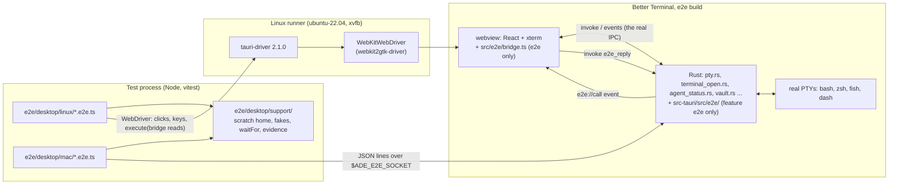
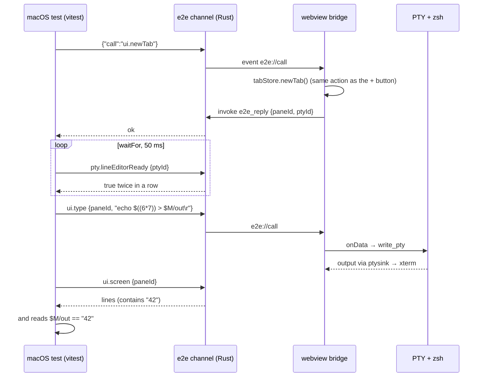

# Desktop app end-to-end tests: technical design

- **Status:** Proposed, revision 1 (2026-11-09). Not yet reviewed by the
  adversarial-reviewer; not approved. Nothing here changes the verification command.
- **Owner:** architect.
- **ADR:** `.ade/context/decisions/0030-desktop-e2e-webdriver-on-linux-and-a-compiled-out-test-channel.md`.
- **Contract (written by the first build story, not now):**
  `.ade/context/e2e-control-channel.md`, from section 6 of this design.
- **Scope:** how the owner's flows in the desktop app (Better Terminal, `src-tauri` +
  `src/`) are tested end to end against the real built app: real Rust backend, real
  PTYs, real webview. It does not replace the isolation test of F1 (`isotest`,
  gate D28), which answers a different question (where an engagement's writes land).
- **Shard nothing yet.** Section 13 lists the slices for the scrum-master after
  approval.

## 1. What exists, and the gap

| Layer | What it proves | What it cannot see |
|---|---|---|
| vitest, about 1,965 tests (`npm test`) | components, stores and hooks with Tauri mocked | the real backend, real PTYs, real xterm, the IPC between them |
| `cargo test` in `src-tauri`, including `tests/bmadv6_e2e.rs`, `tests/bmadswitch_e2e.rs` | Rust modules; scaffolds on disk | the window, the frontend store, the webview |
| `relay/e2e` | the relay with real clients | the desktop app |
| `terminal_open_e2e.rs` (PR #100, branch `st9-typed-command`, not merged) | `ade open` end to end with a real endpoint, real PTYs, real bash; a test thread stands in for the window | the Tauri window, the frontend store, a real `"$ADE_HOOK_BIN"` expansion (its manual checks M1 to M5) |
| `.github/workflows/mac-smoke.yml` (manual dispatch) | the app builds, starts, stays up two minutes; diagnostics | assertions: typing goes through `osascript`, which needs Accessibility permission the runner may not grant, so "typed" is unproven |

The gap is the **seam between the webview and the backend**, exercised through the UI
a person uses: a tab is clicked, keys reach xterm, `write_pty` reaches the shell, the
output comes back through `ptysink` into xterm, and the store shows the right tabs and
sub-terminals. Story 9's own plan lists that gap as its manual checks M1 to M5.

## 2. Constraint that shapes everything

macOS's WKWebView has no WebDriver. `tauri-driver` works on Linux (through
`WebKitWebDriver`, webkit2gtk) and on Windows (through Edge's driver), and its README
lists macOS as "[Todo] … (probably)". Two third-party routes reach macOS (section 11):
CrabNebula's fork (a paid API key) and WebdriverIO's `@wdio/tauri-service` with the
`tauri-plugin-wdio-webdriver` plugin, a WebDriver server embedded in the app (crate first
published 2026-05, version 1.5.1 of 2026-10-24).

## 3. Decision in one paragraph

Keep the owner's three layers, with three changes. **(a) One build flavour for both
end-to-end layers**: a cargo feature `e2e` plus a Vite mode `e2e`, which add a small,
fixed-vocabulary **frontend bridge** (reads xterm buffers and the store; runs a few store
actions) and a **Unix-socket control channel** in Rust. Neither exists in a build
without the feature, and four checks prove it (section 7). **(b) One test runner**:
both layers are vitest suites in Node (`environment: "node"`), the Linux one using
`webdriverio` as a library against `tauri-driver`, the macOS one talking to the control
channel. There is no `@wdio/cli` or mocha. Shared helpers (scratch home, fakes, waits,
evidence) live once. **(c) The macOS native actions call the real AppKit entry points**
(`-[NSWindow performClose:]`, `-[NSApplication terminate:]`), which is what the close
button and Quit do, so no Accessibility permission is needed and the close and quit
paths under test are the real ones.

## 4. Architecture



### 4.1 Components

| Component | Where | Responsibility | Exists in |
|---|---|---|---|
| Bridge | `src/e2e/bridge.ts`, loaded by `src/main.tsx` only under `if (__ADE_E2E__)` with a dynamic `import()` | `window.__adeE2E`: `state()` (tabs, panes, sub-terminals with `name`, `typed`/spinner flags, active ids, open dialogs), `screen(paneId)` (the xterm buffer's lines, trailing blanks trimmed; renderer-independent, so WebGL or DOM does not matter), `type(paneId, text)` (xterm's `input(text, true)`, which fires `onData`, the path a keystroke takes to `write_pty`), `newTab()` and `closeTab(tabId)` (the store actions the tab bar's buttons call), `click(testId)` (a DOM click on a `data-testid`) | e2e builds only |
| Control channel | `src-tauri/src/e2e/{mod,channel,native_macos}.rs`, mounted by one `#[cfg(feature = "e2e")]` line in `lib.rs`'s `setup` | listens on `$ADE_E2E_SOCKET` (section 6); forwards `ui.*` calls to the bridge by event and waits for `e2e_reply`; answers `pty.*` from `PtyManager` (`lineEditorReady`, `pid`, `alive`); runs `native.*` on the main thread on macOS | e2e builds with `ADE_E2E_SOCKET` set |
| `e2e_reply` command | same module, added to `generate_handler!` under the feature | the bridge's answer to a forwarded call | e2e builds only |
| Linux suite | `e2e/desktop/linux/` | real input through WebDriver (click, `keys`), reads through `browser.execute(() => window.__adeE2E.screen(id))` | test tree |
| macOS suite | `e2e/desktop/mac/` | actions through the channel; Mac-only behaviour | test tree |
| Support | `e2e/desktop/support/` | `scratchHome()`, `installFakes()`, `launchApp()`, `waitFor()`, `evidence()`, a `Driver` interface with a WebDriver and a channel implementation so a scenario that makes sense on both can run on both | test tree |

There is no data model; nothing is persisted beyond each test's scratch home, so there is
no ER diagram.

### 4.2 Why a bridge at all on Linux

WebDriver gives real clicks and real key events, which is the point of the Linux layer,
so actions there go through WebDriver. **Reads cannot**: xterm may draw on a WebGL
canvas (`useTerminal.ts` loads `WebglAddon`), and a canvas has no text in the DOM. The
bridge reads xterm's buffer instead. So Linux uses WebDriver to act and the bridge to
read; macOS uses the bridge for both. The bridge exposes **no arbitrary-JavaScript
eval**, only the fixed calls above.

## 5. Build for tests

One recipe on both platforms, `npm run build:e2e-app`:

```
cargo build --release --manifest-path src-tauri/Cargo.toml -p ade-hook
npx tauri build --features e2e --config src-tauri/tauri.e2e.conf.json \
  --no-bundle            # Linux
  --bundles app          # macOS: a real .app, so NSBundle, menus and Info.plist are real
```

- **Release profile with the feature**, not `--debug`: timing in optimised code is what
  users run, and debug-only paths (devtools) stay out. A cold Rust build is slower; the
  rust-cache keyed on `src-tauri -> target` and a separate cache key for the `e2e`
  feature keep warm builds to a few minutes (section 10 says what to measure).
- **`src-tauri/tauri.e2e.conf.json`** (merged over `tauri.conf.json`): `identifier`
  `com.betterterminal.e2e`, `productName` "Better Terminal E2E", the main window
  `maximized: false` at 1200x800, and `build.beforeBuildCommand` `npm run build:e2e`
  (that is `tsc && vite build --mode e2e && npm run build:runtime && cp …`, the existing
  `build` with `--mode e2e`). The separate **identifier** keeps every OS store keyed by
  bundle identifier (WebKit website data, `NSUserDefaults`, saved window state, the
  Tauri app-data folder) apart from a real install of the app on the same machine.
- **Vite**: `vite.config.ts` gains `__ADE_E2E__: JSON.stringify(mode === "e2e")` in
  `define`. With it `false`, Rollup removes the `if` and its dynamic import, so no bridge
  chunk is emitted (checked in section 7, not assumed).
- **`ade-hook`** is built first into the same `target/release`, so
  `helper_beside_exe()` finds it beside the app and `ADE_HOOK_BIN` is real. On macOS the
  e2e config does not use `externalBin` (the release config's route); the test launcher
  copies `ade-hook` into `Contents/MacOS/` beside the executable before launch, which is
  the layout a release bundle has.
- **Cargo**: `[features] e2e = []`, `default` unchanged and without it. No dependency is
  added for the channel: `std::os::unix::net::UnixListener`, `serde_json` (present) and,
  on macOS, `objc2`/`objc2-app-kit` already pulled in by `tauri` (the build story checks
  `cargo tree` and adds them as direct optional deps under the feature only if they are
  not reachable).

## 6. The control channel (contract)

- **Off unless both hold**: the binary was built with `--features e2e`, and the process
  starts with `ADE_E2E_SOCKET=<absolute path>`. Without the variable, the e2e module
  does nothing.
- **Transport**: a Unix stream socket at that path. The parent folder must exist, be
  owned by the user and be mode 0700, and the path must not exist yet; otherwise the app
  logs the reason and the channel does not start (the test then fails at `hello`, named).
  Each connection's peer uid (`getpeereid` on macOS, `SO_PEERCRED` on Linux) must equal
  the app's uid. Unix only: there is no Windows e2e layer in this design (section 12).
- **Framing**: one JSON object per line. Request `{"id": n, "call": "<name>", "args": {…}}`,
  reply `{"id": n, "ok": true, "value": …}` or `{"id": n, "ok": false, "error": "<text>"}`.
  One request at a time per connection.
- **Calls (v1)**, a closed set; an unknown `call` is an error:

| Call | Args | Value | Path inside the app |
|---|---|---|---|
| `hello` | | `{sentinel, version: 1, pid}` | Rust |
| `ui.state` | | tabs, panes, sub-terminals, dialogs | bridge |
| `ui.screen` | `paneId` | `string[]` | bridge, xterm buffer |
| `ui.type` | `paneId`, `text` | `null` | bridge, `term.input(text, true)` → `onData` → `write_pty` |
| `ui.newTab` / `ui.closeTab` | `tabId` for close | ids | bridge, the tab bar's store actions |
| `ui.click` | `testId` | `null` | bridge, DOM click |
| `pty.lineEditorReady` / `pty.pid` / `pty.alive` | `ptyId` | bool / int / bool | Rust, `PtyManager` |
| `native.performClose` | `window` label | `null` | macOS main thread: `-[NSWindow performClose:]` |
| `native.terminate` | | `null` (the socket then closes) | macOS main thread: `-[NSApplication terminate:]` |
| `native.snapshot` | `window`, `path` | `path` | macOS: `-[WKWebView takeSnapshotWithConfiguration:…]` written as PNG; evidence only |

- **Bridge round trip**: Rust emits `e2e://call {id, call, args}` to the window's webview
  and waits up to 5 s for `invoke("e2e_reply", {id, ok, value|error})`; past that, the
  reply is `error: "bridge did not answer in 5 s"`.
- **Sentinel**: the module holds `ADE-E2E-CHANNEL-v1` and returns it from `hello`, so
  the string is used at runtime and survives optimisation; the bridge holds
  `ADE-E2E-BRIDGE-v1` and returns it from `state()`. Section 7 greps for both.



## 7. Proving release builds do not contain the channel or the bridge

Four checks, each where it is cheapest and each able to fail:

1. **Static test, inside `cd src-tauri && cargo test`** (so it is already under the
   verification command): `Cargo.toml`'s `default` feature list does not contain `e2e`,
   and no dependency entry enables it; every `feature = "e2e"` in `src-tauri/src` is
   either inside `src-tauri/src/e2e/` or one of the two allowed lines in `lib.rs` (the
   `mod` and the `setup` call; the `generate_handler!` entry is inside a `cfg`-gated
   helper in the module); `tauri.release.conf.json`, `tauri.conf.json` and
   `.github/workflows/release.yml` do not mention `e2e`. A planted violation in a
   fixture string proves the scanner finds one.
2. **Static test, inside `npm test`**: `src/main.tsx` loads the bridge only under
   `if (__ADE_E2E__)`, nothing else imports `src/e2e/`, and `vite.config.ts` sets
   `__ADE_E2E__` only from `mode === "e2e"`.
3. **Artifact check, `scripts/check-e2e-absent.sh <binary> <dist dir> <present|absent>`**,
   which greps (`grep -a -c`) the binary for `ADE-E2E-CHANNEL-v1` and every file under
   `dist/` for `ADE-E2E-BRIDGE-v1`. The **dist folder** is checked, not the binary, for
   the bridge, because Tauri embeds the frontend compressed.
   - `present` mode runs in each e2e job on the e2e build: the **positive control**,
     proving the strings survive optimisation and the grep can find them. If it ever
     fails, the absent checks prove nothing and the job is red.
   - `absent` mode runs in `release.yml` on every platform's built executable and `dist/`
     **before upload**, and fails the release (owner question Q8).
   - `absent` mode also runs in CI's Frontend job on its `npm run build` output (cheap,
     every PR).
4. **Runtime**: an e2e build without `ADE_E2E_SOCKET` opens no socket (a Linux-layer test
   launches without it and checks that no socket file appears in the scratch folder and
   `hello` cannot connect).

What this does not prove: that a release binary built on someone else's machine with
`--features e2e` is not shipped. Only `release.yml` builds what ships; check 3 guards it.

## 8. Isolation

Every test file starts from `scratchHome()` and launches its own app instance:

- **Scratch home**: `mktemp -d`, then `HOME`, `XDG_CONFIG_HOME`, `XDG_DATA_HOME`,
  `XDG_CACHE_HOME`, `XDG_STATE_HOME`, `XDG_RUNTIME_DIR` (0700) inside it. The app's
  `get_home_dir()` takes `HOME` first, so the app's own files (session, logs under
  `Library/Logs/ADE` on macOS, app data) land there. `ZDOTDIR` is not set, so zsh reads
  the scratch home's rc files, which the harness writes: a fixed `PS1='ade$ '`, no
  plugins, `HISTFILE` inside the scratch home.
- **No `~/.claude`**: `CLAUDE_CONFIG_DIR=<scratch>/.claude` (left empty), plus
  `ANTHROPIC_API_KEY=invalid`, `ANTHROPIC_BASE_URL=http://127.0.0.1:9`. A harness check
  after each file asserts the real home's `.claude` folder (if any) has the same
  top-level listing and mtimes as before the run, so a leak fails loudly on a developer's
  Mac; on CI the runner's home is throwaway, and the check still runs.
- **Fakes first, in two places**, because the app resolves CLIs two ways:
  - shells use `PATH`: `<scratch>/fakebin` is first on the `PATH` the app is launched with;
  - the app's own `find_command` (`lib.rs`) searches `$HOME/.local/bin` **before** `PATH`
    (and also `/usr/local/bin`, `/opt/homebrew/bin`), so the same fakes are also linked
    into `<scratch>/.local/bin`, which is first in that list.
  - Faked: `gh`, `claude`, `codex`, `gemini`, `hermes`, `orgo` (every agent or remote CLI
    the app may start), `ssh`, `scp`, `open` and `xdg-open`. Each fake appends its argv
    and cwd to `<scratch>/fakes.log` and exits 0 with a fixed line (`claude` prints a
    banner and waits for a line, so a hand-over has something to hand over to). `gh`
    exits 1 with "fake gh: refused" for any verb other than `auth status`, `api user` and
    `repo view`.
  - **Preflight**, the first thing every file does after the first prompt: in a terminal,
    `command -v gh claude ssh` must print the fake paths, else the file aborts with
    "isolation preflight failed" and the scratch path. A later scenario that needs
    `find_command` checks it through the app (the provider picker's path), not assumed.
- **macOS secrets**: the backend jobs' CI keychain set-up (architecture.md, gate D28's
  "Depends on") is reused: created, unlocked, no timeout, default and in the search list.
  Items the app writes use the e2e identifier's service names, and the file's teardown
  deletes them. Locally, the macOS suite refuses to run the Keychain scenario unless
  `ADE_E2E_KEYCHAIN=<path>` names a throwaway keychain (it never touches the login
  keychain).
- **Linux secrets**: the Linux job runs under `dbus-run-session` with an unlocked
  `gnome-keyring-daemon`, as the `backend` job does.
- **F1**: tests run with `ADE_FEATURE_F1` unset (F1 off) unless a scenario says
  otherwise; engagement isolation stays `isotest`'s job.

## 9. Flake control

- **No sleeps.** Every wait is `waitFor(name, predicate, timeoutMs)`, polling every
  50 ms; on timeout it throws with the name and the last observed value (the last screen,
  the last state).
- **Ready means ready**: a terminal is at its prompt when `pty.lineEditorReady` is true
  on two polls in a row (story 9's rule), never "the prompt text appeared".
- **Output is distinguishable from input**: commands print a computed value
  (`echo $((N*7))` with a per-test nonce `N`), so an echoed command line never satisfies
  the wait. Each assertion is made twice when it can be: on the screen and in a marker
  file the shell wrote under the scratch folder.
- **Fixed geometry and environment**: window 1200x800, `TERM` from the app, `LANG=C.UTF-8`
  (Linux) / `en_US.UTF-8` (macOS), `TZ=UTC`, the rc files above.
- **One app at a time**: vitest `fileParallelism: false`, one app per file, killed with
  its process group in `afterAll` even when a test failed; the harness checks that every
  PTY pid it recorded is gone.
- **Timeouts**: a wait 10 s (20 s for the first prompt on a cold macOS runner), a test
  60 s, a job 30 minutes.
- **No retries**: vitest `retry: 0`, no "re-run failed jobs". This matches the project's
  rule that a nondeterministic result is red until fixed. A flaky test goes into
  `e2e/desktop/QUARANTINE` (test name, issue link, date) and is skipped with its name
  printed; while the layer is advisory that is a developer's call, once it gates it is a
  gate change (Q5).
- **Evidence on every failure, and on every macOS run**: a screenshot (WebDriver's
  `takeScreenshot` on Linux; `native.snapshot` on macOS), every pane's screen, the
  channel transcript, the app's stdout and stderr, `ade.log` from the scratch home,
  `fakes.log`; on macOS also mac-smoke's diagnostics (crash reports, a 3 s `sample`). All
  uploaded as the job's artifact.
- **Stability record**: a scheduled nightly run of both layers on `main`. Its results are
  the evidence for Q4.

## 10. CI: runners, cost, time

One new workflow, `.github/workflows/desktop-e2e.yml` (DevOps writes it; `docs/ops.md`
records it):

| Job | Runner | Steps | Estimated wall clock (to be measured in the first run and written here) |
|---|---|---|---|
| `e2e-linux` | `ubuntu-22.04` (as `backend`: webkit2gtk 4.1 and its driver from the same apt archive) | apt: `libwebkit2gtk-4.1-dev`, `webkit2gtk-driver`, `xvfb`, `zsh`, `fish`, `dash`, `gnome-keyring`, `dbus-x11`; `cargo install tauri-driver --version 2.1.0 --locked` (cached); build (section 5); `check-e2e-absent.sh … present`; `dbus-run-session -- xvfb-run -a npm run e2e:linux` | 12 to 20 min cold, 6 to 9 min warm |
| `e2e-macos` | `macos-latest` (arm64) | CI keychain; `brew install fish`; build with `--bundles app`; `present` check; `npm run e2e:mac` | 15 to 25 min cold, 8 to 12 min warm |

- **Cost**: the repository is public, so GitHub-hosted standard runners cost no minutes.
  The cost is queue time and wall clock; macOS runners are the scarcer pool, so macOS
  runs less often (Q3).
- **Triggers (recommended, Q3)**: `e2e-linux` on every pull request and push to `main`;
  `e2e-macos` on push to `main`, nightly, `workflow_dispatch`, and pull requests that
  touch `src-tauri/src/pty.rs`, `src-tauri/src/lib.rs`, `src-tauri/src/vault.rs`,
  `src-tauri/src/e2e/**`, `src/hooks/useGuardedClose.ts` or `e2e/desktop/**`.
- **Concurrency**: its own group per ref, `cancel-in-progress: true` for PRs only.

## 11. Alternatives considered

- **`@wdio/tauri-service` with its embedded WebDriver plugin on macOS.** It would let one
  WebDriver suite run on macOS and Linux. Not chosen now: (1) the Mac-only behaviours we
  need (close, quit, Keychain, login-shell PATH) are native and outside WebDriver anyway;
  (2) it puts a general remote-control server (WebDriver's `execute` runs arbitrary
  JavaScript) into the binary, where our channel is a closed set of calls; (3) the crate
  is six months old. Its gating would need the same four checks. Revisit if the macOS
  layer needs real WKWebView key events or the channel grows past about twenty calls
  (Q2).
- **CrabNebula's `tauri-driver` fork**: macOS needs a paid API key and an external
  service in the test path. Rejected.
- **Appium Mac2 / XCUITest / `osascript`**: need Accessibility permission (the reason
  mac-smoke cannot assert) and see the webview only as an accessibility tree. Rejected.
- **Only the Rust harness pattern of `terminal_open_e2e.rs`**: stays, and grows, as the
  fast layer; it cannot see the window or the store.
- **Windows WebDriver layer**: `tauri-driver` supports it, but `ade open` is refused on
  Windows today (ADR 0014, and ADR 0022 is direction only), and none of the first
  scenarios is Windows-specific. Deferred until ADR 0022 is scheduled.

## 12. First scenarios

Each is one test file with its own scratch home and app. "L" runs on Linux through
WebDriver, "M" on macOS through the channel. Each line says what it automates.

| # | Layer | Scenario | Asserts | Automates |
|---|---|---|---|---|
| S1 | L | **Open a tab, type, see output.** Click the new-tab button; wait for the prompt; type `echo $((N*7)) > "$M/out"; echo $((N*7))` with real WebDriver keys and Enter. | the screen shows the product; `$M/out` holds it; `ui.state` shows two tabs, the new one active | the core loop: click → xterm → `write_pty` → shell → `ptysink` → xterm |
| S2 | L | **Isolation preflight and no-channel check.** Launch an e2e build without `ADE_E2E_SOCKET`. | fakes resolve first; no socket is created; the real-home check passes | sections 7.4 and 8 |
| S3 | L | **`ade open` from a caller, with a command (story 9).** In tab A's shell: `"$ADE_HOOK_BIN" open --cwd "$M/sub" --name smoke -- echo $((N*7)); echo "rc=$?" > "$M/rc"`. | a sub-terminal named `smoke` appears in tab A's strip (`ui.state` and the strip's DOM); its spinner clears; its screen shows the product; its shell's cwd is `$M/sub`; `$M/rc` is `rc=0`; the caller is at its prompt again and runs a second marker command | story 9 H1 through the real window and store; its manual check M1 without Claude Code, and M5 |
| S4 | L | **Not typed: a shell with no line editor.** As S3, with the sub-terminal's shell `dash` (`SHELL=/usr/bin/dash` for the launch). | the CLI's `rc=5` and its stderr line; the notice reads "The command (`echo …`) wasn't typed: …" with only the first word; Insert command is disabled with the title "This shell has no line editor; type the command yourself" | story 9 T4 and T6 in the real app; part of M4 |
| S5 | L | **fish runs a typed `VAR=value cmd`.** `SHELL=fish`; `ade open -- E2E=$((N*7)) env`. | the sub-terminal's screen shows `E2E=<product>` | story 9's manual check M3 |
| S6 | L | **Closing a busy tab asks first.** Tab with a sub-terminal running `sleep 300`; click the tab's close. | the confirm dialog with "Close all"; Cancel keeps the tab and the `sleep` pid alive; Close all removes the tab and the pid is gone within 5 s | `useGuardedClose`, PTY teardown |
| S7 | M | **Login shell and Dock-style PATH.** Launch with the launchd PATH (`/usr/bin:/bin:/usr/sbin:/sbin`) and a scratch `.zprofile` that prepends `$HOME/loginbin` (holding a fake `e2etool`). | the first tab's shell is a login shell (`[[ -o login ]]` prints yes); its `PATH` has `$HOME/loginbin`; the app's `find_command("e2etool")` (through the provider picker's check, in the story) finds it; `native.snapshot` evidence saved | `lib.rs` login-shell PATH; replaces mac-smoke's typing |
| S8 | M | **A long typed line, and quit.** zsh with the scratch rc files; `ade open -- printf '%s' <1,500-byte word> > "$M/long"` (over macOS's 1,024-byte `MAX_CANON`). Then `native.performClose` on the window with a busy sub-terminal: the close guard's dialog appears; Cancel; then `native.terminate`. | `$M/long` holds all 1,500 bytes; the dialog appears and Cancel keeps the window; after terminate, the app exits 0 within 5 s and every recorded PTY pid is gone; the session file in the scratch home was written | story 9's manual check M2; window close and quit through AppKit's own entry points |

**Next, after these eight**: a Keychain scenario on macOS (S9: a vault secret saved
through the app reaches a new terminal's environment, and its removal removes the item
from the CI keychain), and, once F2 (onboarding) is approved and built, an onboarding
scenario on both layers (S10: create a hub from a fixture template with fake `gh` and
fake `claude`; the steps run in one PTY; the hand-over starts the fake `claude` and then
a login shell; on macOS the `bin/secret` step's item lands in the CI keychain). F2's
design (`onboarding-arch` branch, revision 4) needs its fixture template and its runner
to accept a scratch `HOME`; this is noted for the F2 review, not decided here.

**Dependencies**: S3, S4, S5 and S8's `ade open --` need story 9 (PR #100) merged. S1,
S2, S6 and S7 do not, so the harness and those scenarios can be built first.

## 13. Where the tests live, and the slices (for the scrum-master)

```
e2e/desktop/
  support/          scratchHome.ts, fakes/ (gh, claude, …), launch.ts, driver.ts,
                    waitFor.ts, evidence.ts, realHomeGuard.ts
  linux/            s1-new-tab.e2e.ts … s6-close-busy-tab.e2e.ts
  mac/              s7-login-shell.e2e.ts, s8-long-line-and-quit.e2e.ts
  vitest.linux.config.ts, vitest.mac.config.ts   (environment node, retry 0,
                    fileParallelism false, include *.e2e.ts in their folder)
  QUARANTINE
src/e2e/bridge.ts
src-tauri/src/e2e/{mod.rs, channel.rs, native_macos.rs}
src-tauri/tauri.e2e.conf.json
scripts/check-e2e-absent.sh
.github/workflows/desktop-e2e.yml       (DevOps)
```

The root `vitest.config.ts` includes only `src/`, `scripts/` and `packages/protocol/`, so
`npm test` never runs these. `package.json` gains `build:e2e`, `build:e2e-app`,
`e2e:linux` and `e2e:mac`, and pins `webdriverio` at exactly `9.32.0` (the 9 line, which
`@wdio/tauri-service` also needs should Q2 change; 10.x is newer than the project needs).
The existing `vitest` 2.1 is used.

Suggested slices, each independently testable:
1. The `e2e` flavour and its proofs: the feature, the Vite define, `tauri.e2e.conf.json`,
   the empty module with its sentinel, `hello`, checks 7.1, 7.2 and the script of 7.3.
2. The bridge and channel calls `ui.*` and `pty.*`, with Rust and vitest unit tests.
3. Linux harness and S1, S2 (DevOps: `e2e-linux` job).
4. S6, then S3 to S5 once PR #100 is merged.
5. macOS native calls, harness and S7 (DevOps: `e2e-macos` job, the release `absent`
   check).
6. S8 (after PR #100); then retire `mac-smoke.yml` (Q6).

## 14. The verification command

**No line is added by this design.** The layers start advisory. The proposal, for the
owner to decide (Q4):

- **Entry criterion**: 20 consecutive green nightly or `main` runs of a layer with an
  empty `QUARANTINE`, recorded in this file.
- **Then, for the Linux layer**: a same-SHA CI gate in the style of gate D28's item 3,
  because it cannot run on a developer's Mac: "the `desktop-e2e.yml` job `Desktop e2e on
  Linux` passed on the story's SHA, counted and cited as item 4 of the F1 gate says",
  for every story that changes `src/`, `src-tauri/src/` or `e2e/desktop/`.
- **The macOS layer** stays advisory until its own 20-run record; then the same rule for
  stories that touch the paths in section 10's macOS trigger.
- **Locally**, `npm run e2e:mac` on a Mac and `npm run e2e:linux` on Linux run the same
  suites, for developers; they are not verification lines.

## 15. Failure modes

| Failure | Handling |
|---|---|
| The channel or bridge reaches a release build | section 7: static tests in the verification command, the artifact check fails the release |
| A test touches the real home or a real CLI | scratch home, fakes in both lookup paths, preflight, the real-home guard after each file |
| `WebKitWebDriver` and webkit2gtk drift apart | both from the runner's apt archive in one step; versions printed in the job summary |
| The bridge hangs (webview stalled) | 5 s bridge timeout with a named error; evidence captured |
| An app or shell outlives its test | process-group kill in `afterAll`; recorded PTY pids checked gone |
| WebGL unavailable under xvfb | irrelevant to reads (buffer, not pixels); the screenshot may show the DOM renderer |
| macOS runner cannot take a screen capture without permission | `native.snapshot` uses WKWebView's own snapshot, which needs none; screenshots are evidence, never assertions |
| Keychain prompts on an unsigned build | CI keychain unlocked with no timeout; a prompt shows as a timeout with evidence; the S9 story confirms on a runner before it gates anything |
| WKWebView key handling differs from webkit2gtk | **residual**: macOS actions go through xterm's `input()`, not real key events; real keys are tested on Linux only. Stated limit; Q2's revisit trigger |

## 16. Owner questions

1. **Q1. Accept the three layers as revised here** (one `e2e` build flavour; Linux with
   tauri-driver and WebdriverIO as a library under vitest; macOS through a compiled-out
   control channel calling AppKit's own close and quit; fast layers unchanged)?
   *Recommendation: yes.*
2. **Q2. Spike `@wdio/tauri-service`'s embedded WebDriver on macOS now?**
   *Recommendation: no; revisit if the macOS layer needs real WKWebView key events or the
   channel passes about twenty calls.*
3. **Q3. Triggers**: Linux on every PR and `main`; macOS on `main`, nightly, dispatch and
   PRs touching the listed paths? *Recommendation: yes.*
4. **Q4. Gate**: no verification line now; after 20 consecutive green runs, add the Linux
   job as a same-SHA CI gate for stories changing `src/`, `src-tauri/src/` or
   `e2e/desktop/` (section 14), and later the macOS job for its paths. Each addition comes
   back to you for approval. *Recommendation: yes, in that order.*
5. **Q5. Flakes**: no retries ever; a flaky test is quarantined with an issue; once a
   layer gates, quarantining one of its tests needs your approval. *Recommendation: yes.*
6. **Q6. Retire `mac-smoke.yml`** once S7 and S8 are green on `main` (its diagnostics move
   into the macOS job's evidence)? *Recommendation: yes.*
7. **Q7. Order**: build slices 1 to 3 and S6 and S7 before PR #100 merges, and the
   story-9 scenarios after? *Recommendation: yes; PR #100 is not blocked by this.*
8. **Q8. Release guard**: `release.yml` fails the release if `check-e2e-absent.sh absent`
   finds either sentinel in any platform's executable or `dist/`. *Recommendation: yes.*
