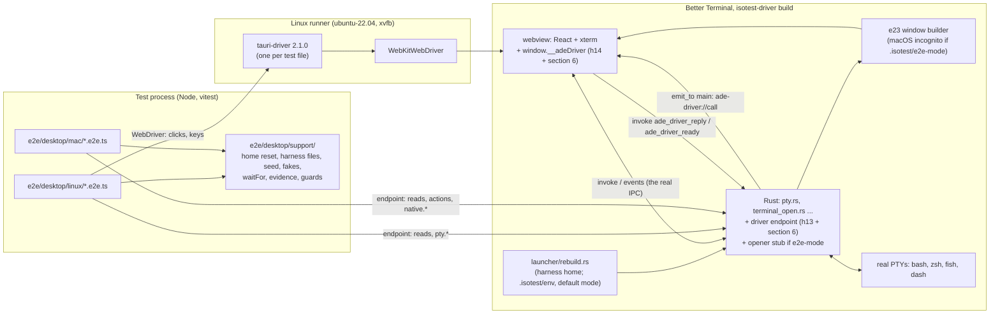
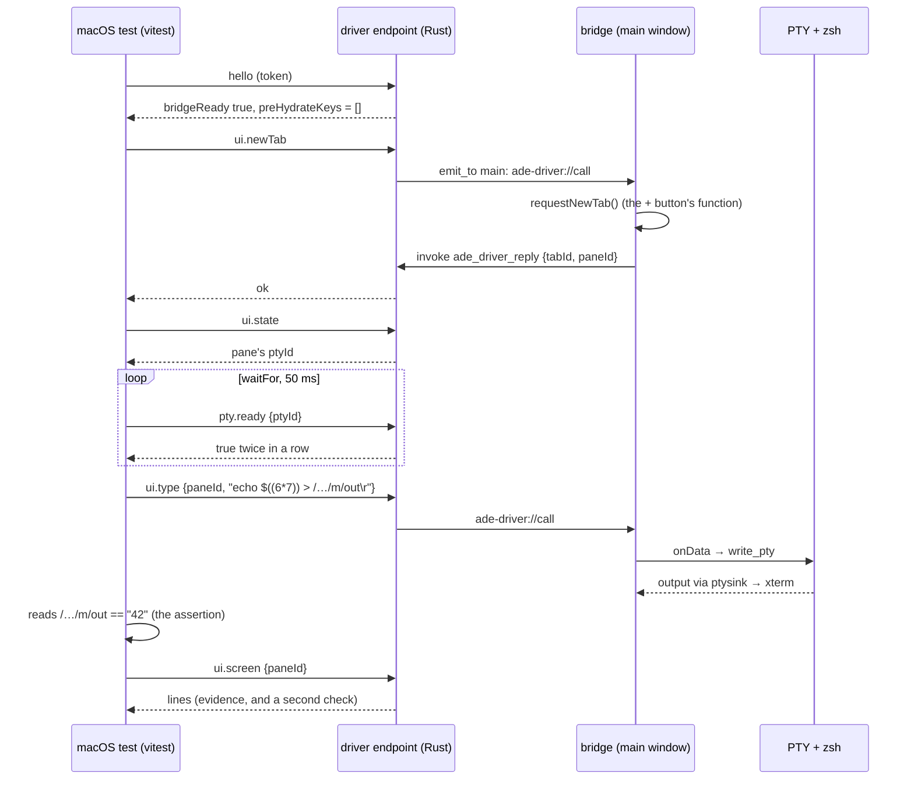

# Desktop app end-to-end tests: technical design

- **Status:** Proposed, revision 3 (2026-11-09). Not approved. Nothing here changes the
  verification command.
  - Revision 1 was merged to `main` before review (PR #105, merge `ef77558`). Its review
    came back BLOCKED (B1 to B4, M1 to M10, minors 1 to 12).
  - Revision 2 (PR #108, `6b23dad`) answered that review. Its own review also came back
    BLOCKED (NB1 to NB3, M-a to M-h, the slice findings, minors 1 to 10).
  - This revision, on the same PR, answers that review (section 0). **PR #108 supersedes
    revision 1 on `main`:** once it merges, `ef77558`'s text is history only.
- **Owner:** architect.
- **ADR:** `.ade/context/decisions/0030-desktop-e2e-webdriver-on-linux-and-a-compiled-out-test-channel.md`
  (the file name is kept so links hold; its title says what it decides).
- **Builds on:** F1's harness driver (ADR 0020; F1 design 4.1, 14 and 15.1; harness
  stories h13 to h16 in
  `_bmad-output/initiative-personas-and-engagements/epic-harness/tickets.toml`), ADR
  0016's harness home, and ADR 0017's Rust-made windows (F1 story e23). It adds no second
  test feature, bridge, release check, bundle id or Tauri config.
- **Amends, if the owner agrees:** h13 and h14 (Q14), e22, h16, pc3 and e25 (Q9), e23 and
  ADR 0017 (Q13), and ADR 0016 (Q10). None of them is described as "unchanged" any more.
- **Contract:** at approval the architect writes `.ade/context/isotest-driver.md` from
  sections 6 and 7.1. It holds the calls that isotest and the e2e layers share, the harness
  files, and the table of every feature-gated site. The F1 stories and the e2e stories
  build against that one file.
- **Scope:** end-to-end tests of the owner's flows in the desktop app (Better Terminal:
  `src-tauri` and `src/`), run against the real built app: the real Rust backend, real
  PTYs and the real webview. They do not replace the isolation test (`isotest`, gate D28),
  which answers a different question: where an engagement's writes land.
- **Shard nothing yet.** Section 13 lists the slices for the scrum-master after approval.

## 0. Revision 3: what the review found and what changed

| Finding | Change | Where |
|---|---|---|
| **NB1** on Linux `incognito` turns WebDriver off: wry 0.54.2 `webkitgtk/mod.rs:255-257` swaps Tauri's context for `WebContext::new_ephemeral()`, and `create_context` sets `automation = false` (`web_context.rs:61`) | Incognito is **macOS only**. On Linux the webview's data lives under the compiled home (`XDG_*_HOME` unset, so it defaults under `HOME`), and the reset before each file deletes it. The empty pre-hydrate key list (M-a) checks it on both platforms | 2, 8.3; ADR 0030 |
| **NB2** e23 creates every window in Rust, and its acceptance (2) is `default_windows_are_not_incognito`, so a `tauri.e2e.conf.json` window entry stops working when e23 lands | `tauri.e2e.conf.json` is dropped. Incognito is decided in Rust, in e23's window builder: under `isotest-driver`, on macOS, when the harness file `<compiled home>/.isotest/e2e-mode` passes the file checks. Isotest never writes that file. Q13 asks to amend e23's acceptance (2) and ADR 0017. **e2e slice 7 builds it**, after e23 | 3, 5, 8.3, 13; Q13 |
| **NB3** S8 depends on `quiesce`, but h13 says only "stops timers and further store flushes", and `flushNow()` returns early while auto-save is suspended (`persistence.ts:71`) | `quiesce` is defined in the contract. It stops the 2 s debounce, the 20 s interval, snapshots, sync and the automatic store flushes. An explicit `saveSession()` and `flushNow()` still write. It uses its own flag, not `suspendAutoSave`. h13's and h14's text are amended (Q14). S8(c) gains a control: `ui.saveSession` after `quiesce` writes `K<v>` | 6.2, 12 (S8); Q14 |
| **M-a** `boot()` writes `ade-bmad-kept` and `ade-bmad-reasked-v4` before the bridge loads, and S8(c) restores `ade-session`, so "`localStorage` keys equal the seed" fails | The bridge's module records `Object.keys(localStorage)` as the **first statement of `boot()`**, before sync and hydrate, under the define. `hello.preHydrateKeys` must be `[]`. Nothing depends on the seed key set | 6.1, 8.3, 8.5 |
| **M-b** the env-file reader is unchecked | The home must be owned by the user. `.isotest` must be mode 0700. The file must be a regular file owned by the user, with no group or other bits. No component may be a symlink. Otherwise exit 2. Values are checked: `SHELL` must be an absolute path to an existing executable file, and every `PATH` entry must be absolute. The file is applied in default mode only. The local home is per-user (8.1), never a predictable `/tmp` path. `.isotest/env` is a `--expect absent` pattern | 5, 7.3, 8.1, 8.2 |
| **M-c** S2(b) and 7.4 compare names that are always set | They compare **canary values** (a per-run nonce in three of the file's values), run on CI only (they refuse to run anywhere else), use a named config (`tauri.conf.json` plus h16's `tauri.isotest.conf.json`, no feature, no define), and the Linux job gains the second build step | 5, 7.4, 10, 12 (S2) |
| **M-d** the dependency order was understated | The real order is written out: pb1 → h1 → h13, then h14 → h15 → h16, before any slice. S3 to S5 and S8(a) need PR #100. The macOS layer needs e23, and the post-rebuild environment needs e15 (with e16, its builder). **The env-file branch is e2e slice 6, after e15**, and Q10 offers folding it into e15 instead | 12, 13; Q7, Q10 |
| **M-e** `cargo test --features isotest-driver` does not compile without `ADE_ISOTEST_HOME` (h13 uses `env!`) | The line supplies the variable and runs only the driver's tests: `cd src-tauri && ADE_ISOTEST_HOME="$PWD/target/isotest-cargo-home" cargo test --locked --features isotest-driver isotest_driver_tests`. The full suite under the feature is not run: F1-on and the substitutions change behaviour that ordinary tests assume. h13's own line needs the same fix (Q14) | 10, 13, 14; Q11 |
| **M-f** 7.1's allowlist missed F1's own feature-gated sites, and put the vault `cfg` in `lib.rs` | One table lists every site, F1's and this design's, with its file, item and owner story. The static test holds it as one constant, and the context file holds the same rows. The vault site is `vault.rs` | 7.1; Q14 |
| **M-g** Q9 said "`f1-forced-build` is already checked"; it is only in the F1 design's text | Corrected. `f1-forced` arrives in e22, which must add the sentinel string; h15's script must check for it; and h16, pc3 and e25 must add `f1-forced` to the isotest builds. With Q9, the e2e layers never test F1 on unless a later decision says so | 8.9; Q9 |
| **M-h** Q12's vault rename conflicts with F1 section 10's derived services and Windows filters; the opener stub hides real opener writes from isotest's tier-2 scan | Every derived name moves with the base: `com.betterterminal.isotest.vault.p.<id>`, Windows targets and the `…/*` filter included, all derived from one constant. The opener stub is used **only when `e2e-mode` is present**, so isotest keeps the real opener and ADR 0020's tier 2 is unchanged. The consequence is stated in case isotest ever opts in | 8.6, 8.8; Q12 |
| **Slices** slice 1 was a grab-bag; `native.performClose` and `native.terminate` sat in slice 4; mac-smoke's retirement was folded into slice 5 | Slices are now vertical, each ending in a scenario. The native close and Quit calls are in S8's slice. Retiring mac-smoke is its own slice | 13 |
| Minor 1 | On macOS the shell's environment is read with a typed `env > <m>/shellenv`: `ps eww` returns no environment for Apple platform binaries such as `/bin/zsh`. `ps eww` is kept for the cargo-built app | 8.2, 12 (S7) |
| Minor 2 | The pass-through list is fixed now: `WEBKIT_INSPECTOR_SERVER` only, with a loopback value. It opens WebKit's remote inspector, which is recorded | 2, 8.2 |
| Minor 3 | h13 defines no `hello`. This contract defines it, and Q7 and Q14 say so | 6.1; Q7, Q14 |
| Minor 4 | The real-home guard's first macOS run is a measured listing, and the guard's patterns come from it | 8.3, 13 |
| Minor 5 | The bridge loads in `boot()`, after `void reaskV4Projects()` (`main.tsx:81` today), not "lines 19 to 23" | 6.1 |
| Minor 6 | Checked: the settings store merges a partial `better-terminal-settings` with its defaults (`settingsStore.ts:462`, `{ ...defaults, ...migrate(saved) }`) | 8.5 |
| Minor 7 | The rule is now "one app at a time". A file may start its app again only after the previous process group is gone. The home is reset per file, not per launch | 9, 12 (S8) |
| Minor 8 | The local guard deletes isotest's per-bundle state (same bundle id). The doc says so, and the guard refuses to run while any test build or isotest is running | 8.3 |
| Minor 9 | The opener stub's permission path is proved by a feature-on test through the real IPC with the real capability file. The stub bypasses the opener plugin's URL scope, which is recorded | 8.8 |
| Minor 10 | The header says revision 1 is on `main` (`ef77558`) and PR #108 supersedes it | header |

**Revision 2's answers that this revision changes:** B3 (incognito is now a Rust decision,
macOS only; the seed-key comparison is replaced by the empty pre-hydrate list); minor 2
(the window patch file is gone); M2 (the feature line carries `ADE_ISOTEST_HOME` and a
filter); minor 6 (S2(b) compares values); M7 (the vault rename moves to S9's slice, with
derived names); M8 (the opener stub is gated by `e2e-mode`). Revision 2's other answers
stand. Its table is in `6b23dad`.

## 1. What exists, and the gap

| Layer | What it proves | What it cannot see |
|---|---|---|
| vitest, about 1,965 tests (`npm test`) | components, stores and hooks, with Tauri mocked | the real backend, real PTYs, real xterm, the IPC between them |
| `cargo test` in `src-tauri`, including `tests/bmadv6_e2e.rs` and `tests/bmadswitch_e2e.rs` | Rust modules; scaffolds on disk | the window, the frontend store, the webview |
| `relay/e2e` | the relay, with real clients | the desktop app |
| `terminal_open_e2e.rs` (PR #100, story 9, open) | `ade open` end to end with a real endpoint, real PTYs and real bash; a test thread stands in for the window | the Tauri window, the frontend store, a real `"$ADE_HOOK_BIN"` expansion (its manual checks M1 to M5) |
| `.github/workflows/mac-smoke.yml` (manual dispatch) | the app builds, starts and stays up for two minutes | assertions; its typing goes through `osascript`, which needs Accessibility permission |
| F1's `isotest` (planned, slice 0) | where an engagement's writes land, through the `isotest-driver` build | ordinary flows: tabs, typing, `ade open`, close and Quit |

The gap is the **seam between the webview and the backend**, exercised through the UI. A
tab is clicked, keys reach xterm, `write_pty` reaches the shell, output comes back through
`ptysink` into xterm, and the store shows the right tabs and sub-terminals.

## 2. Constraints that shape everything

- macOS's WKWebView has no WebDriver. `tauri-driver` works on Linux (`WebKitWebDriver`,
  webkit2gtk) and on Windows. The third-party macOS routes are in section 11.
- F1 has already decided, with the owner's approval, how a test build of this app is made
  and kept out of releases (ADR 0020, F1 design 15.1). A second mechanism would need a case
  against ADR 0020. There is none, so this design extends that one.
- ADR 0016: from F1 slice 1 (story e15), every instance rebuilds its environment from the
  login session and re-execs before Tauri starts. A test that sets `HOME` or `PATH` on the
  launch command loses it. Only what the feature compiles in, or reads from a place derived
  from the compiled home, survives.
- ADR 0017 and story e23: from F1 slice 1, every window is created in Rust, and the default
  profile's windows are not incognito (e23 acceptance 2). Window settings in a Tauri
  config file stop applying from then on.
- `NSHomeDirectory()` ignores `HOME`. WKWebView's persistent store, `NSUserDefaults`,
  saved window state and per-bundle caches live under the real `~/Library`, whatever the
  test sets.
- **Linux incognito disables automation (NB1).** wry 0.54.2, `webkitgtk/mod.rs:255-257`:
  when `incognito` is set, wry replaces Tauri's context with
  `WebContext::new_ephemeral()`, and `create_context` (`web_context.rs:60-62`) sets
  `automation = false`. A Linux window that is incognito cannot be driven by WebDriver. So
  no e2e window is incognito on Linux. (The same holds for F1's incognito engagement
  windows on Linux. That does not matter to F1, which drives through its endpoint, but it
  rules out a future WebDriver test of an engagement window on Linux.)
- **Already true, not added here:**
  - wry enables WebKitGTK automation when the process has `TAURI_WEBVIEW_AUTOMATION=true`,
    in any build, release included. So anyone who can start a Linux release build with that
    variable can drive it with WebDriver.
  - WebKitGTK opens its **remote inspector server** on the address in
    `WEBKIT_INSPECTOR_SERVER` in any process that has it. Whoever can connect to that
    address can inspect and script the webview (minor 2).
  - Before F1 slice 1, both reach a release build from whatever launched it. After slice 1,
    the rebuild drops a caller's variables in release builds, which narrows both to the
    login session.
  - This is recorded for the owner as a fact, not as a finding against this design.
- **Story numbers.** "h" and "pb"/"pc" stories are F1 slice 0
  (`epic-harness/tickets.toml`). "e" stories are F1 slice 1
  (`epic-profile-and-rule/tickets.toml`).

## 3. Decision in one paragraph

Keep the owner's three layers on **one test build: F1's `isotest-driver` build**, built
exactly as h16 builds it, with its own compiled home. Its loopback endpoint (h13) gains a
small set of calls. Its `window.__adeDriver` (h14) gains reads of xterm buffers and the
store, and a few store actions. Its release check (h15) gains patterns and a `present`
mode. **One runner:** both layers are vitest suites in Node. The Linux suite uses
`webdriverio` as a library against `tauri-driver` for real clicks and keys. Both suites
read through the endpoint. **macOS native actions call AppKit's own entry points**
(`-[NSWindow performClose:]`, `-[NSApplication terminate:]`). **Test-only behaviour that
isotest must not get** (a macOS incognito window, the opener stub) switches on at run time
from one harness file, `<compiled home>/.isotest/e2e-mode`, which only the e2e harness
writes. The rest of the test environment survives the rebuild through a second harness
file, `<compiled home>/.isotest/env`, read only under the feature and only in default mode.

## 4. Architecture



### 4.1 Components

| Component | Where | Responsibility | Exists in |
|---|---|---|---|
| Driver endpoint | h13's module in `src-tauri/src` (the h13 plan names it); `native_macos.rs` inside it | h13's calls, `hello` and `quiesce` as defined in 6, and section 6's calls; forwards `ui.*` to the bridge and waits for the reply; answers `pty.*` from `PtyManager`; runs `native.*` on the main thread on macOS | `isotest-driver` builds |
| Bridge | h14's module (`window.__adeDriver`), plus section 6's reads and actions | records the pre-hydrate key list; reads the store and xterm buffers; runs the store actions the buttons run; implements `quiesce`'s frontend half; signals ready | `VITE_ADE_ISOTEST=1` builds |
| Harness files | `<compiled home>/.isotest/e2e-mode`, `<compiled home>/.isotest/env` | written by the e2e harness only; checked by the app (8.2) before use | test homes only |
| e2e-mode reader | the driver module, called from `lib.rs` (opener) and e23's window builder (incognito) | one checked read at start, cached for the process's life | `isotest-driver` builds |
| Env-file branch | `launcher/rebuild.rs`, feature-only, default mode only | applies `.isotest/env` and the one pass-through name after the harness-home values (8.2) | `isotest-driver` builds, from e2e slice 6 (after e15) |
| Linux suite | `e2e/desktop/linux/` | real input through WebDriver; reads through the endpoint | test tree |
| macOS suite | `e2e/desktop/mac/` | actions and reads through the endpoint; Mac-only behaviour | test tree |
| Support | `e2e/desktop/support/` | `resetHome()`, `writeHarnessFiles()`, `seed()`, `installFakes()`, `launchApp()`, `waitFor()`, `evidence()`, `realHomeGuard()`, `procEnv()`, and a `Driver` interface with a WebDriver and an endpoint implementation | test tree |

There is no data model. Nothing persists beyond the compiled home, which is recreated for
each test file, so there is no ER diagram.

### 4.2 Why a bridge on Linux too

WebDriver gives real clicks and keys, so Linux acts through WebDriver. It cannot read
terminal text, because xterm may draw on a WebGL canvas (`useTerminal.ts` loads
`WebglAddon`). The bridge reads xterm's buffer instead, which does not depend on the
renderer. The bridge has **no arbitrary-JavaScript eval**, only the fixed calls of
section 6.

## 5. Build for tests

One recipe on both platforms: **h16's harness build**, with this harness's compiled home.

```
cargo build --release --manifest-path src-tauri/Cargo.toml -p ade-hook
cp target/release/ade-hook src-tauri/binaries/ade-hook-<target triple>   # as release.yml
ADE_ISOTEST_HOME=<home> VITE_ADE_ISOTEST=1 \
npx tauri build --features isotest-driver --config src-tauri/tauri.isotest.conf.json \
  --no-bundle     # Linux
  --bundles app   # macOS: a real .app, so NSBundle, menus and Info.plist are real
```

`npm run build:e2e-app` runs it. If Q9 is accepted, the features become
`isotest-driver` only for the e2e build, and `isotest-driver,f1-forced` for isotest's
(8.9).

- **The feature and config are F1's.** `tauri.isotest.conf.json` (h16) gives the bundle id
  `com.betterterminal.isotest` and `bundle.externalBin: ["binaries/ade-hook"]`, as
  `tauri.release.conf.json` does. So the helper lands beside the executable: on macOS in
  `Contents/MacOS/`. With Linux `--no-bundle`, Tauri's build is expected to copy
  `externalBin` beside the executable; the slice confirms this, and if not, the build
  script copies it. `launchApp()` refuses to start if the helper is not beside the
  executable.
- **No e2e Tauri config.** Revision 2's `tauri.e2e.conf.json` is gone (NB2). The window's
  incognito flag is decided in Rust (8.3). Geometry is not patched: the real window is
  `maximized: true`, the Linux job fixes the screen at `xvfb-run -s "-screen 0 1280x800x24"`,
  and no assertion depends on the column count.
- **`ADE_ISOTEST_HOME`**, chosen by the build script:
  - **On CI:** `$RUNNER_TEMP/ade-e2e/home` (per job, owned by the runner user).
  - **Locally (M-b):** a per-user folder, never a predictable shared path:
    - macOS: `$(getconf DARWIN_USER_TEMP_DIR)ade-e2e/home`. This is always set, per user,
      mode 0700. `TMPDIR` is not consulted.
    - Linux: `$XDG_RUNTIME_DIR/ade-e2e/home` if `XDG_RUNTIME_DIR` is set, is a directory
      owned by the user, has mode 0700 and is not a symlink. Otherwise
      `${XDG_CACHE_HOME:-$HOME/.cache}/ade-e2e/home`. `/tmp` is never used, whether or not
      `TMPDIR` is set.
  - The script creates `ade-e2e` with mode 0700. It refuses to build if `ade-e2e` already
    exists and is not a directory owned by the user with mode 0700, or is a symlink.
  - The script writes the value to `e2e/desktop/.build/home` (ignored by git). `hello`
    returns the compiled value, and the harness aborts if they differ ("the binary's
    compiled home is not this harness's").
- **Release profile with the feature**, not `--debug`.
- **Vite:** `VITE_ADE_ISOTEST=1` as h14 defines it. When it is absent, the bridge's dynamic
  import and the pre-hydrate list sit in branches Vite replaces with `false`, and no bridge
  chunk is emitted. This is proved in 7.3, not assumed.
- **Cargo:** the feature gains the macOS-only optional dependencies the native calls need,
  pinned to the versions in `Cargo.lock` today. They are added by slice 7.

  ```toml
  [features]
  isotest-driver = ["dep:objc2", "dep:objc2-app-kit", "dep:objc2-web-kit"]
  [target.'cfg(target_os = "macos")'.dependencies]
  objc2 = { version = "=0.6.3", optional = true }
  objc2-app-kit = { version = "=0.3.2", optional = true }
  objc2-web-kit = { version = "=0.3.2", optional = true }
  ```

  `default` is unchanged and never lists the feature.
- **The no-feature build for S2(b) (M-c), CI only, Linux:**
  - Command: `npx tauri build --config src-tauri/tauri.isotest.conf.json --no-bundle`.
    That is `tauri.conf.json` plus h16's override, with no `--features`, no
    `VITE_ADE_ISOTEST` and no `ADE_ISOTEST_HOME`.
  - It uses the test bundle id, so whatever it writes is under
    `com.betterterminal.isotest` on a disposable runner.
  - The Linux job builds it **first**, copies the executable to
    `e2e/desktop/.build/nofeature/`, and then makes the feature build. Order matters
    because both builds write `target/release`.
  - `check-no-driver.sh --expect absent` runs on it. That makes it a second, real
    negative control beside h15's fixtures.

## 6. The driver endpoint and bridge (contract)

Transport, token, `driver.json` and framing are h13's: loopback, a random port and a random
token, written to `<compiled home>/.isotest/driver.json`. Every request carries the token.
A request without it is refused and changes nothing (h13 acceptance 2). Calls are a closed
set, and an unknown call is an error.

### 6.1 Calls

| Call | Args | Value | Path inside the app | Used by |
|---|---|---|---|---|
| `hello` (**defined here**; h13 names no such call, minor 3) | | `{sentinel, contract: 1, pid, home, bridgeReady, f1, e2eMode, preHydrateKeys}` | Rust. `f1`: F1 is on in this process. `e2eMode`: the `e2e-mode` file was accepted at start. `preHydrateKeys`: from the bridge's ready signal, `null` until then | both, isotest |
| `quiesce` (h13, **defined in 6.2**) | | `null` | Rust forwards to the bridge; the bridge runs 6.2 | S8, isotest |
| `ui.saveSession` | | `null` once written | bridge: `await saveSession(); await flushNow();`, the pair the close path runs (`App.tsx:133-134`), nothing else | S8 (the control) |
| `ui.state` | | tabs, panes (each with its `ptyId`), sub-terminals (`name`, typed and spinner flags), active ids, open dialogs (title, buttons) | bridge | both |
| `ui.screen` | `paneId` | `string[]`: the xterm buffer, trailing blanks trimmed | bridge | both |
| `ui.type` | `paneId`, `text` | `null` | bridge: `term.input(text, true)` → `onData` → `write_pty` | macOS |
| `ui.newTab` | | `{tabId, paneId}` once the store has it | bridge: `requestNewTab()`, the function the + button calls (`src/lib/newTab.ts:17`) | macOS |
| `ui.closeTab` | `tabId` | `null` | bridge: the tab bar's close action through `useGuardedClose` | macOS |
| `ui.click` | `testId` | `null` | bridge: h14's click (pointer events) | macOS |
| `pty.ready` | `ptyId` | bool or null | Rust: `pty::line_editor_ready`, the code behind `pty_line_editor_ready` | both |
| `pty.pid` | `ptyId` | int | Rust: `PtyManager`'s shell pid | both |
| `pty.alive` | `pid` | bool | Rust: `kill(pid, 0)` | both |
| `native.performClose` | | `null` | macOS main thread: `-[NSWindow performClose:]` on the main window | S8 |
| `native.terminate` | | `null` (the connection then closes) | macOS main thread: `-[NSApplication terminate:]` | S8 |
| `native.snapshot` | `path` | `path` | macOS: `-[WKWebView takeSnapshotWithConfiguration:…]` written as a PNG; evidence only | macOS |

The Rust calls take the PTY id that the harness read from `ui.state`.

- **Pre-hydrate key list (M-a).** The **first statement of `boot()`** in `src/main.tsx`
  is:

  ```ts
  const preHydrateKeys = import.meta.env.VITE_ADE_ISOTEST === "1" ? Object.keys(localStorage) : null;
  ```

  This runs before `syncBeforeLaunch()`, `hydrateFromDisk()`, `migrateKept()` and
  `reaskV4Projects()`, which write `ade-bmad-kept` and `ade-bmad-reasked-v4`
  (`projectSetup.ts:142`, `:158`). The bridge receives the list and reports it.
  `hello.preHydrateKeys` must be `[]` on every launch, the relaunch in S8(c) included. Any
  key means the webview store came from somewhere other than this file's fresh home or a
  non-persistent store: "store contaminated", with the list. No seed key set is compared.
- **Bridge load (minor 5).** In `boot()`'s main-window branch, immediately after
  `void reaskV4Projects();` (`main.tsx:81` today) and before `startPeriodicSync()`:

  ```ts
  if (import.meta.env.VITE_ADE_ISOTEST === "1") (await import("./<h14's module>")).install({ preHydrateKeys });
  ```

  So the bridge reads the restored stores, never pre-hydrate values. Detached windows do
  not load it.
- **Ready signal.** Tauri does not queue events sent before a listener exists. Once its
  listener is registered, the bridge invokes `ade_driver_ready` with `preHydrateKeys`. Until
  then, the endpoint answers every `ui.*` call and `quiesce` with
  `error: "bridge not ready"`, and `hello` reports `bridgeReady: false`. The harness's
  first wait is for `bridgeReady: true`.
- **One window.** Rust sends `ade-driver://call {id, call, args}` with
  `emit_to("main", …)`, never as a broadcast, so a detached window cannot answer for the
  main one. The bridge replies with `invoke("ade_driver_reply", {id, ok, value|error})`.
  After 5 s the endpoint replies `error: "bridge did not answer in 5 s"`.
- **Names that 7.3 greps:**
  - Rust side: h13's `#[used]` sentinel `__ade_isotest_driver_build__`, the command names
    `ade_driver_reply` and `ade_driver_ready`, the event name `ade-driver://call`, and the
    relative paths `.isotest/env` and `.isotest/e2e-mode`. Each path is **one string
    literal** joined to the compiled home, never built from parts, so it appears whole in
    the binary. The positive control catches a violation.
  - Frontend: `__adeDriver`.
- **Evidence file.** Under the feature, `main.rs` points stdout and stderr (`dup2`) at
  `<compiled home>/.isotest/stdio.log` before Tauri starts, after the rebuild once e15 has
  landed. So the app's output survives whatever launched it. A refusal by the rebuild or the
  env-file checks happens before the redirect, so it goes to the original stderr. On Linux
  the harness also runs the same checks before launch (8.2), so that refusal is a backstop.

### 6.2 `quiesce` (NB3)

h13's text is "stops timers and further store flushes", and `persistence.ts` has only
`suspendAutoSave()`, after which `flush()` returns early (`persistence.ts:71`). So an
implementation through `suspendAutoSave` would make the close path's `flushNow()` write
nothing. That breaks S8(b), and it breaks isotest's P1c, whose quit-as-a-user path runs
`saveSession()` and `flushNow()` (F1 design 15.2, step 6). The contract is therefore:

1. **First, once:** `flushNow()`, plus isotest's one WebKit-store flush (h13, F1 15.2
   step 4).
2. **Then stops, for the rest of the process's life:**
   - `App.tsx`'s 2 s session debounce (`:118`) and 20 s session interval (`:122`): no
     `saveSession()` from a timer;
   - the 10-minute snapshot interval (`persistence.ts:153`);
   - `startPeriodicSync`'s interval and its `visibilitychange` tick (`sync.ts:100-103`);
   - the store's **automatic** flushes: the 800 ms queue timer, the 5 s retry timer, and
     the `beforeunload` and `visibilitychange` flushes. Writes to persisted keys still
     queue in memory (`pending`).
3. **Still writes:** an explicit `saveSession()` (which writes `localStorage` and so
   queues) and an explicit `flushNow()` (which writes the queue to `state/kv`). These are
   the close path, isotest's quit-as-a-user, and `ui.saveSession`.
4. **Implementation:**
   - a `quiesced` flag in `persistence.ts`, distinct from `suspended`;
   - `flush()` takes an `explicit` argument, and only `flushNow()` passes `true`;
   - `suspended` still wins: after `suspendAutoSave()`, even `flushNow()` writes nothing,
     as today;
   - the `App.tsx` and `sync.ts` timer callbacks check `isQuiesced()`.
5. **Tests (vitest, h14 amended plus slice 8):**
   - after `quiesce`, a `setItem` on a persisted key reaches no `state_write` within 10 s
     of fake time;
   - `flushNow()` then writes it;
   - after `suspendAutoSave()`, `flushNow()` still writes nothing;
   - after `quiesce`, the session timers call no `saveSession`.

h13 and h14 are amended to this text (Q14). They are no longer "unchanged".



## 7. Proving release builds do not contain the driver

There is one feature, one bridge and one release check. Every check is able to fail.

### 7.1 Static test in `cd src-tauri && cargo test` (already under the verification command)

- **Manifests:** in every workspace manifest (`src-tauri/Cargo.toml`, `ade-hook`,
  `isotest`), no `default` list contains `isotest-driver` or `f1-forced`, and no
  dependency entry enables either.
- **Feature-gated sites (M-f).** Every `feature = "isotest-driver"` and
  `feature = "f1-forced"` in `src-tauri/src` must sit in a row of this table, matched by
  file and enclosing item. The test holds the rows as one constant, `FEATURE_SITES`. The
  context file `.ade/context/isotest-driver.md` holds the same rows. A story that adds a
  site adds its row to both, in the same change. A site outside the table fails the test,
  and so does a row with no site, so the table cannot drift.

  | # | Site (file, item) | Gated by | Owner story |
  |---|---|---|---|
  | 1 | `Cargo.toml` `[features]`: `isotest-driver`, and its optional macOS deps | — | h13; deps: e2e slice 7 |
  | 2 | `Cargo.toml` `[features]`: `f1-forced` | — | e22 |
  | 3 | the driver module, whole (endpoint, token, `driver.json`, `hello`, `quiesce`, quit-as-a-user, section 6's calls, `native_macos.rs`, the e2e-mode reader) | `isotest-driver` (`native_macos.rs` also `target_os = "macos"`) | h13; additions: e2e slices 1, 2, 7, 8 |
  | 4 | the `#[used]` sentinel `__ade_isotest_driver_build__`, inside the driver module | `isotest-driver` | h13 |
  | 5 | `lib.rs`: the driver's `mod` line and its `setup` call | `isotest-driver` | h13 |
  | 6 | `lib.rs`: the opener plugin choice (the stub when `e2e-mode`, 8.8) | `isotest-driver` | e2e slice 2 |
  | 7 | `main.rs`: the stdio redirect | `isotest-driver` | e2e slice 2 |
  | 8 | `launcher/rebuild.rs` or `launcher/login_env.rs` (the e15 and e16 plans name the function): the compiled harness home, applied last | `isotest-driver` | e15/e16 (ADR 0016) |
  | 9 | `launcher/rebuild.rs`: the env-file branch and the pass-through, default mode only | `isotest-driver` | e2e slice 6 (or e15, Q10) |
  | 10 | where `ProfilePaths`' OS bases are computed (the e1 and e3 plans name the function): every Windows base from the compiled home | `isotest-driver` | e1/e3 (F1 design 4.1) |
  | 11 | e22's flag module: F1 compiled on | `any(isotest-driver, f1-forced)`; `f1-forced` only if Q9 is accepted | e22 |
  | 12 | e22's flag module: the `#[used]` string `f1-forced-build` | `f1-forced` | e22 (amended, Q9) |
  | 13 | e24's jump-list registration and the `.desktop` action: "only in builds with F1 compiled on" | they read row 11's constant and repeat no `cfg` | e24 |
  | 14 | e23's window builder: macOS incognito when `e2e-mode` (8.3) | `all(isotest-driver, target_os = "macos")` | e2e slice 7 (Q13) |
  | 15 | `vault.rs`: the base service constant (8.6) | `isotest-driver` | S9's slice (Q12) |

  The table is built by e2e slice 1 with the rows that exist then (1, 3, 4, 5). Rows 2 and
  6 to 15 are added by their owner stories. F1's stories are told to do so through Q14.
- **Workflows and config:** `release.yml`, `ci.yml`'s frontend job, `.cargo/config.toml`
  (if any), and any `RUSTFLAGS` set in a workflow contain none of these patterns:
  `isotest-driver`, `f1-forced`, `VITE_ADE_ISOTEST`, `ADE_ISOTEST_HOME`,
  `tauri.isotest.conf.json`, `--cfg feature=`. `release.yml` may mention
  `check-no-driver`: the pattern list is what is forbidden, not a word.
- **Planted violations:** one per rule, in fixture strings, proves each rule fires.

### 7.2 Static test in `npm test`

- `src/main.tsx` references `VITE_ADE_ISOTEST` in exactly two places: the first statement
  of `boot()`, and the bridge import after `void reaskV4Projects();`.
- Nothing imports the bridge module **except** `src/main.tsx` and the bridge's own test
  files.
- `src/vite-env.d.ts` declares `VITE_ADE_ISOTEST?: "1"` in `ImportMetaEnv`.
- `vitest.config.ts` pins the define (`import.meta.env.VITE_ADE_ISOTEST` → `undefined`),
  so a developer's shell cannot turn it on in `npm test`. The bridge's own tests set it per
  test with `vi.stubEnv`.

### 7.3 Artifact check: h15's `scripts/check-no-driver.sh`, extended, one script

`check-no-driver.sh --expect absent|present <executable> <dist dir>`:

- **The executable** (`grep -a -c`) is searched for `__ade_isotest_driver_build__`,
  `com.betterterminal.isotest`, `ade_driver_reply`, `ade_driver_ready`,
  `ade-driver://call`, `.isotest/env` and `.isotest/e2e-mode`, and, once e22 lands,
  `f1-forced-build`.
- **Every file under `dist/`** is searched for `__adeDriver`. `dist/` is checked, not the
  binary, for frontend names, because Tauri embeds the frontend compressed.
- **`--expect present`** on every test build is the **positive control**. If a name the
  test build must hold is not found, the absent checks prove nothing, and the job is red.
  `f1-forced-build` is excluded from `present` for the e2e build (it has no `f1-forced`).
  The S2(b) no-feature build is checked with `--expect absent`.
  - The bundle id is excluded from `absent` for that build only, because it uses the test
    config.
- **`--expect absent`** runs:
  - in `release.yml` on each platform's executable and `dist/` before upload (h15 adds the
    step; Q8);
  - in CI's frontend job on the `dist/` of its `npx vite build` (the executable argument
    is omitted there).
- **Release ordering, proposed to DevOps, not changed here:** `release.yml` creates a
  non-draft release before the platform builds, with `fail-fast: false`. So a failed
  absence check on one platform leaves the other platforms' assets public. Proposal: create
  the release as a draft, and publish it in a final job that needs every platform's build,
  check included (Q8).

### 7.4 Runtime check (S2(b); M-c), CI only

- **Setup:** the no-feature build (5) is started with a fresh `HOME` under `$RUNNER_TEMP`.
  The harness first plants, in that home:
  - an `.isotest/driver.json` folder;
  - an `.isotest/e2e-mode` file;
  - an `.isotest/env` file whose values carry a per-run nonce `c<nonce>`:
    `PATH=<home>/fakebin-c<nonce>:/usr/bin:/bin`, `CLAUDE_CONFIG_DIR=<home>/.claude-c<nonce>`
    and `ANTHROPIC_BASE_URL=http://127.0.0.1:9/c<nonce>`.
- **Launch:** through `env -i`, with values that do not contain the nonce, and with
  `TAURI_WEBVIEW_AUTOMATION` unset.
- **Asserts:**
  - the string `c<nonce>` occurs nowhere in the app's `/proc/<pid>/environ`;
  - it occurs nowhere in the environment of the first shell the app starts (found through
    `/proc/<pid>/task/*/children`);
  - no `driver.json` file is written;
  - no new listening port appears (`/proc/net/tcp` and `tcp6` are compared before and
    after, filtered to sockets in `/proc/<pid>/fd`).
- **CI only:** without the feature there is no compiled home, so the build writes under
  the runner's real `HOME` and its app data. The test refuses to run unless
  `GITHUB_ACTIONS=true` and `RUNNER_TEMP` is set ("S2(b) runs only on CI: it writes outside
  any test home").
- **What it shows:**
  - Before e15, nothing reads `.isotest/env`, so S2(b) is a baseline.
  - From e2e slice 6, S2(a) shows that the feature build applies the nonce values, and
    S2(b) shows that the no-feature build does not.

What this does not prove: that nobody ships a binary built by hand with the feature. Only
`release.yml` builds what ships, and 7.3 guards it.

## 8. Isolation

### 8.1 The home

The home is the compiled `ADE_ISOTEST_HOME` (5), the same mechanism isotest uses. Before
each test file, `resetHome()` deletes it with no-follow deletes (F1's `fsx` helper, or its
TypeScript twin). It then recreates the home with mode 0700 and writes the harness files:
rc files, fakes, seed, `.isotest/` (mode 0700), `e2e-mode` and `env` (both mode 0600).
Files run one at a time, so one compiled home serves a whole suite.

- **Before e15:** there is no rebuild. The harness launches the app with `HOME` and the
  env file's values set (h16's approach for today's binary), and the app reads neither
  harness file's values from disk. `e2e-mode` is still read, because it is a feature
  switch, not environment.
- **From e2e slice 6 (after e15):** the rebuild sets the home from the compiled root and
  applies the env file. S2(a) checks both eras.

### 8.2 The rest of the environment

- **Launch:** the harness starts the app (macOS) or `tauri-driver` (Linux, 8.4) through
  `env -i` plus a named list, never with its own environment. portable-pty copies the app's
  environment into every shell, so anything inherited would reach the terminals (`ZDOTDIR`,
  `BASH_ENV`, `GH_TOKEN`, `ANTHROPIC_AUTH_TOKEN`, `GIT_CONFIG_GLOBAL`, `SSH_AUTH_SOCK` and
  the like).
- **The env file** `<compiled home>/.isotest/env`. The harness writes `NAME=value` lines
  from a closed list compiled into the feature: `PATH`, `SHELL`, `LANG`, `LC_ALL`, `TZ`,
  `CLAUDE_CONFIG_DIR`, `ANTHROPIC_API_KEY`, `ANTHROPIC_BASE_URL`, `DISPLAY`, `XAUTHORITY`,
  `DBUS_SESSION_BUS_ADDRESS`, `XDG_RUNTIME_DIR`, `TAURI_WEBVIEW_AUTOMATION`. `HOME`,
  `USERPROFILE`, `TMPDIR` and `XDG_{DATA,CONFIG,CACHE,STATE}_HOME` can never be listed.
  They stay the compiled home's.
- **File checks (M-b)**, the same for `env` and `e2e-mode`, made by the app before use and
  by the harness before launch:
  1. the compiled home, `.isotest` and the file are each checked with `lstat`, and none
     may be a symlink;
  2. the compiled home and `.isotest` must be directories owned by the user, and
     `.isotest` must have mode 0700;
  3. the file is opened with `O_NOFOLLOW`, and `fstat` must show a regular file owned by
     the user with no group or other bits (`mode & 0o077 == 0`);
  4. any failure is "harness file refused: <path>: <reason>", on stderr, with exit 2. No
     part of the file is applied.
- **Value checks (M-b)**, `env` only. Each failure exits 2, naming the variable and never
  its value:
  - a name outside the list, a repeated name, a value with NUL or a newline, or a line
    without `=`;
  - `SHELL` must be an absolute path to an existing regular file with an execute bit;
  - `PATH` must be non-empty, every entry must be absolute, and there may be no empty
    entries (no leading, trailing or doubled `:`);
  - `CLAUDE_CONFIG_DIR` and `XAUTHORITY` must be absolute; `XDG_RUNTIME_DIR` must be an
    absolute path to a directory owned by the user;
  - `ANTHROPIC_BASE_URL` must start with `http://127.0.0.1:` (no test reaches a real
    endpoint);
  - `TAURI_WEBVIEW_AUTOMATION` must be `true` and is accepted on Linux only.
- **Where it applies:** the rebuild, under `isotest-driver` only, in **default mode only**.
  An engagement-mode start (`--ade-profile`) never reads the file. It applies the file's
  values after the harness-home values (ADR 0016's "applied last"). Without the feature,
  neither the reader nor the list exists. Without the file, nothing changes, so isotest is
  unaffected. This amends ADR 0016's harness-home clause (Q10).
- **Pass-through, fixed now (minor 2):** from its inherited environment, the rebuild keeps
  exactly one variable, `WEBKIT_INSPECTOR_SERVER`, the one WebKitWebDriver sets on the
  browser it launches (WebKit's GLib `SessionHost`). It is kept only on Linux, only in
  default mode, and only when its value is `127.0.0.1:<port>`; any other value exits 2.
  - **What it does:** it makes WebKitGTK open a remote inspector server on that address.
    Any local process that can connect to it can inspect and script the webview for as
    long as the app runs. In the e2e build that is intended, because it is how WebDriver
    reaches the page. It is recorded so nobody adds it to another list by analogy.
  - **If the runner's WebKit differs:** slice 6 prints the browser process's environment
    once on the runner's webkit2gtk version. If WebKit sets any other variable that the
    session needs, that is a design change, which comes back here and to the owner. It is
    not added silently.
- **Values:**
  - `PATH=<home>/fakebin:/usr/bin:/bin:/usr/sbin:/sbin`
  - `CLAUDE_CONFIG_DIR=<home>/.claude` (empty)
  - `ANTHROPIC_API_KEY=invalid`
  - `ANTHROPIC_BASE_URL=http://127.0.0.1:9`
  - `LANG=C.UTF-8` (Linux) or `en_US.UTF-8` (macOS)
  - `TZ=UTC`
  - `SHELL` per 8.7
  - on Linux, the xvfb and bus variables and `TAURI_WEBVIEW_AUTOMATION=true`
  - S2 adds a nonce to three of them (7.4).
- **The check (S2(a), S7):** after `hello`, the harness reads:
  - **The app's start-time environment:** `/proc/<pid>/environ` on Linux, `ps eww -p
    <pid>` on macOS. The app is cargo-built, not a platform binary, so `KERN_PROCARGS2`
    returns its environment.
  - **The first shell's environment:** on Linux, `/proc/<pty.pid>/environ`. On macOS the
    shell is `/bin/zsh`, a platform binary, for which `KERN_PROCARGS2` returns argv but no
    environment, so `ps eww` shows nothing (minor 1). There the harness types
    `env > <m>/shellenv` in the shell and reads the file. That is the shell's live
    environment after its rc files, not its start-time one. That is the one that matters
    to commands, and the app's start-time environment covers the rest.
  - **Asserts:**
    - `HOME` is the compiled home;
    - `PATH` starts with `<home>/fakebin`;
    - `SHELL` and `CLAUDE_CONFIG_DIR` are the file's, and from slice 6 the nonce values
      are present;
    - the canaries the runner sets in its own environment (`ADE_E2E_CANARY=<nonce>`,
      `GH_TOKEN=canary-<nonce>`, `ZDOTDIR=/nonexistent-<nonce>`) are absent from both.

### 8.3 Per-bundle stores, incognito and the real-home guard (NB1, NB2)

- **macOS: incognito from Rust (NB2).** F1 story e23 creates every window in Rust. Its
  builder makes engagement windows incognito and keeps the default profile's windows
  persistent (e23 acceptance 2, ADR 0017).
  - **The addition (e2e slice 7, after e23; Q13):** under
    `all(feature = "isotest-driver", target_os = "macos")`, the builder also makes a
    default-profile window incognito when `hello`'s `e2eMode` is true, that is, when
    `<compiled home>/.isotest/e2e-mode` passed 8.2's file checks at start.
  - **Scope:** it applies to the main window and to detached windows, since e23 makes both.
    The file is read once at start.
  - **Effect:** a non-persistent `WKWebsiteDataStore` (wry's `nonPersistentDataStore`), so
    nothing is written under `~/Library/WebKit/com.betterterminal.isotest`, and no earlier
    run's `localStorage` is visible.
  - **Isotest never writes `e2e-mode`.** It needs the default profile's persistent store
    (ADR 0020's attribution of per-bundle folders), and it gets it.
  - **Tests in slice 7:** e23's acceptance (2) becomes
    `default_windows_are_not_incognito_unless_e2e_mode`, plus
    `e2e_mode_makes_default_windows_incognito_on_macos_only` and
    `e2e_mode_refused_when_the_file_fails_its_checks`.
  - **Before e23 there is no macOS layer** (13).
- **Linux: no incognito (NB1).** The webview stays persistent, so WebDriver works.
  WebKitGTK's data and cache follow `XDG_DATA_HOME` and `XDG_CACHE_HOME`, which are unset,
  so they default to `<compiled home>/.local/share/com.betterterminal.isotest/` and
  `<compiled home>/.cache/com.betterterminal.isotest/`. The per-file `resetHome()` deletes
  them. Within a file, a relaunch sees the same store, which is what a user's relaunch
  sees.
- **The check on both platforms:** `hello.preHydrateKeys` must be `[]` (6.1). On macOS that
  proves the store is non-persistent. On Linux it proves that the reset emptied it.
  `hydrateFromDisk` (`persistence.ts:98-128`) then copies only the seeded `state/kv` into a
  fresh store.
- **Saved window state:** e23 also sets `setRestorable: NO` and registers
  `ApplePersistenceIgnoreState` (ADR 0017). The macOS layer comes after e23, so it has
  both. Without them tao writes `.savedState`, and the guard below fails, by design.
- **The real-home guard (macOS):**
  - **The real home** is read from `getpwuid`, never from `HOME`.
  - **Refusal (minor 8):** the guard **refuses to run while a test build or isotest is
    running**: any process whose executable is inside a bundle with id
    `com.betterterminal.isotest` (`lsappinfo` and the executable's bundle path), or any
    `isotest` process. The message is "isotest or another test build is running; the guard
    would delete its state".
  - **Before each file:** it deletes, without following links, every entry matching
    `~/Library/{WebKit,Preferences,Saved Application State,Caches,HTTPStorages}/com.betterterminal.isotest*`.
    **These are isotest's per-bundle folders too** (the same bundle id). Running the e2e
    suite locally deletes a local isotest run's per-bundle state, just as isotest's clean
    step (F1 15.2, step 1) deletes the e2e suite's. Neither holds anything a later run
    needs.
  - **After each file:** each pattern must match nothing.
  - **Exemption:** the per-user cache's Metal folders
    (`$(getconf DARWIN_USER_CACHE_DIR)com.betterterminal.isotest/com.apple.metal*`) are ADR
    0017's measured, data-free exemption, and lie outside the guard.
  - **`~/.claude`:** its real listing and mtimes must be unchanged.
  - **Measured first run (minor 4):** slice 7's first macOS CI run, and its first local
    run, list every path under the real home's `Library`, under
    `$(getconf DARWIN_USER_CACHE_DIR)` and under `$(getconf DARWIN_USER_TEMP_DIR)` whose
    name contains `com.betterterminal.isotest`, before and after a full S7. The listing is
    recorded in the slice's story file. The guard's patterns are the measured set. A path
    outside the five folders and the Metal exemption is a finding for the owner, not an
    addition made silently.

### 8.4 Linux driver process

tauri-driver 2.1.0 passes only the binary and its arguments to `WebKitWebDriver`
(`server.rs:45-46`), and it discards the native driver's stdout (`webdriver.rs:58`). So:

- **One tauri-driver per launch.** `launchApp()` starts it through `env -i` with that
  file's allowlisted environment (8.2), so `WebKitWebDriver` and the app inherit it.
- **Ports:** two free ports are chosen by binding port 0 and releasing it. They are passed
  as `--port` and `--native-port`. After start, the harness requires `/status` on the
  first port to answer and both ports to be held by the driver's process group
  (`ss -ltnp`). Otherwise it reports "port taken" and aborts.
- **Process group:** the driver is started with `detached: true`, so it has its own group.
  Teardown sends `SIGTERM` to the group, then `SIGKILL` after 3 s, and checks that every
  recorded pid (driver, app, PTY shells) is gone.
- **Evidence never relies on app stdout:** it comes from `stdio.log` (6.1), `ade.log` in
  the home, the endpoint transcript, and tauri-driver's own stderr, which the harness
  captures.

### 8.5 Seeded first-launch settings

Before launch the harness writes, into the app's `state/kv` under the compiled home (the
format `state_write` uses; the slice names the files from `src-tauri/src/state.rs`):

- `better-terminal-settings` as the partial object `{"askOnNewTab": false,
  "autoProjectSetup": false}`. The store merges a partial value with its defaults
  (`settingsStore.ts:462`: `{ ...defaults, ...migrate(readJson(SETTINGS_KEY, {})) }`;
  checked, minor 6), so every other setting keeps its default. Both keys default to `true`
  (`settingsStore.ts:438-440`).
- `better-terminal-tour-done` (`persistence.ts:30`).

So `requestNewTab()` opens a terminal tab rather than the "terminal or project" question,
and no tour or project setup starts. The seed is not compared with `localStorage`. M-a's
check is the empty pre-hydrate list.

### 8.6 Secrets (M-h)

- **Today:** `vault.rs:13` fixes the service as `com.betterterminal.vault`, and `keyring`
  writes to the default keychain.
- **Locally, no scenario touches a keychain.** With an empty vault the app reads no
  keychain item. The S9 slice proves this with a unit test on `env_for_terminals`. S9
  refuses to run outside CI, by name.
- **The rename, built with S9 (Q12).** Under the feature only, the **base** constant is
  `com.betterterminal.isotest.vault`, as a `cfg` pair in `vault.rs` (row 15 of 7.1).
  **Every derived name moves with it.** F1 section 10's engagement services become
  `com.betterterminal.isotest.vault.p.<id>`. The Windows targets become
  `com.betterterminal.isotest.vault.p.<id>/<name>`, and the delete filter becomes
  `com.betterterminal.isotest.vault.p.<id>/*`. F1's vault story (PE-7) must derive each of
  them from the one base constant and never repeat the literal, and Q12 asks for that
  wording. Isotest's record of B's secret entries (F1 15.2, step 2) and its delete checks
  read the same constant.
- **On CI,** the macOS job uses the backend jobs' CI keychain (created, unlocked, default
  and in the search list). For S9 only, the compiled home gets F1's `Library/Keychains`
  link (E7.3), after the harness checks that `security default-keychain` names the CI
  keychain.
- **Teardown** deletes only under the test base. The helper takes no service argument, and
  a unit test asserts that it refuses to build a query for any service outside
  `com.betterterminal.isotest.vault*`, the real one included.
- **Linux:** the job runs under `dbus-run-session` with an unlocked
  `gnome-keyring-daemon`, as the backend job does. The same rule applies.

### 8.7 Shells, rc files and the fakes

Every shell the app starts is a login shell (`platform::shell_from` passes `-l`), and its
program is `$SHELL`. The harness writes these files in the compiled home:

| Shell | Used by | rc files the harness writes | Prompt |
|---|---|---|---|
| bash (`SHELL=/bin/bash`, Linux default) | S1, S2, S3, S6 | `.bash_profile` (sources `.bashrc`), `.bashrc` | `PS1='ade$ '`, `HISTFILE=<home>/.bash_history`, no `PROMPT_COMMAND` |
| fish (`SHELL=$(command -v fish)`) | S5 | `.config/fish/config.fish` | `set -g fish_greeting`; `function fish_prompt; echo -n 'ade$ '; end` |
| dash (`SHELL=/usr/bin/dash`) | S4 | `.profile` | `PS1='ade$ '` |
| zsh (`SHELL=/bin/zsh`, macOS default) | S7, S8 | `.zshenv`, `.zprofile`, `.zshrc` | `PS1='ade$ '`, `HISTFILE=<home>/.zsh_history`, no plugins |

- **After `path_helper`:** macOS's `/etc/zprofile` and `/etc/profile` run `path_helper`,
  which moves the system folders in front of a prepended `PATH`. So `.zprofile`,
  `.bash_profile`, `.profile` and `config.fish`, which run after the system files,
  re-prepend `<home>/fakebin` and remove any later copy of it.
- **Fakes in two places:** `<home>/fakebin`, first on every shell's `PATH`, and
  `<home>/.local/bin`, first in `find_command`'s fixed folders.
  - Faked: `gh`, `claude`, `codex`, `gemini`, `hermes`, `orgo`, `ssh`, `scp`, `open` and
    `xdg-open`.
  - Each appends its argv and cwd to `<home>/fakes.log`.
  - `gh` refuses every verb but `auth status`, `api user` and `repo view`.
- **Preflight, in every file, for every shell the file uses:** after the first prompt, the
  harness types
  `for c in gh claude codex gemini hermes orgo ssh scp open xdg-open; do command -v $c; done > <home>/m/preflight`
  (in fish: `for c in …; command -v $c; end > …`). Every line must be under
  `<home>/fakebin`. Otherwise it reports "isolation preflight failed: <name> → <path>".

### 8.8 The opener (M-h, minor 9)

- **The problem:** `tauri-plugin-opener` calls `/usr/bin/open` by absolute path on macOS,
  and `xdg-open` through its own lookup on Linux, so `PATH` fakes cannot catch it.
- **The stub:** under the feature, and **only when `e2e-mode` was accepted at start**,
  `lib.rs` registers a stub plugin named `opener` in place of
  `tauri_plugin_opener::init()`. It has the same command names (`open_url`, `open_path`,
  `reveal_item_in_dir`). Each appends its arguments to `<home>/.isotest/opener.log` and
  returns success. The JavaScript API is unchanged. A scenario that opens a link asserts
  on that log.
- **Permissions (minor 9):**
  - The capability file grants `opener:default`. Tauri resolves capabilities at build time
    from the real plugin's permission manifests, and checks each call by plugin name and
    command name.
  - Slice 2 proves the stub passes those checks. A feature-on test builds the app's real
    `tauri::Builder` with the real `capabilities/default.json`, in `tauri::test`'s mock
    runtime. It invokes `plugin:opener|open_url` and `plugin:opener|reveal_item_in_dir`
    through the IPC (not by calling the function), and asserts that both reach the stub's
    log.
  - A control asserts that a command name the capability does not grant is refused.
- **The stub bypasses the plugin's URL scope (minor 9):** the real `open_url` checks its
  URL against the `opener:default` scope (`allow-default-urls`) inside the command. The
  stub checks nothing. That is acceptable only because it opens nothing, and it is
  recorded so that nobody reuses the stub as a pattern.
- **Isotest keeps the real opener (M-h).** Isotest never writes `e2e-mode`. So its runs
  still start the real `open` or `xdg-open`, and every write those make (LaunchServices
  records, the `sharedfilelist` recent items, the opened application's stores) stays in
  isotest's tier-2 scan. ADR 0020 is unchanged.
  - **If isotest ever opted in,** those writes would leave its tier-2 scan, and a marker
    leaked through the opener would no longer be found. That would need an ADR 0020
    amendment with the owner's approval. This is stated in ADR 0030 and in Q12.

### 8.9 F1 (M-g)

From F1 slice 1, `isotest-driver` compiles F1 on (F1 design 14; ADR 0016's flag bullet).
Q9 proposes that it stops doing so, and that isotest builds pass
`--features isotest-driver,f1-forced`.

- **What exists today:** nothing checks `f1-forced-build` yet. The string, and the release
  check for it, are only in F1 design 14's text. No ticket builds them.
- **So, if Q9 is accepted, these stories change:**
  - **e22** (which adds the `f1-forced` feature) also adds a `#[used]` string
    `f1-forced-build` under `f1-forced` (7.1 row 12), and its row-11 `cfg` becomes
    `f1-forced` only;
  - **h15's** `check-no-driver.sh` gains the pattern `f1-forced-build` (7.3);
  - **h16**, **pc3** and **e25**, which build or run the isotest harness, pass
    `--features isotest-driver,f1-forced`;
  - **e24's** "builds with F1 compiled on" follows row 11's constant, so it needs no
    edit.
- **Then the e2e layers never test F1 on,** unless a later decision says so. `hello.f1` is
  printed in the job summary, so a run says which app it tested. If Q9 is declined, the
  e2e layers test an F1-on app from F1 slice 1, and section 15 states the gap.

## 9. Flake control

- **No sleeps.** Every wait is `waitFor(name, predicate, timeoutMs)`, polling every 50 ms.
  On timeout it throws with the name and the last value it observed.
- **Ready means ready.** A shell with a line editor is ready when `pty.ready` is true on two
  polls in a row (story 9's rule).
  - **dash** has no line editor, so it is never "ready" by that rule. Its readiness is a
    round trip instead: the harness types `echo <v> > <home>/m/ready`, with a literal the
    test computed, and waits for the file. The TTY buffers typed input until dash reads it.
- **The shell under test computes, and files are the assertion:**
  - In the caller's own shell, `echo $((N*7)) > <abs>/out` is fine, because that shell is
    the one computing.
  - Through `ade open`, the command is quoted so that the **sub-terminal** computes:
    `"$ADE_HOOK_BIN" open … -- sh -c 'echo $((N*7)) > <abs>/out'`. The test writes `N`
    and `<abs>` as literals, with no spaces. The single quotes stop the caller from
    expanding the command; `sh` in the sub-terminal expands it.
  - A redirect after `ade open …` belongs to the caller, so it is never used to capture the
    sub-terminal's output.
  - fish has neither `$((…))` nor `$?`, so fish lines use literals and `$status`.
  - The screen is checked too, but a typed line echoes its own text, so the marker file
    decides.
- **Fixed environment:** the env file of 8.2, the rc files of 8.7, and on Linux a fixed
  xvfb screen.
- **One app at a time (minor 7):**
  - vitest runs with `fileParallelism: false`.
  - A file may start its app more than once, but only in sequence, and only after the
    previous launch's process group is gone and every recorded pid is checked gone. S8 is
    the one file that relaunches: (c) needs the session that (b) saved.
  - The home is reset per file, not per launch.
  - On Linux each launch has its own tauri-driver.
  - Every launch is killed by process group in `afterEach` or `afterAll`, even after a
    failure.
- **Timeouts:** 10 s for a wait (20 s for the first prompt on a cold macOS runner), 60 s
  for a test (120 s for S8), 30 minutes for a job.
- **No retries:** vitest runs with `retry: 0`, and nobody uses "re-run failed jobs". A flaky
  test goes into `e2e/desktop/QUARANTINE` (test name, issue link, date) and is skipped,
  with its name printed (Q5).
- **Evidence on every failure, and on every macOS run:**
  - a screenshot: WebDriver's `takeScreenshot` on Linux, `native.snapshot` on macOS;
  - every pane's screen;
  - the endpoint transcript;
  - `stdio.log`, `ade.log`, `fakes.log` and `opener.log`;
  - tauri-driver's stderr;
  - on macOS, also crash reports and a 3 s `sample`.
- **Stability record:** a scheduled nightly run of both layers on `main` (Q4).

## 10. CI: runners, cost, time

One new workflow, `.github/workflows/desktop-e2e.yml`. DevOps writes it, and `docs/ops.md`
records it.

| Job (display name) | Runner | Steps | Estimated wall clock (measured by the first run) |
|---|---|---|---|
| `Desktop e2e on Linux` | `ubuntu-22.04` | apt: `libwebkit2gtk-4.1-dev`, `webkit2gtk-driver`, `xvfb`, `zsh`, `fish`, `dash`, `gnome-keyring`, `dbus-x11`; `cargo install tauri-driver --version 2.1.0 --locked` (cached); **the no-feature build** (5), copied aside, then `--expect absent` on it; the feature build (5); `--expect present`; `dbus-run-session -- xvfb-run -a -s "-screen 0 1280x800x24" npm run e2e:linux` | 16 to 26 min cold, 9 to 13 warm (two release builds) |
| `Desktop e2e on macOS` | `macos-latest` (arm64) | CI keychain; `brew install fish`; build with `--bundles app`; `--expect present`; `npm run e2e:mac` | 15 to 25 min cold, 8 to 12 warm |

- **Cost:** the repository is public, so standard runners cost no minutes. The cost is
  queue time, and macOS runners are scarcer (Q3).
- **Triggers (Q3):**
  - Linux: every pull request, and every push to `main`.
  - macOS: push to `main`, nightly, `workflow_dispatch`, and pull requests touching
    `src-tauri/src/pty.rs`, `src-tauri/src/lib.rs`, `src-tauri/src/main.rs`,
    `src-tauri/src/vault.rs`, `src-tauri/src/terminal_open.rs`, the driver's module, e23's
    window module, `src/App.tsx`, `src/hooks/useGuardedClose.ts`, `src/main.tsx`,
    `src/lib/persistence.ts` or `e2e/desktop/**`.
- **Concurrency:** its own group per ref, with `cancel-in-progress: true` for pull requests
  only.
- **Feature build in the backend jobs (M-e, Q11):** each backend job gains:

  ```
  cd src-tauri && ADE_ISOTEST_HOME="$PWD/target/isotest-cargo-home" \
    cargo test --locked --features isotest-driver isotest_driver_tests
  ```

  - **The variable:** a fixed path inside `target/`. `env!` makes it a compile-time input,
    and a fixed value keeps incremental builds. No test writes there unless it creates the
    folder.
  - **The filter:** every feature-on test lives in a module named `isotest_driver_tests`,
    which is a 7.1 rule. So the line compiles the whole crate with the feature, but runs
    only those tests.
  - **Why not the full suite under the feature:** F1-on (until Q9), the opener stub and the
    vault base change behaviour that ordinary tests assume. Running everything under the
    feature would need each such test assessed first. A later decision may do that.
  - h13's own verify line has the same problem, and Q14 amends it.

## 11. Alternatives considered

- **A second test channel beside `isotest-driver` (revision 1).** Rejected. It meant two
  features, two bridges, two release checks and two bundle ids for one purpose, against ADR
  0020's "a driver that never ships".
- **A Tauri config patch for the window (revision 2's `tauri.e2e.conf.json`).** Rejected
  (NB2). e23 creates every window in Rust, and from then on the patch silently does
  nothing.
- **Incognito on Linux too.** Rejected (NB1). wry's ephemeral context turns automation off.
  The per-file home reset gives the same fresh store.
- **Always incognito under the feature, without a harness file.** Rejected. Isotest needs
  the persistent store for ADR 0020's attribution.
- **Always stub the opener under the feature.** Rejected (M-h). It would remove real
  opener writes from isotest's tier-2 scan.
- **`@wdio/tauri-service` with its embedded WebDriver plugin on macOS.** Not now:
  - the Mac-only behaviours (close, Quit, Keychain, login-shell PATH) are native and outside
    WebDriver;
  - it puts a general remote-control server into the binary (WebDriver `execute` runs
    arbitrary JavaScript);
  - the crate is six months old.

  Revisit per Q2.
- **CrabNebula's `tauri-driver` fork:** needs a paid key and an external service. Rejected.
- **Appium Mac2, XCUITest, `osascript`:** need Accessibility permission. Rejected.
- **A per-run WebKit store** (`data_store_identifier`, macOS 14+) instead of incognito: it
  would still write under the real `~/Library/WebKit`. Rejected.
- **Only the Rust harness of `terminal_open_e2e.rs`:** stays as the fast layer, but cannot
  see the window or the store.
- **Windows layer:** deferred until ADR 0022 (`ade open` on Windows) is scheduled.

## 12. First scenarios

Each scenario is one test file with a freshly reset home. "L" runs on Linux (WebDriver
acts, the endpoint reads). "M" runs on macOS (the endpoint does both). `N` is a per-test
nonce, `v = N*7` is computed by the test, and `<m>` is `<home>/m`. Every launch first
waits for `hello.bridgeReady` and checks `hello.preHydrateKeys == []`.

| # | Layer | Scenario | Asserts | Automates |
|---|---|---|---|---|
| S1 | L | **Open a tab, type, see output.** Click the new-tab button (WebDriver); wait for `pty.ready`; type `echo $((N*7)) > <m>/s1` and Enter with WebDriver keys. | `<m>/s1` holds `v`; the screen shows `v` on a line of its own; `ui.state` has two tabs, and the new one is active | click → xterm → `write_pty` → bash → `ptysink` → xterm |
| S2 | L | **Environment, preflight, no-feature build.** (a) Feature build, with the nonce in three env-file values: read the app's and the first shell's start-time environments; run the preflight. (b) CI only: the no-feature build, started as 7.4 says. | (a) 8.2's check: compiled `HOME`; fake `PATH` first; the file's `SHELL` and `CLAUDE_CONFIG_DIR`; from slice 6, the nonce values present; no runner canary. The preflight passes. (b) 7.4: the nonce is in neither environment; no `driver.json`; no new listening port | sections 7.4 and 8 |
| S3 | L | **`ade open` with a command (story 9).** In tab A (bash): `"$ADE_HOOK_BIN" open --cwd <m>/sub --name smoke -- sh -c 'echo $((N*7)) > <m>/s3; pwd > <m>/s3cwd'; echo "rc=$?" > <m>/rc` | `<m>/s3` is `v`; `<m>/s3cwd` is `<m>/sub`; `<m>/rc` is `rc=0`; a sub-terminal `smoke` is in tab A's strip (`ui.state` and the strip's DOM); its spinner clears; the caller is ready again, and a second marker command runs | story 9's H1 through the real window and store; its manual checks M1 and M5 |
| S4 | L | **Not typed: a shell with no line editor.** `SHELL=/usr/bin/dash`, so caller and sub-terminal are both dash. Caller readiness by round trip (9). Type `"$ADE_HOOK_BIN" open --name nt -- sh -c 'echo $((N*7)) > <m>/s4' 2> <m>/err; echo "rc=$?" > <m>/rc` | `<m>/rc` is `rc=5`; `<m>/err` holds the CLI's not-typed line; `<m>/s4` does not exist; the notice reads "The command (`sh …`) wasn't typed: …" with only the first word; Insert command is disabled, with the title "This shell has no line editor; type the command yourself" | story 9's T4 and T6 in the real app; part of M4 |
| S5 | L | **fish runs a typed `VAR=value cmd`.** `SHELL=fish`. Caller: `"$ADE_HOOK_BIN" open --name f -- E2E=<v> sh -c 'printf %s "$E2E" > <m>/s5'; echo "rc=$status" > <m>/rc` | `<m>/s5` is `v` (only the sub-terminal's fish can have set `E2E` for `sh`); `<m>/rc` is `rc=0` | story 9's manual check M3 |
| S6 | L | **Closing a busy tab asks first.** New tab; type `sleep 300` and Enter with WebDriver keys; wait until `ui.state` shows the pane busy; click the tab's close button. | `ui.state` lists the guarded-close dialog (`useGuardedClose`'s `closeTabCopy` title and its confirm label); Cancel keeps the tab and the `sleep` pid alive (`pty.alive`); confirming removes the tab, and the pid is gone within 5 s | `useGuardedClose`, PTY teardown |
| S7 | M | **Login shell and Dock-style PATH.** The env file has `PATH=/usr/bin:/bin:/usr/sbin:/sbin` (launchd's) plus `<home>/fakebin`. `.zprofile` also prepends `<home>/loginbin`, which holds a fake `codex`; for this file, `codex` is **not** in `fakebin` or `.local/bin`. Preflight: `codex` is absent from every fixed folder `find_command` checks (`<home>/.local/bin`, `.cargo/bin`, `.foundry/bin`, `.avm/bin`, `.local/share/solana/…/bin`, `bin`, `.nvm/versions/node/*/bin`, `/usr/local/bin`, `/opt/homebrew/bin`, `/usr/bin`, `/bin`), or the test aborts naming the path. Type `env > <m>/shellenv` (minor 1). Open the agent picker (`ui.click`). | the app's `ps eww` environment passes 8.2's check; `<m>/shellenv` has `HOME` = compiled home and `PATH` holding `<home>/loginbin`; the first shell is a login shell (`[[ -o login ]] && echo yes > <m>/login`); the picker shows Codex as available: `AgentPicker` calls `check_command_exists("codex")` (`binaryFor`), which reaches `find_command`'s `zsh -lc 'which codex'` step, the only place `loginbin` exists; `native.snapshot` saved; the real-home guard passes | `lib.rs`'s login-shell lookup; replaces mac-smoke's typing |
| S8 | M | **A long typed line; then close; then Quit.** (a) zsh: `"$ADE_HOOK_BIN" open -- sh -c 'printf %s <1,500-byte word> > <m>/long'` (over macOS's 1,024-byte `MAX_CANON`). (b) `quiesce` (6.2); type `echo C$((N*7))` in the tab; wait for it on screen; `native.performClose`. (c) After every pid from (b) is gone, a second launch in the same home: `quiesce`; type `echo K$((N*7))`, wait for it, then **`ui.saveSession`** (the control); type `echo Q$((N*7))`, wait for it; `native.terminate`. | (a) `<m>/long` holds all 1,500 bytes. (b) **No dialog:** window close has no guard (`App.tsx:129-141` saves and destroys; `useGuardedClose` covers tabs, panes and views only), so the transcript shows no dialog in `ui.state` before the window goes. The saved session in `state/kv` holds `C<v>` in that pane's buffer, which only the close path's `saveSession()` + `flushNow()` can have written after `quiesce`. The app exits (Tauri's default after the last window, since `lib.rs` handles no `ExitRequested`; the slice confirms this, otherwise it asserts the window is gone and then terminates). Every PTY pid is gone. (c) The relaunch restores (b)'s session (the restored pane shows `C<v>`). **After `ui.saveSession`, `state/kv` holds `K<v>`**: so explicit saves still write after `quiesce` (NB3's control). Then exit 0 within 5 s; every PTY pid gone; the saved session holds `K<v>` and **not** `Q<v>`: `terminate:` runs `applicationWillTerminate` → `LoopDestroyed` (tao 0.34.5 `app_delegate.rs:132`), with no `CloseRequested` and no JS save. This records today's behaviour. If a later story adds a save on Quit, it changes this assertion in the same story | story 9's manual check M2; close and Quit through AppKit's own entry points |

**Next, after these eight:**

- S9, a Keychain scenario on macOS CI only, with the vault base (8.6; Q12).
- S10 on both layers, once F2 (onboarding) is approved and built. F2's fixture template
  and runner must accept the compiled home. This is noted for the F2 review, not decided
  here.

**Dependencies (M-d), the real order:**

1. **Before any slice:** pb1 → h1 → h13, then h14 → h15 → h16 (F1 slice 0's chain, with
   h13 and h14 as amended by Q14). That covers Linux S1, S2(a) and S6.
2. **S3, S4, S5 and S8(a):** PR #100 (story 9) merged.
3. **The macOS layer (S7, S8):** F1 slice 1's e23, and what e23 depends on (e20 and its
   chain). It needs Rust-made windows, `setRestorable: NO` and the incognito site.
4. **The post-rebuild environment (S2(a) from slice 6, and every scenario after e15
   lands):** e15, with e16 as its builder.
   - **The gap:** from the moment e15 merges until e2e slice 6 merges, the rebuild drops
     the test environment. The Linux layer then loses `TAURI_WEBVIEW_AUTOMATION` and goes
     red.
   - **Handling:** slice 6 is branched from e15's branch and merged immediately after it.
     The red runs on `main` in between reset the streak (14). Q10 offers folding the
     branch into e15 instead, which removes the gap.

## 13. Where the tests live, and the slices (for the scrum-master)

```
e2e/desktop/
  support/          home.ts (reset, harness files, seed), fakes/, launch.ts, driver.ts,
                    waitFor.ts, evidence.ts, realHomeGuard.ts, procEnv.ts
  linux/            s1-new-tab.e2e.ts … s6-close-busy-tab.e2e.ts
  mac/              s7-login-shell.e2e.ts, s8-long-line-close-quit.e2e.ts
  vitest.linux.config.ts, vitest.mac.config.ts   (environment node, retry 0,
                    fileParallelism false, include *.e2e.ts in their folder)
  QUARANTINE
  .build/           (ignored) the compiled home's path; nofeature/ executable (CI)
src-tauri/src/<h13's driver module>/native_macos.rs
scripts/check-no-driver.sh                 (h15's, extended)
.github/workflows/desktop-e2e.yml          (DevOps)
```

The root `vitest.config.ts` includes only `src/`, `scripts/` and `packages/protocol/`, so
`npm test` never runs these. `package.json` gains `build:e2e-app`, `e2e:linux` and
`e2e:mac`, and pins `webdriverio` at exactly `9.32.0`.

**Slices.** Each slice is vertical: it ends in a scenario that is green on CI, or in a
removal. Each states its verification lines beyond the verification command (Q11 asks the
owner to confirm them). "Feature line" means section 10's `cargo test --features` line;
"script tests" means `check-no-driver.sh`'s fixture tests.

| # | Slice | After | Lines beyond the verification command |
|---|---|---|---|
| 0 | F1 slice 0's pb1 → h1 → h13, h14 → h15 → h16, with h13 and h14 amended (Q14). These are F1's stories | — | theirs, with Q14's fixed feature line |
| 1 | **Read path and S1 on Linux.** Section 6's `hello` and the `ui.state`, `ui.screen` and `pty.*` calls; the pre-hydrate list; the bridge load point; the ready signal; their names in `check-no-driver.sh` and `--expect present`; 7.1's static test with the `FEATURE_SITES` table (rows 1, 3, 4, 5); 7.2's static test; the Linux harness core (reset, seed, fakes, `env -i` launch, waitFor, evidence); S1. DevOps: the Linux job, and the backend jobs' feature line | 0 | the feature line; the script tests; `Desktop e2e on Linux` green on the story's SHA |
| 2 | **Environment isolation on Linux, before the rebuild.** The harness-file checks (TypeScript side); the `e2e-mode` reader with its Rust file checks; the opener stub and its permission test (8.8); the stdio redirect; rc files and the preflight; `procEnv`; S2(a) and S2(b). DevOps: the no-feature build step. Rows 6 and 7 | 1 | as slice 1 |
| 3 | **S6:** guarded close of a busy tab (Linux) | 1 | as slice 1 |
| 4 | **S3:** `ade open` with a command | 2, PR #100 | as slice 1 |
| 5 | **S4 and S5:** a not-typed command in dash; fish's `VAR=value` | 2, PR #100 | as slice 1 |
| 6 | **The harness environment under the rebuild.** The env-file branch in `launcher/rebuild.rs` (8.2's file and value checks, default mode only, the `WEBKIT_INSPECTOR_SERVER` pass-through with the one-time listing on the runner), and S2(a) asserting the nonce values after the rebuild. Row 9. Amends ADR 0016 (Q10) | 2, e15 (and e16) | as slice 1; e15's own lines for the rebuild's unit tests |
| 7 | **The macOS layer and S7.** `ui.type`, `ui.newTab`, `ui.closeTab`, `ui.click` and `native.snapshot`; the `objc2` deps; the incognito site in e23's builder, with e23's test (2) amended (Q13), row 14; the real-home guard with its isotest refusal and its measured first run (8.3); the macOS harness; S7. DevOps: the macOS job | 1, 6, e23 | the feature line; the script tests; `Desktop e2e on macOS` green on the story's SHA |
| 8 | **S8:** `native.performClose`, `native.terminate` and `ui.saveSession`; the `quiesce` tests of 6.2 that are not h14's; S8 | 7, PR #100 | as slice 7 |
| 9 | **Retire `mac-smoke.yml`** (DevOps; Q6) | S7 and S8 green on `main` in the nightly run | the workflow file removed; `docs/ops.md` updated |

Not in these slices:

- the draft-release proposal (DevOps, Q8);
- S9 with the vault base (row 15, Q12).

## 14. The verification command

**This design adds no line to the verification command.** The layers start advisory, but
each scenario slice is Done only with its e2e job green on its own SHA (13, Q11). The
proposal for joining the gate (Q4):

- **Entry criterion:** 20 consecutive green runs of a layer on `main` (push or nightly),
  recorded in this file.
  - A commit whose path filter started no macOS run neither counts nor breaks the streak.
  - Any red run on `main` resets the streak. That includes the e15-to-slice-6 gap
    (12, dependencies, item 4).
  - A red PR run shown to be a flake (it fails and then passes on the same SHA, or it fails
    in code the PR did not touch) also resets the streak and needs an issue.
  - `QUARANTINE` must be empty for every one of the 20 runs. A test quarantined during the
    streak restarts it from zero once it is back.
- **Then, Linux:** a same-SHA CI gate in the style of gate D28 item 3: "the
  `desktop-e2e.yml` job `Desktop e2e on Linux` passed on the story's SHA, counted and cited
  as item 4 of the F1 gate says". It applies to every story that changes `src/`,
  `src-tauri/src/` or `e2e/desktop/`.
- **macOS** follows its own 20-run record, for stories touching section 10's macOS paths.
- **Locally,** `npm run e2e:mac` and `npm run e2e:linux` run the same suites (S2(b)
  excepted). They are not verification lines.

## 15. Failure modes

| Failure | Handling |
|---|---|
| The driver or bridge reaches a release build | 7: static tests under the verification command, with every feature-gated site in one table; `check-no-driver.sh --expect absent` before upload; a positive control on every test build; a no-feature build checked absent on CI |
| The rebuild drops the test environment | the compiled home; the env file applied last under the feature, in default mode; S2(a) reads the start-time environment and the nonce values; the e15-to-slice-6 gap is stated (12) |
| A harness file is planted or swapped by another user or a link | 8.2's ownership, mode and no-symlink checks; exit 2; nothing applied |
| A harness file sets a dangerous value | closed list of names; value checks; the home variables can never be listed; a loopback-only base URL and inspector address |
| A test touches the real home, a real CLI or a real keychain | the compiled home; `env -i`; fakes in both lookup paths, re-prepended after `path_helper`; the preflight per shell; the opener stub (e2e mode); the test vault base (S9); guards on `~/.claude` and the five `~/Library` folders |
| The guard deletes a running isotest's state | the guard refuses while a test build or isotest runs (8.3) |
| A shared WebKit store contaminates a run | macOS: incognito from e23's builder in e2e mode. Linux: the per-file home reset. Both: `preHydrateKeys == []` |
| `quiesce` silences the close path | 6.2's definition; vitest tests; S8(c)'s `ui.saveSession` control |
| A first-launch dialog swallows an action | seeded partial settings (8.5) |
| An event is sent before the bridge listens | ready signal; a `bridge not ready` error until then |
| `WebKitWebDriver` and webkit2gtk drift apart | both from the runner's apt archive in one step; versions printed in the job summary; the pass-through listing is rerun when the version changes |
| The bridge hangs | 5 s timeout with a named error; evidence captured |
| An app, driver or shell outlives its test | process-group kill; recorded pids checked gone; relaunch only after that |
| Port taken on Linux | free-port check and ownership check before the first session |
| No WebGL under xvfb | xterm's WebGL addon likely fails there, and the DOM renderer draws. Reads use the buffer, so assertions do not change. Screenshots show the DOM renderer, and the GPU path is untested on Linux |
| macOS screen capture needs permission | `native.snapshot` uses WKWebView's own snapshot; evidence only |
| WKWebView key handling differs from webkit2gtk | **residual:** macOS acts through xterm's `input()`; real keys are tested on Linux only (Q2) |
| Linux tests a persistent store, macOS a non-persistent one | **residual (NB1):** the stores differ by platform. Neither layer asserts on the store's own persistence; `state/kv` is the source of truth on both |
| `isotest-driver` compiles F1 on | **residual until Q9:** the run prints which app it tested |
| The remote inspector is open during a Linux run | **residual, test builds only:** loopback, the runner's own user, the run's lifetime (8.2) |

## 16. Owner questions

1. **Q1. Accept the layers on F1's `isotest-driver` build?** Its endpoint and
   `__adeDriver` are extended as in section 6. Linux goes through tauri-driver, with
   WebdriverIO as a library under vitest. macOS goes through the endpoint, calling AppKit's
   close and Quit. Test-only behaviour switches on from the `e2e-mode` harness file, with
   no e2e Tauri config. *Recommendation: yes.*
2. **Q2. Spike `@wdio/tauri-service` on macOS now?** *Recommendation: no.* Revisit if the
   macOS layer needs real WKWebView key events, or if the endpoint grows past about twenty
   calls.
3. **Q3. Triggers:** Linux on every PR and on `main`; macOS on `main`, nightly, dispatch,
   and PRs touching section 10's paths? *Recommendation: yes.*
4. **Q4. Gate:** no verification line now. After 20 consecutive green `main` runs of a
   layer (14's rules), add the Linux job as a same-SHA gate for stories changing `src/`,
   `src-tauri/src/` or `e2e/desktop/`, then macOS for its paths. Each addition comes back
   to you. *Recommendation: yes, in that order.*
5. **Q5. Flakes:** no retries; quarantine with an issue; once a layer gates, quarantining
   one of its tests needs your approval. *Recommendation: yes.*
6. **Q6. Retire `mac-smoke.yml`** (slice 9) once S7 and S8 are green on `main`?
   *Recommendation: yes.*
7. **Q7. Order (M-d, minor 3):**
   - pb1 → h1 → h13, then h14 → h15 → h16, with **h13 and h14 amended** (Q14). They are
     not unchanged: h13 defines no `hello`, and its `quiesce` text is too loose for either
     isotest's P1c or S8.
   - Then slices 1 to 3 (S1, S2, S6).
   - Slices 4, 5 and 8 after PR #100.
   - Slice 6 after e15.
   - Slices 7 and 8 after e23.

   *Recommendation: yes. PR #100 is not blocked by this.*
8. **Q8. Release guard:** `release.yml` fails on `check-no-driver.sh --expect absent` for
   any platform's executable or `dist/` (h15's step, with 7.3's patterns). And ask DevOps
   to create the release as a draft, published only after every platform's build and check
   pass. Today the release is public before the builds, with `fail-fast: false`.
   *Recommendation: yes to both.*
9. **Q9. Stop `isotest-driver` turning F1 on (M-g).** Today, F1 design 14 and ADR 0016
   compile F1 on in `isotest-driver` builds. If that stays, the e2e layers test an F1-on
   app while users run F1 off.
   - **Proposal:** `isotest-driver` is the driver only, and isotest builds pass
     `--features isotest-driver,f1-forced`. That keeps F1's "reads no switch" property for
     isotest.
   - **Correction to revision 2:** nothing checks `f1-forced-build` today. It is only in F1
     design 14's text.
   - **Amendments this needs:** e22 adds the `#[used]` string `f1-forced-build` under
     `f1-forced`, and gates the flag on `f1-forced` only. h15's script checks for the
     string. h16, pc3 and e25 add `f1-forced` to the isotest builds. F1 design 14 and ADR
     0016's flag bullet change to match.
   - **Then the e2e layers never test F1 on,** unless a later decision says so.

   *Recommendation: yes.* If no, the e2e layers test F1 on, and section 15 states the gap.
10. **Q10. Amend ADR 0016's harness-home clause (M-b, M-d):**
    - **The amendment:** under `isotest-driver` only, and in default mode only, the rebuild
      applies `<compiled home>/.isotest/env` last. It takes the closed list of 8.2, never
      the home variables, after 8.2's file and value checks, with exit 2 on any failure. It
      passes through only `WEBKIT_INSPECTOR_SERVER` with a loopback value, on Linux, which
      opens WebKit's remote inspector for WebDriver. Release builds, and builds without the
      file, are unchanged.
    - **Who builds it:** e2e slice 6, after e15, merged right after it. *Alternative:* fold
      it into e15 as an added acceptance, which removes the e15-to-slice-6 red gap at the
      cost of a larger e15.

    *Recommendation: yes, as slice 6.*
11. **Q11. Done lines for these slices (M-e):** every slice that touches feature code lists
    `cd src-tauri && ADE_ISOTEST_HOME="$PWD/target/isotest-cargo-home" cargo test --locked
    --features isotest-driver isotest_driver_tests`. The backend jobs run that line too
    (DevOps). Scenario slices are Done only with their e2e job green on the story's SHA.
    The full suite under the feature is not run. *Recommendation: yes.*
12. **Q12. The vault base and the opener stub (M-h):**
    - **The vault base:** under the feature, the vault's base service is
      `com.betterterminal.isotest.vault`, built with S9.
      - Every derived name moves with it: `…isotest.vault.p.<id>`, the Windows targets, and
        the `…/*` delete filter.
      - F1's vault story (PE-7) derives all of them from the one constant.
      - Isotest's secret checks read the same constant.
    - **The opener stub:** it is used only in e2e mode. Isotest keeps the real opener, so
      ADR 0020's tier-2 scan is unchanged. If isotest ever opted in, real opener writes
      would leave its scan, and that would need an ADR 0020 amendment.

    *Recommendation: yes.*
13. **Q13. (new, NB2) Amend e23 and ADR 0017** so that the default profile keeps the
    persistent store **except** in an `isotest-driver` build on macOS whose compiled home
    holds an accepted `.isotest/e2e-mode` file. In that case the default profile's windows
    are incognito too.
    - e23's acceptance (2) becomes `default_windows_are_not_incognito_unless_e2e_mode`.
    - e2e slice 7 builds the site and the amended test, after e23.
    - Linux is excluded because of NB1.

    *Recommendation: yes.*
14. **Q14. (new) Amend F1's slice-0 and slice-1 stories to this contract:**
    - **h13:**
      - adds `hello` as 6.1 defines it;
      - implements `quiesce` as 6.2 defines it (with h14 for the frontend half; h14's
        acceptance gains 6.2's vitest tests);
      - its verify line becomes `ADE_ISOTEST_HOME="$PWD/target/isotest-cargo-home" cargo
        test --locked --features isotest-driver isotest_driver_tests`, with its feature-on
        tests in modules named `isotest_driver_tests`.
    - **e1/e3, e15/e16, e22, e23 and e24:** each adds its row to 7.1's `FEATURE_SITES`
      table and to `.ade/context/isotest-driver.md` when it adds its feature-gated site.

    *Recommendation: yes.*
