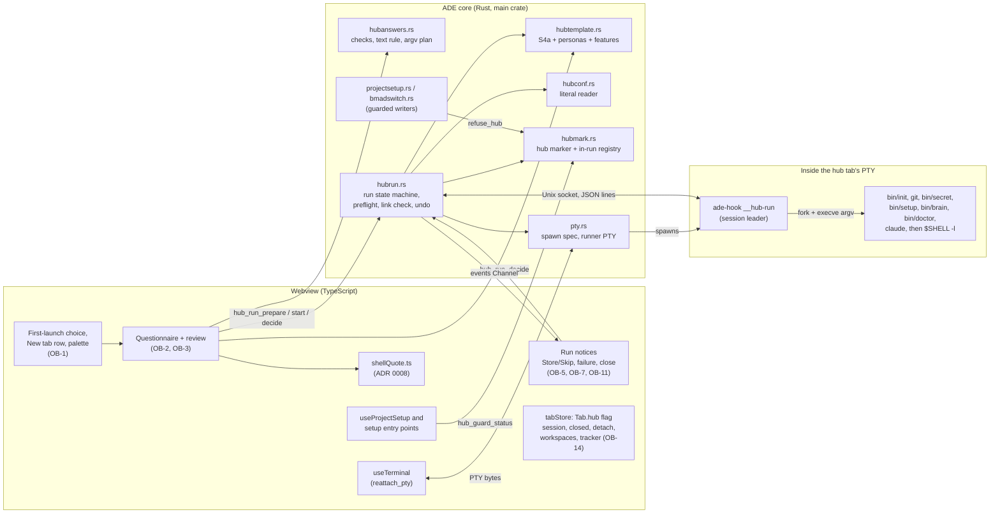
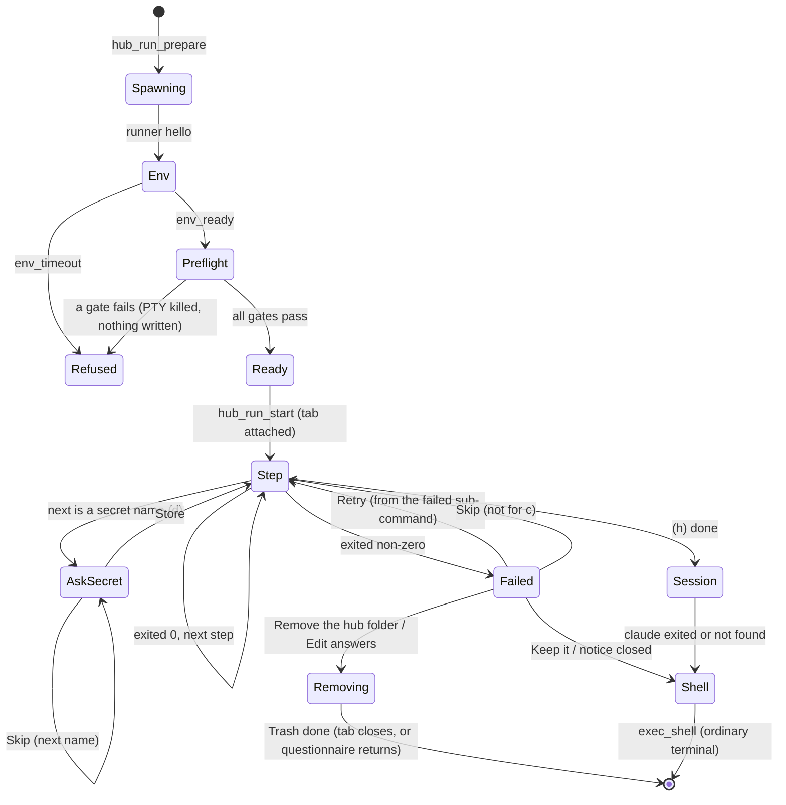
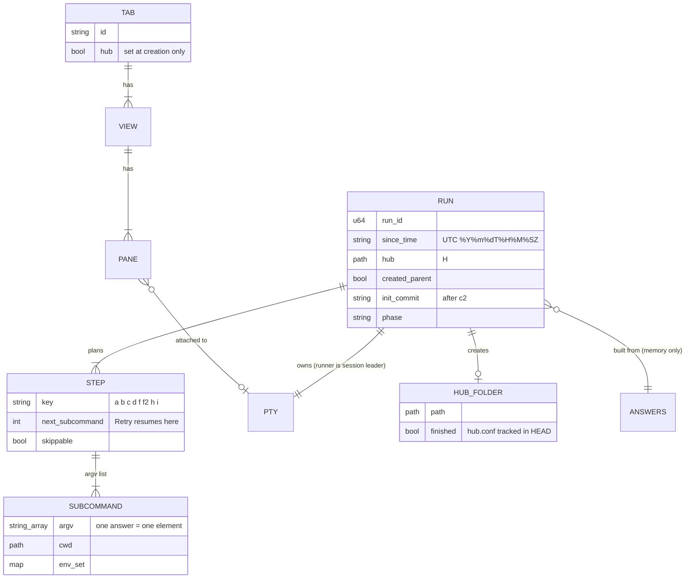

# Agentic-environment onboarding (F2): technical design

- **Status:** Proposed (2026-11-09). Not yet reviewed or approved.
- **Owner:** architect.
- **PRD:** `docs/prd.md` F2, approved by the owner 2026-11-09 (revision 4 + minors
  n1 to n6). This design adds nothing to F2's scope. Where F2 leaves a choice to the
  architect, the choice is made here and marked **(architect)**.
- **ADRs:** `0026-hub-setup-steps-run-under-a-runner-in-one-pty.md`,
  `0027-a-hub-tab-is-a-tab-flag-and-keeps-no-scrollback.md`,
  `0028-project-setup-refuses-hubs-at-its-two-writers.md`.
- **Contracts:** `.ade/context/hub-onboarding.md` (new),
  `.ade/context/remote-tabs.md` (new; the relay's tab entries and the hub-tab mask,
  shared with phone-watch story 8).
- **Builds on:** the bundling plan (PR #91, ADR 0025, `bundled-sources.md`: S2's
  tarball and archiver, S3's release jobs, S4a's `hub_template_info` and
  `hub_template_create`); sub-terminals (`terminal-open.md`, ADR 0014; story 9's
  `shellQuote.ts`, ADR 0008); the PTY layer (`pty.rs`, `ptysink.rs`,
  `useTerminal.ts`); project setup (`projectsetup.rs`, `bmadswitch.rs`,
  `useProjectSetup.ts`); the session and sync (`tabStore.ts`, `persistence.ts`,
  `sync.rs`); the relay-pairing design (story 8, not built).
- **Naming rule (owner, Q12):** the template is "the agent hub template"; this
  document names no private repository, commit or pull request of it. Script and
  folder names (`bin/init`, `personas/`, …) are the interface ADE runs and ships, so
  they are named.

## 1. What has to be true

F2 asks ADE to collect answers, then run the bundled template's own scripts in a
visible tab, so that the result is byte-for-byte the hub the CLI makes (G2), no
answer passes through a shell (OB-4 AC6), no secret value is kept (G4), and the hub
tab leaves nothing of its content in ADE's stores (OB-14). The hard parts, in the
order this design settles them:

1. **The step runner** (section 4): run argument vectors one after another in **one**
   terminal, with a login shell's environment, observe each exit status, pause for
   the developer's decisions, then hand the terminal to Claude Code and finally to a
   login shell. ADR 0026.
2. **The gates** (section 5): the preflight, the git identity in the steps'
   environment, and the memory-link check, run twice.
3. **Failure and undo** (section 6): Retry and Skip per step, idempotency, Remove
   with T4 detection, the Trash.
4. **OB-13** (section 7): project setup refuses a hub. ADR 0028.
5. **OB-14** (section 8): the hub-tab flag. ADR 0027, `remote-tabs.md`.
6. **The persona list** (section 3.2), **the fixture and the gates** (section 9).

## 2. Where things stand (origin/main 90f4f6f, 2026-11-09)

- `create_pty(rows, cols, cwd, on_event)` (`pty.rs:123`) always spawns
  `$SHELL -l` (`platform::shell_from`) with `TERM`, `HOME`, `USER`, `PATH`, `LANG`,
  the default locale, the Vault's variables and the four `ADE_*` variables, whose
  token is per PTY id (`AgentStatus::terminal_env`). There is no way to start a pane
  with a given program; `PtyEvent::Exit {}` carries no status. A pane whose `ptyId`
  is already set attaches with `reattach_pty` (`useTerminal.ts:428-446`, used today
  for detached windows); an unattached `Sink` keeps 1 MB of backlog
  (`ptysink.rs:17`).
- portable-pty's spawn makes the child a session leader on the PTY. On macOS the
  controlling terminal is revoked when a session leader exits, so **one PTY cannot be
  reused for a sequence of session leaders** (one per step) without risking `EIO` on
  the master and on any slave descriptor ADE holds. This is why section 4 keeps one
  process as session leader for the whole run.
- `ade-hook` (`src-tauri/ade-hook`, a workspace member) is the agent-status helper
  and, since story 4c, the `ade` CLI. It shares source with the main crate by
  `#[path]` (`hook_forward.rs`). Its tests cannot run as `cargo test -p ade-hook`
  (fixture paths); shared logic is tested in the main crate.
- `shellQuote.ts` (ADR 0008) arrives with sub-terminals story 9 (branch
  `st9-typed-command`). F2's slice 1 needs it; if story 9 has not merged, the first
  F2 story that shows a command takes its three files unchanged, as story 9 did.
- Project setup writes only through `project_setup_apply` (`set_up`,
  `projectsetup.rs:708`) and `bmad_switch_apply` (`bmadswitch.rs:1958`); no hub or
  folder exclusion exists. `refuse_unfinished` (`projectsetup.rs:731`) is the
  pattern for a Rust-side refusal.
- A `Tab` has no flags field. Scrollback is captured in `saveSession`
  (`tabStore.ts:749-758`); closed tabs (`ClosedTab`), detached tabs (`SerializedTab`),
  Duplicate (`TabBar.tsx:139`) and workspaces (`WorkspacePreset.tabs`, names only,
  **no folder**) each copy a subset of the tab. The agent tracker stores `cwd` and is
  synced (`SHARED_KEYS`). Nothing relays tabs to a phone yet.

## 3. Components



### 3.1 Modules (new unless marked)

| Module | Holds | Tested by |
|---|---|---|
| `src-tauri/src/hubtemplate.rs` (S4a; F2 adds two functions) | `hub_template_personas`, `hub_template_features` (3.2) | Rust unit tests on fixture tarballs |
| `src-tauri/src/hubanswers.rs` | `Answers`, every OB-3 AC2 check, F1's text rule, the derived hub name, the **plan** (each step's argv) | Rust unit tests; the parity table (9.3) |
| `src-tauri/src/textrule.rs` | F2.5's text rule (Cc and Cf, 1 to 80 code points after trim); shared with F1 if F1's lands first (then F2 uses F1's and this file is not added) | Rust unit tests incl. U+202E, U+200B, U+FEFF, U+E0001 |
| `src-tauri/src/hubconf.rs` | OB-6 AC2's literal reader of `hub.conf` | Rust unit tests |
| `src-tauri/src/hubmark.rs` | OB-13's marker, the in-run registry, `hub_guard_status` | Rust unit tests; setup e2e |
| `src-tauri/src/hubrun.rs` | the run's state machine, the socket server, preflight, link check, undo, Trash | Rust tests with a real PTY and fixture template (macOS) |
| `src-tauri/src/hubrun_proto.rs` | the runner protocol's message types; `#[path]`-shared with `ade-hook` | Rust unit tests (serde round trips) |
| `src-tauri/src/hubrun_child.rs` | the runner's loop (`__hub-run`) and env capture (`__hub-env`); `#[path]`-shared with `ade-hook`, compiled into the main crate for tests | Rust tests in the main crate (they spawn the built logic through a test binary seam, 4.8) |
| `src-tauri/src/pty.rs` (changed) | `terminal_spawn_spec()` extracted from `create_pty`; `spawn_runner_pty` | existing tests + new |
| `src/lib/hubOnboarding.ts` | invoke wrappers, the shown commands (`shellQuote` over the plan's argv) | vitest |
| `src/stores/hubRunStore.ts` | run state per tab for the notices | vitest |
| `src/components/onboarding/*` | the choice, questionnaire, review, notices (the designer's screens) | vitest (RTL), OB-11 |
| `src/stores/tabStore.ts`, `src/lib/tabDisplay.ts`, `src/lib/detachWindow.ts`, `src/components/TabBar.tsx`, `src/components/SettingsPanel.tsx`, `src/stores/settingsStore.ts`, `src/stores/agentTrackerStore.ts` (changed) | the hub-tab flag (section 8) | vitest |
| `src/lib/remoteTabs.ts` | `remoteTabEntry(tab)` with the mask (story 8 calls it) | vitest |

All of F2's Rust commands return an error off macOS, and the UI never offers F2 there
(OB-1 AC9). The modules compile on every platform so CI's Linux and Windows jobs
still build.

### 3.2 The persona list and the template's features from the tarball

`hub_template_personas() -> Vec<Persona>` reads the bundled tarball **without
unpacking it** (F2.8's new capability): it verifies the tarball's sha256 against the
manifest (S4a's rule), streams the entries, and for every regular file at
`personas/<slug>.md` (top level of `personas/` only; `<slug>` matching
`^[a-z0-9][a-z0-9-]*$`) parses the front matter **as `bin/init`'s `fm()` does**: the
lines between the first and second `---` lines, a key being the text before the
first `": "` and the value everything after it. `Persona { slug, title, model,
folders, briefing_focus }`; a persona without `title` keeps its slug as the title
(as `bin/init --list` prints an empty title). Sorted by slug, as the shell glob.
Cached for the launch (the tarball cannot change while ADE runs). Entries over
64 KiB are skipped.

`hub_template_features() -> { unlink_since: bool }` reads `bin/setup` from the
same tarball: **T4 is present** when a comment line of `bin/setup` (a line starting
with `#`) contains both `--unlink` and `--since`. The template's T4 is asked to keep
its usage line in that form; the rule is recorded in `hub-onboarding.md` so the
template's maintainers see it. **(architect)** Running `bin/setup --help` is not an
option: today's `bin/setup` has no `--help` and would set up instead.

At undo time (6.4) the same test is applied to the **hub's own** `bin/setup` on
disk, which is the copy that runs.

## 4. The step runner (ADR 0026)

### 4.1 Shape

The hub tab's PTY is spawned by Rust with **`ade-hook __hub-run`** as its program
(not the shell). The runner is the PTY's session leader for the whole run. It:

1. starts the developer's login shell once, interactively, only to **capture the
   environment** it produces (4.3);
2. waits on a Unix socket for instructions from ADE and runs each step as **its own
   child, started from an argument vector** with that environment, in the
   foreground of the terminal, and reports the exit status;
3. finally **`execve`s the developer's login shell** in the hub folder with the
   environment a new terminal gets, so the tab becomes an ordinary terminal with the
   same PTY id, token and agent status.

The runner is dumb: every argv, cwd, environment change, line to print and timeout
comes from ADE. All policy (the plan, the gates, the decisions) is in `hubrun.rs`.

Why a runner and not the shell: the PRD forbids typing into an interactive shell
(OB-4 AC6). Why not one PTY per step: the PTY id would change at each step (the
persona session's `ADE_PTY_ID` would not be the tab's), the controlling terminal is
revoked between session leaders (section 2), and every step would pay the start-up
files again. Why `ade-hook`: it is already shipped, signed and on `ADE_HOOK_BIN`, and
it has no GUI; a hidden verb costs nothing.

### 4.2 Spawning (`pty.rs`)

`create_pty`'s environment and shell selection move into one function,
`terminal_spawn_spec(app, agent, id) -> SpawnSpec { program, args, env, cwd }`,
which `create_pty` keeps calling. ADR 0021's shell integration (F1), when it lands,
changes this one function, and the runner follows it automatically (4.3, 4.6).

`spawn_runner_pty(app, state, agent, rows, cols, window_label) -> (pty_id, Socket)`:

- reserves the id (`reserve_id`) and builds the spec as for a terminal;
- **requires** `agent.terminal_env(id)` to be `Some` (the helper and the hook port
  exist). Without them the run is refused at the preflight ("Better Terminal's
  helper is not available, so the setup cannot run; restart Better Terminal"),
  because OB-4 AC6 promises the four `ADE_*` variables;
- creates a socket directory `$TMPDIR/ade-hub-<16 random hex>` (mode 0700, owned by
  the user, not a symlink) and listens on `s` in it;
- program `ADE_HOOK_BIN` (the helper's absolute path), args `["__hub-run"]`, env =
  the terminal's env plus `ADE_HUB_RUN=<socket path>` and `ADE_HUB_RUN_KEY=<64 hex,
  random per run>`;
- registers a `PtyInstance` with an **unattached** sink and the calling window as
  owner (story 4a's field), exactly as a terminal, so `reattach_pty`, `kill_pty`,
  `get_pty_cwd`, `pty_foreground_job` and agent status work unchanged.

The runner connects, sends `hello { key }`; ADE accepts the first connection whose
key matches, then removes the socket file and its directory. Nothing else listens.
`ADE_HUB_RUN` and `ADE_HUB_RUN_KEY` are removed by the runner from every
environment it passes on (steps, probes, the final shell).

`ade_cli::mode` gains one arm before hook mode: `args[0] == "__hub-run"` **and**
`ADE_HUB_RUN` set → runner; `args[0] == "__hub-env"` and `ADE_HUB_ENV_FD` set →
env capture. Neither verb is listed by `ade help`, neither changes story 9's
`capabilities:` line, and both are refused (exit 2, nothing done) when their variable
is missing. `ade-hook` gains `libc = "0.2"` (already locked by the main crate).

### 4.3 The steps' environment (OB-4 AC6)

The runner starts, as its first child, **the developer's login shell as a new
terminal starts it** (the `SpawnSpec`'s program and args, today `$SHELL -l`) plus
`-i -c 'exec "$ADE_HOOK_BIN" __hub-env'`, with stdin, stdout and stderr on the
terminal, and **fd 3 the write end of a pipe** (`ADE_HUB_ENV_FD=3`). The shell reads
its login and interactive start-up files (for zsh `~/.zshenv`, `~/.zprofile`,
`~/.zshrc`, `~/.zlogin`), then replaces itself with `ade-hook __hub-env`, which
writes its whole environment to fd 3, NUL-separated, and exits 0. The runner keeps
that map in memory as **the steps' environment**.

- The `-c` string is a constant; no answer is in it. `exec "$X" word` means the same
  in sh, bash, zsh, ksh, dash and fish. **Only those shells are accepted** (by the
  basename of the spec's program, the set `terminal-open.md` already uses). Any other
  login shell is refused at the preflight, naming it **(architect; open question
  Q-A1)**.
- The environment passes through a pipe in memory, never a file: it holds the
  Vault's variables and `ADE_HOOK_TOKEN`.
- Start-up output (banners, a framework's update question) appears in the tab, as
  in a new terminal. If the shell has not reached `__hub-env` within **30 s**, the
  runner kills its process group and reports `env_timeout`; the preflight fails
  with "your shell's start-up files did not finish within 30 seconds (they may be
  waiting for input); open a terminal to see what they ask".
- The identity check (5.3) and every probe run in this same environment, so it is
  literally the environment of step (c).

### 4.4 Running a step

For `run { id, argv, cwd, env_set, env_unset }` the runner:

1. prints nothing itself (ADE sends a separate `print` with the shown command first,
   so the order of lines and output is the order of bytes on the PTY);
2. forks a child with `std::process::Command` (`argv[0]` resolved through the
   steps' `PATH` when it has no `/`, as `execvp`; `bin/init` with a `/` is relative
   to `cwd`), environment = steps' environment, then `env_unset` removed and
   `env_set` applied; in `pre_exec`: `setpgid(0, 0)`, `tcsetpgrp(0, getpid())`
   with `SIGTTOU` ignored, then every signal the runner ignores set back to
   default. The runner also calls `tcsetpgrp` after the fork (both sides, as a
   shell does, so neither order races);
3. `waitpid`s it. A child stopped by Ctrl-Z (`WUNTRACED`) gets `SIGCONT` and the
   foreground back at once: a run has no job control;
4. takes the foreground back (`tcsetpgrp(0, own pgrp)`) and sends
   `exited { id, code | signal | spawn_error }`. `spawn_error` is `not_found` for
   `ENOENT` and the `errno` text otherwise.

The runner ignores `SIGINT`, `SIGQUIT`, `SIGTSTP`, `SIGTTIN` and `SIGTTOU` for its
own life (as `system(3)` does), so Ctrl-C reaches the step and not the runner.
`SIGHUP` (the tab closed: `kill_pty` drops the master) is not ignored: the runner
and the foreground step both die, which is "closing stops the run" (OB-5 AC5).

Every answer reaches the program as exactly one `argv` element, byte for byte, with
no shell anywhere between ADE and `execve`; nothing is ever written to the PTY's
input by ADE, so **no shell history can hold an answer**. A text-rule value with
characters that cannot be typed (`Zoë 日本`, `C:\x\y`) is passed as it is.

### 4.5 Probes

`probe { id, argv, cwd, env_set, env_unset, stdin: bytes?, timeout_ms }` runs a
child the same way but **not on the terminal**: stdin is the given bytes or
`/dev/null`, stdout and stderr are pipes (capped at 64 KiB and 16 KiB), it is its own
process group, and it is killed (`SIGKILL` to the group) at the timeout (default
30 s). The answer is `probed { id, code | signal | spawn_error | timeout, stdout,
stderr }`. Probes are how ADE asks "in the steps' environment" without showing
anything: `git --version`, the identity, `which claude`, the memory-link facts
(5.4), the commit count for undo (6.4). Nothing a probe prints reaches the tab.

### 4.6 The hand-over: Claude Code, then a login shell

- **(i) the persona session** is an ordinary `run` step: argv `[<claude command>]`,
  cwd the hub folder, `env_set CLAUDE_CONFIG_DIR=<HUB_CLAUDE_CONFIG_DIR>` when
  `hub.conf` holds a non-empty literal (OB-6 AC1), read by `hubconf.rs` (6.6). It
  inherits the four `ADE_*` variables of the tab's PTY, so the session's hooks report
  to agent status and `ade open` opens sub-terminals of this tab (OB-12).
- `spawn_error: not_found` → ADE prints "The Claude command `<cmd>` was not found in
  your shell's PATH. The hub is ready in <folder>; start Claude there by hand."
  (wording the designer's), and goes on to the shell (OB-6 AC3).
- **The shell** is `exec_shell { program, args, cwd, env }`: ADE sends the
  `SpawnSpec` a **new terminal** would get (same program and args, the env with the
  same `ADE_*` values, since the PTY id is the same), with `cwd` the hub folder. The
  runner closes the socket and `execve`s it. The PID, PTY id and token stay; the tab
  is now an ordinary terminal in the hub folder (OB-4 AC6 "after the persona session
  exits"). The same message ends a run that stops at a failed step (Keep it, or the
  failure notice closed without Retry). Nothing is re-run.

### 4.7 The protocol

Newline-delimited JSON over the socket, types in `hubrun_proto.rs` (one source for
both binaries). ADE → runner: `print { text }`, `run {…}`, `probe {…}`,
`exec_shell {…}`, `stop { grace_ms }` (send `SIGHUP` to the foreground step's
group, then `SIGKILL` after the grace, then wait for ADE's next message).
Runner → ADE: `hello { key }`, `env_ready { shell, vars: { HOME, LANG, LC_ALL,
LC_CTYPE, CLAUDE_HOME, CLAUDE_CONFIG_DIR } }` (only these named values, never the
whole map), `env_timeout`, `exited {…}`, `probed {…}`. Unknown messages are a
protocol error: the runner prints one line and execs the shell; ADE ends the run as
failed. Socket EOF on either side ends the run (ADE: the tab closed; runner: ADE
quit, so it execs the shell).

### 4.8 The run as ADE sees it



State lives only in `HubRuns` (memory). **No run is recorded on disk** (OB-5 AC5):
after a restart, the tab is an ordinary hub tab (section 8).

The Tauri commands (shapes in `hub-onboarding.md`):

- `hub_check(answers) -> { errors[], derived_name, name_required }`: OB-3 AC2,
  pure, called as the developer types.
- `hub_folder_kind(path) -> finished | unfinished | not_hub | missing_ok |
  parent_missing{name} | in_engagement{name}`: OB-2 AC2/AC3/AC4 inline errors. `~`
  expanded with ADE's `HOME`.
- `hub_plan(answers) -> Plan`: the folders to create, the steps and their argv in
  order, the memory-notice checkouts, `t4: bool`. The review step shows
  `shellQuote(argv)` for each (OB-3 AC3), and **the same `Plan` object** is passed to
  `hub_run_prepare`, so the listed commands are the executed ones (test: 11, O-7).
- `hub_run_prepare(plan, rows, cols, on_event) -> { run_id, pty_id } | preflight
  failure`: spawns the runner PTY **hidden** and runs the preflight (5). On failure
  the PTY is killed and nothing is shown or written.
- `hub_run_start(run_id, shown: string[])`: after the window has opened the hub tab
  with `pty_id` and attached (`reattach_pty` flushes the backlog: the start-up
  output). `shown[i]` is `shellQuote(plan.steps[i].argv)` from the webview, checked
  for count; it is display only.
- `hub_run_decide(run_id, step_token, decision)`: `store | skip | retry | keep |
  edit_answers | remove`. A decision for a step that is no longer waiting is
  ignored.
- `hub_run_close(run_id, remove: bool)`: OB-5 AC5's answer when the tab closes or
  ADE quits during (a) or (b).
- `hub_open_existing(path, run_setup, rows, cols, on_event)`: OB-2 AC2 (6.7).

Events on `on_event`: `step_started { key, index }`, `step_ended { key, ok }`,
`awaiting_secret { name, token }`, `step_failed { key, token, options }`,
`run_ended { how }`, `removal { listed_left_behind, manual_restore[] }`.

A hub tab is made **after** the preflight, so a failed preflight opens no tab and
records no first-launch answer (OB-1 AC1: "at the moment a tab opens").

### 4.9 Key flow

```mermaid
sequenceDiagram
  participant W as Webview (review step)
  participant R as hubrun.rs
  participant P as PTY (hidden, then the hub tab)
  participant X as ade-hook __hub-run
  participant S as login shell -l -i -c
  W->>R: hub_run_prepare(plan)
  R->>R: xcode-select -p (ADE's own process, before any shell)
  R->>P: spawn ade-hook __hub-run (terminal env + ADE_HUB_RUN)
  P->>X: start (session leader)
  X->>R: hello{key}
  X->>S: fork, fd 3 = pipe
  S->>S: ~/.zshenv .zprofile .zshrc .zlogin
  S->>X: exec ade-hook __hub-env, env on fd 3
  X->>R: env_ready
  R->>X: probe git --version, python3 --version, git config user.name/email, which claude, sed (encoding)
  X->>R: probed...
  R->>R: link check (predicted), folder rules
  R-->>W: ready{run_id, pty_id}
  W->>W: open hub tab "Agent hub", pane.ptyId = pty_id (reattach)
  W->>R: hub_run_start(run_id, shown[])
  R->>R: since-time = now UTC; registry += hub folder
  R->>R: (a) hub_template_create (+ parent)
  R->>X: print "(a) line"
  loop steps (b)..(h)
    R->>X: print shown[i]
    R->>X: run{argv, cwd}
    X->>X: fork, setpgid, tcsetpgrp, execve
    X->>R: exited{code}
    R-->>W: step_ended / step_failed / awaiting_secret
  end
  R->>X: run{claude} (i)
  X->>R: exited
  R->>X: exec_shell{$SHELL -l, hub folder}
  X->>X: execve login shell (same PID, same PTY id)
```

## 5. The gates

All gates run in `hub_run_prepare`, in this order, and stop at the first failure.
Each failure names what is missing and how to fix it, writes nothing (the hidden PTY
is killed; the socket directory removed) and keeps the answers (OB-4 AC2).

### 5.1 Before any shell

1. macOS, and `hub_template_info()` is not `None` (OB-1 AC10).
2. **The Command Line Tools:** `/usr/bin/xcode-select -p` run by ADE's own process
   (absolute path, no shell, stdin `/dev/null`, 10 s), **before** the runner is
   spawned, because the developer's start-up files may call `git` and the stubs open
   the install dialog. Non-zero → "the Command Line Tools are not installed: run
   `xcode-select --install`". No `git` or `python3` has started (test: a fake
   `xcode-select` seam returning 2 and a `PATH` whose `git` and `python3` record
   calls).
3. The login shell is one of the six (4.3) and the helper is available (4.2).
4. **Folder rules** (OB-2 AC3, AC4, F2.13): the hub folder is absolute after `~`
   expansion, does not exist, is not inside an engagement (F1 flag on), and its
   parent exists or only the parent is missing (one level). These need no shell.

### 5.2 In the steps' environment

5. The runner is spawned and reports `env_ready` within 30 s (4.3).
6. `git --version` and `python3 --version` exit 0 as probes; `spawn_error:
   not_found` names the program.

### 5.3 The git identity (OB-4 AC2)

Two probes, `git config --get user.name` and `git config --get user.email`, with:

- **cwd `/`**, so no enclosing repository's local config can apply, and
  `env_unset GIT_DIR GIT_WORK_TREE` so a variable cannot point git at one; git
  then reads exactly the system and global files and their unconditional includes;
- the steps' environment, so `HOME`, `XDG_CONFIG_HOME` and `GIT_CONFIG_GLOBAL`
  set by start-up files apply, as for step (c).

Each passes when it exits 0 **and** its stdout, without the trailing newline, is not
empty. The failure message names the missing key(s), gives the two
`git config --global` commands, and **always** states the limit: "an identity set
only by `includeIf "gitdir:…"` for the hub's folder is not seen, because the hub does
not exist yet". (So the `includeIf`-only case is refused naming the limit, by
construction.) The parent folder and ancestors are never consulted: the probe never
runs there.

### 5.4 The memory-link check (OB-4 AC2; run twice)

One function, `check_links(config_dir, paths, hub) -> Ok | Refused[{path, link,
target, target_exists}]`: for each path, `entry = <config_dir>/projects/<encoded
path>/memory`; `lstat(entry)`; when it is a symbolic link, its target (`readlink`,
made absolute against the link's folder when relative, normalised lexically) is
**outside `hub`** (not `hub` and not under `hub/`) → refused. A real folder, a
missing entry, or a link into `hub` passes. The refusal message lists each with the
ways on of OB-4 AC2, including the move-the-claim command `rm <entry>` with the full
path, and says when the target no longer exists.

**The encoding** is not reimplemented: each path is encoded by a probe that runs
`sed 's/[^A-Za-z0-9]/-/g'` (resolved through the steps' `PATH`, so a GNU `sed` in
`PATH` is used if `bin/setup` would use it) with the path on stdin, in the steps'
environment and locale, and the one trailing newline removed. That is what
`encode_path` does (`printf '%s' "$1" | sed …` inside `$(…)`).

The two runs differ in where the inputs come from:

| | **At the preflight** (predicted, before anything exists) | **Just before (f)** and before OB-2 AC2's `bin/setup` (actual) |
|---|---|---|
| config folder | `CLAUDE_HOME` from `env_ready` if set (as `claude_home` puts it first), else **`bin/init`'s rule**: `--claude-config-dir` (slice 2), else the `export CLAUDE_CONFIG_DIR=` line of the file `which <claude command>` finds when it is under 64 KiB (with `${HOME}`, `$HOME` and a leading `~` replaced by the steps' `HOME`), else `<HOME>/.claude` | **the template's own code**: a probe `bash -c '<constant script>' _` in the hub folder, with `HUB=<hub>`, that sources `bin/lib.sh` (which reads `hub.conf`) and prints, NUL-separated, `claude_home`, then for the hub, each of `folders`, and each `repos_of` checkout, the path and its `encode_path` |
| paths | the hub folder; `<hub>/<f>` for each of the persona's `folders` (front matter; question 10 in slice 2); each question-7 checkout as typed, `~` expanded with the steps' `HOME`, kept only if it is an existing folder (as `repos_of`) | as printed by the probe |
| encoding | the `sed` probe above | as printed by the probe |

The constant script is fixed text in `hubrun.rs`; no answer is in it. The actual
check uses the template's own functions, so it is exact for whatever template is
bundled; the predicted check can only be wrong when the prediction is (for example
a template whose `bin/init` resolves the config folder differently), and then the
second check catches it and **(f) fails with the same message and `bin/setup` does
not start** (OB-4 AC2 n4). The second check also covers a link created after the
preflight (the PRD's test with a fixture `bin/secret` at (d)). The remaining window,
between the second check and `bin/setup`'s own `link()`, is the PRD's stated
negligible one; T5 closes it in the template.

If the actual probe fails (non-zero, or a `hub.conf` that `bin/lib.sh` cannot source)
(f) fails with the probe's stderr; (f) is not started.

### 5.5 What the preflight does not do

It writes nothing: no folder, no file, no `ade-*` key, and no first-launch answer.
The only processes it starts are `xcode-select`, the hidden runner, the login shell
and the probes. The hidden PTY's backlog (start-up output) is discarded with it.

## 6. The steps, Retry and Skip, and undo

### 6.1 The plan (slice 1)

`hub_plan` builds, from answers that passed `hub_check`, with `H` the hub folder
(absolute, `~` expanded, normalised lexically, no trailing `/`):

| Key | Sub-commands (argv; cwd `H` unless noted) | Retry | Skip |
|---|---|---|---|
| (a) | ADE: create the parent if missing (one `mkdir`, recorded), `hub_template_create(H)`; prints one line "Unpacked the agent hub template (<short ref>) into <H>" | no: (a) fails → OB-5 AC1 | no |
| (b) | `bin/init --persona <slug> --client <c> --owner <o> [--name <n>] [--secret <s>]… [--repo <r>]… --auto-sync off` | no (OB-5 AC2: Edit answers, Remove, Keep) | no |
| (c) | c1 `git add -A`; c2 `git commit -m "Initialize the hub"`; c3 `git ls-files --error-unmatch hub.conf`; after c2, a probe `git rev-parse HEAD` records the commit for undo | from the failed sub-command | **never** |
| (d) | per name: `bin/secret --set <name>`, after that name's Store | that name | that name |
| (f) | the link check (5.4, actual), then `bin/setup` | check again, then `bin/setup` | yes |
| (f2) | `bin/brain index` | yes | yes |
| (h) | `bin/doctor` (any exit counts as done; OB-4 AC4) | n/a | n/a |
| (i) | `<HUB_CLAUDE>` with `CLAUDE_CONFIG_DIR` (4.6) | n/a | n/a |

(e) and (g) are slice 2 and are absent from the plan until then. `--name` is passed
only when question 9 is answered. Repeated options keep the questionnaire's order.

**Idempotency per step (architect).** A step is a list of sub-commands, and the run
records which have succeeded; **Retry resumes at the first sub-command that has not
succeeded**. So a (c) whose commit succeeded but whose `ls-files` failed retries only
the check, never commits twice. Each script step is safe to repeat as the template
writes it: `bin/secret --set` uses `security -U` (replace); `bin/setup` answers `ok`
for its own links and is preceded by the link check on every attempt; `bin/brain
index` rebuilds its index. (e)'s Retry (slice 2) follows OB-5 AC3's rule and is
designed with slice 2.

### 6.2 Failures (OB-5 AC1 to AC3)

- **(a)** fails → nothing is left (S4a's guarantee); a parent the run created is
  removed with `rmdir` (only if empty); the run ends; the tab closes; the
  questionnaire returns with the answers kept.
- **(b)** fails → `bin/init`'s own stderr is in the tab; options **Edit answers**
  (confirm "Move <H> to the Trash and edit your answers?", then 6.4's removal, then
  the questionnaire with the answers kept; confirming the review again prepares a new
  run from (a)), **Remove the hub folder**, **Keep it**.
- **(c) to (h)** fail → options **Retry this step**, **Remove the hub folder**, and
  **Skip it** except for (c).
- The runner and its PTY stay alive while a notice waits; nothing has a time limit
  (OB-11 AC5).

### 6.3 Secrets (OB-7)

Before each name, ADE emits `awaiting_secret { name }` and runs nothing. **Store**
→ `print` then `run bin/secret --set <name>`; the webview moves focus to the
terminal (OB-11 AC3), where `bin/secret` reads the value with `read -rs` from its
stdin, which is the terminal, in the foreground process group (4.4), so echo is off
and the keystrokes reach it. **Skip** → no `bin/secret` runs for that name. A
non-zero exit (empty value: exit 1) is that name's failure with Retry or Skip.
ADE never sees the value except as bytes passing `write_pty` on their way to the
PTY, which ADE neither logs nor stores (G4); the tab's scrollback is never saved
(OB-14). T3's absence (`security -w <value>` visible to `ps`) is G4's stated limit.

### 6.4 Remove the hub folder (OB-5 AC4) and the Trash

Offered only when the run created `H` and the probe `git rev-list --all --count`
in `H` prints `0`, or prints `1` and `git rev-list --all` equals the commit recorded
after c2. Anything else (a later commit, a folder not created by this run) is never
offered. After the confirmation (it names the folder and lists what follows and
what is left behind: the secret names stored in this run, with
`bin/secret --forget <name>`), ADE, in the tab:

1. (g) in this run (slice 2): `bin/schedule uninstall`.
2. (f) ran in this run:
   - **with T4** (the hub's own `bin/setup` passes 3.2's test): `bin/setup --unlink
     --since <since-time>`, shown and run as a step. Non-zero → the removal stops
     **before the Trash**, the notice says so with Retry and Keep **(architect; Q-A3)**.
   - **without T4**: ADE changes nothing in the Claude config folder. It runs the
     actual-paths probe (5.4) and lists, for each path whose memory entry is a link
     into `H`, the link with `rm <link>`, and each sibling `memory.bak-<ts>` with
     `<ts> >= since-time` (string compare; the form sorts in time order) with
     `mv <bak> <entry>`, and each `skills/bmad-*` link into `H` with `rm`. The list
     is shown in the confirmation for the developer to run.
3. Move `H` to the Trash, then `rmdir` the parent if this run created it (fails, and
   is kept, when not empty).

**The since-time** is taken in `hub_run_start`, before (a), as UTC
`%Y%m%dT%H%M%SZ` (for example `20261109T105700Z`), the form `bin/setup` stamps.

**The Trash (architect):** the `trash` crate (5.x, an exact version at least two
weeks old, pinned in `Cargo.lock`) with its macOS delete method set to
`NsFileManager` (`NSFileManager trashItemAtURL`), not the default Finder/AppleScript
method, which would raise an Automation permission prompt. The item lands in the
user's Trash and can be put back. A failure to trash is shown and nothing else
happens.

### 6.5 Closing or quitting during the run (OB-5 AC5)

- During (a) or (b): the tab's close guard (`useGuardedClose`) and the window's
  close-requested handler ask "Stop setting up and remove <H>?" with **Remove** and
  **Keep**; `hub_run_close(run_id, remove)`. ADE sends `stop { grace_ms: 3000 }`;
  during (a), it waits for `hub_template_create` to return (it is a local unpack of
  about 1 MB), then removes as 6.4 (Remove) or leaves what exists (Keep); then the
  PTY is killed and the tab closes. Quitting asks once per running run.
- During (c) to (h) and (i): closing kills the PTY like any tab; the runner and the
  step get `SIGHUP`; the hub is kept; nothing asks.
- After a restart: nothing was recorded; the folder is what the step left (OB-5 AC5's
  four cases), judged by `hub_folder_kind` and OB-13's marker.

### 6.6 Reading `hub.conf` (OB-6 AC2)

`hubconf::read_literal(text, key) -> Literal(value) | NotLiteral{line} | Absent`.
Every line that names `HUB_CLAUDE` or `HUB_CLAUDE_CONFIG_DIR` as a word must be a
plain assignment `KEY=<value>` at the start of the line; the last one wins (as
sourcing would). `<value>` is accepted in the forms bash's `printf %q` writes:
`''` (empty); a run of characters where shell metacharacters are backslash-escaped
(`O\'Brien\ \"Bob\"`); and `$'…'` with `\\ \' \" \a \b \e \f \n \r \t \v \NNN \xHH`.
Any `$` outside `$'`, a backquote, an unescaped quote or space, `export`, `+=`, `;`
or a second token → `NotLiteral`. `HUB_CLAUDE` must also match
`^[A-Za-z0-9._/-]+$`. On `NotLiteral` the hub tab opens with only the login shell
(`exec_shell` with no session) and a notice names the line and says to start Claude
by hand. ADE never sources `hub.conf` in its own process. (The template's scripts
source it as they always do.)

### 6.7 An existing hub (OB-2 AC2)

`hub_open_existing(path, run_setup)` uses the same runner with a shorter plan:

- `finished` = `hub.conf` at the top **and** `git ls-files --error-unmatch hub.conf`
  exits 0 in it (a probe in the steps' environment; ADE's own `git` is not used);
  `unfinished` and `not_hub` are refused inline before anything starts, with the
  PRD's texts and ways on.
- With `run_setup`: the actual link check (5.4), then `bin/setup`, then
  `bin/doctor`, then (i). A refusal stops before `bin/setup`; neither script runs.
  No undo is offered (OB-5 AC4 covers only a run's own hub).
- Without: straight to (i).
- ADE writes nothing into the folder; the tab is a hub tab (section 8).

## 7. OB-13: project setup stays out of hubs (ADR 0028)

### 7.1 The marker

`hubmark::hub_reason(dir) -> Option<HubReason>` is true when `dir` **or any
ancestor** (lexically, after `~` expansion and normalisation; then the same walk on
the canonical path, so a symlinked path is caught either way) has at its top:

- a `hub.conf` (any file type except a directory), or
- an executable regular file `bin/init`, a folder `templates/hub/` and a folder
  `personas/` (the template's own top-level files; S4a's `.<name>.ade-tmp-*` and the
  template's source clone included, as OB-13 intends), or
- it is in the **in-run registry**: the hub folder of a run of this launch, from
  `hub_run_start` until the run ends (covers (a) before the folder exists and (b)
  before `hub.conf`).

`HubReason { hub: PathBuf, why }` names the hub for the refusal. The walk stops at
the filesystem root; each level costs at most four `stat`s.

### 7.2 Where it is checked

- **Writers (the backstop, Rust):** `projectsetup::set_up` (which every
  `project_setup_apply` call reaches, full or per agent) and
  `bmadswitch::bmad_switch_apply` call `refuse_hub(root)` next to
  `refuse_unfinished`, and refuse with "<root> is an agent hub (<hub>); Better
  Terminal does not set up or switch agent hubs". Nothing is written, so
  `ade-project-setup-done` is never recorded (the webview only records after a
  successful apply). `bmad_switch_plan` and `project_setup_status` are read-only and
  stay as they are, so `bmadRootOf`'s walk is unchanged.
- **Askers (the webview):** a new command `hub_guard_status(path) -> HubReason |
  null`. `useProjectSetup` checks it before asking anything (no question, no
  record); `openProjectTab` checks it before the keep-or-switch question and before
  `setUpProject`; the palette's "Set up project" and "BMAD: Switch to…", the stage
  board's buttons and the Agents tab's Set up now / Re-check / add agent show the
  refusal instead of acting. One TS helper, `hubGuard(path)`, is the only caller.
- **Containing a hub:** setup of a folder that **contains** a hub sets up that folder
  only; ADE's setup writes only at the root it is given (`.ade/`, `.claude/agents/`,
  `llms.txt`, `CLAUDE.md`), never into subfolders, so nothing reaches the hub. A test
  asserts it (OB-13 AC1's last sentence).

Out of OB-13's list and unchanged: the agent-status hook toggle and MCP install
(they are not project setup); they write only where the developer explicitly asks.

## 8. OB-14: the hub-tab flag (ADR 0027)

`Tab.hub?: true`. It is set only when a tab is **made** as a hub tab: the run's tab,
an existing hub's tab, a Duplicate / Reopen / workspace / session restore of a hub
tab, and (automatically) every view of the tab, so sub-terminals opened by `ade open`
inside it are covered because they are views of the same tab. It is never set by a
`cd`, and never cleared.

| Where | Change |
|---|---|
| `tabLabel` (`tabDisplay.ts:41`) | a hub tab is always "Agent hub", whatever `name`, folder or a program's title |
| `saveSession` (`tabStore.ts:722`) | `SavedTab.hub = true`; **no `serializedBuffer`** for any pane of any view of a hub tab (also before the 5 MB trim) |
| `loadSession` | restores `hub`, empty panes, fresh login shells (today's behaviour); nothing re-run |
| snapshots (`state.rs`) | unchanged: they copy the saved `ade-session`, which has no buffer |
| `ClosedTab` / `reopenClosedTab` | `hub` carried; reopened empty |
| Duplicate (`TabBar.tsx:139`) | passes `hub`; name "Agent hub"; plain `create_pty` in the same folder; no session |
| `SerializedTab` (`detachWindow.ts`) | `hub` carried to the new window |
| Workspaces (`WorkspacePreset.tabs`) | an entry gains `hub?: true` and `cwd?` **for hub tabs only** (today entries hold no folder, and plain tabs keep that); opening one opens a hub tab in that folder, empty |
| Agent tracker (`agentTrackerStore.startSession`) | for a pane of a hub tab: `agentName` "Agent hub", `cwd` omitted. Fleet's live `meta.cwd` is in memory only and unchanged |
| Recent projects (`rememberProject`) | never called by F2's flows; plain Open project of a hub folder stays as today (OB-14 AC4) |
| Relay (`remoteTabs.ts`) | `remoteTabEntry(tab)` returns `title` and `project` "Agent hub" and `hub: true` for a hub tab; story 8 calls it, and its Rust bridge re-applies the mask when `hub` is true (`remote-tabs.md`) |

`ade-session` already has its scrollback stripped before sync (`sync.rs:68`); the
hub folder path stays in the session and, for hub tabs in a saved workspace, in the
synced workspaces key: both are stated by OB-10 AC2 and the review step's notice.

**Relay masking (OB-14 AC2).** Story 8 is not built. This design **creates
`.ade/context/remote-tabs.md` now** (the PRD lets whichever ships first create it):
the entry shape `{ tab_id, title, project, pty_ids, hub }`, the mask, and the rule
that the bridge never sends a folder. Whichever of story 8 and F2's slice 1 ships
second adds the capture test (OB-14 AC2, OB-7 AC3's and OB-10 AC1's relay parts).

## 9. Data



Persistent data F2 adds: the local key `ade-onboarding-choice-answered` (OB-1; in
`PERSISTED_KEYS`, not in any sync list), the `hub` field of saved tabs and closed
tabs, and the `hub`/`cwd` fields of workspace entries. **Answers are never
persisted** (OB-10 AC1): they live in the questionnaire's React state and in the
run's `Plan` in Rust memory, and are dropped when the run ends.

## 10. The fixture, the CI tests and the release gates (OB-5 AC6, AC7)

### 10.1 The public fixture template

`src-tauri/src/fixtures/hub-template/` (this repository, public): `bin/init`,
`bin/lib.sh`, `bin/secret`, `bin/setup`, `bin/brain`, `bin/doctor`, `bin/new`,
`bin/journal`, `personas/` (three personas, one without `folders`),
`templates/hub/{CLAUDE.md,ACCESS.md,README.md,persona-agent.md}`,
`templates/folder-settings.json`, `_bmad/config.toml`, `.gitignore`, `.githooks/`,
`memory/MEMORY.md`. Written from scratch for this repository (small bash; no
`python3` needed except where `bin/init` must match the bundled one's behaviour on a
row of the parity table). Its `bin/init` takes **every option of OB-3** and
implements **the same checks as the bundled `bin/init`** for every row of the parity
table; it writes the absolute hub path into `hub.conf`, `_bmad/config.toml`'s
`output_folder`, the hub's and each work area's `.claude/settings.json` (from
`folder-settings.json`), and a dated journal line, so AC6's normalisations are
exercised. Its `bin/secret` stores into a file under the test's `HOME` (no
Keychain); its `bin/setup` links exactly as the bundled one (and a `T4` variant adds
`--unlink --since`); `bin/doctor` prints `OK`/`MISSING` and exits 0.
`hub_template_*` take the resource paths from a test seam (`HubTemplateSource`), so
tests point them at a fixture tarball.

### 10.2 Building the fixture tarball

A Rust test helper `fixture_tarball()` (macOS):

1. copies the fixture into a temp folder, `git init -b main`, commits, creates a bare
   temp remote, pushes `main` and fetches, so `origin/main` contains the commit
   (`bundle.sh` checks `git merge-base --is-ancestor HEAD origin/main`; PRD n1);
2. runs S2's `scripts/hub-template/bundle.sh` with `HUB_TEMPLATE_SRC` at it, which
   runs S2's `check.mjs` with Node;
3. returns the tarball and manifest paths.

### 10.3 The three checks, written once

`hubgate.rs` (test-only module) holds three tests parameterised by a `Source`:

- **comparison (AC6):** ADE's run, driven headless through `hubrun.rs` with stub
  Claude, to the end of (b), versus `bin/init --dest <tmp> <same options>` run from
  an unpacked copy of the **same tarball**; both with the same isolated `HOME` and
  the same `--claude-config-dir <tmp>`; compared file by file (content, mode,
  symlink target) with only the three normalisations (the hub path → one
  placeholder in both; the journal's date and time → one placeholder; `.git/`
  excluded, and `git ls-files --others` equal). A self-test plants an extra file in
  ADE's tree and expects a failure.
- **options (AC7):** every option ADE can pass (`hubanswers::OPTIONS`) appears in
  `bin/init`'s usage text (the comment lines `usage()` prints).
- **parity table (AC7):** `hubanswers::PARITY_ROWS` (at least one accepted and one
  refused value per OB-3 AC2 rule, plus a name starting with `-`, an empty-slug
  client and a `--claude` value with a space) through `hub_check` and through that
  `bin/init` in a temp folder; disagreement fails, except rows marked
  `text_rule_stricter`.

`Source` is the fixture tarball by default, or **the tarball named by
`ADE_HUB_TEMPLATE_TARBALL`** (with its manifest beside it) when that variable is
set. Set but missing → the tests **fail** (fail closed), never skip.

On Linux and Windows these tests are `#[cfg_attr(not(target_os = "macos"),
ignore = "macOS only: OB-5 AC6/AC7")]`, so `cargo test` reports them **ignored**,
never passed. **(architect)** Putting ADE's checks and run in Rust makes these cargo
tests, so no TypeScript comparison test exists and the Ubuntu `frontend` job has
nothing to skip.

### 10.4 Where they run

- **PR CI:** `ci.yml`'s `backend-macos` job (`cargo test --locked`) runs them on the
  fixture. Slice 1 adds `actions/setup-node@v4` (`node-version: 20`) to that job
  before the tests, because S2's archiver runs `check.mjs`. No `npm ci` is needed
  (S2's scripts import only `node:` modules).
- **Release gate:** `release.yml`'s macOS build job, after the bundled tarball is
  downloaded into `src-tauri/resources/` and **before any upload step**, gains a step
  "Agent hub gates (OB-5 AC6, AC7)": `cargo test --locked hubgate -- --include-ignored`
  in `src-tauri` with `ADE_HUB_TEMPLATE_TARBALL=src-tauri/resources/hub-template.tar.gz`.
  A failure fails the job, so nothing is uploaded; the diff it prints is in the public
  Actions log, which the PRD accepts. S3's structure tests
  (`scripts/bundledSources.test.ts`) gain assertions: the step exists in the macOS
  build job, sets that variable, and comes before the first upload step.

### 10.5 The scans (OB-7 AC3, OB-10 AC1, AC3)

There is no whole-app test harness, so the scans are two layers plus a manual check:

- **Rust layer:** a fixture run (marker answers, a marker secret typed through
  `write_pty` into `bin/secret`) with ADE's data folder pointed at a temp folder
  (through a seam on the data-folder lookup that `state.rs` and `crashlog.rs` use;
  O12 adds it if it is not there): afterwards no file under it, and nothing in the
  crash log, holds a marker (the hub path excepted, as OB-10 AC2 allows).
- **Webview layer:** a vitest drives the questionnaire and run store with mocked
  invokes, writes a hub tab whose xterm buffer holds the marker, then runs
  `saveSession`, the tracker, workspaces and every `PERSISTED_KEYS` writer, and
  scans the serialised `localStorage` and the sync payloads (`value_for_repo`'s TS
  mirror) for markers.
- **No network from ADE's process (OB-10 AC3):** a Rust test asserts the `hub*`
  modules use no network client (no `reqwest`, `ureq`, `TcpStream::connect` outside
  the Unix socket); the only network code F2 adds is slice 2's `gh`.
- **Manual (release, QA):** on a release build, one run with marker values, then
  `grep -r` for the markers over the app's data folder; recorded in the story.
- The relay capture waits for story 8 (`remote-tabs.md`).

## 11. Verification command

**Unchanged.** The six lines in force (approved 2026-11-02, `docs/architecture.md`
"Verification command"), each from the repository root, each must exit 0:

```
npx tsc --noEmit
npm test
cd src-tauri && cargo test
cd relay && cargo test
cd mobile && npx tsc --noEmit && npx jest
cd src-tauri && cargo check -p ade-hook
```

Green means: the app type-checks; every vitest passes (the questionnaire, review,
notices, the hub-tab flag, the webview scan); every Rust test passes, which on a Mac
includes the runner, the gates, undo, OB-13's guards and the three OB-5 AC6/AC7
checks on the fixture tarball (on Linux and Windows those report **ignored**); and
`ade-hook`, which now carries `__hub-run` and `__hub-env`, builds. The macOS-only
checks are proven by the `backend-macos` CI job on the PR's SHA, whose run URL each
F2 story records with the local output. The release gate (10.4) and the manual
checks (10.5, RC-F2-1) are outside the command and are recorded by the owner or QA.
No line is added or changed.

## 12. Slice 1 stories (for the scrum-master)

Order: O1, O2 and O3 can start now (O3 needs S4a). O4 needs O3. O5 needs O4 and S2.
O6 is independent of O3 to O5. O7 needs O4 and O6. O8 needs O7. O9 needs O7. O10a,
O10b, O10c need the designer's screens and O4/O7. O11 needs S3 and O5. O12 needs
O7 and O8 and O2.

| Story | Scope | PRD ACs | Tests (where) |
|---|---|---|---|
| **O1. Hubs are not projects** | `hubmark.rs`, registry API, `refuse_hub` in `set_up` and `bmad_switch_apply`, `hub_guard_status`, `hubGuard` in every asker | OB-13 AC1, AC2 (automatic and asked-for paths; the run end-to-end part is O7's) | Rust: marker cases (`hub.conf` finished and not, template files, `.x.ade-tmp-*`, source clone, `projects/x`, registry), writers refuse and write nothing, a folder containing a hub sets up only itself; vitest: `useProjectSetup` asks nothing and records nothing for each case; palette, board, Agents tab, New tab dialog refuse; switch v6 and v4 refused |
| **O2. The hub-tab flag** | `Tab.hub`, label, session, closed, Duplicate, detach, workspaces, tracker, `remoteTabs.ts`; `remote-tabs.md` as written here | OB-14 AC1, AC3, AC4, AC5; AC2's mask function (capture test with story 8) | vitest: session holds no buffer and restores empty "Agent hub"; each operation keeps the flag; a plain tab in a hub keeps its scrollback and stays plain; tracker has "Agent hub" and no path; `remoteTabEntry` masks |
| **O3. Personas and features from the tarball** | `hub_template_personas`, `hub_template_features` | OB-3 AC1; T4 detection (OB-3 AC3, OB-5 AC4) | Rust: an added persona appears; front matter parsed as `fm()`; nested and oversize entries ignored; sha mismatch is an error; T4 present/absent |
| **O4. Answers, checks and the plan** | `textrule.rs`, `hubanswers.rs`, `hubconf.rs`, `hub_check`, `hub_folder_kind`, `hub_plan` | OB-3 AC2, AC4; OB-2 AC3, AC4 (rules); OB-6 AC2; OB-7 AC2; F2.13 path refusal | Rust: one case per rule; derived name and empty slug; value-looking secret names; folder kinds; `hub.conf` literal forms and `$(evil)`; plan argv for the four slice-1 shapes |
| **O5. Fixture template, options and parity (PR CI)** | `src-tauri/src/fixtures/hub-template/`, `fixture_tarball()`, `hubgate.rs` options and parity, `setup-node` in `backend-macos` | OB-5 AC7 (PR CI side) | Rust (macOS): options check passes, a fixture without `--staging-url` fails it; parity passes, a fixture accepting `-x-engineer` fails it; ignored on Linux and Windows |
| **O6. The runner** | `spawn_runner_pty`, `terminal_spawn_spec`, `hubrun_proto.rs`, `hubrun_child.rs`, `ade_cli::mode` arms, `libc` in `ade-hook` | OB-4 AC6 (argv, env, history, shell after) | Rust (macOS): stub `bin/init` receives each PRD answer byte for byte and nothing runs (`/tmp/pwned*` absent); isolated `HISTFILE` holds no answer; `.zshrc`-only `PATH` finds a stub `claude` that sees the four `ADE_*` variables; exit codes and signals reported; Ctrl-C reaches the step; env timeout; `exec_shell` leaves a prompt in the folder with the same PTY id; unknown verbs refused |
| **O7. The run** | `hubrun.rs` state machine and commands, preflight (5.1 to 5.4, both link checks), steps (a) to (i), Retry/Skip, secrets, (i) | OB-4 AC1 to AC5; OB-5 AC2, AC3; OB-6 AC1, AC3; OB-7 AC1; OB-3 AC3's "listed equals executed"; OB-13 AC2 end-to-end; OB-5 AC6 comparison (PR CI) | Rust (macOS, fixture): each preflight case of OB-4 AC2's test list; the step order and lines; `.gitignore`d `hub.conf` fails (c); (c) has no Skip and retries without a second commit; a link created at (d) fails (f) without starting `bin/setup`; MISSING lines still reach (i); offline run reaches (i); Store/Skip and two names give one OK and one MISSING; `git status --porcelain` empty after a run; comparison passes and its planted difference fails |
| **O8. Undo, close and restart** | Remove, Edit answers, Keep, Trash, T4 and manual lists, close/quit during (a)/(b) | OB-5 AC1, AC2 (options), AC4, AC5 | Rust (macOS): not offered after a later commit or for a pre-existing folder; with T4, `--unlink` gets the since-time and the old `.bak-` stays; without T4 the list names hub, work-area and `/x/r` links and this run's `.bak-` with commands and nothing changes; parent removed only when empty; kill during (a), before and after `hub.conf`, after (c), then relaunch cases |
| **O9. Existing hub** | `hub_open_existing`, the option with link check | OB-2 AC2; OB-6 AC1 (existing hub's `HUB_CLAUDE`/`HUB_CLAUDE_CONFIG_DIR`) | Rust: finished hub byte-for-byte unchanged with a stub Claude; unfinished and not-hub refused; option runs both scripts; option refused for a linked `/x/r`; `claude-work` with `CLAUDE_CONFIG_DIR=/x/cfg`; vitest: the option's notice has no undo sentence and has the refusal sentence |
| **O10a. The choice and its entries** | first launch, Esc, cancel, quit, tour order, upgrade, new windows, New tab row, palette entry, no-template message, prefill from a GitHub clone | OB-1 AC1 to AC10 | vitest |
| **O10b. Questionnaire and review** | new/existing, questions 2 to 7 and 9, inline errors, review list with folders, shown commands (`shellQuote`), the memory, skills and session notices | OB-2 AC1, AC5; OB-3 AC2 (inline), AC3; OB-11 AC1, AC2, AC4, AC5 | vitest (RTL roles, `aria-describedby`, live region, focus trap); shown command for each PRD answer round-trips through sh, bash, zsh and fish when present (story 9's tokenizer) |
| **O10c. Run notices** | Store/Skip, failure options, close question, removal confirmation, focus moves | OB-11 AC1, AC3; OB-5 AC2 to AC5 (UI) | vitest: announced and focused; after Store the terminal has focus |
| **O11. Release gates** | the `release.yml` step, S3 structure-test assertions | OB-5 AC6, AC7 (release side) | vitest (`bundledSources.test.ts`): step exists, sets `ADE_HUB_TEMPLATE_TARBALL`, precedes upload |
| **O12. Privacy scans** | 10.5's Rust and webview layers, the no-network test, the manual check's script | OB-7 AC3, OB-10 AC1, AC3 (relay parts with story 8) | Rust and vitest as 10.5 |

## 13. Risks

- **Start-up files that capture the terminal.** An rc file that `exec`s tmux or
  another shell when interactive never reaches `__hub-env`; the preflight times out
  with its message. Same for one that waits for input (an update prompt). A new
  terminal would behave the same; the message says to open one.
- **ADR 0021's shell integration** changes how terminals start shells. The runner
  takes the program and args from `terminal_spawn_spec`, so it follows; ADR 0021's
  story must keep O6's `.zshrc` `PATH` test green.
- **Claude Code and an explicit `CLAUDE_CONFIG_DIR`.** `bin/init` always writes
  `HUB_CLAUDE_CONFIG_DIR` (usually `~/.claude`), so the session always gets the
  variable set. Some Claude Code versions keep credentials per config-folder value
  and may ask to log in once. The template's own launchers do the same, so the CLI
  and ADE behave alike (G2); the guide should say so.
- **The predicted link check** can disagree with the template's own resolution; the
  actual check before (f) is the guard, and the failure is safe (no `bin/setup`).
- **The fixture drifts from the bundled template.** PR CI proves only ADE's side;
  the release gate is the guard (F2.10).
- **The `trash` crate** is a new dependency (pin an exact version at least two weeks
  old; NSFileManager method only).
- **Runner bugs strand a tab.** On any protocol error the runner prints one line and
  execs the login shell, so the tab is always left usable.

## 14. Open questions and what the PRD left to the architect

Decided here **(architect)**: the runner (ADR 0026); env capture through a pipe; the
six accepted login shells; cwd `/` for the identity probes; the template's own
`lib.sh` for the second link check; Retry resumes at the failed sub-command; T4
detection by `bin/setup`'s comment line; NSFileManager Trash; checks and run in
Rust, so the AC6/AC7 tests are cargo tests (no TypeScript comparison test);
`setup-node` without `npm ci` in `backend-macos`; workspace entries carry `cwd` for
hub tabs only; `remote-tabs.md` created now.

For the owner:

**Owner answers (2026-11-09):** Q-A1: refuse at the preflight with a clear message naming the supported shells (no fallback to zsh). Q-A2: allow; hub tabs in a saved workspace keep their folder, and the review step's sync disclosure names workspaces too. Q-A3: stop before the Trash and offer Retry or Keep. Q-A4: noted for the agent hub template's maintainers (keep T4's usage line in the documented form).

- **Q-A1. Other login shells.** A developer whose login shell is not sh, bash, zsh,
  ksh, dash or fish (nushell, xonsh, tcsh) is refused at the preflight with the fix
  (`chsh -s /bin/zsh`). Alternative: run the steps from `/bin/zsh -l -i` with a
  warning, which breaks OB-4 AC6's "the developer's login shell". **Recommended:
  refuse.**
- **Q-A2. Workspaces gain a folder for hub tabs.** OB-14 AC5 needs a hub tab's
  folder in a saved workspace, and workspaces are a synced key, so the hub path
  reaches the sync repo through them too (OB-10 AC2 already says so). Plain tabs stay
  folder-less. Confirm.
- **Q-A3. `bin/setup --unlink` fails during Remove.** Recommended: stop before the
  Trash and offer Retry or Keep, so the links and the folder never disagree.
  Alternative: trash anyway and list the links.
- **Q-A4. The template's T4 usage line.** T4 is detected by a `#` comment line of
  `bin/setup` naming `--unlink` and `--since`. The template's maintainers should keep
  it (recorded in `hub-onboarding.md`).
