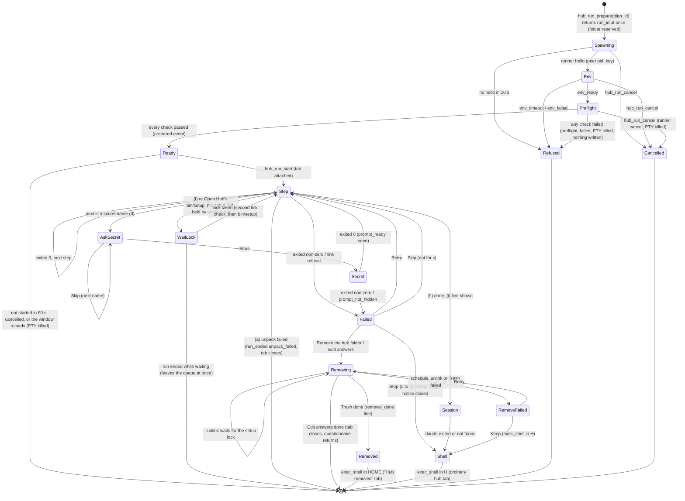

# Agentic-environment onboarding (F2): technical design

- **Status:** Proposed, revision 6 (2026-11-09). Revision 1 was blocked by the
  adversarial review (B1, M1 to M9, minors 1 to 11); revision 2 was blocked by the
  joint review of architecture revision 2 and UX revision 2 (X1, X3, X4, M1, M3, M5,
  M6, M8 to M10, M12, minors 3 to 7, N4) and amended by the owner's decisions of
  2026-11-09 (P4, OB-5 AC3's Stop, Q4, Q10); revision 3 was blocked by the round-3
  joint review (M-A, M-B, m1, m2, m4 to m11, m15) and is amended by the owner's
  decisions of the same day (the OB-7 AC1 paste rule; C2 for a busy hub tab);
  revision 4 was blocked by the round-4 delta review on M1 (the setup lock
  under-specified), with minors n1 to n5 and n7, which revision 5 answers; the
  round-5 delta review closed M1 and found minors L1 to L4, D1 to D3 and T1, which
  revision 6 answers. Section 15 maps every finding to its answer. Not yet approved.
- **Owner:** architect.
- **PRD:** `docs/prd.md` F2, approved by the owner 2026-11-09 (revision 4 + minors
  n1 to n6), with the owner's decisions of 2026-11-09 (PR #98, 3e215aa: OB-4 AC7,
  OB-3 AC2's paths and prefixes, OB-5 AC3's Stop, OB-5 AC4's "Hub removed" tab),
  and PRD 70253a7 (OB-5 AC4's left-behind secrets name the `security` command, not
  `bin/secret --forget`). This design adds nothing to F2's scope. Where F2 leaves a choice to the
  architect, the choice is made here and marked **(architect)**.
- **ADRs:** `0026-hub-setup-steps-run-under-a-runner-in-one-pty.md`,
  `0027-a-hub-tab-is-a-tab-flag-and-keeps-no-scrollback.md`,
  `0028-project-setup-refuses-hubs-at-its-two-writers.md`,
  `0029-a-finished-hub-is-judged-by-head-with-ades-own-git.md` (new in revision 2).
- **Contracts:** `.ade/context/hub-onboarding.md` (new),
  `.ade/context/remote-tabs.md` (new; the relay's tab entries and the hub-tab mask,
  shared with phone-watch story 8).
- **UX:** `docs/superpowers/specs/2026-11-09-onboarding-ux.md` (PR #102), revision 4
  (f8cdeed). Section 11 gives each of its needs N1 to N23 one row; sections 11.1 and
  11.2 list what revisions 4 and 5 add or rename for the designer.
- **Builds on:** the bundling plan (PR #91, ADR 0025, `bundled-sources.md`: S2's
  tarball and archiver, S3's release jobs, S4a's `hub_template_info` and
  `hub_template_create`); sub-terminals (`terminal-open.md`, ADR 0014; story 9's
  `shellQuote.ts`, ADR 0008); the PTY layer (`pty.rs`, `ptysink.rs`,
  `useTerminal.ts`); project setup (`projectsetup.rs`, `bmadswitch.rs`,
  `useProjectSetup.ts`); the session and sync (`tabStore.ts`, `persistence.ts`,
  `sync.rs`); the close guard (`useGuardedClose.ts`); git (`git.rs`); the
  relay-pairing design (story 8, not built).
- **Naming rule (owner, Q12):** the template is "the agent hub template"; this
  document names no private repository, commit or pull request of it. Script and
  folder names (`bin/init`, `personas/`, …) are the interface ADE runs and ships, so
  they are named.

## 1. What has to be true

F2 asks ADE to collect answers, then run the bundled template's own scripts in a
visible tab, so that the result is byte-for-byte the hub the CLI makes (G2), no
answer passes through a shell (OB-4 AC6), no secret value is kept (G4), and the hub
tab leaves nothing of its content in ADE's stores (OB-14). The hard parts, in the
order this design settles them:

1. **The step runner** (section 4): run argument vectors one after another in **one**
   terminal, with a login shell's environment, observe each exit status, pause for
   the developer's decisions, keep typed input away from the wrong program, then hand
   the terminal to Claude Code and finally to a login shell. ADR 0026.
2. **The gates** (section 5): the preflight, reported check by check; the git
   identity in the steps' environment; the memory-link check, run twice.
3. **Failure and undo** (section 6): Retry and Skip per step, idempotency, Remove
   with T4 detection, the Trash; what a "finished hub" is (ADR 0029).
4. **Closing, quitting and moving a running hub tab** (section 6.5), several runs
   at once and one per hub folder (4.10.1), and the "Hub removed" tab (6.4, 8).
5. **OB-13** (section 7): project setup refuses a hub. ADR 0028.
6. **OB-14** (section 8): the hub-tab flag. ADR 0027, `remote-tabs.md`.
7. **The persona list** (section 3.2), **the fixture and the gates** (section 10).

## 2. Where things stand (origin/main 90f4f6f, 2026-11-09)

- `create_pty(rows, cols, cwd, on_event)` (`pty.rs:123`) always spawns
  `$SHELL -l` (`platform::shell_from`) with `TERM`, `HOME`, `USER`, `PATH`, `LANG`,
  the default locale, the Vault's variables and the four `ADE_*` variables, whose
  token is per PTY id (`AgentStatus::terminal_env`). There is no way to start a pane
  with a given program; `PtyEvent::Exit {}` carries no status. A pane whose `ptyId`
  is already set attaches with `reattach_pty` (`useTerminal.ts:428-446`, used today
  for detached windows); an unattached `Sink` keeps 1 MB of backlog
  (`ptysink.rs:17`). `write_pty` (`pty.rs:277`) is the only path from a pane's
  keystrokes to the PTY's input.
- portable-pty's spawn makes the child a session leader on the PTY (`setsid`). On
  macOS the controlling terminal is revoked when a session leader exits, so **one
  PTY cannot be reused for a sequence of session leaders** (one per step) without
  risking `EIO` on the master and on any slave descriptor ADE holds. This is why
  section 4 keeps one process as session leader for the whole run.
- `pty_foreground_job` (`pty.rs:522`) classifies the foreground group's leader
  against the PTY's first process: when the leader **is** that process the pane is
  idle. Under the runner (section 4) that means a run between steps looks idle and a
  run during a step looks busy with the step's program name, so the close guard
  cannot rely on it for a hub tab (section 6.5).
- `ade-hook` (`src-tauri/ade-hook`, a workspace member) is the agent-status helper,
  the command guard and, since story 4c, the `ade` CLI; `ade_cli::dispatch` picks
  the mode. It shares source with the main crate by `#[path]`. **Its binary has
  integration tests:** `src-tauri/ade-hook/tests/dispatch.rs` runs the built binary
  (`env!("CARGO_BIN_EXE_ade-hook")`), and both `ci.yml` backend jobs run
  `cargo test --locked -p ade-hook --test dispatch` after the root `cargo test`
  ("Helper binary tests"). `cargo test -p ade-hook` as a whole is green since 4c.
  Since 2026-11-09 the seventh verification line, `cd src-tauri && cargo test -p
  ade-hook` (owner-approved Q-A5, on main with PR #103), runs them too, and so runs
  F2's `tests/hubrun.rs`.
- `git.rs` runs `git` from ADE's own process for the slop check and the switch,
  with a 10 s limit and pipes read on threads; `sync.rs`, `usage.rs` and
  `projectsetup.rs` also call `git` directly. So ADE already runs its own `git`.
- `shellQuote.ts` (ADR 0008) arrives with sub-terminals story 9 (branch
  `st9-typed-command`). F2's slice 1 needs it; if story 9 has not merged, the first
  F2 story that shows a command takes its three files unchanged, as story 9 did.
- Project setup writes only through `project_setup_apply` (`set_up`,
  `projectsetup.rs:708`) and `bmad_switch_apply` (`bmadswitch.rs:1958`); no hub or
  folder exclusion exists. `refuse_unfinished` (`projectsetup.rs:731`) is the
  pattern for a Rust-side refusal.
- A `Tab` has no flags field. Scrollback is captured in `saveSession`
  (`tabStore.ts:749-758`); closed tabs (`ClosedTab`), detached tabs (`SerializedTab`),
  Duplicate (`TabBar.tsx:139`) and workspaces (`WorkspacePreset.tabs`, names only,
  **no folder**) each copy a subset of the tab. The agent tracker stores `cwd` and is
  synced (`SHARED_KEYS`). Nothing relays tabs to a phone yet.
- Closing: `useGuardedClose` handles the tab (×, context Close, ⌘W), "Close Others"
  and "Close Tabs to the Right" (`request-close-tabs`, one confirm), the pane
  (`request-close-pane`; a tab's last pane is never closed) and the sub-terminal
  (`request-close-view`). The window's `onCloseRequested` (`App.tsx:129`) saves and
  destroys the window without asking. The Rust side has no `ExitRequested` handler.
  "Move to New Window" (`TabBar.tsx`, `detachTabToWindow`) is hidden for a tab with
  sub-terminals and kills the source panes' PTYs after the new window attaches.

## 3. Components


### 3.1 Modules (new unless marked)

| Module | Holds | Tested by |
|---|---|---|
| `src-tauri/src/hubtemplate.rs` (S4a; F2 adds two functions) | `hub_template_personas`, `hub_template_features` (3.2) | Rust unit tests on fixture tarballs |
| `src-tauri/src/hubanswers.rs` | `Answers`, every OB-3 AC2 check, F1's text rule, the derived hub name, `~` expansion, the **plan** (each step's argv) kept in `HubPlans` behind a `plan_id` | Rust unit tests; the parity table (10.3) |
| `src-tauri/src/textrule.rs` | F2.5's text rule (Cc and Cf, 1 to 80 code points after trim); shared with F1 if F1's lands first (then F2 uses F1's and this file is not added) | Rust unit tests incl. U+202E, U+200B, U+FEFF, U+E0001 |
| `src-tauri/src/hubconf.rs` | OB-6 AC2's literal reader of `hub.conf` (6.6) | Rust unit tests |
| `src-tauri/src/hubfolder.rs` | `tools_ready()` (the cached `xcode-select -p`), `hub_folder_kind` (6.7, ADR 0029), `hub_existing_info`, `hub_prefill`; all through ADE's own `git` after `tools_ready()` | Rust unit tests with temp repos |
| `src-tauri/src/hubmark.rs` | OB-13's marker, the app-wide folder registry (4.10.1: NFC keys, component-prefix conflicts; case folding and `pathconf` macOS-only, NFC-only keys elsewhere), `hub_guard_status`; compiles on every platform | Rust unit tests; setup e2e |
| `src-tauri/src/hubrun.rs` | the run's state machine on **one driver thread and one socket-reader thread per run** (each run its own socket; no shared socket server, 4.10.1), preflight, link check, the app-wide **setup lock** (4.10.1), undo, Trash (behind a `Trasher` seam), the input gate's state, close and quit handling (`app.exit` behind an `AppExit` seam, 6.5) | Rust tests with a real PTY and fixture template (macOS) |
| `src-tauri/src/hubrun_proto.rs` | the runner protocol's message types and the env frame format; `#[path]`-shared with `ade-hook` and with `ade-hook/tests/hubrun.rs` | Rust unit tests (serde round trips, frame codec) |
| `src-tauri/src/hubrun_child.rs` | the runner's loop (`__hub-run`), the foreground procedure, env capture (`__hub-env`); `#[path]`-shared into `ade-hook` | `cargo test -p ade-hook --test hubrun` (the built binary, 4.9); its pure parts also in the main crate |
| `src-tauri/ade-hook/tests/hubrun.rs` | the runner's integration tests (4.9) | CI `backend-macos` step |
| `src-tauri/src/ade_cli.rs` (changed) | `dispatch` gains `Action::HubRun` and `Action::HubEnv` | existing `ade_cli` and `dispatch` tests + new |
| `src-tauri/src/pty.rs` (changed) | `terminal_spawn_spec()` extracted from `create_pty`; `spawn_runner_pty`; `PtyInstance.input_gate` consulted by `write_pty` | existing tests + new |
| `src/lib/hubOnboarding.ts` | invoke wrappers, the shown commands (`shellQuote` over an argv), the line channel's answers (4.8.1), `focusHubPrompt(tabId)` | vitest |
| `src/lib/hubPathRule.ts` | 6.8's path rule for inline errors, mirroring Rust from one case file | vitest |
| `src/stores/hubRunStore.ts` | run state per tab (phase, notices, preflight list, the answers until `run_ended`, the removal record until Dismiss; 6.5.1) | vitest |
| `src/components/onboarding/*` | the choice, questionnaire, review, notices (the designer's screens) | vitest (RTL), OB-11 |
| `src/hooks/useGuardedClose.ts`, `src/App.tsx` (changed) | the hub-run close rule on every path (6.5) | vitest |
| `src/stores/tabStore.ts`, `src/lib/tabDisplay.ts`, `src/lib/detachWindow.ts`, `src/components/TabBar.tsx`, `src/components/SettingsPanel.tsx`, `src/stores/settingsStore.ts`, `src/stores/agentTrackerStore.ts` (changed) | the hub-tab flag (section 8); Move to New Window refused during a run (6.5) | vitest |
| `src/lib/remoteTabs.ts` | `remoteTabEntry(tab)` with the mask (story 8 calls it) | vitest |

All of F2's Rust commands return an error off macOS, and the UI never offers F2 there
(OB-1 AC9). The modules compile on every platform so CI's Linux and Windows jobs
still build.

### 3.2 The persona list and the template's features from the tarball

`hub_template_personas() -> Vec<Persona>` reads the bundled tarball **without
unpacking it** (F2.8's new capability): it verifies the tarball's sha256 against the
manifest (S4a's rule), streams the entries, and for every regular file at
`personas/<slug>.md` (top level of `personas/` only; `<slug>` matching
`^[a-z0-9][a-z0-9-]*$`) parses the front matter **as `bin/init`'s `fm()` does**: the
lines between the first and second `---` lines, a key being the text before the
first `": "` and the value everything after it. `Persona { slug, title, model,
folders, briefing_focus }`; a persona without `title` keeps its slug as the title
(as `bin/init --list` prints an empty title). Sorted by slug, as the shell glob.
Cached for the launch (the tarball cannot change while ADE runs). Entries over
64 KiB are skipped. Errors (`sha_mismatch`, `unreadable`) are returned as such, so
the questionnaire shows its failure state.

`hub_template_features() -> { unlink_since: bool }` reads `bin/setup` from the
same tarball. **T4 is present** when `bin/setup` holds a line that, with trailing
white space removed, is exactly:

```
#   bin/setup --unlink --since <stamp>
```

(a `#`, three spaces, then that text). **(architect)** An exact line, not a loose
"mentions both flags" match, because a false positive would run
`bin/setup --unlink --since …` against a `bin/setup` that may ignore unknown
arguments and **set up** instead of undoing. A template whose T4 lacks the line is
treated as without T4, which is safe (the manual list, 6.4). Two asks go to the
template's backlog (recorded in `hub-onboarding.md`): keep that exact usage line
with T4, and make `bin/setup` refuse an unknown argument (exit 2, nothing done), so
no misread flag can ever set up. Running `bin/setup --help` is not an option: today's
`bin/setup` has no `--help` and would set up.

At undo time (6.4) the same test is applied to the **hub's own** `bin/setup` on
disk, which is the copy that runs.

## 4. The step runner (ADR 0026)

### 4.1 Shape

The hub tab's PTY is spawned by Rust with **`ade-hook __hub-run`** as its program
(not the shell). The runner is the PTY's session leader for the whole run. It:

1. starts the developer's login shell once, interactively, in the terminal's
   foreground, only to **capture the environment** it produces (4.3);
2. waits on a Unix socket for instructions from ADE and runs each step as **its own
   child, started from an argument vector** with that environment, in the
   foreground of the terminal, and reports the exit status (4.4);
3. finally **`execve`s the developer's login shell** in the hub folder with the
   environment a new terminal gets, so the tab becomes an ordinary terminal with the
   same PTY id, token and agent status (4.6).

The runner is dumb: every argv, cwd, environment change, line to print, shell to
capture and timeout comes from ADE. All policy (the plan, the gates, the decisions)
is in `hubrun.rs`.

Why a runner and not the shell: the PRD forbids typing into an interactive shell
(OB-4 AC6). Why not one PTY per step: the PTY id would change at each step (the
persona session's `ADE_PTY_ID` would not be the tab's), the controlling terminal is
revoked between session leaders (section 2), and every step would pay the start-up
files again. Why `ade-hook`: it is already shipped, signed and on `ADE_HOOK_BIN`, and
it has no GUI; a hidden verb costs nothing.

### 4.2 Spawning and the socket (`pty.rs`, `hubrun.rs`)

`create_pty`'s environment and shell selection move into one function,
`terminal_spawn_spec(app, agent, id) -> SpawnSpec { program, args, env, cwd }`,
which `create_pty` keeps calling. ADR 0021's shell integration (F1), when it lands,
changes this one function, and the runner follows it automatically (4.3, 4.6).

`spawn_runner_pty(app, state, agent, rows, cols, window_label) -> (pty_id, child_pid,
Listener)`:

- reserves the id (`reserve_id`) and builds the spec as for a terminal;
- **requires** `agent.terminal_env(id)` to be `Some` (the helper and the hook port
  exist). Without them the preflight's `helper` check fails (5.1) because OB-4 AC6
  promises the four `ADE_*` variables;
- creates the socket folder **exclusively**: `mkdir(2)` (never `create_dir_all`) of
  `$TMPDIR/ade-hub-<16 random hex>` with mode 0700; `EEXIST` → a new random name, at
  most 3 tries; then `lstat` must show a directory (not a symbolic link) owned by
  `getuid()` with mode 0700, else the folder is left alone and the `helper` check
  fails. The socket is `<folder>/s`. **`sun_path` limit:** when that path is longer
  than 103 bytes (macOS's `sun_path` is 104 with the NUL), the folder is made under
  `/private/tmp` instead, by the same exclusive rule (macOS's `$TMPDIR` is about
  49 bytes, so this is only for an unusual `TMPDIR`);
- program `ADE_HOOK_BIN` (the helper's absolute path), args `["__hub-run"]`, cwd the
  developer's `HOME` (the hub folder does not exist yet), env = the terminal's env
  plus `ADE_HUB_RUN=<socket path>` and `ADE_HUB_RUN_KEY=<64 hex, random per run>`;
- registers a `PtyInstance` with an **unattached** sink, the calling window as owner
  (story 4a's field) and an `input_gate` (4.5), exactly as a terminal otherwise, so
  `reattach_pty`, `kill_pty`, `get_pty_cwd`, `pty_foreground_job` and agent status
  work unchanged.

**Accepting the runner.** On each accepted connection ADE reads the peer's pid with
`getsockopt(LOCAL_PEERPID)`; a peer that is not `child_pid` (the PTY's first process)
is closed at once and ADE keeps listening. The first message must be
`hello { key }`, compared with the run's key in constant time; a wrong key closes
that connection. **The hello timeout:** with no accepted `hello` within **10 s** of
the spawn, the PTY is killed, the folder removed, and the `helper` check fails ("the
setup helper did not start; restart Better Terminal"). On the accepted `hello`, ADE
unlinks the socket and removes its folder. Nothing else listens.

The runner removes `ADE_HUB_RUN` and `ADE_HUB_RUN_KEY` from its own environment
before starting any thread, and they reach nothing it starts. At start it also marks
every inherited descriptor above 2 close-on-exec (by listing `/dev/fd`), and opens
everything of its own (socket, pipes) close-on-exec, so a step, a probe and the final
shell receive exactly fds 0, 1 and 2 (plus the env fd for the env shell only, 4.3).

`ade_cli::dispatch` gains two arms before hook mode: `args[0] == "__hub-run"`
**and** `ADE_HUB_RUN` set → `Action::HubRun`; `args[0] == "__hub-env"` and
`ADE_HUB_ENV_FD` set → `Action::HubEnv`. Neither verb is listed by `ade help`,
neither changes story 9's `capabilities:` line, and both are refused (exit 2,
nothing done) when their variable is missing. `ade-hook` gains `libc = "0.2"`
(already locked by the main crate).

### 4.3 The steps' environment (OB-4 AC6)

After the `hello`, ADE checks the spec's program (Q-A1, answered: **refuse**): its
basename must be one of `sh`, `bash`, `zsh`, `ksh`, `dash`, `fish`, else the
`login_shell` check fails naming the shell and the six supported ones, with the fix
`chsh -s /bin/zsh`. Then ADE sends `capture_env { program, args, timeout_ms: 30000 }`
(the `SpawnSpec`'s program and args, today `$SHELL -l`).

The runner then starts **the developer's login shell as a new terminal starts it**
plus `-i -c 'exec "$ADE_HOOK_BIN" __hub-env'`:

- **Under the foreground procedure** (4.4): its own process group, made the
  terminal's foreground, signals and mask reset, input flushed; the runner takes the
  foreground back when it ends. An interactive shell that is not in the foreground
  would stop itself on its first terminal access.
- **The env fd is 57** (`ENV_FD`), the write end of a pipe, dup'd in the child with
  `ADE_HUB_ENV_FD=57` set. **(architect)** Not fd 3: descriptors 0 to 9 are the
  ones start-up files redirect (`exec 3>…` is common), and bash and zsh place their
  own private descriptors at the lowest **free** number from 10, so an open 57 is
  never taken by them. The read end is close-on-exec.
- The shell reads its login and interactive start-up files (for zsh `~/.zshenv`,
  `~/.zprofile`, `~/.zshrc`, `~/.zlogin`), then replaces itself with
  `ade-hook __hub-env`, which checks that fd 57 is a pipe (`fstat`, `S_ISFIFO`),
  writes its environment as **framed data** and exits 0:
  - the magic `ADEENV1\n`; then per variable a 4-byte big-endian length and the
    `NAME=value` bytes; then a 4-byte zero length as the terminator. Values may hold
    newlines; nothing is parsed by separators.
- The runner **reads the pipe on its own thread while it waits**, so an environment
  over the pipe's 64 KiB buffer cannot deadlock `__hub-env`; the frame is capped at
  4 MiB (over → `env_failed { too_large }`).
- **The end is `__hub-env`'s exit, not EOF.** The runner `waitpid`s the shell's pid
  (which became `__hub-env`): exit 0 **and** a complete frame up to the terminator →
  the map is accepted. A background process the start-up files left (an agent, a
  daemon) may hold the write end open forever, so EOF is never waited for: after the
  exit the reader gets 1 s to finish the frame already in the pipe, then stops;
  anything after the terminator is ignored. Exit non-zero, a signal, or no
  terminator → `env_failed { shell_ended { code | signal } }`.
- **Dropped from the map:** `PWD`, `OLDPWD`, `SHLVL`, `_` (they describe the env
  shell, not a step), and `ADE_HUB_ENV_FD`, `ADE_HUB_RUN`, `ADE_HUB_RUN_KEY`. Each
  `run` and `probe` sets `PWD` to its own cwd, as a shell does before `exec`.
- The `-c` string is a constant; no answer is in it. `exec "$X" word` means the same
  in the six shells.
- The environment passes through a pipe in memory, never a file: it holds the
  Vault's variables and `ADE_HOOK_TOKEN`.
- Start-up output (banners, a framework's update question) appears in the tab, as
  in a new terminal (the PTY is still hidden; its backlog is shown when the tab
  opens). If `__hub-env` has not exited within **30 s**, the runner kills the env
  shell's process group (`SIGKILL`) and sends `env_timeout`; the `env` check fails
  with "your shell's start-up files did not finish within 30 seconds (they may be
  waiting for input); open a terminal to see what they ask".
- The identity check (5.3) and every probe run in this same environment, so it is
  literally the environment of step (c), with one deliberate exception: the git
  variables that point git at another repository are removed (4.4, M7).

### 4.4 Running a step: the foreground procedure

The runner saves the terminal's settings once at start (`tcgetattr`, the **cooked**
settings: canonical, echo on). Between children it is **holding**: it owns the
foreground and the terminal's echo is **off** (the cooked settings with `ECHO`
cleared), so nothing typed while a notice waits is shown, and ADE's input gate is
closed (4.5).

For `run { id, argv, cwd, env_set, env_unset, secret: bool }` (and for the env shell
of 4.3) the runner:

1. prints nothing itself (ADE sends a separate `print` with the shown command first,
   so the order of lines and output is the order of bytes on the PTY);
2. **flushes pending input** (`tcflush(0, TCIFLUSH)`), so nothing typed earlier
   reaches the step, then sets the terminal to the cooked settings (echo on);
3. forks a child with `std::process::Command` (`argv[0]` resolved through the
   steps' `PATH` when it has no `/`, as `execvp`; `bin/init` with a `/` is relative
   to `cwd`), environment = steps' environment, then the **always-removed git
   variables** (`GIT_DIR`, `GIT_WORK_TREE`, `GIT_INDEX_FILE`,
   `GIT_OBJECT_DIRECTORY`, `GIT_ALTERNATE_OBJECT_DIRECTORIES`, `GIT_COMMON_DIR`,
   `GIT_NAMESPACE`, `GIT_CEILING_DIRECTORIES`, `GIT_DISCOVERY_ACROSS_FILESYSTEM`)
   removed, then `env_unset` removed and `env_set` applied, and `PWD=<cwd>`. In
   `pre_exec`: `setpgid(0, 0)`; `tcsetpgrp(0, getpid())` (`SIGTTOU` is still ignored
   here, inherited); then **every signal's disposition set to `SIG_DFL`** (1 to
   `NSIG - 1`, except `SIGKILL` and `SIGSTOP`) and **the signal mask cleared**
   (`sigprocmask(SIG_SETMASK, ∅)`). The runner also calls `setpgid(child, child)`
   and `tcsetpgrp(0, child)` after the fork (both sides, as a shell does, so
   neither order races);
4. `waitpid(pid, WUNTRACED)` in a loop. A child stopped by Ctrl-Z (or `SIGTTIN`)
   gets **`killpg(pgid, SIGCONT)`** (the whole group: a script's own children
   stopped with it) and `tcsetpgrp(0, pgid)` again: a run has no job control;
5. on exit: takes the foreground back (`tcsetpgrp(0, own pgrp)`), flushes pending
   input, sets the holding settings (cooked with echo off, which also repairs a
   step killed in raw mode), and sends `exited { id, code | signal | spawn_error }`.
   `spawn_error` is `not_found` for `ENOENT` and the `errno` text otherwise.

The runner ignores `SIGINT`, `SIGQUIT`, `SIGTSTP`, `SIGTTIN` and `SIGTTOU` for its
own life (as `system(3)` does), so Ctrl-C reaches the step and not the runner;
because dispositions and the mask are reset in every child (step 3) and before the
final `execve` (4.6), nothing the runner ignores is inherited. `SIGHUP` (the tab
closed: `kill_pty` drops the master) is not ignored: the runner and the foreground
step both die, which is "closing stops the run" (OB-5 AC5).

Every answer reaches the program as exactly one `argv` element, byte for byte, with
no shell anywhere between ADE and `execve`; nothing is ever written to the PTY's
input by ADE, so **no shell history can hold an answer**. A text-rule value with
characters that cannot be typed (`Zoë 日本`, `C:\x\y`) is passed as it is.

**The git variables (M7).** A `GIT_DIR` or `GIT_WORK_TREE` exported by a start-up
file would point `git add -A` and `git commit` (c), `bin/init`'s `git init` and every
probe at another repository. They are removed for **every** step and probe. This is
the one place where a step's environment differs from the developer's shell, and
the CLI run by hand in such a shell would misbehave the same way; the removal makes
ADE's run safe, not different in result.

### 4.5 Secrets: what the terminal accepts and when (OB-7 AC1, M4)

`PtyInstance.input_gate` is consulted by `write_pty` for the hub tab's PTY:

| Gate | When | `write_pty` |
|---|---|---|
| **closed** | the runner is holding (preflight, notices, between steps), a secret step before its prompt is ready, and **every removal command** (6.4) | drops the bytes, except the signal characters `\x03` (Ctrl-C), `\x1c` (Ctrl-\\) and `\x1a` (Ctrl-Z), which pass |
| **open** | any non-secret step, (i), and after `exec_shell` (gate removed) | as today |
| **secret** | a secret step after `prompt_ready` | the **paste rule** below: a write holding a line break anywhere except at its end is dropped whole and ADE emits `secret_paste_refused { name }`; any other write passes |

Bytes are dropped, never queued, so nothing typed early lands in a later program.

**The paste rule (OB-7 AC1; owner, 2026-11-09).** A pasted secret containing a line
break anywhere except at its end is refused **whole**: none of its bytes reach the
PTY. Exactly, for one `write_pty` call while the gate is **secret**: strip **one**
trailing line break (a final `\r\n`, else a final `\r`, else a final `\n`); if what
remains holds any `\r` or `\n`, the write is dropped whole and
`secret_paste_refused { name }` is emitted once for it; otherwise the whole write
(trailing line break included) passes. So `abc`, `abc\r`, `abc\n` and `abc\r\n`
pass; `ab\rc`, `ab\ncd\r`, `\rabc` and `abc\r\r` are refused whole. xterm.js
delivers a paste as one `onData` string (its line breaks as `\r`) and the hub pane
passes it to `write_pty` as one call, unsplit; O10c asserts that. Typed keys arrive
one write at a time, so typing is never refused; keys typed after Enter reach the
prompt only if `bin/secret` is still reading, and are flushed when it exits (below).

A Store runs `run { …, secret: true }` for `bin/secret --set <name>`. The runner
follows 4.4 (flush, cooked settings with echo **on**, fork) and then **polls
`tcgetattr` every 20 ms**: when `ECHO` is cleared while the step's group is the
foreground (`bin/secret`'s `read -rs` has started), it sends `prompt_ready { id }`.
ADE sets the gate to **secret** and emits `secret_prompt_ready { name, token }`; only
then does the webview tell the developer to type and call `focusHubPrompt(tabId)`.
While the gate was closed the echo state did not matter, because no byte reached the
terminal. If echo is not cleared within **15 s**, the runner sends
`prompt_not_hidden { id }`; ADE sends `stop` and the name fails with reason
`prompt_not_hidden` (options `retry`, `skip`, `remove` when offered, `keep`: Retry,
Skip, Remove, Stop, as every secret failure, 4.10.3), so nobody is ever asked to type
a secret into an echoing terminal.

When `bin/secret` exits, the runner flushes input (a second pasted line, or keys
typed after Enter, are discarded, never passed to the next step or the shell) and
sets echo off; ADE closes the gate. Values are **single lines** (`read -r` reads
one), which the paste rule enforces for pastes.

ADE never sees the value except as bytes passing `write_pty` on their way to the
PTY, which ADE neither logs nor stores (G4); the tab's scrollback is never saved
(OB-14). T3's absence (`security -w <value>` visible to `ps`) is G4's stated limit.

### 4.6 Probes

`probe { id, argv, cwd, env_set, env_unset, stdin: bytes?, timeout_ms }` runs a
child the same way (environment and the always-removed git variables as 4.4, signals
and mask reset) but **not on the terminal**: stdin is the given bytes or
`/dev/null`, stdout and stderr are pipes read on threads (capped at 64 KiB and
16 KiB), it is its own process group, never the foreground, and it is killed
(`SIGKILL` to the group) at the timeout (default 30 s). The answer is `probed { id,
code | signal | spawn_error | timeout, stdout, stderr }`. Probes are how ADE asks
"in the steps' environment" without showing anything: `git --version`, the identity,
`which claude`, the memory-link facts (5.4), the Keychain service and the removal
facts (6.4). Nothing a probe prints reaches the tab.

### 4.7 The hand-over: Claude Code, then a login shell

- **(i) the persona session** is an ordinary `run` step: argv `[<claude command>]`,
  cwd the hub folder, `env_set CLAUDE_CONFIG_DIR=<HUB_CLAUDE_CONFIG_DIR>` when
  `hub.conf` holds a non-empty literal (OB-6 AC1), read by `hubconf.rs` (6.6). It
  inherits the four `ADE_*` variables of the tab's PTY, so the session's hooks report
  to agent status and `ade open` opens sub-terminals of this tab (OB-12). Its shown
  line comes through the line channel like every other (4.8.1): `awaiting_line
  { line: { kind: command, key: "i", argv, env_set } }`.
- **The shown command for (i)** is the webview's: `CLAUDE_CONFIG_DIR=` +
  `shellQuote(value)` + ` ` + `shellQuote(argv)`: only the value is quoted, never the
  `NAME=` part, so the line is copyable in sh, bash, zsh, ksh and dash, and in fish
  3.1 or later (fish before 3.1 has no `NAME=value command` form; this is stated, not
  worked around). Without `HUB_CLAUDE_CONFIG_DIR` it is `shellQuote(argv)`.
- **The alias limit.** The Claude command is found through the steps' `PATH`, as
  `execvp` does; a shell alias or function named `claude` (for example
  `alias claude=~/.claude/local/claude`) is not seen, because no shell runs (4.4).
- **Claude not found has one source:** (i)'s `exited { spawn_error: not_found }`.
  ADE emits `awaiting_line { line: { kind: claude_not_found, command, hub } }`,
  prints the text the webview returns (the designer's words, which say an alias is
  not used), then `exec_shell`, and the run ends with `run_ended { how:
  session_skipped { reason: claude_not_found { command } } }` (OB-6 AC3). ADE prints
  **no wording of its own** in the tab (owner, Q10). Nothing else (not the
  preflight's `which claude`, which only predicts the config folder) reports it.
- **The shell** is `exec_shell { program, args, cwd, env }`: ADE sends the
  `SpawnSpec` a **new terminal** would get (same program and args, the env with the
  same `ADE_*` values, since the PTY id is the same), with `cwd` the hub folder, or
  **`HOME` after a finished removal** (6.4, the "Hub removed" tab). The runner takes
  the foreground for its own group (its pid, which the shell keeps), flushes input,
  restores the cooked settings, **resets every signal disposition to `SIG_DFL` and
  clears the signal mask** (an ignored `SIGINT` survives `execve`, and a bash that
  starts with `SIGINT` ignored passes the ignore to every command it runs, so Ctrl-C
  would stop nothing), closes the socket and `execve`s it. The PID, PTY id and token
  stay; ADE removes the input gate; the tab is now an ordinary terminal (OB-4 AC6
  "after the persona session exits"). The same message ends a run that stops at a
  failed step (Stop, Keep it, or the failure notice closed without Retry), a removal
  kept after a failure (Q-A3), and a finished removal (in `HOME`). Nothing is re-run.

### 4.8 The protocol

Newline-delimited JSON over the socket, types in `hubrun_proto.rs` (one source for
both binaries and the integration tests). ADE → runner: `capture_env { program,
args, timeout_ms }`, `chdir { path }`, `print { text }`, `run {…}`, `probe {…}`,
`exec_shell {…}`, `stop { grace_ms }` (send `SIGHUP` to the foreground step's group,
then `SIGKILL` after the grace, then wait for ADE's next message), **`cancel`**
(revision 3, M1: `SIGKILL` to every process group the runner started that has not
been reaped (the env shell's, each running probe's, a step's), reap them, then exit
0 without starting anything). Runner → ADE: `hello { key }`, `env_ready { vars:
{ HOME, LANG, LC_ALL, LC_CTYPE, CLAUDE_HOME, CLAUDE_CONFIG_DIR } }` (only these named
values, never the whole map), `env_timeout`, `env_failed { reason }`,
`prompt_ready { id }`, `prompt_not_hidden { id }`, `exited {…}`, `probed {…}`.
Unknown messages are a protocol error: the runner execs the shell (printing nothing:
ADE's wording is the designer's, 4.8.1); ADE ends the run with `run_ended { how:
failed { message } }`, and the webview's notice says so. Socket EOF: ADE treats it as
the tab closed; the runner, **before `hub_run_start`** (the preflight), does what
`cancel` does; **after it**, kills any step or probe still running (as `cancel`) and
execs the shell (ADE quit).

**`chdir`.** The runner's own working folder is `HOME` until the hub folder exists.
Right after (a) succeeds ADE sends `chdir { path: H }`, so between steps the PTY's
first process is in `H`: `get_pty_cwd`, the tab's folder, its tooltip and agent
status show the hub folder from then on. Before the Trash (6.4) ADE sends
`chdir { path: HOME }`, so the runner never holds the folder being moved.

#### 4.8.1 The line channel: every printed line is the designer's (owner, Q10)

ADE prints **no wording of its own** into the hub tab. Every line it prints (each
shown command, each `▸` note) is text the webview supplies for a fact ADE names:

1. ADE emits `awaiting_line { token, line }` and waits;
2. the webview builds the text (its copy, `shellQuote` of an argv: ADR 0008's single
   quoter, used only in the webview) and calls **`hub_run_show(run_id, token,
   text)`**;
3. ADE checks the text and sends `print { text }` to the runner, then goes on.

`line` is one of (facts only; every path absolute, every argv an array):

| `kind` | Facts | When |
|---|---|---|
| `command` | `key`, `sub`, `argv`, `env_set` | before each sub-command of (b) to (i), each Retry included, and each removal command (`key: "removal"`, `part`) |
| `unpacked` | `short_ref`, `hub`, `created_parent?` | after (a) succeeds |
| `secret_skipped` | `name` | Skip on a secret notice, or Skip on a failed secret |
| `step_skipped` | `key` | Skip on a failed step |
| `retrying` | `key`, `name?`, `part?` | Retry on a failed step, a failed secret or a stopped removal |
| `stopped` | `hub`, `key` | Stop on a failed step; Keep it after (b) |
| `claude_not_found` | `command`, `hub` | (i)'s spawn found no program (4.7) |
| `hubconf_not_literal` | `line`, `key` | the session is not started (6.6) |
| `removal_kept` | `hub`, `part`, `since_time`, `t4` | Keep after a stopped removal (6.4) |
| `removal_done` | the `removal` record (6.4) | after the Trash, before the shell starts in `HOME` |

**Text rules.** UTF-8, at most 16 KiB; `\n` separates lines (ADE writes `\r\n`);
the only escape sequences allowed are SGR (`ESC [` digits and `;` `m`), so the
designer's colour and weight work; any other C0 or C1 control, or another escape, →
the text is refused and nothing is printed for that line. An **empty** text prints
nothing (a fact the designer chooses not to print). With no `hub_run_show` within
**10 s** the line is not printed and the run goes on, so a webview bug cannot hold a
run. A `hub_run_show` for a token that is no longer waiting is ignored. The facts
are emitted to the run's own window only.

The OB-3 AC3 promise "the listed commands are the executed ones" holds because the
argv in `awaiting_line` is the argv the runner is then sent, taken from the same
`Plan` the review showed (by `plan_id`); O7 asserts it. `hub_run_start` no longer
takes `shown[]` (revision 2), and `awaiting_shown` is replaced by this channel.

### 4.9 Tests of the runner: the binary-level seam (M8)

`src-tauri/ade-hook/tests/hubrun.rs` runs the **built** helper
(`env!("CARGO_BIN_EXE_ade-hook")`), as `dispatch.rs` does, and plays ADE's part:

- it opens a PTY pair with `libc::openpty`, makes a socket folder and listener as
  4.2 does, and spawns the helper with args `["__hub-run"]`, `pre_exec` `setsid()`
  and `ioctl(TIOCSCTTY)` on the slave as fds 0 to 2 (what portable-pty does), env
  `ADE_HUB_RUN`, `ADE_HUB_RUN_KEY`, a temporary `HOME` holding the test's start-up
  files, and `PATH` with the test's stubs;
- it speaks the protocol with `hubrun_proto.rs`, included by `#[path]`;
- it reads the master to see what the terminal shows and writes it to type.

`ade-hook` gains `[dev-dependencies] libc = "0.2"`. The file is
`#![cfg(target_os = "macos")]` at the top, so other platforms compile it to no tests.
CI: `ci.yml`'s `backend-macos` job gains a step after "Helper binary tests",
`cargo test --locked -p ade-hook --test hubrun` (O6). The verification command's
seventh line, `cd src-tauri && cargo test -p ade-hook` (in force on main, section
12), runs it too, on every Mac that runs the command. The main crate keeps unit
tests of the pure parts (frame codec, message round trips, the gate's rules).

### 4.10 The run as ADE sees it



State lives only in `HubRuns` (memory, app-wide). **No run is recorded on disk**
(OB-5 AC5): after a restart, the tab is an ordinary hub tab (section 8).

**In progress (OB-4 AC7).** A run is *in progress* from `hub_run_prepare` (the
review step's confirmation) until it reaches (i) (`Session`), ends at a failed step
(`Shell` by Stop, Keep it or the notice closed), its tab closes, its removal
finishes (`Removed`, or the tab closing after Edit answers), or it is refused,
cancelled or expires before the start. While in progress its hub folder is in the
**folder registry** (7.1), which refuses a second run, or Open Hub with `bin/setup`,
on the same folder (4.10.1).

**Prepared but not started; reloads.** A run that passed the preflight waits for
`hub_run_start` at most 60 s (the window opens the tab at once); after that, or when
its window's webview (re)loads, ADE kills the hidden PTY and forgets the run.
Every window calls `hub_runs_reset(window)` when its webview starts: any run that
window owned is ended as **Keep** (a `stop`, then the PTY is killed; nothing is
removed, because no one was asked), its registry entry is dropped, it leaves or
releases the setup lock (4.10.1), and the window's current plan is dropped
(4.10.2). A reload in a
packaged build happens only by a crash of the webview, so this is the safe default,
not a flow.

#### 4.10.1 One run per hub folder, several runs at once (owner, P4; OB-4 AC7)

Several runs may go at once, each in its own tab, in one window or several; each
has its own `run_id`, PTY, runner, `Plan`, notices and undo. Nothing limits their
number, and no "one at a time" state exists (the UX's N12 is withdrawn).

A second run **on the same hub folder** is refused by the app-wide folder registry
in `hubmark.rs` (a `Mutex<Vec<RegEntry { key, hub, run_id }>>` in Tauri state, so
every window sees one registry):

- **The key.** `H` after `~` expansion with ADE's `HOME` and lexical normalisation;
  then its nearest existing ancestor `A` is canonicalised (`realpath`) and the
  missing components are appended. The whole path is then **NFC-normalised**
  (revision 4, m10: APFS and HFS+ treat NFC and NFD spellings of a name as the same
  file, on case-sensitive volumes too, so `café` typed precomposed and decomposed is
  one key). On macOS, when `pathconf(A, _PC_CASE_SENSITIVE)` is 0 (the default APFS volume),
  the key is then **case-folded**, then NFC-normalised again (folding can
  decompose); on a case-sensitive volume it is the NFC path. So `~/hubs/A` and
  `~/hubs/a` are one key on a default Mac, and `~/hubs/x` through a symbolic link to
  `~/hubs` is the same key as the link's target, even during (a) before `H` exists.
  Off macOS the key is the NFC path only ("Platforms" below).
- **The implementations (revision 5, n4); no new crate.**
  - **NFC:** `icu_normalizer` **2.1.1**, already in `src-tauri/Cargo.lock` (through
    `url` → `idna` → `idna_adapter`, with its `compiled_data` feature already on),
    made a direct dependency of the main crate on every platform, **without its
    default features** (revision 6, D1):
    `icu_normalizer = { version = "=2.1.1", default-features = false, features =
    ["compiled_data"] }`. The defaults add the `utf16_iter` feature, which pulls the
    `utf16_iter` and `write16` crates, neither in `Cargo.lock`, so `cargo metadata`
    fails under `--locked`; `compiled_data` is what `new_nfc()` needs, and
    `normalize(&str)` is behind no feature. The call:
    `ComposingNormalizerBorrowed::new_nfc().normalize(&key)`. With this and
    `core-foundation-sys` below, the lock file changes only in the root package's
    `dependencies` list (checked offline: 608 packages before and after); the story
    commits that change. Revision 4's `unicode-normalization` is dropped (it is not
    in the lock file).
  - **Case folding (macOS only):** CoreFoundation's **`CFStringFold(s,
    kCFCompareCaseInsensitive, NULL)`** (Unicode full case folding,
    locale-independent with a `NULL` locale) on a `CFMutableString` of the whole key,
    through `core-foundation-sys` **0.8.7**, already in the lock file, made a direct
    dependency **for macOS only** (revision 6, D2):
    `[target.'cfg(target_os = "macos")'.dependencies] core-foundation-sys = "=0.8.7"`.
    Not `str::to_lowercase`, which is lowercasing, not folding (a final `Σ` becomes
    `ς`, so `ΣΟΦΟΣ` and `σοφοσ` would be two keys).
  - **The pairs O1 pins are the volume's own, not over-folds (revision 6, D3).** Full
    folding maps `ß` to `ss` and `ς` to `σ`, and APFS's case-insensitive comparison
    identifies the same pairs: on APFS (checked, macOS 26), `mkdir strasse` after
    `mkdir straße` fails with "File exists", and so do `mkdir σοφοσ` and
    `mkdir ΣΟΦΟΣ` after `mkdir σοφος`. Revision 5 called `ß`/`ss` a safe over-fold;
    it is not one, and O1's cases stand as written because `CFStringFold` and APFS
    agree on them. **Direction of error, for any pair not pinned:** a pair the fold
    identifies and the volume keeps apart can only refuse a second run that would
    have been safe; a pair the volume identifies and the fold keeps apart could let
    two runs share a folder. Full folding identifies every pair that simple folding
    does, and HFS+'s table (TN1150) is a simple folding, so there any error is the
    safe one. APFS's table is not published; a pair APFS folds that `CFStringFold`
    does not would be a bug against this rule.
  - **Platforms (revision 6, D2).** `hubmark.rs` compiles and runs on every platform
    (the marker walk and `hub_guard_status` serve project setup everywhere), but
    `CFStringFold` and `_PC_CASE_SENSITIVE` exist only on macOS, and `libc` is a
    `cfg(unix)` dependency. So the fold function and the `pathconf` call carry
    `#[cfg(target_os = "macos")]`. The key function, `registry_key(path, case:
    Case)`, takes the volume's case as a plain enum, `Case { Sensitive, Insensitive
    }`, which `volume_case(dir)` answers by `pathconf` on macOS and as `Sensitive`
    elsewhere; off macOS `Case::Insensitive` folds nothing. **Off macOS the key is the
    NFC path only.** That decides nothing in practice: F2's commands fail off macOS
    (F2 is macOS only), so the registry is never filled there. O1's tests that fold
    or read the volume call only the cross-platform items (`registry_key`, `Case`,
    `volume_case`), so they compile on every target, and carry
    `#[cfg_attr(not(target_os = "macos"), ignore = "case folding and
    _PC_CASE_SENSITIVE are macOS-only")]` (section 13's rule): the Ubuntu and
    Windows CI jobs build them and report them ignored.
  - A canonical ancestor whose bytes are not UTF-8 (possible only off APFS and HFS+,
    for example on some network volumes) is kept as raw bytes, neither normalised nor
    folded.
- **Overlap, not only equality (revision 4, m10).** A key **conflicts** with a held
  key when they are equal, or one is an ancestor of the other **by whole
  components** (`~/hubs/a` and `~/hubs/a/b` conflict; `~/hubs/a` and `~/hubs/ab` do
  not). A hub inside another run's hub folder, or a hub folder that would contain
  one, is refused like the same folder. **(architect; revision 5, n5)** This goes
  beyond OB-4 AC7 as approved, which refuses only the same folder: refusing `inside`
  and `contains` is the architect's decision, because the outer run's unpack collides
  with the inner one (S4a's rename into the outer folder meets the inner run's
  files, or the inner run unpacks into the outer one's tree), and the outer
  `bin/init` would commit the inner hub.
  The product manager is amending OB-4 AC7 to say so (PRD eafae5f on
  `onboarding-prd`, not yet approved); until then this is recorded as the
  architect's choice.
- **Reserve, atomically.** `hub_run_prepare` (and `hub_open_existing` with
  `run_setup`) reserve the key under the mutex **before anything starts** (no
  `xcode-select`, no runner): if the key conflicts with one an in-progress run
  holds, the call returns `{ refused: { in_setup: { hub, tab_id?, relation } } }` at
  once, starts nothing and writes nothing. `hub` is **the other run's** hub folder;
  `relation` is `same` (the same folder), `inside` (the asked folder is inside the
  other run's) or `contains` (the asked folder contains the other run's). Otherwise
  the entry is added with the new `run_id`.
- **Release.** The entry is removed when the run stops being in progress (above):
  refused or cancelled preflight, 60 s expiry, (i) reached, Stop/Keep, tab closed,
  removal finished, `hub_runs_reset`, the window destroyed.
- **Inline.** `hub_folder_kind` sets `in_setup` (same shape) for a key that
  conflicts with a reserved one (6.7), so the questionnaire can say so before the
  review; the reservation in `hub_run_prepare` is the decision (a race between two
  windows' confirmations is settled there).
- **Open Hub without `bin/setup`** (only the session) is not refused: it writes
  nothing and is not a run on the folder. Two runs that list the **same checkout**
  are not refused here; the **setup lock** below orders their (f), and the later
  run's second link check refuses it (OB-4 AC7).
- The registry also serves OB-13 (7.1): a reserved folder is a hub for project
  setup from the reservation on, which covers (a) before the folder exists.

**The setup lock (revision 4, M-A; specified in revision 5, M1).** The second link
check (5.4) and `bin/setup`'s own `link()` are two moments; between them another
run's `bin/setup` could link the same checkout's memory entry, and the template's
`link()` then does `rm -f "$mem"; ln -s …`, silently moving that checkout's Claude
memory to the other hub. Within ADE that window is closed by **one app-wide lock** in
`hubrun.rs`, `SetupLock` (Tauri state), served first come, first served:

- **Taken** by every run, on every attempt (a Retry takes it again), right **before
  the second link check**, under one of three **lock keys**: `f` (a new hub's (f)),
  `open_setup` (Open Hub's `bin/setup`, with `run_setup`) and `removal` (a removal's
  `bin/setup --unlink`, T4, 6.4, which also changes memory links).
- **Held** until the `exited` of that `bin/setup` (any code or signal, or a
  `spawn_error`). It is released at once when the check itself ends the attempt
  (`links_refused`, `link_probe_failed`: no `bin/setup` starts), and whenever the run
  ends or stops in any way ("Every way out" below).

**Threads: who blocks where (revision 5, M1).**

- **Each run is driven by its own OS thread** (`std::thread`, named
  `hub-run-<run_id>`), started by `hub_run_prepare` or `hub_open_existing` after the
  reservation and ending with the run. The driver owns the run's state machine,
  accepts that run's own listener (there is **no shared socket server**: each run has
  its own socket, accepted on its own driver thread until `hello`), writes to the
  runner, emits the run's events on its `on_event` channel, and is the **only**
  thread that takes, waits for or drops the setup lock for that run.
- **A second thread per run, `hub-rd-<run_id>`,** reads the runner's socket and
  forwards each message into the driver's `std::sync::mpsc` channel.
  **It ends the run however it exits (revision 6, L2).** The first local of its body
  is a `ReaderExit` sentinel whose `Drop` runs on every exit of the thread, a
  panic's unwinding included: it sets the run's `ending` flag, sends `SocketClosed {
  cause: eof | error | panic }` into the driver's channel, then calls
  `SetupLock::wake()` (the order every outside ender uses, below). EOF is reported
  only by the sentinel, so the driver gets exactly one `SocketClosed`. Nothing else
  can be relied on: the driver's channel never disconnects while the run lives,
  because `RunHandle` keeps its own `Sender` for the commands, so a reader that died
  without the sentinel would leave the driver waiting on its channel forever. The
  sentinel's `Drop` cannot panic (a failed send, the driver already gone, is
  ignored; `wake` recovers poison), so it never turns an unwinding panic into an
  abort. The driver handles every `cause` alike (the socket row of the table
  below).
- **Commands and window handlers never wait on the lock.** The run's Tauri commands
  (`hub_run_start`, `hub_run_show`, `hub_run_decide`, `hub_run_close`,
  `hub_run_cancel`, `hub_quit_answer`, `hub_runs_reset`) and the handlers of
  `WindowEvent::Destroyed` and `RunEvent::ExitRequested` only set flags, send into
  the driver's channel and read the run's `phase` (below). The commands that report an outcome (`hub_run_close`,
  `hub_quit_answer`, `hub_run_cancel`) are `async` and wait for the driver's reply
  inside `tauri::async_runtime::spawn_blocking`, so they occupy a blocking-pool
  thread, never the main thread (the event loop) or an async worker.
- So **a waiting run blocks only its own driver thread** (`Condvar::wait`). The
  holder's way to release (its `bin/setup` exits → its runner sends `exited` → the
  holder's reader thread → the holder's driver thread → the guard is dropped) uses
  only the holder's own two threads: not the main thread, not an async worker, not a
  waiter's thread. tokio is not a direct dependency of the main crate, so the lock is `std::sync`
  (`Mutex` + `Condvar`), not an async lock.

**Shape.**

```
SetupLock  { state: Mutex<LockState>, wake: Condvar }
LockState  { holder: Option<LockEntry>, queue: VecDeque<LockEntry>, next_ticket: u64 }
LockEntry  { run_id, ticket: u64, hub: PathBuf, tab_id: Option<TabId>,
             key: f | removal | open_setup }
SetupGuard { lock: Arc<SetupLock>, run_id, ticket }     // Drop releases
RunHandle  { ending: Arc<AtomicBool>,
             phase: AtomicU8,          // a Phase; stored by the run's driver thread only
             tx: mpsc::Sender<DriverInput>, … }
```

- **The phase, readable without the driver (revision 6, L3).** `RunHandle.phase`
  holds the run's `Phase` (`#[repr(u8)]`: `spawning`, `preflight`, `ready`,
  `making`, `setting_up`, `removing`, `ended`; 6.5's three close phases plus the
  states before the tab and after the run) in an `AtomicU8`. **Only the run's
  driver thread stores it** (its panic handler included, which runs on that
  thread), with `Ordering::Release`, at each transition and before it emits the
  event that tells the webview; every other thread only loads it, with
  `Ordering::Acquire`. So `RunEvent::ExitRequested`, on the main thread, decides
  "any run making or removing" **synchronously**, even while a driver is blocked in
  `Condvar::wait` or waiting for a step: it locks `HubRuns` only to clone the
  handles, unlocks, and loads each `phase`; it sends no message and waits for no
  driver before deciding. A phase that moves on after the load stays safe: the
  driver maps whatever answer then arrives by its phase at receipt (6.5's table),
  and a run never goes back to `making` once it has left it.

The entries carry everything `setup_waiting` reports about the run in the way
(`hub`, `tab_id`, `key`), so the lock never reads `HubRuns` or the registry.
`tab_id` is set for every entry in practice (the lock is taken only after
`hub_run_start`); it stays optional in the event's shape.

- **Acquire** (`SetupLock::acquire(entry, &ending, report)`, driver thread only):
  under the mutex, push the entry with a fresh ticket. Then loop: if `ending` is set,
  remove the entry from the queue, unlock, `notify_all` and return `Left`; if
  `holder` is `None` and the entry is the queue's front, move it to `holder` and
  return a `SetupGuard`; otherwise take the **blocking entry** (the holder, or the
  queue's front during the instant after a release before the front has woken) and,
  when it differs by `run_id` and `ticket` from the one last reported, unlock, emit
  `setup_waiting waiting` naming it, and lock again (then re-check from the top);
  else `wake.wait`. After a `waiting` was emitted, `done` is emitted on both
  outcomes (the lock taken, or `Left`).
- **Between the guard and `bin/setup` (revision 6, L3).** With the guard in hand,
  the driver loads `ending` **twice before it starts `bin/setup`**: right after
  `acquire` returns, and again after the second link check has passed. If it is set
  either time, the driver drops the guard (no `bin/setup` started, so there is
  nothing to kill) and returns to its channel, where the message that set `ending`
  waits. So a close that lands between the wake-up and the spawn never starts
  `bin/setup`; one that lands after the second load finds a started `bin/setup` and
  takes the holder's path (stop, kill the PTY, then drop the guard).
- **Release** (`SetupGuard::drop`): **when `std::thread::panicking()`, it does
  nothing** (revision 6, L1: during a panic's unwinding the run's `bin/setup` may
  still be running, so the panic handler frees the lock after the kill, below).
  Otherwise, under the mutex, clear `holder` only when it is
  this guard's `run_id` **and** `ticket` (a stale guard never frees a later
  acquisition of the same run, for example after a Retry); unlock; `notify_all`.
- **Evict** (`SetupLock::evict(run_id)`): **its one caller is the run's own panic
  handler**, on the driver thread, after the run's PTY is killed (revision 6, L4).
  Under the mutex, remove the run's queued entry and clear `holder` if it is that
  run's; unlock; `notify_all`. Idempotent: an entry already gone (a guard dropped
  before the panic) leaves it nothing to do.
- **How a waiting run is woken to leave:** whoever ends a run from outside sets its
  `ending` flag, sends its message (`Close`, `Reset`, `SocketClosed`, …) into the
  driver's channel, then calls `SetupLock::wake()` (lock, unlock, `notify_all`). The
  waiter's loop sees `ending`, leaves the queue, emits `done`, and returns to its
  channel, where the message is waiting. No wait has a timeout, and none needs one.
  **Outside callers only ever call `wake()`** (revision 6, L4): no command, window
  handler or reader thread calls `evict` or changes `holder` or the queue; the run's
  own driver leaves the queue (`Left`) or drops its guard, and only its panic
  handler evicts.
- **A poisoned mutex is recovered, never unwrapped:** every lock and wait is
  `lock().unwrap_or_else(PoisonError::into_inner)` (and the same for the `Condvar`'s
  `wait` result). The state stays consistent because nothing under the mutex can
  panic between two writes: each operation is one push, one removal or one
  assignment of `holder`.

**Every way out** (each sets `ending` and calls `wake`; the run's driver then leaves
the queue or drops its guard, and only its panic handler evicts):

| What ends the attempt or the run | A run waiting in the queue | The holder |
|---|---|---|
| its `bin/setup` (or `--unlink`) exited | n/a | guard dropped by its driver |
| `links_refused`, `link_probe_failed` | n/a | guard dropped before any `bin/setup` starts |
| a close of its tab, a batch or window close, a quit answer (C2, C3, C4) | leaves at once (`Left`) | driver stops the step, kills the PTY, then drops the guard |
| `hub_runs_reset(window)` | leaves at once | as a close, then `run_ended reset` |
| `WindowEvent::Destroyed` of the owner window | leaves at once | as a close (6.5's "Window destroyed" row) |
| the runner's socket closing, or the reader thread ending any other way, a panic included (its `ReaderExit` sentinel, revision 6, L2) | leaves at once | driver kills the PTY, drops the guard, `run_ended failed` |
| **a panic in the driver** | the handler kills the PTY, then evicts | the guard's drop frees nothing (`thread::panicking()`); the handler kills the PTY, **then** evicts (revision 6, L1) |

- **A holder releases only after its step is gone, on every path** (revision 6, L1:
  the panic is no longer an exception). The lock is freed only after the PTY is
  killed (the step's group has had `SIGHUP` and, after the grace, `SIGKILL`): by the
  driver dropping the guard after the kill, or on a panic by the handler evicting
  after the kill. So a released lock never overlaps a dying `bin/setup` that could
  still `link()`. Waiters leave at once (they run nothing).
- **Free on panic, after the kill (revision 6, L1; chosen over "when its tab
  closes").** The driver's body runs inside `std::panic::catch_unwind`. The guard is
  a local of that body, so unwinding drops it, and its `Drop` sees
  `thread::panicking()` and frees nothing. The handler then, on the same driver
  thread and in this order: stores `phase = ended`; kills the PTY by the close
  path's procedure (the step's group `SIGHUP`, then `SIGKILL` after the grace, the
  runner with it); **only then** calls `evict(run_id)`; releases the folder
  reservation; emits `run_ended { how: failed { message } }`. Until the evict the
  waiters keep waiting, still naming the panicked run. The kill and the evict
  contain no `unwrap` or `expect` (a kill error means the group is already gone and
  is ignored). A panic inside the handler itself would leave the lock held by a run
  no thread drives any more, so the handler runs under an `AbortOnPanic` guard whose
  `Drop`, when `thread::panicking()`, calls `std::process::abort()`: the process
  ends, and with it the lock and (the PTY masters closing) the steps, rather than
  leaving waiters behind a dead holder. This relies on unwinding: no profile in `src-tauri/Cargo.toml` sets
  `panic = "abort"` (checked), and the coding standards forbid adding it; under an
  abort the process, and with it the lock, ends anyway.
- **Lock order.** Three locks exist: `HubRuns` (the map of run handles), the folder
  registry (`hubmark.rs`) and `SetupLock.state`. Where two are ever held at once the
  order is `HubRuns` → registry → `SetupLock.state`; in practice each caller holds
  one at a time (`HubRuns` only to clone a run's `Arc<RunHandle>`, then released).

**Rules that keep it deadlock-free** (replacing revision 4's "No deadlock is
possible"; O7 tests each):

1. `SetupLock.state`, **the mutex**, is a **leaf**: while a thread holds that mutex
   (for one push, one removal or one assignment of `holder`), no other lock is
   taken, no event emitted, no message sent, no I/O done, and nothing waited for
   except `wake.wait`, which releases it.
2. A run acquires the setup lock **holding no other lock** (not `HubRuns`, not the
   registry) and is the holder of at most one acquisition. **While it is the
   holder** (the logical role, from `acquire` returning a guard until the guard
   drops or the panic handler evicts; minutes, not the instant the
   `SetupLock.state` mutex is held), it takes neither `HubRuns` nor the registry,
   except to end itself, and then in the order above and never while holding the
   `SetupLock.state` mutex.
3. Only a run's own driver thread acquires for that run; a waiter blocks only that
   thread; the holder's release path uses only the holder's own threads.
4. Every way a run ends sets `ending` and wakes the waiters; the run's own driver
   then leaves the queue or drops its guard, and on a panic its handler evicts after
   the kill (the table). Nothing outside the run frees its entry.
5. So the only unbounded wait is the holder's own `bin/setup`: a hung one holds the
   others until it is stopped or its tab closed (section 14), and the waiting tabs
   name it.

**Waiting is reported, not asked.** While another run is in the way, the run emits
**`setup_waiting { key, state: "waiting", holder: { hub, tab_id?, key } }`**: `key`
is this run's step key (`f` for a new hub's (f) and for Open Hub's `bin/setup`,
`removal` for `--unlink`); `holder.hub` is the blocking run's hub folder and
`holder.key` its lock key (`f`, `removal` or `open_setup`, n1). It is **sent again
whenever the blocking entry changes** (with three runs, the third first names the
first, then the second once that one takes the lock). When it takes the lock, or
leaves because its own run ended, it emits **`setup_waiting { key, state: "done"
}`**, and on taking the lock goes on with the check. The wait is **not a notice**:
it asks nothing, sets no notice-waiting flag, prints no line (the line channel has no
kind for it) and has no time limit; the run stays in **setting_up** (or
**removing**) phase, so closing its tab is C2 (or C3), and the input gate stays
closed. **The designer adds a run-bar state for it** (for example "Waiting for
another agent hub setup to finish linking …", worded per `holder.key`); it normally
lasts as long as the other run's `bin/setup`, a few seconds.

- **Why one lock and not one per checkout:** the set of memory entries a `bin/setup`
  touches is known only from the template's own probe (5.4), run inside the check
  the lock must already cover; serialising every `bin/setup` costs seconds, and only
  when two runs reach (f) together.
- **Result:** of two runs listing one checkout, whichever takes the lock second sees
  the first one's link in its second check and fails (f) with `links_refused`; its
  `bin/setup` never starts and nothing of the first hub is moved. The PRD's remaining
  negligible window is now only a link made **outside ADE** between the check and
  `link()` (5.4).

#### 4.10.2 Commands

The Tauri commands (shapes in `hub-onboarding.md`):

- `hub_check(answers) -> { errors[], derived_name, name_required }`: OB-3 AC2,
  pure, called as the developer types. Includes the path rule for the hub folder and
  each checkout (6.8: absolute or `~/…`, no Cc or Cf; owner Q4).
- `hub_folder_kind(path, intent: new | existing) -> { kind: FolderKind, in_setup? }`
  (6.7, ADR 0029).
  Called inline as the developer types (on blur and 400 ms after typing stops),
  again by the preflight's `folder` (and `finished`) checks.
- `hub_existing_info(path) -> { kind, checkouts: [{ path, exists }], claude:
  { command?, config_dir?, not_literal?: { line, key } } }`: an existing hub's facts
  **without sourcing `hub.conf`** (6.7), for the questionnaire's notice before Open
  Hub.
- `hub_prefill(tab_cwd?) -> { git_user_name: string | null, repo: { repo:
  "owner/name", root } | null }` (N23): "Your name" from ADE's own `git config
  --global --get user.name` and OB-1 AC8's GitHub origin of `tab_cwd` (`git -C
  <path> rev-parse --show-toplevel`, then `git -C <root> config --get
  remote.origin.url`, parsed as GitHub only: `git@github.com:o/r(.git)`,
  `ssh://git@github.com/o/r(.git)`, `https://github.com/o/r(.git)`, with or without a
  trailing `/`; anything else → null). Both by ADE's own `git` after the Command Line
  Tools check (6.7's cached `xcode-select -p`); null when the tools are missing. A
  prefill only: the preflight's identity check decides (5.3). Replaces revision 2's
  `hub_git_user_name` and `hub_repo_origin` (same code, one command).
- `hub_plan(answers) -> { plan_id, folders_to_create, steps: [{ key, commands:
  [{ argv, cwd, env_set }] }], memory_checkouts: [{ path, exists }], t4,
  claude_memory: { config_dir, encoded_hub, entry, prediction: true } } | { errors:
  [{ field, code, message }] }`: the plan is **kept in Rust** (`HubPlans`, one
  current plan per window). `{ errors }` is `hub_check`'s answer when the answers do
  not pass (no plan is made); a rejected call is an internal failure (for example
  ADE's `HOME` unreadable). **The plan's lifetime (revision 5, n2):** it lives until
  the same window's next `hub_plan` replaces it, `hub_plan_drop(plan_id)` (the
  questionnaire closed by the developer), or that window's `hub_runs_reset`. **No
  time limit, and a run never drops it:** `hub_run_prepare` copies the plan into the
  run (`Arc<Plan>`), so a refused, cancelled or failed preflight leaves the review's
  plan usable. **The webview re-plans on return (the choice):** every time the
  questionnaire enters Review (the first time, after Back, and when it comes back
  after `run_ended unpack_failed` or `edit_answers`) it calls `hub_plan(answers)`
  and shows that plan; Set Up Hub is disabled until that call answers. So after an
  unpack failure Set Up Hub prepares the fresh plan and never meets `unknown_plan`,
  even when another questionnaire in the window planned meanwhile. **After
  `preflight_failed`** the questionnaire stays in Review (it does not enter it again,
  so it does not re-plan): Set Up Hub calls `hub_run_prepare` with **the same
  `plan_id`**, and `hub_plan_drop` is not called (revision 6, T1; O10b). **When
  `hub_plan` fails on such a return, or on Review Again:** `{ errors }` takes the
  questionnaire to the first answer with an error, showing the inline errors as
  `hub_check` would (a pure check, so this happens only after the developer changed
  an answer); a rejected call keeps the review without a plan, shows the failure
  with its message and a Review Again that calls `hub_plan` again, and keeps Set Up
  Hub disabled; Back still returns to the answers.
  The review shows `shellQuote(argv)` for each (OB-3 AC3). `memory_checkouts` lists
  each question-7 checkout after `~` expansion, with `exists` from `is_dir` in ADE's
  process (as `repos_of`'s `[ -d ]`), so the review can say no link is made for a
  missing one (N17). `claude_memory` is a **static prediction** for the review's
  sync note (N21): `config_dir` is `<ADE's HOME>/.claude`, `encoded_hub` is the hub
  folder with every character outside `[A-Za-z0-9]` replaced by `-` (Rust, per
  Unicode scalar, as `sed` does in a UTF-8 locale), `entry` is
  `<config_dir>/projects/<encoded_hub>/memory`; marked `prediction` because the
  steps' environment, `bin/init`'s wrapper rule and `hub.conf` can change it (5.4).
  The preflight's `links` check reports its better prediction (5.0).
- `hub_run_prepare(plan_id, rows, cols, on_event) -> { run_id } | { refused:
  { in_setup: { hub, tab_id?, relation: same | inside | contains } } } | { refused:
  "unknown_plan" }` (one shape here and in the contract; m15). **`unknown_plan`
  happens only** when `plan_id` is not the calling window's current plan: that
  window's webview restarted since the `hub_plan` (`hub_runs_reset` cleared it), or
  the window replaced or dropped it (a later `hub_plan`, `hub_plan_drop`) and an
  older Set Up Hub was still pressed. Never by time, and never because a run of the
  plan ended (revision 5, n2). It **returns at once** (M1),
  after reserving the folder (4.10.1); the preflight then runs in the background and
  reports through `on_event`: `preflight_check` per check, then **`prepared { run_id,
  pty_id }`** or **`preflight_failed { run_id, results: [CheckResult] }`** (every
  check's result, 5.0). On failure the PTY is killed, the reservation released and
  nothing is shown or written.
- **`hub_run_cancel(run_id)`** (M1, OB-2 AC5): valid until `hub_run_start`. Sets the
  run's cancelled flag (no later check starts), kills a running `xcode-select` or
  ADE's own `git` (the folder check), sends `cancel` to the runner if it said `hello`
  (4.8), waits at most 1 s for it to exit, then kills the PTY (`SIGHUP`) and
  `SIGKILL`s the runner's pid, removes the socket folder, releases the reservation,
  and emits `run_ended { how: cancelled }`. Nothing was written (the preflight
  writes nothing, 5.5) and nothing it started is left running. After
  `hub_run_start` it returns an error; the close rules (6.5) apply instead.
- `hub_run_start(run_id, tab_id)`: after the window has opened the hub tab with `pty_id` and
  attached (`reattach_pty` flushes the backlog: the start-up output).
- `hub_run_show(run_id, token, text)`: the text of a line ADE is waiting to print
  (4.8.1).
- `hub_run_decide(run_id, token, decision)`: `store | skip | retry | keep |
  edit_answers | remove` (`keep` is the UX's Stop on (c) to (h), Keep it on (b), and
  Keep on a stopped removal). A decision for a token that is no longer waiting, or
  one not in that notice's `options`, is ignored.
- `hub_run_removal_plan(run_id) -> RemovalPlan` (6.4): what Remove will do and leave,
  computed **before** the confirmation is shown, and computed again when Remove is
  confirmed.
- `hub_run_close(run_id, answer: remove | keep | stop_removal) -> { closed } |
  { kept_open: { reason: trash_failed } }` (6.5): Rust maps the answer by **its own
  phase of the run** at the call (6.5's mapping table, m1), so the webview may send a
  batch's one answer for every run in it; `kept_open` means the tab must stay (a
  Trash failed, M-B).
- `hub_quit_answer(answer: cancel | keep | remove) -> { quitting } | { cancelled:
  { runs: [run_id] } }` (6.5): `cancelled` when the quit was dropped, by the answer
  or because a Remove's Trash failed (those runs listed).
- `hub_runs_reset(window)` (above).
- `hub_open_existing(path, run_setup, rows, cols, on_event) -> { run_id } |
  { refused: { in_setup: { hub, tab_id?, relation } } }` (6.7): like
  `hub_run_prepare`, returns at once and
  reports `preflight_check`, then `prepared { run_id, pty_id, steps }` or
  `preflight_failed`; then `hub_run_start`. `hub_run_cancel` applies.

#### 4.10.3 Events on `on_event` (all fields in `hub-onboarding.md`)

- `preflight_check { check, state: running | passed | failed | skipped, detail? }`
  (5.0; a `skipped` check's `detail` is `{ because: <check> }`, m4); `prepared
  { run_id, pty_id, steps? }`; `preflight_failed { run_id, results }`.
- `step_started { key, index, count, name }`, `step_ended { key, ok, skipped }`.
  **What is counted (m7):** `count` is the number of top-level steps in the run's
  plan, (a) to (i) for a new hub (8 with secrets in slice 1; (d) counts **once**, and
  only when at least one secret name was given, so 7 without), and the existing
  hub's own steps for Open Hub; `index` is the step's 1-based place in that list.
  `name` is the step's fixed id for the designer's words (`unpack`, `init`, `commit`,
  `secrets`, `setup`, `brain`, `doctor`, `session`). `step_started` is emitted at
  each attempt (a Retry emits it again with the same `index`); secrets are counted by
  `awaiting_secret`'s own `index`/`count` over the names.
- `awaiting_secret { name, index, count, token }`, `secret_prompt_ready { name,
  token }`, `secret_paste_refused { name }` (4.5's paste rule).
- `setup_waiting { key: f | removal, state: waiting | done, holder?: { hub, tab_id?,
  key: f | removal | open_setup } }` (4.10.1's setup lock; `holder` with `waiting`
  only; `waiting` is sent again whenever the run in the way changes, revision 5,
  n1).
- `step_failed { key, token, options[], remove_unavailable?, steps_left: [key],
  reason }`. `options` is the notice's buttons in order: **(b)** `edit_answers`,
  `remove`, `keep`; **(c)** `retry`, `remove`, `keep`; **(d)** per name and
  **(f), (f2)** (and (e), (g) in slice 2) `retry`, `skip`, `remove`, `keep`; an
  existing hub's (f) `retry`, `skip`, `keep`. `remove` is left out when not offered,
  and `remove_unavailable` says why: `later_commits` or `existing_hub` (N19).
  `steps_left` names the steps Stop would not run (for the Stop sentence), (i)
  included. After `keep` (Stop) the run has ended: no option of it is offered again
  (OB-5 AC3); for a secret, Stop ends the run and the later names are not asked.
  `reason` is one of `exit { code }`, `signal { name }`, `spawn_error { program,
  error }`, `commit_check` (c3), `links_refused { refusals: [{ path, link, target,
  target_exists }] }` (f), `link_probe_failed { stderr }` (f), `secret { name, code
  }`, `prompt_not_hidden { name }`.
- `awaiting_line { token, line }` (4.8.1).
- `session_started`.
- `removal_progress { part: schedule | unlink | trash | rmdir_parent, state:
  running | done }` (N20); `removal_failed { part: schedule | unlink | trash,
  message, token, options: [retry, keep], left: RemovalPlan }`; `removal_done {
  removal }` (6.4).
- `close_progress { run_id, state: stopping | removing | done | kept_open }` while a
  close or quit answer is carried out (6.5); `kept_open` when a Remove's Trash failed
  and the tab stays with `removal_failed` (M-B).
- `quit_requested { runs: [{ run_id, tab_id, window, folder, phase }] }` (6.5).
- `run_ended { how }`, `how` one of `session_ended` (Claude exited), `session_skipped
  { reason: claude_not_found { command } | hubconf_not_literal { line, key } }`,
  `stopped` (Stop, Keep it, or a notice closed), `removed` (the "Hub removed" tab),
  `removal_kept { part }` (Keep after a stopped removal), `edit_answers`,
  `unpack_failed { message, removed: [path] }`, `cancelled`, `closed { answer }`,
  `reset`, `failed { message }` (N18).

A hub tab is made **after** the preflight (on `prepared`), so a failed or cancelled
preflight opens no tab and records no first-launch answer (OB-1 AC1: "at the moment a
tab opens").

### 4.11 Key flow

```mermaid
sequenceDiagram
  participant W as Webview (review step)
  participant R as hubrun.rs
  participant P as PTY (hidden, then the hub tab)
  participant X as ade-hook __hub-run
  participant S as login shell -l -i -c
  W->>R: hub_run_prepare(plan_id)
  R->>R: reserve H in the folder registry (refused: in_setup)
  R-->>W: { run_id } at once
  R-->>W: preflight_check platform, template, clt (xcode-select -p, ADE's own process)
  R-->>W: preflight_check login_shell (basename), helper, folder
  R->>P: spawn ade-hook __hub-run (terminal env + ADE_HUB_RUN)
  P->>X: start (session leader)
  X->>R: hello{key} (LOCAL_PEERPID = child pid)
  R->>X: capture_env{program, args}
  X->>S: fork, own pgrp + foreground, fd 57 = pipe
  S->>S: ~/.zshenv .zprofile .zshrc .zlogin
  S->>X: exec ade-hook __hub-env, framed env on fd 57, exit 0
  X->>X: take foreground back, echo off
  X->>R: env_ready
  R->>X: probe git/python3 --version, git config user.name/email, git var, which claude, sed
  X->>R: probed...
  R-->>W: preflight_check env, tools, identity, links
  R-->>W: prepared{run_id, pty_id}
  W->>W: open hub tab "Agent hub", pane.ptyId = pty_id (reattach)
  W->>R: hub_run_start(run_id, tab_id)
  R->>R: since-time = now UTC
  R->>R: (a) hub_template_create (+ parent)
  R->>X: chdir H
  R-->>W: awaiting_line{unpacked}
  W->>R: hub_run_show(token, designer's text)
  R->>X: print text
  loop steps (b)..(h)
    Note over R: before (f): take the app-wide setup lock (setup_waiting while another run holds it), then the second link check; release at bin/setup's exit
    R-->>W: awaiting_line{command, argv}
    W->>R: hub_run_show(token, shellQuote(argv))
    R->>X: print text
    R->>X: run{argv, cwd}
    X->>X: flush, fork, setpgid, tcsetpgrp, reset signals, execve
    X->>R: exited{code}
    R-->>W: step_ended / step_failed / awaiting_secret
  end
  R-->>W: awaiting_line{command, key i, argv, env_set}
  W->>R: hub_run_show(token, text)
  R->>X: print text, run{claude} (i)
  X->>R: exited
  R->>X: exec_shell{$SHELL -l, hub folder}
  X->>X: reset signals and mask, execve login shell (same PID, same PTY id)
```

## 5. The gates

### 5.0 Reporting: one order, every failure (M9)

The checks run in `hub_run_prepare` (and `hub_open_existing`) in **one order**, under
**one set of names**, which the UX's rows use as they are. Each is reported as it
starts and ends with `preflight_check { check, state, detail }`; `preflight_failed`
lists **every** check's result. A check is skipped only when it cannot run without
an earlier one, or running it could open the Command Line Tools install dialog;
otherwise every check runs after a failure too, so the developer sees all that is
wrong at once (the designer's multi-failure block). **A skipped check's shape (m4):**
`{ check, state: "skipped", detail: { because: <check> } }`, `because` naming the
**first** check in 5.0's order whose failure caused the skip (for `links` on an
existing hub whose `env` and `finished` both failed: `finished`, the earlier one).

| # | Check | New hub | Open Hub | Runs | Skipped when | `detail` |
|---|---|---|---|---|---|---|
| 0 | `platform` | ✓ | ✓ | macOS | — (the UI never offers F2 elsewhere) | failed: — |
| 0 | `template` | ✓ | — | `hub_template_info()` is not `None` | — | failed: `{ missing }` |
| 1 | `clt` | ✓ | ✓ | `/usr/bin/xcode-select -p` in ADE's process (5.1) | — | failed: `{ fix: "xcode-select --install" }` |
| 2 | `login_shell` | ✓ | ✓ | the `SpawnSpec`'s program basename, **before the spawn** | — | always: `{ shell, path }`; failed adds `{ supported: [sh, bash, zsh, ksh, dash, fish], fix: "chsh -s /bin/zsh" }` |
| 3 | `helper` | ✓ | ✓ | `ADE_HOOK_BIN` and the hook port exist; the runner is spawned and says `hello` (4.2) | — | failed: `{ reason: not_available \| did_not_start \| socket }` |
| 4 | `folder` | ✓ | ✓ | `hub_folder_kind(H, new \| existing)` file-system part (6.7); for a new hub **any existing folder is `exists`**, `hub.conf` or not (m5) | — | failed: `{ kind }` |
| 5 | `finished` | — | ✓ | the git part of 6.7 (ADE's own git) | `clt` or `folder` failed | failed: `{ kind: unfinished \| check_failed { reason } }` |
| 6 | `env` | ✓ | ✓ | `capture_env` (4.3) | `clt`, `login_shell` or `helper` failed | failed: `{ reason: timeout { seconds: 30 } \| shell_ended { code \| signal } \| too_large }` |
| 7 | `tools` | ✓ | with `run_setup` | probes `git --version`, `python3 --version` | `env` failed | failed: `{ missing: [git \| python3], failed: [{ program, stderr }] }` |
| 8 | `identity` | ✓ | — | 5.3 | `env` failed, or `tools` found no git | failed: `{ missing: [user.name \| user.email], git_var_stderr?, limit: true }` |
| 9 | `links` | ✓ | with `run_setup` | 5.4 (predicted for a new hub; the template's own code for an existing hub) | `env` failed, or (existing hub) `finished` failed | passed: `{ config_dir, entries: [{ path, encoded, entry }], checkouts: [path] }`; failed: `{ refused: [{ path, link, target, target_exists }] } \| { probe_failed: stderr }` |

- **Why this order.** `clt` first: no `git` may start before it (ADE's own, or a
  start-up file's under `env`), because the stubs open the install dialog. A failed
  `clt` therefore skips `finished`, `env` and everything after `env`, but
  `login_shell`, `helper` and `folder` still run (none starts git), so all their
  failures are reported too. `login_shell` is judged from the basename **before**
  the runner is spawned; `helper` still runs when the shell is refused (it starts the
  runner only, never the shell), so both failures can show. `folder` and `finished`
  run in ADE's process before the shell starts, so a changed folder is reported even
  when the shell would time out.
- **The slow shell (N1).** The webview starts its own 5 s timer at `preflight_check
  { check: env, state: running }` to show the "still running" line; Rust sends no
  `slow` state. The 30 s limit is Rust's (4.3).
- **A new hub's folder that now exists (m5).** The preflight's `folder` check runs
  only the file-system part (no git before `clt`), so for a new hub **every existing
  folder fails with `{ kind: exists }`**, including one that now holds `hub.conf`
  (made by another terminal since the questionnaire looked). The finished/unfinished
  distinction, which offers Open Hub, is the questionnaire's inline check (6.7), which
  runs the git part; the preflight only has to refuse.
- **The existing hub's checkouts (N4).** `links` passed carries `checkouts`: the
  paths the template's own `repos_of` printed (5.4), so the UX's "OK · ~/src/web"
  line names what was really checked.
- **The prediction (N21).** `links` passed carries the predicted `config_dir` and,
  per path, its encoding and entry (the `sed` probe's), which replace the review's
  static `claude_memory` prediction (4.10.2) if the webview still shows it.

Every failure names what is missing and how to fix it, writes nothing (the hidden PTY
is killed; the socket folder removed; the reservation released) and keeps the
answers (OB-4 AC2).

### 5.1 Before any shell

1. macOS, and (new hub) `hub_template_info()` is not `None` (OB-1 AC10).
2. **The Command Line Tools:** `/usr/bin/xcode-select -p` run by ADE's own process
   (absolute path, no shell, stdin `/dev/null`, 10 s), **before** the runner is
   spawned and before any `git` of ADE's own, because the developer's start-up files
   may call `git` and the stubs open the install dialog. Non-zero → `clt` failed.
   No `git` or `python3` has started (test: a fake `xcode-select` seam returning 2
   and a `PATH` whose `git` and `python3` record calls). One function,
   `hubfolder::tools_ready()`, runs it; a 0 is **cached for the launch**, a non-zero
   is not cached (the developer may install the tools and try again). The
   preflight, `hub_folder_kind` and `hub_prefill` all call it (X3).
3. **The login shell** (Q-A1): the `SpawnSpec`'s program basename is one of `sh`,
   `bash`, `zsh`, `ksh`, `dash`, `fish`; judged before any spawn.
4. **The helper:** the runner is spawned and says `hello` (4.2).
5. **The folder** (OB-2 AC3, AC4, F2.13; 6.7): for a new hub `missing_ok` or
   `parent_missing`; for Open Hub, `hub` (file-system part) and then `finished`.
   The registry reservation (4.10.1) was taken before the first check.

### 5.2 In the steps' environment

5. The runner reports `env_ready` within 30 s (4.3).
6. `git --version` and `python3 --version` exit 0 as probes; `spawn_error:
   not_found` names the program.

### 5.3 The git identity (OB-4 AC2)

Two probes, `git config --get user.name` and `git config --get user.email`, with:

- **cwd `/`**, so no enclosing repository's local config can apply, and the git
  variables removed (4.4) so none can point git at one; git then reads exactly the
  system and global files and their unconditional includes;
- the steps' environment, so `HOME`, `XDG_CONFIG_HOME` and `GIT_CONFIG_GLOBAL`
  set by start-up files apply, as for step (c).

Each passes when it exits 0 **and** its stdout, without the trailing newline, is not
empty. The failure message names the missing key(s), gives the two
`git config --global` commands, and **always** states the limit: "an identity set
only by `includeIf "gitdir:…"` for the hub's folder is not seen, because the hub does
not exist yet". The parent folder and ancestors are never consulted.

**`git var` (minor 6, considered).** `git var GIT_AUTHOR_IDENT` and
`GIT_COMMITTER_IDENT` resolve the identity exactly as `git commit` will (with
`GIT_AUTHOR_*`/`GIT_COMMITTER_*`/`EMAIL` variables and auto-detection). They do
**not** replace the config check, because OB-4 AC2 defines the gate as `user.name`
and `user.email` having values, and `git var` accepts an auto-detected identity (for
example `dana@macbook.local`) that the PRD refuses. **(architect)** They are added as
a second, stricter check in the same probe environment: when the config keys pass but
either `git var` exits non-zero (for example a start-up file exports an empty
`GIT_AUTHOR_NAME`), the identity check fails with git's own message
(`git_var_stderr`), because (c) would certainly fail and (c) cannot be skipped.

### 5.4 The memory-link check (OB-4 AC2; run twice)

One function, `check_links(config_dir, paths, hub) -> Ok | Refused[{path, link,
target, target_exists}]`: for each path, `entry = <config_dir>/projects/<encoded
path>/memory`; `lstat(entry)`; when it is a symbolic link, its target (`readlink`,
made absolute against the link's folder when relative, normalised lexically) is
**outside `hub`** (not `hub` and not under `hub/`) → refused. A real folder, a
missing entry, or a link into `hub` passes. The refusal carries, per path, the path,
the link, its target and whether the target exists; the UX's message gives the ways
on of OB-4 AC2, including `rm <entry>` with the full path.

**The encoding** is not reimplemented: each path is encoded by a probe that runs
`sed 's/[^A-Za-z0-9]/-/g'` (resolved through the steps' `PATH`, so a GNU `sed` in
`PATH` is used if `bin/setup` would use it) with the path on stdin, in the steps'
environment and locale, and the one trailing newline removed. That is what
`encode_path` does (`printf '%s' "$1" | sed …` inside `$(…)`).

The two runs differ in where the inputs come from:

| | **At the preflight** (predicted, before anything exists) | **Just before (f)** and before OB-2 AC2's `bin/setup` (actual) |
|---|---|---|
| config folder | `CLAUDE_HOME` from `env_ready` if set (as `claude_home` puts it first), else **`bin/init`'s rule**: `--claude-config-dir` (slice 2), else the `export CLAUDE_CONFIG_DIR=` line of the file `which <claude command>` finds when it is under 64 KiB (with `${HOME}`, `$HOME` and a leading `~` replaced by the steps' `HOME`), else `<HOME>/.claude` | **the template's own code**: a probe **`/bin/bash`** `-c '<constant script>' _` in the hub folder, with `HUB=<hub>`, that sources `bin/lib.sh` (which reads `hub.conf`) and prints, NUL-separated, `claude_home`, then for the hub, each of `folders`, and each `repos_of` checkout, the path and its `encode_path` |
| paths | the hub folder; `<hub>/<f>` for each of the persona's `folders` (front matter; question 10 in slice 2); each question-7 checkout **as the plan expanded it** (4.10, `~` with ADE's `HOME`), kept only if it is an existing folder (as `repos_of`) | as printed by the probe |
| encoding | the `sed` probe above | as printed by the probe |

**`/bin/bash` (minor 11):** the absolute path, not `bash` through `PATH`, so a newer
bash earlier in `PATH` cannot change how the constant script runs; the template
targets Bash 3.2 or later (its guide), which `/bin/bash` is. The constant script is
fixed text in `hubrun.rs`; no answer is in it. The actual check uses the template's
own functions, so it is exact for whatever template is bundled; the predicted check
can only be wrong when the prediction is, and then the second check catches it and
**(f) fails with `links_refused` and `bin/setup` does not start** (OB-4 AC2 n4). The
second check also covers a link created after the preflight (the PRD's test with a
fixture `bin/secret` at (d)). **Between two runs in ADE** there is no window: the
setup lock (4.10.1, M-A) is held from before the second check until `bin/setup`
exits, so no other run's `bin/setup` can link in between. The remaining window, a
link made **outside ADE** between the second check and `bin/setup`'s own `link()`,
is the PRD's stated negligible one; T5 closes it in the template.

If the actual probe fails (non-zero, or a `hub.conf` that `bin/lib.sh` cannot source)
(f) fails with `link_probe_failed { stderr }`; (f) is not started.

### 5.5 What the preflight does not do

It writes nothing: no folder, no file, no `ade-*` key, and no first-launch answer.
The only processes it starts are `xcode-select`, ADE's own `git` (the folder check),
the hidden runner, the login shell and the probes; `hub_run_cancel` (4.10.2) stops
every one of them and starts nothing more (OB-2 AC5). The hidden PTY's backlog
(start-up output) is discarded with it.

## 6. The steps, Retry and Skip, and undo

### 6.1 The plan (slice 1)

`hub_plan` builds, from answers that passed `hub_check`, with `H` the hub folder
(absolute, `~` expanded with ADE's `HOME`, normalised lexically, no trailing `/`):

| Key | Sub-commands (argv; cwd `H` unless noted) | Retry | Skip |
|---|---|---|---|
| (a) | ADE: create the parent if missing (one `mkdir`, recorded), `hub_template_create(H)`, then `chdir H`; then the `unpacked` line (4.8.1: the designer's words, with `short_ref`, `H`, the created parent) | no: (a) fails → `run_ended unpack_failed`, OB-5 AC1 | no |
| (b) | `bin/init --persona <slug> --client <c> --owner <o> [--name <n>] [--secret <s>]… [--repo <r>]… --auto-sync off` | no (OB-5 AC2: Edit answers, Remove, Keep) | no |
| (c) | c1 `git add -A`; c2 `git commit -m "Initialize the hub"`; c3 `git ls-files --error-unmatch hub.conf`; after each c2 that exits 0, a probe `git rev-parse HEAD` records the commit for undo | see below | **never** |
| (d) | per name: `bin/secret --set <name>` (`secret: true`), after that name's Store | that name | that name |
| (f) | the link check (5.4, actual), then `bin/setup` | check again, then `bin/setup` | yes |
| (f2) | `bin/brain index` | yes | yes |
| (h) | `bin/doctor` (any exit counts as done; OB-4 AC4) | n/a | n/a |
| (i) | `<HUB_CLAUDE>` with `CLAUDE_CONFIG_DIR` (4.7) | n/a | n/a |

(e) and (g) are slice 2 and are absent from the plan until then. `--name` is passed
only when question 9 is answered. Repeated options keep the questionnaire's order.

**`~` in argv (recorded in `hub-onboarding.md`; 6.8).** In the hub folder (`~` or
`~/…`) and in a question-7 checkout (`owner/name=~/src/api`; a bare `~` checkout is
refused, OB-3 AC2), the leading `~` is replaced by ADE's `HOME` **when the plan is
built**, so the argv element is `acme/api=/Users/dana/src/api` and the review shows
the expanded path. `~user` is refused by `hub_check`. A start-up file that sets a
different `HOME` changes nothing already in the plan.

**Retry and idempotency (architect).** A step is a list of sub-commands and the run
records which have succeeded; Retry resumes at the first that has not, except (c):

- **(c)'s Retry always re-runs c1, then c2 only when something is staged** (a probe
  `git diff --cached --quiet` exits 1), then c3. Resuming at c3 alone would fail
  forever when c3 failed because the commit lacked `hub.conf` (for example a
  `.gitignore` that ignores it): the developer fixes the cause in the tab or
  elsewhere and presses Retry, and the fix is staged and committed. c2 never makes an
  empty commit, and a second commit exists only when the developer changed files
  after the first. The c3 notice's reason is `commit_check`, and its words say what
  usually causes it and that Retry stages and commits again; the manual command
  (`git add -A && git commit -m "Initialize the hub"`) is in the notice for a
  developer who prefers to do it by hand (UX).
- Each script step is safe to repeat as the template writes it: `bin/secret --set`
  uses `security -U` (replace); `bin/setup` answers `ok` for its own links and is
  preceded by the link check on every attempt; `bin/brain index` rebuilds its index.
  (e)'s Retry (slice 2) follows OB-5 AC3's rule and is designed with slice 2.

### 6.2 Failures (OB-5 AC1 to AC3)

- **(a)** fails → `run_ended { how: unpack_failed { message, removed } }`: nothing
  is left (S4a's guarantee: `H` itself never existed, because S4a renames into it
  only at the end, and its temporary sibling is removed on the error it sees); a
  parent the run created is removed with `rmdir` (only if empty) and listed in
  `removed` (N8; empty when no parent was created or the `rmdir` failed); the tab
  closes without a Reopen Closed Tab entry (8); the questionnaire returns on Review
  with the answers kept (from `hubRunStore`, 6.5.1).
- **(b)** fails → `bin/init`'s own stderr is in the tab; options **Edit answers**
  (confirm, then 6.4's removal, then the questionnaire with the answers kept;
  confirming the review again prepares a new run from (a)), **Remove the hub
  folder**, **Keep it** (`keep`).
- **(c) to (h)** fail → options **Retry this step**, **Skip it** (not for (c)),
  **Remove the hub folder** (only when 6.4 offers it; otherwise `remove_unavailable`
  says why) and **Stop** (`keep`; owner, 2026-11-09, OB-5 AC3). **Stop** ends the
  run there: no later step runs, nothing is undone, ADE asks for the `stopped` line
  (4.8.1) and sends `exec_shell` in `H`; the tab stays a hub tab; the run has ended,
  so none of its options (Remove included) is offered again. For a secret name, Stop
  ends the run and the later names are not asked. An existing hub's (f) offers
  Retry, Skip and Stop (no Remove: `existing_hub`).
- The runner and its PTY stay alive while a notice waits; nothing has a time limit
  (OB-11 AC5). Closing the notice without choosing (the tab's notice host closed) is
  Stop.

### 6.3 Secrets (OB-7)

Before each name, ADE emits `awaiting_secret { name, index, count, token }` and runs
nothing. **Store** → the `command` line (4.8.1), then `run bin/secret --set <name>`
with `secret: true`;
the terminal accepts nothing until `bin/secret`'s hidden prompt has started, then the
webview tells the developer to type and focuses the terminal (4.5, OB-11 AC3).
**Skip** → the `secret_skipped` line; no `bin/secret` runs for that name. A non-zero
exit (empty value: exit 1) is that name's failure, `reason: secret { name, code }`,
with Retry, Skip, Remove (when offered) and Stop; Stop ends the run and the later
names are not asked (OB-5 AC3).

### 6.4 Remove the hub folder (OB-5 AC4), the Trash and the "Hub removed" tab

**Eligibility (M7).** Remove is offered only when this run created `H` and:

- `H/.git` does not exist (`lstat`): no repository, so **no commit**, eligible,
  and **no git is run** (in a folder without `.git`, git would walk up and count an
  enclosing repository's commits);
- otherwise the probe `git --git-dir=<H>/.git rev-list --all` (cwd `H`, git
  variables removed as 4.4) lists only commits this run recorded after c2 (an empty
  list included). `--git-dir` pins git to the hub's own repository whatever the
  parents are.

Anything else is never offered; `remove_unavailable` is `later_commits`, or
`existing_hub` for an Open Hub run. Eligibility is computed for each notice and
**again when Remove (or Edit answers) is confirmed**, before any action: if it no
longer holds (a commit made meanwhile in another terminal), nothing is done and the
notice is shown again without Remove.

**`hub_run_removal_plan(run_id) -> RemovalPlan`**, called before the confirmation is
shown (the confirmation shows everything in it) and again at confirm. Every command
is an **argv array**; the webview `shellQuote`s it for display and Copy (ADR 0008:
one quoter, in the webview; Rust never builds a command string) (M8):

```
{ offered: bool, remove_unavailable?: later_commits | existing_hub,
  folder: H, parent_rmdir?: path,
  since_time: "20261109T105700Z",
  t4: bool,                        // the hub's own bin/setup, 3.2's exact line
  setup_started: bool,             // (f) started in this run
  will_run: [{ part: schedule | unlink, argv }],
  manual_restore: [{ kind: unlink | restore | skill, argv }],   // without T4, in order
  restorable_bak: [{ entry, bak }],                              // this run's .bak- folders
  left_behind: [{ kind: secret, name, service, account,
                  argv: ["security", "delete-generic-password", "-s", service, "-a", name] }] }
```

- **(f) started** means `bin/setup` was spawned at least once in this run (an
  `exited` with a code or signal was received for it), whether it succeeded or not,
  because a failed `bin/setup` may have made some links. A link refusal before
  `bin/setup` is not a start.
- **The Keychain service, per secret** (N10): a probe in `H` with the template's own
  code (`/bin/bash`, sourcing `bin/lib.sh` as 5.4 does) prints the result of the
  template's own `keychain_service` function. Today that is
  `${AGENT_KEYCHAIN_SERVICE:-${HUB_KEYCHAIN_SERVICE:-$(hub_name)}}`, and `hub_name`
  is `${HUB_NAME:-$(basename "$(hub_root)")}`: so the chain is
  `AGENT_KEYCHAIN_SERVICE` (the steps' environment), then **`HUB_KEYCHAIN_SERVICE`**
  (`hub.conf`), then `HUB_NAME` (`hub.conf`), and the hub folder's base name only
  when `hub.conf` sets neither. **The usual answer is `HUB_KEYCHAIN_SERVICE`
  (revision 5, n3):** the template's `bin/init` writes both `HUB_NAME=<name>` and
  `HUB_KEYCHAIN_SERVICE=<name>` (the same value, the hub's name) into `hub.conf`, so
  `HUB_NAME` is only the fallback for a `hub.conf` whose service line was removed.
  The fixture's `bin/init` writes both lines too (10.1). ADE reimplements none of it;
  it prints what the function prints. It is read
  **while the hub exists** (at the plan and at confirm) and kept in the run, so the
  summary after the Trash still has it. `account` is the name (`bin/secret` stores
  with `-a <name>`). Only names stored in this run (a `bin/secret` that exited 0) are
  listed. ADE never runs the `security` command; `bin/secret --forget` is not
  offered, because it works only while the hub exists (UX Q2, answered).
- **`manual_restore`** (without T4), computed with the actual-paths probe (5.4): for
  each path whose memory entry is a link into `H`, `["rm", <entry>]`; each sibling
  `memory.bak-<ts>` with `<ts> >= since_time` (string compare; one per entry, else
  none and the entry is named in `left`), `["mv", <bak>, <entry>]` after its `rm`;
  each `skills/bmad-*` link into `H`, `["rm", <link>]`.

After the confirmation, ADE, in the tab, with the input gate **closed for every
removal command** (m4: the removal takes no typed input; Ctrl-C still passes), each
command shown through the line channel (`command { key: "removal", part, argv }`) and
`removal_progress` events:

1. (g) in this run (slice 2): `bin/schedule uninstall`.
2. (f) started in this run:
   - **with T4**: `bin/setup --unlink --since <since-time>`, run as a step, holding
     the setup lock (4.10.1) from before it starts until it exits (it changes memory
     links, as `bin/setup` does).
   - **without T4**: ADE changes nothing in the Claude config folder; the
     `manual_restore` list was shown in the confirmation and is in the summary.
3. `chdir { path: HOME }` to the runner (4.8), then move `H` to the Trash, then
   `rmdir` the parent if this run created it.

**A failed part (Q-A3, owner: stop before the Trash).** A non-zero `bin/schedule
uninstall` or `bin/setup --unlink`, or a failed Trash, emits `removal_failed { part:
schedule | unlink | trash, message, token, options: [retry, keep], left }` and
nothing later runs. **Retry** asks for the `retrying` line and runs that part again
(and the rest). **Keep** asks for the `removal_kept` line, sends `chdir`/`exec_shell`
in `H` (when the Trash failed the folder is still there), ends the run with
`run_ended { how: removal_kept { part } }`, and the tab stays an ordinary hub tab;
Remove is not offered again. **The parent `rmdir` is never a failure (M8):** it is
attempted once, and when it fails (the parent is not empty, or any error) the parent
is kept, `done` has no `rmdir_parent`, and `removal.kept_parent { path, reason:
not_empty | error }` says so; there is no `removal_failed { part: parent }`.

**N9's fact: does a failed `bin/setup --unlink` leave the links unchanged?** It
cannot be read from the template: **no version of the agent hub template available
to the architect has T4** (`bin/setup` takes no arguments at all; it ignores them
and sets up, which is why 3.2 detects T4 only by its exact usage line). So nothing
says whether `--unlink` checks everything first or can stop partway. Today's
`bin/setup` itself runs with `set -u` and no `set -e`, and its `link` does
`rm -f` then `ln -s` per path, so the template's existing style is per-path, not
all-or-nothing. **Design rule:** after a failed `--unlink`, ADE claims nothing about
the links: the notice says `--unlink`'s own message tells which links, if any, it
undid (the UX's second wording), and `left` is recomputed by the actual-paths probe
so the facts shown are the current ones. A new template-backlog ask (recorded in
`hub-onboarding.md`): T4's `--unlink` should check every path before changing any
(exit non-zero with nothing changed on a check failure) and print one line per link
it undid; if the template adopts it, the UX may use the "unchanged" wording for a
check failure.

**The removal record and the "Hub removed" tab (X1, N10, N11; PRD OB-5 AC4).** When
the Trash succeeds (and the parent `rmdir` has been attempted), ADE:

1. emits `removal_done { removal }` with
   ```
   removal: { folder: H,
     done: [{ kind: schedule | unlink | trash | rmdir_parent, path? }],
     kept_parent?: { path, reason: not_empty | error },
     restored_bak_count,      // T4: this run's .bak- folders gone and their entry a real folder again
     manual_restore: [{ kind, argv }],      // without T4 (as the plan)
     left_behind: [{ kind: secret, name, service, account, argv }] }
   ```
   `restored_bak_count` is counted by ADE with `lstat` in its own process: each
   `restorable_bak` (listed before `--unlink` ran) whose `bak` no longer exists and
   whose `entry` is now a folder, not a link;
2. asks for the `removal_done` line (4.8.1) and prints it (the designer's lines for
   the transcript);
3. sends `exec_shell` with **cwd `HOME`** (the hub folder is gone), and ends the run
   with `run_ended { how: removed }`.

The webview then turns the tab into a **"Hub removed" tab** (section 8,
`Tab.hubRemoved`): label "Hub removed", never saved in the session or a workspace,
scrollback never saved, never restored, no Reopen Closed Tab entry. `hubRunStore`
keeps the `removal` record for the summary, in memory, until **Dismiss** or the tab
closes (6.5.1). Edit answers is the one removal that closes the tab instead (no
record: nothing was linked or stored after (b)), also without a Reopen Closed Tab
entry.

**The since-time** is taken in `hub_run_start`, before (a), as UTC
`%Y%m%dT%H%M%SZ` (for example `20261109T105700Z`), the form `bin/setup` stamps.

**The Trash (architect):** the `trash` crate (5.x, an exact version at least two
weeks old, pinned in `Cargo.lock`) with its macOS delete method set to
`NsFileManager` (`NSFileManager trashItemAtURL`), not the default Finder/AppleScript
method, which would raise an Automation permission prompt. The folder lands in the
user's Trash. **No "Put Back" is promised:** Finder's Put Back works for items Finder
itself moved; the developer can drag the folder out of the Trash. A failure to trash
is `removal_failed { part: trash }`.

### 6.5 Closing, quitting and moving a running hub tab (OB-5 AC5; M3)

**The phase** is Rust's (`HubRuns`), mirrored per tab in `hubRunStore` from the
events: **making** ((a), (b), or a notice after them), **setting_up** ((c) to (h),
or a notice after them, a wait for the setup lock included), **removing** (from a
confirmed Remove, a notice's or C1/C4's, or Edit answers, until `removal_done`, or
until Keep on a `removal_failed` notice; a waiting `removal_failed` notice counts as
removing; the webview learns it from the first `removal_progress`). Before `prepared` there is no tab (the questionnaire's Cancel is
`hub_run_cancel`). From (i) on, after Stop or Keep, and in a "Hub removed" tab, the
run has ended and the tab is an ordinary terminal for these rules (its busy check
names `claude`, as for any tab). The busy label for a tab with a run in progress is
never taken from `pty_foreground_job`, which would say `ade-hook` between steps and
`bash`, `python3` or `git` during them.

**One close table, agreed with the designer (revision 3; owner, 2026-11-09).** Every
path asks **at most one** confirm; the copy is the designer's (its names C1 to C4,
UX 9.3); the facts come from Rust's events through `hubRunStore`
(`hubRunStore.closeFacts(tabId) -> { run_id, phase, folder, remove_offered,
sub_terminals_busy: [label] } | null`, and `quit_requested`'s list).

| Path | making | setting_up | removing |
|---|---|---|---|
| **One tab**: ×, context Close, ⌘W, or the run's pane (`requestCloseTab`, `requestClosePane` of the run's pane) | **C1**: **Cancel** · **Keep** · **Remove** (OB-5 AC5) | **C2**: the app's **ordinary busy confirm**, as closing any terminal with a running program (owner, 2026-11-09; OB-5 AC5: nothing about the hub is asked), labelled from the run (the designer's label, e.g. "agent hub setup"): **Cancel** · **Close** (the hub is kept) | **C3**: **Cancel** · **Stop** ("Stop removing <H>?") |
| **Batch**: Close Others, Close Tabs to the Right (`request-close-tabs`) | **C4**, one confirm for the whole batch, naming each making or removing run tab and counting setting_up run tabs as busy tabs (as today's batch confirm counts busy tabs): **Cancel** · **Close** · **Remove** (offered when at least one run in the batch is making). **Cancel aborts the whole batch** (no tab closes). | (in C4; a batch whose only runs are setting_up gets today's batch confirm with those tabs counted as busy) | (in C4) |
| **Window close** (`onCloseRequested`) | C4 over the window's making and removing run tabs, before saving; Cancel keeps the window open | **nothing hub-specific asks** when every run in the window is setting_up (owner, 2026-11-09; today's window close asks nothing for busy tabs); each run ends as Close | (in C4) |
| **Quit** (⌘Q) | C4 over every window's making and removing run tabs, once, in the focused window (or the first owning window); its Cancel reads Don't Quit | **nothing hub-specific asks** when every run is setting_up; each run ends as Close | (in C4) |
| **Window destroyed** without a close request (webview crash, force) | Keep | Close | Stop |
| A **sub-terminal** pane or view of the tab | as today | as today | as today |
| **Move to New Window** | refused: hidden in the menu and refused by `detachTabToWindow` while a run is in progress (any phase up to `exec_shell`), as for a tab with sub-terminals | same | same |

With no making or removing run in the batch, window or app, nothing changes from
today (window close and quit ask nothing; the batch confirm counts busy tabs as
today). A one-tab confirm also names the tab's busy sub-terminals, if any, in the
same confirm (never a second one).

**Answer to action, by Rust's phase (m1).** `hub_run_close(run_id, answer)` (and
Rust itself for quit and a destroyed window) maps the answer by the run's phase **as
Rust holds it at the call**, so a confirm answered after the phase moved on, or a
batch's one answer sent for every run in it, always does the safe thing:

| answer \ phase at the call | making | setting_up | removing | ended (after (i), Stop, Keep, `removed`) |
|---|---|---|---|---|
| `keep` (C1 Keep, C2 Close, C4 Close) | **Keep** | **Close** | **Stop** | kill the PTY (an ordinary close) |
| `remove` (C1 Remove, C4 Remove) | **Remove** | **Close** | **Stop** | kill the PTY |
| `stop_removal` (C3 Stop) | **Keep** | **Close** | **Stop** | kill the PTY |

So `keep` on a removing run **is** `stop_removal`, and `remove` never removes outside
the making phase (a run that reached (c) between the confirm and the answer is kept,
as OB-5 AC5 asks for (c) to (h)).

**What happens to the runner** for each action, with `close_progress` events:

| Phase · action | ADE does | Folder after | Tab |
|---|---|---|---|
| making · **Keep** | `stop { grace_ms: 3000 }`; during (a), waits for `hub_template_create` to return (a local unpack of about 1 MB); kills the PTY | (a): no `H` (S4a); (b): the unfinished folder | closes; Reopen Closed Tab reopens an empty hub tab |
| making · **Remove** (M-B) | `stop { grace_ms: 3000 }`: the runner kills the step's group and **holds** (waits for ADE's next message), so **the PTY stays alive**; during (a), waits for `hub_template_create`; the phase becomes **removing**; eligibility is checked (it holds by construction in (a)/(b)); `chdir { path: HOME }`; then 6.4's removal in ADE's process (no `bin/setup` ran, so only the Trash and the parent `rmdir`), with `removal_progress`. **Only after the Trash has succeeded** (or there was no `H` to move: (a) had not finished) does ADE kill the PTY and return `{ closed }` | gone (Trash) | closes, no Reopen entry |
| making · Remove, **the Trash fails** (M-B) | the PTY is **not** killed; ADE emits `removal_failed { part: trash, … options: [retry, keep] }` (6.4) and `close_progress { state: kept_open }`, and returns `{ kept_open: { reason: trash_failed } }`. **Retry** (`hub_run_decide retry`) runs the Trash again (and the parent `rmdir`), then kills the PTY and closes the tab as above. **Keep** asks for the `removal_kept` line, sends `chdir { path: H }` and `exec_shell` in `H`, and ends the run with `run_ended { how: removal_kept { part: trash } }`; the tab stays an ordinary hub tab | still there | **stays open**, showing the Retry/Keep notice; the webview does not close it. A **window close** that asked is cancelled (the window stays open); a **quit** is cancelled (`hub_quit_answer` returns `{ cancelled: { runs } }`, Rust does not call `app.exit`). The other tabs of a batch close as answered |
| setting_up · **Close** | `stop { grace_ms: 3000 }`, then kills the PTY (the step's group gets `SIGHUP`, then `SIGKILL`); a run waiting for the setup lock leaves the queue at once, and one holding it releases it after the PTY is killed (4.10.1) | the hub as the step left it (OB-5 AC5) | closes; Reopen Closed Tab reopens an empty hub tab |
| removing · **Stop** | `stop { grace_ms: 3000 }` for a running removal command (`bin/setup --unlink`, `bin/schedule uninstall`); a Trash already called is waited for (one `NSFileManager` move); nothing later starts; a waiting `removal_failed` notice is dropped; kills the PTY | whatever the removal had not yet done is left | closes, no Reopen entry |
| any · **Cancel** / Don't Quit | nothing; the run goes on | — | stays |

**Quit.** `RunEvent::ExitRequested` with `code: None`:
the handler decides on the main thread, synchronously, by loading each run's
`RunHandle.phase` (4.10.1, revision 6, L3; no driver is asked, so a driver blocked in
the setup lock's `Condvar::wait` delays nothing). When any run is in making or
removing phase, Rust calls `prevent_exit()` and emits
`quit_requested { runs }` to the focused window (else the first owning window), which
shows C4; `hub_quit_answer(cancel)` drops the quit and returns `{ cancelled }`;
`keep` or `remove` carries out the tables above for every run (setting_up runs end as
Close). When every action is done and **no Remove's Trash failed**, Rust returns
`{ quitting }` and calls `app.exit(0)` (code `Some(0)`, not prevented again) through
the **`AppExit` seam** (revision 5, n7: `trait AppExit: Send + Sync { fn exit(&self,
code: i32); }` in Tauri state; production `TauriAppExit(AppHandle)` calls
`app.exit(code)`, O8's tests install a `RecordingAppExit` that records the calls and
exits nothing; every exit F2's quit handling makes goes through it); when one
failed, the quit is dropped, those runs' tabs show `removal_failed`, and the other
runs have already ended as answered. When every run is setting_up, nothing asks:
Rust ends each as Close and lets the exit go on. Runs with no tab yet (`spawning`,
`preflight`, `ready`) are cancelled as `hub_run_cancel` does, and ended runs are
closed. A run whose phase moved after the load (a notice on (c) answered Remove in
that instant) gets the Close mapped by its phase at receipt (6.5's table: Stop for
a removing run), the same safe outcome as a batch's late answer. F1's design also handles
`ExitRequested` (its own shutdown); the two share one handler, F2's check first. O8
verifies on a built app that ⌘Q reaches `ExitRequested`; if Tauri's predefined Quit
item bypasses it, O8 replaces that menu item with one that calls the same check.

**Window close** runs the same check in `onCloseRequested` for the window's own
runs: C4 when one is making or removing, then `hub_run_close` for each; when any
returns `kept_open`, the window is **not** saved or destroyed (it stays open with that
tab's notice). Otherwise it saves and destroys as today. **A destroyed window**
(`WindowEvent::Destroyed` for the owner window, without a close request) ends its
runs as the "Window destroyed" row says; nothing is removed without an answer.

Move to New Window is refused rather than carried because the run's event channel,
its notices and `hubRunStore` belong to the opening window's webview; carrying them
would mean a second channel and a store hand-off for a few minutes of setup. After
`exec_shell` the tab moves like any hub tab (`SerializedTab.hub`). **A "Hub removed"
tab (m11)** is also refused Move to New Window **while its removal summary shows**
(from `removal_done` until Dismiss: hidden in the menu and refused by
`detachTabToWindow`), because the summary lives in the opening window's
`hubRunStore` and would be lost; after Dismiss it moves as one
(`SerializedTab.hubRemoved`). **(architect)** Hiding rather than carrying the record:
the summary is read once and dismissed, and one rule ("the menu item is hidden while
the tab's `hubRunStore` entry exists") covers both cases.

- After a restart: nothing was recorded; the folder is what the step left (OB-5 AC5's
  cases, including a kill between c1 and c2, judged by ADR 0029's HEAD check),
  judged by `hub_folder_kind` and OB-13's marker.

#### 6.5.1 What the webview holds (M5)

`hubRunStore` holds, per run, in memory only: the phase, the waiting notice and
token, the preflight results, the **answers** the run was prepared from (so the
questionnaire gets them back after `unpack_failed` and `edit_answers`), and after
`removal_done` the `removal` record. The answers are dropped at `run_ended` (after
they have been handed back to the questionnaire, when it returns), the `removal`
record at Dismiss or when the tab closes. Nothing in it is persisted, synced or
relayed; the webview scan (10.5) checks that. A **notice-waiting flag** per tab
(N14) lives in the tab store, in memory, not in `SavedTab`: set while a notice
(`awaiting_secret`, `step_failed`, `removal_failed`) waits, it drives the attention
dot and the "Agent hub needs you" toast whatever Settings' agent status display says.

### 6.6 Reading `hub.conf` (OB-6 AC2)

`hubconf::read_literal(text, key) -> Literal(value) | NotLiteral{line} | Absent`.
Every line that names the key as a word must be a plain assignment `KEY=<value>` at
the start of the line; the last one wins (as sourcing would). `<value>` is accepted
in the forms bash's `printf %q` writes:

- `''` (empty);
- a run of characters in which every shell metacharacter is backslash-escaped,
  `\$` included: `O\'Brien\ \"Bob\"`, `cost\$5`. A backslash makes the next
  character literal; an **unescaped** `$`, backquote, quote, space, `;`, `&`, `|`,
  `<`, `>`, `(`, `)`, `*`, `?`, `[`, `#` at the start, or `~` at the start →
  `NotLiteral`;
- `$'…'` with `\\ \' \" \a \b \e \f \n \r \t \v \NNN \xHH` (a `$` inside is
  literal).

`export`, `+=`, or a second token → `NotLiteral`. `HUB_CLAUDE` must also match
`^[A-Za-z0-9._/-]+$`. On `NotLiteral` for `HUB_CLAUDE` or `HUB_CLAUDE_CONFIG_DIR`
the hub tab opens with only the login shell: ADE asks for the `hubconf_not_literal`
line (4.8.1; the value is never in the facts or shown), sends `exec_shell` with no
session, and ends the run with `run_ended { how: session_skipped { reason:
hubconf_not_literal { line, key } } }`. The same reader serves 6.7's static reads (`hub_existing_info`). ADE
never sources `hub.conf` in its own process. (The template's scripts source it as
they always do.)

### 6.7 An existing hub (OB-2 AC2) and the folder kind (ADR 0029; X3)

**`hub_folder_kind(path, intent) -> { kind: FolderKind, in_setup?: { hub, tab_id?,
relation } }`** is computed in ADE's process, in two parts. `in_setup` is set when the
path's key conflicts with one the folder registry (4.10.1) holds (the same folder, or
one inside or containing the other, `relation` saying which; `hub` the other run's
folder): for `new` it is a refusal whatever the kind;
for `existing` it refuses only the `bin/setup` option (Open Hub without it writes
nothing and is allowed). The **file-system part** starts no process; the **git part** runs only
for a folder that holds `hub.conf`.

File-system part, in this order (the first that applies wins):

1. The path rule (6.8): not absolute after `~` expansion (relative, `~user`) →
   `not_absolute`; a Cc or Cf character → `bad_characters`.
2. `lstat(path)`:
   - **missing**, intent `new`: walk up to the nearest existing ancestor. It is not a
     folder (a file, a link to a file) → `parent_not_folder { name }` (that
     ancestor). The parent exists → `missing_ok`. Only the parent is missing (the
     grandparent is a folder) → `parent_missing { name }` (the parent: the one level
     the run creates, OB-2 AC4). More is missing → **`ancestor_missing { name }`**,
     `name` the **highest** missing folder (OB-2 AC4: `/a/b/hub` with no `/a` names
     `/a`).
   - **missing**, intent `existing` → **`missing`** (no longer folded into
     `not_hub`).
   - exists and is not a folder (a file, a link to a file, a dangling link) →
     `not_a_folder`.
3. Inside an engagement (F1 flag on) → `in_engagement { name }`.
4. No regular file `hub.conf` at its top → `exists` (intent `new`) or **`not_hub`**
   (intent `existing`: a folder without `hub.conf`).
5. Otherwise the git part, **except in the preflight's `folder` check for a new
   hub**, which reports `exists` for any existing folder, `hub.conf` or not (m5,
   5.0): it runs before `clt` and starts no git, and a new hub refuses every
   existing folder anyway. The inline call (below) does run the git part, so the
   questionnaire can offer Open Hub for a `finished` one.

Git part (the finished check, B1, ADR 0029):

6. `hubfolder::tools_ready()` (5.1: runs `/usr/bin/xcode-select -p` **itself** when
   no 0 is cached this launch, caches a 0). Non-zero → `tools_missing` (no `git` is
   started). So a fresh launch no longer answers `tools_missing` for every existing
   hub (X3): the first call pays one `xcode-select -p` (about 10 ms).
7. No `<path>/.git` (`lstat`) → `unfinished` (no git run).
8. ADE's own `/usr/bin/git` (through `git.rs`: 10 s limit, stdin `/dev/null`, cwd
   `path`, the git variables of 4.4 removed, `GIT_CONFIG_NOSYSTEM=1`,
   `GIT_CONFIG_GLOBAL=/dev/null`, `GIT_OPTIONAL_LOCKS=0`):
   - `git --git-dir=<path>/.git rev-parse -q --verify HEAD`: exit 1 (`HEAD` names
     no commit yet: a new repository, a kill between c1 and c2) → `unfinished`;
     anything but 0 or 1 → `check_failed`;
   - `git --git-dir=<path>/.git rev-parse -q --verify HEAD^{commit}`: exit 0 → a
     commit; anything else (a `HEAD` that names a missing or non-commit object, a
     broken repository) → `check_failed`;
   - `git --git-dir=<path>/.git ls-tree HEAD -- hub.conf`: exit 0 with one line of
     type `blob` → **`finished`**; exit 0 with no line (or not a blob) →
     `unfinished`; anything else → `check_failed`.
   - **`check_failed { reason: timeout | spawn { error } | signal { name } | git {
     code, stderr } }`** for every failure that is not one of git's answers above
     (a corrupt repository, `.git` unreadable, the 10 s limit), instead of revision
     2's folding into `unfinished` (N4).

For `new`, `finished`, `unfinished` and `check_failed` are all refusals ("already
exists"), with different words (OB-2 AC3: `finished` offers Open Hub instead). For
`existing`, only `finished` passes.

`FolderKind`, complete: `missing_ok`, `parent_missing { name }`, `ancestor_missing {
name }`, `parent_not_folder { name }`, `not_absolute`, `bad_characters`,
`missing`, `not_a_folder`, `in_engagement { name }`, `exists`,
`not_hub`, `finished`, `unfinished`, `check_failed { reason }`, `tools_missing`.

**Inline and in the preflight.** The questionnaire calls `hub_folder_kind` on blur
and 400 ms after typing stops (the git part included: OB-2 AC3 needs `finished` vs
`unfinished` inline). The preflight splits it (5.0): `folder` reports the
file-system part (for `existing`, passing means `hub.conf` is there), and **after
`clt`**, Open Hub's `finished` check runs the git part.

**Why ADE's own git and not reading `.git` (architect, ADR 0029):** `HEAD` may be a
symbolic ref to a loose or packed ref (or a reftable), and the tree may be in a
loose object or a pack, possibly SHA-256; reading that correctly is reimplementing
git. ADE already runs `git` itself (`git.rs`), the folder check runs as the developer
types, before any runner exists, and the Command Line Tools check comes first, so no
install dialog can open. Why `HEAD` and not `git ls-files`: `ls-files` reads the
**index**, which holds `hub.conf` after c1 even when c2 never ran, and F2.5 defines
finished as "tracked in the folder's git `HEAD`". Why two commands and not
revision 2's `cat-file -e HEAD:hub.conf`: `cat-file` exits 128 both for "no such
path in `HEAD`" and for a broken repository, so it cannot tell `unfinished` from
`check_failed`; `rev-parse -q --verify HEAD` answers "no commit yet" with exit 1,
the peeled `HEAD^{commit}` then fails only for a damaged repository, and `ls-tree`
answers "absent" with an empty listing, keeping 128 for real failures (checked
with git 2.x: unborn `HEAD` → 1; `HEAD` at a missing object → 0 then 1; index-only
`hub.conf` → empty listing; no repository → 128). **Every "finished" decision uses
this check** (the questionnaire's inline errors, the preflight's `folder`/`finished`,
a folder met after a restart); the only other test of `hub.conf` being tracked is
the PRD's c3 inside the run, right after the commit.

**`hub_existing_info(path)`**, for the questionnaire before Open Hub, reads the hub
**statically** (no sourcing, no runner): `kind` as above; the Claude command and
config folder through `hubconf::read_literal` (`HUB_CLAUDE`,
`HUB_CLAUDE_CONFIG_DIR`), with `not_literal { line, key }` when one is not a
literal; and the checkouts, each `{ path, exists }`. **Their source is settled
(O9's question):** the template's `repos_of <folder>` reads the second cell of every
table row of `<folder>/ACCESS.md` that starts with `/` or `~`, replaces a leading
`~` with `$HOME` and keeps only existing folders. `hub_existing_info` does the same
for each work area (`projects/*`, `ops/*`) in Rust (with ADE's `HOME`), listing
missing ones with `exists: false` for display. The static list is for display; the
link check before `bin/setup` uses the template's own code (5.4), and its result
(`links` passed `checkouts`) is what the preflight shows.

**`hub_open_existing(path, run_setup, rows, cols, on_event)`** uses the same runner
with a shorter plan:

- With `run_setup` it reserves the folder (4.10.1; refused `in_setup` if another tab
  is setting it up). Without, it reserves nothing (only the session; it writes
  nothing).
- The preflight (5.0): `platform`, `clt`, `login_shell`, `helper`, `folder`
  (`existing`), `finished`, `env`; with `run_setup` also `tools` and `links` (the
  actual check, 5.4).
- With `run_setup`: then `bin/setup`, then `bin/doctor`, then (i). A refusal stops
  before `bin/setup`; neither script runs. No undo is offered (OB-5 AC4 covers only
  a run's own hub; `remove_unavailable: existing_hub`).
- Without: straight to (i).
- ADE writes nothing into the folder; the tab is a hub tab (section 8).

### 6.8 The path rule for the hub folder and checkouts (owner Q4; OB-3 AC2; N15)

One rule, in Rust (`hubanswers::check_path`, used by `hub_check`, `hub_folder_kind`
and `hub_plan`) and mirrored in the webview (`src/lib/hubPathRule.ts`, for the inline
errors as the developer types):

- **`~` (N15):** a leading `~` followed by `/` or the end is replaced by **ADE's
  `HOME`**; `~user` is refused. ADE's `HOME` wins everywhere: the plan's argv holds
  the absolute path, so a start-up file that sets another `HOME` changes nothing in
  it, and the preflight's predicted link check uses these expanded paths.
- **Hub folder:** absolute after expansion; no Cc or Cf character (F1's rule,
  `textrule.rs`) anywhere in it.
- **Checkout** (the part after `=` in `owner/name=<checkout>`): must start with `/`
  or `~/` (refused: `r`, `./r`, a bare `~`, `~bob/r`); no Cc or Cf character. It need
  not exist (`memory_checkouts[].exists` says whether it does).
- Error codes in `hub_check`: `path_not_absolute`, `path_tilde_user`,
  `path_bad_characters` (with the first offending code point, e.g. `U+202E`),
  `checkout_not_full`.

**Parity, twice.** (1) Rust vs the webview: one case file,
`src-tauri/src/fixtures/hub-path-rule-cases.json` (`{ input, field, accepted, code?
}`), read by a Rust test and by a vitest, so both implementations answer the same.
(2) ADE vs `bin/init` (OB-5 AC7): `PARITY_ROWS` gains rows for a hub folder with
U+202E, a hub folder with U+200B, a checkout with U+FEFF, **a checkout with U+202E
and a checkout with a tab (U+0009)** (OB-3 AC2's own test cases, m8), a relative checkout `r`,
`./r`, a bare `~` checkout and `~bob/r`; each row that the bundled `bin/init` would
accept is marked `text_rule_stricter` (a stricter refusal), so the table records the
difference instead of failing on it.

## 7. OB-13: project setup stays out of hubs (ADR 0028)

### 7.1 The marker

`hubmark::hub_reason(dir) -> Option<HubReason>` is true when `dir` **or any
ancestor below `HOME`** (lexically, after `~` expansion and normalisation; then the
same walk on the canonical path, so a symlinked path is caught either way) has at its
top:

- a `hub.conf` (any file type except a directory), or
- an executable regular file `bin/init`, a folder `templates/hub/` and a folder
  `personas/` (the template's own top-level files; S4a's `.<name>.ade-tmp-*` and the
  template's source clone included, as OB-13 intends), or
- it is in the **folder registry** (4.10.1, app-wide): the hub folder of a run in
  progress in this launch, from `hub_run_prepare`'s reservation until the run stops
  being in progress (covers (a) before the folder exists and (b) before
  `hub.conf`). Compared by the registry's key (NFC, case folded on a
  case-insensitive volume); since the walk visits `dir` and every ancestor, a folder
  inside a reserved one is a hub too, and a folder that merely contains one is not
  (its setup writes only at its own root, 7.2). After (i) or Stop the folder is a hub
  by its own files.

**A stray `~/hub.conf` (minor 8).** A `hub.conf` left in the home folder (or in `/`,
`/Users`) would make every folder under it a hub, and project setup would be refused
everywhere. **(architect)** The walk therefore stops **below `HOME`**: `HOME` and its
ancestors are never hub roots by their files (a hub is never the home folder: the
folder rules refuse an existing path, and a hub at `HOME` is not a supported layout).
A folder outside `HOME` is walked to `/` as before. The refusal always names the hub
root it found, so any other stray file is easy to find.

`HubReason { hub: PathBuf, why }` names the hub for the refusal. Each level costs at
most four `stat`s.

### 7.2 Where it is checked

- **Writers (the backstop, Rust):** `projectsetup::set_up` (which every
  `project_setup_apply` call reaches, full or per agent) and
  `bmadswitch::bmad_switch_apply` call `refuse_hub(root)` next to
  `refuse_unfinished`, and refuse with "<root> is an agent hub (<hub>); Better
  Terminal does not set up or switch agent hubs". Nothing is written, so
  `ade-project-setup-done` is never recorded (the webview only records after a
  successful apply). `bmad_switch_plan` and `project_setup_status` are read-only and
  stay as they are, so `bmadRootOf`'s walk is unchanged.
- **Askers (the webview):** a new command `hub_guard_status(path) -> HubReason |
  null`. `useProjectSetup` checks it before asking anything (no question, no
  record); `openProjectTab` checks it before the keep-or-switch question and before
  `setUpProject`; the palette's "Set up project" and "BMAD: Switch to…", the stage
  board's buttons and the Agents tab's Set up now / Re-check / add agent show the
  refusal instead of acting. One TS helper, `hubGuard(path)`, is the only caller.
- **Containing a hub:** setup of a folder that **contains** a hub sets up that folder
  only; ADE's setup writes only at the root it is given (`.ade/`, `.claude/agents/`,
  `llms.txt`, `CLAUDE.md`), never into subfolders, so nothing reaches the hub. A test
  asserts it (OB-13 AC1's last sentence).

**OB-13 AC2 end to end (M9)** is proven in two halves that together cover the path a
run takes: O1's vitest drives the real `cd` hook (`useProjectSetup`) through the
three phases of a run (hub folder registered but missing; template files present
after (a); `hub.conf` present after (b)), with `hub_guard_status` answering as the
Rust side does in each phase, and asserts no question, no record and no apply; O7's
Rust test runs a fixture run and asserts that `hub_guard_status(H)` is `Some` at each
of those three points, that `set_up(H)` refuses at each, and that `git status
--porcelain` in `H` is empty after the run.

Out of OB-13's list and unchanged: the agent-status hook toggle and MCP install
(they are not project setup); they write only where the developer explicitly asks.

## 8. OB-14: the hub-tab flag, and the "Hub removed" tab (ADR 0027)

`Tab.hub?: true`. It is set only when a tab is **made** as a hub tab: the run's tab,
an existing hub's tab, a Duplicate / Reopen / workspace / session restore of a hub
tab, and (automatically) every view of the tab, so sub-terminals opened by `ade open`
inside it are covered because they are views of the same tab. It is never set by a
`cd`. It is cleared in **one** case only: a finished removal turns the tab into a
"Hub removed" tab (below).

| Where | Change |
|---|---|
| `tabLabel` (`tabDisplay.ts:41`) | a hub tab is always "Agent hub", whatever `name`, folder or a program's title; a "Hub removed" tab is always "Hub removed" |
| `saveSession` (`tabStore.ts:722`) | `SavedTab.hub = true`; **no `serializedBuffer`** for any pane of any view of a hub tab (also before the 5 MB trim); a "Hub removed" tab is **not written at all** |
| `loadSession` | restores `hub`, empty panes, fresh login shells (today's behaviour); nothing re-run |
| snapshots (`state.rs`) | unchanged: they copy the saved `ade-session`, which has no buffer and no "Hub removed" tab |
| `ClosedTab` / `reopenClosedTab` | `hub` carried; reopened empty. **No entry** for a "Hub removed" tab, nor for a tab the run itself closes (`unpack_failed`, `edit_answers`) or closed during removal or with Remove (its folder is in the Trash) |
| Duplicate (`TabBar.tsx:139`) | passes `hub`; name "Agent hub"; plain `create_pty` in the same folder; no session. Hidden for a "Hub removed" tab (it has no hub folder) |
| `SerializedTab` (`detachWindow.ts`) | `hub` and `hubRemoved` carried to the new window; refused while a run is in progress, and for a "Hub removed" tab while its removal summary shows (until Dismiss; m11) (6.5) |
| Workspaces (`WorkspacePreset.tabs`) | an entry gains `hub?: true` and `cwd?` **for hub tabs only** (Q-A2, answered: allow; today entries hold no folder, and plain tabs keep that); opening one opens a hub tab in that folder, empty. A "Hub removed" tab is **left out** of a saved workspace |
| Agent tracker (`agentTrackerStore.startSession`) | for a pane of a hub or "Hub removed" tab: `agentName` "Agent hub", `cwd` omitted. Fleet's live `meta.cwd` is in memory only and unchanged |
| Recent projects (`rememberProject`) | never called by F2's flows; plain Open project of a hub folder stays as today (OB-14 AC4) |
| Relay (`remoteTabs.ts`) | `remoteTabEntry(tab)` returns `title` and `project` "Agent hub" and `hub: true` for a hub tab, "Hub removed" and `hub: "removed"` for a "Hub removed" tab; story 8 calls it, and its Rust bridge re-applies the mask (`remote-tabs.md`) |

**The "Hub removed" tab (X1, owner 2026-11-09, PRD OB-5 AC4).** On `run_ended { how:
removed }` the webview sets `Tab.hubRemoved = true` and clears `Tab.hub` on that tab
(PRD: "it is no longer a hub tab"). `hubRemoved` is set only there and never
cleared; every no-scrollback rule of `hub` applies to it too (its scrollback shows
the hub's path), and in addition it is **never saved or restored**: not in the saved
session, not in a saved workspace, not brought back by a relaunch, no Reopen Closed
Tab entry. Its shell runs in `HOME` (6.4). Its removal summary (from `hubRunStore`,
6.5.1) stays until Dismiss, and until then Move to New Window is hidden for the tab
(m11, 6.5). Closing it asks what any terminal asks.

`ade-session` already has its scrollback stripped before sync (`sync.rs:68`); the
hub folder path stays in the session and, for hub tabs in a saved workspace, in the
synced workspaces key: both are stated by OB-10 AC2 and the review step's sync
disclosure, which names workspaces too (Q-A2).

**Relay masking (OB-14 AC2).** Story 8 is not built. This design **creates
`.ade/context/remote-tabs.md` now** (the PRD lets whichever ships first create it):
the entry shape `{ tab_id, title, project, pty_ids, hub }`, the mask, and the rule
that the bridge never sends a folder. Whichever of story 8 and F2's slice 1 ships
second adds the capture test (OB-14 AC2, OB-7 AC3's and OB-10 AC1's relay parts).

## 9. Data

```mermaid
erDiagram
  PLAN ||--o| RUN : "prepared as (plan_id)"
  RUN ||--|{ STEP : "runs"
  RUN ||--|| PTY : "owns (runner is session leader)"
  RUN ||--o| HUB_FOLDER : "creates"
  PLAN }o--|| ANSWERS : "built from (memory only)"
  STEP ||--|{ SUBCOMMAND : "argv list"
  TAB ||--|{ VIEW : "has"
  VIEW ||--|{ PANE : "has"
  PANE }o--o| PTY : "attached to"
  PTY ||--|| INPUT_GATE : "while a run holds it"
  TAB {
    string id
    bool hub "set at creation; cleared only by a finished removal"
    bool hubRemoved "Hub removed: never saved"
  }
  PLAN {
    u64 plan_id
    string window
    path hub "H, ~ expanded"
  }
  RUN {
    u64 run_id
    string since_time "UTC %Y%m%dT%H%M%SZ"
    path hub "H"
    bool created_parent
    string_array init_commits "each c2"
    bool setup_started "(f) spawned"
    string_array secrets_stored
    string phase "making | setting_up | removing (in progress), then ended"
    path registry_key "NFC; case-folded on a case-insensitive volume; conflicts by component prefix"
    bool holds_setup_lock "from the second link check until bin/setup exits"
  }
  STEP {
    string key "a b c d f f2 h i"
    int next_subcommand "Retry resumes here (c: c1)"
    bool skippable
  }
  SUBCOMMAND {
    string_array argv "one answer = one element"
    path cwd
    map env_set
    bool secret
  }
  INPUT_GATE {
    string state "closed | open | secret"
  }
  HUB_FOLDER {
    path path
    string kind "FolderKind: finished = hub.conf a blob in HEAD (ADR 0029)"
  }
```



Persistent data F2 adds: the local key `ade-onboarding-choice-answered` (OB-1; in
`PERSISTED_KEYS`, not in any sync list), the `hub` field of saved tabs and closed
tabs, and the `hub`/`cwd` fields of workspace entries (a "Hub removed" tab adds
nothing: it is never saved). **Answers are never persisted** (OB-10 AC1): they live
in the questionnaire's React state, in `hubRunStore` (memory, until `run_ended`,
6.5.1) and in the `Plan` in Rust memory, and are dropped when the questionnaire
closes or the run ends. The folder registry and the setup lock (4.10.1) are memory
only.

## 10. The fixture, the CI tests and the release gates (OB-5 AC6, AC7)

### 10.1 The public fixture template

`src-tauri/src/fixtures/hub-template/` (this repository, public): `bin/init`,
`bin/lib.sh`, `bin/secret`, `bin/setup`, `bin/brain`, `bin/doctor`, `bin/new`,
`bin/journal`, `personas/` (three personas, one without `folders`),
`templates/hub/{CLAUDE.md,ACCESS.md,README.md,persona-agent.md}`,
`templates/folder-settings.json`, `_bmad/config.toml`, `.gitignore`, `.githooks/`,
`memory/MEMORY.md`. **Its `bin/lib.sh` defines the functions ADE's probes call
(m7), with the bundled template's behaviour:** `claude_home`, `folders`, `repos_of`,
`encode_path`, `keychain_service` and `hub_name` (and `hub_root`, which `folders` and
`hub_name` use); the probes (5.4's actual check, 6.4's Keychain service) source it
with `HUB=<hub>` under `/bin/bash`. Written from scratch for this repository (small bash for
`/bin/bash` 3.2; no `python3` needed except where `bin/init` must match the bundled
one's behaviour on a row of the parity table). Its `bin/init` takes **every option of
OB-3** and implements **the same checks as the bundled `bin/init`** for every row of
the parity table; it writes the absolute hub path into `hub.conf`,
`_bmad/config.toml`'s `output_folder`, the hub's and each work area's
`.claude/settings.json` (from `folder-settings.json`), and a dated journal line, so
AC6's normalisations are exercised; like the bundled one it writes both
`HUB_NAME=<name>` and `HUB_KEYCHAIN_SERVICE=<name>` into `hub.conf` (n3). Its `bin/secret` reads with `read -rs` and stores
into a file under the test's `HOME` (no Keychain); its `bin/setup` links exactly as
the bundled one, refuses unknown arguments, and a `T4` variant has 3.2's exact usage
line and `--unlink --since`; `bin/doctor` prints `OK`/`MISSING` and exits 0. A
test-only file, `$HOME/.fixture-setup-sleep` (holding a number of seconds, read by
the fixture's `bin/setup` only, in the steps' `HOME`), makes it sleep **before** its
first `link`, for O7's setup-lock test. The bundled template has no such hook and
the release gate never creates the file.
`hub_template_*` take the resource paths from a test seam (`HubTemplateSource`), so
tests point them at a fixture tarball.

### 10.2 Building the fixture tarball

A Rust test helper `fixture_tarball()` (macOS):

1. copies the fixture into a temp folder, `git init -b main`, commits, creates a bare
   temp remote, pushes `main` and fetches, so `origin/main` contains the commit
   (`bundle.sh` checks `git merge-base --is-ancestor HEAD origin/main`; PRD n1);
2. runs S2's `scripts/hub-template/bundle.sh` with `HUB_TEMPLATE_SRC` at it, which
   runs S2's `check.mjs` with Node;
3. returns the tarball and manifest paths.

### 10.3 The three checks, written once

`hubgate.rs` (test-only module) holds three tests parameterised by a `Source`:

- **comparison (AC6):** ADE's run, driven headless through `hubrun.rs` with stub
  Claude, to the end of (b), versus `bin/init --dest <tmp> <same options>` run from
  an unpacked copy of the **same tarball**; both with the same isolated `HOME` and
  the same `--claude-config-dir <tmp>`; compared file by file (content, mode,
  symlink target) with only the three normalisations (the hub path → one
  placeholder in both; the journal's date and time → one placeholder; `.git/`
  excluded, and `git ls-files --others` equal). A self-test plants an extra file in
  ADE's tree and expects a failure.
- **options (AC7):** every option ADE can pass (`hubanswers::OPTIONS`) appears in
  `bin/init`'s usage text (the comment lines `usage()` prints).
- **parity table (AC7):** `hubanswers::PARITY_ROWS` (at least one accepted and one
  refused value per OB-3 AC2 rule, plus a name starting with `-`, an empty-slug
  client and a `--claude` value with a space) through `hub_check` and through that
  `bin/init` in a temp folder; disagreement fails, except rows marked
  `text_rule_stricter`.

`Source` is the fixture tarball by default, or **the tarball named by
`ADE_HUB_TEMPLATE_TARBALL`** (with its manifest beside it) when that variable is
set. Set but missing → the tests **fail** (fail closed), never skip.

On Linux and Windows these tests are `#[cfg_attr(not(target_os = "macos"),
ignore = "macOS only: OB-5 AC6/AC7")]`, so `cargo test` reports them **ignored**,
never passed. **(architect)** Putting ADE's checks and run in Rust makes these cargo
tests, so no TypeScript comparison test exists and the Ubuntu `frontend` job has
nothing to skip.

### 10.4 Where they run

- **PR CI:** `ci.yml`'s `backend-macos` job (`cargo test --locked`) runs them on the
  fixture. Slice 1 adds `actions/setup-node@v4` (`node-version: 20`) to that job
  before the tests, because S2's archiver runs `check.mjs`. No `npm ci` is needed
  (S2's scripts import only `node:` modules). O6 adds the step
  `cargo test --locked -p ade-hook --test hubrun` after "Helper binary tests" in the
  same job (4.9).
- **Release gate:** `release.yml`'s macOS build job, after the bundled tarball is
  downloaded into `src-tauri/resources/` and **before any upload step**, gains a step
  "Agent hub gates (OB-5 AC6, AC7)": `cargo test --locked hubgate -- --include-ignored`
  in `src-tauri` with `ADE_HUB_TEMPLATE_TARBALL=src-tauri/resources/hub-template.tar.gz`.
  A failure fails the job, so nothing is uploaded; the diff it prints is in the public
  Actions log, which the PRD accepts. S3's structure tests
  (`scripts/bundledSources.test.ts`) gain assertions: the step exists in the macOS
  build job, sets that variable, and comes before the first upload step.

### 10.5 The scans (OB-7 AC3, OB-10 AC1, AC3)

There is no whole-app test harness, so the scans are two layers plus a manual check:

- **Rust layer:** a fixture run (marker answers, a marker secret typed through
  `write_pty` into `bin/secret` after `prompt_ready`) with ADE's data folder pointed
  at a temp folder (through a seam on the data-folder lookup that `state.rs` and
  `crashlog.rs` use; O12 adds it if it is not there): afterwards no file under it,
  and nothing in the crash log, holds a marker (the hub path excepted, as OB-10 AC2
  allows).
- **Webview layer:** a vitest drives the questionnaire and `hubRunStore` with
  mocked invokes (marker answers held by the store while the run is in progress,
  M5), writes a hub tab and a "Hub removed" tab whose xterm buffers hold the marker,
  then runs `saveSession`, the tracker, workspaces and every `PERSISTED_KEYS`
  writer, and scans the serialised `localStorage` and the sync payloads
  (`value_for_repo`'s TS mirror) for markers; after `run_ended` it also asserts that
  `hubRunStore` holds no answer.
- **No network from ADE's process (OB-10 AC3):** a Rust test asserts the `hub*`
  modules use no network client (no `reqwest`, `ureq`, `TcpStream::connect` outside
  the Unix socket); the only network code F2 adds is slice 2's `gh`.
- **Manual (release, QA):** on a release build, one run with marker values, then
  `grep -r` for the markers over the app's data folder; recorded in the story.
- The relay capture waits for story 8 (`remote-tabs.md`).

## 11. What the UX spec needs (its §14.2, N1 to N23), and where it is

Against the UX spec revision 2's N1 to N23 (PR #102, §14.2), which revision 3
(a8657f7) adopted by name (its §14.3). One row per need; each is also
recorded in `hub-onboarding.md` ("UX needs"). Where this design differs from what the
UX asked, the row says so and the difference is in the list for the designer.

| # | UX need | Given by | Differs from the UX's ask |
|---|---|---|---|
| **N1** | Preflight progress per check, in order; env "slow" after 5 s | `preflight_check { check, state }` per check in 5.0's one order, from `hub_run_prepare` and `hub_open_existing` | names: `login_shell` (not `shell`), `passed` (not `ok`), `finished` is its own check for Open Hub; plus `platform`/`template`. No `slow` state: the webview's 5 s timer from `env` `running` |
| **N2** | Structured result: which checks passed, data per failed check | `preflight_failed { results: [CheckResult] }`: **every** check with its state and `detail` (5.0); several may fail at once | not `{ failed: check, passed[] }`: all failures are reported (the designer's multi-failure block) |
| **N3** | Cheap folder kinds on blur and 400 ms after typing | `hub_folder_kind` (6.7): file-system part with no process; git part only for a folder holding `hub.conf` | kept git inline (OB-2 AC3 needs `finished` vs `unfinished` for a new path); names: `not_a_folder` (UX `is_file`), `parent_not_folder` (UX `parent_is_file`), `missing`, `not_hub`; new `ancestor_missing`, `bad_characters`, `check_failed`, `in_setup` |
| **N4** | Open Hub's preflight with the same rows, a cancel, checkouts on a passed link check, unfinished vs check failed | 5.0's rows (Open Hub column); `hub_run_cancel` (4.10.2); `links` passed `checkouts`; `finished` failed `{ kind: unfinished \| check_failed { reason } }` | — |
| **N5** | No input while a notice waits; flush before each step | the input gate `closed` while holding (4.5), echo off, `tcflush` before each run and after each exit (4.4); removal commands run with the gate closed (6.4) | — |
| **N6** | Prompt-ready after Store | `secret_prompt_ready { name, token }` from the runner's `ECHO` watch (4.5); `prompt_not_hidden` after 15 s | ADE never opens the gate without it; the UX's 10 s "type now anyway" fallback would tell the developer to type into a closed gate. The designer should replace it with the `prompt_not_hidden` failure notice (Retry/Skip/Remove/Stop) |
| **N7** | Flush and input off after `bin/secret` exits | 4.5 (flush, echo off, gate closed) | — |
| **N8** | (a)'s failure with its reason and what was removed | `run_ended { how: unpack_failed { message, removed: [path] } }` (6.2) | one event (no `step_failed { key: a }`); `removed` lists only the parent the run created: the hub folder **never existed** (S4a renames into it at the end), so the UX's "`~/hubs/acme…` … were removed" should name only the parent |
| **N9** | `removal_stopped` with Retry/Keep; does a failed `--unlink` leave links unchanged? | `removal_failed { part: schedule \| unlink \| trash, message, token, options: [retry, keep], left }`; Keep → shell in `H` (6.4). The fact: **unknown**; no template version has T4; use the "its message says which links, if any, it undid" wording; backlog ask recorded | event name `removal_failed`; decisions through `hub_run_decide` |
| **N10** | Removal data: done list, restored count, manual restore as argv, left behind with the Keychain service | `RemovalPlan` and `removal_done { removal }` (6.4): `done`, `kept_parent`, `restored_bak_count`, `manual_restore[].argv`, `left_behind[] { name, service, account, argv }` | — |
| **N11** | After removal: shell in `HOME`, a "Hub removed" tab never saved, restored or reopened | 6.4, section 8 (`Tab.hubRemoved`) | — |
| **N12** | One setup at a time (`hub_runs_active`) | **withdrawn** (owner, P4: several runs at once); only the same hub folder is refused (4.10.1): `hub_folder_kind`'s `in_setup`, and `hub_run_prepare`/`hub_open_existing` `refused { in_setup { hub, tab_id?, relation } }` (revision 4: `relation`, 11.1) | the UX's disabled Set Up Hub / Open Hub during another run goes; "Show That Tab" can use `tab_id` |
| **N13** | (i)'s line with `CLAUDE_CONFIG_DIR=<quoted value>` | `awaiting_line { line: { kind: command, key: i, argv, env_set } }` (4.7, 4.8.1); the webview builds the line | — |
| **N14** | Notice attention independent of agent status | the tab store's in-memory notice-waiting flag (6.5.1), driven by the run events; O10c | — |
| **N15** | One `~` rule; which `HOME` wins | 6.8: `~` and `~/…` with ADE's `HOME` everywhere; `~user` refused; ADE's `HOME` wins | — |
| **N16** | The engagement-instance flag in the webview | **F1's**, not F2's: F2 reads F1's "this window is an engagement instance" fact; O10a depends on F1 providing it (recorded in `hub-onboarding.md`). With F1's flag off there are no engagement instances, so F2's entries always show | — |
| **N17** | Checkout existence in the plan | `hub_plan.memory_checkouts: [{ path, exists }]` (4.10.2) | — |
| **N18** | Run-ended reasons named | `run_ended.how` (4.10.3) | values: `session_ended`, `session_skipped { reason }` (claude not found, `hub.conf` not literal), `stopped`, `removed`, `removal_kept`, `edit_answers`, `unpack_failed`, `cancelled`, `closed`, `reset`, `failed` |
| **N19** | Why Remove is not offered; the steps left | `step_failed { options, remove_unavailable: later_commits \| existing_hub, steps_left }` | — |
| **N20** | Removal progress; close during removal | `removal_progress { part, state }`; 6.5's removing column (`hub_run_close(run_id, stop_removal)`) | event name `removal_progress` |
| **N21** | The Claude config folder and the encoded hub path for the review | `hub_plan.claude_memory { config_dir, encoded_hub, entry, prediction: true }` (static: `<HOME>/.claude` and Rust's encoding); then `links` passed `{ config_dir, entries }` from the preflight (5.0) | marked as a prediction; the UX words it as one |
| **N22** | Which `shellQuote` | ADR 0008's single quoter **with** `contracts.ts`'s bare-word fast path (`^[\w./-]+$`), the one story 9 ships, used only in the webview; review and tab show the same string | — |
| **N23** | Prefill | `hub_prefill(tab_cwd?) -> { git_user_name, repo: { repo, root } }` (4.10.2) | field `repo.repo` ("owner/name") |

Also from the owner's decisions of 2026-11-09, for the designer: the **line channel**
(4.8.1) is how every `▸` line and shown command reaches the tab; the **Stop** option
is `keep` in `step_failed.options` (6.2); the **close table** is 6.5's.

### 11.1 What revision 4 asks the designer to adopt

Every name or behaviour below is new or changed in revision 4; the UX spec must use
it as written (also in `hub-onboarding.md`).

1. **`setup_waiting { key: f | removal, state: waiting | done, holder?: { hub,
   tab_id? } }`** (4.10.1, M-A): a **run-bar state** with the designer's copy while
   another run's `bin/setup` holds the setup lock (it names `holder.hub`). Not a
   notice: no buttons, no notice-waiting flag, no dot or toast, no line in the tab
   (no line kind exists for it), no time limit. `key: removal` is a T4 removal's
   `--unlink` waiting (slice 1 shows it only with a T4 template). The phase stays
   setting_up (or removing), so C2 (or C3) applies while it waits.
2. **`in_setup { hub, tab_id?, relation: same | inside | contains }`** (4.10.1, m10)
   on `hub_folder_kind`, `hub_run_prepare` and `hub_open_existing`: `hub` is **the
   other run's** folder, which may differ from the typed one; the inline error and
   the refusal need words for `inside` ("is inside ~/hubs/a, which is being set up")
   and `contains` ("contains ~/hubs/a/b, which is being set up").
3. **Paste rule (OB-7 AC1):** a paste with a line break anywhere except at its end is
   refused whole (`secret_paste_refused { name }`); a single trailing line break is
   allowed and submits the value (4.5). The UX's 8.6 wording ("a line break anywhere
   but at its end") already matches.
4. **C2 is the ordinary busy confirm** for one busy hub tab in (c) to (h); window close
   and quit ask nothing hub-specific when every run is in (c) to (h) (owner; 6.5).
5. **Close with Remove whose Trash fails (M-B):** `hub_run_close` returns `{ kept_open:
   { reason: trash_failed } }` and `close_progress { state: kept_open }`; the tab
   stays with 9.5's Retry/Keep notice for `part: trash`; a window close that asked is
   cancelled (the window stays) and a quit is cancelled (`hub_quit_answer` returns
   `{ cancelled: { runs } }`). **Keep** there leaves a shell in the hub folder
   (`run_ended removal_kept { part: trash }`); **Retry** trashes again and then closes
   the tab.
6. **Answers map by Rust's phase (m1):** the webview may send one batch answer for
   every run; `keep` on a removing run is Stop, `remove` outside making is Close
   (6.5's mapping table). No copy change; the confirm text stays the phase it showed.
7. **A skipped check:** `{ check, state: "skipped", detail: { because: <check> } }`
   (m4): the row can say "Skipped: needs <because>".
8. **A new hub's folder in the preflight** fails `{ kind: exists }` for any existing
   folder, even one now holding `hub.conf` (m5); only the inline check says
   `finished`/`unfinished`.
9. **Move to New Window** is also hidden for a **"Hub removed" tab while its removal
   summary shows** (until Dismiss) (m11).
10. **`{ refused: "unknown_plan" }`** is `hub_run_prepare`'s plan-gone answer (m15):
    the review shows its "out of date, review again" state. Revision 5 (n2) narrows
    when it happens; see 11.2.
11. **The Keychain service** in the summary is usually the hub's name, read from
    `HUB_KEYCHAIN_SERVICE`, which `bin/init` writes as the hub's name (6.4; revision
    5, n3); `HUB_NAME` is only its fallback. No copy should say "the folder's name".

### 11.2 What revision 5 asks the designer to adopt

1. **`setup_waiting.holder.key: f | removal | open_setup`** (n1): what the run in
   the way is doing (a new hub's link step, a removal's `--unlink`, Open Hub's
   `bin/setup`), for the bar's words. The run's own `key` stays `f` or `removal`.
2. **`setup_waiting waiting` is sent again whenever the run in the way changes**
   (n1): the bar must replace the named `holder.hub` (and its wording by
   `holder.key`) on every `waiting`, not only the first, and clear on `done`.
3. **The webview re-plans on entering Review** (n2): `hub_plan(answers)` is called
   every time Review is shown, including the return after `unpack_failed` and after
   Edit answers; **Set Up Hub is disabled until that call answers**. After an unpack
   failure Set Up Hub therefore prepares at once (no `unknown_plan`).
4. **`unknown_plan` has no time limit** (n2): it happens only when the window's
   webview restarted since the plan, or an older Set Up Hub was pressed after the
   plan was replaced or dropped. Copy must not say the review "sat open too long" or
   that the plan "expired" (UX 7.2's explanation).
5. **Review Again when `hub_plan` fails** (n2): `{ errors }` → the questionnaire goes
   to the first answer with an error and shows the inline errors; a rejected call →
   the review stays without a plan, shows the failure with its message and Review
   Again (which calls `hub_plan` again), Set Up Hub stays disabled, Back works.
6. **`hub_plan` may answer `{ errors: [{ field, code, message }] }`** instead of a
   plan (the same errors as `hub_check`).
7. **The Keychain service** is usually `HUB_KEYCHAIN_SERVICE` (the hub's name as
   `bin/init` writes it); see 11.1's item 11 as amended (n3).

## 12. Verification command

**Seven lines, in force on main** (the six approved 2026-11-02, plus the seventh the
owner approved on 2026-11-09 as Q-A5, merged to main with PR #103, cf0d295; recorded
in `docs/architecture.md` "Verification command"). Each from the repository root,
each must exit 0:

```
npx tsc --noEmit
npm test
cd src-tauri && cargo test
cd relay && cargo test
cd mobile && npx tsc --noEmit && npx jest
cd src-tauri && cargo check -p ade-hook
cd src-tauri && cargo test -p ade-hook
```

Green means: the app type-checks; every vitest passes (the questionnaire, review,
notices, the close rules, the hub-tab and "Hub removed" flags, the path-rule cases,
the webview scan); every Rust test passes, which on a Mac includes the run, the gates,
undo, the folder registry, OB-13's guards and the three OB-5 AC6/AC7 checks on the
fixture tarball (on Linux and Windows those report **ignored**); `ade-hook`, which
now carries `__hub-run` and `__hub-env`, builds; and **the helper's own tests pass,
including `ade-hook/tests/hubrun.rs`** (the runner's binary-level tests, 4.9:
macOS-only, compiled to nothing elsewhere) and `tests/dispatch.rs`. This design adds
no line and changes none. The release gate (10.4) and the manual checks (10.5,
RC-F2-1) are outside the command and are recorded by the owner or QA.

## 13. Slice 1 stories (for the scrum-master)

Order: O1, O2, O3 and O6 can start now (O3 needs S4a). O4 needs O3 **and O1** (m9:
its `in_setup` test reserves a key in O1's folder registry). O5 needs O4 and
S2. **O7 needs O1, O4, O5 and O6.** O8 needs O7. O9 needs O7. O10a needs the
designer's screens, O4 and F1's engagement-instance fact (N16; without F1, its
engagement case is not built). O10b needs the designer's screens and O4 (it builds
against O4's commands and mocks O7's events by the contract). O10c needs the
designer's screens and O7. O11 needs S3 and O5. O12 needs O2, O7 and O8.

**Test-first for slice-1 developers.** Every row's tests can be written before the
code, against the contract (`hub-onboarding.md`): Rust tests against the command
signatures and `FolderKind`/event types, vitest against the events (O10b and O10c
mock `invoke` and drive `on_event` with the contract's shapes). Each story's tests
pass under the seven-line verification command (section 12); a macOS-only test is
`#[cfg_attr(not(target_os = "macos"), ignore = "...")]` (reported ignored, never
passed) or lives in `ade-hook/tests/hubrun.rs` (`#![cfg(target_os = "macos")]`).

| Story | Scope | PRD ACs | Tests (where) |
|---|---|---|---|
| **O1. Hubs are not projects** | `hubmark.rs` (walk stops below `HOME`), the **app-wide folder registry** (4.10.1: key NFC-normalised, case-folded on a case-insensitive volume, conflicts by component prefix, reserve/release; NFC by `icu_normalizer =2.1.1` with `default-features = false, features = ["compiled_data"]` on every platform (D1), and folding by `CFStringFold` through `core-foundation-sys =0.8.7` as a `cfg(target_os = "macos")` dependency, both already in `Cargo.lock`, n4; the fold and the `pathconf` call `#[cfg(target_os = "macos")]`, the key NFC only off macOS, D2), `refuse_hub` in `set_up` and `bmad_switch_apply`, `hub_guard_status`, `hubGuard` in every asker | OB-13 AC1; AC2's automatic and asked-for paths and its webview half (7.2) | Rust: marker cases (`hub.conf` finished and not, template files, `.x.ade-tmp-*`, source clone, `projects/x`, a registry entry, a stray `~/hub.conf` marks nothing under `HOME`); **registry: a second reserve of `~/hubs/a` and of `~/hubs/A` (case-insensitive volume) is refused `relation: same`, `~/hubs/b` is not, a path through a symbolic link to `~/hubs` is the same key, a released key can be reserved again, reserve is atomic under two threads; with `~/hubs/a` held, `~/hubs/a/b` is refused `inside` and `~/hubs` `contains` (each naming `~/hubs/a`), and `~/hubs/ab` is not refused; `~/hubs/café` precomposed (U+00E9) and decomposed (`e` U+0301) are one key, on a case-insensitive and (by a key-function test with the volume flag forced) a case-sensitive volume**; **`~/hubs/ΣΟΦΟΣ`, `~/hubs/σοφος` (final `ς`) and `~/hubs/σοφοσ` are one key on a case-insensitive volume (lowercasing would make the last a second key: n4, folding, not lowercasing) and three with the flag forced case-sensitive; `~/hubs/straße` and `~/hubs/strasse` are one key on a case-insensitive volume (APFS identifies the pair too, revision 6, D3)**; **the tests that fold or read the volume (`~/hubs/A`, the case-insensitive `café`, sigma and `ß` cases) carry `#[cfg_attr(not(target_os = "macos"), ignore = "case folding and _PC_CASE_SENSITIVE are macOS-only")]` and call only `registry_key`, `Case` and `volume_case`, so `cargo test` builds them on Ubuntu and Windows and reports them ignored; the forced case-sensitive cases run on every platform; `cargo metadata --locked --format-version 1` succeeds with the committed lock (D1)**; writers refuse and write nothing; a folder containing a hub sets up only itself; vitest: `useProjectSetup` asks nothing and records nothing for each case; the `cd` hook driven through a run's three phases asks, records and applies nothing; palette, board, Agents tab, New tab dialog refuse; switch v6 and v4 refused |
| **O2. The hub-tab and "Hub removed" flags** | `Tab.hub`, `Tab.hubRemoved`, label, session, closed, Duplicate, detach, workspaces, tracker, notice-waiting flag field, `remoteTabs.ts`; `remote-tabs.md` as written here | OB-14 AC1, AC3, AC4, AC5; OB-5 AC4's "Hub removed" persistence rules; AC2's mask function (capture test with story 8) | vitest: session holds no buffer and restores empty "Agent hub"; each operation keeps the flag; a plain tab in a hub keeps its scrollback and stays plain; tracker has "Agent hub" and no path; `remoteTabEntry` masks both kinds; **a "Hub removed" tab: label, absent from `saveSession`'s output, from a workspace saved while it is open and from `ClosedTab` after closing it; Duplicate hidden; the notice-waiting flag never reaches `SavedTab`** |
| **O3. Personas and features from the tarball** | `hub_template_personas`, `hub_template_features` (exact T4 line) | OB-3 AC1; T4 detection (OB-3 AC3, OB-5 AC4) | Rust: an added persona appears; front matter parsed as `fm()`; nested and oversize entries ignored; sha mismatch is an error; T4 present only with the exact line (a line naming both flags in other words is absent) |
| **O4. Answers, checks, the plan and the folder** | `textrule.rs`, `hubanswers.rs` (plan by id, **6.8's path rule**, `memory_checkouts` with `exists`, `claude_memory` prediction), `hubconf.rs` (`\$` forms), `hubfolder.rs` (`tools_ready()` with its cache, `hub_folder_kind` by 6.7, `hub_existing_info` with ACCESS.md checkouts, `hub_prefill`), `hub_check`, `hub_plan`, `hub_plan_drop`; `src/lib/hubPathRule.ts` and `fixtures/hub-path-rule-cases.json` | OB-3 AC2 (incl. checkouts and Cc/Cf, OB-7 AC2's prefixes `sk-`, `glpat-`, `^xox[a-z]-`); OB-2 AC2 (kinds), AC3, AC4; OB-6 AC2; F2.13 path refusal; OB-1 AC8's origin detection (the command; O10a the prefill) | Rust: one case per rule; derived name and empty slug; secret names (`ghost-api-key`, `xoxo-shop-key` stated limit, `xoxb-1` refused, `sky-key` accepted); **the path-rule case file (also run by a vitest against `hubPathRule.ts`): U+202E and U+200B in the hub folder, U+FEFF, **U+202E and a tab (U+0009)** in a checkout (OB-3 AC2's cases, m8), `r`, `./r`, bare `~`, `~bob/r` refused, `~/src/api` and `/x/r` accepted**; **every `FolderKind`: `missing_ok`, `parent_missing`, `ancestor_missing` naming the highest missing folder (`/a/b/hub`, no `/a` → `/a`), `parent_not_folder`, `not_absolute`, `bad_characters`, `missing` vs `not_hub` (existing), `not_a_folder` (file, dangling link), `exists`; `finished` only with `hub.conf` in `HEAD`: index-only and no-`.git` are `unfinished`; a corrupt `.git` (`HEAD` pointing at a missing object) and a git seam that times out are `check_failed`; with a fake `xcode-select` returning 2 → `tools_missing` and no git started; on a fresh `tools_ready()` cache, an existing finished hub is `finished` (xcode-select run once, cached)**; `in_setup` set for a reserved key, with `relation` `same`, `inside` and `contains` (uses O1's registry, m9); **an existing folder holding `hub.conf` is `exists` in the preflight's file-system part (m5) and `finished`/`unfinished` inline**; a hub inside an enclosing repo is judged by its own `.git`; `hub.conf` literal forms incl. `cost\$5`, and `$(evil)` refused; origin forms (scp, ssh, https, `.git`, trailing `/`, non-GitHub → null, outside git → null); plan argv for the four slice-1 shapes; `~/src/api` expanded in the argv; **`memory_checkouts` `exists` true and false; `claude_memory` for `/Users/dana/hubs/acme` is `-Users-dana-hubs-acme`**; `hub_existing_info` reads checkouts from ACCESS.md rows starting `/` or `~`; `prepare` with an unknown `plan_id` refused; **a plan outlives its run (n2): `hub_run_prepare` with one `plan_id` is accepted again after that plan's run ended `preflight_failed`, `cancelled` and `unpack_failed`; the plan is replaced by the same window's next `hub_plan` (the old id then `unknown_plan`), not by another window's; dropped by `hub_plan_drop` and by `hub_runs_reset`, never by time; `hub_plan` with answers that fail `hub_check` returns `{ errors }` and stores no plan** |
| **O5. Fixture template, options and parity (PR CI)** | `src-tauri/src/fixtures/hub-template/` (its `bin/lib.sh` with `claude_home`, `folders`, `repos_of`, `encode_path`, `keychain_service`, `hub_name` and `hub_root`, m7; `bin/setup`'s `~/.fixture-setup-sleep` hook), `fixture_tarball()`, `hubgate.rs` options and parity (incl. 6.8's rows, the U+202E and tab checkouts among them), `setup-node` in `backend-macos` | OB-5 AC7 (PR CI side) | Rust (macOS): options check passes, a fixture without `--staging-url` fails it; parity passes, a fixture accepting `-x-engineer` fails it; **the path rows marked `text_rule_stricter` pass where the fixture accepts them**; **each of the six `lib.sh` functions, sourced under `/bin/bash` with `HUB=<hub>`, prints what the bundled template's prints for the same `hub.conf` and environment (`keychain_service` with `HUB_KEYCHAIN_SERVICE` set and unset, and with `HUB_NAME` set and unset); the fixture `bin/init` writes `HUB_KEYCHAIN_SERVICE=<name>` as well as `HUB_NAME=<name>`, as the bundled one does (n3)**; ignored on Linux and Windows |
| **O6. The runner** | `spawn_runner_pty` (exclusive socket folder, `sun_path` fallback, peer pid, hello timeout), `terminal_spawn_spec`, `input_gate` in `write_pty`, `hubrun_proto.rs` (incl. `cancel`), `hubrun_child.rs` (foreground procedure, signal reset, framed env on fd 57, `chdir`, prompt ready, `cancel` and EOF kill every child group), `ade_cli::dispatch` arms, `libc` in `ade-hook`; `ade-hook/tests/hubrun.rs` and its CI step | OB-4 AC6 (argv, env, history, shell after); **OB-7 AC1** (the terminal side: hidden prompt, the paste rule); OB-2 AC5's "starts nothing" (runner side) | `cargo test -p ade-hook --test hubrun` (macOS; also the seventh verification line): stub `bin/init` receives each PRD answer byte for byte and nothing runs (`/tmp/pwned*` absent); isolated `HISTFILE` holds no answer; `.zshrc`-only `PATH` finds a stub `claude` that sees the four `ADE_*` variables; exit codes and signals reported; Ctrl-C reaches the step; **Ctrl-C stops `sleep 30` typed into the bash login shell after `exec_shell`** (and in zsh); **Ctrl-Z during the fixture `bin/secret` leaves it running and reading, and the value typed after it is stored**; a step sees only fds 0 to 2 and an empty signal mask; env timeout; **env: a value with a newline and an environment over 64 KiB arrive whole; a `.zshrc` that starts `sleep 600 &` still gives `env_ready`; a `.zshrc` that runs `exec 3>/dev/null` is harmless; `PWD`, `OLDPWD`, `SHLVL`, `_` absent; a shell that exits 1 gives `env_failed`**; `GIT_DIR` exported by `.zshrc` does not reach a step; **keys written to the master between steps never reach the next step; `prompt_ready` comes only after `read -rs` started; a fixture `bin/secret` that never hides echo gives `prompt_not_hidden`; a second line after the value is flushed, not run by the shell**; `exec_shell` leaves a prompt in the folder with the same PTY id; unknown verbs refused; plus **`cancel` during `capture_env` (a `.zshrc` that sleeps) and during a probe that sleeps leaves no process of the run alive (checked by process group) and the runner exits 0; socket EOF before the start does the same**; the runner prints nothing of its own on a protocol error. Main crate: a peer with another pid is ignored; a wrong key is ignored; no hello in 10 s fails `helper`; a pre-existing socket folder name is not used; the gate drops typed bytes when closed, passes `\x03`; **the paste rule (OB-7 AC1) exactly, with the gate secret: `abc`, `abc\r`, `abc\n` and `abc\r\n` pass whole; `ab\rc`, `ab\ncd\r`, `\rabc` and `abc\r\r` reach the PTY with no byte at all and emit one `secret_paste_refused`** |
| **O7. The run** | `hubrun.rs` state machine and commands, `hub_run_prepare` returning at once with the folder reserved, `hub_run_cancel`, `preflight_check`/`prepared`/`preflight_failed`, preflight in 5.0's order, steps (a) to (i), Retry/Skip/**Stop** (incl. (c)'s rule), secrets, **the line channel** (`awaiting_line`, `hub_run_show`, the text rules), `step_started` counts | OB-4 AC1 to AC5, **AC7** (incl. the setup lock); OB-5 AC1, AC2, AC3 (incl. Stop); OB-6 AC1, AC3; OB-7 AC1 (Store/Skip; through `write_pty` during the fixture `bin/secret`'s prompt, a paste `a\rb\r` stores nothing of it and the value stored is the one typed next, and a paste `abc\r` stores `abc`); OB-3 AC3's "listed equals executed"; OB-3 AC4; OB-2 AC5 (cancel); OB-13 AC2's run half; OB-5 AC6 comparison (PR CI) | Rust (macOS, fixture): each preflight case of OB-4 AC2's test list; **5.0's order observed in the events; a failed `clt` still reports `login_shell`, `helper` and `folder` and skips `env` onward with no git or shell started; a refused shell and a missing helper reported together**; **`hub_run_prepare` returns before the first check; `hub_run_cancel` during `env` and during `links` leaves no process, writes nothing, releases the folder, ends `cancelled`**; **two runs to `~/hubs/a` and `~/hubs/b` together both reach (i), each hub equal to a run made alone; with a run at (a) or (d) to `~/hubs/a`, a second prepare to `~/hubs/a` and `~/hubs/A` is refused `in_setup` and writes nothing; after Stop, (i) or removal it is accepted; two runs with checkout `/x/r`: the second's (f) fails `links_refused`**; **the setup lock (M-A): two runs listing checkout `/x/r` whose fixture `bin/setup` sleeps before linking (`~/.fixture-setup-sleep`), started so their (f) overlap: exactly one `bin/setup` links `/x/r`'s entry (into its hub), the other run emits `setup_waiting waiting` naming the first hub, then `done`, then fails (f) with `links_refused`, and its `bin/setup` never starts; the lock is released when the holder's `bin/setup` exits non-zero, when it is closed mid-sleep (the waiter then proceeds), and on Stop; a waiting run closed leaves the queue; two runs with different checkouts both reach (i)**; **the setup lock's rules (revision 5, M1). Unit tests of `SetupLock` with threads, no PTY: FIFO for three acquirers; the third's `setup_waiting waiting` names the first (`holder.key` included), then is sent again naming the second when the second takes the lock; a waiter whose `ending` is set and woken returns `Left` and emits `done`, the holder is untouched and the next waiter is served; a stale guard (an earlier ticket of the same run) dropped after a re-acquire frees nothing; with the mutex poisoned (a test thread panics while holding it), acquire, release, evict and wake still work; a guard dropped while its thread is panicking frees nothing, and `evict` then frees it and serves the next waiter (revision 6, L1); acquire runs only on a `hub-run-*` thread (asserted). With the fixture's sleeping `bin/setup`: the runner's socket closing (the holder's runner `SIGKILL`ed mid-sleep: the waiter takes the lock only after the holder's PTY was killed, then proceeds; a waiter's runner killed: it leaves the queue and the holder is unaffected); a waiter that cancels (its tab closed by C2 while it waits: it leaves the queue, emits `done`, ends `closed`, its `bin/setup` never starts, and a third run queued behind it is served next)**; **revision 6, with the fixture's sleeping `bin/setup` and the `HubRunFaults` seam's ordered trace (`pty_killed { run }`, the runner reaped and the step's group sent `SIGKILL`; `lock_taken { run }`): a panic while holding (`HubRunFaults::panic_while_holding`, fired mid-sleep): the waiter takes the lock only after the holder's PTY was killed (the trace has the holder's `pty_killed` before the waiter's `lock_taken`), the holder's `bin/setup` linked nothing, the waiter's `bin/setup` then runs, and the panicked run ends `failed` with its folder released (L1); a panic in the reader thread (`HubRunFaults::panic_in_reader`): the holder's reader panicking mid-sleep makes its driver end `failed` with the PTY killed before the waiter's `lock_taken`, and the waiter proceeds; a waiter's reader panicking makes it leave the queue (`done`), end `failed`, and the holder is unaffected (L2); a close landing after the lock is taken and before `bin/setup` starts (`HubRunFaults::pause_after_link_check`) starts no `bin/setup`, and the next waiter is served (L3)**; the identity passes by config and fails by an empty exported `GIT_AUTHOR_NAME`; **every skipped check carries `detail.because` naming the first failed check it depends on (m4)**; **every printed line came through `hub_run_show` (a run whose webview answers with marker texts shows only those, and nothing else of ADE's); an empty text prints nothing; a text with `\x1b]0;` or `\x07` is refused; no answer in 10 s prints nothing and the run goes on; each `awaiting_line { command }` argv equals the plan's**; `step_started` `count` 8 with secrets and 7 without, the same `index` on Retry; `.gitignore`d `hub.conf` fails (c), and after removing the ignore line Retry stages and commits `hub.conf`; (c)'s options are `retry, remove, keep`; **Stop at (c), (d) and (f): no later step or name runs, the shell starts in `H`, `run_ended stopped`, the folder is unchanged, the token's later decisions are ignored**; a link created at (d) fails (f) with `links_refused` without starting `bin/setup`; MISSING lines still reach (i); offline run reaches (i); Store/Skip and two names give one OK and one MISSING; a run with only questions 2 to 5 answered completes; `git status --porcelain` empty after a run; `hub_guard_status(H)` is `Some` and `set_up(H)` refuses from the reservation on, at each of the three phases; comparison passes and its planted difference fails; `claude` absent → `awaiting_line { claude_not_found }`, a shell, `run_ended session_skipped` |
| **O8. Undo, close, quit and restart** | `hub_run_removal_plan` (argv, Keychain service per secret through `keychain_service`, `restorable_bak`), Remove, Edit answers, Trash (behind a `Trasher` seam), the removal record and `removal_done`, `exec_shell` in `HOME`, T4 and manual lists (T4's `--unlink` under the setup lock), `removal_failed` Retry/Keep (no `parent` part), the input gate closed for removal commands, `hub_run_close` with 6.5's phase mapping and `kept_open`, close-with-Remove killing the PTY only after the Trash (M-B), `ExitRequested` and `hub_quit_answer`, `WindowEvent::Destroyed`, `hub_runs_reset`, prepared-run expiry | OB-5 AC1, AC2 (options), AC4 (incl. the "Hub removed" tab's shell in `HOME`), AC5 | Rust (macOS): eligibility as revision 2 (not offered after a later commit or for an existing hub: `existing_hub`; offered with no `H/.git` and no git started; `GIT_DIR` does not change the count; re-checked at confirm); **every command in `RemovalPlan` and `removal` is an argv array; the service in **the usual case** comes from `HUB_KEYCHAIN_SERVICE` as the fixture `bin/init` writes it (with `--name` unlike the folder's base name, so `HUB_KEYCHAIN_SERVICE` and `HUB_NAME` both hold that name), and a variant that edits only `HUB_KEYCHAIN_SERVICE` to a third value gets that value (the source proved); `AGENT_KEYCHAIN_SERVICE` (steps' environment) wins over everything; **the fallback case** removes the `HUB_KEYCHAIN_SERVICE` line and gets `HUB_NAME`; with both lines removed, the folder's base name (n3)**; with T4 (fixture variant), `--unlink` gets the since-time, the old `.bak-` stays, `restored_bak_count` is 1; a failing `--unlink` stops before the Trash, Retry and Keep work, Keep leaves a shell in `H` and `run_ended removal_kept`; **keys written to the master during `--unlink` never reach it**; without T4 the list names hub, work-area and `/x/r` links and this run's `.bak-` as argv and nothing changes; **after the Trash the runner's cwd was `HOME` before the move, `removal_done` lists `trash` and `rmdir_parent`, a non-empty parent gives `kept_parent { not_empty }` and no `removal_failed`, and the PTY's shell runs in `HOME` with the same PTY id**; parent removed only when empty; **6.5's runner table: Keep and Remove in (a) (waits for the unpack) and (b), Close in (d), Stop during `--unlink` leaves the Trash undone. Close with Remove (M-B), with a `Trasher` seam: the PTY is alive and the runner holding (same PTY id, process alive) when the Trash is called, and is killed only after it returns Ok; with the seam failing, `hub_run_close` returns `kept_open { trash_failed }`, the PTY is alive, `removal_failed { part: trash, options: [retry, keep] }` is emitted, Retry calls the Trash again and on Ok kills the PTY (`closed`), Keep gives a shell in `H` with the same PTY id and `run_ended removal_kept { part: trash }`; a quit answered Remove whose Trash fails returns `cancelled { runs }` and the `AppExit` seam (`RecordingAppExit`) records no call (the other runs have ended as answered); a quit whose answers all succeed records exactly one `exit(0)` (n7); a window close likewise leaves the window open. The answer mapping (m1): `keep` on a removing run stops the removal (as `stop_removal`), `remove` on a setting_up run closes and keeps the hub, `stop_removal` on a making run keeps; a close in the setup-lock wait or while holding it releases the lock; **the setup lock on every way out (revision 5, M1): `hub_runs_reset` of the owner window while a run waits (it leaves at once, `setup_waiting done`, `run_ended reset`) and while a run holds (the lock is released only after that run's PTY is killed, and the waiter then proceeds); `WindowEvent::Destroyed` of the owner window, the same two ways; a T4 `--unlink` waiting behind a holder (fixture T4 variant: run A's (f) sleeping, run B's Remove confirmed: B emits `setup_waiting { key: removal, state: waiting, holder: { hub: A, key: f } }`, its `--unlink` starts only after A's `bin/setup` exited, then `done`; and a new hub's (f) waiting behind that `--unlink` names `holder.key: removal`)**; kill during (a), during (b) before and after `hub.conf`, between c1 and c2, and after (c), then relaunch cases; a destroyed window ends making as Keep and removing as Stop; a prepared run not started in 60 s is killed; ⌘Q with one run in (b) and one in (d) asks once, Don't Quit keeps both running (on a built app, recorded); **the quit decision is made from `RunHandle.phase` alone (revision 6, L3): with one run waiting in the setup lock's `Condvar::wait` and one making, the `ExitRequested` handler returns, having prevented the exit and emitted `quit_requested` naming the making run, before any message reaches either driver; with every run setting_up, one of them waiting for the lock, it ends each as Close and the `AppExit` seam records no call (the exit was not prevented)** |
| **O9. Existing hub** | `hub_open_existing` (returns at once; reserves only with `run_setup`), the option with the link check and `checkouts` on success, `finished` as its own check | OB-2 AC2; OB-4 AC7 (the option on a folder being set up); OB-6 AC1 (existing hub's `HUB_CLAUDE`/`HUB_CLAUDE_CONFIG_DIR`) | Rust: finished hub byte-for-byte unchanged with a stub Claude; `unfinished` (incl. index-only), `check_failed` and `not_hub` refused with their kinds; option runs both scripts and `links` passed lists the checkouts; option refused for a linked `/x/r`; **option refused `in_setup` while a new run on that folder is at (d); Open Hub without the option is not refused; the option's `bin/setup` takes the setup lock (it waits while a new run's fixture `bin/setup` sleeps, then its link check refuses a checkout that run linked); a new hub's (f) waiting behind the option's `bin/setup` reports `holder.key: open_setup`**; `claude-work` with `CLAUDE_CONFIG_DIR=/x/cfg`; `hub_existing_info` runs nothing (a `hub.conf` holding `$(touch /tmp/pwned)`); vitest: the option's notice has no undo sentence and has the refusal sentence |
| **O10a. The choice and its entries** | first launch, Esc, cancel, quit, tour order, upgrade, new windows, New tab row, palette entry, no-template message, prefill (`hub_prefill`), F2 entries hidden in an engagement instance (F1's fact) | OB-1 AC1 to AC10 | vitest |
| **O10b. Questionnaire and review** | new/existing, questions 2 to 7 and 9, inline errors (every `FolderKind`, `in_setup`, the path rule through `hubPathRule.ts`), review list with folders, shown commands (`shellQuote`), the memory notice with `memory_checkouts[].exists` and `claude_memory`, the skills and session notices, the preflight list in 5.0's order with every failure shown, **Cancel during the preflight (`hub_run_cancel`)**, the answers kept in `hubRunStore` and handed back after `unpack_failed` | OB-2 AC1, AC4, AC5; OB-3 AC2 (inline), AC3; OB-4 AC7 (inline refusal); OB-11 AC1, AC2, AC4, AC5 | vitest (RTL roles, `aria-describedby`, live region, focus trap); events mocked with the contract's shapes; shown command for each PRD answer round-trips through sh, bash, zsh and fish when present; **every preflight check shown in order, skipped ones as skipped with their `detail.because`, two failures shown together; `refused in_setup` for each `relation`; `refused "unknown_plan"`; Cancel calls `hub_run_cancel` and opens no tab; `prepared` opens the tab and calls `hub_run_start(run_id, tab_id)`; `refused in_setup` shows the refusal naming the folder; `unpack_failed` returns to Review with the answers and `removed`**; **after `unpack_failed`, the questionnaire calls `hub_plan(answers)` on returning to Review, Set Up Hub is disabled until it answers, and Set Up Hub then calls `hub_run_prepare` with the new `plan_id` and is not refused `unknown_plan` (n2); **after `preflight_failed`, Set Up Hub calls `hub_run_prepare` with the same `plan_id`, and `hub_plan_drop` is not called (revision 6, T1)**; Review Again with `hub_plan` answering `{ errors }` goes to the first answer with an error and shows it inline; with `hub_plan` rejected it shows the failure with its message and Review Again, and Set Up Hub stays disabled**; after `run_ended`, `hubRunStore` holds no answers |
| **O10c. Run notices, lines and close rules** | Store/Skip, "type now" only after `secret_prompt_ready`, `focusHubPrompt`, paste refusal (OB-7 AC1), the `setup_waiting` bar state, failure options incl. **Stop** (`keep`) and `steps_left`, **the line channel's webview half** (answering each `awaiting_line` with the designer's text through `hub_run_show`), removal confirmation from `hub_run_removal_plan`, `removal_failed`, the removal summary and the "Hub removed" tab, **the notice-waiting flag (N14)**, 6.5's close table in `useGuardedClose` and `App.tsx`, Move to New Window refused during a run and for a "Hub removed" tab while its summary shows | OB-11 AC1, AC3; OB-5 AC2 to AC5 (UI); **OB-7 AC1** (the webview half of the paste rule) | vitest: announced and focused; after `secret_prompt_ready` the terminal has focus, not before; **a paste into the hub pane during a secret prompt reaches `write_pty` as one call, unsplit (xterm `onData` with `ab\rc\r` gives exactly one `write_pty` with those bytes), and `secret_paste_refused` turns the bar to the refusal copy without showing or keeping the pasted text**; **`setup_waiting waiting` shows the designer's bar state naming `holder.hub`, sets no notice-waiting flag, and `done` clears it; a second `waiting` with another `holder` replaces the name and the `holder.key` wording (n1)**; **Stop shown on (c) to (h) and per secret, absent after it is chosen; each `awaiting_line` kind answered once with the designer's text (snapshot of the texts), commands built with `shellQuote` from the event's argv**; **the notice-waiting flag set on a background tab with agent status display off drives the dot and the toast, and is cleared when the notice is answered**; **each row of 6.5's close table: one confirm only on every path; tab close in making (Cancel/Keep/Remove), setting_up (the busy confirm with the run's label, never `ade-hook`), removing (Cancel/Stop); a batch with a making run offers Remove and Cancel aborts it all; window close and quit with a making run ask once and nothing with only setting_up runs**; Move to New Window absent from a running hub tab's menu and refused by `detachTabToWindow`, present after `exec_shell`; **the summary stays until Dismiss and Esc does nothing on it; Move to New Window is absent from a "Hub removed" tab's menu and refused by `detachTabToWindow` while its summary shows, and present after Dismiss (m11)**; **close with Remove answered `kept_open`: the tab stays with the Retry/Keep notice, a window close leaves the window open, a quit is dropped; one batch answer is sent for every run of a C4 batch** |
| **O11. Release gates** | the `release.yml` step, S3 structure-test assertions | OB-5 AC6, AC7 (release side) | vitest (`bundledSources.test.ts`): step exists, sets `ADE_HUB_TEMPLATE_TARBALL`, precedes upload |
| **O12. Privacy scans** | 10.5's Rust and webview layers (incl. `hubRunStore`), the no-network test, the manual check's script | OB-7 AC3, OB-10 AC1, AC3 (relay parts with story 8) | Rust and vitest as 10.5 |

## 14. Risks

- **Start-up files that capture the terminal.** An rc file that `exec`s tmux or
  another shell when interactive never reaches `__hub-env`; the preflight times out
  with its message. Same for one that waits for input (an update prompt). A new
  terminal would behave the same; the message says to open one.
- **ADR 0021's shell integration** changes how terminals start shells. The runner
  takes the program and args from `terminal_spawn_spec`, so it follows; ADR 0021's
  story must keep O6's `.zshrc` `PATH` test green.
- **Claude Code and an explicit `CLAUDE_CONFIG_DIR`.** `bin/init` always writes
  `HUB_CLAUDE_CONFIG_DIR` (usually `~/.claude`), so the session always gets the
  variable set. Some Claude Code versions keep credentials per config-folder value
  and may ask to log in once. The template's own launchers do the same, so the CLI
  and ADE behave alike (G2); the guide should say so.
- **A `claude` alias or function** is not used (4.7); the not-found notice says so.
- **The predicted link check** can disagree with the template's own resolution; the
  actual check before (f) is the guard, and the failure is safe (no `bin/setup`).
- **The fixture drifts from the bundled template.** PR CI proves only ADE's side;
  the release gate is the guard (F2.10).
- **The `trash` crate** is a new dependency (pin an exact version at least two weeks
  old; NSFileManager method only).
- **⌘Q and `ExitRequested`.** If Tauri's predefined Quit bypasses `ExitRequested`,
  O8 replaces the menu item (6.5).
- **The secret prompt detection** relies on `bin/secret` clearing `ECHO`
  (`read -s`); a template that changes that is caught by `prompt_not_hidden`, which
  fails safe.
- **A stray `hub.conf` outside `HOME`** still marks the folders under it; the refusal
  names the file's folder.
- **Runner bugs strand a tab.** On any protocol error the runner execs the login
  shell (printing nothing of ADE's own), so the tab is always left usable; the
  webview's notice explains.
- **The line channel** waits up to 10 s for each line; a webview that never answers
  slows a run by 10 s per line but cannot hold it.
- **`bin/setup` reports failure weakly:** today's runs with `set -u` and no
  `set -e`, so a failed `link` can still end with exit 0 (the last command's
  status); (f) then counts as done. The link check before (f) and `bin/doctor` are
  the guards; nothing in ADE depends on (f)'s exit beyond Retry/Skip.
- **Several runs at once** each start a login shell and probes; two runs on the
  same checkout are settled by the setup lock and the second link check, as OB-4 AC7
  says (4.10.1). The lock serialises every `bin/setup`, so a run can wait as long as
  another's `bin/setup` runs; a `bin/setup` that hangs makes the others wait until it
  is stopped or its tab closed (the waiting tab says whose setup it waits for).
  Revision 5 states the threads, wake-up, lock order, poison and panic rules
  (4.10.1), and revision 6 closes the last gaps (a panic frees the lock only after
  the kill, a reader thread that dies still ends its run, the quit decision reads
  the phase without the driver); a bug against them would show as a run waiting
  forever, so O7 tests each way out. A panic inside the panic handler aborts the
  process rather than leave the lock held (4.10.1).
- **The Trash failing on close with Remove** keeps a tab open the developer asked to
  close, and cancels a window close or quit (M-B); this is chosen over losing the
  failure behind a closed window.

## 15. Review findings and their answers

### 15.0 Revision 6: the round-5 delta review (M1 closed; minors)

| Finding | Answer | Where |
|---|---|---|
| **L1** a panic frees the lock before the PTY is killed | `SetupGuard::drop` does nothing when `std::thread::panicking()`; the `catch_unwind` handler kills the PTY, **then** evicts; "a holder releases only after its step is gone" now holds on every path; a panic inside the handler aborts the process (`AbortOnPanic`) rather than leave the lock held. O7: after a panic while holding, the waiter takes the lock only after the holder's PTY was killed (ordered trace) | 4.10.1, 14, ADR 0026, contract, O7 |
| **L2** a panic in `hub-rd-<id>` strands the driver | a `ReaderExit` sentinel in the reader sets `ending`, sends `SocketClosed { cause: eof \| error \| panic }`, then `wake()`, on every exit including unwinding (the driver's channel cannot disconnect: `RunHandle` keeps a `Sender`). O7 through `HubRunFaults::panic_in_reader`, holder and waiter | 4.10.1, ADR 0026, contract, O7 |
| **L3** quit's decision vs a blocked driver | `RunHandle.phase: AtomicU8` (a `Phase`), stored only by the driver (`Release`), loaded by anyone (`Acquire`); `ExitRequested` decides from it on the main thread without messaging a driver. The driver loads `ending` after taking the lock and again after the link check, before starting `bin/setup`. O7 (`pause_after_link_check`), O8 (quit with a waiter blocked) | 4.10.1, 6.5, contract, O7, O8 |
| **L4** wording | Rules 1 and 2 separate the `SetupLock.state` mutex (held for one operation) from the logical holder role ("while it is the holder"); `evict`'s one caller is the run's panic handler, and outside callers only call `wake()` | 4.10.1, contract |
| **D1** `icu_normalizer` defaults are not locked | `icu_normalizer = { version = "=2.1.1", default-features = false, features = ["compiled_data"] }` (the defaults pull `utf16_iter` and `write16`); checked offline: the lock gains no package, only the root's dependency entries | 4.10.1, contract, O1 |
| **D2** macOS-only folding in an every-platform module | `core-foundation-sys = "=0.8.7"` under `[target.'cfg(target_os = "macos")'.dependencies]`; the fold and `pathconf` `#[cfg(target_os = "macos")]`; the key is NFC only off macOS (the registry is never filled there); O1's fold and volume tests `cfg_attr(not(macos), ignore)`, calling only cross-platform items | 4.10.1, 3.1, contract, O1 |
| **D3** `ß`/`ss`, `σ`/`ς` are not over-folds | Rationale corrected: APFS case-insensitive identifies both pairs (checked: `mkdir strasse` after `straße` fails "File exists"; the sigma forms likewise); tests unchanged | 4.10.1, ADR 0028, O1 |
| **T1** retry after `preflight_failed` | The questionnaire stays in Review; Set Up Hub calls `hub_run_prepare` with the same `plan_id`; `hub_plan_drop` is not called. O10b asserts both | 4.10.2, contract, O10b |

### 15.0a Revision 5: the round-4 delta review (BLOCKED on M1), and m13, m14 closed

| Finding | Answer | Where |
|---|---|---|
| **M1** (major) `SetupLock` under-specified | **Threads:** each run is driven by its own OS thread (`hub-run-<id>`) with its own socket-reader thread (`hub-rd-<id>`); no shared socket server; commands and window handlers only set flags and send to the driver's channel, and the waiting commands wait in `spawn_blocking`; a waiter blocks only its own driver thread, and the holder's release path uses only the holder's threads (no main thread, no async worker). **Wake to leave:** the run's `ending` flag plus `SetupLock::wake()` (`notify_all`). **Lock order:** entries carry `{ run_id, ticket, hub, tab_id, key }`; `SetupLock.state` is a leaf; `HubRuns` → registry → `SetupLock.state`, and a run acquires holding no other lock. **Poison** recovered with `PoisonError::into_inner`. **Panic** frees the lock (guard dropped by unwinding, `catch_unwind` handler evicts; no `panic = "abort"`). A holder releases only after its PTY is killed. "No deadlock is possible" replaced by five stated rules. Tests: reset while waiting and holding, destroyed window, socket closing, T4 `--unlink` waiting, a waiter that cancels, plus FIFO, re-sent `waiting`, stale ticket, poison and panic | 4.10, 4.10.1, 6.5, 3.1, ADR 0026, contract, O7, O8, O9 |
| **n1** holder's activity; holder changes | `setup_waiting.holder.key: f \| removal \| open_setup`; `waiting` re-sent whenever the run in the way changes | 4.10.1, 4.10.3, 11.2, contract, O7, O9, O10c |
| **n2** plan lifetime breaks retry | A run never drops its plan (`hub_run_prepare` copies it); **the webview re-plans on entering Review**, Set Up Hub disabled until `hub_plan` answers; `hub_plan` may answer `{ errors }`; Review Again on `{ errors }` goes to the answers, on a rejected call shows the failure and Review Again; `unknown_plan` only after a webview restart or a replaced/dropped plan, never by time | 4.10.2, 11.1, 11.2, contract, O4, O10b |
| **n3** Keychain service source | The usual service is `HUB_KEYCHAIN_SERVICE` (the template's `bin/init` line 112 writes it as the hub's name); `HUB_NAME` is the fallback; the fixture `bin/init` writes both; O8's usual case keeps `HUB_KEYCHAIN_SERVICE`, its fallback case removes it | 6.4, 10.1, 11.1 item 11, contract, O5, O8 |
| **n4** new dependency; folding | `unicode-normalization` dropped; NFC by `icu_normalizer` 2.1.1 (already locked via `idna`); case folding by CoreFoundation's `CFStringFold(…, kCFCompareCaseInsensitive, NULL)` through `core-foundation-sys` 0.8.7 (already locked), never `to_lowercase`; the direction of any folding error is the safe one | 4.10.1, contract, ADR 0028, O1 |
| **n5** `inside` and `contains` beyond OB-4 AC7 | Marked **(architect)**: the outer run's unpack collides with the inner one; PM's amendment (PRD eafae5f) in progress | 4.10.1, ADR 0028, contract |
| **n7** a seam for app exit | `AppExit` trait in Tauri state (`TauriAppExit` calls `app.exit`; O8's `RecordingAppExit`) | 6.5, 3.1, O8 |
| **m13** closed | PRD f873d85: C2 is the ordinary busy confirm, and one combined confirm satisfies OB-5 AC5's "asks the same" | 6.5 (unchanged) |
| **m14** closed | UX revision 4 (f8cdeed): C4 uses C1's question when there is one making run | 6.5 (unchanged) |

### 15.0b Revision 4: the round-3 joint review (BLOCKED) and the owner's decisions

| Finding | Answer | Where |
|---|---|---|
| **Owner** paste rule (OB-7 AC1) | Kept revision 3's rule and stated it exactly: strip one trailing line break (`\r\n`, `\r` or `\n`); any other `\r`/`\n` refuses the write whole with `secret_paste_refused`; a paste is one `write_pty` call. The PRD is being amended to match | 4.5, O6, O7, O10c |
| **Owner** a busy hub tab | C2 is the app's ordinary busy confirm for one busy hub tab in (c) to (h); window close and quit ask nothing hub-specific when every run is in (c) to (h) | 6.5 |
| **M-A** concurrent runs link one checkout | App-wide **setup lock** in `hubrun.rs`, FIFO, taken before the second link check on every attempt (new hub's (f), Open Hub's `bin/setup`, T4's `--unlink`) and held until that `bin/setup` exits; released on refusal and on any end of the run. `setup_waiting { key, state, holder }` for the designer's bar state (not a notice). O7 test with a fixture `bin/setup` that sleeps before linking | 4.10, 4.10.1, 4.10.3, 5.4, 6.4, 10.1, 11.1, 14, O5, O7, O8, O9, O10c |
| **M-B** close with Remove kills the PTY first | making · Remove: `stop`, runner holds, removal, PTY killed only after the Trash succeeds; on failure the tab stays with `removal_failed { part: trash }` (Retry trashes again; Keep `exec_shell` in `H`), `hub_run_close` returns `kept_open`, a window close or quit is cancelled (`hub_quit_answer` → `cancelled`) | 4.10.2, 4.10.3, 6.5, O8, O10c |
| **m1** Close on a removing run | Rust maps every answer by its own phase at the call: `keep` on removing is Stop, `remove` outside making is Close, `stop_removal` on making is Keep; ended runs just close | 4.10.2, 6.5, contract, O8 |
| **m2** ADR 0029 `cat-file` | Consequence reworded for `rev-parse` and `ls-tree` | ADR 0029 |
| **m4** `skipped` shape | `detail: { because: <check> }`, the first failed check in 5.0's order | 4.10.3, 5.0, contract, O7, O10b |
| **m5** new hub folder now holding `hub.conf` | The preflight's `folder` reports `{ kind: exists }` for any existing folder of a new hub (no git before `clt`); the inline check keeps the git part | 5.0, 6.7, O4 |
| **m6** Keychain fallback | `AGENT_KEYCHAIN_SERVICE`, `HUB_KEYCHAIN_SERVICE`, then `hub_name` = `HUB_NAME` (always written by `bin/init`), then the base name; O8 sets `HUB_NAME` | 6.4, O8 |
| **m7** fixture `lib.sh` | `claude_home`, `folders`, `repos_of`, `encode_path`, `keychain_service`, `hub_name` (+ `hub_root`) | 10.1, O5, contract |
| **m8** OB-3 AC2 cases | A checkout with U+202E and one with a tab, in O4's case file and `PARITY_ROWS` | 6.8, O4, O5 |
| **m9** O4 needs O1 | Stated in the story order | 13 |
| **m10** registry equality only | Keys NFC-normalised (then case-folded on a case-insensitive volume); conflicts by component prefix (same, inside, contains), refused with `relation` | 4.10.1, 6.7, 7.1, contract, ADR 0028, O1, O4 |
| **m11** summary lost on Move to New Window | Hidden and refused for a "Hub removed" tab while its summary shows | 6.5, 8, ADR 0027, contract, O10c |
| **m15** header, §16, `prompt_not_hidden`, `unknown_plan` | UX revision 3 (a8657f7) and PRD 70253a7 cited; §16's note removed; Stop listed for `prompt_not_hidden`; `{ refused: "unknown_plan" }` in both texts | header, 4.5, 4.10.2, 16, contract |

### 15.1 Revision 3: the joint review of architecture revision 2 and UX revision 2

| Finding | Answer | Where |
|---|---|---|
| **Owner P4** several runs | Several runs at once; one per hub folder, refused by an app-wide registry keyed with `~` expanded and case folded on a case-insensitive volume, reserved atomically at `hub_run_prepare` (before any check, so during (a) too) and by `hub_open_existing` with `bin/setup`; N12 withdrawn (PRD OB-4 AC7) | 4.10.1, 6.7, 7.1, O1, O7, O9 |
| **Owner OB-5 AC3** Stop | `keep` in `step_failed.options` for (c) to (h) and per secret; Stop ends the run, shell in `H`, options never again, later names not asked | 4.10.3, 6.2, O7, O10c |
| **Owner Q4** Cc/Cf in paths | 6.8: hub folder and checkouts, Rust and webview from one case file; checkouts `/…` or `~/…`; parity rows marked `text_rule_stricter` | 6.8, O4, O5 |
| **Owner Q10** the designer's lines | The line channel: `awaiting_line { token, line }` + `hub_run_show`; ADE prints no words of its own (revision 2's (a) line and "one line" on a protocol error removed; 4.7 reconciled) | 4.7, 4.8, 4.8.1, 6.1, O7, O10c |
| **Owner Q-A5** | Seventh line in force on main (PR #103) | 12 (M10) |
| **X1** how a removal ends | `removal_done`, `exec_shell` in `HOME`, `run_ended removed`; `Tab.hubRemoved` ("Hub removed": never saved, restored, reopened; scrollback never saved); summary in `hubRunStore` until Dismiss; ADR 0027's "never cleared" amended | 4.7, 4.10, 6.4, 6.5, 8, ADR 0027, O2, O8 |
| **X3** folder kinds | `tools_ready()` runs and caches `xcode-select -p` itself; `ancestor_missing`; `missing` split from `not_hub`; `check_failed { reason }` by `rev-parse -q --verify` (twice) + `ls-tree` instead of `cat-file -e`; Open Hub's `finished` check after `clt`; git inline kept | 6.7, 5.0, ADR 0029, O4, O9 |
| **X4** §11 | Rewritten against UX rev 2's N1 to N23, one row each, recorded in the contract | 11, `hub-onboarding.md` |
| **M1** preflight cancel | `hub_run_prepare` returns `run_id` at once; `prepared`/`preflight_failed` events; `hub_run_cancel` kills ADE's own children, sends `cancel` (runner kills every child group and exits), then the PTY | 4.8, 4.10.2, O6, O7, O10b |
| **M3** close table | 6.5's one table (one confirm on every path; batch Cancel aborts all; window close and quit the same way) and the runner's action per answer | 6.5, O8, O10c |
| **M5** answers in the store | `hubRunStore` holds them until `run_ended`; in 10.5's scan | 6.5.1, 9, 10.5 |
| **M6/N21** config folder | `hub_plan.claude_memory`, a static prediction; the preflight's better one in `links` passed | 4.10.2, 5.0 |
| **M8** removal data | argv arrays only; `done`, `kept_parent`, `restored_bak_count`, per-secret service via the template's `keychain_service`; N9's fact answered (no T4 exists; claim nothing; backlog ask); no `parent` part | 6.4, `hub-onboarding.md` |
| **M9** one order | 5.0: platform, template, clt, login_shell (before the spawn), helper, folder, finished, env, tools, identity, links; one set of names; every failure reported | 5.0, 5.1 |
| **M10** verification drift | §12, 4.9, 2, ADR 0026, the contract, 16's heading and 13's note say seven lines | 2, 4.9, 12, 13, 16 |
| **M12** checkouts shape | `memory_checkouts: [{ path, exists }]` | 4.10.2 |
| m3 | N14's flag in O10c (and the field in O2) | 6.5.1, 13 |
| m4 | Gate closed during removal commands | 4.5, 6.4 |
| m5 | `unpack_failed { message, removed }` | 6.2 |
| m6 | N16 depends on F1 | 11, 13, `hub-onboarding.md` |
| m7 | What `step_started` counts | 4.10.3 |
| N4 | cancel, checkouts on a passed links check, `unfinished` vs `check_failed` | 4.10.2, 5.0, 6.7 |

### 15.2 Revision 1: the first adversarial review

| Finding | Answer | Where |
|---|---|---|
| **B1** "finished" check | `hub_folder_kind` runs ADE's own `/usr/bin/git --git-dir=<H>/.git cat-file -e HEAD:hub.conf` after `xcode-select -p` returned 0 (else `tools_missing`, no git started); reading `.git` directly rejected (refs, packs, reftable, SHA-256). Every "finished" decision outside c3 uses it. Kill between c1 and c2 added to O8 (and an index-only case to O4, O9). ADR 0029 | 6.7, 6.5, 13 (O4, O8, O9), ADR 0029 |
| **M1** signals before exec | Every child (steps, env shell, (i)) and the final `execve` get all dispositions `SIG_DFL` and an empty mask. O6: Ctrl-C stops `sleep 30` in the bash (and zsh) login shell after `exec_shell` | 4.4, 4.7, O6 |
| **M2** Ctrl-Z | `killpg(pgid, SIGCONT)` and the foreground again; O6 tests Ctrl-Z during `bin/secret` | 4.4, O6 |
| **M3** env capture | Framed data (magic, length prefixes, terminator); done at `__hub-env`'s exit, not EOF; fd 57; CLOEXEC on everything else; reader thread (no 64 KiB deadlock, 4 MiB cap); `PWD`, `OLDPWD`, `SHLVL`, `_` dropped; env shell under the foreground procedure | 4.3, 4.2, O6 |
| **M4** typed input and secrets | `tcflush` before each run and after each exit; echo off while holding; the input gate (closed while holding and before the prompt; signal keys pass); `prompt_ready` from `ECHO` cleared → `secret_prompt_ready` before the webview says "type"; `prompt_not_hidden` after 15 s; single-line values enforced for pastes | 4.4, 4.5, 6.3, O6, O10c |
| **M5** close paths | 6.5's table: Hub dialog in making phase on tab, batch (first, Cancel aborts), run pane, window close and quit (`ExitRequested`); setup-busy confirm labelled "agent hub setup" in (c) to (h); destroyed window = Keep; label never from `pty_foreground_job` | 6.5, O8, O10c |
| **M6** Move to New Window | Refused (hidden + `detachTabToWindow` guard) while a run is in progress; test in O10c | 6.5, 8, O10c |
| **M7** undo probes | No `H/.git` → no commit, no git run; `--git-dir=<H>/.git`; git variables removed for all probes and steps; eligibility re-checked at confirm | 4.4, 6.4, O8 |
| **M8** binary-level tests | `ade-hook/tests/hubrun.rs` run by `cargo test -p ade-hook --test hubrun`, added to O6 and `backend-macos` like `dispatch`; §2's stale claim fixed; the seam (openpty, setsid/TIOCSCTTY, the test as ADE, `#[path]` proto) defined | 2, 4.9, 10.4, 12, O6 |
| **M9** story order and ACs | O7 needs O1, O4, O5, O6; OB-13 AC2 end to end = O1's `cd`-hook vitest through the phases + O7's Rust phases and clean status; OB-3 AC4 moved to O7; OB-1 AC8's origin detection is O4's `hub_repo_origin` (now inside `hub_prefill`; prefill in O10a) | 7.2, 13 |
| m1 Put Back | No promise; drag it out of the Trash | 6.4 |
| m2 T4 line, unknown args | Exact usage line; template backlog asks for that line and for `bin/setup` to refuse unknown arguments | 3.2, `hub-onboarding.md` |
| m3 socket hardening | Exclusive `mkdir` + `lstat` owner/mode, `LOCAL_PEERPID` = child pid, 10 s hello timeout, `sun_path` fallback to `/private/tmp` | 4.2, O6 |
| m4 runner cwd | `chdir { path: H }` after (a) | 4.8, 6.1 |
| m5 plan in Rust | `hub_plan` returns `plan_id`; `hub_run_prepare(plan_id)` | 4.10 |
| m6 `git var` | Considered: kept the PRD's config check, added `git var` as a stricter second check (an exported empty `GIT_AUTHOR_NAME` would fail (c)) | 5.3, O7 |
| m7 Retry at c3 | (c)'s Retry re-runs c1, c2 when something is staged, then c3; manual command in the notice | 6.1, O7 |
| m8 stray `~/hub.conf` | Marker walk stops below `HOME`; named as a risk for paths outside `HOME` | 7.1, 14, ADR 0028 |
| m9 alias limit | Stated; the not-found notice says an alias is not used | 4.7, 14 |
| m10 loose ends | Reload between prepare and start (60 s expiry, `hub_runs_reset`); "(f) started" defined; `\$` parsed as a literal `$` | 4.10, 6.4, 6.6 |
| m11 second link probe | `/bin/bash` | 5.4 |

## 16. Open questions and what the PRD left to the architect

Decided here **(architect)**: the runner (ADR 0026); env capture through framed data
on fd 57; the six accepted login shells; cwd `/` and `git var` for the identity; the
template's own `lib.sh` under `/bin/bash` for the second link check; (c)'s Retry
rule; T4 detection by an exact usage line; NSFileManager Trash with no Put Back
promise; the input gate and prompt detection; Move to New Window refused during a
run; the finished check by ADE's own git (ADR 0029); the marker walk stops below
`HOME`; checks and run in Rust, so the AC6/AC7 tests are cargo tests (no TypeScript
comparison test); `setup-node` without `npm ci` in `backend-macos`; workspace entries
carry `cwd` for hub tabs only; `remote-tabs.md` created now. Revision 3: the folder
registry's key (case folding by `_PC_CASE_SENSITIVE`); the line channel's text rules
and 10 s limit; `rev-parse` + `ls-tree` for `check_failed`; the batch confirm's
Remove for making runs. Revision 4: one FIFO setup lock for every `bin/setup`
(not one per checkout); answers mapped by Rust's phase; a failed Trash keeps the tab
and cancels the close or quit; NFC keys with component-prefix conflicts; the
preflight's `exists` for any existing new-hub folder; Move to New Window hidden for a
"Hub removed" tab while its summary shows. Revision 5: one driver thread and one
reader thread per run, the setup lock a `std::sync` `Mutex` + `Condvar` with an
`ending` flag to leave and free-on-panic; the webview re-plans on entering Review
(not a plan kept past the questionnaire); `CFStringFold` for case folding and
`icu_normalizer` for NFC; refusing `inside` and `contains` (beyond OB-4 AC7 as
approved); the `AppExit` seam. Revision 6: the setup lock freed on a panic only
after the kill, with an abort on a panic in the panic handler; a drop sentinel in
the reader thread; the run's phase in an `AtomicU8` for the quit decision; folding
macOS-only, with NFC-only keys elsewhere.

**Owner answers (2026-11-09), all applied:** Q-A1 refuse other login shells, naming
the six (4.3, 5.0). Q-A2 hub tabs in a saved workspace keep their folder; the review's
sync disclosure names workspaces (8). Q-A3 a failed removal part stops before the
Trash with Retry or Keep (6.4). Q-A4 keep T4's usage line (template backlog). Q-A5
the seventh verification line `cd src-tauri && cargo test -p ade-hook`, **approved
and in force on main** (PR #103, cf0d295; section 12). Q-A6 both template asks go to
the template backlog (`hub-onboarding.md`). P4 several runs, never two on one folder
(4.10.1). OB-5 AC3's Stop (6.2). Q4 Cc/Cf refused in the hub folder and checkouts
(6.8). Q10 the designer owns every printed line (4.8.1). Revision 4: the OB-7 AC1
paste rule as 4.5 states it (the PRD is amended to match); C2, the ordinary busy
confirm, for one busy hub tab in (c) to (h), and nothing hub-specific on window close
or quit when every run is in (c) to (h) (6.5).

No question is open for the owner in this revision. Revision 3's note for the
product manager (OB-5 AC4's `bin/secret --forget`) is settled by PRD 70253a7.
