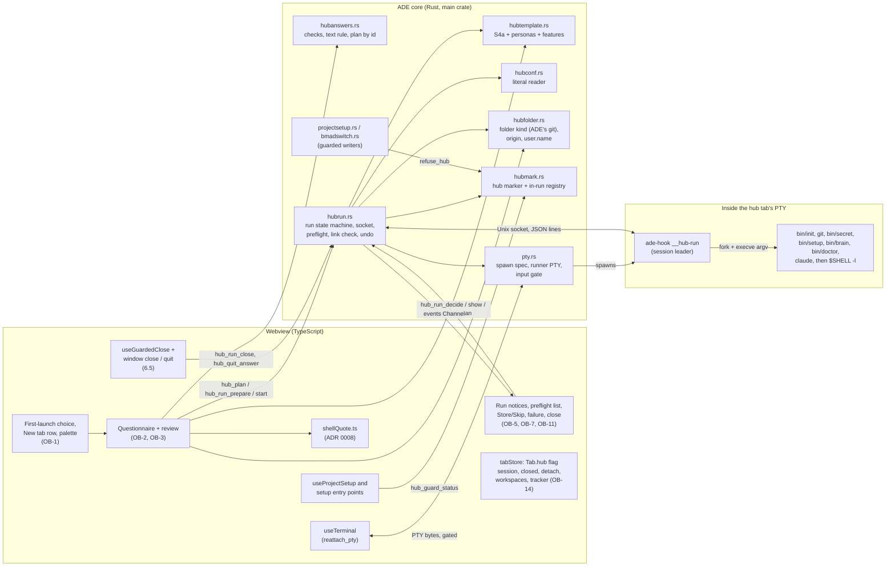
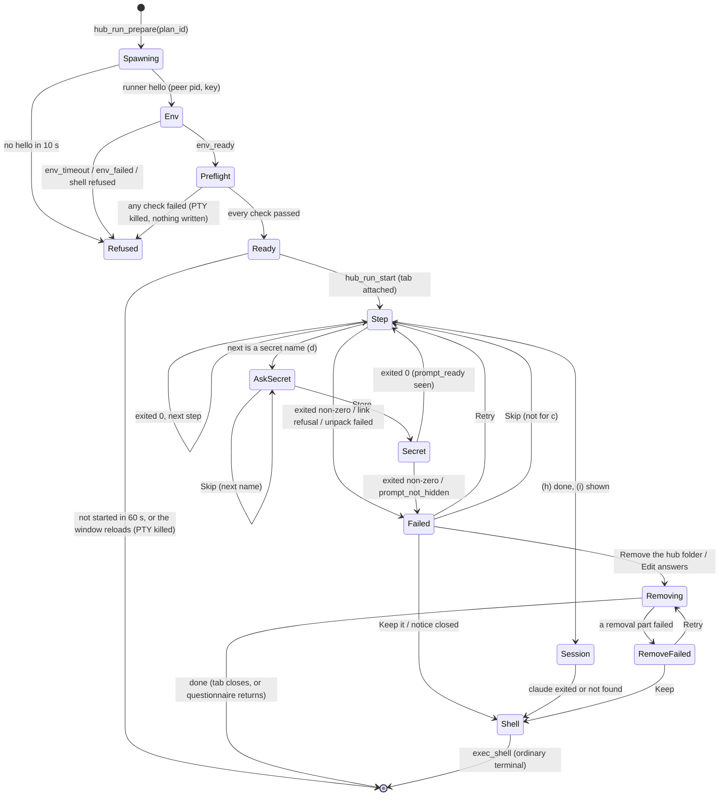
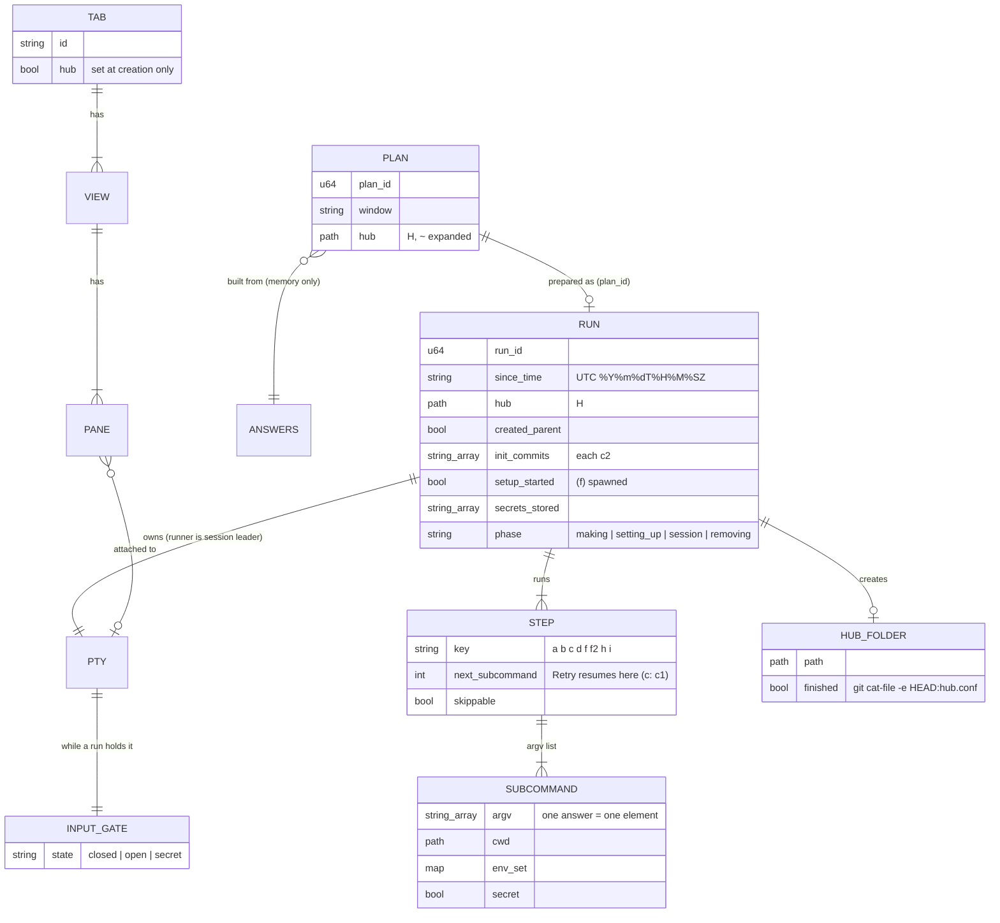

# Agentic-environment onboarding (F2): technical design

- **Status:** Proposed, revision 2 (2026-11-09). Revision 1 was blocked by the
  adversarial review (B1, M1 to M9, minors 1 to 11); section 15 maps every finding to
  its answer. Not yet approved.
- **Owner:** architect.
- **PRD:** `docs/prd.md` F2, approved by the owner 2026-11-09 (revision 4 + minors
  n1 to n6). This design adds nothing to F2's scope. Where F2 leaves a choice to the
  architect, the choice is made here and marked **(architect)**.
- **ADRs:** `0026-hub-setup-steps-run-under-a-runner-in-one-pty.md`,
  `0027-a-hub-tab-is-a-tab-flag-and-keeps-no-scrollback.md`,
  `0028-project-setup-refuses-hubs-at-its-two-writers.md`,
  `0029-a-finished-hub-is-judged-by-head-with-ades-own-git.md` (new in revision 2).
- **Contracts:** `.ade/context/hub-onboarding.md` (new),
  `.ade/context/remote-tabs.md` (new; the relay's tab entries and the hub-tab mask,
  shared with phone-watch story 8).
- **UX:** `docs/superpowers/specs/2026-11-09-onboarding-ux.md` (PR #102). Section 11
  lists what this design gives each of the UX spec's needs (its section 14).
- **Builds on:** the bundling plan (PR #91, ADR 0025, `bundled-sources.md`: S2's
  tarball and archiver, S3's release jobs, S4a's `hub_template_info` and
  `hub_template_create`); sub-terminals (`terminal-open.md`, ADR 0014; story 9's
  `shellQuote.ts`, ADR 0008); the PTY layer (`pty.rs`, `ptysink.rs`,
  `useTerminal.ts`); project setup (`projectsetup.rs`, `bmadswitch.rs`,
  `useProjectSetup.ts`); the session and sync (`tabStore.ts`, `persistence.ts`,
  `sync.rs`); the close guard (`useGuardedClose.ts`); git (`git.rs`); the
  relay-pairing design (story 8, not built).
- **Naming rule (owner, Q12):** the template is "the agent hub template"; this
  document names no private repository, commit or pull request of it. Script and
  folder names (`bin/init`, `personas/`, …) are the interface ADE runs and ships, so
  they are named.

## 1. What has to be true

F2 asks ADE to collect answers, then run the bundled template's own scripts in a
visible tab, so that the result is byte-for-byte the hub the CLI makes (G2), no
answer passes through a shell (OB-4 AC6), no secret value is kept (G4), and the hub
tab leaves nothing of its content in ADE's stores (OB-14). The hard parts, in the
order this design settles them:

1. **The step runner** (section 4): run argument vectors one after another in **one**
   terminal, with a login shell's environment, observe each exit status, pause for
   the developer's decisions, keep typed input away from the wrong program, then hand
   the terminal to Claude Code and finally to a login shell. ADR 0026.
2. **The gates** (section 5): the preflight, reported check by check; the git
   identity in the steps' environment; the memory-link check, run twice.
3. **Failure and undo** (section 6): Retry and Skip per step, idempotency, Remove
   with T4 detection, the Trash; what a "finished hub" is (ADR 0029).
4. **Closing, quitting and moving a running hub tab** (section 6.5).
5. **OB-13** (section 7): project setup refuses a hub. ADR 0028.
6. **OB-14** (section 8): the hub-tab flag. ADR 0027, `remote-tabs.md`.
7. **The persona list** (section 3.2), **the fixture and the gates** (section 10).

## 2. Where things stand (origin/main 90f4f6f, 2026-11-09)

- `create_pty(rows, cols, cwd, on_event)` (`pty.rs:123`) always spawns
  `$SHELL -l` (`platform::shell_from`) with `TERM`, `HOME`, `USER`, `PATH`, `LANG`,
  the default locale, the Vault's variables and the four `ADE_*` variables, whose
  token is per PTY id (`AgentStatus::terminal_env`). There is no way to start a pane
  with a given program; `PtyEvent::Exit {}` carries no status. A pane whose `ptyId`
  is already set attaches with `reattach_pty` (`useTerminal.ts:428-446`, used today
  for detached windows); an unattached `Sink` keeps 1 MB of backlog
  (`ptysink.rs:17`). `write_pty` (`pty.rs:277`) is the only path from a pane's
  keystrokes to the PTY's input.
- portable-pty's spawn makes the child a session leader on the PTY (`setsid`). On
  macOS the controlling terminal is revoked when a session leader exits, so **one
  PTY cannot be reused for a sequence of session leaders** (one per step) without
  risking `EIO` on the master and on any slave descriptor ADE holds. This is why
  section 4 keeps one process as session leader for the whole run.
- `pty_foreground_job` (`pty.rs:522`) classifies the foreground group's leader
  against the PTY's first process: when the leader **is** that process the pane is
  idle. Under the runner (section 4) that means a run between steps looks idle and a
  run during a step looks busy with the step's program name, so the close guard
  cannot rely on it for a hub tab (section 6.5).
- `ade-hook` (`src-tauri/ade-hook`, a workspace member) is the agent-status helper,
  the command guard and, since story 4c, the `ade` CLI; `ade_cli::dispatch` picks
  the mode. It shares source with the main crate by `#[path]`. **Its binary has
  integration tests:** `src-tauri/ade-hook/tests/dispatch.rs` runs the built binary
  (`env!("CARGO_BIN_EXE_ade-hook")`), and both `ci.yml` backend jobs run
  `cargo test --locked -p ade-hook --test dispatch` after the root `cargo test`
  ("Helper binary tests"). `cargo test -p ade-hook` as a whole is green since 4c.
  None of the six verification lines runs them; CI does. (Revision 1 said these
  tests could not run; that was stale.)
- `git.rs` runs `git` from ADE's own process for the slop check and the switch,
  with a 10 s limit and pipes read on threads; `sync.rs`, `usage.rs` and
  `projectsetup.rs` also call `git` directly. So ADE already runs its own `git`.
- `shellQuote.ts` (ADR 0008) arrives with sub-terminals story 9 (branch
  `st9-typed-command`). F2's slice 1 needs it; if story 9 has not merged, the first
  F2 story that shows a command takes its three files unchanged, as story 9 did.
- Project setup writes only through `project_setup_apply` (`set_up`,
  `projectsetup.rs:708`) and `bmad_switch_apply` (`bmadswitch.rs:1958`); no hub or
  folder exclusion exists. `refuse_unfinished` (`projectsetup.rs:731`) is the
  pattern for a Rust-side refusal.
- A `Tab` has no flags field. Scrollback is captured in `saveSession`
  (`tabStore.ts:749-758`); closed tabs (`ClosedTab`), detached tabs (`SerializedTab`),
  Duplicate (`TabBar.tsx:139`) and workspaces (`WorkspacePreset.tabs`, names only,
  **no folder**) each copy a subset of the tab. The agent tracker stores `cwd` and is
  synced (`SHARED_KEYS`). Nothing relays tabs to a phone yet.
- Closing: `useGuardedClose` handles the tab (×, context Close, ⌘W), "Close Others"
  and "Close Tabs to the Right" (`request-close-tabs`, one confirm), the pane
  (`request-close-pane`; a tab's last pane is never closed) and the sub-terminal
  (`request-close-view`). The window's `onCloseRequested` (`App.tsx:129`) saves and
  destroys the window without asking. The Rust side has no `ExitRequested` handler.
  "Move to New Window" (`TabBar.tsx`, `detachTabToWindow`) is hidden for a tab with
  sub-terminals and kills the source panes' PTYs after the new window attaches.

## 3. Components



### 3.1 Modules (new unless marked)

| Module | Holds | Tested by |
|---|---|---|
| `src-tauri/src/hubtemplate.rs` (S4a; F2 adds two functions) | `hub_template_personas`, `hub_template_features` (3.2) | Rust unit tests on fixture tarballs |
| `src-tauri/src/hubanswers.rs` | `Answers`, every OB-3 AC2 check, F1's text rule, the derived hub name, `~` expansion, the **plan** (each step's argv) kept in `HubPlans` behind a `plan_id` | Rust unit tests; the parity table (10.3) |
| `src-tauri/src/textrule.rs` | F2.5's text rule (Cc and Cf, 1 to 80 code points after trim); shared with F1 if F1's lands first (then F2 uses F1's and this file is not added) | Rust unit tests incl. U+202E, U+200B, U+FEFF, U+E0001 |
| `src-tauri/src/hubconf.rs` | OB-6 AC2's literal reader of `hub.conf` (6.6) | Rust unit tests |
| `src-tauri/src/hubfolder.rs` | `hub_folder_kind` (ADR 0029), `hub_existing_info`, `hub_repo_origin`, `hub_git_user_name`; all through ADE's own `git` after the Command Line Tools check | Rust unit tests with temp repos |
| `src-tauri/src/hubmark.rs` | OB-13's marker, the in-run registry, `hub_guard_status` | Rust unit tests; setup e2e |
| `src-tauri/src/hubrun.rs` | the run's state machine, the socket server, preflight, link check, undo, Trash, the input gate's state, quit handling | Rust tests with a real PTY and fixture template (macOS) |
| `src-tauri/src/hubrun_proto.rs` | the runner protocol's message types and the env frame format; `#[path]`-shared with `ade-hook` and with `ade-hook/tests/hubrun.rs` | Rust unit tests (serde round trips, frame codec) |
| `src-tauri/src/hubrun_child.rs` | the runner's loop (`__hub-run`), the foreground procedure, env capture (`__hub-env`); `#[path]`-shared into `ade-hook` | `cargo test -p ade-hook --test hubrun` (the built binary, 4.9); its pure parts also in the main crate |
| `src-tauri/ade-hook/tests/hubrun.rs` | the runner's integration tests (4.9) | CI `backend-macos` step |
| `src-tauri/src/ade_cli.rs` (changed) | `dispatch` gains `Action::HubRun` and `Action::HubEnv` | existing `ade_cli` and `dispatch` tests + new |
| `src-tauri/src/pty.rs` (changed) | `terminal_spawn_spec()` extracted from `create_pty`; `spawn_runner_pty`; `PtyInstance.input_gate` consulted by `write_pty` | existing tests + new |
| `src/lib/hubOnboarding.ts` | invoke wrappers, the shown commands (`shellQuote` over the plan's argv), `focusHubPrompt(tabId)` | vitest |
| `src/stores/hubRunStore.ts` | run state per tab (phase, notices, preflight list) | vitest |
| `src/components/onboarding/*` | the choice, questionnaire, review, notices (the designer's screens) | vitest (RTL), OB-11 |
| `src/hooks/useGuardedClose.ts`, `src/App.tsx` (changed) | the hub-run close rule on every path (6.5) | vitest |
| `src/stores/tabStore.ts`, `src/lib/tabDisplay.ts`, `src/lib/detachWindow.ts`, `src/components/TabBar.tsx`, `src/components/SettingsPanel.tsx`, `src/stores/settingsStore.ts`, `src/stores/agentTrackerStore.ts` (changed) | the hub-tab flag (section 8); Move to New Window refused during a run (6.5) | vitest |
| `src/lib/remoteTabs.ts` | `remoteTabEntry(tab)` with the mask (story 8 calls it) | vitest |

All of F2's Rust commands return an error off macOS, and the UI never offers F2 there
(OB-1 AC9). The modules compile on every platform so CI's Linux and Windows jobs
still build.

### 3.2 The persona list and the template's features from the tarball

`hub_template_personas() -> Vec<Persona>` reads the bundled tarball **without
unpacking it** (F2.8's new capability): it verifies the tarball's sha256 against the
manifest (S4a's rule), streams the entries, and for every regular file at
`personas/<slug>.md` (top level of `personas/` only; `<slug>` matching
`^[a-z0-9][a-z0-9-]*$`) parses the front matter **as `bin/init`'s `fm()` does**: the
lines between the first and second `---` lines, a key being the text before the
first `": "` and the value everything after it. `Persona { slug, title, model,
folders, briefing_focus }`; a persona without `title` keeps its slug as the title
(as `bin/init --list` prints an empty title). Sorted by slug, as the shell glob.
Cached for the launch (the tarball cannot change while ADE runs). Entries over
64 KiB are skipped. Errors (`sha_mismatch`, `unreadable`) are returned as such, so
the questionnaire shows its failure state.

`hub_template_features() -> { unlink_since: bool }` reads `bin/setup` from the
same tarball. **T4 is present** when `bin/setup` holds a line that, with trailing
white space removed, is exactly:

```
#   bin/setup --unlink --since <stamp>
```

(a `#`, three spaces, then that text). **(architect)** An exact line, not a loose
"mentions both flags" match, because a false positive would run
`bin/setup --unlink --since …` against a `bin/setup` that may ignore unknown
arguments and **set up** instead of undoing. A template whose T4 lacks the line is
treated as without T4, which is safe (the manual list, 6.4). Two asks go to the
template's backlog (recorded in `hub-onboarding.md`): keep that exact usage line
with T4, and make `bin/setup` refuse an unknown argument (exit 2, nothing done), so
no misread flag can ever set up. Running `bin/setup --help` is not an option: today's
`bin/setup` has no `--help` and would set up.

At undo time (6.4) the same test is applied to the **hub's own** `bin/setup` on
disk, which is the copy that runs.

## 4. The step runner (ADR 0026)

### 4.1 Shape

The hub tab's PTY is spawned by Rust with **`ade-hook __hub-run`** as its program
(not the shell). The runner is the PTY's session leader for the whole run. It:

1. starts the developer's login shell once, interactively, in the terminal's
   foreground, only to **capture the environment** it produces (4.3);
2. waits on a Unix socket for instructions from ADE and runs each step as **its own
   child, started from an argument vector** with that environment, in the
   foreground of the terminal, and reports the exit status (4.4);
3. finally **`execve`s the developer's login shell** in the hub folder with the
   environment a new terminal gets, so the tab becomes an ordinary terminal with the
   same PTY id, token and agent status (4.6).

The runner is dumb: every argv, cwd, environment change, line to print, shell to
capture and timeout comes from ADE. All policy (the plan, the gates, the decisions)
is in `hubrun.rs`.

Why a runner and not the shell: the PRD forbids typing into an interactive shell
(OB-4 AC6). Why not one PTY per step: the PTY id would change at each step (the
persona session's `ADE_PTY_ID` would not be the tab's), the controlling terminal is
revoked between session leaders (section 2), and every step would pay the start-up
files again. Why `ade-hook`: it is already shipped, signed and on `ADE_HOOK_BIN`, and
it has no GUI; a hidden verb costs nothing.

### 4.2 Spawning and the socket (`pty.rs`, `hubrun.rs`)

`create_pty`'s environment and shell selection move into one function,
`terminal_spawn_spec(app, agent, id) -> SpawnSpec { program, args, env, cwd }`,
which `create_pty` keeps calling. ADR 0021's shell integration (F1), when it lands,
changes this one function, and the runner follows it automatically (4.3, 4.6).

`spawn_runner_pty(app, state, agent, rows, cols, window_label) -> (pty_id, child_pid,
Listener)`:

- reserves the id (`reserve_id`) and builds the spec as for a terminal;
- **requires** `agent.terminal_env(id)` to be `Some` (the helper and the hook port
  exist). Without them the preflight's `helper` check fails (5.1) because OB-4 AC6
  promises the four `ADE_*` variables;
- creates the socket folder **exclusively**: `mkdir(2)` (never `create_dir_all`) of
  `$TMPDIR/ade-hub-<16 random hex>` with mode 0700; `EEXIST` → a new random name, at
  most 3 tries; then `lstat` must show a directory (not a symbolic link) owned by
  `getuid()` with mode 0700, else the folder is left alone and the `helper` check
  fails. The socket is `<folder>/s`. **`sun_path` limit:** when that path is longer
  than 103 bytes (macOS's `sun_path` is 104 with the NUL), the folder is made under
  `/private/tmp` instead, by the same exclusive rule (macOS's `$TMPDIR` is about
  49 bytes, so this is only for an unusual `TMPDIR`);
- program `ADE_HOOK_BIN` (the helper's absolute path), args `["__hub-run"]`, cwd the
  developer's `HOME` (the hub folder does not exist yet), env = the terminal's env
  plus `ADE_HUB_RUN=<socket path>` and `ADE_HUB_RUN_KEY=<64 hex, random per run>`;
- registers a `PtyInstance` with an **unattached** sink, the calling window as owner
  (story 4a's field) and an `input_gate` (4.5), exactly as a terminal otherwise, so
  `reattach_pty`, `kill_pty`, `get_pty_cwd`, `pty_foreground_job` and agent status
  work unchanged.

**Accepting the runner.** On each accepted connection ADE reads the peer's pid with
`getsockopt(LOCAL_PEERPID)`; a peer that is not `child_pid` (the PTY's first process)
is closed at once and ADE keeps listening. The first message must be
`hello { key }`, compared with the run's key in constant time; a wrong key closes
that connection. **The hello timeout:** with no accepted `hello` within **10 s** of
the spawn, the PTY is killed, the folder removed, and the `helper` check fails ("the
setup helper did not start; restart Better Terminal"). On the accepted `hello`, ADE
unlinks the socket and removes its folder. Nothing else listens.

The runner removes `ADE_HUB_RUN` and `ADE_HUB_RUN_KEY` from its own environment
before starting any thread, and they reach nothing it starts. At start it also marks
every inherited descriptor above 2 close-on-exec (by listing `/dev/fd`), and opens
everything of its own (socket, pipes) close-on-exec, so a step, a probe and the final
shell receive exactly fds 0, 1 and 2 (plus the env fd for the env shell only, 4.3).

`ade_cli::dispatch` gains two arms before hook mode: `args[0] == "__hub-run"`
**and** `ADE_HUB_RUN` set → `Action::HubRun`; `args[0] == "__hub-env"` and
`ADE_HUB_ENV_FD` set → `Action::HubEnv`. Neither verb is listed by `ade help`,
neither changes story 9's `capabilities:` line, and both are refused (exit 2,
nothing done) when their variable is missing. `ade-hook` gains `libc = "0.2"`
(already locked by the main crate).

### 4.3 The steps' environment (OB-4 AC6)

After the `hello`, ADE checks the spec's program (Q-A1, answered: **refuse**): its
basename must be one of `sh`, `bash`, `zsh`, `ksh`, `dash`, `fish`, else the
`login_shell` check fails naming the shell and the six supported ones, with the fix
`chsh -s /bin/zsh`. Then ADE sends `capture_env { program, args, timeout_ms: 30000 }`
(the `SpawnSpec`'s program and args, today `$SHELL -l`).

The runner then starts **the developer's login shell as a new terminal starts it**
plus `-i -c 'exec "$ADE_HOOK_BIN" __hub-env'`:

- **Under the foreground procedure** (4.4): its own process group, made the
  terminal's foreground, signals and mask reset, input flushed; the runner takes the
  foreground back when it ends. An interactive shell that is not in the foreground
  would stop itself on its first terminal access.
- **The env fd is 57** (`ENV_FD`), the write end of a pipe, dup'd in the child with
  `ADE_HUB_ENV_FD=57` set. **(architect)** Not fd 3: descriptors 0 to 9 are the
  ones start-up files redirect (`exec 3>…` is common), and bash and zsh place their
  own private descriptors at the lowest **free** number from 10, so an open 57 is
  never taken by them. The read end is close-on-exec.
- The shell reads its login and interactive start-up files (for zsh `~/.zshenv`,
  `~/.zprofile`, `~/.zshrc`, `~/.zlogin`), then replaces itself with
  `ade-hook __hub-env`, which checks that fd 57 is a pipe (`fstat`, `S_ISFIFO`),
  writes its environment as **framed data** and exits 0:
  - the magic `ADEENV1\n`; then per variable a 4-byte big-endian length and the
    `NAME=value` bytes; then a 4-byte zero length as the terminator. Values may hold
    newlines; nothing is parsed by separators.
- The runner **reads the pipe on its own thread while it waits**, so an environment
  over the pipe's 64 KiB buffer cannot deadlock `__hub-env`; the frame is capped at
  4 MiB (over → `env_failed { too_large }`).
- **The end is `__hub-env`'s exit, not EOF.** The runner `waitpid`s the shell's pid
  (which became `__hub-env`): exit 0 **and** a complete frame up to the terminator →
  the map is accepted. A background process the start-up files left (an agent, a
  daemon) may hold the write end open forever, so EOF is never waited for: after the
  exit the reader gets 1 s to finish the frame already in the pipe, then stops;
  anything after the terminator is ignored. Exit non-zero, a signal, or no
  terminator → `env_failed { shell_ended { code | signal } }`.
- **Dropped from the map:** `PWD`, `OLDPWD`, `SHLVL`, `_` (they describe the env
  shell, not a step), and `ADE_HUB_ENV_FD`, `ADE_HUB_RUN`, `ADE_HUB_RUN_KEY`. Each
  `run` and `probe` sets `PWD` to its own cwd, as a shell does before `exec`.
- The `-c` string is a constant; no answer is in it. `exec "$X" word` means the same
  in the six shells.
- The environment passes through a pipe in memory, never a file: it holds the
  Vault's variables and `ADE_HOOK_TOKEN`.
- Start-up output (banners, a framework's update question) appears in the tab, as
  in a new terminal (the PTY is still hidden; its backlog is shown when the tab
  opens). If `__hub-env` has not exited within **30 s**, the runner kills the env
  shell's process group (`SIGKILL`) and sends `env_timeout`; the `env` check fails
  with "your shell's start-up files did not finish within 30 seconds (they may be
  waiting for input); open a terminal to see what they ask".
- The identity check (5.3) and every probe run in this same environment, so it is
  literally the environment of step (c), with one deliberate exception: the git
  variables that point git at another repository are removed (4.4, M7).

### 4.4 Running a step: the foreground procedure

The runner saves the terminal's settings once at start (`tcgetattr`, the **cooked**
settings: canonical, echo on). Between children it is **holding**: it owns the
foreground and the terminal's echo is **off** (the cooked settings with `ECHO`
cleared), so nothing typed while a notice waits is shown, and ADE's input gate is
closed (4.5).

For `run { id, argv, cwd, env_set, env_unset, secret: bool }` (and for the env shell
of 4.3) the runner:

1. prints nothing itself (ADE sends a separate `print` with the shown command first,
   so the order of lines and output is the order of bytes on the PTY);
2. **flushes pending input** (`tcflush(0, TCIFLUSH)`), so nothing typed earlier
   reaches the step, then sets the terminal to the cooked settings (echo on);
3. forks a child with `std::process::Command` (`argv[0]` resolved through the
   steps' `PATH` when it has no `/`, as `execvp`; `bin/init` with a `/` is relative
   to `cwd`), environment = steps' environment, then the **always-removed git
   variables** (`GIT_DIR`, `GIT_WORK_TREE`, `GIT_INDEX_FILE`,
   `GIT_OBJECT_DIRECTORY`, `GIT_ALTERNATE_OBJECT_DIRECTORIES`, `GIT_COMMON_DIR`,
   `GIT_NAMESPACE`, `GIT_CEILING_DIRECTORIES`, `GIT_DISCOVERY_ACROSS_FILESYSTEM`)
   removed, then `env_unset` removed and `env_set` applied, and `PWD=<cwd>`. In
   `pre_exec`: `setpgid(0, 0)`; `tcsetpgrp(0, getpid())` (`SIGTTOU` is still ignored
   here, inherited); then **every signal's disposition set to `SIG_DFL`** (1 to
   `NSIG - 1`, except `SIGKILL` and `SIGSTOP`) and **the signal mask cleared**
   (`sigprocmask(SIG_SETMASK, ∅)`). The runner also calls `setpgid(child, child)`
   and `tcsetpgrp(0, child)` after the fork (both sides, as a shell does, so
   neither order races);
4. `waitpid(pid, WUNTRACED)` in a loop. A child stopped by Ctrl-Z (or `SIGTTIN`)
   gets **`killpg(pgid, SIGCONT)`** (the whole group: a script's own children
   stopped with it) and `tcsetpgrp(0, pgid)` again: a run has no job control;
5. on exit: takes the foreground back (`tcsetpgrp(0, own pgrp)`), flushes pending
   input, sets the holding settings (cooked with echo off, which also repairs a
   step killed in raw mode), and sends `exited { id, code | signal | spawn_error }`.
   `spawn_error` is `not_found` for `ENOENT` and the `errno` text otherwise.

The runner ignores `SIGINT`, `SIGQUIT`, `SIGTSTP`, `SIGTTIN` and `SIGTTOU` for its
own life (as `system(3)` does), so Ctrl-C reaches the step and not the runner;
because dispositions and the mask are reset in every child (step 3) and before the
final `execve` (4.6), nothing the runner ignores is inherited. `SIGHUP` (the tab
closed: `kill_pty` drops the master) is not ignored: the runner and the foreground
step both die, which is "closing stops the run" (OB-5 AC5).

Every answer reaches the program as exactly one `argv` element, byte for byte, with
no shell anywhere between ADE and `execve`; nothing is ever written to the PTY's
input by ADE, so **no shell history can hold an answer**. A text-rule value with
characters that cannot be typed (`Zoë 日本`, `C:\x\y`) is passed as it is.

**The git variables (M7).** A `GIT_DIR` or `GIT_WORK_TREE` exported by a start-up
file would point `git add -A` and `git commit` (c), `bin/init`'s `git init` and every
probe at another repository. They are removed for **every** step and probe. This is
the one place where a step's environment differs from the developer's shell, and
the CLI run by hand in such a shell would misbehave the same way; the removal makes
ADE's run safe, not different in result.

### 4.5 Secrets: what the terminal accepts and when (OB-7, M4)

`PtyInstance.input_gate` is consulted by `write_pty` for the hub tab's PTY:

| Gate | When | `write_pty` |
|---|---|---|
| **closed** | the runner is holding (preflight, notices, between steps), and a secret step before its prompt is ready | drops the bytes, except the signal characters `\x03` (Ctrl-C), `\x1c` (Ctrl-\\) and `\x1a` (Ctrl-Z), which pass |
| **open** | any non-secret step, (i), and after `exec_shell` (gate removed) | as today |
| **secret** | a secret step after `prompt_ready` | passes a write only when its sole line break, if any, is its last byte; a write with an inner `\r` or `\n` (a multi-line paste) is dropped whole and ADE emits `secret_paste_refused { name }` |

Bytes are dropped, never queued, so nothing typed early lands in a later program.

A Store runs `run { …, secret: true }` for `bin/secret --set <name>`. The runner
follows 4.4 (flush, cooked settings with echo **on**, fork) and then **polls
`tcgetattr` every 20 ms**: when `ECHO` is cleared while the step's group is the
foreground (`bin/secret`'s `read -rs` has started), it sends `prompt_ready { id }`.
ADE sets the gate to **secret** and emits `secret_prompt_ready { name, token }`; only
then does the webview tell the developer to type and call `focusHubPrompt(tabId)`.
While the gate was closed the echo state did not matter, because no byte reached the
terminal. If echo is not cleared within **15 s**, the runner sends
`prompt_not_hidden { id }`; ADE sends `stop` and the name fails with reason
`prompt_not_hidden` (Retry, Skip, Remove), so nobody is ever asked to type a secret
into an echoing terminal.

When `bin/secret` exits, the runner flushes input (a second pasted line, or keys
typed after Enter, are discarded, never passed to the next step or the shell) and
sets echo off; ADE closes the gate. Values are **single lines** (`read -r` reads
one), which the gate enforces for pastes.

ADE never sees the value except as bytes passing `write_pty` on their way to the
PTY, which ADE neither logs nor stores (G4); the tab's scrollback is never saved
(OB-14). T3's absence (`security -w <value>` visible to `ps`) is G4's stated limit.

### 4.6 Probes

`probe { id, argv, cwd, env_set, env_unset, stdin: bytes?, timeout_ms }` runs a
child the same way (environment and the always-removed git variables as 4.4, signals
and mask reset) but **not on the terminal**: stdin is the given bytes or
`/dev/null`, stdout and stderr are pipes read on threads (capped at 64 KiB and
16 KiB), it is its own process group, never the foreground, and it is killed
(`SIGKILL` to the group) at the timeout (default 30 s). The answer is `probed { id,
code | signal | spawn_error | timeout, stdout, stderr }`. Probes are how ADE asks
"in the steps' environment" without showing anything: `git --version`, the identity,
`which claude`, the memory-link facts (5.4), the Keychain service and the removal
facts (6.4). Nothing a probe prints reaches the tab.

### 4.7 The hand-over: Claude Code, then a login shell

- **(i) the persona session** is an ordinary `run` step: argv `[<claude command>]`,
  cwd the hub folder, `env_set CLAUDE_CONFIG_DIR=<HUB_CLAUDE_CONFIG_DIR>` when
  `hub.conf` holds a non-empty literal (OB-6 AC1), read by `hubconf.rs` (6.6). It
  inherits the four `ADE_*` variables of the tab's PTY, so the session's hooks report
  to agent status and `ade open` opens sub-terminals of this tab (OB-12). Before it
  runs, ADE emits `awaiting_shown { key: "i", token, env_set, argv }` and waits for
  `hub_run_show(run_id, token, text)` (the webview's `shellQuote`, 4.8), then prints
  that text.
- **The shown command for (i)** is `CLAUDE_CONFIG_DIR=` + `shellQuote(value)` + ` `
  + `shellQuote(argv)`: only the value is quoted, never the `NAME=` part, so the line
  is copyable in sh, bash, zsh, ksh and dash, and in fish 3.1 or later (fish before
  3.1 has no `NAME=value command` form; this is stated, not worked around). Without
  `HUB_CLAUDE_CONFIG_DIR` it is `shellQuote(argv)`.
- **The alias limit.** The Claude command is found through the steps' `PATH`, as
  `execvp` does; a shell alias or function named `claude` (for example
  `alias claude=~/.claude/local/claude`) is not seen, because no shell runs (4.4).
  The same holds for the preflight's `which claude` (an external program).
- **Claude not found has one source:** (i)'s `exited { spawn_error: not_found }`.
  ADE prints nothing of its own, emits `session_skipped { reason: claude_not_found
  { command } }` (the notice's words are the designer's and say an alias is not
  used), and goes on to the shell (OB-6 AC3). Nothing else (not the preflight's
  `which claude`, which only predicts the config folder) reports it.
- **The shell** is `exec_shell { program, args, cwd, env }`: ADE sends the
  `SpawnSpec` a **new terminal** would get (same program and args, the env with the
  same `ADE_*` values, since the PTY id is the same), with `cwd` the hub folder. The
  runner takes the foreground for its own group (its pid, which the shell keeps),
  flushes input, restores the cooked settings, **resets every signal disposition to
  `SIG_DFL` and clears the signal mask** (an ignored `SIGINT` survives `execve`, and
  a bash that starts with `SIGINT` ignored passes the ignore to every command it
  runs, so Ctrl-C would stop nothing), closes the socket and `execve`s it. The PID,
  PTY id and token stay; ADE removes the input gate; the tab is now an ordinary
  terminal in the hub folder (OB-4 AC6 "after the persona session exits"). The same
  message ends a run that stops at a failed step (Keep it, or the failure notice
  closed without Retry). Nothing is re-run.

### 4.8 The protocol

Newline-delimited JSON over the socket, types in `hubrun_proto.rs` (one source for
both binaries and the integration tests). ADE → runner: `capture_env { program,
args, timeout_ms }`, `chdir { path }`, `print { text }`, `run {…}`, `probe {…}`,
`exec_shell {…}`, `stop { grace_ms }` (send `SIGHUP` to the foreground step's group,
then `SIGKILL` after the grace, then wait for ADE's next message). Runner → ADE:
`hello { key }`, `env_ready { vars: { HOME, LANG, LC_ALL, LC_CTYPE, CLAUDE_HOME,
CLAUDE_CONFIG_DIR } }` (only these named values, never the whole map),
`env_timeout`, `env_failed { reason }`, `prompt_ready { id }`,
`prompt_not_hidden { id }`, `exited {…}`, `probed {…}`. Unknown messages are a
protocol error: the runner prints one line and execs the shell; ADE ends the run as
failed. Socket EOF on either side ends the run (ADE: the tab closed; runner: ADE
quit, so it execs the shell).

**`chdir`.** The runner's own working folder is `HOME` until the hub folder exists.
Right after (a) succeeds ADE sends `chdir { path: H }`, so between steps the PTY's
first process is in `H`: `get_pty_cwd`, the tab's folder, its tooltip and agent
status show the hub folder from then on.

### 4.9 Tests of the runner: the binary-level seam (M8)

`src-tauri/ade-hook/tests/hubrun.rs` runs the **built** helper
(`env!("CARGO_BIN_EXE_ade-hook")`), as `dispatch.rs` does, and plays ADE's part:

- it opens a PTY pair with `libc::openpty`, makes a socket folder and listener as
  4.2 does, and spawns the helper with args `["__hub-run"]`, `pre_exec` `setsid()`
  and `ioctl(TIOCSCTTY)` on the slave as fds 0 to 2 (what portable-pty does), env
  `ADE_HUB_RUN`, `ADE_HUB_RUN_KEY`, a temporary `HOME` holding the test's start-up
  files, and `PATH` with the test's stubs;
- it speaks the protocol with `hubrun_proto.rs`, included by `#[path]`;
- it reads the master to see what the terminal shows and writes it to type.

`ade-hook` gains `[dev-dependencies] libc = "0.2"`. The file is
`#![cfg(target_os = "macos")]` at the top, so other platforms compile it to no tests.
CI: `ci.yml`'s `backend-macos` job gains a step after "Helper binary tests",
`cargo test --locked -p ade-hook --test hubrun` (O6). Like `--test dispatch`, it is
not one of the six verification lines (open question Q-A5). The main crate keeps unit
tests of the pure parts (frame codec, message round trips, the gate's rules).

### 4.10 The run as ADE sees it



State lives only in `HubRuns` (memory). **No run is recorded on disk** (OB-5 AC5):
after a restart, the tab is an ordinary hub tab (section 8).

**Prepared but not started; reloads.** A run that passed the preflight waits for
`hub_run_start` at most 60 s (the window opens the tab at once); after that, or when
its window's webview (re)loads, ADE kills the hidden PTY and forgets the run.
Every window calls `hub_runs_reset(window)` when its webview starts: any run that
window owned is ended as **Keep** (a `stop`, then the PTY is killed; nothing is
removed, because no one was asked), and its registry entry is dropped. A reload in a
packaged build happens only by a crash of the webview, so this is the safe default,
not a flow.

The Tauri commands (shapes in `hub-onboarding.md`):

- `hub_check(answers) -> { errors[], derived_name, name_required }`: OB-3 AC2,
  pure, called as the developer types.
- `hub_folder_kind(path, intent: new | existing) -> FolderKind` (ADR 0029, 6.7):
  `missing_ok | parent_missing { name } | parent_not_folder { name } | not_absolute
  | not_a_folder | exists | finished | unfinished | not_hub | in_engagement { name }
  | tools_missing`. Called inline as the developer types, again by the preflight's
  `folder` check, and again at Open Hub.
- `hub_existing_info(path) -> { kind, checkouts: [path], claude: { command?,
  config_dir?, not_literal?: { line, key } } }`: an existing hub's facts **without
  sourcing `hub.conf`** (6.7), for the questionnaire's notice before Open Hub.
- `hub_git_user_name() -> string | null`: the "Your name" prefill (OB-3), from ADE's
  own `git config --global --get user.name` after the Command Line Tools check; null
  when the tools are missing or the value is empty. A prefill only: the preflight's
  identity check in the steps' environment is what decides (5.3).
- `hub_repo_origin(path) -> { root, repo: "owner/name" } | null`: OB-1 AC8's prefill.
  `git -C <path> rev-parse --show-toplevel`, then `git -C <root> config --get
  remote.origin.url`, parsed as GitHub only (`git@github.com:o/r(.git)`,
  `ssh://git@github.com/o/r(.git)`, `https://github.com/o/r(.git)`, with or without
  a trailing `/`); anything else → null. ADE's own `git`, after the tools check.
- `hub_plan(answers) -> { plan_id, folders_to_create, steps: [{ key, commands:
  [{ argv, cwd, env_set }] }], memory_checkouts, t4 }`: the plan is **kept in Rust**
  (`HubPlans`, one per window, replaced by the next `hub_plan`, dropped by
  `hub_plan_drop(plan_id)` when the questionnaire closes and when its run ends). The
  review shows `shellQuote(argv)` for each (OB-3 AC3). `hub_run_prepare` takes the
  **`plan_id`**, so the webview cannot change what runs: the listed commands are the
  executed ones (test: O7).
- `hub_run_prepare(plan_id, rows, cols, on_event) -> { run_id, pty_id } |
  { failed: [CheckResult] }`: spawns the runner PTY **hidden** and runs the
  preflight (5), reporting each check as it goes (`preflight_check`). On failure the
  PTY is killed and nothing is shown or written.
- `hub_run_start(run_id, shown: string[])`: after the window has opened the hub tab
  with `pty_id` and attached (`reattach_pty` flushes the backlog: the start-up
  output). `shown[i]` is `shellQuote` of the plan's argv from the webview, checked
  for count; it is display only.
- `hub_run_show(run_id, token, text)`: the shown line for a command built during the
  run ((i), 4.7).
- `hub_run_decide(run_id, token, decision)`: `store | skip | retry | keep |
  edit_answers | remove`. A decision for a token that is no longer waiting is
  ignored.
- `hub_run_removal_plan(run_id) -> RemovalPlan` (6.4): what Remove will do and leave,
  computed **before** the confirmation is shown, and computed again when Remove is
  confirmed.
- `hub_run_close(run_id, choice: remove | keep)`: OB-5 AC5's answer (6.5).
- `hub_quit_answer(choice: remove | keep | cancel)` (6.5).
- `hub_runs_reset(window)` (above).
- `hub_open_existing(path, run_setup, rows, cols, on_event) -> { run_id, pty_id,
  steps } | { failed: [CheckResult] }` (6.7), then `hub_run_start`.

Events on `on_event` (all fields in `hub-onboarding.md`):

- `preflight_check { check, state: running | passed | failed | skipped, detail? }`
  (5.0).
- `step_started { key, index, count, name? }`, `step_ended { key, ok, skipped }`.
- `awaiting_secret { name, index, count, token }`, `secret_prompt_ready { name,
  token }`, `secret_paste_refused { name }`.
- `step_failed { key, token, options[], remove_unavailable?, reason }`; `reason` is
  one of `exit { code }`, `signal { name }`, `spawn_error { program, error }`,
  `unpack { message }` (a), `commit_check` (c3), `links_refused { refusals: [{ path,
  link, target, target_exists }] }` (f), `link_probe_failed { stderr }` (f),
  `secret { name, code }`, `prompt_not_hidden { name }`.
- `awaiting_shown { key, token, env_set, argv }`.
- `session_started`, `session_skipped { reason: claude_not_found { command } |
  hubconf_not_literal { line, key } }`.
- `removal_progress { part, state }`, `removal_failed { part: schedule | unlink |
  trash | parent, message, token, options: [retry, keep], left: RemovalPlan }`.
- `quit_requested { run_id, folder }` (6.5).
- `run_ended { how: session_ended | stopped_kept | removed | edit_answers |
  unpack_failed | closed | reset | failed { message } }`.

A hub tab is made **after** the preflight, so a failed preflight opens no tab and
records no first-launch answer (OB-1 AC1: "at the moment a tab opens").

### 4.11 Key flow

```mermaid
sequenceDiagram
  participant W as Webview (review step)
  participant R as hubrun.rs
  participant P as PTY (hidden, then the hub tab)
  participant X as ade-hook __hub-run
  participant S as login shell -l -i -c
  W->>R: hub_run_prepare(plan_id)
  R-->>W: preflight_check platform, template, clt (xcode-select -p, ADE's own process)
  R-->>W: preflight_check folder (hub_folder_kind), helper, login_shell
  R->>P: spawn ade-hook __hub-run (terminal env + ADE_HUB_RUN)
  P->>X: start (session leader)
  X->>R: hello{key} (LOCAL_PEERPID = child pid)
  R->>X: capture_env{program, args}
  X->>S: fork, own pgrp + foreground, fd 57 = pipe
  S->>S: ~/.zshenv .zprofile .zshrc .zlogin
  S->>X: exec ade-hook __hub-env, framed env on fd 57, exit 0
  X->>X: take foreground back, echo off
  X->>R: env_ready
  R->>X: probe git/python3 --version, git config user.name/email, git var, which claude, sed
  X->>R: probed...
  R-->>W: preflight_check env, tools, identity, links
  R-->>W: ready{run_id, pty_id}
  W->>W: open hub tab "Agent hub", pane.ptyId = pty_id (reattach)
  W->>R: hub_run_start(run_id, shown[])
  R->>R: since-time = now UTC; registry += hub folder
  R->>R: (a) hub_template_create (+ parent)
  R->>X: chdir H, print "(a) line"
  loop steps (b)..(h)
    R->>X: print shown[i]
    R->>X: run{argv, cwd}
    X->>X: flush, fork, setpgid, tcsetpgrp, reset signals, execve
    X->>R: exited{code}
    R-->>W: step_ended / step_failed / awaiting_secret
  end
  R-->>W: awaiting_shown (i)
  W->>R: hub_run_show(text)
  R->>X: print text, run{claude} (i)
  X->>R: exited
  R->>X: exec_shell{$SHELL -l, hub folder}
  X->>X: reset signals and mask, execve login shell (same PID, same PTY id)
```

## 5. The gates

### 5.0 Reporting: every check, not the first failure

All checks run in `hub_run_prepare` in this order. Each is reported as it starts and
ends with `preflight_check { check, state, detail }`, and the failure result lists
**every** check. A check is `skipped { because: <check> }` only when it cannot run
without an earlier one; otherwise every check runs even after a failure, so the
developer sees all that is wrong at once (UX §14.2).

| Check | Runs | Skipped when | `detail` on failure |
|---|---|---|---|
| `platform` | always | (UI never offers F2 off macOS) | — |
| `template` | always | — | `{ missing }` |
| `clt` | always | — | `{ fix: "xcode-select --install" }`; **stops the rest** (every later check is skipped), because the stubs open the install dialog |
| `folder` | after `clt` | `clt` failed | `{ kind: FolderKind }` (`hub_folder_kind(H, new)` again: the folder may have appeared since the questionnaire checked it) |
| `helper` | after `clt` | `clt` failed | `{ reason: not_available | did_not_start | socket }` |
| `login_shell` | after `helper` | `helper` failed | `{ shell, supported: ["sh","bash","zsh","ksh","dash","fish"], fix: "chsh -s /bin/zsh" }` |
| `env` | after `login_shell` | `helper` or `login_shell` failed | `{ reason: timeout { seconds: 30 } | shell_ended { code | signal } | too_large }` |
| `tools` | after `env` | `env` failed | `{ missing: ["git" | "python3"], failed: [{ program, stderr }] }` |
| `identity` | after `env` | `env` or `tools` (git) failed | `{ missing: ["user.name" | "user.email"], git_var_stderr?, limit: true }` |
| `links` | after `env` | `env` failed | `{ refused: [{ path, link, target, target_exists }] } | { probe_failed: stderr }` |

Every failure names what is missing and how to fix it, writes nothing (the hidden PTY
is killed; the socket folder removed) and keeps the answers (OB-4 AC2).

### 5.1 Before any shell

1. macOS, and `hub_template_info()` is not `None` (OB-1 AC10).
2. **The Command Line Tools:** `/usr/bin/xcode-select -p` run by ADE's own process
   (absolute path, no shell, stdin `/dev/null`, 10 s), **before** the runner is
   spawned and before any `git` of ADE's own (6.7), because the developer's start-up
   files may call `git` and the stubs open the install dialog. Non-zero → "the
   Command Line Tools are not installed: run `xcode-select --install`". No `git` or
   `python3` has started (test: a fake `xcode-select` seam returning 2 and a `PATH`
   whose `git` and `python3` record calls). The result is cached for the launch once
   it is 0.
3. **The folder** (OB-2 AC3, AC4, F2.13): `hub_folder_kind(H, new)` must be
   `missing_ok` or `parent_missing` (only the parent missing: one level), and not
   inside an engagement (F1 flag on).
4. The helper is available and the runner says `hello` (4.2); the login shell is one
   of the six (4.3).

### 5.2 In the steps' environment

5. The runner reports `env_ready` within 30 s (4.3).
6. `git --version` and `python3 --version` exit 0 as probes; `spawn_error:
   not_found` names the program.

### 5.3 The git identity (OB-4 AC2)

Two probes, `git config --get user.name` and `git config --get user.email`, with:

- **cwd `/`**, so no enclosing repository's local config can apply, and the git
  variables removed (4.4) so none can point git at one; git then reads exactly the
  system and global files and their unconditional includes;
- the steps' environment, so `HOME`, `XDG_CONFIG_HOME` and `GIT_CONFIG_GLOBAL`
  set by start-up files apply, as for step (c).

Each passes when it exits 0 **and** its stdout, without the trailing newline, is not
empty. The failure message names the missing key(s), gives the two
`git config --global` commands, and **always** states the limit: "an identity set
only by `includeIf "gitdir:…"` for the hub's folder is not seen, because the hub does
not exist yet". The parent folder and ancestors are never consulted.

**`git var` (minor 6, considered).** `git var GIT_AUTHOR_IDENT` and
`GIT_COMMITTER_IDENT` resolve the identity exactly as `git commit` will (with
`GIT_AUTHOR_*`/`GIT_COMMITTER_*`/`EMAIL` variables and auto-detection). They do
**not** replace the config check, because OB-4 AC2 defines the gate as `user.name`
and `user.email` having values, and `git var` accepts an auto-detected identity (for
example `dana@macbook.local`) that the PRD refuses. **(architect)** They are added as
a second, stricter check in the same probe environment: when the config keys pass but
either `git var` exits non-zero (for example a start-up file exports an empty
`GIT_AUTHOR_NAME`), the identity check fails with git's own message
(`git_var_stderr`), because (c) would certainly fail and (c) cannot be skipped.

### 5.4 The memory-link check (OB-4 AC2; run twice)

One function, `check_links(config_dir, paths, hub) -> Ok | Refused[{path, link,
target, target_exists}]`: for each path, `entry = <config_dir>/projects/<encoded
path>/memory`; `lstat(entry)`; when it is a symbolic link, its target (`readlink`,
made absolute against the link's folder when relative, normalised lexically) is
**outside `hub`** (not `hub` and not under `hub/`) → refused. A real folder, a
missing entry, or a link into `hub` passes. The refusal carries, per path, the path,
the link, its target and whether the target exists; the UX's message gives the ways
on of OB-4 AC2, including `rm <entry>` with the full path.

**The encoding** is not reimplemented: each path is encoded by a probe that runs
`sed 's/[^A-Za-z0-9]/-/g'` (resolved through the steps' `PATH`, so a GNU `sed` in
`PATH` is used if `bin/setup` would use it) with the path on stdin, in the steps'
environment and locale, and the one trailing newline removed. That is what
`encode_path` does (`printf '%s' "$1" | sed …` inside `$(…)`).

The two runs differ in where the inputs come from:

| | **At the preflight** (predicted, before anything exists) | **Just before (f)** and before OB-2 AC2's `bin/setup` (actual) |
|---|---|---|
| config folder | `CLAUDE_HOME` from `env_ready` if set (as `claude_home` puts it first), else **`bin/init`'s rule**: `--claude-config-dir` (slice 2), else the `export CLAUDE_CONFIG_DIR=` line of the file `which <claude command>` finds when it is under 64 KiB (with `${HOME}`, `$HOME` and a leading `~` replaced by the steps' `HOME`), else `<HOME>/.claude` | **the template's own code**: a probe **`/bin/bash`** `-c '<constant script>' _` in the hub folder, with `HUB=<hub>`, that sources `bin/lib.sh` (which reads `hub.conf`) and prints, NUL-separated, `claude_home`, then for the hub, each of `folders`, and each `repos_of` checkout, the path and its `encode_path` |
| paths | the hub folder; `<hub>/<f>` for each of the persona's `folders` (front matter; question 10 in slice 2); each question-7 checkout **as the plan expanded it** (4.10, `~` with ADE's `HOME`), kept only if it is an existing folder (as `repos_of`) | as printed by the probe |
| encoding | the `sed` probe above | as printed by the probe |

**`/bin/bash` (minor 11):** the absolute path, not `bash` through `PATH`, so a newer
bash earlier in `PATH` cannot change how the constant script runs; the template
targets Bash 3.2 or later (its guide), which `/bin/bash` is. The constant script is
fixed text in `hubrun.rs`; no answer is in it. The actual check uses the template's
own functions, so it is exact for whatever template is bundled; the predicted check
can only be wrong when the prediction is, and then the second check catches it and
**(f) fails with `links_refused` and `bin/setup` does not start** (OB-4 AC2 n4). The
second check also covers a link created after the preflight (the PRD's test with a
fixture `bin/secret` at (d)). The remaining window, between the second check and
`bin/setup`'s own `link()`, is the PRD's stated negligible one; T5 closes it in the
template.

If the actual probe fails (non-zero, or a `hub.conf` that `bin/lib.sh` cannot source)
(f) fails with `link_probe_failed { stderr }`; (f) is not started.

### 5.5 What the preflight does not do

It writes nothing: no folder, no file, no `ade-*` key, and no first-launch answer.
The only processes it starts are `xcode-select`, ADE's own `git` (the folder check),
the hidden runner, the login shell and the probes. The hidden PTY's backlog
(start-up output) is discarded with it.

## 6. The steps, Retry and Skip, and undo

### 6.1 The plan (slice 1)

`hub_plan` builds, from answers that passed `hub_check`, with `H` the hub folder
(absolute, `~` expanded with ADE's `HOME`, normalised lexically, no trailing `/`):

| Key | Sub-commands (argv; cwd `H` unless noted) | Retry | Skip |
|---|---|---|---|
| (a) | ADE: create the parent if missing (one `mkdir`, recorded), `hub_template_create(H)`, then `chdir H`; prints one line "Unpacked the agent hub template (<short ref>) into <H>" | no: (a) fails → `unpack` reason, OB-5 AC1 | no |
| (b) | `bin/init --persona <slug> --client <c> --owner <o> [--name <n>] [--secret <s>]… [--repo <r>]… --auto-sync off` | no (OB-5 AC2: Edit answers, Remove, Keep) | no |
| (c) | c1 `git add -A`; c2 `git commit -m "Initialize the hub"`; c3 `git ls-files --error-unmatch hub.conf`; after each c2 that exits 0, a probe `git rev-parse HEAD` records the commit for undo | see below | **never** |
| (d) | per name: `bin/secret --set <name>` (`secret: true`), after that name's Store | that name | that name |
| (f) | the link check (5.4, actual), then `bin/setup` | check again, then `bin/setup` | yes |
| (f2) | `bin/brain index` | yes | yes |
| (h) | `bin/doctor` (any exit counts as done; OB-4 AC4) | n/a | n/a |
| (i) | `<HUB_CLAUDE>` with `CLAUDE_CONFIG_DIR` (4.7) | n/a | n/a |

(e) and (g) are slice 2 and are absent from the plan until then. `--name` is passed
only when question 9 is answered. Repeated options keep the questionnaire's order.

**`~` in argv (recorded in `hub-onboarding.md`).** In the hub folder and in a
question-7 checkout (`owner/name=~/src/api` or `=~`), a leading `~` followed by `/`
or the end is replaced by ADE's `HOME` **when the plan is built**, so the argv
element is `acme/api=/Users/dana/src/api` and the review shows the expanded path.
`~user` is refused by `hub_check`. A start-up file that sets a different `HOME`
changes nothing already in the plan.

**Retry and idempotency (architect).** A step is a list of sub-commands and the run
records which have succeeded; Retry resumes at the first that has not, except (c):

- **(c)'s Retry always re-runs c1, then c2 only when something is staged** (a probe
  `git diff --cached --quiet` exits 1), then c3. Resuming at c3 alone would fail
  forever when c3 failed because the commit lacked `hub.conf` (for example a
  `.gitignore` that ignores it): the developer fixes the cause in the tab or
  elsewhere and presses Retry, and the fix is staged and committed. c2 never makes an
  empty commit, and a second commit exists only when the developer changed files
  after the first. The c3 notice's reason is `commit_check`, and its words say what
  usually causes it and that Retry stages and commits again; the manual command
  (`git add -A && git commit -m "Initialize the hub"`) is in the notice for a
  developer who prefers to do it by hand (UX).
- Each script step is safe to repeat as the template writes it: `bin/secret --set`
  uses `security -U` (replace); `bin/setup` answers `ok` for its own links and is
  preceded by the link check on every attempt; `bin/brain index` rebuilds its index.
  (e)'s Retry (slice 2) follows OB-5 AC3's rule and is designed with slice 2.

### 6.2 Failures (OB-5 AC1 to AC3)

- **(a)** fails → `step_failed { key: a, reason: unpack { message } }`, then
  `run_ended { how: unpack_failed }`: nothing is left (S4a's guarantee); a parent the
  run created is removed with `rmdir` (only if empty); the tab closes; the
  questionnaire returns with the answers kept.
- **(b)** fails → `bin/init`'s own stderr is in the tab; options **Edit answers**
  (confirm, then 6.4's removal, then the questionnaire with the answers kept;
  confirming the review again prepares a new run from (a)), **Remove the hub
  folder**, **Keep it**.
- **(c) to (h)** fail → options **Retry this step**, **Remove the hub folder** (only
  when 6.4 offers it; otherwise `remove_unavailable` says why), and **Skip it**
  except for (c).
- The runner and its PTY stay alive while a notice waits; nothing has a time limit
  (OB-11 AC5).

### 6.3 Secrets (OB-7)

Before each name, ADE emits `awaiting_secret { name, index, count, token }` and runs
nothing. **Store** → `print` then `run bin/secret --set <name>` with `secret: true`;
the terminal accepts nothing until `bin/secret`'s hidden prompt has started, then the
webview tells the developer to type and focuses the terminal (4.5, OB-11 AC3).
**Skip** → no `bin/secret` runs for that name. A non-zero exit (empty value: exit 1)
is that name's failure, `reason: secret { name, code }`, with Retry or Skip.

### 6.4 Remove the hub folder (OB-5 AC4) and the Trash

**Eligibility (M7).** Remove is offered only when this run created `H` and:

- `H/.git` does not exist (`lstat`): no repository, so **no commit**, eligible,
  and **no git is run** (in a folder without `.git`, git would walk up and count an
  enclosing repository's commits);
- otherwise the probe `git --git-dir=<H>/.git rev-list --all` (cwd `H`, git
  variables removed as 4.4) lists only commits this run recorded after c2 (an empty
  list included). `--git-dir` pins git to the hub's own repository whatever the
  parents are.

Anything else (a later commit, a folder not created by this run) is never offered;
`remove_unavailable` is `later_commits` or `not_created`. Eligibility is computed
for each notice and **again when Remove (or Edit answers) is confirmed**, before any
action: if it no longer holds (a commit made meanwhile in another terminal), nothing
is done and the notice is shown again without Remove.

**`hub_run_removal_plan(run_id) -> RemovalPlan`**, called before the confirmation is
shown (the confirmation shows everything in it) and again at confirm:

```
{ offered: bool, remove_unavailable?: later_commits | not_created,
  folder: H, parent_rmdir?: path,
  since_time: "20261109T105700Z",
  t4: bool,                       // the hub's own bin/setup, 3.2's exact line
  setup_started: bool,            // (f) started in this run
  will_run: [{ key, argv }],      // bin/schedule uninstall (slice 2), bin/setup --unlink --since …
  manual_restore: [{ kind: unlink | restore | skill, command }],   // without T4
  left_behind: [{ kind: secret, name, service, forget: "bin/secret --forget <name>",
                  security: "security delete-generic-password -s <service> -a <name>" }] }
```

- **(f) started** means `bin/setup` was spawned at least once in this run (an
  `exited` with a code or signal was received for it), whether it succeeded or not,
  because a failed `bin/setup` may have made some links. A link refusal before
  `bin/setup` is not a start.
- **The Keychain service** is read by a probe in `H` with the template's own code
  (`/bin/bash`, sourcing `bin/lib.sh` as 5.4 does) printing
  `${AGENT_KEYCHAIN_SERVICE:-${HUB_KEYCHAIN_SERVICE:-$HUB_NAME}}`, the order the
  template's guide documents. `bin/secret --forget <name>` works only while the hub
  exists, so the plan gives both forms and the UX decides how to present them (UX
  Q2). Only names stored in this run (a `bin/secret` that exited 0) are listed.

After the confirmation, ADE, in the tab, with `removal_progress` events:

1. (g) in this run (slice 2): `bin/schedule uninstall`.
2. (f) started in this run:
   - **with T4**: `bin/setup --unlink --since <since-time>`, shown and run as a step.
   - **without T4**: ADE changes nothing in the Claude config folder; the
     `manual_restore` list (for each path whose memory entry is a link into `H`,
     `rm <link>`; each sibling `memory.bak-<ts>` with `<ts> >= since-time`, string
     compare, with `mv <bak> <entry>`; each `skills/bmad-*` link into `H` with `rm`),
     computed with the actual-paths probe (5.4), was shown in the confirmation for
     the developer to run.
3. Move `H` to the Trash, then `rmdir` the parent if this run created it (fails, and
   is kept, when not empty).

**A failed part (Q-A3, answered: stop before the Trash).** A non-zero
`bin/schedule uninstall` or `bin/setup --unlink`, or a failed Trash, emits
`removal_failed { part, message, token, options: [retry, keep], left }` and nothing
later runs. Retry runs that part again (and the rest); Keep ends the run with
`exec_shell` in `H`. A failed parent `rmdir` is not a failure (the parent stays, as
said).

**The since-time** is taken in `hub_run_start`, before (a), as UTC
`%Y%m%dT%H%M%SZ` (for example `20261109T105700Z`), the form `bin/setup` stamps.

**The Trash (architect):** the `trash` crate (5.x, an exact version at least two
weeks old, pinned in `Cargo.lock`) with its macOS delete method set to
`NsFileManager` (`NSFileManager trashItemAtURL`), not the default Finder/AppleScript
method, which would raise an Automation permission prompt. The folder lands in the
user's Trash. **No "Put Back" is promised:** Finder's Put Back works for items Finder
itself moved; the developer can drag the folder out of the Trash. A failure to trash
is `removal_failed { part: trash }`.

### 6.5 Closing, quitting and moving a running hub tab (OB-5 AC5, M5, M6)

`hubRunStore` knows, per tab, whether a run is in progress and its phase: **making**
((a) or (b), or a notice after them) or **setting up** ((c) to (h), or a notice
after them). After (i) starts, the tab is an ordinary terminal for these rules (its
busy check names `claude`, as for any tab).

The dialogs:

- **Hub dialog** (the UX's 9.3): "Stop setting up and remove <H>?" with Cancel,
  Keep, Remove (for quit, Cancel reads Don't Quit). Remove/Keep → `hub_run_close(run_id,
  remove | keep)`: ADE sends `stop { grace_ms: 3000 }`; during (a), it waits for
  `hub_template_create` to return (a local unpack of about 1 MB); then Remove runs
  6.4 (its eligibility holds by construction during (a)/(b), but is checked) and
  Keep leaves what exists; then the PTY is killed and the tab closes.
- **Setup-busy confirm**: the generic busy confirm with the label **"agent hub
  setup"** ("This tab is setting up an agent hub. Closing it stops the setup; the hub
  is kept."), whatever `paneBusy` says. The busy label for a hub tab with a run in
  progress is never taken from `pty_foreground_job`, which would say `ade-hook`
  (between steps it reads the runner as idle, and during a step it names `bash`,
  `python3` or `git`).

Which dialog wins, by path:

| Path | making ((a), (b)) | setting up ((c) to (h)) |
|---|---|---|
| Tab ×, context Close, ⌘W (`requestCloseTab`) | Hub dialog, alone (no other confirm first or after) | Setup-busy confirm; the tab's sub-terminals, if any running, are named in the same confirm's message |
| Close Others / Close Tabs to the Right (`request-close-tabs`) | for each target in making phase, in tab order, its Hub dialog first; **Cancel aborts the whole batch**; after all are answered, the generic batch confirm for the remaining targets, counting setup tabs as live | the run's tab counts as one live tab labelled "agent hub setup" in the batch confirm |
| Pane close (`requestClosePane`) of the **run's pane** in a split hub tab | Hub dialog | Setup-busy confirm |
| Pane close of another pane, a sub-terminal | as today (it does not touch the run) | as today |
| Window close (`onCloseRequested`) | Hub dialog for each run the window owns in making phase, before saving; Cancel keeps the window | nothing is asked (today's window close asks nothing for busy tabs; UX 9.3) |
| App quit (⌘Q) | `RunEvent::ExitRequested` with `code: None`: when any run is in making phase, Rust calls `prevent_exit()` and emits `quit_requested` to each owning window, which shows the Hub dialog (Don't Quit); `hub_quit_answer(cancel)` drops the quit; when every such run is answered and closed, Rust calls `app.exit(0)` (code `Some(0)`, not prevented again) | nothing is asked |
| Window destroyed without a close request (webview crash, force) | **Keep**: Rust's `WindowEvent::Destroyed` for the owner window ends the run as `hub_runs_reset` does; nothing is removed without an answer | the PTY dies with the window's panes (`SIGHUP`); the hub is kept |
| Move to New Window | **refused**: hidden in the tab's context menu while a run is in progress (any phase up to `exec_shell`), as for a tab with sub-terminals, and `detachTabToWindow` returns without acting for such a tab | same |

Move to New Window is refused rather than carried because the run's event channel,
its notices and `hubRunStore` belong to the opening window's webview; carrying them
would mean a second channel and a store hand-off for a few minutes of setup. After
`exec_shell` the tab moves like any hub tab (`SerializedTab.hub`).

The quit path relies on ⌘Q reaching `ExitRequested`. O8 verifies it on a built app;
if Tauri's predefined Quit item bypasses it, O8 replaces that menu item with one that
calls the same check. F1's design also handles `ExitRequested` (its own shutdown);
the two share one handler, F2's check first.

- After a restart: nothing was recorded; the folder is what the step left (OB-5 AC5's
  cases, including a kill between c1 and c2, judged by ADR 0029's HEAD check),
  judged by `hub_folder_kind` and OB-13's marker.

### 6.6 Reading `hub.conf` (OB-6 AC2)

`hubconf::read_literal(text, key) -> Literal(value) | NotLiteral{line} | Absent`.
Every line that names the key as a word must be a plain assignment `KEY=<value>` at
the start of the line; the last one wins (as sourcing would). `<value>` is accepted
in the forms bash's `printf %q` writes:

- `''` (empty);
- a run of characters in which every shell metacharacter is backslash-escaped,
  `\$` included: `O\'Brien\ \"Bob\"`, `cost\$5`. A backslash makes the next
  character literal; an **unescaped** `$`, backquote, quote, space, `;`, `&`, `|`,
  `<`, `>`, `(`, `)`, `*`, `?`, `[`, `#` at the start, or `~` at the start →
  `NotLiteral`;
- `$'…'` with `\\ \' \" \a \b \e \f \n \r \t \v \NNN \xHH` (a `$` inside is
  literal).

`export`, `+=`, or a second token → `NotLiteral`. `HUB_CLAUDE` must also match
`^[A-Za-z0-9._/-]+$`. On `NotLiteral` for `HUB_CLAUDE` or `HUB_CLAUDE_CONFIG_DIR`
the hub tab opens with only the login shell (`exec_shell` with no session) and
`session_skipped { reason: hubconf_not_literal { line, key } }` (the value is never
shown). The same reader serves 6.7's static reads (`hub_existing_info`). ADE
never sources `hub.conf` in its own process. (The template's scripts source it as
they always do.)

### 6.7 An existing hub (OB-2 AC2) and the folder kind (ADR 0029)

**`hub_folder_kind(path, intent)`** is computed in ADE's process:

1. `~` expanded with ADE's `HOME`; not absolute → `not_absolute`.
2. `lstat(path)`: missing → for `new`, parent exists as a folder → `missing_ok`;
   parent missing and grandparent a folder → `parent_missing { name }`; parent is
   not a folder → `parent_not_folder { name }`; for `existing`, missing →
   `not_hub`. Exists but not a folder (a file, a link to a file) → `not_a_folder`.
3. Inside an engagement (F1 flag on) → `in_engagement { name }`.
4. No regular file `hub.conf` at its top → for `new`, `exists`; for `existing`,
   `not_hub`.
5. **The finished check (B1):** `hub.conf` is there. If `xcode-select -p` has not
   returned 0 this launch (5.1), → `tools_missing` (no `git` is started). Else ADE
   runs **its own** `/usr/bin/git` (through `git.rs`, 10 s limit, stdin
   `/dev/null`) as
   `git --git-dir=<path>/.git cat-file -e HEAD:hub.conf`, cwd `path`, with the git
   variables of 4.4 removed and `GIT_CONFIG_NOSYSTEM=1`,
   `GIT_CONFIG_GLOBAL=/dev/null` (no developer config can run anything). Exit 0 →
   `finished`; anything else (no `.git`, no `HEAD`, `hub.conf` not in `HEAD`, git
   failed) → `unfinished`. For `new`, `finished` and `unfinished` are both "already
   exists" refusals with different words (OB-2 AC3).

**Why ADE's own git and not reading `.git` (architect, ADR 0029):** `HEAD` may be a
symbolic ref to a loose or packed ref (or a reftable), and the tree may be in a
loose object or a pack, possibly SHA-256; reading that correctly is reimplementing
git. ADE already runs `git` itself (`git.rs`), the folder check runs as the developer
types, before any runner exists, and the Command Line Tools check comes first, so no
install dialog can open. Why `HEAD` and not `git ls-files`: `ls-files` reads the
**index**, which holds `hub.conf` after c1 even when c2 never ran (a kill between c1
and c2), and F2.5 defines finished as "tracked in the folder's git `HEAD`". **Every
"finished" decision uses this check** (the questionnaire's inline errors, the
preflight's `folder`, Open Hub's re-check, a folder met after a restart); the only
other test of `hub.conf` being tracked is the PRD's c3 inside the run, right after
the commit.

**`hub_existing_info(path)`**, for the questionnaire before Open Hub, reads the hub
**statically** (no sourcing, no runner): `kind` as above; the Claude command and
config folder through `hubconf::read_literal` (`HUB_CLAUDE`,
`HUB_CLAUDE_CONFIG_DIR`), with `not_literal { line, key }` when one is not a
literal; and the checkouts the notice names, read from `hub.conf`'s `HUB_REPOS`
literal (each `owner/name=<checkout>` word's checkout) and, when the bundled
template's `repos_of` reads them from `ACCESS.md`, from `ACCESS.md`'s lines in the
form `bin/init` writes. O9 confirms against the bundled template's `repos_of` which
source it uses and implements only that one. The static list is for display; the
link check before `bin/setup` uses the template's own code (5.4).

**`hub_open_existing(path, run_setup, rows, cols, on_event)`** uses the same runner
with a shorter plan:

- Re-checks `hub_folder_kind(path, existing)` (the `folder` check): `finished`, else
  refused with the PRD's texts and ways on, before anything starts.
- The preflight checks `clt`, `helper`, `login_shell`, `env`; with `run_setup` also
  `tools` and the actual link check (5.4).
- With `run_setup`: then `bin/setup`, then `bin/doctor`, then (i). A refusal stops
  before `bin/setup`; neither script runs. No undo is offered (OB-5 AC4 covers only
  a run's own hub).
- Without: straight to (i).
- ADE writes nothing into the folder; the tab is a hub tab (section 8).

## 7. OB-13: project setup stays out of hubs (ADR 0028)

### 7.1 The marker

`hubmark::hub_reason(dir) -> Option<HubReason>` is true when `dir` **or any
ancestor below `HOME`** (lexically, after `~` expansion and normalisation; then the
same walk on the canonical path, so a symlinked path is caught either way) has at its
top:

- a `hub.conf` (any file type except a directory), or
- an executable regular file `bin/init`, a folder `templates/hub/` and a folder
  `personas/` (the template's own top-level files; S4a's `.<name>.ade-tmp-*` and the
  template's source clone included, as OB-13 intends), or
- it is in the **in-run registry**: the hub folder of a run of this launch, from
  `hub_run_start` until the run ends (covers (a) before the folder exists and (b)
  before `hub.conf`).

**A stray `~/hub.conf` (minor 8).** A `hub.conf` left in the home folder (or in `/`,
`/Users`) would make every folder under it a hub, and project setup would be refused
everywhere. **(architect)** The walk therefore stops **below `HOME`**: `HOME` and its
ancestors are never hub roots by their files (a hub is never the home folder: the
folder rules refuse an existing path, and a hub at `HOME` is not a supported layout).
A folder outside `HOME` is walked to `/` as before. The refusal always names the hub
root it found, so any other stray file is easy to find.

`HubReason { hub: PathBuf, why }` names the hub for the refusal. Each level costs at
most four `stat`s.

### 7.2 Where it is checked

- **Writers (the backstop, Rust):** `projectsetup::set_up` (which every
  `project_setup_apply` call reaches, full or per agent) and
  `bmadswitch::bmad_switch_apply` call `refuse_hub(root)` next to
  `refuse_unfinished`, and refuse with "<root> is an agent hub (<hub>); Better
  Terminal does not set up or switch agent hubs". Nothing is written, so
  `ade-project-setup-done` is never recorded (the webview only records after a
  successful apply). `bmad_switch_plan` and `project_setup_status` are read-only and
  stay as they are, so `bmadRootOf`'s walk is unchanged.
- **Askers (the webview):** a new command `hub_guard_status(path) -> HubReason |
  null`. `useProjectSetup` checks it before asking anything (no question, no
  record); `openProjectTab` checks it before the keep-or-switch question and before
  `setUpProject`; the palette's "Set up project" and "BMAD: Switch to…", the stage
  board's buttons and the Agents tab's Set up now / Re-check / add agent show the
  refusal instead of acting. One TS helper, `hubGuard(path)`, is the only caller.
- **Containing a hub:** setup of a folder that **contains** a hub sets up that folder
  only; ADE's setup writes only at the root it is given (`.ade/`, `.claude/agents/`,
  `llms.txt`, `CLAUDE.md`), never into subfolders, so nothing reaches the hub. A test
  asserts it (OB-13 AC1's last sentence).

**OB-13 AC2 end to end (M9)** is proven in two halves that together cover the path a
run takes: O1's vitest drives the real `cd` hook (`useProjectSetup`) through the
three phases of a run (hub folder registered but missing; template files present
after (a); `hub.conf` present after (b)), with `hub_guard_status` answering as the
Rust side does in each phase, and asserts no question, no record and no apply; O7's
Rust test runs a fixture run and asserts that `hub_guard_status(H)` is `Some` at each
of those three points, that `set_up(H)` refuses at each, and that `git status
--porcelain` in `H` is empty after the run.

Out of OB-13's list and unchanged: the agent-status hook toggle and MCP install
(they are not project setup); they write only where the developer explicitly asks.

## 8. OB-14: the hub-tab flag (ADR 0027)

`Tab.hub?: true`. It is set only when a tab is **made** as a hub tab: the run's tab,
an existing hub's tab, a Duplicate / Reopen / workspace / session restore of a hub
tab, and (automatically) every view of the tab, so sub-terminals opened by `ade open`
inside it are covered because they are views of the same tab. It is never set by a
`cd`, and never cleared.

| Where | Change |
|---|---|
| `tabLabel` (`tabDisplay.ts:41`) | a hub tab is always "Agent hub", whatever `name`, folder or a program's title |
| `saveSession` (`tabStore.ts:722`) | `SavedTab.hub = true`; **no `serializedBuffer`** for any pane of any view of a hub tab (also before the 5 MB trim) |
| `loadSession` | restores `hub`, empty panes, fresh login shells (today's behaviour); nothing re-run |
| snapshots (`state.rs`) | unchanged: they copy the saved `ade-session`, which has no buffer |
| `ClosedTab` / `reopenClosedTab` | `hub` carried; reopened empty |
| Duplicate (`TabBar.tsx:139`) | passes `hub`; name "Agent hub"; plain `create_pty` in the same folder; no session |
| `SerializedTab` (`detachWindow.ts`) | `hub` carried to the new window; refused while a run is in progress (6.5) |
| Workspaces (`WorkspacePreset.tabs`) | an entry gains `hub?: true` and `cwd?` **for hub tabs only** (Q-A2, answered: allow; today entries hold no folder, and plain tabs keep that); opening one opens a hub tab in that folder, empty |
| Agent tracker (`agentTrackerStore.startSession`) | for a pane of a hub tab: `agentName` "Agent hub", `cwd` omitted. Fleet's live `meta.cwd` is in memory only and unchanged |
| Recent projects (`rememberProject`) | never called by F2's flows; plain Open project of a hub folder stays as today (OB-14 AC4) |
| Relay (`remoteTabs.ts`) | `remoteTabEntry(tab)` returns `title` and `project` "Agent hub" and `hub: true` for a hub tab; story 8 calls it, and its Rust bridge re-applies the mask when `hub` is true (`remote-tabs.md`) |

`ade-session` already has its scrollback stripped before sync (`sync.rs:68`); the
hub folder path stays in the session and, for hub tabs in a saved workspace, in the
synced workspaces key: both are stated by OB-10 AC2 and the review step's sync
disclosure, which names workspaces too (Q-A2).

**Relay masking (OB-14 AC2).** Story 8 is not built. This design **creates
`.ade/context/remote-tabs.md` now** (the PRD lets whichever ships first create it):
the entry shape `{ tab_id, title, project, pty_ids, hub }`, the mask, and the rule
that the bridge never sends a folder. Whichever of story 8 and F2's slice 1 ships
second adds the capture test (OB-14 AC2, OB-7 AC3's and OB-10 AC1's relay parts).

## 9. Data



Persistent data F2 adds: the local key `ade-onboarding-choice-answered` (OB-1; in
`PERSISTED_KEYS`, not in any sync list), the `hub` field of saved tabs and closed
tabs, and the `hub`/`cwd` fields of workspace entries. **Answers are never
persisted** (OB-10 AC1): they live in the questionnaire's React state and in the
`Plan` in Rust memory, and are dropped when the questionnaire closes or the run
ends.

## 10. The fixture, the CI tests and the release gates (OB-5 AC6, AC7)

### 10.1 The public fixture template

`src-tauri/src/fixtures/hub-template/` (this repository, public): `bin/init`,
`bin/lib.sh`, `bin/secret`, `bin/setup`, `bin/brain`, `bin/doctor`, `bin/new`,
`bin/journal`, `personas/` (three personas, one without `folders`),
`templates/hub/{CLAUDE.md,ACCESS.md,README.md,persona-agent.md}`,
`templates/folder-settings.json`, `_bmad/config.toml`, `.gitignore`, `.githooks/`,
`memory/MEMORY.md`. Written from scratch for this repository (small bash for
`/bin/bash` 3.2; no `python3` needed except where `bin/init` must match the bundled
one's behaviour on a row of the parity table). Its `bin/init` takes **every option of
OB-3** and implements **the same checks as the bundled `bin/init`** for every row of
the parity table; it writes the absolute hub path into `hub.conf`,
`_bmad/config.toml`'s `output_folder`, the hub's and each work area's
`.claude/settings.json` (from `folder-settings.json`), and a dated journal line, so
AC6's normalisations are exercised. Its `bin/secret` reads with `read -rs` and stores
into a file under the test's `HOME` (no Keychain); its `bin/setup` links exactly as
the bundled one, refuses unknown arguments, and a `T4` variant has 3.2's exact usage
line and `--unlink --since`; `bin/doctor` prints `OK`/`MISSING` and exits 0.
`hub_template_*` take the resource paths from a test seam (`HubTemplateSource`), so
tests point them at a fixture tarball.

### 10.2 Building the fixture tarball

A Rust test helper `fixture_tarball()` (macOS):

1. copies the fixture into a temp folder, `git init -b main`, commits, creates a bare
   temp remote, pushes `main` and fetches, so `origin/main` contains the commit
   (`bundle.sh` checks `git merge-base --is-ancestor HEAD origin/main`; PRD n1);
2. runs S2's `scripts/hub-template/bundle.sh` with `HUB_TEMPLATE_SRC` at it, which
   runs S2's `check.mjs` with Node;
3. returns the tarball and manifest paths.

### 10.3 The three checks, written once

`hubgate.rs` (test-only module) holds three tests parameterised by a `Source`:

- **comparison (AC6):** ADE's run, driven headless through `hubrun.rs` with stub
  Claude, to the end of (b), versus `bin/init --dest <tmp> <same options>` run from
  an unpacked copy of the **same tarball**; both with the same isolated `HOME` and
  the same `--claude-config-dir <tmp>`; compared file by file (content, mode,
  symlink target) with only the three normalisations (the hub path → one
  placeholder in both; the journal's date and time → one placeholder; `.git/`
  excluded, and `git ls-files --others` equal). A self-test plants an extra file in
  ADE's tree and expects a failure.
- **options (AC7):** every option ADE can pass (`hubanswers::OPTIONS`) appears in
  `bin/init`'s usage text (the comment lines `usage()` prints).
- **parity table (AC7):** `hubanswers::PARITY_ROWS` (at least one accepted and one
  refused value per OB-3 AC2 rule, plus a name starting with `-`, an empty-slug
  client and a `--claude` value with a space) through `hub_check` and through that
  `bin/init` in a temp folder; disagreement fails, except rows marked
  `text_rule_stricter`.

`Source` is the fixture tarball by default, or **the tarball named by
`ADE_HUB_TEMPLATE_TARBALL`** (with its manifest beside it) when that variable is
set. Set but missing → the tests **fail** (fail closed), never skip.

On Linux and Windows these tests are `#[cfg_attr(not(target_os = "macos"),
ignore = "macOS only: OB-5 AC6/AC7")]`, so `cargo test` reports them **ignored**,
never passed. **(architect)** Putting ADE's checks and run in Rust makes these cargo
tests, so no TypeScript comparison test exists and the Ubuntu `frontend` job has
nothing to skip.

### 10.4 Where they run

- **PR CI:** `ci.yml`'s `backend-macos` job (`cargo test --locked`) runs them on the
  fixture. Slice 1 adds `actions/setup-node@v4` (`node-version: 20`) to that job
  before the tests, because S2's archiver runs `check.mjs`. No `npm ci` is needed
  (S2's scripts import only `node:` modules). O6 adds the step
  `cargo test --locked -p ade-hook --test hubrun` after "Helper binary tests" in the
  same job (4.9).
- **Release gate:** `release.yml`'s macOS build job, after the bundled tarball is
  downloaded into `src-tauri/resources/` and **before any upload step**, gains a step
  "Agent hub gates (OB-5 AC6, AC7)": `cargo test --locked hubgate -- --include-ignored`
  in `src-tauri` with `ADE_HUB_TEMPLATE_TARBALL=src-tauri/resources/hub-template.tar.gz`.
  A failure fails the job, so nothing is uploaded; the diff it prints is in the public
  Actions log, which the PRD accepts. S3's structure tests
  (`scripts/bundledSources.test.ts`) gain assertions: the step exists in the macOS
  build job, sets that variable, and comes before the first upload step.

### 10.5 The scans (OB-7 AC3, OB-10 AC1, AC3)

There is no whole-app test harness, so the scans are two layers plus a manual check:

- **Rust layer:** a fixture run (marker answers, a marker secret typed through
  `write_pty` into `bin/secret` after `prompt_ready`) with ADE's data folder pointed
  at a temp folder (through a seam on the data-folder lookup that `state.rs` and
  `crashlog.rs` use; O12 adds it if it is not there): afterwards no file under it,
  and nothing in the crash log, holds a marker (the hub path excepted, as OB-10 AC2
  allows).
- **Webview layer:** a vitest drives the questionnaire and run store with mocked
  invokes, writes a hub tab whose xterm buffer holds the marker, then runs
  `saveSession`, the tracker, workspaces and every `PERSISTED_KEYS` writer, and
  scans the serialised `localStorage` and the sync payloads (`value_for_repo`'s TS
  mirror) for markers.
- **No network from ADE's process (OB-10 AC3):** a Rust test asserts the `hub*`
  modules use no network client (no `reqwest`, `ureq`, `TcpStream::connect` outside
  the Unix socket); the only network code F2 adds is slice 2's `gh`.
- **Manual (release, QA):** on a release build, one run with marker values, then
  `grep -r` for the markers over the app's data folder; recorded in the story.
- The relay capture waits for story 8 (`remote-tabs.md`).

## 11. What the UX spec needs, and where it is

From the UX spec's section 14 (PR #102, first version) and the review's list. The
designer's revision of PR #102 may add needs; any new one is answered in the next
revision of this section.

| UX need | Given by |
|---|---|
| Each step's start and result, the current secret name, Skip/Retry state (§14.1) | `step_started`/`step_ended`, `awaiting_secret { name, index, count }`, `step_failed { options, remove_unavailable }` (4.10) |
| Every preflight check's result, not the first failure only; Command Line Tools failure stops the rest; login shell refused naming sh, bash, zsh, ksh, dash, fish; env/start-up timeout; helper not available; folder re-check (§14.2) | `preflight_check` per check and the full list on failure (5.0) |
| The link refusal's per-path facts, at the preflight and at (f) | `links { refused: [{ path, link, target, target_exists }] }` and `step_failed { key: f, reason: links_refused {…} }` (5.0, 5.4) |
| The failing secret's name | `step_failed { reason: secret { name, code } | prompt_not_hidden { name } }` |
| "Type now" only when the hidden prompt is ready; focusing it | `secret_prompt_ready { name, token }` (4.5); `focusHubPrompt(tabId)` in `hubOnboarding.ts` activates the tab and focuses the run pane's terminal; `secret_paste_refused` for a multi-line paste |
| The existing hub's checkouts and Claude command without running `hub.conf` (§14.3) | `hub_existing_info(path)` (6.7) |
| `hub_folder_kind` results incl. missing and is-a-file | `missing_ok`, `parent_missing`, `parent_not_folder`, `not_absolute`, `not_a_folder`, `exists`, `finished`, `unfinished`, `not_hub`, `in_engagement`, `tools_missing` (6.7) |
| T4 flag and the start stamp (§14.4); whether Remove is offered (§14.5); removal details before the confirmation | `hub_template_features()` for the review; `hub_run_removal_plan(run_id)` (6.4): `offered`, `remove_unavailable`, `since_time`, `t4`, `will_run`, `manual_restore`, `left_behind` with the Keychain service and both `bin/secret --forget <name>` and `security delete-generic-password -s <service> -a <name>` |
| Unpack failure at (a) | `step_failed { key: a, reason: unpack { message } }` then `run_ended { how: unpack_failed }` |
| Removal failure (Q-A3: Retry/Keep) | `removal_failed { part, message, token, options: [retry, keep], left }` |
| `hub.conf` unreadable `{line, key}` | `session_skipped { reason: hubconf_not_literal { line, key } }`; also `hub_existing_info.claude.not_literal` before Open Hub |
| One place for "Claude not found" | `session_skipped { reason: claude_not_found { command } }`, only from (i)'s spawn (4.7) |
| Persona list with loading/failure (§14.6) | `hub_template_personas()` returns the list or an error |
| Git's global `user.name` prefill; the opening tab's repo root and GitHub origin (§14.7) | `hub_git_user_name()`, `hub_repo_origin(path)` (4.10) |
| The notice host above a tab's terminal (§14.8) | webview only (O10c); nothing from Rust |
| Which `shellQuote` (§14.9) | ADR 0008's single quoter **with** `contracts.ts`'s bare-word fast path (`^[\w./-]+$`), the one story 9 ships; review and tab show the same string (`shown[]`, `hub_run_show`) |
| The shown `CLAUDE_CONFIG_DIR=<value> claude` | 4.7: only the value quoted; fish 3.1+ note |
| `~` in the repo checkout | expanded with ADE's `HOME` in the argv at plan time (6.1), recorded in `hub-onboarding.md` |
| The close question on every path, Move to New Window | 6.5's table |

## 12. Verification command

**Unchanged.** The six lines in force (approved 2026-11-02, `docs/architecture.md`
"Verification command"), each from the repository root, each must exit 0:

```
npx tsc --noEmit
npm test
cd src-tauri && cargo test
cd relay && cargo test
cd mobile && npx tsc --noEmit && npx jest
cd src-tauri && cargo check -p ade-hook
```

Green means: the app type-checks; every vitest passes (the questionnaire, review,
notices, the close rules, the hub-tab flag, the webview scan); every Rust test
passes, which on a Mac includes the run, the gates, undo, OB-13's guards and the
three OB-5 AC6/AC7 checks on the fixture tarball (on Linux and Windows those report
**ignored**); and `ade-hook`, which now carries `__hub-run` and `__hub-env`, builds.
The runner's binary-level tests (`cargo test -p ade-hook --test hubrun`, 4.9) are,
like `--test dispatch`, run by CI's `backend-macos` job and not by the six lines;
each F2 story records that job's run URL on the PR's SHA with the local output. The
release gate (10.4) and the manual checks (10.5, RC-F2-1) are outside the command and
are recorded by the owner or QA. No line is added or changed; Q-A5 asks whether to
add one.

## 13. Slice 1 stories (for the scrum-master)

Order: O1, O2, O3 and O6 can start now (O3 needs S4a). O4 needs O3. O5 needs O4 and
S2. **O7 needs O1, O4, O5 and O6.** O8 needs O7. O9 needs O7. O10a and O10b need the
designer's screens and O4. O10c needs the designer's screens and O7. O11 needs S3
and O5. O12 needs O2, O7 and O8.

| Story | Scope | PRD ACs | Tests (where) |
|---|---|---|---|
| **O1. Hubs are not projects** | `hubmark.rs` (walk stops below `HOME`), registry API, `refuse_hub` in `set_up` and `bmad_switch_apply`, `hub_guard_status`, `hubGuard` in every asker | OB-13 AC1; AC2's automatic and asked-for paths and its webview half (7.2) | Rust: marker cases (`hub.conf` finished and not, template files, `.x.ade-tmp-*`, source clone, `projects/x`, registry, a stray `~/hub.conf` marks nothing under `HOME`), writers refuse and write nothing, a folder containing a hub sets up only itself; vitest: `useProjectSetup` asks nothing and records nothing for each case; **the `cd` hook driven through a run's three phases** asks, records and applies nothing; palette, board, Agents tab, New tab dialog refuse; switch v6 and v4 refused |
| **O2. The hub-tab flag** | `Tab.hub`, label, session, closed, Duplicate, detach, workspaces, tracker, `remoteTabs.ts`; `remote-tabs.md` as written here | OB-14 AC1, AC3, AC4, AC5; AC2's mask function (capture test with story 8) | vitest: session holds no buffer and restores empty "Agent hub"; each operation keeps the flag; a plain tab in a hub keeps its scrollback and stays plain; tracker has "Agent hub" and no path; `remoteTabEntry` masks |
| **O3. Personas and features from the tarball** | `hub_template_personas`, `hub_template_features` (exact T4 line) | OB-3 AC1; T4 detection (OB-3 AC3, OB-5 AC4) | Rust: an added persona appears; front matter parsed as `fm()`; nested and oversize entries ignored; sha mismatch is an error; T4 present only with the exact line (a line naming both flags in other words is absent) |
| **O4. Answers, checks, the plan and the folder** | `textrule.rs`, `hubanswers.rs` (plan by id, `~` expansion), `hubconf.rs` (`\$` forms), `hubfolder.rs` (`hub_folder_kind` by ADR 0029, `hub_existing_info`, `hub_git_user_name`, **`hub_repo_origin`**), `hub_check`, `hub_plan`, `hub_plan_drop` | OB-3 AC2; OB-2 AC2 (kinds), AC3, AC4; OB-6 AC2; OB-7 AC2; F2.13 path refusal; **OB-1 AC8's origin detection** (the command; O10a the prefill) | Rust: one case per rule; derived name and empty slug; value-looking secret names; every folder kind incl. a file, a missing parent, a parent that is a file, `tools_missing` with no `git` started; **finished only with `hub.conf` in `HEAD`: index-only (after `git add`, no commit) is `unfinished`**; a hub inside an enclosing repo is judged by its own `.git`; `hub.conf` literal forms incl. `cost\$5`, and `$(evil)` refused; origin forms (scp, ssh, https, `.git`, trailing `/`, non-GitHub → null, outside git → null); plan argv for the four slice-1 shapes; `~/src/api` expanded in the argv; `prepare` with an unknown `plan_id` refused |
| **O5. Fixture template, options and parity (PR CI)** | `src-tauri/src/fixtures/hub-template/`, `fixture_tarball()`, `hubgate.rs` options and parity, `setup-node` in `backend-macos` | OB-5 AC7 (PR CI side) | Rust (macOS): options check passes, a fixture without `--staging-url` fails it; parity passes, a fixture accepting `-x-engineer` fails it; ignored on Linux and Windows |
| **O6. The runner** | `spawn_runner_pty` (exclusive socket folder, `sun_path` fallback, peer pid, hello timeout), `terminal_spawn_spec`, `input_gate` in `write_pty`, `hubrun_proto.rs`, `hubrun_child.rs` (foreground procedure, signal reset, framed env on fd 57, `chdir`, prompt ready), `ade_cli::dispatch` arms, `libc` in `ade-hook`; **`ade-hook/tests/hubrun.rs` and its CI step** | OB-4 AC6 (argv, env, history, shell after); OB-7's terminal side | **`cargo test -p ade-hook --test hubrun` (macOS):** stub `bin/init` receives each PRD answer byte for byte and nothing runs (`/tmp/pwned*` absent); isolated `HISTFILE` holds no answer; `.zshrc`-only `PATH` finds a stub `claude` that sees the four `ADE_*` variables; exit codes and signals reported; Ctrl-C reaches the step; **Ctrl-C stops `sleep 30` typed into the bash login shell after `exec_shell`** (and in zsh); **Ctrl-Z during the fixture `bin/secret` leaves it running and reading, and the value typed after it is stored**; a step sees only fds 0 to 2 and an empty signal mask; env timeout; **env: a value with a newline and an environment over 64 KiB arrive whole; a `.zshrc` that starts `sleep 600 &` still gives `env_ready`; a `.zshrc` that runs `exec 3>/dev/null` is harmless; `PWD`, `OLDPWD`, `SHLVL`, `_` absent; a shell that exits 1 gives `env_failed`**; `GIT_DIR` exported by `.zshrc` does not reach a step; **keys written to the master between steps never reach the next step; `prompt_ready` comes only after `read -rs` started; a fixture `bin/secret` that never hides echo gives `prompt_not_hidden`; a second line after the value is flushed, not run by the shell**; `exec_shell` leaves a prompt in the folder with the same PTY id; unknown verbs refused. **Main crate:** a peer with another pid is ignored; a wrong key is ignored; no hello in 10 s fails `helper`; a pre-existing socket folder name is not used; the gate drops typed bytes when closed, passes `\x03`, refuses a multi-line paste when secret |
| **O7. The run** | `hubrun.rs` state machine and commands, preflight (5.0 to 5.4, both link checks, per-check events), steps (a) to (i), Retry/Skip (incl. (c)'s rule), secrets, (i) with `awaiting_shown` | OB-4 AC1 to AC5; OB-5 AC2, AC3; OB-6 AC1, AC3; OB-7 AC1; OB-3 AC3's "listed equals executed"; **OB-3 AC4**; OB-13 AC2's run half; OB-5 AC6 comparison (PR CI) | Rust (macOS, fixture): each preflight case of OB-4 AC2's test list, **every failing check reported in one result, and `clt` failure skipping all later checks**; the identity passes by config and fails by an empty exported `GIT_AUTHOR_NAME` (`git var`); the step order and lines; `.gitignore`d `hub.conf` fails (c), and **after removing the ignore line, Retry stages and commits `hub.conf` and c3 passes**; (c) has no Skip and makes no empty commit; a link created at (d) fails (f) with `links_refused` without starting `bin/setup`; MISSING lines still reach (i); offline run reaches (i); Store/Skip and two names give one OK and one MISSING; **a run with only questions 2 to 5 answered completes (OB-3 AC4)**; `git status --porcelain` empty after a run; `hub_guard_status(H)` is `Some` and `set_up(H)` refuses at each of the three phases; comparison passes and its planted difference fails; `claude` absent → one `session_skipped { claude_not_found }` and a shell |
| **O8. Undo, close, quit and restart** | `hub_run_removal_plan`, Remove, Edit answers, Keep, Trash, T4 and manual lists, Keychain service, `removal_failed` Retry/Keep, `hub_run_close`, `ExitRequested` and `hub_quit_answer`, `WindowEvent::Destroyed`, `hub_runs_reset`, prepared-run expiry | OB-5 AC1, AC2 (options), AC4, AC5 | Rust (macOS): not offered after a later commit or for a pre-existing folder; **offered with no `H/.git` and no git started, also when `H`'s parent is a repository with commits**; `GIT_DIR` in the environment does not change the count; **eligibility re-checked at confirm (a commit made after the notice → nothing removed)**; with T4, `--unlink` gets the since-time and the old `.bak-` stays; a failing `--unlink` stops before the Trash and Retry/Keep work; without T4 the list names hub, work-area and `/x/r` links and this run's `.bak-` with commands and nothing changes; the plan lists the Keychain service from `HUB_KEYCHAIN_SERVICE` and from `HUB_NAME`; parent removed only when empty; **kill during (a), during (b) before and after `hub.conf`, between c1 and c2 (index holds `hub.conf`, no `HEAD`: `unfinished`), and after (c), then relaunch cases**; a destroyed window keeps the folder; a prepared run not started in 60 s is killed; ⌘Q during (b) asks once, Don't Quit keeps running (on a built app, recorded) |
| **O9. Existing hub** | `hub_open_existing`, the option with link check, `repos_of`'s source confirmed for `hub_existing_info` | OB-2 AC2; OB-6 AC1 (existing hub's `HUB_CLAUDE`/`HUB_CLAUDE_CONFIG_DIR`) | Rust: finished hub byte-for-byte unchanged with a stub Claude; unfinished (incl. index-only) and not-hub refused; option runs both scripts; option refused for a linked `/x/r`; `claude-work` with `CLAUDE_CONFIG_DIR=/x/cfg`; `hub_existing_info` lists the checkouts without running `hub.conf` (a `hub.conf` holding `$(touch /tmp/pwned)` runs nothing); vitest: the option's notice has no undo sentence and has the refusal sentence |
| **O10a. The choice and its entries** | first launch, Esc, cancel, quit, tour order, upgrade, new windows, New tab row, palette entry, no-template message, prefill from a GitHub clone (calls O4's `hub_repo_origin`) | OB-1 AC1 to AC10 | vitest |
| **O10b. Questionnaire and review** | new/existing, questions 2 to 7 and 9, inline errors (incl. every folder kind), review list with folders, shown commands (`shellQuote`), the memory, skills and session notices, the preflight list | OB-2 AC1, AC5; OB-3 AC2 (inline), AC3; OB-11 AC1, AC2, AC4, AC5 | vitest (RTL roles, `aria-describedby`, live region, focus trap); shown command for each PRD answer round-trips through sh, bash, zsh and fish when present (story 9's tokenizer); every preflight check shown, skipped ones as skipped |
| **O10c. Run notices and close rules** | Store/Skip, "type now" only after `secret_prompt_ready`, `focusHubPrompt`, paste refusal, failure options, removal confirmation from `hub_run_removal_plan`, `removal_failed`, 6.5's close rules in `useGuardedClose` and `App.tsx`, Move to New Window refused during a run | OB-11 AC1, AC3; OB-5 AC2 to AC5 (UI) | vitest: announced and focused; after `secret_prompt_ready` the terminal has focus, not before; **each row of 6.5's table: the Hub dialog alone on tab close in making phase, the batch asks the hub tab first and Cancel aborts it, the run's pane close, the window close; the busy label is "agent hub setup", never `ade-hook`**; **Move to New Window absent from a running hub tab's menu and `detachTabToWindow` refuses it; present after `exec_shell`** |
| **O11. Release gates** | the `release.yml` step, S3 structure-test assertions | OB-5 AC6, AC7 (release side) | vitest (`bundledSources.test.ts`): step exists, sets `ADE_HUB_TEMPLATE_TARBALL`, precedes upload |
| **O12. Privacy scans** | 10.5's Rust and webview layers, the no-network test, the manual check's script | OB-7 AC3, OB-10 AC1, AC3 (relay parts with story 8) | Rust and vitest as 10.5 |

## 14. Risks

- **Start-up files that capture the terminal.** An rc file that `exec`s tmux or
  another shell when interactive never reaches `__hub-env`; the preflight times out
  with its message. Same for one that waits for input (an update prompt). A new
  terminal would behave the same; the message says to open one.
- **ADR 0021's shell integration** changes how terminals start shells. The runner
  takes the program and args from `terminal_spawn_spec`, so it follows; ADR 0021's
  story must keep O6's `.zshrc` `PATH` test green.
- **Claude Code and an explicit `CLAUDE_CONFIG_DIR`.** `bin/init` always writes
  `HUB_CLAUDE_CONFIG_DIR` (usually `~/.claude`), so the session always gets the
  variable set. Some Claude Code versions keep credentials per config-folder value
  and may ask to log in once. The template's own launchers do the same, so the CLI
  and ADE behave alike (G2); the guide should say so.
- **A `claude` alias or function** is not used (4.7); the not-found notice says so.
- **The predicted link check** can disagree with the template's own resolution; the
  actual check before (f) is the guard, and the failure is safe (no `bin/setup`).
- **The fixture drifts from the bundled template.** PR CI proves only ADE's side;
  the release gate is the guard (F2.10).
- **The `trash` crate** is a new dependency (pin an exact version at least two weeks
  old; NSFileManager method only).
- **⌘Q and `ExitRequested`.** If Tauri's predefined Quit bypasses `ExitRequested`,
  O8 replaces the menu item (6.5).
- **The secret prompt detection** relies on `bin/secret` clearing `ECHO`
  (`read -s`); a template that changes that is caught by `prompt_not_hidden`, which
  fails safe.
- **A stray `hub.conf` outside `HOME`** still marks the folders under it; the refusal
  names the file's folder.
- **Runner bugs strand a tab.** On any protocol error the runner prints one line and
  execs the login shell, so the tab is always left usable.

## 15. Review findings (revision 1) and their answers

| Finding | Answer | Where |
|---|---|---|
| **B1** "finished" check | `hub_folder_kind` runs ADE's own `/usr/bin/git --git-dir=<H>/.git cat-file -e HEAD:hub.conf` after `xcode-select -p` returned 0 (else `tools_missing`, no git started); reading `.git` directly rejected (refs, packs, reftable, SHA-256). Every "finished" decision outside c3 uses it. Kill between c1 and c2 added to O8 (and an index-only case to O4, O9). ADR 0029 | 6.7, 6.5, 13 (O4, O8, O9), ADR 0029 |
| **M1** signals before exec | Every child (steps, env shell, (i)) and the final `execve` get all dispositions `SIG_DFL` and an empty mask. O6: Ctrl-C stops `sleep 30` in the bash (and zsh) login shell after `exec_shell` | 4.4, 4.7, O6 |
| **M2** Ctrl-Z | `killpg(pgid, SIGCONT)` and the foreground again; O6 tests Ctrl-Z during `bin/secret` | 4.4, O6 |
| **M3** env capture | Framed data (magic, length prefixes, terminator); done at `__hub-env`'s exit, not EOF; fd 57; CLOEXEC on everything else; reader thread (no 64 KiB deadlock, 4 MiB cap); `PWD`, `OLDPWD`, `SHLVL`, `_` dropped; env shell under the foreground procedure | 4.3, 4.2, O6 |
| **M4** typed input and secrets | `tcflush` before each run and after each exit; echo off while holding; the input gate (closed while holding and before the prompt; signal keys pass); `prompt_ready` from `ECHO` cleared → `secret_prompt_ready` before the webview says "type"; `prompt_not_hidden` after 15 s; single-line values enforced for pastes | 4.4, 4.5, 6.3, O6, O10c |
| **M5** close paths | 6.5's table: Hub dialog in making phase on tab, batch (first, Cancel aborts), run pane, window close and quit (`ExitRequested`); setup-busy confirm labelled "agent hub setup" in (c) to (h); destroyed window = Keep; label never from `pty_foreground_job` | 6.5, O8, O10c |
| **M6** Move to New Window | Refused (hidden + `detachTabToWindow` guard) while a run is in progress; test in O10c | 6.5, 8, O10c |
| **M7** undo probes | No `H/.git` → no commit, no git run; `--git-dir=<H>/.git`; git variables removed for all probes and steps; eligibility re-checked at confirm | 4.4, 6.4, O8 |
| **M8** binary-level tests | `ade-hook/tests/hubrun.rs` run by `cargo test -p ade-hook --test hubrun`, added to O6 and `backend-macos` like `dispatch`; §2's stale claim fixed; the seam (openpty, setsid/TIOCSCTTY, the test as ADE, `#[path]` proto) defined | 2, 4.9, 10.4, 12, O6 |
| **M9** story order and ACs | O7 needs O1, O4, O5, O6; OB-13 AC2 end to end = O1's `cd`-hook vitest through the phases + O7's Rust phases and clean status; OB-3 AC4 moved to O7; OB-1 AC8's origin detection is O4's `hub_repo_origin` (prefill in O10a) | 7.2, 13 |
| m1 Put Back | No promise; drag it out of the Trash | 6.4 |
| m2 T4 line, unknown args | Exact usage line; template backlog asks for that line and for `bin/setup` to refuse unknown arguments | 3.2, `hub-onboarding.md` |
| m3 socket hardening | Exclusive `mkdir` + `lstat` owner/mode, `LOCAL_PEERPID` = child pid, 10 s hello timeout, `sun_path` fallback to `/private/tmp` | 4.2, O6 |
| m4 runner cwd | `chdir { path: H }` after (a) | 4.8, 6.1 |
| m5 plan in Rust | `hub_plan` returns `plan_id`; `hub_run_prepare(plan_id)` | 4.10 |
| m6 `git var` | Considered: kept the PRD's config check, added `git var` as a stricter second check (an exported empty `GIT_AUTHOR_NAME` would fail (c)) | 5.3, O7 |
| m7 Retry at c3 | (c)'s Retry re-runs c1, c2 when something is staged, then c3; manual command in the notice | 6.1, O7 |
| m8 stray `~/hub.conf` | Marker walk stops below `HOME`; named as a risk for paths outside `HOME` | 7.1, 14, ADR 0028 |
| m9 alias limit | Stated; the not-found notice says an alias is not used | 4.7, 14 |
| m10 loose ends | Reload between prepare and start (60 s expiry, `hub_runs_reset`); "(f) started" defined; `\$` parsed as a literal `$` | 4.10, 6.4, 6.6 |
| m11 second link probe | `/bin/bash` | 5.4 |

## 16. Open questions and what the PRD left to the architect

Decided here **(architect)**: the runner (ADR 0026); env capture through framed data
on fd 57; the six accepted login shells; cwd `/` and `git var` for the identity; the
template's own `lib.sh` under `/bin/bash` for the second link check; (c)'s Retry
rule; T4 detection by an exact usage line; NSFileManager Trash with no Put Back
promise; the input gate and prompt detection; Move to New Window refused during a
run; the finished check by ADE's own git (ADR 0029); the marker walk stops below
`HOME`; checks and run in Rust, so the AC6/AC7 tests are cargo tests (no TypeScript
comparison test); `setup-node` without `npm ci` in `backend-macos`; workspace entries
carry `cwd` for hub tabs only; `remote-tabs.md` created now.

**Owner answers (2026-11-09):** Q-A1: refuse at the preflight with a clear message
naming the supported shells (no fallback to zsh). Q-A2: allow; hub tabs in a saved
workspace keep their folder, and the review step's sync disclosure names workspaces
too. Q-A3: stop before the Trash and offer Retry or Keep. Q-A4: noted for the agent
hub template's maintainers (keep T4's usage line in the documented form). All four
are applied above (4.3, 8, 6.4, 3.2).

Open for the owner:

**Owner answers (2026-11-09):** Q-A5: approved — the verification command gains a seventh line, `cd src-tauri && cargo test -p ade-hook` (recorded in docs/architecture.md's "Verification command" by its own change; it applies to every story from then on). Q-A6: yes — both asks go to the agent hub template's backlog.

- **Q-A5. The runner's binary tests in the verification command.** O6's most
  important tests (signals, env capture, the secret prompt) run as
  `cargo test -p ade-hook --test hubrun`, which, like the existing
  `--test dispatch`, CI runs and the six lines do not. Recommended: add a seventh
  line, `cd src-tauri && cargo test -p ade-hook` (the whole helper package, green
  since story 4c; the `hubrun` tests are macOS-only and compile to nothing
  elsewhere), so "Done" covers them on every machine that runs the command.
  Alternative: keep six lines and rely on the recorded CI run, as today.
- **Q-A6. The template backlog note.** Two asks go to the agent hub template's
  maintainers with T4: keep the exact usage line `#   bin/setup --unlink --since
  <stamp>`, and make `bin/setup` refuse unknown arguments. Neither blocks slice 1
  (without them ADE shows the manual list). Confirm they go on the template's
  backlog.
