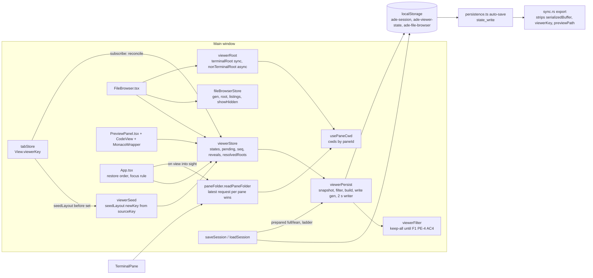
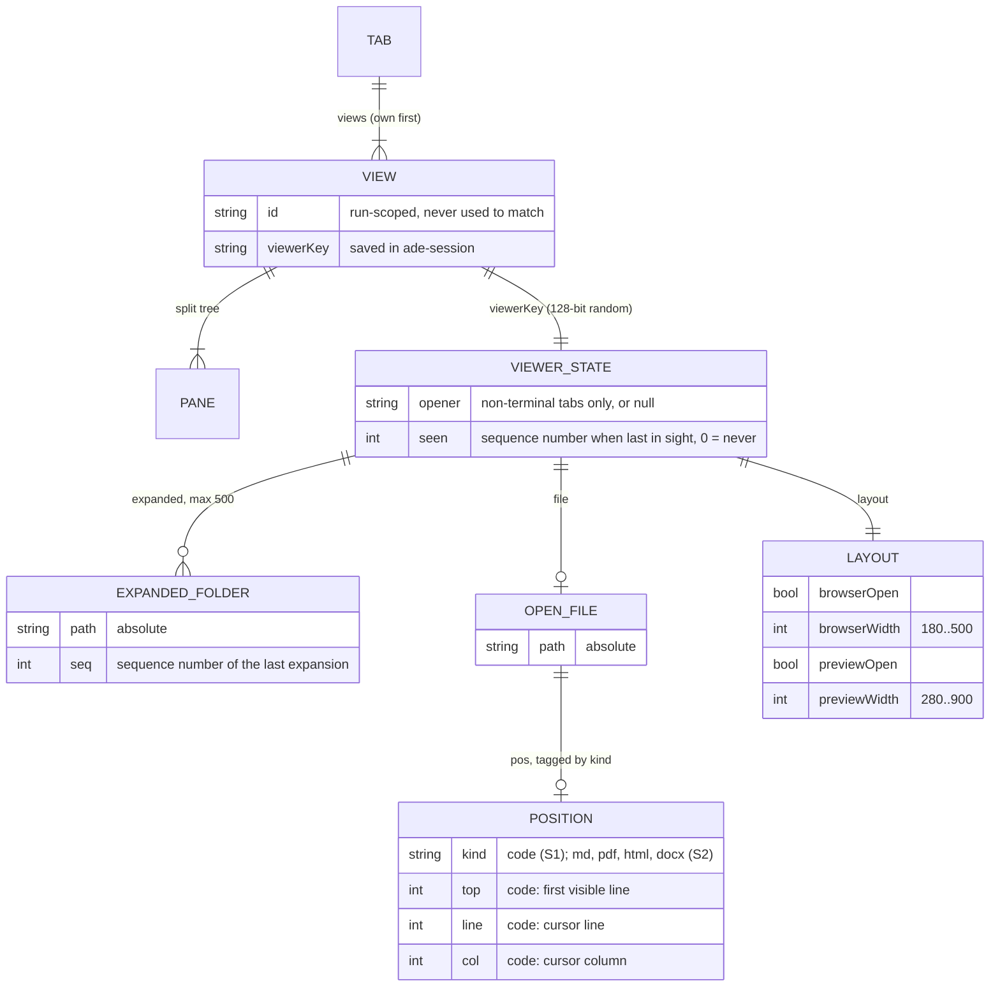

# Per-view file browser and preview panel: design for F3 slice S1

- **Status:** Proposed, revision 2, 2026-11-10. Not approved. Revision 1 was blocked by the adversarial review (B1 to B3, majors M1 to M5, seven minors); section 17 maps each finding to its change. Needs the adversarial review of revision 2, then the owner's approval.
- **PRD:** `docs/prd.md` section F3, revision 6, approved by the owner on 2026-11-10 (PR #112), with OQ-5 to OQ-12 answered at their recommendations.
- **Scope:** slice S1 (every [S1] criterion of F3.7). Section 10 sets out what S2 to S5 decide, as far as those decisions constrain S1's data model, and what each later slice changes.
- **Decisions:** ADR 0031 (where viewer state lives and how it is matched, saved and kept local) and ADR 0032 (per-view open file; partly supersedes ADR 0009).
- **Contract:** `.ade/context/viewer-state.md`.

## 1. Summary

- Viewer state lives in its own `zustand` store (`src/stores/viewerStore.ts`), not in the tab store. It is keyed by a **viewer key**: a random 128-bit id held on each `View` and written into that view's record in `ade-session`. Viewer state is never keyed by a tab, view or pane id (D15).
- It is saved under a separate local key, **`ade-viewer-state`**. The key is in `PERSISTED_KEYS` and is not in `SHARED_KEYS` or `DEVICE_KEYS`, so ADE sync never exports it. Only the viewer key travels inside `ade-session`, and `sync.rs` strips it from the export together with scrollback (`SESSION_LOCAL_FIELDS`).
- **Load order:** the saved viewer state is read into a *pending* pool **before** `loadSession`; each restored view claims its own state by key as it appears; whatever is left unclaimed is dropped once the restore ends (section 5.2).
- The store saves on its own schedule: at most once every 2 s, writing only its own bytes. A viewer change never touches the tab store, so it never triggers the session save, which serializes scrollback (VV-14).
- Every save is built from **one snapshot** of the states, after the engagement filter has decided on every path in that snapshot. A path with no decision is refused. Writes carry a generation, so an older write never lands last. If the filter fails, a layout-only version with no paths is written (section 8).
- A terminal view's root is never stored. It is derived from the view's active pane folder (`usePaneCwd`), which is fetched once when the view comes into sight and then kept current by today's 3 s pane poll. Hidden views are never polled.
- The file browser's tree is built **lazily** from the view's expanded set: only folders whose every ancestor up to the root is expanded are listed, at most 4 listings at a time. Every async result (root resolution, listings) carries a generation and is dropped if the view in sight or its root has changed since it was asked for (section 6.3).
- The 500-folder cap is enforced in `viewerStore.expand` (evict the lowest sequence number) and again on load (section 4.5).
- The size caps and the trim and drop order are a pure function run at write time. Order uses sequence numbers only; the times are dropped, which F3.1 allows.
- The code position is recorded by `MonacoWrapper` from Monaco's scroll and cursor events and restored on mount, after `editor.layout()`. `CodeView` keys the editor by **viewer key and path**, so the same file open in two views is two editors (section 9).
- Five S1 stories, built **one after another**, each with every test it owns runnable when it lands (section 15).

## 2. What exists today (checked in the code, branch `prd-per-view-viewer` at `6e0ec17`)

| Thing | Where | Today |
|---|---|---|
| File browser open/width | `fileBrowserStore.ts` | one global value, saved in `ade-file-browser` `{isOpen, width, showHidden}` |
| File browser root | `FileBrowser.tsx:154-180` | polls `getPtyCwd(ownView(activeTab).activePaneId)` every 3 s; the **own** view only; a non-terminal tab keeps the previous terminal's root because its placeholder pane has no PTY |
| Expanded folders | `fileBrowserStore.tree[].isExpanded` | one tree; `setRootPath` resets it and lists the root with an unguarded `.then` |
| Listing errors | `fileBrowserStore.loadDirectory` | catches every error and returns `[]`, so callers cannot tell "empty" from "failed" |
| Tree refresh | `fileBrowserStore.refreshTree` | lists the root, then every expanded folder **one after another** |
| Preview file | `Tab.previewPath`, `Tab.previewReveal` | per tab; `saveSession` never writes it, but `loadSession` reads it |
| Preview open | `usePreviewPanel()` in `App.tsx` | one `useState`, never saved |
| Preview width | `useDragWidth(280, 900, 480)` in `PreviewPanel.tsx` | component state, never saved |
| Code editor identity | `CodeView.tsx:107-108` | `<MonacoWrapper key={path}>`: one editor per path |
| Code position | `MonacoWrapper` | only the reload path (`saveViewState`/`restoreViewState`); nothing kept across a remount |
| Session save | `App.tsx:116-123`, `tabStore.ts` `saveSession` | 2 s after any change to `tabs`/`activeTabId`, and every 20 s; each save serializes all scrollback. Over `MAX_SESSION_SIZE` (5 MB in UTF-16 code units) it tails scrollback; on a quota error it strips scrollback, then removes the session |
| Load | `App.tsx:108-112` | `loadSession()` in App's first effect. The tab store already holds `tab-1` from its module load (`tabStore.ts:349`) |
| Ids | `tabStore.ts:220-224` | `tab-N`, `view-N` and `pane-N` counters that restart at 1 every run |
| Detached windows | `detachWindow.ts:10-17` | `tabFromDetached` rebuilds the tab with `ownViewOnly`, so the window gets new `View` objects |
| Sync export | `sync.rs` `value_for_repo` | `ade-session` (a `DEVICE_KEYS` entry) with `serializedBuffer` stripped at every depth |
| Pane folders | `TerminalPane.tsx:64-79` | every **mounted** pane polls `getPtyCwd` every 3 s into `usePaneCwd.cwds[paneId]`. Only the active tab's shown view is mounted |

## 3. Components



| Module | New/changed | Responsibility |
|---|---|---|
| `src/stores/viewerStore.ts` | new | In-memory viewer state per viewer key: layout, expanded set, open file and position, opener folder, last in sight. Holds the window's sequence counter, the hydrated-but-unclaimed `pending` pool, the transient `path:line` reveals and the transient last-resolved roots of non-terminal tabs. Reconciles with the tab store (5.1). Enforces the 500-folder cap (4.5). It has no I/O. |
| `src/lib/viewerSeed.ts` | new | `seedLayout(newKey, sourceKey)` and `takeSeed(key)`. A module-level map with no imports, so `tabStore` can pass a new view's layout source to reconciliation as an argument, without a `View` field and without an import cycle (5.1). |
| `src/lib/viewerPersist.ts` | new | Load (`hydrateViewerState`), `endRestore`, the pure builder (`buildSavedViewerState`), the snapshot-and-filter step (`prepareViewerWrite`), the throttled writer (`startViewerPersistence`, main window only), `flushViewerState()`, and the commit/lean/remove calls that `saveSession`'s ladder uses. Also writes the `ade-file-browser` mirror (VV-9 AC4). |
| `src/lib/viewerFilter.ts` | new | `setViewerPathFilter(f)` and `viewerPathFilter()`. The default keeps every path (section 8). |
| `src/lib/viewerRoot.ts` | new | `terminalRoot(view)`, synchronous, from `usePaneCwd`, `savedCwd` and `initialCwd`. `nonTerminalRoot(tab, state)`, asynchronous, the D7 chain. |
| `src/lib/paneFolder.ts` | new | `readPaneFolder(paneId)`: the only reader of a pane's folder. It calls `getPtyCwd` and writes `usePaneCwd`, dropping any result older than the latest request for that pane. It is the seam that OSC 7 later feeds. |
| `src/stores/tabStore.ts` | changed | `View.viewerKey` (saved). View creators call `seedLayout`. `Tab.previewPath` and `Tab.previewReveal` are removed (story 4). `SavedTab.viewerKey` and `SavedView.viewerKey` are added, written **last** in each record. `loadSession` validates keys and records legacy `previewPath`s for `takeLegacyPreviews()`. `saveSession` gets the VV-7 AC7 ladder (7.3). |
| `src/stores/fileBrowserStore.ts` | changed | Keeps `showHidden` (global, D2). The tree becomes `{ gen, viewerKey, rootPath, listings }` for the view in sight (6.3). `isOpen` and `width` leave it and become layout. `loadDirectory` rejects on error. |
| `src/components/FileBrowser.tsx` | changed | Shows the view in sight: root by `viewerRoot`, expansion by the view's expanded set. Its own 3 s poll is removed; it reads `usePaneCwd` (section 6). |
| `src/components/PreviewPanel.tsx`, `viewer/CodeView.tsx` | changed | File, reveal and width come from the view in sight's state. CodeView keys the editor by `viewerKey + path` and passes `initialView` and `onViewChange`. |
| `src/components/editor/MonacoWrapper.tsx` | changed | Optional `initialView` and `onViewChange` props (section 9). The file tab passes neither, so it is unchanged. |
| `src/components/editor/__tests__/monacoStub.tsx` | changed | The extension of section 9.3. |
| `src/App.tsx`, `src/lib/previewFocus.ts` | changed | Restore order (5.2). The preview's open state comes from the view's layout; `focusRequest` stays App state. The focus rule on a switch (VV-1 AC7). `hydrateViewerState()`, `endRestore()` and `startViewerPersistence()` are called here, never in `DetachedApp`. |
| `src/lib/openFile.ts` | changed | `handlePreviewOpen` opens in the view in sight (`viewerStore.openFile(key, path, at)`). |
| `src/lib/persistence.ts` | changed | `"ade-viewer-state"` is added to `PERSISTED_KEYS`. |
| `src-tauri/src/sync.rs` | changed | `SESSION_LOCAL_FIELDS = ["serializedBuffer", "viewerKey", "previewPath"]`. |

## 4. Data model



### 4.1 In memory

```ts
type ViewerKey = string;                    // 32 lowercase hex chars, crypto.getRandomValues(16 bytes)

interface Layout { browserOpen: boolean; browserWidth: number; previewOpen: boolean; previewWidth: number }
type CodePos = { kind: "code"; top: number; line: number; col: number };   // all whole numbers >= 1
type Position = CodePos;                    // S2 widens the union (section 10.1)

interface ViewerState {
  opener: string | null;                    // non-terminal tabs: the opener folder (D7); terminal views: null
  expanded: Record<string, number>;         // absolute folder path -> seq of its last expansion; at most 500 entries
  file: { path: string; pos: Position | null } | null;
  layout: Layout;
  seen: number;                             // seq when last in sight; 0 = never
}

interface ViewerStore {
  states: Record<ViewerKey, ViewerState>;
  pending: Record<ViewerKey, ViewerState>;  // hydrated, not yet claimed by a view (5.2); empty outside a restore
  seq: number;                              // the last value taken; next() returns ++seq
  inSight: ViewerKey | null;                // the main window's view in sight
  reveals: Record<ViewerKey, PreviewReveal>;// path:line requests, never saved (was Tab.previewReveal)
  resolvedRoots: Record<ViewerKey, string>; // non-terminal tabs: last root nonTerminalRoot resolved this run; never saved
}
```

**Root is not part of the stored state.**
- A terminal view's root is its active folder, which the pane already holds: `usePaneCwd.cwds[activePaneId]`, else the pane's `savedCwd`, else its `initialCwd`. The session already saves that folder as the pane's `savedCwd`. Storing it again would put a second copy of the same path in a second store, and that copy could disagree with the first.
- A non-terminal tab's root is computed by D7 from the tab's own fields and the stored `opener`.

So VV-8 AC1 holds by construction: a restored view lists whatever folder its shell reports.

### 4.2 On `View` and in `ade-session`

- `View.viewerKey: string`, required. It is minted by `newViewerKey()` in `ownViewOnly`, in `addView`, and in `restoreViews`/`loadSession` when a saved key is missing or invalid.
- There is **no** `View.layoutFrom` field. A view's layout source is passed to reconciliation through `seedLayout(newKey, sourceKey)` (5.1), called by the creator just before its `set`.
- `SavedTab.viewerKey?: string` (the own view) and `SavedView.viewerKey?: string` (each sub-terminal). A non-terminal tab's saved record carries it too. `saveSession` writes the field **last** in each record, so deleting it gives exactly the record an older build wrote (12.3).
- On load, a key is accepted only if it matches `/^[0-9a-f]{32}$/` and has not already been taken by an earlier record of the same session. Otherwise a new key is minted, and that view gets the defaults.

Why the key lives on `View` and not in a side map: **Move to New Tab** (sub-terminals story 5) moves the `View` object, so its state follows it with no code at all (VV-2 AC3). **Move to New Window** does **not** carry it today: `tabFromDetached` rebuilds the tab through `ownViewOnly`, which mints a new key. The key survives Move to New Window only once S3 changes the hand-over to carry `viewerKey` and its state (10.3). **Duplicate** and **Reopen Closed Tab** (S5) build new views, so they get new keys, and S5 copies the state across explicitly (D15).

### 4.3 Saved: `ade-viewer-state`

```json
{
  "v": 1,
  "states": {
    "9f2c…(32 hex)": {
      "opener": null,
      "expanded": [["/hub/atomic-stays/src", 41], ["/hub/atomic-stays/src/lib", 44]],
      "file": { "path": "/hub/atomic-stays/b.ts", "pos": { "kind": "code", "top": 120, "line": 130, "col": 5 } },
      "layout": { "browserOpen": false, "browserWidth": 240, "previewOpen": true, "previewWidth": 700 },
      "seen": 52
    }
  }
}
```

- `expanded` is stored oldest first, so the trim (section 7) drops from the front.
- `file.pos` may be `null`, or absent for a file that has no position yet.
- Any value other than `"v": 1` is treated as an absent store, so every view gets the defaults (D12). A state whose `pos.kind` is unknown keeps its file with `pos: null`, so an S2 session read by an S1 build opens those files at their top.
- Every field is validated on load:
  - widths are clamped (VV-7 AC5);
  - a `seq` or `seen` that is not a positive safe integer (or 0 for `seen`) drops that entry, or sets `seen` to 0;
  - a path that is not a string drops that entry;
  - the whole state is dropped if `layout` is malformed;
  - the expanded set is capped at 500 (4.5).
- **No times.** F3.1 allows the times to be dropped. Every order the PRD defines ("expanded longest ago", "least recently in sight") is by sequence number, so a stubbed or backwards `Date.now()` cannot change any result (VV-7 AC2, AC6).

### 4.4 The sequence counter

- `viewerStore.seq` is per window: each JS context has its own store.
- `next()` returns `++seq`. It is taken by every expansion (including a re-expansion) and by every change of the view in sight (`seen = next()`).
- **At module init** `seq` is 0. The module-init reconciliation (5.1) makes `tab-1`'s state and sets its `seen = next()`, so `seq` is 1.
- **At hydrate** (5.2, before `loadSession`): `seq = max(seq, every valid saved expanded seq, every valid saved seen)`, computed after the load cap. So every event after the restore, including the restored view in sight's own `seen`, is newer than everything restored (F3.1). No counter field is saved: nothing can fall out of step with the states.
- **`seen`:** a restored state keeps its saved `seen`. A state created by a seed or by default starts at 0. Whenever the view in sight changes (reconcile step 5), the new one gets `seen = next()`.
- Numbers are only ever compared within one window's store. S3 renumbers on arrival (section 10.3).

### 4.5 The 500-folder cap (VV-7 AC2, D8)

The cap is a property of the in-memory set, so the tree and the saved set always agree.

- **`viewerStore.expand(key, path)`**:
  1. `expanded[path] = next()` (a new entry, or a re-expansion that refreshes its number);
  2. if the set now holds 501 entries, delete the one entry with the lowest `seq`. Only one entry was added, so one eviction restores the cap. The entry just expanded holds the highest number and is never the one evicted.
- **An evicted folder shows collapsed**, because the tree shows a folder expanded exactly when its path is in the set (6.3). Its descendants are **kept** in the set, hidden, and show expanded again when it is re-expanded, exactly as after a collapse (VV-1 AC3).
- **`viewerStore.collapse(key, path)`** deletes only `expanded[path]`. Descendants stay.
- **At load** (`hydrateViewerState`), a hand-edited set with more than 500 valid entries keeps the 500 with the highest `seq` (a path listed twice keeps its highest `seq`; equal numbers keep the later array entry). So the store never starts above the cap.
- The builder (7.2) does not count entries: memory is never above 500, and the byte caps apply on top.

## 5. Lifecycle

### 5.1 Reconciliation (tab store to viewer store)

`viewerStore` subscribes to `useTabStore` and runs `reconcile()` **synchronously** on each change. It also runs `reconcile()` **once at module init**, after subscribing, because the tab store already holds `tab-1` when `viewerStore` is first imported and no change event would announce it.

1. Collect the live keys: every view of every tab in this window's tab store.
2. For each live key with no state, create one, in this order of precedence:
   1. **`pending[key]` exists** (a restore is under way): move it into `states`. This is the restored view's own saved state;
   2. **`takeSeed(key)` names a source key with a state**: copy that state's `layout` (clamped), with an empty `expanded`, `file: null` and `seen: 0` (D1, VV-2);
   3. **otherwise** the defaults (VV-9 AC1, section 5.3). During a restore, the key is added to `restoredByDefault` (used by 5.2 step 4).

   For a non-terminal tab created by a seed, also record `opener` (6.2) from the seed's source view. A restored non-terminal tab keeps its saved `opener`.
3. Delete the state, reveal and resolved root of each stored key that is no longer live. This covers closing a sub-terminal or a tab (VV-3) and Move to New Window (VV-4 AC2: `detachTab` removes the tab from the main store, so its states go, and the next save holds nothing of it). `pending` is **not** touched here; it is cleared by `endRestore`.
4. Drop any seed whose key is not live (a creator that seeded but did not add the view).
5. Compute `inSight` = the active tab's shown view's key. If it changed, set the new view's `seen = next()`.

**Seeds, passed as an argument.** `viewerSeed.ts` holds a module-level `Map<newKey, sourceKey>` and nothing else. Each `tabStore` view creator calls `seedLayout(newKey, sourceKey)` immediately before its `set`, and reconciliation, which runs inside that `set`, takes it:
- `addView` (New Sub-terminal, `ade open`): the spawning view's key when `spawnedBy` names a view of that tab, otherwise the tab's shown view's key (VV-2 AC1);
- `openTab` and every other creator of a top-level tab: the key of the main window's view in sight at that moment (VV-2 AC2), read from the tab store's own state (`shownView(activeTab).viewerKey`). With no tab, nothing is seeded, and the new tab gets the defaults;
- `restoreViews`/`loadSession` never seed: restored views get their own state or the defaults (D12), never a copy.

Reconciliation keys on `viewerKey` only. Tab, view and pane ids are never read to match a state.

### 5.2 Load

`App`'s first effect becomes, in this order, all synchronous:

```ts
hydrateViewerState();        // 1. read ade-viewer-state into pending; raise seq
try {
  loadSession();             // 2. set tabs; reconcile claims pending by key
} finally {
  endRestore();              // 3-4. drop unclaimed; apply legacy previewPath; mark dirty
}
startViewerPersistence();    // 5. only now may ade-viewer-state be written
```

1. **`hydrateViewerState()`** parses `ade-viewer-state` (4.3), applies the load cap (4.5), puts every valid state into `pending` (not `states`) and raises `seq` (4.4). At this moment `states` holds only `tab-1`'s module-init defaults.
2. **`loadSession()`** sets the restored tabs. The subscription runs `reconcile()`:
   - each restored view whose key is in `pending` takes that state (VV-6 AC1);
   - `tab-1` is no longer live, so its default state is deleted. Hydrate never wrote over a state reconcile had made, and reconcile never makes a default for a key that has a saved state, because `pending` is consulted first;
   - a restored view without a pending state gets the defaults (D12) and joins `restoredByDefault`;
   - the view in sight changes from `tab-1`'s to the restored one, so it gets `seen = next()`, which is above every restored number.
3. **`endRestore()`** clears `pending`: a stored state whose key no restored view carries is dropped (VV-6 AC1). If `loadSession` found no session (fresh install, or it threw), the same happens and `tab-1` keeps its defaults.
4. **Legacy `previewPath`** (VV-9 AC2, D3): `loadSession` records, for each restored tab whose saved record had a `previewPath`, `ownViewKey -> path`; `endRestore` reads it with `takeLegacyPreviews()`. For a key in `restoredByDefault`, `file = { path, pos: null }`. A key that took a hydrated state keeps it. Sub-terminals take nothing.
5. `endRestore` marks the store dirty, so the first write after the restore records the reconciled set. Until `startViewerPersistence()` has run, `flushViewerState()` is a no-op, so nothing can overwrite `ade-viewer-state` with `tab-1`'s defaults mid-restore.

### 5.3 Defaults (VV-9 AC1)

| Field | Default |
|---|---|
| `layout.browserOpen`, `layout.browserWidth` | `ade-file-browser` `isOpen` and `width` (width clamped to 180..500); `false` and 240 if absent |
| `layout.previewOpen`, `layout.previewWidth` | `false`, 480 |
| `expanded` | `{}` |
| `file` | `null` (or the legacy `previewPath`, 5.2 step 4) |
| `opener` | `null` for a restored non-terminal tab without one; a new tab records it at creation (6.2) |
| `seen` | 0 |

`ade-file-browser` is read once, at module load, as today, so the defaults never depend on a write made later in the run.

### 5.4 Key flow: a view switch with a save

```mermaid
sequenceDiagram
  actor E as Engineer
  participant TS as tabStore
  participant VS as viewerStore
  participant APP as App
  participant PF as paneFolder
  participant PC as usePaneCwd
  participant FBS as fileBrowserStore
  participant VP as viewerPersist
  participant LS as localStorage
  E->>TS: ⌘] (showView(T, S))
  TS-->>VS: subscribe: reconcile()
  VS->>VS: inSight = S.key; states[S.key].seen = next()
  TS-->>APP: render (tabs changed: today's 2 s session save is scheduled, unchanged)
  APP->>APP: panel had focus and S's layout closes it? focus S's active pane (VV-1 AC7)
  APP->>PF: readPaneFolder(S.activePaneId) (immediate, VV-1 AC2)
  APP->>FBS: show(S.key, terminalRoot(S)) : gen = g+1, listings = {} (last known root, never another view's)
  FBS->>FBS: list root and visible expanded folders, at most 4 at a time, each tagged g+1
  PF->>PC: setCwd(S.activePaneId, "/tmp") (only if still the latest request for that pane)
  PC-->>APP: root changed: show(S.key, "/tmp") : gen = g+2; results tagged g+1 are dropped
  VS-->>VP: state changed (seen): dirty; throttle, at most one write per 2 s
  VP->>VP: snapshot; await filter(paths of snapshot); build from the snapshot; write gen w
  VP->>LS: setItem("ade-viewer-state", json) unless a newer write gen already landed
  LS-->>LS: persistence.ts queues state_write {"ade-viewer-state": …}
  VP->>LS: setItem("ade-file-browser") only if the shown isOpen/width differ (VV-9 AC4)
```

## 6. Roots and the tree

### 6.1 Terminal views (VV-1 AC2, D4, VV-8 AC1)

- **Displayed root** is `terminalRoot(view)`: `usePaneCwd.cwds[view.activePaneId] ?? pane.savedCwd ?? pane.initialCwd ?? null`. It is synchronous, so a terminal view never has a "resolving" state: it shows its last known folder at once. Because it is read per pane, a late fetch for another view can only update that other pane's entry. One view's root can never show in another view.
- **While in sight:** `TerminalPane` already polls each mounted pane every 3 s into `usePaneCwd`, through `readPaneFolder`. `FileBrowser` drops its own poll and subscribes to the active pane's entry. This saves one `getPtyCwd` call every 3 s.
- **Coming into sight:** `App` calls `readPaneFolder(activePaneId)` at once whenever the view in sight or its active pane changes. That covers ⌘[ / ⌘], the strip, the switcher, toasts, the fleet, a tab switch, closing the view in sight, and focusing the other pane of a split (D4). F3.1 counts this immediate fetch as no wait.
- **`readPaneFolder` drops stale results.** It keeps a per-pane request counter; a result is written to `usePaneCwd` only if no newer request for the same pane was made since. So the 3 s poll and an on-show fetch for the same pane cannot land out of order.
- **Hidden views are not polled.** None of F3's criteria needs a hidden view's root before it is shown, and polling every hidden view would cost one `pgrep`/`lsof`-class call per pane every 3 s.
- **When ADR 0021 is built:** `ptysink.rs` parses OSC 7 for every PTY, shown or hidden, and an event writes `usePaneCwd.setCwd(paneId, folder)`. Hidden views then stay current with no polling, and S1's code does not change. The 3 s poll stays for shells without the integration.

### 6.2 Non-terminal tabs (D7, VV-11)

- **Opener folder.** When a non-terminal tab is created, reconciliation records `opener` from the seed's source view: `terminalRoot` of that view if it is a terminal view, else `null`. A non-terminal source has no active folder (F3.1), so the new tab falls back to home. Owner question Q1 (section 16) asks whether to change that.
- **`nonTerminalRoot(tab, state)`** is asynchronous and runs when the tab comes into sight and when the file browser is opened on it:
  1. its own folder:
     - editor: `invoke("project_root", { path: dirname(editorFilePath) })`, which returns the nearest folder holding `.git`, or the folder itself;
     - contracts: `contractsRoot`;
     - orchestrator, fleet and browser: none in S1;
  2. else `opener`;
  3. else the home folder (`homeDir()` from `@tauri-apps/api/path`).

  A candidate counts only if `invoke("list_directory", { path })` resolves. That command rejects for a missing folder, so no new Rust command is needed. The check is repeated each time the tab is shown, so a deleted folder falls through the chain (VV-11 AC2).
- **Guarded.** `FileBrowser` takes a token `t = ++resolveToken` before it calls `nonTerminalRoot`. The result is applied (`resolvedRoots[key] = root`, then `fileBrowserStore.show(key, root)`) only if `t` is still the latest token **and** `key` is still `inSight`. A slow resolution for a tab that has since left sight is dropped.
- **Interim state while resolving.** The panel shows the tab's `resolvedRoots[key]` from earlier in this run, if any, with its tree listed as usual; otherwise a blank header and an empty tree. It never shows another view's root or tree. `resolvedRoots` is transient: never saved, deleted with the state.
- **Fixed, not following.** The resolver never reads `usePaneCwd`, so no `cd` anywhere moves the root (VV-11 AC3).

### 6.3 The tree: lazy, bounded and guarded (VV-1 AC3, VV-8 AC2)

`fileBrowserStore` no longer holds `TreeNode.isExpanded` or a cached tree. It holds:

```ts
{ gen: number; viewerKey: ViewerKey | null; rootPath: string | null;
  listings: Record<string, { entries: FileEntry[] } | "loading" | "error">;   // by absolute folder path
  showHidden: boolean }
```

- **`show(key, root)`** sets `gen = gen + 1`, `viewerKey`, `rootPath` and `listings = {}`, then requests the root's listing. It is called whenever the view in sight or its displayed root changes. Nothing from the previous view survives it: the tree is empty until the new root's listing arrives (the interim state of a terminal view).
- **Rendering.** A folder row is expanded exactly when its path is in `states[viewerKey].expanded`. Its children are `listings[path]`. If an expanded folder is rendered and has no listing, the renderer requests one. So only folders whose every ancestor up to the root is expanded are ever listed: a folder hidden under a collapsed one is not listed until it can be seen. This replaces `refreshTree`'s rebuild of every expanded folder.
- **Bounded.** Listing requests go through one queue with at most **4** `list_directory` calls in flight (`list_directory` is an async command, so they run in parallel off the main thread). A view with 30 visible expanded folders costs 30 calls, 4 at a time, instead of 30 in sequence.
- **Every result is guarded.** Each request captures `gen`. A result whose `gen` is not the current one is dropped, so a listing for a previous view or root never lands in the tree. This covers the root listing (which replaces `setRootPath`'s unguarded `.then`), every child listing, and the watcher refresh.
- **Errors reach the caller.** `loadDirectory(path)` no longer catches: it resolves with the entries or rejects. The queue maps a rejection to `listings[path] = "error"`, which renders as an expanded folder with no children (as today's `[]` does) and **removes nothing** from the expanded set (VV-8 AC2).
- **A gone folder is pruned on success only.** When a listing of folder P succeeds (current `gen`), every path in the view's expanded set that is a **direct child** of P and is not a folder in that listing is removed by `viewerStore.pruneMissing(key, P, childFolders)`, together with every expanded path below it (they lie under a folder that no longer exists, and would otherwise hold places in the cap forever). Nothing is shown (VV-8 AC2).
- **Expand and collapse** call `viewerStore.expand(key, path)` / `collapse(key, path)` for the view in sight. They change no `fileBrowserStore` state except, for an expand, requesting the folder's listing if it has none.
- **Watcher refresh.** On a `watch_directory` event (500 ms debounce, as today), every folder that currently has a listing is re-listed through the same queue under the current `gen`. Each result replaces its entry when it arrives, so the old entries stay on screen until then; an error leaves the old entry.
- `showHidden` filters at render, as today, so toggling it lists nothing again.

## 7. Saving

### 7.1 Schedule (VV-14)

- `startViewerPersistence()` is called by `App` (the main window) only, after `endRestore()`. It subscribes to `viewerStore` and marks the store **dirty** on any change to `states` or `inSight` (not `reveals` or `resolvedRoots`, which are never saved).
- It writes `ade-viewer-state` with a **throttle of 2 s** (leading edge off, trailing edge on): at most one write per 2 s, however many changes come in.
- A write is `localStorage.setItem("ade-viewer-state", json)`. `persistence.ts` then queues the disk write (`state_write`) as it does for every persisted key.
- **No viewer change touches `useTabStore`.** Expanding, collapsing, recording positions, dragging a width and opening a file are all `viewerStore` sets. So `App`'s `[tabs, activeTabId]` effect never fires for them, `saveSession` is not called, and no scrollback is serialized.
- Opening a file today calls `setPreviewPath`, which changes `tabs` and so schedules a session save. After S1 it no longer does, so sessions are saved **less** often.
- **`flushViewerState()`** is called by `saveSession` (7.3):
  - if the store is clean and no throttled write is pending, it writes nothing and returns the last prepared write (7.2), so the ladder can still go lean or remove;
  - otherwise it cancels the pending throttled write, prepares and writes at once, and **restarts the throttle window** from that write, so the next throttled write is at least 2 s later;
  - before `startViewerPersistence()` has run (tests, a detached window, mid-restore) it is a no-op and returns `null`; `saveSession` then runs today's ladder alone.
  The one way two viewer writes can come less than 2 s apart is a throttled write followed by the flush of a session save. That flush happens only when a session save happens, which VV-14 does not change, so viewer changes alone still cause at most one write per 2 s.
- **Position updates do not re-render.** `PreviewPanel` and `CodeView` select `file.path` and `layout` with `zustand`'s equality selectors, never `file.pos`.

### 7.2 Snapshot, filter, build, write

A write has three phases. Only the second is asynchronous.

1. **Snapshot** (`prepareViewerWrite`, synchronous start). Take `w = ++writeGen`, `snap = viewerStore.getState().states` (an immutable reference: later sets make new objects and never change it) and `inSight`. Clear the dirty flag; a change during phase 2 sets it again and schedules the next write. Collect every path of `snap` that passes the 4,096-byte path rule.
2. **Filter.** `decisions = await viewerPathFilter()(paths)`. A result that is not an array of the same length is a failure; a non-`true` element is a refusal. On failure, see section 8.
3. **Build** (`buildSavedViewerState(snap, inSight, keep, { lean })`, pure and synchronous). `keep(p)` is `true` only if the filter returned `true` for exactly that path string in phase 2. **A path with no decision is refused**, so a path that reached the store after the snapshot can never be saved unfiltered: it is not in `snap`, and if it were, it would have no decision. Both the full and the lean string are built here from the same snapshot and kept as `{ w, full, lean }`, the **last prepared write**.

**Commit.** `commit(prepared, mode)` writes `prepared[mode]` only if `prepared.w >= lastCommitted`, then sets `lastCommitted = prepared.w`. So an older write that finishes its filter after a newer one has landed never lands last, while the ladder (7.3) may still replace a generation's full value with its own lean value or remove it. `removeViewerState(w)` follows the same rule.

**The builder's steps:**

1. **Measure** (VV-7 AC6 unit): `bytes(x) = new TextEncoder().encode(JSON.stringify(x)).length`. One view's size is `bytes(key) + 1 + bytes(state)`: the `"key":{…}` member, the colon included. The total is `bytes('{"v":1,"states":{') + sum(view sizes) + (views − 1) + bytes('}}')`, which equals `bytes` of the whole serialized value because `JSON.stringify` adds no whitespace.
2. **Path rule:** a path with `bytes(path) > 4096` is not stored:
   - an expanded folder that long is left out;
   - an open file that long is saved as `null`;
   - an opener that long is saved as `null`.
3. **Engagement filter:** every remaining path goes through `keep`.
   - An expanded folder that is refused is left out.
   - A refused open file is saved as `null`, with no position.
   - A refused opener is saved as `null`.
4. **Lean** (only when `lean` is set): every `expanded` is emptied. Nothing else changes.
5. **Per view, 32 KB (32,768 bytes):** sort the view's expanded entries by `seq` ascending. If the view is over the cap, find by binary search the smallest `k` such that the view with the first `k` entries removed fits, **re-serializing the view at each probe**. Sizes are recomputed, never derived by subtracting entry sizes, so the comma of the last entry and any escaping are counted exactly. Root, file, position, layout, `seen` and `opener` are never trimmed; each is at most 4,096 bytes of path plus a few numbers, so they always fit.
6. **All views, 256 KB (262,144 bytes):**
   - order the views by `seen` ascending, with `inSight` forced last;
   - walk that order. For each view: if emptying its expanded set would bring the total to the cap or under, trim it **partly** (binary search for the smallest `k` oldest entries to remove, recomputing that view's size and the total at each probe) and stop; otherwise empty it, recompute its size and the total, and go on;
   - if every expanded set is empty and the total is still over, drop whole states in the same order, recomputing the total after each, until it fits.

   A dropped view gets the defaults on restore (D12).
7. **Check.** Serialize the result and assert `bytes ≤ 262,144`. If a bug made it larger, drop states in the step-6 order until it fits, so the cap holds even then.
8. Return the JSON string. The in-memory `states` are never changed, so trimming changes only what is saved.

### 7.3 Never at the session's cost (VV-7 AC7)

`saveSession` is already asynchronous (it awaits `getPtyCwd` per pane). Its viewer steps are:

- **Step 0** happens first and is the only asynchronous viewer step: `const P = await flushViewerState()`. When it writes, it commits `P.full`; if that `setItem` throws, it commits `P.lean`; if that throws, `removeViewerState(P.w)`. Every viewer failure is caught here and never reaches `ade-session`.
- The rest of the ladder is **synchronous** and uses only `P.full` and `P.lean`, the strings built in step 0 from one filtered snapshot. No filter call and no await happens between session retries. If `P` is `null` (persistence not started), the viewer rows below are skipped and the ladder is today's.

| Step | Condition | Action |
|---|---|---|
| 1 | `json.length > MAX_SESSION_SIZE` | commit `P.lean` (unless already lean); then today's scrollback tail (`tail(…, 10000)`) |
| 2 | `setItem(ade-session)` throws | commit `P.lean` (unless already lean), retry the session with the same scrollback |
| 3 | still throws | `removeViewerState(P.w)`, retry the session **with the same scrollback** |
| 4 | still throws | today's: strip `serializedBuffer`, retry (viewer state already removed) |
| 5 | still throws | today's last resort: `removeItem(ade-session)` |

- **`MAX_SESSION_SIZE` measures `ade-session` alone.** Viewer state does not count against it. The limit exists to bound the session value; viewer state lives in its own key with its own 256 KB cap (7.2), so adding it to the session's measure would let viewer bytes trim scrollback, the opposite of VV-7 AC7. Step 1 still goes lean before tailing scrollback, as AC7's order requires ("the saved expanded sets are dropped first, and only then … scrollback trimming"), which also leaves the most quota for the session.
- **Step 3 comes before step 4** so that viewer state is removed entirely before any scrollback is stripped. That is what lets AC7's test keep scrollback when it fits without viewer state.
- After step 3, the store is marked dirty, so the throttled writer tries again later. If the quota is still short, that write goes lean, then removes itself, and never touches `ade-session`.

**AC7's test, pinned** (`viewerSave.test.ts`, story 2):
- A `localStorage` mock whose quota is the sum over keys of `key.length + value.length` in UTF-16 code units, where a `setItem` on an existing key counts the new value in place of the old. It starts empty.
- 30 views, each with an expanded set at the 32 KB cap, a layout and an open file; terminal panes with scrollback.
- The quota is set to `S + 1,024` code units, where `S` is the size of `ade-session` saved with **no** viewer state and full scrollback (measured in the test by a first save with persistence not started).
- Expected: `ade-session` holds every tab and folder with **full scrollback**; `ade-viewer-state` is absent (the lean value of 30 views is over 1,024 units, so step 3 ran; the test asserts that precondition); a restore from that storage brings back every tab and folder. A second case with the quota at `S + lean + 1,024` expects the lean viewer value and full scrollback.

### 7.4 The `ade-file-browser` mirror (VV-9 AC4)

- `viewerPersist` subscribes to the main window's view in sight's `layout.browserOpen` and `layout.browserWidth`.
- When either shown value differs from the last one written (a ⌘B, a drag, the palette, or a switch), it does a read-modify-write of `ade-file-browser` that keeps `showHidden`. A switch to the same values writes nothing.
- `setShowHidden` writes `showHidden` alone, by the same read-modify-write.
- `DetachedApp` never starts this.

### 7.5 What is written where

| Store | Viewer-state content | Exported by ADE sync | In saved workspaces | To the phone |
|---|---|---|---|---|
| `ade-viewer-state` | all of it | no: not in `SHARED_KEYS`/`DEVICE_KEYS` (Rust test) | no | no |
| `ade-session` | `viewerKey` per view only | `ade-session` yes, but `viewerKey` and `previewPath` are stripped at every depth | no | no: the payload builder picks fields (rule for phone-watch story 8) |
| `ade-file-browser` | `isOpen`, `width` (layout of the view in sight), `showHidden` | no | no | no |
| `better-terminal-workspaces` | none: presets hold `{name, splits}` only | n/a | n/a | n/a |

## 8. The VV-13 engagement filter hook

```ts
// src/lib/viewerFilter.ts
export type ViewerPathFilter = (paths: string[]) => Promise<boolean[]>;   // true = may be saved
export function setViewerPathFilter(f: ViewerPathFilter): void;
export function viewerPathFilter(): ViewerPathFilter;                     // default: async ps => ps.map(() => true)
```

- It takes a batch and is asynchronous, because PE-4 AC4's rule resolves symlinks and compares paths the way the file system does (`fsx::same_path`, F1 design section 20). That needs Rust. F1's story is expected to add one Rust command, called once per write with every path of that write.
- **One snapshot, one decision set** (7.2). The builder only sees `snap`, and `keep` is built from the decisions on `snap`'s own paths. A path the filter was not asked about is refused.
- **Write generation** (7.2). Two writes can be in phase 2 at once (a throttled write and a session save's flush). Whichever took the higher `w` wins; the other is discarded when it resolves.
- **Fail closed, and never keep stale paths.** If the filter rejects, or returns a malformed result, the write still happens, but with a **layout-only** value: every state keeps its `layout` and `seen`, with `expanded: []`, `file: null` and `opener: null`. No path is written, and none of the previous value's paths survive. Layouts carry no path, so they need no filtering. Both `full` and `lean` are that value.
- **Reported.** Each failure increments a consecutive-failure count, reset by the next success. On the first failure and on every 10th consecutive one, `console.warn("viewer state: path filter failed (N in a row); saved layouts only")`, with no path in the message. This is the precedent `persistence.ts` sets for a failed auto-save (`console.warn("auto-save failed", …)`). A toast is not used: the engineer cannot act on it, and the PRD gives the panel no new notice. The crash log (`invoke("log_error")`) is not used either, because it writes a file and VV-12 AC4's test bans file-writing commands on viewer-state paths.
- S1 ships the default, so in S1 every path is kept. The F1 story that delivers PE-4 AC4 calls `setViewerPathFilter` at start-up in the default profile. That story, or S1's story 2 if S1 merges second, carries VV-13's test (D14).
- F1's rule that "a terminal whose folder is unknown is treated as having been in an engagement's folders" (ADR 0021) is the filter's business. The hook passes paths, not views, as VV-13 AC1 asks.

## 9. The code position (VV-1 AC5 code, VV-8 AC4)

### 9.1 One editor per view and file (B1)

- `CodeView` takes the view's `viewerKey` from `PreviewPanel` and renders `<MonacoWrapper key={viewerKey + ":" + path} …>`.
- So a switch between two views that show the **same file** unmounts one editor and mounts another. Each mount gets its own view's `initialView` and its own `onViewChange`.
- `onViewChange` is built by `CodeView` as `(v) => viewerStore.recordPosition(viewerKey, path, { kind: "code", ...v })`, closing over the key it was rendered with. `MonacoWrapper` keeps it in a ref updated on render. Because the key change remounts the wrapper, the old instance never renders with the new view's callback: any event it fires while being disposed records into its own view, with its own view's real values.
- Remounting costs one Monaco editor creation per switch between views showing a file. That is what a switch between two different files costs today, and the model's text is already in memory (`head.text`).

### 9.2 Recording

- `MonacoWrapper` gains two props:
  - `initialView?: { top: number; line: number; col: number }`;
  - `onViewChange?: (v: { top: number; line: number; col: number }) => void`.
- In `onMount` it registers `editor.onDidScrollChange` and `editor.onDidChangeCursorPosition`, both disposed on unmount. Each calls `report()`:
  ```ts
  const ranges = editor.getVisibleRanges();
  if (ranges.length === 0) return;          // not laid out yet: record nothing, never a guess
  const p = editor.getPosition();
  onViewChangeRef.current?.({ top: ranges[0].startLineNumber, line: p.lineNumber, col: p.column });
  ```
  There is no `?? 1` fallback: an editor with no visible range has no position worth saving, and saving 1 would overwrite the real one.
- Events are **ignored until the initial restore has been applied** (a `restored` ref). Otherwise the mount's own scroll-to-0 and cursor-to-1:1 would overwrite the stored position before it is restored.
- The reload path (`saveViewState`, `setValue`, `restoreViewState`) runs synchronously after the restore, and its last events carry the restored view, so it records correctly.
- Every event records at once, so the position is current when the view leaves sight or a save runs. Nothing depends on unmount order.

### 9.3 Restoring: the sequence

After mount and after the content effect, in the place `applyReveal` runs today, one function `applyInitial()` runs once per mount:

1. **If a reveal is pending** for this file, `applyReveal()` as today (it already calls `editor.layout()` first). Then set `restored = true` and call `report()` once, so the revealed line becomes the remembered position (VV-1 AC5: "a `path:line` click lands on its line instead and that becomes the remembered position").
2. **Else if `initialView`:**
   1. `editor.layout()`: the editor was created in a `display:none` container, so until it measures itself its viewport is a few pixels tall (the reason `applyReveal` calls it, `MonacoWrapper.tsx:166-169`);
   2. `n = model.getLineCount()`; `line = min(line, n)`; `top = min(top, n)`;
   3. `editor.setScrollTop(editor.getTopForLineNumber(top))`;
   4. `editor.setPosition({ lineNumber: line, column: max(1, col) })`. `setPosition` never focuses, so restoring never takes focus;
   5. `restored = true`. Nothing is reported: the store already holds this position (or, if clamped, the next real event records the clamped one).
3. **Else** `restored = true`.

- **VV-8 AC4:** a file that got shorter puts the cursor on its last line, and `top` is clamped so that line is in view. Lines are kept by number.
- A truncated file is clamped to the part shown.
- With `asyncMount`, `onMount` runs late and `applyInitial` runs then; events before it are ignored by the `restored` ref.

### 9.4 The stub extension (`monacoStub.tsx`)

Added to `FakeEditor`:
- `lineHeight = 20`;
- `laidOut = false`; `layout()` sets it to `true` (and still logs the call);
- `getTopForLineNumber(n) = (n - 1) * 20`;
- `getVisibleRanges()`: `[]` while `laidOut` is false, as the real editor reports for a zero-height viewport; afterwards `[{ startLineNumber: floor(scrollTop / 20) + 1, endLineNumber: startLineNumber + 29 }]`;
- `onDidScrollChange(cb)` and `onDidChangeCursorPosition(cb)`, each returning `{ dispose }`;
- `setScrollTop`, `setValue`, `restoreViewState` and `setPosition` fire the matching listeners, as the real editor does.

Because `getVisibleRanges` is empty until `layout()`, a restore that forgets `layout()` reports nothing and the test fails.

**Tests** (`codePosition.test.tsx`, story 5), each with `asyncMount` both off and on:
- **VV-1 AC5 (code):** in S scroll `b.ts` so line 120 is first visible, cursor at 130:5, ⌘[ then ⌘]: `getVisibleRanges()[0].startLineNumber === 120` and `getPosition()` is 130:5.
- **The same file in two views (B1):** open `/hub/b.ts` in T's own view and in S. In the own view scroll to 120, cursor 130:5; ⌘]; in S scroll to 300, cursor 310:2; ⌘[: the own view's editor shows 120 and 130:5; ⌘]: S's shows 300 and 310:2. After each switch, the store holds both positions unchanged, and the view that left sight was not overwritten by the other's events.
- **No guess:** an editor whose `layout()` has not run fires a scroll event; nothing is recorded.
- **VV-8 AC4:** a remembered 130:5 in a file cut to 50 lines: cursor on 50, line 50 in view.

## 10. Later slices: what they decide and what they change

S1's data model is fixed so that S2 to S5 add to it without changing what S1 saves.

### 10.1 S2: positions in the other viewers

- **Position union** (S2 widens `Position`; field names fixed now so S1's loader can recognise them):
  - `{ kind: "md", digest: string /* 32 hex = 128 bits */, occ: number, px: number, frac: number }`
  - `{ kind: "pdf", page: number, frac: number, zoom: number }`
  - `{ kind: "html", frac: number }`
  - `{ kind: "docx", frac: number }`

  Every one fits VV-7 AC4's per-kind limit. An S1 build reads these as unknown and opens at the top (4.3).
- **Anchor digest:** SHA-256 of the UTF-8 slug (`headingSlug`), truncated to 128 bits, lower-case hex. It is computed with `crypto.subtle.digest`, asynchronously, when a position is recorded. No key, and not a secrecy measure (D11).
- **Geometry seam (D13):** `src/components/viewer/geometry.ts` holds a `ViewerGeometry` interface:
  - `scrollTop`, `scrollHeight`, `clientHeight`, `headingTops()`, `pageRects()`;
  - `scrollTo(px)`;
  - `onDrawn(cb)`.

  Each viewer reads and restores through it. Tests pass fixed numbers. "Finished drawing" plus the 3 s timeout and cancel-on-user-scroll live in one `useRestoreOnDrawn` hook.
- **Same-file remount:** each S2 viewer is keyed by `viewerKey + path`, as `CodeView` is (9.1).
- **HTML reporter (OQ-6): not confirmed.** A `srcdoc` frame inherits the app's CSP, but the reporter has to be loaded from an opaque-origin frame (sandbox without `allow-same-origin`) through the app's custom protocol. Whether `script-src 'self'` matches that load is not settled on paper: it differs between WKWebView, WebView2 and WebKitGTK. So the S2 HTML story starts with a spike on all three platforms. If the reporter does not run under the unchanged CSP and sandbox, the HTML position is dropped, as the owner's answer to OQ-6 already says, and VV-1 AC5's six rules are not built.
- S2 also amends the code-viewer plan's PDF reload exclusion (D10).

### 10.2 S4: the orchestrator's project folder

`nonTerminalRoot` gains one case: orchestrator, with `projectDir` read from `orchestratorStore` by `orchestratorSessionId`. Watching for the folder to appear is the "comes into sight" check plus a 3 s check while that tab is in sight, under the same token guard (6.2). Nothing that S1 saves changes.

### 10.3 S3: detached windows

- **The key does not survive Move to New Window until S3.** Today `tabFromDetached` rebuilds the tab through `ownViewOnly`, which mints a new key, and `detachTab` removes the tab from the main store, whose reconciliation then deletes the states (VV-4 AC2's S1 part).
- S3 changes Move to New Window so that, **before** the main store removes the tab, it takes `viewerStore` states for the tab's keys and passes them, with each view's `viewerKey`, in the window-creation payload. That payload is the Rust window command of ADR 0017, not today's URL. `tabFromDetached` then builds views that keep their keys.
- The detached window's own `viewerStore` takes them in with **renumbering on arrival**:
  - sort every incoming `seq` (expanded and `seen`) ascending, keeping relative order;
  - map them to `local.seq + 1 …`;
  - set `local.seq` to the new maximum.

  The same function renumbers states that arrive in the main window when F1 PE-13 AC5 saves detached tabs. It is one pure function, `renumberOnArrival(states, localSeq)`, in `viewerStore.ts`. Incoming states go into `pending` before the tab is set, exactly as a restore does (5.2), so reconciliation claims them by key.
- Detached windows never call `startViewerPersistence()`, so they never write `ade-viewer-state` or `ade-file-browser`'s `isOpen`/`width`. Show hidden reaches every window through a Tauri event carrying `showHidden`, plus the `ade-file-browser` read-modify-write.
- S1 already keeps this possible: states are plain JSON keyed by `viewerKey`, with no cross-references.

### 10.4 S5: copies and reopened tabs

- **Duplicate:** the new view gets a fresh `viewerKey`, and `viewerStore.copyState(fromKey, toKey)` deep-copies the state. Its `file.pos` is kept, its `seen` is reset to `next()`, and its expanded `seq`s are kept.
- **Reopen Closed Tab:** `ClosedTab` gains `viewer?: ViewerState`, a snapshot taken in `closeTab` before reconciliation deletes the state. It is in memory only, with the existing cap of 20.
- **"Hub removed" (F2):** the view's state is reset to `{ expanded: {}, file: null }` with its layout kept.

### 10.5 [Second] criteria: what S1 guarantees by construction

| Criterion | Why S1 already meets the rule, and what the second story's test adds |
|---|---|
| VV-2 AC3 (Move to New Tab) | The state is keyed on `View.viewerKey`; moving the `View` object carries it. Rule for sub-terminals story 5: move the `View`, do not rebuild it, or copy `viewerKey` if it must rebuild. |
| VV-12 AC3 (phone) | Viewer state is not in the tab store. The relay payload builder must pick fields explicitly and never spread a `View` (which carries `viewerKey`). |
| VV-12 AC4 [Second] (isolation scan) | All viewer-state I/O is `localStorage` on `ade-viewer-state`/`ade-session`, through `state_write`. |
| VV-13 | The filter hook (section 8). |

## 11. Failure modes

| Failure | Handling |
|---|---|
| `ade-viewer-state` missing, corrupt, or a newer `v` | Treated as absent; every view gets the defaults (D12). It is never thrown into `loadSession`. |
| `ade-session` restored by an older ADE (keys dropped) | Every restored view gets a new key and the defaults; the unclaimed pending states are dropped by `endRestore` (VV-9 AC5 new → old → new). |
| `loadSession` throws or finds nothing | `endRestore` runs in `finally`: pending is cleared, `tab-1` keeps its defaults, and nothing was written mid-restore. |
| Two saved records carry the same key | The first keeps it; the rest get new keys and the defaults. |
| A hand-edited key holds a path or a short string | It fails `/^[0-9a-f]{32}$/` and is replaced. |
| A hand-edited expanded set of 5,000 entries | Capped to the 500 highest `seq` at load (4.5). |
| Crash between the viewer write and the session write | Either a view has a key with no state yet (defaults) or a state has no view (dropped). No view can show another's state. |
| `setItem("ade-viewer-state")` throws (quota) | Lean, then remove the key. `ade-session` is never touched by that path. |
| Session over the limit or quota | The ladder in 7.3: viewer state goes lean, then away entirely, before scrollback is stripped and before the session is removed. |
| The filter rejects or returns a malformed result | A layout-only value is written; no path is kept, old or new; a warning is logged on the 1st and every 10th consecutive failure. |
| Two writes in flight | The higher write generation wins; the older is discarded when it resolves. |
| A late `readPaneFolder` result | Dropped if a newer request for that pane exists; otherwise it updates only that pane's `usePaneCwd` entry. |
| A late listing or root resolution after a switch | Dropped by the `gen` / token check (6.2, 6.3). |
| A listing error | The folder shows no children; nothing is removed from the expanded set. |
| A non-terminal tab's folder is deleted | `list_directory` rejects; the next link of the chain is used; no error is shown. |
| An expanded folder is deleted | When its parent is next listed successfully and the folder is absent, it and the expanded paths below it are removed (VV-8 AC2). |
| The open file is deleted | The panel shows its existing notice; `file` and `pos` are kept until another file is opened (VV-8 AC3). |
| A file got shorter | Clamped (9.3). |
| Monaco not laid out yet | `getVisibleRanges()` is empty: nothing is recorded (9.2). The restore calls `layout()` first (9.3). |
| Monaco loads late (`asyncMount`) | The restore runs in `onMount`, and events are ignored until then. |
| A detached window imports the stores | No hydrate, no persistence; its reconciliation acts only on its own store. |
| A width out of range from a hand edit or an old value | Clamped wherever it enters (VV-7 AC5). |

## 12. Tests

Every test runs under `npm test` (vitest), except the Rust lines. Each test file below belongs to one story (section 15), and every test in it runs green when that story lands.

### 12.1 New tests, by criterion and story

| Criterion | Story | Test file | Notes |
|---|---|---|---|
| VV-2 AC1, AC2; VV-6 AC4; VV-7 AC1, AC2, AC5; VV-9 AC1, AC2 | 1 | `src/stores/__tests__/viewerStore.test.ts` | Reconciliation, seeds, defaults, `expand` eviction (VV-7 AC2's three cases, `Date.now` constant and backwards), the load cap on a hydrated 600-entry set, width clamps on hydrate, copy and default |
| VV-2 AC3 (conditional, D14) | 1 | `viewerStore.test.ts` | Only if sub-terminals story 5 is on `main` at review |
| (load order) | 1 | `src/stores/__tests__/viewerRestore.test.ts` | Hydrate → `loadSession` → `endRestore`: claimed by key, `tab-1`'s state gone, unclaimed dropped, `seq` above every saved number, legacy `previewPath` only for default states |
| `sync.rs` field strip | 1 | `src-tauri/src/sync.rs` tests | `viewerKey` and `previewPath` removed at every depth (a hand-built value) |
| VV-3; VV-4 AC2; VV-6 AC3; VV-7 AC6, AC7; VV-9 AC3, AC4, AC5; VV-12 AC1, AC2, AC4 (S1 part); VV-14 | 2 | `src/lib/__tests__/viewerSave.test.ts`, `viewerPersist.test.ts` (pure builder), `viewerLocalOnly.test.ts` | Store-level actions only; no component is rendered |
| VV-12 AC1 | 2 | `src-tauri/src/sync.rs` tests on the golden fixture (12.2) | — |
| VV-12 AC3, VV-12 AC4 [Second], VV-13 (conditional, D14) | 2 | as F3.8 names them | Only if the other story is on `main` at review |
| (filter, write generation) | 2 | `viewerSave.test.ts` | Snapshot decisions; a path added during the await is not written; an older write resolving last is discarded; a rejecting filter writes layout-only and warns on the 1st and 10th failure |
| VV-1 AC2, AC3; VV-8 AC1, AC2; VV-11 AC1 to AC4 | 3 | `src/components/__tests__/perViewRoot.test.tsx`, `src/lib/__tests__/nonTerminalRoot.test.ts`, `src/stores/__tests__/fileBrowserTree.test.ts` | `getPtyCwd` mocked (12.4); `project_root`, `list_directory` and `homeDir` mocked; stale-`gen` listing dropped; a listing error removes nothing; at most 4 listings in flight |
| VV-1 AC1, AC4, AC6, AC7, AC8; VV-8 AC9; VV-11 AC5 | 4 | `src/components/__tests__/perViewPanels.test.tsx` | Renders `App`'s panel area with two views |
| VV-1 AC5 (code); VV-6 AC1; VV-7 AC3; VV-8 AC3, AC4; same file in two views | 5 | `src/components/__tests__/codePosition.test.tsx`, `viewerRestart.test.tsx` | 9.4; VV-6 AC1 is the end-to-end restart (fresh modules) over every built part |

**Story 2's VV-12 AC4 test** (`viewerLocalOnly.test.ts`) follows F3.9's two minors and the reviewer's note:
- it calls `startAutoSave({ snapshots: false })`, so no snapshot interval is created and `state_snapshot` is not on the allowlist;
- `__resetForTests` restores `setItem`/`removeItem` and the queue, but not the `beforeunload`/`visibilitychange` listeners. Those call `flush()`, which is a no-op on an empty queue, and vitest gives each test file its own module instance, so they cannot leak into another file. The test does not use fake timers for auto-save;
- every read command on its allowlist is checked against `src-tauri/src` to write nothing, and the test says so in a comment the reviewer checks.

### 12.2 The golden fixture (story 2 owns both halves)

`src-tauri/tests/fixtures/f3-viewer-session.json` holds an `ade-session` and an `ade-viewer-state` with unique path markers in an own view, a sub-terminal and a non-terminal tab.
- **TypeScript half** (`src/stores/__tests__/viewerGolden.test.ts`): from a fixed store (fixed `viewerKey`s such as `"0".repeat(31) + "1"`, fixed `seq`s, `Date.now` mocked, `getPtyCwd` and the serializer mocked), it runs `saveSession()` with persistence started and asserts the two stored strings equal the fixture **byte for byte**. Regenerate with:
  ```
  UPDATE_F3_GOLDEN=1 npx vitest run src/stores/__tests__/viewerGolden.test.ts
  ```
  which writes the fixture instead of comparing (the `UPDATE_FIXTURES=1` pattern of `scripts/bmadTextFixture.test.ts`). A regenerated fixture is reviewed as a code change.
- **Rust half** (`sync.rs` tests): load the fixture into a temporary `kv` folder, run `export_state`, and assert the repo holds no marker, no `viewerKey` and no `ade-viewer-state` file, and still holds the tab names and the `savedCwd`s (VV-12 AC1).
- Both halves land in story 2, because the TypeScript half needs the builder and the Rust half needs the fixture. Story 1's `sync.rs` change has its own unit test (12.1).

A Rust test also asserts that `"ade-viewer-state"` is in neither `SHARED_KEYS` nor `DEVICE_KEYS` (story 2).

**ADR 0017's static key test** (built with F1): `ade-viewer-state` is in `PERSISTED_KEYS`, so it passes as "persisted". S1 adds no `localStorage` key that is not persisted.

### 12.3 Existing tests that change, and what replaces each

| Existing test | Story | Why it breaks | Replacement |
|---|---|---|---|
| `src/stores/__tests__/session.test.ts`, "a single-view tab saves the same JSON as before the refactor" (byte-for-byte against `fixtures/session-golden.json`) | 1 | Every saved tab now carries a random `viewerKey` | `goldenState()` sets a fixed `viewerKey` on each view after `ownViewOnly`. The test asserts each saved tab's `viewerKey` equals its fixed key, then deletes `viewerKey` from every tab (and `subViews` entry), re-serializes, and compares with `GOLDEN` byte for byte. `saveSession` writes `viewerKey` last (4.2), so deleting it restores the exact old record. **The golden file is not regenerated**: it is the pre-refactor capture, and that is its point |
| `session.test.ts`, the other four tests | 1 | none | unchanged; they also check that `loadSession` still accepts sessions with no keys |
| Every `View` literal under `tsc`: `subTerminalCallSites.test.tsx` (2), `TabBar.subTerminal.test.tsx` (1), `useOwnFolderCwd.test.tsx` (2), `detachWindow.test.ts` (2), `tabDisplay.test.ts` (2), `subViewSession.test.ts` (2), `tabViews.test.ts` (3), and the 3 in `tabStore.ts` itself | 1 | `View.viewerKey` is required | Each literal gains `viewerKey: testKey(n)` from a new helper `src/stores/__tests__/viewerKeys.ts` (`testKey(n)` = `n` in hex, left-padded to 32). `npx tsc --noEmit` finds every literal; the list above is from `grep -E 'restored: (false|true)'` at `6e0ec17` |
| `src/stores/__tests__/previewPerTab.test.ts` (9 `it` blocks) | 4 | `Tab.previewPath`, `setPreviewPath` and `previewReveal` are removed | File deleted. Each case moves to `src/stores/__tests__/viewerOpenFile.test.ts`, per view: starts with no document → a new view's `file` is `null`; each tab's document separate → each view's; setting one leaves others → `openFile(k1)` leaves `k2`; switching changes which is current → `inSight`'s file; clearing keeps the rest → `openFile(k, null)` keeps layout and expanded; survives the panel closing → `layout.previewOpen = false` keeps `file`; a path aimed at a gone tab → `openFile` on an unknown key is a no-op; a target line is per request and never saved → `reveals[k]` set, absent from `ade-viewer-state` and `ade-session`; a reveal cleared once applied, not a newer one → `clearReveal(k, nonce)` |
| `src/lib/__tests__/openFile.test.ts`, "App's open-preview handler sets the file and its line on the active tab, then opens the panel" | 4 | `handlePreviewOpen`'s deps change from `{activeTabId, setPreviewPath, openPanel}` to `{inSightKey, openFile, openPanel}` | Same assertions against the view in sight: `openFile` called with `(key, path, at)`; the end-to-end part asserts `viewerStore.reveals[inSight]`; the source check of `App.tsx` stays. The other four tests are unchanged |
| `src/components/__tests__/PreviewPanelCode.test.tsx` | 4 | Its helper calls `setPreviewPath(activeTabId, …)`; four assertions read `activeTab().previewReveal` / `.previewPath` | The helper becomes `openInSight(path, at?)` = `viewerStore.openFile(inSightKey(), path, at)`; the assertions read `viewerStore.reveals[k]` and `states[k].file.path`. Behaviour asserted is unchanged |
| `src/components/__tests__/PreviewPanelFocus.test.tsx` | 4 | Same helper | Same change. The eight focus tests are otherwise unchanged; VV-1 AC7 adds its own test in `perViewPanels.test.tsx` |
| `src/components/__tests__/PreviewPanelOpenClose.test.tsx` | 4 | It opens a file with `setPreviewPath` and reads open state from `usePreviewPanel()` | The file is opened with `openInSight`; open/closed is read from `states[inSight].layout.previewOpen`; `usePreviewPanel()` still supplies the focus request. Both tests keep their assertions |
| `MonacoWrapper.test.tsx` | 5 | none expected: the new props are optional | unchanged; story 5 runs it with the extended stub |
| code-viewer story 5's AC4 test ("a plain click sets that tab's `previewPath`") | 4 | the field is gone | rewritten to "sets the open file of the view in sight" (ADR 0032) |

### 12.4 Mocking the folder report (VV-1 AC2)

`perViewRoot.test.tsx` mocks `getPtyCwd` (in `src/hooks/useTerminal`) with a stub the test drives: each call returns a promise the test resolves. `paneFolder.readPaneFolder` and its write into `usePaneCwd` stay **real**, so the test covers the seam, the per-pane stale-result rule and the root derivation together. Fake timers are installed and not advanced, so no 3-second tick runs (the PRD's "with fake timers not advanced").

## 13. Verification command

The command in force is the seven lines under "Verification command" in `docs/architecture.md`. S1 stories are judged by all seven, and each line must exit 0. These lines exercise S1:

```
npx tsc --noEmit                    # View.viewerKey required, then the removal of Tab.previewPath/previewReveal: tsc finds every literal and reader
npm test                            # every vitest test of section 12
cd src-tauri && cargo test          # sync.rs: viewerKey strip, the key not exported, the golden fixture
```

- The other four lines (`relay`, `mobile`, `cargo check -p ade-hook`, `cargo test -p ade-hook`) are unaffected by S1. They still run and must stay green.
- S1 proposes **no new line**.
- The [Second] criteria that join F1's isolation test run under F1's gate D28. They are in force for F1 stories already, and apply only if S1 merges second (D14).
- S2's real-webview checks wait for OQ-10 (answered: later, not blocking): a line for the desktop e2e harness (ADR 0030), which the owner approves separately.

## 14. Order and the code-viewer plan (OQ-9 (a), answered by the owner)

1. **Code-viewer story 3** (live follow with `watch_file`, "Deleted on disk") lands first. S1 then changes only where `PreviewPanel` gets its file from: from `tab.previewPath` to the view's `file.path`. Story 3's per-path watch state stays component state; it is not viewer state.
2. **Code-viewer story 5** (file browser clicks open the panel; a modifier-click opens a tab) lands next. Its AC4 clause "with an editor tab active, a plain click sets that tab's `previewPath`" is rewritten by S1's story 4 to "sets the open file of the view in sight", which is the same behaviour.
3. **F3 S1**, stories 1 to 5 (section 15). Story 4 removes `Tab.previewPath` and `Tab.previewReveal`, moves the reveal into `viewerStore.reveals`, and updates `.ade/context/side-panel-files.md` (the "Store" and "App" bullets of Go to line).
4. **Code-viewer story 6 is not built.** VV-6 replaces its restart part, and S5's VV-4 AC3 replaces its Reopen Closed Tab part (ADR 0032).

## 15. S1 stories (advice to the scrum-master)

Five stories, built **in sequence**: 1 → 2 → 3 → 4 → 5. No two run in parallel: all of them change `tabStore.ts`, `viewerStore.ts` or `App.tsx`, and each one's tests use what the earlier ones built. Every criterion is assigned to the first story at which its whole test can run; no criterion is split across stories. The table in 12.1 lists each story's test files.

1. **Keys, the store and view creation.** `View.viewerKey`, minting and validation, `SavedTab`/`SavedView.viewerKey` (written last), `viewerSeed`, `viewerStore` with reconciliation (including the module-init run), defaults, `expand`/`collapse`/eviction, `hydrateViewerState` with the load cap, `endRestore`, legacy `previewPath` (while `Tab.previewPath` still exists), the `sync.rs` field strip, and the existing-test updates of 12.3 rows 1 to 3. **No writer yet**: `ade-viewer-state` is read, never written. Criteria: VV-2 AC1, AC2; VV-6 AC4; VV-7 AC1, AC2, AC5; VV-9 AC1, AC2. **Conditional: VV-2 AC3**, as "the story that builds view creation and moves" (F3.9): its test is store-level (move S's `View` to a new tab; the new tab's own view carries S's key and S's state, unchanged).
2. **Saving.** `PERSISTED_KEYS`, the snapshot-filter-build-commit pipeline, the write generation, the throttle and `flushViewerState`, the caps, the `saveSession` ladder, the filter hook and its failure path, the `ade-file-browser` mirror and `setShowHidden`'s read-modify-write, the golden fixture (both halves), and the Rust key-set test. Every test drives store actions (`expand`, `openFile`, `recordPosition`, `setLayout`, `showView`); none needs a component. Criteria: VV-3; VV-4 AC2; VV-6 AC3; VV-7 AC6, AC7; VV-9 AC3, AC4, AC5; VV-12 AC1, AC2, AC4 (S1 part); VV-14. **Conditional: VV-13 and VV-12 AC4's [Second] part** (the story that builds the session save, F3.9), and **VV-12 AC3** (it owns "what leaves the machine"). This story carries F3.9's two VV-12 AC4 minors (12.1).
3. **File browser per view.** `paneFolder`, `viewerRoot`, the lazy guarded tree (6.3), `loadDirectory` rejecting, pruning, `FileBrowser` reading the view in sight, ⌘B and the browser drag writing layout, non-terminal roots and the opener. Criteria: VV-1 AC2, AC3; VV-8 AC1, AC2; VV-11 AC1 to AC4 (AC4's restart uses story 2's save).
4. **Preview panel per view.** The open file, reveal and layout of the panel from the view in sight; removing `Tab.previewPath`/`previewReveal`; `handlePreviewOpen`; the focus rule; 12.3's preview rows; `side-panel-files.md`. Criteria: VV-1 AC1, AC4, AC6, AC7, AC8; VV-8 AC9; VV-11 AC5.
5. **Code position.** `MonacoWrapper`'s props, the restore sequence, `CodeView`'s key, the stub extension. Criteria: VV-1 AC5 (code); VV-8 AC3, AC4; VV-6 AC1 (the end-to-end restart: every part of it is built by now); VV-7 AC3 (the `ZQX-MARK` scan through a file opened in the panel with a recorded position, and a save).

**Recorded on both sides (F3.9):** the scrum-master writes VV-2 AC3 into story 1 and sub-terminals story 5; VV-12 AC3 into story 2 and phone-watch story 8; VV-12 AC4's [Second] part into story 2 and the F1 story for PE-4 AC9; VV-13 into story 2 and `.ade/context/f3-merges-second.md` (PE-4 AC4 is not yet sharded).

## 16. Owner questions

- **Q1. The opener folder when the source view is a non-terminal tab.** F3.1 defines the opener as the "active folder" of the view in sight, and a non-terminal view has none. So a browser tab opened from an editor tab lists the home folder, not the editor's repository. Using the source tab's root instead costs:
  - **code:** reconciliation reads `resolvedRoots[sourceKey]`, the root `nonTerminalRoot` last resolved for that tab in this run (6.2). That cache exists in S1 anyway, for the panel's interim state, so the change is one branch. It is empty for a source tab not yet shown in this run (a restored tab), and then the opener stays `null` (home), because resolving the source's root is asynchronous and reconciliation is not;
  - **PRD:** a change by the product manager to F3.1's "opener folder" and VV-11 AC2 (from "the active folder of the view in sight" to "… or, for a non-terminal view, its last resolved root"), with a test, and the owner's approval of that change.

  *Recommend yes*, as a small PRD change before story 3 is built. If the owner says no, S1 builds the PRD as written (home folder).
- **OQ-9** is answered (a), so ADR 0032 needs no further question; it is accepted with this design.
- **Q3. The HTML position's spike (S2).** As in revision 1: the S2 HTML story starts with a three-webview spike and drops the HTML position if the reporter cannot run under the unchanged CSP and sandbox, which is the owner's OQ-6 answer. *Recommend accepting* this as the plan for S2; no S1 work depends on it.
- **No change to the verification command** is proposed for S1.

## 17. Changes from revision 1 (the blocking review)

| Finding | Change | Where |
|---|---|---|
| B1 same file in two views shares one editor | Editor keyed by `viewerKey + path`; callback bound per mount; restore sequence `layout()` → clamp → `setScrollTop` → `setPosition` → `restored`; recording skips an empty `getVisibleRanges()` with no `?? 1`; stub returns `[]` until `layout()`; a two-view same-file test | 9.1 to 9.4 |
| B2 no design for the 500 cap | Eviction in `viewerStore.expand` by lowest `seq`; evicted folder collapsed with descendants kept; load cap at hydrate; tests in the store | 4.5, 12.1 |
| B3 stories not test-first | Five sequential stories; every criterion at the first story where its whole test runs; VV-2 AC3 in story 1 (view creation and moves); golden fixture's both halves in story 2 | 15, 12.1, 12.2 |
| M1 load order | Hydrate into `pending` before `loadSession`; claim by key in reconcile; `endRestore` drops the rest; module-init reconcile for `tab-1`; how `seq` and `seen` are set | 4.4, 5.1, 5.2 |
| M2 async races | Per-pane latest-request rule in `readPaneFolder`; `gen` on every listing; token on `nonTerminalRoot`; interim state defined; `loadDirectory` rejects so errors remove nothing; lazy tree, 4 listings at a time | 6.1 to 6.3 |
| M3 VV-13 filter | One snapshot, decisions only for its paths, no decision = refused; write generation; layout-only value on failure; `console.warn` on the 1st and every 10th failure | 7.2, 8 |
| M4 VV-7 AC7 ladder | "Remove viewer state, retry with full scrollback" before the strip; viewer state no longer counted against `MAX_SESSION_SIZE`, with the reason; the ladder after step 0 is synchronous on step 0's strings; the PRD test's quota pinned | 7.3 |
| M5 existing tests | Each breaking test listed with its story and replacement; session golden kept by stripping fixed keys; regeneration command for the new fixture | 12.2, 12.3 |
| Minor: flush | No-op when clean; resets the throttle window when it writes | 7.1 |
| Minor: partial trim | The last view is trimmed partly; sizes recomputed by serializing | 7.2 |
| Minor: VV-12 AC4 test | `startAutoSave({ snapshots: false })`; listeners explained | 12.1 |
| Minor: VV-1 AC2 mock | `getPtyCwd` mocked; `paneFolder`'s write real | 12.4 |
| Minor: ADR 0031 Move to New Window | True only after S3; stated | 4.2, 10.3, ADR 0031 |
| Minor: `layoutFrom` | Passed through `seedLayout`, not a `View` field | 4.2, 5.1 |
| Minor: Q1 | Kept as an owner question with its code and PRD cost | 16 |
