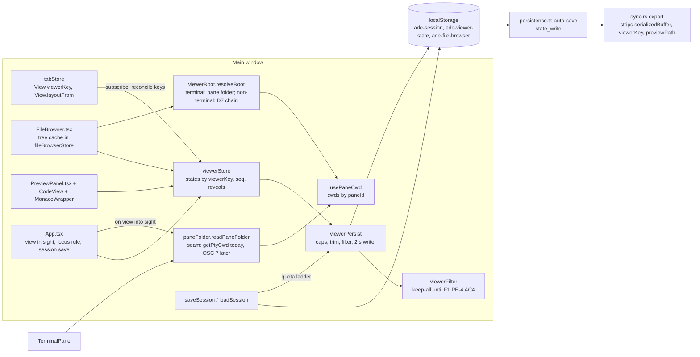
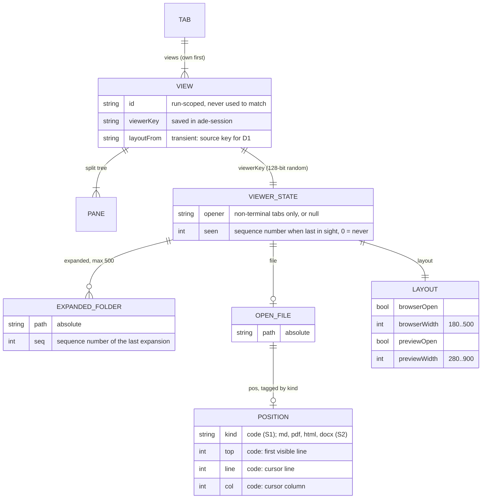
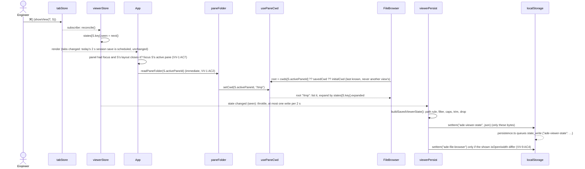

# Per-view file browser and preview panel: design for F3 slice S1

- **Status:** Proposed, 2026-11-10. Not approved. Needs adversarial review, then the owner's approval.
- **PRD:** `docs/prd.md` section F3, revision 6, approved by the owner on 2026-11-10 (PR #112).
- **Scope:** slice S1 (every [S1] criterion of F3.7). Section 10 sets out what S2 to S5 decide, as far as those decisions constrain S1's data model, and what each later slice changes.
- **Decisions:** ADR 0031 (where viewer state lives and how it is matched, saved and kept local) and ADR 0032 (per-view open file; partly supersedes ADR 0009).
- **Contract:** `.ade/context/viewer-state.md`.

## 1. Summary

- Viewer state lives in its own `zustand` store (`src/stores/viewerStore.ts`), not in the tab store. It is keyed by a **viewer key**: a random 128-bit id held on each `View` and written into that view's record in `ade-session`. Viewer state is never keyed by a tab, view or pane id (D15).
- It is saved under a separate local key, **`ade-viewer-state`**. The key is in `PERSISTED_KEYS` and is not in `SHARED_KEYS` or `DEVICE_KEYS`, so ADE sync never exports it. Only the viewer key travels inside `ade-session`, and `sync.rs` strips it from the export together with scrollback (`SESSION_LOCAL_FIELDS`).
- The store saves on its own schedule: at most once every 2 s, writing only its own bytes. A viewer change never touches the tab store, so it never triggers the session save, which serializes scrollback (VV-14).
- A terminal view's root is never stored. It is derived from the view's active pane folder (`usePaneCwd`), which is fetched once when the view comes into sight and then kept current by today's 3 s pane poll. Hidden views are never polled. When ADR 0021's OSC 7 reports are built, they write the same `usePaneCwd` entry and nothing else changes.
- The size caps and the trim and drop order are a pure function run at write time. Order uses sequence numbers only; the times are dropped, which F3.1 allows.
- The VV-13 engagement filter is a path filter hook that defaults to "keep everything". F1's PE-4 AC4 story replaces the default.
- The code position (first visible line, cursor line and column) is recorded by `MonacoWrapper` from Monaco's scroll and cursor events and restored on mount. The test stub gains a fixed line height, `getVisibleRanges`, `getTopForLineNumber` and the two event hooks.
- Build order: after code-viewer stories 3 and 5 (OQ-9 (a)). Story 6 is not built (ADR 0032).

## 2. What exists today (checked in the code, branch `prd-per-view-viewer` at `65af965`)

| Thing | Where | Today |
|---|---|---|
| File browser open/width | `fileBrowserStore.ts` | one global value, saved in `ade-file-browser` `{isOpen, width, showHidden}` |
| File browser root | `FileBrowser.tsx:154-180` | polls `getPtyCwd(ownView(activeTab).activePaneId)` every 3 s; the **own** view only; a non-terminal tab keeps the previous terminal's root because its placeholder pane has no PTY |
| Expanded folders | `fileBrowserStore.tree[].isExpanded` | one tree; `setRootPath` resets it |
| Preview file | `Tab.previewPath`, `Tab.previewReveal` | per tab; `saveSession` never writes it, but `loadSession` reads it |
| Preview open | `usePreviewPanel()` in `App.tsx` | one `useState`, never saved |
| Preview width | `useDragWidth(280, 900, 480)` in `PreviewPanel.tsx` | component state, never saved |
| Code position | `MonacoWrapper` | only the reload path (`saveViewState`/`restoreViewState`); nothing kept across a remount |
| Session save | `App.tsx:116-123` | 2 s after any change to `tabs`/`activeTabId`, and every 20 s; each save serializes all scrollback |
| Ids | `tabStore.ts:220-224` | `tab-N`, `view-N` and `pane-N` counters that restart at 1 every run |
| Sync export | `sync.rs` `value_for_repo` | `ade-session` (a `DEVICE_KEYS` entry) with `serializedBuffer` stripped at every depth |
| Pane folders | `TerminalPane.tsx:64-79` | every **mounted** pane polls `getPtyCwd` every 3 s into `usePaneCwd.cwds[paneId]`. Only the active tab's shown view is mounted |

## 3. Components



| Module | New/changed | Responsibility |
|---|---|---|
| `src/stores/viewerStore.ts` | new | In-memory viewer state per viewer key: layout, expanded set, open file and position, opener folder, last in sight. Holds the window's sequence counter and the transient `path:line` reveals. Reconciles with the tab store: it creates a state for each new key and deletes the state of each key that is gone. It has no I/O. |
| `src/lib/viewerPersist.ts` | new | Load (`hydrateViewerState`), the pure save builder (`buildSavedViewerState`, which applies the path rule, filter, caps, trim and drop), the throttled writer (`startViewerPersistence`, main window only), `flushViewerState()`, and the lean and remove fall-backs that `saveSession` uses. Also writes the `ade-file-browser` mirror (VV-9 AC4). |
| `src/lib/viewerFilter.ts` | new | `setViewerPathFilter(f)` and `viewerPathFilter()`. The default keeps every path (section 8). |
| `src/lib/viewerRoot.ts` | new | `terminalRoot(view)`, synchronous, from `usePaneCwd`, `savedCwd` and `initialCwd`. `nonTerminalRoot(tab, state)`, asynchronous, the D7 chain. |
| `src/lib/paneFolder.ts` | new | `readPaneFolder(paneId)`: the only reader of a pane's folder. Today it calls `getPtyCwd` and writes `usePaneCwd`. It is the seam that tests mock, and that OSC 7 later feeds. |
| `src/stores/tabStore.ts` | changed | `View.viewerKey` (saved), `View.layoutFrom` (never saved). `Tab.previewPath` and `Tab.previewReveal` are removed. `SavedTab.viewerKey` and `SavedView.viewerKey` are added. `loadSession` returns the legacy `previewPath` per own view. `saveSession` gets the VV-7 AC7 ladder. |
| `src/stores/fileBrowserStore.ts` | changed | Keeps `showHidden` (global, D2) and the tree **cache** for the displayed root. `isOpen` and `width` leave it and become layout. |
| `src/components/FileBrowser.tsx` | changed | Shows the view in sight: root by `viewerRoot`, expansion by the view's expanded set. Its own 3 s poll is removed; it reads `usePaneCwd` (section 6). |
| `src/components/PreviewPanel.tsx`, `viewer/CodeView.tsx` | changed | File, reveal and width come from the view in sight's state. CodeView passes `initialView` and `onViewChange` to the editor. |
| `src/components/editor/MonacoWrapper.tsx` | changed | Optional `initialView` and `onViewChange` props (section 9). The file tab passes neither, so it is unchanged. |
| `src/components/editor/__tests__/monacoStub.tsx` | changed | The extension of section 9.3. |
| `src/App.tsx`, `src/lib/previewFocus.ts` | changed | The preview's open state comes from the view's layout. `focusRequest` stays App state. The focus rule on a switch (VV-1 AC7). `startViewerPersistence()` and `hydrateViewerState()` are called here, never in `DetachedApp`. |
| `src/lib/openFile.ts` | changed | `handlePreviewOpen` opens in the view in sight (`viewerStore.openFile(key, path, at)`). |
| `src/lib/persistence.ts` | changed | `"ade-viewer-state"` is added to `PERSISTED_KEYS`. |
| `src-tauri/src/sync.rs` | changed | `SESSION_LOCAL_FIELDS = ["serializedBuffer", "viewerKey", "previewPath"]`. |

## 4. Data model



### 4.1 In memory

```ts
type ViewerKey = string;                    // 32 lowercase hex chars, crypto.getRandomValues(16 bytes)

interface Layout { browserOpen: boolean; browserWidth: number; previewOpen: boolean; previewWidth: number }
type CodePos = { kind: "code"; top: number; line: number; col: number };   // all whole numbers >= 1
type Position = CodePos;                    // S2 widens the union (section 10.1)

interface ViewerState {
  opener: string | null;                    // non-terminal tabs: the opener folder (D7); terminal views: null
  expanded: Record<string, number>;         // absolute folder path -> seq of its last expansion
  file: { path: string; pos: Position | null } | null;
  layout: Layout;
  seen: number;                             // seq when last in sight; 0 = never
}

interface ViewerStore {
  states: Record<ViewerKey, ViewerState>;
  seq: number;                              // the last value taken; next() returns ++seq
  reveals: Record<ViewerKey, PreviewReveal>;// path:line requests, never saved (was Tab.previewReveal)
}
```

**Root is not part of the stored state.**
- A terminal view's root is its active folder, which the pane already holds: `usePaneCwd.cwds[activePaneId]`, else the pane's `savedCwd`, else its `initialCwd`. The session already saves that folder as the pane's `savedCwd`. Storing it again would put a second copy of the same path in a second store, and that copy could disagree with the first.
- A non-terminal tab's root is computed by D7 from the tab's own fields and the stored `opener`.

So VV-8 AC1 holds by construction: a restored view lists whatever folder its shell reports.

### 4.2 On `View` and in `ade-session`

- `View.viewerKey: string`. It is minted by `newViewerKey()` in `ownViewOnly`, in `addView`, and in `restoreViews`/`loadSession` when a saved key is missing or invalid.
- `View.layoutFrom: ViewerKey | null`. It is never saved and is read only once, when the state is created:
  - `addView` sets it to the spawning view's key when `spawnedBy` names a view of that tab, otherwise to the tab's shown view's key;
  - `openTab` sets it to the key of the view in sight in the main window at that moment.
- `SavedTab.viewerKey?: string` (the own view) and `SavedView.viewerKey?: string` (each sub-terminal). A non-terminal tab's saved record carries it too.
- On load, a key is accepted only if it matches `/^[0-9a-f]{32}$/` and has not already been taken by an earlier record of the same session. Otherwise a new key is minted, and that view gets the defaults.

Why the key lives on `View` and not in a side map: **Move to New Tab** (sub-terminals story 5) moves the `View` object, so its state follows it with no code at all (VV-2 AC3). **Move to New Window** (S3) carries the `View` with its key. **Duplicate** and **Reopen Closed Tab** (S5) build new views, so they get new keys, and S5 copies the state across explicitly (D15).

### 4.3 Saved: `ade-viewer-state`

```json
{
  "v": 1,
  "states": {
    "9f2c…(32 hex)": {
      "opener": null,
      "expanded": [["/hub/atomic-stays/src", 41], ["/hub/atomic-stays/src/lib", 44]],
      "file": { "path": "/hub/atomic-stays/b.ts", "pos": { "kind": "code", "top": 120, "line": 130, "col": 5 } },
      "layout": { "browserOpen": false, "browserWidth": 240, "previewOpen": true, "previewWidth": 700 },
      "seen": 52
    }
  }
}
```

- `expanded` is stored oldest first, so the trim (section 7) drops from the front.
- `file.pos` may be `null`, or absent for a file that has no position yet.
- Any value other than `"v": 1` is treated as an absent store, so every view gets the defaults (D12). A state whose `pos.kind` is unknown keeps its file with `pos: null`, so an S2 session read by an S1 build opens those files at their top.
- Every field is validated on load:
  - widths are clamped (VV-7 AC5);
  - a `seq` that is not a positive safe integer drops that entry;
  - a path that is not a string drops that entry;
  - the whole state is dropped if `layout` is malformed.
- **No times.** F3.1 allows the times to be dropped. Every order the PRD defines ("expanded longest ago", "least recently in sight") is by sequence number, so a stubbed or backwards `Date.now()` cannot change any result (VV-7 AC2, AC6).

### 4.4 The sequence counter

- `viewerStore.seq` is per window: each JS context has its own store.
- `next()` returns `++seq`. It is taken by every expansion (including a re-expansion) and by every change of the view in sight (`seen = next()`).
- On load, `seq = max(every saved expanded seq, every saved seen)`, or 0 when nothing was saved. So the first event after a restart is newer than everything restored (F3.1), and no counter field is saved: nothing can fall out of step with the states.
- Numbers are only ever compared within one window's store. S3 renumbers on arrival (section 10.3).

## 5. Lifecycle

### 5.1 Reconciliation (tab store to viewer store)

`viewerStore` subscribes to `useTabStore` and runs `reconcile()` **synchronously** on each change. This runs before React renders, so a component never sees a view without a state.

1. Collect the live keys: every view of every tab in the main window's store.
2. For each live key with no state, create one:
   - `layoutFrom` names a state: copy its `layout` (clamped), with an empty `expanded`, `file: null` and `seen: 0` (D1, VV-2);
   - otherwise use the defaults (VV-9 AC1, section 5.3).

   For a non-terminal tab, also record `opener` (section 6.2).
3. Delete the state and any reveal of each stored key that is no longer live. This covers closing a sub-terminal or a tab (VV-3) and Move to New Window (VV-4 AC2: `detachTab` removes the tab from the main store, so its states go, and the next save holds nothing of it).
4. If the view in sight changed, set the new view's `seen = next()`.

Reconciliation keys on `viewerKey` only. Tab, view and pane ids are never read here.

### 5.2 Load

`App` already calls `loadSession()` in its first effect. Then:

1. `hydrateViewerState()` parses `ade-viewer-state` (section 4.3), sets `seq`, and puts every valid state into `states`.
2. `reconcile()` runs, through the subscription or by an explicit call after hydrate:
   - each restored view with a stored state keeps it;
   - a stored state whose key no restored view carries is dropped (VV-6 AC1);
   - a view without a state gets the defaults (D12).
3. Legacy `previewPath` (VV-9 AC2, D3): `loadSession` returns `legacyPreview: Map<ViewerKey, string>` for each restored tab whose saved record had a `previewPath`. For a key whose state was just created by default (not hydrated), `file = { path, pos: null }`. Sub-terminals take nothing.

### 5.3 Defaults (VV-9 AC1)

| Field | Default |
|---|---|
| `layout.browserOpen`, `layout.browserWidth` | `ade-file-browser` `isOpen` and `width` (width clamped to 180..500); `false` and 240 if absent |
| `layout.previewOpen`, `layout.previewWidth` | `false`, 480 |
| `expanded` | `{}` |
| `file` | `null` (or the legacy `previewPath`, 5.2 step 3) |
| `opener` | `null` for a restored non-terminal tab without one; a new tab records it at creation (6.2) |
| `seen` | 0 |

`ade-file-browser` is read once, at module load, as today, so the defaults never depend on a write made later in the run.

### 5.4 Key flow: a view switch with a save



## 6. Roots

### 6.1 Terminal views (VV-1 AC2, D4, VV-8 AC1)

- **Displayed root** is `terminalRoot(view)`: `usePaneCwd.cwds[view.activePaneId] ?? pane.savedCwd ?? pane.initialCwd ?? null`. Because it is read per pane, a late fetch for another view can only update that other pane's entry. One view's root can never show in another view.
- **While in sight:** `TerminalPane` already polls each mounted pane every 3 s into `usePaneCwd`, and the shown view's panes are mounted. `FileBrowser` drops its own poll and subscribes to the active pane's entry. This saves one `getPtyCwd` call every 3 s.
- **Coming into sight:** `App` calls `readPaneFolder(activePaneId)` at once whenever the view in sight or its active pane changes. That covers ⌘[ / ⌘], the strip, the switcher, toasts, the fleet, a tab switch, closing the view in sight, and focusing the other pane of a split (D4). F3.1 counts this immediate fetch as no wait.
- **Hidden views are not polled.** None of F3's criteria needs a hidden view's root before it is shown, and polling every hidden view would cost one `pgrep`/`lsof`-class call per pane every 3 s.
- **`readPaneFolder` is the seam.** TerminalPane's poll and the on-show fetch both go through it, and the VV-1 AC2 test mocks it with `vi.mock("../lib/paneFolder")`.
- **When ADR 0021 is built:** `ptysink.rs` parses OSC 7 for every PTY, shown or hidden, and an event writes `usePaneCwd.setCwd(paneId, folder)`. Hidden views then stay current with no polling, and S1's code does not change. The 3 s poll stays for shells without the integration.

### 6.2 Non-terminal tabs (D7, VV-11)

- **Opener folder.** When `openTab` makes a non-terminal tab, reconciliation records `opener` as the active folder of the view in sight at that moment, which is `layoutFrom`'s view: `terminalRoot` of that view if it is a terminal view, else `null`. A non-terminal source has no active folder (F3.1), so the new tab falls back to home. Owner question Q1 asks whether to use the source's own root instead.
- **`nonTerminalRoot(tab, state)`** is asynchronous and runs when the tab comes into sight and when the file browser is opened on it:
  1. its own folder:
     - editor: `invoke("project_root", { path: dirname(editorFilePath) })`, which returns the nearest folder holding `.git`, or the folder itself;
     - contracts: `contractsRoot`;
     - orchestrator, fleet and browser: none in S1;
  2. else `opener`;
  3. else the home folder (`homeDir()` from `@tauri-apps/api/path`).

  A candidate counts only if `invoke("list_directory", { path })` resolves. That command rejects for a missing folder, so no new Rust command is needed. The check is repeated each time the tab is shown, so a deleted folder falls through the chain (VV-11 AC2).
- **Fixed, not following.** The resolver never reads `usePaneCwd`, so no `cd` anywhere moves the root (VV-11 AC3).

## 7. Saving

### 7.1 Schedule (VV-14)

- `startViewerPersistence()` is called by `App` (the main window) only. It subscribes to `viewerStore` and writes `ade-viewer-state` with a **throttle of 2 s** (leading edge off, trailing edge on): at most one write per 2 s, however many changes come in.
- A write is `localStorage.setItem("ade-viewer-state", json)`. `persistence.ts` then queues the disk write (`state_write`) as it does for every persisted key.
- **No viewer change touches `useTabStore`.** Expanding, collapsing, recording positions, dragging a width and opening a file are all `viewerStore` sets. So `App`'s `[tabs, activeTabId]` effect never fires for them, `saveSession` is not called, and no scrollback is serialized.
- Opening a file today calls `setPreviewPath`, which changes `tabs` and so schedules a session save. After S1 it no longer does, so sessions are saved **less** often.
- `flushViewerState()` writes at once and cancels the pending throttle. `saveSession` calls it first, so a session save and the viewer key describe the same moment as nearly as possible. `App`'s close handler reaches it through `saveSession`, before `flushNow()`.
- **Position updates do not re-render.** `PreviewPanel` and `CodeView` select `file.path` and `layout` with `zustand`'s equality selectors, never `file.pos`.

### 7.2 The save builder

`buildSavedViewerState(states, inSightKey, keep)` is a pure function, so it is tested without a DOM, timers or storage. Its steps:

1. **Measure** (VV-7 AC6 unit): `bytes(x) = new TextEncoder().encode(JSON.stringify(x)).length`. One view's size is `bytes(key) + 1 + bytes(state)`: the `"key":{…}` member, the colon included.
2. **Path rule:** a path with `bytes(path) > 4096` is not stored:
   - an expanded folder that long is left out;
   - an open file that long is saved as `null`;
   - an opener that long is saved as `null`.
3. **Engagement filter** (section 8): every remaining path goes through `keep`.
   - An expanded folder that is refused is left out.
   - A refused open file is saved as `null`, with no position.
   - A refused opener is saved as `null`.
4. **Per view, 32 KB (32,768 bytes):** while the size is over the cap, drop the `expanded` entry with the lowest `seq`. Each entry's size is known (`bytes([path, seq]) + 1` for the comma), so this is one pass over the entries sorted by `seq`. Root, file, position, layout, `seen` and `opener` are never trimmed. Each is at most 4,096 bytes of path plus a few numbers, so they always fit.
5. **All views, 256 KB (262,144 bytes),** measured as the whole serialized value (envelope included):
   - order the views by `seen` ascending, with `inSightKey` forced last;
   - empty the expanded sets oldest first, view by view, in that order;
   - if the total is still over, drop whole states in the same order.

   A dropped view gets the defaults on restore (D12).
6. Return the JSON string. The in-memory `states` are never changed, so trimming changes only what is saved.

### 7.3 Never at the session's cost (VV-7 AC7)

`viewerPersist` exposes `writeViewerState(mode: "full" | "lean")` and `removeViewerState()`. `"lean"` is the step-6 output with every `expanded` emptied. `saveSession`'s existing ladder becomes:

| Step | Condition | Action |
|---|---|---|
| 0 | always | `flushViewerState()` (full); if that `setItem` throws, retry lean; if that throws, `removeViewerState()`. A failure here is caught and never reaches `ade-session` |
| 1 | `json.length + viewerJson.length > MAX_SESSION_SIZE` | write viewer **lean** and recompute; only if still over, today's scrollback tail (`tail(…, 10000)`) |
| 2 | `setItem(ade-session)` throws | write viewer **lean**, retry the session |
| 3 | still throws | today's: strip `serializedBuffer`, retry |
| 4 | still throws | `removeViewerState()`, retry |
| 5 | still throws | today's last resort: `removeItem(ade-session)` |

The size check uses string lengths, as today's check does (UTF-16 code units), so the existing limit keeps its meaning. Both keys share the webview's quota, and that is why the viewer key gives way first.

### 7.4 The `ade-file-browser` mirror (VV-9 AC4)

- `viewerPersist` subscribes to the main window's view in sight's `layout.browserOpen` and `layout.browserWidth`.
- When either shown value differs from the last one written (a ⌘B, a drag, the palette, or a switch), it does a read-modify-write of `ade-file-browser` that keeps `showHidden`. A switch to the same values writes nothing.
- `setShowHidden` writes `showHidden` alone, by the same read-modify-write.
- `DetachedApp` never starts this.

### 7.5 What is written where

| Store | Viewer-state content | Exported by ADE sync | In saved workspaces | To the phone |
|---|---|---|---|---|
| `ade-viewer-state` | all of it | no: not in `SHARED_KEYS`/`DEVICE_KEYS` (Rust test) | no | no |
| `ade-session` | `viewerKey` per view only | `ade-session` yes, but `viewerKey` and `previewPath` are stripped at every depth | no | no: the payload builder picks fields (rule for phone-watch story 8) |
| `ade-file-browser` | `isOpen`, `width` (layout of the view in sight), `showHidden` | no | no | no |
| `better-terminal-workspaces` | none: presets hold `{name, splits}` only | n/a | n/a | n/a |

## 8. The VV-13 engagement filter hook

```ts
// src/lib/viewerFilter.ts
export type ViewerPathFilter = (paths: string[]) => Promise<boolean[]>;   // true = may be saved
export function setViewerPathFilter(f: ViewerPathFilter): void;
export function viewerPathFilter(): ViewerPathFilter;                     // default: async ps => ps.map(() => true)
```

- It takes a batch and is asynchronous, because PE-4 AC4's rule resolves symlinks and compares paths the way the file system does (`fsx::same_path`, F1 design section 20). That needs Rust. F1's story is expected to add one Rust command, called once per write with every path of that write.
- The throttled writer awaits it, and then the synchronous builder (7.2) receives a ready `keep` set. `saveSession`'s step 0 awaits the same thing.
- **Fail closed:** if the filter rejects, that write is skipped and the previous `ade-viewer-state` stays. It was filtered when it was written. The next change tries again.
- S1 ships the default, so in S1 every path is kept. The F1 story that delivers PE-4 AC4 calls `setViewerPathFilter` at start-up in the default profile. That story, or S1 if S1 merges second, carries VV-13's test (D14).
- F1's rule that "a terminal whose folder is unknown is treated as having been in an engagement's folders" (ADR 0021) is the filter's business. The hook passes paths, not views, as VV-13 AC1 asks.

## 9. The code position (VV-1 AC5 code, VV-8 AC4)

### 9.1 Recording

- `MonacoWrapper` gains two props:
  - `initialView?: { top: number; line: number; col: number }`;
  - `onViewChange?: (v: { top: number; line: number; col: number }) => void`.
- In `onMount` it registers `editor.onDidScrollChange` and `editor.onDidChangeCursorPosition`. Each handler reports `{ top: editor.getVisibleRanges()[0]?.startLineNumber ?? 1, line, col }`.
- Events are **ignored until the initial restore has been applied** (a ref flag). Otherwise the mount's own scroll-to-0 and cursor-to-1:1 would overwrite the stored position before it is restored.
- The reload path (`saveViewState`, `setValue`, `restoreViewState`) runs synchronously, and its last events carry the restored view, so it records correctly.
- `CodeView` passes `onViewChange`, which becomes `viewerStore.recordPosition(key, path, { kind: "code", ...v })`. Every event records at once, so the position is current when the view leaves sight or a save runs. Nothing depends on unmount order.

### 9.2 Restoring

- After mount, and after the content effect, in the same place the reveal is applied today:
  - **if a reveal is pending** for this file, apply it as today. The reveal wins (a `path:line` click), and the recorded position follows from the resulting events;
  - **else if `initialView`:** `n = model.getLineCount()`, `line = min(line, n)`, `top = min(top, n)`. Then `editor.setScrollTop(editor.getTopForLineNumber(top))` and `editor.setPosition({ lineNumber: line, column: max(1, col) })`. `setPosition` never focuses, so restoring never takes focus.
- **VV-8 AC4:** a file that got shorter puts the cursor on its last line, and `top` is clamped so that line is in view. Lines are kept by number.
- A truncated file is clamped to the part shown.

### 9.3 The stub extension (`monacoStub.tsx`)

Added to `FakeEditor`:
- `lineHeight = 20`;
- `getTopForLineNumber(n) = (n - 1) * 20`;
- `getVisibleRanges() = [{ startLineNumber: floor(scrollTop / 20) + 1, endLineNumber: startLineNumber + 29 }]`;
- `onDidScrollChange(cb)` and `onDidChangeCursorPosition(cb)`, each returning `{ dispose }`;
- `setScrollTop`, `setValue`, `restoreViewState` and `setPosition` fire the matching listeners, as the real editor does.

With these, the VV-1 AC5 code test is: scroll so line 120 is first visible, cursor at 130:5, ⌘[ then ⌘], with `asyncMount` both off and on. It can then assert `getVisibleRanges()[0].startLineNumber === 120` and `getPosition()`.

## 10. Later slices: what they decide and what they change

S1's data model is fixed so that S2 to S5 add to it without changing what S1 saves.

### 10.1 S2: positions in the other viewers

- **Position union** (S2 widens `Position`; field names fixed now so S1's loader can recognise them):
  - `{ kind: "md", digest: string /* 32 hex = 128 bits */, occ: number, px: number, frac: number }`
  - `{ kind: "pdf", page: number, frac: number, zoom: number }`
  - `{ kind: "html", frac: number }`
  - `{ kind: "docx", frac: number }`

  Every one fits VV-7 AC4's per-kind limit. An S1 build reads these as unknown and opens at the top (4.3).
- **Anchor digest:** SHA-256 of the UTF-8 slug (`headingSlug`), truncated to 128 bits, lower-case hex. It is computed with `crypto.subtle.digest`, asynchronously, when a position is recorded. No key, and not a secrecy measure (D11).
- **Geometry seam (D13):** `src/components/viewer/geometry.ts` holds a `ViewerGeometry` interface:
  - `scrollTop`, `scrollHeight`, `clientHeight`, `headingTops()`, `pageRects()`;
  - `scrollTo(px)`;
  - `onDrawn(cb)`.

  Each viewer reads and restores through it. Tests pass fixed numbers. "Finished drawing" plus the 3 s timeout and cancel-on-user-scroll live in one `useRestoreOnDrawn` hook.
- **HTML reporter (OQ-6): not confirmed.** A `srcdoc` frame inherits the app's CSP, but the reporter has to be loaded from an opaque-origin frame (sandbox without `allow-same-origin`) through the app's custom protocol. Whether `script-src 'self'` matches that load is not settled on paper: it differs between WKWebView, WebView2 and WebKitGTK. So the S2 HTML story starts with a spike on all three platforms. If the reporter does not run under the unchanged CSP and sandbox, the HTML position is dropped, as OQ-6 says, and VV-1 AC5's six rules are not built. This is owner question Q3.
- S2 also amends the code-viewer plan's PDF reload exclusion (D10).

### 10.2 S4: the orchestrator's project folder

`nonTerminalRoot` gains one case: orchestrator, with `projectDir` read from `orchestratorStore` by `orchestratorSessionId`. Watching for the folder to appear is the "comes into sight" check plus a 3 s check while that tab is in sight. Nothing that S1 saves changes.

### 10.3 S3: detached windows

- `detachTab` already returns the `Tab`. S3 changes Move to New Window so that, **before** the main store removes the tab, it takes `viewerStore` states for the tab's keys and passes them in the window-creation payload. That payload is the Rust window command of ADR 0017, not today's URL.
- The detached window's own `viewerStore` takes them in with **renumbering on arrival**:
  - sort every incoming `seq` (expanded and `seen`) ascending, keeping relative order;
  - map them to `local.seq + 1 …`;
  - set `local.seq` to the new maximum.

  The same function renumbers states that arrive in the main window when F1 PE-13 AC5 saves detached tabs. It is one pure function, `renumberOnArrival(states, localSeq)`, in `viewerStore.ts`.
- Detached windows never call `startViewerPersistence()`, so they never write `ade-viewer-state` or `ade-file-browser`'s `isOpen`/`width`. Show hidden reaches every window through a Tauri event carrying `showHidden`, plus the `ade-file-browser` read-modify-write.
- S1 already keeps this possible: states are plain JSON keyed by `viewerKey`, with no cross-references.

### 10.4 S5: copies and reopened tabs

- **Duplicate:** the new view gets a fresh `viewerKey`, and `viewerStore.copyState(fromKey, toKey)` deep-copies the state. Its `file.pos` is kept, its `seen` is reset to `next()`, and its expanded `seq`s are kept.
- **Reopen Closed Tab:** `ClosedTab` gains `viewer?: ViewerState`, a snapshot taken in `closeTab` before reconciliation deletes the state. It is in memory only, with the existing cap of 20.
- **"Hub removed" (F2):** the view's state is reset to `{ expanded: {}, file: null }` with its layout kept.

### 10.5 [Second] criteria: what S1 guarantees by construction

| Criterion | Why S1 already meets the rule, and what the second story's test adds |
|---|---|
| VV-2 AC3 (Move to New Tab) | The state is keyed on `View.viewerKey`; moving the `View` object carries it. Rule for sub-terminals story 5: move the `View`, do not rebuild it, or copy `viewerKey` if it must rebuild. |
| VV-12 AC3 (phone) | Viewer state is not in the tab store. The relay payload builder must pick fields explicitly and never spread a `View` (which carries `viewerKey`). |
| VV-12 AC4 [Second] (isolation scan) | All viewer-state I/O is `localStorage` on `ade-viewer-state`/`ade-session`, through `state_write`. |
| VV-13 | The filter hook (section 8). |

## 11. Failure modes

| Failure | Handling |
|---|---|
| `ade-viewer-state` missing, corrupt, or a newer `v` | Treated as absent; every view gets the defaults (D12). It is never thrown into `loadSession`. |
| `ade-session` restored by an older ADE (keys dropped) | Every restored view gets a new key and the defaults; old states are dropped by reconciliation (VV-9 AC5 new → old → new). |
| Two saved records carry the same key | The first keeps it; the rest get new keys and the defaults. |
| A hand-edited key holds a path or a short string | It fails `/^[0-9a-f]{32}$/` and is replaced. |
| Crash between the viewer write and the session write | Either a view has a key with no state yet (defaults) or a state has no view (dropped). No view can show another's state. |
| `setItem("ade-viewer-state")` throws (quota) | Retry lean, then remove the key. `ade-session` is never touched by that path. |
| Session over the limit or quota | The ladder in 7.3: viewer state gives way before scrollback and before the session. |
| The filter rejects | That write is skipped and the previous filtered value is kept. |
| A late `readPaneFolder` result after a switch | It updates only that pane's `usePaneCwd` entry. The displayed root derives from the shown view's own pane. |
| A non-terminal tab's folder is deleted | `list_directory` rejects; the next link of the chain is used; no error is shown. |
| An expanded folder is deleted | When its parent is listed and the folder is absent, it is removed from `expanded` (VV-8 AC2). A listing **error** for the parent removes nothing. |
| The open file is deleted | The panel shows its existing notice; `file` and `pos` are kept until another file is opened (VV-8 AC3). |
| A file got shorter | Clamped (9.2). |
| Monaco loads late (`asyncMount`) | The restore runs in `onMount`, and events are ignored until then. |
| A detached window imports the stores | No persistence is started there; its reconciliation acts only on its own store. |
| A width out of range from a hand edit or an old value | Clamped wherever it enters (VV-7 AC5). |

## 12. Tests (S1), by criterion

Every test runs under `npm test` (vitest), except the Rust lines.

| Criterion | Test file | Notes |
|---|---|---|
| VV-1 AC1, AC3, AC4, AC6, AC7, AC8 | `src/components/__tests__/perViewPanels.test.tsx` | Renders `App`'s panel area with two views; `vi.mock("../../lib/paneFolder")` |
| VV-1 AC2 | `perViewRoot.test.tsx` | The stub drives `readPaneFolder`; fake timers not advanced |
| VV-1 AC5 (code), VV-8 AC4 | `src/components/__tests__/codePosition.test.tsx` | The extended `monacoStub`, `asyncMount` off and on |
| VV-2 AC1, AC2; VV-3; VV-4 AC2 | `src/stores/__tests__/viewerStore.test.ts` | Reconciliation |
| VV-6 AC1, AC4; VV-9 AC1, AC2, AC5 | `src/stores/__tests__/viewerSession.test.ts` | Includes the new → old → new fixture with `vi.resetModules()` and re-imports (VV-9 AC5's rules) |
| VV-7 AC2, AC5, AC6 | `src/lib/__tests__/viewerPersist.test.ts` | Pure `buildSavedViewerState`; `Date.now` constant and backwards |
| VV-7 AC3 | `viewerSession.test.ts` | `ZQX-MARK` in every store |
| VV-7 AC7 | `viewerSession.test.ts` | A `localStorage` mock whose quota is set just above the session's size |
| VV-8 AC1 to AC3, AC9; VV-11 | `perViewRoot.test.tsx`, `nonTerminalRoot.test.ts` | `project_root`, `list_directory` and `homeDir` mocked |
| VV-9 AC3, AC4 | `viewerPersist.test.ts` | `setItem` spy on `ade-file-browser` |
| VV-12 AC1 | `src-tauri/src/sync.rs` tests, plus the golden fixture below | — |
| VV-12 AC2 | `viewerSession.test.ts` | Workspaces hold no markers |
| VV-12 AC4 (S1 part) | `src/lib/__tests__/viewerLocalOnly.test.ts` | `startAutoSave()`, spies on `setItem` and `invoke`, the command allowlist, `__resetForTests` |
| VV-14 | `viewerSession.test.ts` | Spies on `serializeTerminalBuffer` and `saveSession`; 100 position events and 20 expansions over 5 s of fake time |

**Golden fixture, shared by TypeScript and Rust:** `src-tauri/tests/fixtures/f3-viewer-session.json` holds an `ade-session` and an `ade-viewer-state` with unique path markers in an own view, a sub-terminal and a non-terminal tab. It works in both directions:
- a vitest test asserts that the TypeScript serializers produce exactly that fixture from a fixed store, so the fixture cannot drift from the code;
- `sync.rs` tests load it into a temporary `kv` folder, run `export_state`, and assert:
  - the repo holds no marker, no `viewerKey` and no `ade-viewer-state` file;
  - the repo still holds the tab names and the `savedCwd`s (VV-12 AC1).

A Rust test also asserts that `"ade-viewer-state"` is in neither `SHARED_KEYS` nor `DEVICE_KEYS`.

**ADR 0017's static key test** (built with F1): `ade-viewer-state` is in `PERSISTED_KEYS`, so it passes as "persisted". S1 adds no `localStorage` key that is not persisted.

## 13. Verification command

The command in force is the seven lines under "Verification command" in `docs/architecture.md`. S1 stories are judged by all seven, and each line must exit 0. These lines exercise S1:

```
npx tsc --noEmit                    # the removal of Tab.previewPath/previewReveal makes tsc find every reader
npm test                            # every vitest test of section 12
cd src-tauri && cargo test          # sync.rs: viewerKey strip, the key not exported, the golden fixture
```

- The other four lines (`relay`, `mobile`, `cargo check -p ade-hook`, `cargo test -p ade-hook`) are unaffected by S1. They still run and must stay green.
- S1 proposes **no new line**.
- The [Second] criteria that join F1's isolation test run under F1's gate D28. They are in force for F1 stories already, and apply only if S1 merges second (D14).
- S2's real-webview checks wait for OQ-10: a line for the desktop e2e harness (ADR 0030), which the owner approves separately.

## 14. Order and the code-viewer plan (OQ-9 (a))

1. **Code-viewer story 3** (live follow with `watch_file`, "Deleted on disk") lands first. S1 then changes only where `PreviewPanel` gets its file from: from `tab.previewPath` to the view's `file.path`. Story 3's per-path watch state stays component state; it is not viewer state.
2. **Code-viewer story 5** (file browser clicks open the panel; a modifier-click opens a tab) lands next. Its AC4 clause "with an editor tab active, a plain click sets that tab's `previewPath`" is rewritten by S1 to "sets the open file of the view in sight", which is the same behaviour. S1's story updates that test.
3. **F3 S1.** It removes `Tab.previewPath` and `Tab.previewReveal`, moves the reveal into `viewerStore.reveals`, and updates `.ade/context/side-panel-files.md` (the "Store" and "App" bullets of Go to line).
4. **Code-viewer story 6 is not built.** VV-6 replaces its restart part, and S5's VV-4 AC3 replaces its Reopen Closed Tab part (ADR 0032).

If the owner instead lands S1 before stories 3 and 5, the design still holds. Those stories would then be rebased onto the viewer store, and story 5's AC4 rewritten as in step 2.

## 15. How S1 might be sharded (advice to the scrum-master, not binding)

Five stories. Story a goes first; c, d and e can then run in parallel, and b after a.

- **a. Keys and the store.** `viewerKey` on views and in the session, reconciliation, defaults, load, the `sync.rs` strip, and the golden fixture. Criteria: VV-3, VV-4 AC2, VV-6 AC1 and AC4, VV-9 AC1, AC2 and AC5, VV-12 AC1 and AC2.
- **b. Save.** The builder, caps, throttle, quota ladder, mirror, filter hook and `PERSISTED_KEYS`. Criteria: VV-7 AC2, AC3, AC5 to AC7, VV-9 AC3 and AC4, VV-12 AC4 (S1 part), VV-14. This story carries VV-13 and VV-12 AC4's [Second] part.
- **c. File browser per view.** Roots, expansion, the `paneFolder` seam and non-terminal folders. Criteria: VV-1 AC2, AC3 and AC8, VV-8 AC1, AC2 and AC9, VV-11.
- **d. Preview panel per view.** Open file, reveal and layout. Criteria: VV-1 AC1, AC4, AC6 and AC7, VV-2 AC1 and AC2, VV-8 AC3. This story carries VV-2 AC3.
- **e. Code position.** Criteria: VV-1 AC5 (code), VV-8 AC4.
- **VV-12 AC3** goes with whichever story touches no relay code. Story b is suggested, as the one that owns "what leaves the machine".

## 16. Owner questions

- **Q1. The opener folder when the source view is a non-terminal tab.** F3.1 defines the opener as the "active folder" of the view in sight, and a non-terminal view has none. So a browser tab opened from an editor tab lists the home folder. Should it use the source tab's own root instead (the editor's repository)? *Recommend yes*: it is one line in reconciliation, and it is what an engineer would expect. It needs a one-line PRD clarification by the product manager.
- **Q2. ADR 0032.** Accept that F3 replaces ADR 0009's per-tab `previewPath`, that code-viewer story 6 is dropped, and that story 5's AC4 clause is rewritten as in section 14? *Recommend yes* (OQ-9 (a)).
- **Q3. The HTML position's spike (S2).** The reporter's ability to run under the unchanged CSP in an opaque-origin `srcdoc` frame cannot be confirmed without running it on three webviews. Accept that the S2 HTML story starts with that spike, and drops the HTML position if it fails, as OQ-6 already allows? *Recommend yes*.
- **No change to the verification command** is proposed for S1.
