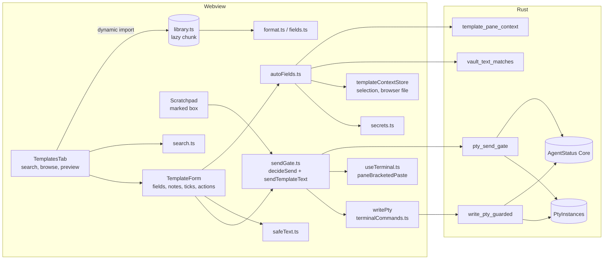
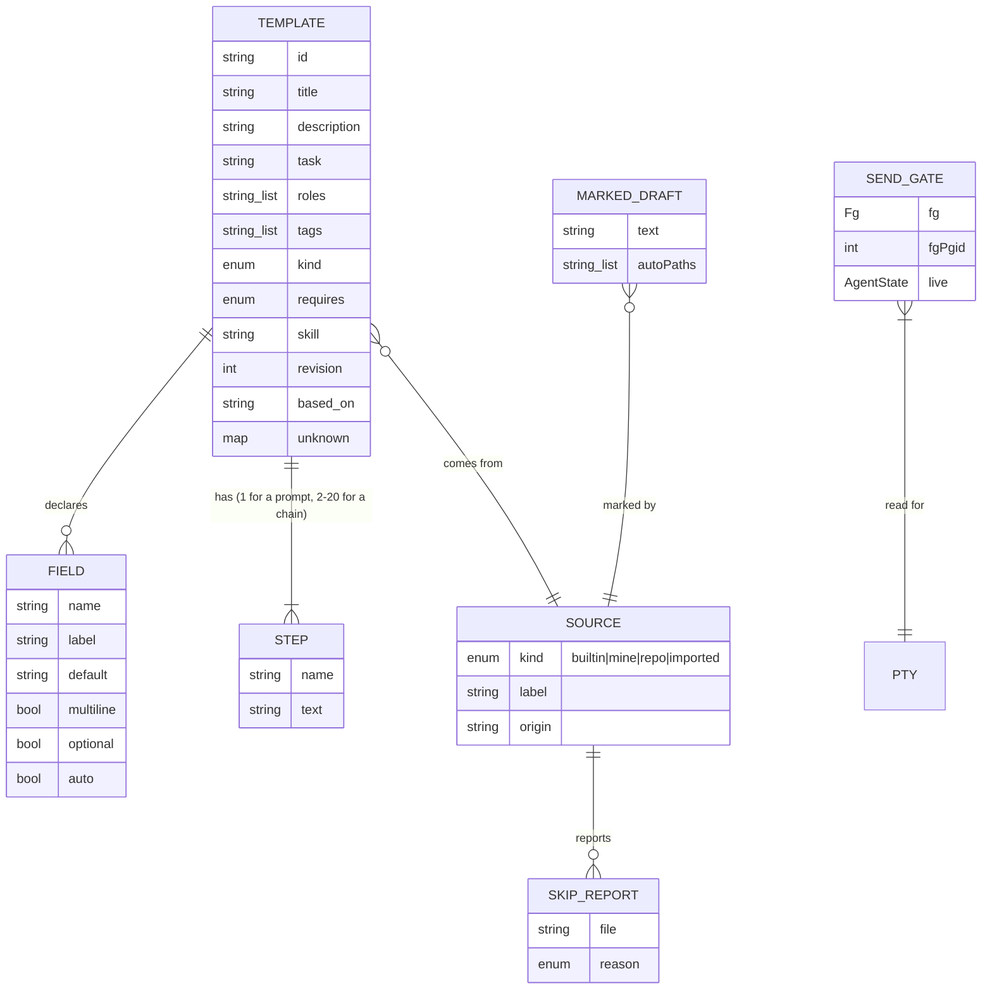

# Prompt templates: design for F5 slice S1

- **Status:** Proposed 2026-11-10, revision 1. Not approved.
- **PRD:** `docs/prd.md` F5, revision 5, approved by the owner 2026-11-10 with every
  open question at its recommendation (PR #115). This design covers **slice S1** only
  (F5.8), plus the F5.9 decisions that fix S1's data and APIs. It does not restate the
  criteria. Each section names the criteria it builds.
- **OQ-19 is accepted**, so S1 also builds PT-7 AC1 to AC3 (one form, step by step, no
  Run) for the 3 built-in chains. Auto-advance (Run) and every other chain stay in S5.
- **Verification command:** unchanged. Every S1 test runs under three lines that are
  already in force (`docs/architecture.md`, "In force"):
  - `npx tsc --noEmit`
  - `npm test`: the parser, the library test, search, safe text, the secret detector,
    the gate's decisions, the form, the marked box, and the static tests;
  - `cd src-tauri && cargo test`: the send gate, live status, the guarded write and its
    payload check, the pane context, `HEAD` reading, the vault match, and the stub-PTY
    tests.
  S1 adds no line. Section 12 says which test runs where.
- **Decisions:** ADR 0034 (the guarded send), ADR 0035 (format and bundling), ADR 0036
  (template text stays local). **Contract:** `.ade/context/prompt-templates.md`.

## 1. What S1 builds



| File | Kind | Role |
|---|---|---|
| `templates/prompts/<task>/<id>.md` | data | The built-in library, one file per template (ADR 0035) |
| `templates/prompts/README.md` | data | The format, task ids, and role ids not in `vendor/ade-setup/agents/` |
| `templates/prompts/SHIPPED` | data | Every id ever shipped, one per line; a removed id stays, suffixed ` removed` |
| `src/lib/templates/types.ts` | pure | `Template`, `Field`, `Step`, `Source`, `SkipReport` |
| `src/lib/templates/format.ts` | pure | `parseTemplate`, `writeTemplate`, the front matter reader and writer |
| `src/lib/templates/fields.ts` | pure | `scanFields`, `render` (one pass) |
| `src/lib/templates/safeText.ts` | pure | control and hidden characters, `!` and `/` lines, CRLF, `bracketedPayload` |
| `src/lib/templates/hiddenChars.json` | data | The hidden-character ranges, read by `safeText.ts` and by Rust |
| `src/lib/templates/secrets.ts` | pure | The secret detector and the secret-file list (PT-11 AC6: the one detector) |
| `src/lib/templates/search.ts` | pure | `buildIndex`, `search` |
| `src/lib/templates/library.ts` | I/O, lazy | Loads and parses the bundled files. Reached only by `import()` |
| `src/lib/templates/autoFields.ts` | I/O | Fills the auto fields for a target pane |
| `src/lib/templates/sendGate.ts` | pure + I/O | `decideSend` (pure) and `sendTemplateText` (the one send path) |
| `src/lib/templates/markedBox.ts` | I/O | The marked draft, the save checks |
| `src/stores/templateContextStore.ts` | store | Last selection per pane and per side-panel file; last file clicked in the browser. Memory only |
| `src/components/templates/TemplatesTab.tsx`, `TemplateForm.tsx`, `TemplatesTab.css` | UI | The tab and the form. The designer owns how they look |
| `src-tauri/src/pty.rs` | Rust | `pty_send_gate`, `write_pty_guarded` |
| `src-tauri/src/template_text.rs` | Rust | The payload check shared by `write_pty_guarded` |
| `src-tauri/src/githead.rs` | Rust | Reads a repo's `HEAD` without starting git |
| `src-tauri/src/templates.rs` | Rust | `template_pane_context`, `vault_text_matches` |
| `src-tauri/src/agent_status.rs` | Rust | `Core::live_state` |

Changed existing files: `Scratchpad.tsx` (the Templates panel becomes `<TemplatesTab>`;
the marked box; `PROMPT_TEMPLATES` removed), `terminalCommands.ts` (`writePty`'s guard
option), `useTerminal.ts` (`paneBracketedPaste`, selection recording),
`agentTrackerStore.ts` and its three `startSession` callers (`continuous`),
`FileBrowser.tsx` (one call on a file click), `persistence.ts` (one key), `lib.rs`
(command registration), `CodeView.tsx` (selection recording).

## 2. The file format (PT-1, ADR 0035)

### 2.1 Front matter

A file is `---\n`, the front matter, `---\n`, then the body. The front matter is a
**strict subset of YAML**. Every file ADE accepts is valid YAML, so editors highlight
it. ADE does not accept all YAML. The parser is hand-written in `format.ts`. No YAML
library is added, and `src/lib/frontmatter.ts` stays scalar-only and is not used here.

```yaml
---
id: code.implement-feature
title: Implement Feature
description: "Build a feature to its requirements, with tests."
task: implement
roles: [developer]
tags: [feature, tests]
kind: prompt
fields:
  - name: feature
    label: Feature
  - name: requirements
    label: Requirements
    multiline: true
    optional: true
revision: 1
---
Implement the following feature:
...
```

The grammar, line by line, between the two fences:

- A blank line, or a line whose first character is `#`, is ignored.
- A **top-level line** is `key: value` at column 0. `key` is `[a-z_][a-z0-9_]*`.
- A **value** is one of:
  - a **plain scalar**: the rest of the line, trimmed, not starting with `"`, `'`,
    `[`, `{`, `&`, `*`, `!`, `|`, `>`, `%`, `@` or a backtick, and not containing
    ` #` or `: `;
  - a **double-quoted string**. The only escapes are `\"` and `\\`. Any other
    backslash is broken front matter;
  - a **flow list** `[a, b, "c, d"]` of plain or double-quoted scalars, on one line;
  - **empty**, for `fields:` only, followed by its block.
- **`fields:` block.** Each item starts with `  - key: value` (two spaces, dash,
  space). Its other keys follow on lines `    key: value` (four spaces). The item keys
  are `name`, `label`, `default`, `multiline` and `optional`. Booleans are `true` or
  `false`.
- Integers (`revision`) are `[0-9]+`.
- An **unknown key** with a scalar or flow-list value is kept, in order, and ignored
  (PT-1 AC1). An unknown key followed by an indented block is broken front matter.
- Any other line, a duplicate key, or a known key with a value of the wrong type is
  **broken front matter**. A missing closing fence is too.

`writeTemplate` writes the known keys in the order above, then the unknown keys in
their original order. It quotes a string only when it would not read back as the same
plain scalar. The body is written byte for byte. PT-1 AC5's round trip is
`parse(write(parse(f))) == parse(f)` over every built-in template.

### 2.2 Body, steps and fields

- **Body.** The text after the closing fence's `\n`, with one trailing `\n` removed if
  the file ends with one. So a file whose last line ends with a newline has a body
  that does not.
- **Step marker (PT-1 AC2).** In a `kind: chain` file, a line that is exactly
  `<!-- step -->` or `<!-- step: Name -->` (Name: F1's text rule, 1 to 40 characters)
  starts a step. The body must start with a marker line. A step's text is everything
  between its marker line and the next marker line, or the end of the body, with the
  newline that ends the marker line, and the newline before the next marker, each
  removed once. Every other line, `---` included, is step text. 2 to 20 steps, each
  with non-blank text, else the chain is invalid. In a `kind: prompt` file, a marker
  line is ordinary text.
- **Why an HTML comment.** It cannot be confused with a Markdown rule. It renders as
  nothing in any Markdown viewer, so a chain file reads as one document on GitHub.
  It is a whole line, so a step's own text cannot contain one by accident.
- **Fields (PT-1 AC3).** `{{` + 1 to 40 characters other than `{`, `}` and newline +
  `}}` is a field token. `\{{` is a literal `{{`, and the backslash is dropped.
  - When the inside is a valid name (`[A-Za-z0-9_]{1,40}`), it is that field.
  - When it is not (`{{env.HOME}}`, `{{file:/etc/hosts}}`), it is a **typed field
    labelled with its raw text**. It is never an auto field and is left empty. This
    is how PT-5 AC2's test template opens with all three empty. The library test
    refuses such tokens in built-in files.
  - `render(template, values)` is one left-to-right pass over the tokens. A value is
    inserted as-is and never scanned again.

`parseTemplate(bytes, source)` returns `{ ok: Template } | { skip: SkipReport }`,
checking in this order: size over 32 KB (`too-large`); a control character anywhere
after CRLF→LF (`control-character`); front matter (`broken-front-matter`); a required
key (`missing-key`); `id` (`invalid-id`); a chain's steps (`invalid-chain`). These are
PT-1 AC4's six reasons. A lone `\r` is a control character.

## 3. The library and how it is bundled (PT-2, PT-14 AC1, ADR 0035)

- **Location.** `templates/prompts/<task>/<id>.md`. The file name is the id plus `.md`,
  and the folder is its `task`. The library test enforces both.
- **Bundled into the app's JavaScript, not as a Tauri resource.**
  `src/lib/templates/library.ts` holds
  `import.meta.glob("/templates/prompts/**/*.md", { query: "?raw", import: "default", eager: true })`.
  This is the same mechanism `src/data/roles.ts` already uses for
  `vendor/ade-setup/agents/*.md`. Because `library.ts` is reached only through
  `import("./library")`, Vite puts the library in one lazy chunk, loaded the first
  time the Templates tab opens.
  - **Why not `tauri.conf.json` resources.** A resource is a file read at run time
    through Rust and a path resolver. That adds a command, a failure mode (missing or
    unreadable resource), and a second code path for tests, which would read the
    folder another way. Inside the JS bundle, the library is signed and shipped
    exactly like ADE's code, needs no I/O, and the library test reads the very glob
    the app ships.
  - **Size.** 150 templates at about 2 KB each is about 300 KB raw, about 80 KB
    gzipped, in a chunk that loads only on first use.
- **PT-14 AC1's static test** (`src/lib/templates/__tests__/lazyLibrary.test.ts`).
  Starting from `src/main.tsx` and every other HTML entry Vite builds, it follows
  static `import … from` and `export … from` specifiers in the source files and fails
  if `src/lib/templates/library.ts` or any `templates/prompts` path is reached. It
  also fails if `library.ts` is imported statically anywhere. Dynamic `import()` is
  not followed.
- **Migration (PT-2 AC1).** Before `PROMPT_TEMPLATES` is removed, the story copies
  today's 27 entries verbatim into
  `src/lib/templates/__tests__/fixtures/legacy-prompts.json`, each with
  `{ name, category, prompt, blanks }`. `blanks` maps each field of the new file to
  the exact text that stood at its blank: `""` for an empty blank, `"[DESCRIBE
  FEATURE]"` for a bracket. The test renders each library template with its `blanks`
  and compares the result byte for byte with `prompt`. For the 3 chains, it joins the
  rendered steps with `\n---\n`. A `**Label:** ` blank becomes `**Label:** {{x}}`,
  keeping the space. An empty fence becomes ```` ```\n{{code}}\n``` ```` with
  `code` multiline.
- **The library test (PT-2 AC5)**, `src/lib/templates/__tests__/library.test.ts`,
  under `npm test`. It imports `library.ts` (the shipped glob) and checks:
  - every file parses with no skip report;
  - ids are unique; the file name and folder match; every id in `SHIPPED` is present
    or marked ` removed`; every present id is in `SHIPPED`;
  - normalised bodies are unique, and the 200-character minimum applies to templates
    that count (S1: the migrated 27 are exempt, PT-2 AC5);
  - the AC3 counts with the 3-row cap, as a table of `minimum per slice`. In S1 every
    minimum is 0; S2 and S5 raise them. The counting function is written and
    unit-tested in S1;
  - every field is declared or auto, and every token is a valid name; every `roles`
    id is in `vendor/ade-setup/agents/` or in `templates/prompts/README.md`'s list;
  - no control or hidden character, nothing `detectSecrets` flags, no absolute path
    (`/` followed by a letter at a word start, `~/`, `[A-Za-z]:\`, `\\`), and no
    `!` line after line-start whitespace;
  - **the pinned BMAD list.** A fixture in the test holds the 30 skill names of PT-2
    AC5 and the string `bda3c59 6.13.0-next`. The test reads
    `src-tauri/resources/bmad-v6/VERSION` and fails, naming the file, when it differs
    from the fixture. It also checks that each of the 30 names is a folder under
    `src-tauri/resources/bmad-v6/skills/`, and that every `skill` in the library is
    one of the 30.
- **Versioning (PT-2 AC6, S1 part).** `revision` is required on built-in templates and
  is a positive integer. The test fails when a built-in file's body or front matter
  changes but `revision` does not. It compares against
  `src/lib/templates/__tests__/fixtures/library-digests.json`, a map of id to
  `{ revision, sha256 }`. Regenerate it with
  `UPDATE_F5_DIGESTS=1 npx vitest run src/lib/templates/__tests__/library.test.ts`.
  Regenerating refuses a changed digest with an unchanged revision, so the flag cannot
  hide a missing bump. Release notes are DevOps' (F5.9).

## 4. Search and browse (PT-3 AC1 to AC3, AC6, PT-14 AC2)

- `buildIndex(templates)` keeps, per template, folded strings for title, description,
  tags, task, role names and body. Folding is NFD, combining marks removed, then
  lowercased.
- `search(index, query, filters)` splits the folded query on whitespace. Every word
  must be a substring of some field. Results rank by the number of words that match
  the title (more first), then by `requires` (PT-2 AC4: a template whose `requires`
  the target project lacks sorts after the others), then by title. It is plain
  substring work: about 2,000 × 6 `includes` calls per word, well under 100 ms.
- PT-14 AC2's budget test builds 2,000 generated templates, runs 3 warm-up and 20
  timed searches, and fails on any search over 300 ms.
- **BMAD fit (PT-2 AC4).** The target pane's project methodology comes from the
  existing detection behind `src/lib/projectMethodology.ts`, asked once when the tab
  opens and cached per project for the tab's life.
- **Plain text everywhere (PT-3 AC3).** Every place F5 shows template text renders
  React text nodes inside `<pre>` or `<span>`. It never uses `dangerouslySetInnerHTML`,
  a Markdown renderer, or a URL built from template text. A static test fails if any
  file under `src/components/templates/` contains `dangerouslySetInnerHTML`,
  `innerHTML`, `MarkdownView` or `marked`. Fields are marked with `<mark>` elements
  built from the token list, not from the text.
- **Hidden characters (PT-1 AC6, PT-4 AC4)** show as `⟨U+202E⟩` spans, built by
  `safeText.markHidden(text) → Array<string | { hidden: codePoint }>`. Every text that
  comes from a template (title, description, tags, labels, defaults, step names,
  body) goes through it.

## 5. Auto fields (PT-5 AC1 to AC6)

### 5.1 Where each value comes from

| Field | Source | Notes |
|---|---|---|
| `cwd` | Rust `template_pane_context(ptyId).cwd`, the same `pty_cwd` as `get_pty_cwd` | |
| `project` | `.project`: `project_root_of(cwd)` (`lib.rs`), the nearest ancestor holding `.git` | |
| `branch` | `.branch`: `githead::branch(project)` | Never starts git |
| `file` | `templateContextStore.browserFile`: the last file clicked in the file browser | Before F3, the window's |
| `open_file` | `viewContext.openFileOf(tab)`: today `tab.previewPath` | After F3 S1 story 4, `viewerStore.states[viewerKey].file?.path` |
| `selection` | `templateContextStore`: the last non-empty selection in the target view | 5.2 |
| `date` | the local date, `YYYY-MM-DD` | |

A path inside `project` is filled relative to it (prefix match on `project + "/"`).
Other paths are absolute. `open_file` reads through one adapter, `src/lib/templates/viewContext.ts`.
F3 S1 story 4 removes `Tab.previewPath`, so `tsc` fails on the adapter, and whichever
of the two stories lands second updates it.

**`githead::branch(project)`** reads `<project>/.git`, with `symlink_metadata` first so
a link is not followed:
- a **directory**: the git dir is that directory;
- a **regular file** of at most 4 KB holding `gitdir: <path>`: the git dir is that
  path, resolved against `project` (a worktree or submodule);
- anything else: the branch is empty.

It then reads `<gitdir>/HEAD`, which must be a regular file of at most 4 KB:
- `ref: refs/heads/<name>` gives `<name>`;
- 40 or 64 hex characters give the first 7;
- anything else gives empty.

No process is started, so neither `core.fsmonitor` nor a hook can run. PT-5 AC1's
marker test sets both and asserts no marker file appears. The same module is where S4
adds root-commit reading (F5.9). S1 builds only `branch`.

### 5.2 Selections

- `useTerminal.ts`, in `openTerminal`: `term.onSelectionChange` records
  `{ kind: "terminal", paneId, text }` when `term.getSelection()` is non-empty.
- `CodeView.tsx`: Monaco `onDidChangeCursorSelection` records
  `{ kind: "file", path, text }` when the selection is non-empty.
- The store keeps **one** latest selection per pane and one for the side panel's code
  viewer, each with a sequence number. It does not keep a history.
- "The target view's last selection" is the one with the highest sequence number among
  the target view's panes and the side panel's viewer. Before F3, the side panel is the
  window's. Editor tabs are their own tab, not part of a terminal view, so they do not
  count in S1. The Thoughts panel and the HTML preview never record (F5.0).
- A selection over 16 KB is recorded as `{ tooLong: true }` and never filled.

**Before `selection` is filled**, in this order, any refusal leaves it empty with the
note "Not filled: the selection looks like a secret":
1. `kind: "file"` and `secrets.isSecretFile(path)` (PT-5 AC3's list, the last two
   entries matched on the last two path parts);
2. `secrets.detectSecrets(text)` is non-empty (PT-5 AC4);
3. `invoke("vault_text_matches", { text })` is `true` (5.3).

### 5.3 The vault match: values never reach the webview (PT-5 AC4)

`vault_text_matches(text: String) -> bool`, `#[tauri::command(async)]` in
`templates.rs`:
- It rejects (`false`, and no keychain read) text over 16 KB.
- It reads the values with `vault::env_for_terminals(&app)`, which the vault already
  caches for new terminals.
- It returns `true` when the text **contains** a value of 8 or more characters, or
  **equals** a shorter one.
- It returns only the boolean: never which secret matched, its name, or its length.
  It logs nothing.

The webview never calls `vault_get` or `vault_list` for F5. A static test fails if any
file under `src/lib/templates/` or `src/components/templates/` contains `vault_get`,
`vault_list` or `env_for_terminals`.

Matching runs in Rust because the values must not cross into the webview (PT-5 AC4).
Rust already holds them to start terminals (`pty.rs:273`), so this adds no new place
where they live.

### 5.4 The secret detector (PT-11 AC6)

There is one implementation, `secrets.ts`:
`detectSecrets(text): Array<{ kind, start, end }>`. It is used by auto-fill (S1), the
library test (S1), the template editor's warning (S3) and the import preview (S6).
Its patterns cover F5.1's list:
- PEM private-key blocks;
- AWS `AKIA`/`ASIA` keys, and GCP service-account JSON (`"type": "service_account"`
  with `"private_key"`);
- GitHub `ghp_`, `gho_`, `ghu_`, `ghs_`, `ghr_` and `github_pat_` tokens; GitLab
  `glpat-`; Slack `xox[abprs]-`; Stripe `sk_live_` and `rk_live_`; Anthropic
  `sk-ant-`; OpenAI `sk-` and `sk-proj-`;
- JWTs: three base64url segments, the first decoding to JSON with `"alg"`;
- `NAME=value` and `NAME: value` lines where NAME ends in `KEY`, `TOKEN`, `SECRET`,
  `PASSWORD` or `PASSWD`, case-insensitive, and the value has 8 or more characters.

Each pattern has a positive and a negative test. Rust has no detector of its own.

## 6. Sending (PT-6 AC1 to AC5, AC8, PT-15, ADR 0034)

### 6.1 The new Rust check: `pty_send_gate`

```rust
// src-tauri/src/pty.rs
#[derive(Serialize)] #[serde(rename_all = "camelCase")]
pub struct SendGate {
    pub fg: Fg,                  // today's classification, unchanged
    pub fg_pgid: Option<u32>,    // tcgetpgrp of the PTY, None when there is none
    pub live: Option<AgentState> // None: no live status (F5.1)
}
#[tauri::command(async)]
pub fn pty_send_gate(pty: State<PtyManager>, agent: State<AgentStatus>, id: u32) -> Result<SendGate, String>
```

- `fg` and `fg_pgid` come from **one** read of `master.process_group_leader()` under
  the instances lock, the same read `pty_foreground_job` makes.
  `pty_foreground_job` is unchanged.
- **`live`** comes from the new `Core::live_state(pty, fg_pgid, pgid_of, start_of)`,
  with the two OS lookups injected, so it is unit-tested with no processes. A session
  of that PTY counts as live only when all of these hold:
  - it has a `process` `(pid, start)`;
  - `start_of(pid) == Some(start)`: alive, and not a reused pid;
  - `pgid_of(pid) == fg_pgid`: `getpgid(2)`, the pid is in the foreground job.
- **Several live sessions:** any `needsYou` gives `NeedsYou`; else any `working` gives
  `Working`; else the most urgent of the remaining ones (`waiting`, `ready`,
  `finished`), all of which are at the input. With no live session, `live` is `None`.
  Sessions without a pid never count (F5.1). This is **not** `pane_state`'s `max()`:
  `AgentState`'s derived order puts `waiting` above `working`, so `max()` would let a
  `working` session hide behind a `waiting` one. A test covers exactly that pair.
- On non-Unix it returns `Err`, as `pty_foreground_job` does. The webview reads that
  as "no busy check": the Windows path.
- `agent_status_watch` is **unchanged**. It stays a status-dot stream and carries no
  pid. The form re-reads `pty_send_gate` when it opens, once a second while it is
  open, whenever `agent_status_watch` reports a change for the target PTY, and again
  just before a write. Each read is one `tcgetpgrp`, at most one sysinfo lookup for
  the leader's name, and two cheap syscalls per tracked session.

### 6.2 The decision (pure)

`decideSend(input): { ok: true, needsTick: Tick[] } | { ok: false, reason }` in
`sendGate.ts`. Its input is:

```ts
interface SendInput {
  tabIsOrchestrator: boolean;
  gate: SendGate | "unsupported" | "error";  // "unsupported": Windows
  agentBinaries: string[];                   // binaryFor(p) for every p in PROVIDERS
  bracketedPaste: boolean | null;            // null: no xterm instance for the pane
  text: string;                              // the whole rendered text (every step)
  source: Source;
  autoValueLines: Set<number>;               // lines that hold an auto-filled value
  hidden: boolean;
  continuous: boolean;                       // the pane's tracker session, PT-15 AC3
  ticks: Set<Tick>;
  requiredEmpty: boolean;
}
```

The rules apply in this order, and the first failing rule gives the reason:
1. **Orchestrator** (PT-6 AC1).
2. **A required field is empty**, or a field holds a control character (PT-4 AC2, AC5).
3. **Control characters** in the text (PT-6 AC5).
4. **A `!` line**, after line-start whitespace (PT-6 AC5): "Line n starts with `!` …".
5. **Not an agent pane** (PT-6 AC2, AC3):
   - `gate` is `"error"`;
   - or `fg.kind` is not `busy`;
   - or no entry in `fg.names` matches an agent binary.

   Matching uses the busy check's existing rule: equal, or a 15-character name that is
   a prefix of the binary (`pane-busy.md`). On Windows (`"unsupported"`), the pane is
   not known to be an agent pane, so the tick `windowsAgent` is required.
6. **No bracketed paste** (PT-6 AC5): `bracketedPaste !== true`.
7. **Live status** `needsYou` or `working` (PT-6 AC4): "The agent is waiting for your
   answer" or "The agent is working".
8. **Ticks still needed:**
   - `noLiveStatus`, when `live` is null (PT-6 AC4);
   - `hiddenChars`, when `hidden` (PT-4 AC4);
   - `slashCommands`, when the source is not built-in and the text has a `/` line, or
     a `/` line is in `autoValueLines` (PT-15 AC2);
   - `noPermissions`, when `continuous` and the source is not built-in (PT-15 AC3).

   Each tick has its own label (PT-4 AC4, PT-15 AC3). Ticks are cleared after every
   send and whenever the form reopens.

### 6.3 The write: one choke point, re-checked in Rust

```mermaid
sequenceDiagram
  participant F as TemplateForm / marked box
  participant G as sendGate.ts
  participant X as xterm (useTerminal)
  participant W as writePty
  participant R as Rust (pty.rs)
  participant A as AgentStatus Core
  F->>G: sendTemplateText(paneId, text, source, ticks)
  G->>G: normalise CRLF, control and ! checks (pure)
  G->>R: pty_send_gate(ptyId)
  R->>A: live_state(pty, fg_pgid)
  R-->>G: {fg, fgPgid, live}
  G->>X: paneBracketedPaste(paneId)
  G->>G: decideSend(...) → ok, ticks satisfied
  G->>W: writePty(ptyId, ESC[200~ text ESC[201~ \r, guard{pgid, allowNoLive})
  W->>W: input hold (hotfix 0.23.2) → refuse if starting
  W->>R: write_pty_guarded(id, data, guard)
  R->>R: payload check (template_text.rs)
  R->>R: tcgetpgrp == guard.pgid ?
  R->>A: live_state again: not needsYou/working; None needs allowNoLive
  R->>R: instance.input.send(data)
  R-->>W: Ok | Err("gate:…")
  W-->>F: resolved | rejected with the reason
```

- **`writePty(id, text, opts?)`** keeps its signature and gains an optional
  `opts.guard`. It applies the input hold first, exactly as today. Without a guard, it
  calls `write_pty` as today. With a guard, it calls `write_pty_guarded`.
  `sendTemplateText` is the only caller that passes a guard. A static test fails if
  `invoke("write_pty_guarded"` appears outside `terminalCommands.ts`, or if `writePty(`
  appears in `src/lib/templates/` or `src/components/templates/` outside
  `sendGate.ts`.
- **`write_pty_guarded(id, data, guard: { pgid: Option<u32>, allowNoLive: bool })`**
  is a **sync** `#[tauri::command]`, like `write_pty`. Tauri runs sync commands on the
  main thread in arrival order, so a guarded write keeps its order relative to the
  user's keystrokes. A source test asserts the attribute, as
  `write_pty_stays_a_sync_command` does. Under the instances lock, it refuses with a
  `gate:` error and writes nothing when:
  - the payload check fails (`gate:text`);
  - on Unix, `guard.pgid` is `None`, or `tcgetpgrp` no longer equals it
    (`gate:changed`: another program came to the front);
  - `live_state` is `NeedsYou` or `Working` (`gate:busy`);
  - `live_state` is `None` and `!allowNoLive` (`gate:tick`: status went away after the
    form decided no tick was needed).

  All of these are cheap: one `tcgetpgrp`, and one `getpgid` plus one start-time
  lookup per tracked session.
- **The payload check** (`template_text.rs`, shared by tests). The payload must be
  exactly `ESC[200~ body ESC[201~` followed by `\r`, or nothing, or be `\r` alone
  (the delayed submit, below). The body must be valid UTF-8 and have:
  - no control character (C0 except `\t` and `\n`, DEL, C1);
  - no `ESC[200~` or `ESC[201~` (already impossible once ESC is refused);
  - no line whose first character, after `char::is_whitespace` characters (Unicode
    `White_Space`) and hidden characters, is `!`.

  The hidden ranges come from `src/lib/templates/hiddenChars.json`, which Rust reads
  with `include_str!`. One table serves both languages. A vitest test checks that the
  JSON covers Unicode category Cf plus U+2028 and U+2029 (`/\p{Cf}/u` over the whole
  BMP and the tag block).
- **Why check twice.** The webview check gives the message, and the Rust check is the
  guarantee. It holds even if a later webview change calls the guarded command with a
  bad payload, and it closes the gap between the gate read and the write for the
  foreground job and live status. What is left is the 2-second status lag that G4
  accepts.
- **The Enter after the paste.** By default the `\r` goes in the same write, right
  after `ESC[201~`. `src/lib/templates/submit.ts` has a per-binary
  `SUBMIT_GAP_MS: Record<string, number>`, `{}` by default. When a binary has a gap,
  the paste goes without `\r`, and after the gap a second guarded write sends `\r`
  alone, with the same `pgid`. That write is re-checked, so if the job changed
  meanwhile, nothing is pressed. **The table's values come from the probe in 6.5.**
- **Images (PT-6 AC8).** `sendTemplateText` takes only text. The Scratchpad's images
  are never passed.
- **History (PT-11 AC4).** `sendTemplateText` never calls `addToHistory`. The form has
  no access to it, and the marked box's send path skips it (section 7).

### 6.4 Bracketed paste mode (PT-6 AC5)

- `useTerminal.ts` exports `paneBracketedPaste(paneId): boolean | null`. It returns
  `instances.get(paneId)?.term.modes.bracketedPasteMode ?? null`. No instance (a
  restored sub-terminal not yet shown) gives `null`, so Send is disabled.
- It is read when the gate is evaluated, and again synchronously just before
  `writePty` is called.
- A pane moved into a detached window loses the mode (F5.0). Send there is disabled
  until S5's PT-6 AC9. S1 does nothing about it, as the PRD accepts.

### 6.5 The probe F5.9 asks for

This has **not been run**: running it submits a real prompt to a real agent on the
owner's account (owner question Q2). It is task 1 of the gate story. The developer
runs each of `claude` (the installed version), `codex` and `ollama run <small model>`
in an ADE terminal and checks three things:
- whether it sends `ESC[?2004h`. Record it from the provider-stub harness's raw
  capture, or `script -q`;
- whether a single write of `ESC[200~hi\nthere ESC[201~\r` submits a two-line prompt;
- whether a single write of `ESC[200~hi ESC[201~` followed by `\r` 30 ms later
  submits it.

The developer records the versions and results in `.ade/context/prompt-templates.md`
("Provider probe") and sets `SUBMIT_GAP_MS` from them. If ollama never sends
`ESC[?2004h`, its panes get Insert and Copy only, which is what PT-6 AC5 already does
with no extra code.

**The Windows check** (ConPTY passing `ESC[?2004h`) needs a Windows machine. The
DevOps engineer runs it on the CI Windows runner's interactive job, or the owner runs
it, and the result goes in the same section and to the PM (OQ-10's note). S1's code
is the same either way.

### 6.6 Continuous mode on the tracker (PT-15 AC3)

- `AgentSession` gains `continuous?: boolean`.
- `startSession(paneId, …, cwd?, opts?: { continuous?: boolean })` stores it. Its
  three callers pass the value they launched with: `agentLaunch.ts:91` with
  `prepared.continuous`, `AgentPicker.tsx:250` with the same, and
  `OrchestratorTab.tsx:355` with `false`.
- Restored sessions without the field read as `false` and show no warning.
- `better-terminal-agent-tracker` is a shared key, and a boolean is not template text,
  so this does not touch D7.

### 6.7 Built-in chains, step by step (OQ-19: PT-7 AC1 to AC3 for the 3 built-ins)

- A chain's form fills every field once and shows every rendered step, numbered and
  named.
- Its actions are **Insert into box**, **Copy** and **Send step n of m**. Each step is
  a separate `sendTemplateText`, with every check and tick re-evaluated and every tick
  cleared after the step.
- Before step 1, every step must pass rules 3, 4 and 6 of 6.2 and the hidden-character
  tick (PT-7 AC2).
- The step index is form state only. Closing the form ends the chain, and no chain
  state is saved.
- There is no Run in S1.
- The marked box's Run Chain stays disabled in S1 (PT-11 AC4).

## 7. The marked box and the stores (PT-11 AC2 to AC5, PT-12, ADR 0036)

### 7.1 The marked draft

```ts
// src/lib/templates/markedBox.ts
interface Mark { source: SourceRef; autoPaths: string[] }   // autoPaths: every value Insert filled into cwd/project/file/open_file
interface MarkedDraft { v: 1; text: string; mark: Mark }
export const MARKED_DRAFT_KEY = "ade-template-draft";
export function persistDraft(text: string, mark: Mark | null): void;
export function loadDraft(): { text: string; mark: Mark | null };
```

- Scratchpad's two draft writers, the 400 ms debounce and the `pagehide` flush, both
  call `persistDraft`.
  - **Unmarked:** it writes `ade-scratchpad-draft` exactly as today.
  - **Marked:** it writes `ade-template-draft` and **removes** `ade-scratchpad-draft`.
  - **Empty text:** it removes both and clears the mark.
- `loadDraft` prefers `ade-template-draft` when it parses, so a restart restores the
  box marked.
- `ade-template-draft` is in `PERSISTED_KEYS`, so it is saved to `state/kv` like
  today's draft. It is in neither `SHARED_KEYS` nor `DEVICE_KEYS`, so `export_state`
  never reads it.
- That makes it an **unexported store**, not stripping on export. Stripping would mean
  a second parser of the draft in `sync.rs`, and would still export whatever the
  stripper missed.
- Like today's draft key, the last window to write wins. Every window that writes it
  writes its own box (ADR 0033's single-writer exemption applies by the same reasoning
  as `ade-scratchpad-draft`).
- **Insert into box** calls `loadText(rendered)` as today, then sets the mark with the
  template's source and the absolute values Insert filled into the four path fields.
  The mark clears only when the box becomes empty (PT-11 AC4).

### 7.2 What a marked box does differently

| Action | Unmarked (PT-12, unchanged) | Marked |
|---|---|---|
| Send to Terminal, ⌘Enter | today's `writePty(text + "\r")`, adds history | `sendTemplateText` with the mark's source, over the box's whole text; **no history entry**; images are not sent, and the box keeps them |
| On an Orchestrator tab | `orchestrator-send` | disabled, PT-6 AC1's message; no event |
| Run Chain (`---` lines) | today's `sendChain` | disabled until S5 |
| ⌘S save note | saves | `markedSaveCheck(text, mark)`: if any absolute auto path still appears in the text, it is **refused** with PT-11 AC4's message listing them; otherwise a confirm that names sync, and it saves only on confirm |

"Absolute" means starting with `/`, `~`, `[A-Za-z]:` or `\\`. A relative value never
blocks.

### 7.3 Keys

| Key | S1 | `PERSISTED_KEYS` | Syncs |
|---|---|---|---|
| `ade-template-draft` | added | yes | never (PT-11 AC2) |
| `better-terminal-prompt-history` | unchanged; F5 adds no entry | yes | shared, as today |
| `better-terminal-agent-tracker` | gains `continuous` | yes | shared, as today |

**Reserved for later slices**, not created in S1. S3 decides their shapes and the
per-id merge:
- `ade-templates-mine` (synced by S3's merge);
- `ade-templates-favourites` (synced by S3's merge, except repo ids);
- `ade-templates-recents` (never);
- `ade-templates-repo-approvals` (S4, never).

Nothing else in S1 is stored: the library, the index, selections and the last
browser file are in memory only.

**PT-11 AC3's static test**, `src/lib/templates/__tests__/storageKeys.test.ts`:
- It lists F5's keys in `F5_KEYS` (persisted) and `F5_EPHEMERAL_KEYS` (none in S1),
  each with a reason.
- It reads `src/lib/persistence.ts` and `src-tauri/src/sync.rs` as text, parses the
  `PERSISTED_KEYS` set and the `SHARED_KEYS` and `DEVICE_KEYS` arrays, and asserts:
  every F5 key is persisted or ephemeral; no F5 key is in either sync list (S3 will
  allow-list its two); and every `localStorage` key literal under
  `src/lib/templates/` and `src/components/templates/` is in `F5_KEYS`.
- A Rust test in `sync.rs`, `f5_keys_never_sync`, asserts `ade-template-draft` is in
  neither array. If F3 S1 story 2's or the Thoughts panel's Rust key-set test has
  landed, F5 adds its key to that test instead of adding a second one. When ADR
  0017's test lands, F5's list folds into it (PT-11 AC3).

**PT-11 AC4's six-way test** runs in vitest against `localStorage`. It then checks the
export by running the same marker set through a Rust export test: the vitest test
writes the resulting `localStorage` snapshot to a fixture,
`src-tauri/tests/fixtures/f5-local-state.json`, through
`UPDATE_F5_STATE=1` the same way F3's golden fixture works, and `sync.rs`'s test loads
it into a temporary kv folder, runs `export_state`, and asserts neither marker is in
the repo, under `shared/` or `devices/`. The vitest half also asserts the fixture
matches what it produces, so a stale fixture fails.

## 8. Data model



`Template` holds `body` (prompt) or `steps` (chain), plus `raw` (the parsed front
matter) for the round trip. A `Source` in S1 is always `builtin` for real templates.
S1's tests build `mine`, `repo` and `imported` sources from fixtures (PT-15's
preamble).

## 9. The Templates tab and the form (PT-3, PT-4, PT-13 AC1, PT-16 AC1 to AC3)

The designer owns the look. This section fixes only structure and behaviour that
tests depend on.

- **Mounting.** Scratchpad's `panel === "templates"` branch renders `<TemplatesTab>`
  in place of today's chip strip. `TemplatesTab` loads the library with
  `import("../../lib/templates/library")` on mount. While it loads, it shows a busy
  row; if the load fails, it shows an error row. Skip reports are listed at the end of
  the list (PT-1 AC4).
- **Form structure (PT-16 AC1).** The form root has `data-f5-form`. Its container,
  either the list area or the composer's place, gets `data-f5-form-open` while the form
  shows. Inside the form root are exactly two children, in order:
  - `[data-f5-scroll]`, which holds the fields and the rendered text;
  - `[data-f5-actions]`, which holds Insert, Send (or "Send step n of m"), Copy, Back,
    the ticks and the source badge.

  `TemplatesTab.css` carries the rules, a new file owned by F5 and added to
  `noInlineStyles.test.ts`:

  ```css
  [data-f5-form-open] { overflow: hidden; }
  [data-f5-form] { display: flex; flex-direction: column; min-height: 0; flex: 1 1 0; }
  [data-f5-scroll] { overflow-y: auto; min-height: 0; flex: 1 1 0; }
  [data-f5-actions] { flex: none; }
  ```

  The F5 rules stay out of `Scratchpad.css`, which belongs to the Thoughts panel's
  work, so the two can merge without editing each other's rules. PT-16 AC4's string
  test reads both files.
- **When the list area is too short** (below the designer's minimum), the form takes
  the composer's place. Scratchpad hides the composer and keeps its state; the box's
  text, draft and images are untouched.
- **Escape (PT-16 AC3).** `TemplatesTab`'s root `onKeyDown` consumes Escape, calling
  `stopPropagation` and `preventDefault`, when there is a step to go back: form to
  list, or search text to an empty search. React's root listener runs before
  `useKeybindings`' `window` listener, so the window never sees a consumed Escape. At
  the root (the list with an empty search) it does not consume:
  - in the main window, `useKeybindings` closes the panel as today;
  - in `DetachedApp`, which has no such handler, `TemplatesTab` gets
    `onEscapeAtRoot`, and DetachedApp passes a function that focuses the active pane
    (`focusActivePane` from `pane-focus.md`, or today's selector if that helper has
    not landed).
- **Announcements (PT-13 AC1).** F5 calls `say(text)` from
  `src/stores/announceStore.ts`, the contract in `thoughts-panel.md`, which
  `SubTerminalAnnouncer` subscribes to. If F5 lands before the Thoughts work that
  builds it, F5's story builds `announceStore.ts` exactly to that contract (as
  `pane-focus.md` does for its helper), and the Thoughts story reuses it. A static test
  fails if any file under `src/components/templates/` contains `aria-live`.
- **Keyboard and G2's three keys (PT-3 AC6).** Typing goes to the search box. ↓ moves
  the highlight. Enter picks. For an all-auto template, the form opens with Send
  focused when Send is enabled. ⌘Enter (Ctrl+Enter) sends from anywhere in the form.
- **Fill form (PT-4).** Inputs are in first-use order. Auto values are filled and
  marked, and every value can be edited (PT-5 AC5). CRLF becomes LF on input. A value
  holding a control character shows PT-4 AC5's message and disables Send, Insert and
  Copy. The rendered text updates on every change, through a `useMemo` over `render`.

## 10. Failure modes

| Failure | Handling |
|---|---|
| A library file is invalid | That file is skipped and reported; the rest load (PT-1 AC4). The library test keeps it from shipping |
| The library chunk fails to load | The tab shows an error row; Insert, Copy and Send are unavailable; the box works as today |
| `pty_send_gate` errors (PTY gone, no pid) | "cannot tell": not an agent pane; Send disabled with no override (PT-6 AC2) |
| The foreground job changes between the gate and the write | `write_pty_guarded` refuses with `gate:changed`; nothing is written; the form re-reads and shows the new reason |
| A permission prompt arrives after the gate read | Refused by the write's re-check if the status has arrived; within the 2 s hook lag it cannot be seen (G4, accepted) |
| The terminal is still starting | `writePty`'s hold refuses with today's toast; the form keeps its values |
| The target pane has no xterm instance | `paneBracketedPaste` gives `null`; Send disabled |
| The active tab is an editor or other non-terminal tab | No target pane; Send disabled, "No terminal to send to"; Insert and Copy remain |
| A pane moved to a detached window | Bracketed paste is off; Send disabled until S5 (accepted) |
| The vault is locked | `env_for_terminals` skips unreadable secrets, so they cannot be matched; the detector still runs. Accepted: the form shows the value before anything is sent (PT-5 AC5) |
| `HEAD` unreadable, a link, or odd | `branch` empty |
| `localStorage` full when writing the marked draft | Not persisted, as today's draft; `ade-scratchpad-draft` is still removed, so template text never falls back into the exported key |
| A process in the terminal forges status or names itself `claude` | Out of scope (F5.5) |

## 11. Interplay with the Thoughts panel (PR #114, #117) and F3 S1 (PR #118), and the landing order

**Shared files:**

| File | F5 S1 | Thoughts (PR #117 plan) | F3 S1 (PR #118) |
|---|---|---|---|
| `Scratchpad.tsx` | the Templates branch, the marked box, send/⌘S gating, `PROMPT_TEMPLATES` removed | panel internals (same-node tree, chrome, handles, lists, a11y); open state moves up to the window | — |
| `Scratchpad.css` / `TemplatesTab.css` | F5 rules in its own file | `Scratchpad.css` (new) | — |
| `persistence.ts` | `ade-template-draft` | two keys, keys-not-values queue | story 2: `ade-viewer-state` |
| `sync.rs` tests | `f5_keys_never_sync` (or joins the existing one) | TR-3 key test | story 1 strip, story 2 key test |
| `FileBrowser.tsx` | one call in the file-click handler | — | story 3 rewrites the tree |
| `tabStore` `previewPath` | read through `viewContext.ts` | — | story 4 removes it |
| `announceStore.ts`, `paneFocus.ts` | uses | builds | story 4 reuses `paneFocus` |
| `useTerminal.ts`, `terminalCommands.ts`, `agentTrackerStore.ts`, Rust | F5 only | — | — |

**F5 S1 split into stories.** This is a suggestion for the scrum-master. Each story
passes the verification command on its own.
- **E1 format:** `types`, `format`, `fields`, `safeText`, `hiddenChars.json` and
  `secrets`, all pure.
- **E2 library:** the 27 migrated files, `SHIPPED`, the README, `library.ts`, the
  library test, the lazy static test, search and its budget test.
- **E3 gate:** the Rust gate (`pty_send_gate`, `live_state`, `write_pty_guarded`,
  `template_text.rs`), `writePty`'s guard, `paneBracketedPaste`, `decideSend`,
  `sendTemplateText`, the tracker's `continuous`, the provider stub and the probe.
- **E4 context:** `template_pane_context`, `githead`, `vault_text_matches`, the
  context store, selection recording, the file-click call, and `viewContext.ts`.
- **E5 tab and form:** `TemplatesTab`, `TemplateForm`, the CSS, Escape, announcements,
  built-in chains step by step, and the replacement of `PROMPT_TEMPLATES`.
- **E6 marked box:** the draft, the box's gated send, ⌘S, the Orchestrator rule, the
  keys static test, and the six-way export test.

**Recommended landing order:**
1. **Now, in parallel** with F3 S1 stories 1 to 3 and the Thoughts plan's step 1:
   - **E1 and E3** (no shared file except `useTerminal.ts`, which neither of the other
     works touches);
   - then **E2** (after E1) and **E4** (after E1). E4's one line in `FileBrowser.tsx`
     goes into whichever click handler exists when it rebases. If F3 story 3 is in
     review at the same moment, E4 waits for it rather than racing it.
2. **The Thoughts panel-internals story** (its step 1, `Scratchpad.tsx`/`.css`) lands
   **before E5 and E6**. It is the larger restructuring of `Scratchpad.tsx`, so E5
   and E6 rebase onto its tree rather than the other way round. Both F5 stories keep
   their `Scratchpad.tsx` edits small:
   - E5 swaps the Templates branch for one component;
   - E6 routes the draft writers through `persistDraft` and the send, ⌘Enter, ⌘S and
     Run Chain paths through one `useMarkedBox` hook.
3. **E5, then E6**, after step 2. These do not wait for F3 S1 story 4.
4. **The Thoughts layout-host story** lands after F3 S1 story 4, as the owner wants.
   Since E5 has landed by then, the host story merges second and **carries PT-16
   AC4's test** (F5.8 [Second] table): both docks, `data-placement` right and
   bottom, and the string test over `Scratchpad.css` and `TemplatesTab.css`.
5. If E5 slips past the host story, E5 carries PT-16 AC4 instead. That is the F3 D14
   rule; the scrum-master records it in `.ade/context/f5-merges-second.md`.

**F5's other [Second] criteria in S1** are unaffected by this order:
- the `HUB_CLAUDE` binary: E3, with F2 slice 1;
- PT-5 AC7: E4, with F1's PE-4 AC4 story;
- PT-13 AC2: E5, with the Thoughts story that mounts the announcer in `DetachedApp`;
- PT-14 AC1's timing: E2, with ADR 0030's runner.

For `HUB_CLAUDE`, `decideSend` takes `agentBinaries` as an input precisely so that F2's
reader adds one entry and nothing else changes.

## 12. Tests and the verification command

| Criterion | Test file | Line |
|---|---|---|
| PT-1 AC1 to AC6 | `src/lib/templates/__tests__/format.test.ts`, `fields.test.ts` | `npm test` |
| PT-2 AC1, AC2, AC5, AC6 (S1) | `library.test.ts`, `legacyPrompts.test.ts` | `npm test` |
| PT-2 AC4, PT-3 AC1 to AC3, AC6, PT-4, PT-12, PT-13 AC1, PT-16 AC1 to AC3, OQ-19 chains | `src/components/templates/__tests__/*.test.tsx` | `npm test` |
| PT-5 AC1 (`cwd`, `project`, `file`, `open_file`, `selection`, `date`), AC2 to AC6 | `autoFields.test.ts` (with `invoke` mocked for Rust values), `secrets.test.ts` | `npm test` |
| PT-5 AC1 `branch` (fsmonitor and hook marker), PT-5 AC4 vault side | `githead.rs`, `templates.rs` unit tests | `cargo test` |
| PT-6 AC1 to AC5, AC8, PT-15 | `sendGate.test.ts` (decision table, `writePty` spy) | `npm test` |
| PT-6 AC4 live rule, AC5 payload, the write re-check | `agent_status.rs` `live_state` tests; `template_text.rs`; `pty.rs` guarded-write tests | `cargo test` |
| PT-6 AC5 end to end | `pty.rs` stub test (Unix): a real PTY runs the provider stub (F5.9), which turns bracketed paste on and records stdin; a three-line template and a one-line template with a tab each arrive as exactly one paste and one `\r` | `cargo test` |
| PT-11 AC2 to AC5 | `storageKeys.test.ts`, `markedBox.test.ts`, `sync.rs` `f5_keys_never_sync` and the export test | `npm test`, `cargo test` |
| PT-14 AC1 (static), AC2 | `lazyLibrary.test.ts`, `searchBudget.test.ts` | `npm test` |
| PT-15 AC3 | `agentTrackerStore.test.ts` | `npm test` |
| types | — | `npx tsc --noEmit` |

**Provider stub location.** `src-tauri/tests/fixtures/provider-stub/claude`, a POSIX
shell script with mode 0755. It prints `ESC[?2004h` and `> `, then
`cat > "$STUB_OUT"`. Before that it writes `"$@"` to `"$STUB_OUT.argv"`. The Rust test
puts its folder first on `PATH` in the PTY's environment. QA confirms this location
in E3 (F5.9).

**What green means for S1:**
- the library is well-formed;
- today's 27 prompts render byte for byte;
- no template text is written to a pane that is not an agent pane, that has no
  bracketed paste, or whose live status is busy;
- every write is one checked paste;
- no auto field holds a secret marker;
- no F5 key, and no template text, reaches sync's export.

QA's security tests (F5.9) must each fail when run against `main`. For example,
`sendGate.test.ts`'s shell case fails against today's `send`.

## 13. Owner questions

- **Q1. Landing order.** Recommended: section 11. F5's engine stories go now; E5 and
  E6 go after the Thoughts panel-internals story and before the Thoughts layout host,
  which waits for F3 S1 story 4 as you asked. Alternative: E5 and E6 first, and the
  Thoughts internals story rebases onto them. That gives smaller F5 diffs, but more
  rework in the bigger Thoughts restructuring.
- **Q2. The live provider probe (6.5).** It types one short prompt, "reply OK", into
  real `claude`, `codex` and `ollama` sessions, which uses your accounts. Recommended:
  yes, as task 1 of E3, with the versions recorded. Without it, `SUBMIT_GAP_MS`
  stays empty. That is still safe, because nothing runs if the Enter is swallowed, but
  Send might paste without submitting.
- **No verification line is proposed.** The S1 tests run under `npx tsc --noEmit`,
  `npm test` and `cd src-tauri && cargo test`.

**Notes for the PM.** These are not owner questions; the PRD wording only.
- **PT-1 AC3 and PT-5 AC2.** `{{env.HOME}}` is not a valid name under AC3, but AC2's
  test expects it to open as an empty field. This design reads any `{{…}}` token as a
  field, with invalid names typed and never auto (2.2). The library test bans invalid
  names in built-ins.
- **PT-5 AC1 `selection`.** "Editor" is read as the side panel's code viewer. Editor
  tabs are separate tabs, not part of the target view, so they do not count in S1.
- **OQ-19's text changes** to PT-12 AC2 and PT-11 AC4 are the PM's. This design builds
  the step-by-step form for the 3 built-in chains, and keeps the marked box's Run
  Chain disabled.
