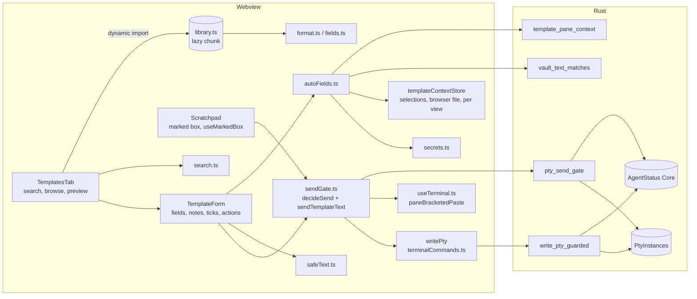
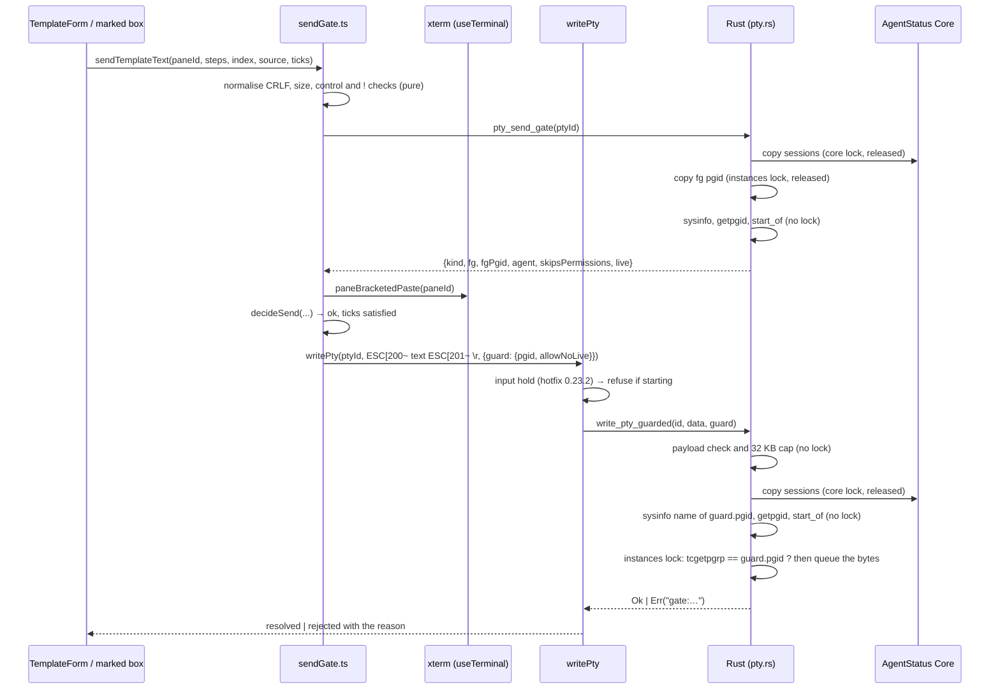
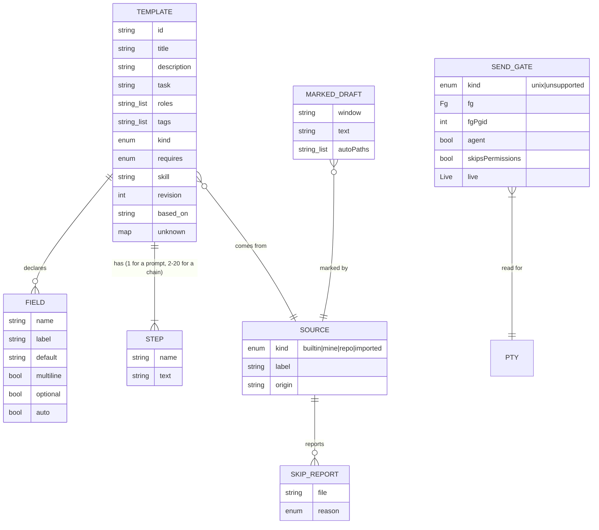

# Prompt templates: design for F5 slice S1

- **Status:** Proposed 2026-11-10, revision 2. Not approved. Revision 2 answers the
  adversarial review of revision 1 (B1, B2, M1 to M6 and the listed minors); the
  revision log is at the end.
- **PRD:** `docs/prd.md` F5, **revision 5.1** (e2281f6, PR #115), the text the owner
  approved on 2026-11-10 with every open question at its recommendation. This branch
  carries that text (merged at a72d61b). This design covers **slice S1** only (F5.8),
  plus the F5.9 decisions that fix S1's data and APIs. It does not restate the
  criteria. Each section names the criteria it builds.
- **OQ-19 is accepted**, so S1 also builds PT-7 AC1 to AC3 (one form, step by step, no
  Run) for the 3 built-in chains. Auto-advance (Run) and every other chain stay in S5.
- **Verification command:** unchanged. Every S1 test runs under three lines that are
  already in force (`docs/architecture.md`, "In force"):
  - `npx tsc --noEmit`
  - `npm test`: the parser, the library test, search, safe text, the secret detector,
    the gate's decisions, the form, the marked box, and the static tests;
  - `cd src-tauri && cargo test`: the send gate, live status, the guarded write and its
    payload check, the pane context, `HEAD` reading, the vault match, and the
    provider-stub PTY tests. `cargo test` builds the crate's examples, which is how the
    compiled provider stub is built (12.1).
  S1 adds no line. Section 12 says which test runs where.
- **Decisions:** ADR 0034 (the guarded send), ADR 0035 (format and bundling), ADR 0036
  (template text stays local). **Contract:** `.ade/context/prompt-templates.md`.

## 1. What S1 builds



| File | Kind | Role |
|---|---|---|
| `templates/prompts/<task>/<id>.md` | data | The built-in library, one file per template (ADR 0035) |
| `templates/prompts/README.md` | data | The format, task ids, and role ids not in `vendor/ade-setup/agents/` |
| `templates/prompts/SHIPPED` | data | Every id ever shipped, one per line, append-only; a removed id stays, suffixed ` removed` |
| `src/lib/templates/types.ts` | pure | `Template`, `Field`, `Step`, `Source`, `SkipReport` |
| `src/lib/templates/format.ts` | pure | `parseTemplate`, `writeTemplate`, the front matter reader and writer |
| `src/lib/templates/fields.ts` | pure | `scanFields`, `render` (one pass) |
| `src/lib/templates/safeText.ts` | pure | control and hidden characters, `!` and `/` lines, CRLF, `bracketedPayload`, `stripForMatching` |
| `src/lib/templates/hiddenChars.json` | data | The hidden-character ranges, read by `safeText.ts` and by Rust |
| `src/lib/templates/agentBinaries.json` | data | The agent binary names, read by `sendGate.ts` and by Rust (6.1) |
| `src/lib/templates/secrets.ts` | pure | The secret detector and the secret-file list (PT-11 AC6: the one detector) |
| `src/lib/templates/search.ts` | pure | `buildIndex`, `search` |
| `src/lib/templates/library.ts` | I/O, lazy | Loads and parses the bundled files. Reached only by `import()` |
| `src/lib/templates/autoFields.ts` | I/O | Fills the auto fields for a target pane |
| `src/lib/templates/viewContext.ts` | I/O | The target pane's view: `viewKeyOfPane`, `openFileOf` (5.1) |
| `src/lib/templates/sendGate.ts` | pure + I/O | `decideSend` (pure) and `sendTemplateText` (the one send path) |
| `src/lib/templates/submit.ts` | data | `SUBMIT_GAP_MS` (6.3) |
| `src/lib/templates/markedBox.ts` | I/O | The marked draft, the save checks |
| `src/components/templates/useMarkedBox.ts` | hook | The marked box's send, ⌘S and Run Chain paths, used by `Scratchpad.tsx` |
| `src/stores/templateContextStore.ts` | store | Last selection per pane and per view's side panel; last file clicked per view. Memory only |
| `src/components/templates/TemplatesTab.tsx`, `TemplateForm.tsx`, `TemplatesTab.css` | UI | The tab and the form. The designer owns how they look |
| `src-tauri/src/pty.rs` | Rust | `pty_send_gate`, `write_pty_guarded`, the last-input time per PTY |
| `src-tauri/src/template_text.rs` | Rust | The payload check shared by `write_pty_guarded` |
| `src-tauri/src/githead.rs` | Rust | Reads a repo's `HEAD` without starting git |
| `src-tauri/src/templates.rs` | Rust | `template_pane_context`, `vault_text_matches`, `text_matches_values` |
| `src-tauri/src/agent_status.rs` | Rust | `Core::gate_sessions`, `live_state` (pure) |
| `src-tauri/src/vault.rs` | Rust | `match_values` (5.3) |
| `src-tauri/test-support/provider_stub.rs` | Rust test support | The compiled provider stub, cargo example `claude` (12.1) |

Changed existing files: `Scratchpad.tsx` (the Templates panel becomes `<TemplatesTab>`;
the marked box through `useMarkedBox`; `PROMPT_TEMPLATES` removed),
`terminalCommands.ts` (`writePty`'s guard option), `useTerminal.ts`
(`paneBracketedPaste`, terminal selection recording), `agentTrackerStore.ts` and its
three `startSession` callers (`continuous`), `FileBrowser.tsx` (one call on a file
click), `CodeView.tsx` and `PreviewPanel.tsx` (selection recording, story E4b),
`persistence.ts` (one key), `lib.rs` (command registration), `Cargo.toml` (the
`claude` example), `.gitattributes` (one line).

## 2. The file format (PT-1, ADR 0035)

### 2.1 Front matter

A file is `---\n`, the front matter, `---\n`, then the body. The front matter is a
**strict subset of YAML**, parsed by a hand-written reader in `format.ts`. No YAML
library is added, and `src/lib/frontmatter.ts` stays scalar-only and is not used here.

```yaml
---
id: code.implement-feature
title: Implement Feature
description: "Build a feature to its requirements, with tests."
task: implement
roles: [developer]
tags: [feature, tests]
kind: prompt
fields:
  - name: feature
    label: Feature
  - name: requirements
    label: Requirements
    multiline: true
    optional: true
revision: 1
---
Implement the following feature:
...
```

The grammar, line by line, between the two fences:

- A blank line, or a line whose first character is `#`, is ignored.
- A **top-level line** is `key: value` at column 0. `key` is `[a-z_][a-z0-9_]*`.
- A **value** is one of:
  - a **plain scalar**: the rest of the line, trimmed. It must not start with `"`,
    `'`, `[`, `{`, `&`, `*`, `!`, `|`, `>`, `%`, `@`, `#` or a backtick, must not
    start with `- `, `? ` or `: `, must not contain ` #` or `: `, and must not end
    with `:`;
  - a **double-quoted string**. The only escapes are `\"` and `\\`. Any other
    backslash is broken front matter;
  - a **flow list** `[a, b, "c, d"]` of plain or double-quoted scalars, on one line.
    A plain item must also not contain `,`, `[`, `]`, `{` or `}`;
  - **empty**, for `fields:` only, followed by its block.
- **`fields:` block.** Each item starts with `  - key: value` (two spaces, dash,
  space). Its other keys follow on lines `    key: value` (four spaces). The item keys
  are `name`, `label`, `default`, `multiline` and `optional`. Booleans are `true` or
  `false`.
- Integers (`revision`) are `[0-9]+`.
- A tab character anywhere in the front matter is broken front matter.
- An **unknown key** with a scalar or flow-list value is kept, in order, and ignored
  (PT-1 AC1). An unknown key followed by an indented block is broken front matter.
- Any other line, a duplicate key, or a known key with a value of the wrong type is
  **broken front matter**. A missing closing fence is too.

**What "subset of YAML" claims, and what it does not.** The plain-scalar rules above
exclude the forms YAML rejects or reads as something other than a string start (an
indicator, a comment, a nested mapping). So an accepted file is intended to parse as
YAML, which is why editors highlight it. This is a design intent, not a tested
guarantee: no test runs a YAML parser, and none is added. YAML may also **type** a
value differently. `title: yes` is a boolean to a YAML 1.1 reader, `title: 1.0` is a
float, and `title: null` is null. ADE reads every value as the string written,
except `revision`, `multiline` and `optional`. ADE's reading is the only one that
counts.

`writeTemplate` writes the known keys in the order above, then the unknown keys in
their original order. It quotes a string only when it would not read back as the same
plain scalar under the rules above. The body is written byte for byte. PT-1 AC5's
round trip is `parse(write(parse(f))) == parse(f)` over every built-in template.

### 2.2 Body, steps and fields

- **Body.** The text after the closing fence's `\n`, with one trailing `\n` removed if
  the file ends with one. So a file whose last line ends with a newline has a body
  that does not.
- **Step marker (PT-1 AC2).** In a `kind: chain` file, a line that is exactly
  `<!-- step -->` or `<!-- step: Name -->` (Name: F1's text rule, 1 to 40 characters)
  starts a step. The body must start with a marker line. A step's text is everything
  between its marker line and the next marker line, or the end of the body, with the
  newline that ends the marker line, and the newline before the next marker, each
  removed once. Every other line, `---` included, is step text. 2 to 20 steps, each
  with non-blank text, else the chain is invalid. In a `kind: prompt` file, a marker
  line is ordinary text.
- **Why an HTML comment.** It cannot be confused with a Markdown rule. It renders as
  nothing in any Markdown viewer, so a chain file reads as one document on GitHub.
  It is a whole line, so a step's own text cannot contain one by accident.
- **Fields (PT-1 AC3).** `{{` + 1 to 40 characters other than `{`, `}` and newline +
  `}}` is a field token. `\{{` is a literal `{{`, and the backslash is dropped.
  - When the inside is a valid name (`[A-Za-z0-9_]{1,40}`), it is that field.
  - When it is not (`{{env.HOME}}`, `{{file:/etc/hosts}}`), it is a **typed field
    labelled with its raw text**. It is never an auto field and is left empty
    (PT-1 AC3 and PT-5 AC2 as approved in revision 5.1). The library test refuses
    such tokens in built-in files.
  - `render(template, values)` is one left-to-right pass over the tokens. A value is
    inserted as-is and never scanned again.

`parseTemplate(bytes, source)` returns `{ ok: Template } | { skip: SkipReport }`,
checking in this order: size over 32 KB (`too-large`); a control character anywhere
after CRLF→LF (`control-character`); front matter (`broken-front-matter`); a required
key (`missing-key`); `id` (`invalid-id`); a chain's steps (`invalid-chain`). These are
PT-1 AC4's six reasons. A lone `\r` is a control character.

**PT-1 AC4's second limit, a rendered step at most 32 KB**, is a send-time rule, since
a step's size depends on the values typed. It is rule 2a of `decideSend` (6.2) and
the Rust payload cap (6.3). It counts UTF-8 bytes of the rendered text of one step
(or of the whole text, for a prompt or a marked box), before the paste brackets.

## 3. The library and how it is bundled (PT-2, PT-14 AC1, ADR 0035)

- **Location.** `templates/prompts/<task>/<id>.md`. The file name is the id plus `.md`,
  and the folder is its `task`. The library test enforces both.
- **Line endings.** `.gitattributes` gains `templates/prompts/** text eol=lf`, so a
  Windows checkout does not turn the files into CRLF. The parser reads CRLF as LF
  anyway, and the digest (below) is taken over the LF-normalised bytes, so a CRLF
  checkout cannot change a digest either.
- **Bundled into the app's JavaScript, not as a Tauri resource.**
  `src/lib/templates/library.ts` holds
  `import.meta.glob("/templates/prompts/**/*.md", { query: "?raw", import: "default", eager: true })`.
  This is the same mechanism `src/data/roles.ts` already uses for
  `vendor/ade-setup/agents/*.md`. Because `library.ts` is reached only through
  `import("./library")`, Vite puts the library in one lazy chunk, loaded the first
  time the Templates tab opens.
  - **This differs from the PRD's handoff text.** F5.9 and D2 say the library is
    bundled "as a resource" (`tauri.conf.json` resources). This design bundles it in
    a JS chunk instead. D2's substance holds: the files live in this repo, ship with
    the app, are versioned with releases, and load on first use (PT-14 AC1). The
    deviation is listed in the notes for the PM (section 13).
  - **Why not `tauri.conf.json` resources.** A resource is a file read at run time
    through Rust and a path resolver. That adds a command, a failure mode (missing or
    unreadable resource), and a second code path for tests, which would read the
    folder another way. Inside the JS bundle, the library is signed and shipped
    exactly like ADE's code, needs no I/O, and the library test reads the very glob
    the app ships.
  - **Size.** 150 templates at about 2 KB each is about 300 KB raw, about 80 KB
    gzipped, in a chunk that loads only on first use.
- **PT-14 AC1's static test** (`src/lib/templates/__tests__/lazyLibrary.test.ts`).
  Starting from `src/main.tsx` and every other HTML entry Vite builds, it follows
  static `import … from` and `export … from` specifiers in the source files and fails
  if `src/lib/templates/library.ts` or any `templates/prompts` path is reached. It
  also fails if `library.ts` is imported statically anywhere. Dynamic `import()` is
  not followed.
- **Migration (PT-2 AC1).** Before `PROMPT_TEMPLATES` is removed, the story copies
  today's 27 entries verbatim into
  `src/lib/templates/__tests__/fixtures/legacy-prompts.json`, each with
  `{ name, category, prompt, blanks }`. `blanks` maps each field of the new file to
  the exact text that stood at its blank: `""` for an empty blank, `"[DESCRIBE
  FEATURE]"` for a bracket. The test renders each library template with its `blanks`
  and compares the result byte for byte with `prompt`. For the 3 chains, it joins the
  rendered steps with `\n---\n`. It also searches each entry's title and asserts the
  template is in the results (PT-2 AC1's last clause). A `**Label:** ` blank becomes
  `**Label:** {{x}}`, keeping the space. An empty fence becomes
  ```` ```\n{{code}}\n``` ```` with `code` multiline.
- **The library test (PT-2 AC5)**, `src/lib/templates/__tests__/library.test.ts`,
  under `npm test`. It imports `library.ts` (the shipped glob) and checks:
  - every file parses with no skip report;
  - ids are unique; the file name and folder match;
  - **`SHIPPED`:** every present id is in `SHIPPED` and not marked ` removed`; every
    id in `SHIPPED` is present or marked ` removed`; and **an id marked ` removed`
    that is present again fails, naming it** (a removed id is never reused);
  - **`SHIPPED` is append-only:** the digest fixture (below) also records the
    `SHIPPED` lines as of its last regeneration. The current file must begin with
    those lines, each either unchanged or with ` removed` appended. A deleted,
    reordered or edited line fails;
  - normalised bodies are unique, and the 200-character minimum applies to templates
    that count (S1: the migrated 27 are exempt, PT-2 AC5);
  - the AC3 counts with the 3-row cap, as a table of `minimum per slice`. In S1 every
    minimum is 0; S2 and S5 raise them. The counting function is written and
    unit-tested in S1;
  - every field is declared or auto, and every token is a valid name; every `roles`
    id is in `vendor/ade-setup/agents/` or in `templates/prompts/README.md`'s list;
  - no control or hidden character; nothing `detectSecrets` flags, on the text and on
    its `stripForMatching` form (5.2); no `!` line after line-start whitespace; no
    rendered text (any step) whose first non-whitespace character is `#`, `?`, `&`
    or `@` until the probe (6.5) clears it;
  - **no absolute path**: `~/`, `[A-Za-z]:\`, `\\`, or a `/` at a word start followed
    by a path segment and another `/` (`/etc/hosts`, `/Users/x/y`). A single segment
    after `/` is not a path, so **slash-command text is allowed**: `/bmad-dev`,
    `/compact` and `run /bmad-prd` pass. A one-segment absolute path such as `/tmp`
    also passes; that is accepted, since it names no user's folder;
  - **the pinned BMAD list.** A fixture in the test holds the 30 skill names of PT-2
    AC5 and the string `bda3c59 6.13.0-next`. The test reads
    `src-tauri/resources/bmad-v6/VERSION` and fails, naming the file, when it differs
    from the fixture. It also checks that each of the 30 names is a folder under
    `src-tauri/resources/bmad-v6/skills/`, and that every `skill` in the library is
    one of the 30.
- **Versioning (PT-2 AC6, S1 part).** `revision` is required on built-in templates and
  is a positive integer. The fixture
  `src/lib/templates/__tests__/fixtures/library-digests.json` maps each id to
  `{ revision, sha256 }`, where `sha256` is over the file's bytes after CRLF→LF.
  - **The test passes only when, for every built-in id, both the digest and the
    revision equal the fixture's**, and the fixture has no id the library lacks
    (other than ids `SHIPPED` marks removed). Any edit to a file therefore fails the
    test until the fixture is regenerated.
  - **`UPDATE_F5_DIGESTS=1 npx vitest run src/lib/templates/__tests__/library.test.ts`
    is the only way to move the fixture.** It rewrites an entry only when the file's
    revision is greater than the fixture's revision for that id, or the id is new.
    It refuses, and writes nothing at all, when any file's digest changed while its
    revision did not, or when a revision went down. So the flag cannot hide a missing
    bump. It also appends nothing to `SHIPPED`; that file is edited by hand.
  - Release notes are DevOps' (F5.9).

## 4. Search and browse (PT-3 AC1 to AC3, AC6, PT-14 AC2)

- `buildIndex(templates)` keeps, per template, folded strings for title, description,
  tags, task, role names and body. Folding is NFD, combining marks removed, then
  lowercased.
- `search(index, query, filters)` splits the folded query on whitespace. Every word
  must be a substring of some field. Results rank by the number of words that match
  the title (more first), then by `requires` (PT-2 AC4: a template whose `requires`
  the target project lacks sorts after the others), then by title. It is plain
  substring work: about 2,000 × 6 `includes` calls per word, well under 100 ms.
- PT-14 AC2's budget test builds 2,000 generated templates, runs 3 warm-up and 20
  timed searches, and fails on any search over 300 ms.
- **BMAD fit (PT-2 AC4).** The target pane's project methodology comes from the
  existing detection behind `src/lib/projectMethodology.ts`, asked once when the tab
  opens and cached per project for the tab's life.
- **Plain text everywhere (PT-3 AC3).** Every place F5 shows template text renders
  React text nodes inside `<pre>` or `<span>`. It never uses `dangerouslySetInnerHTML`,
  a Markdown renderer, or a URL built from template text. A static test fails if any
  file under `src/components/templates/` contains `dangerouslySetInnerHTML` or
  `innerHTML`, or **imports** the `marked` package or `MarkdownView` (the test checks
  import specifiers, `from "marked"` and a path ending `MarkdownView`, not the bare
  word, so `markedBox` and `isMarked` are not false hits). Fields are marked with
  `<mark>` elements built from the token list, not from the text.
- **Hidden characters (PT-1 AC6, PT-4 AC4)** show as `⟨U+202E⟩` spans, built by
  `safeText.markHidden(text) → Array<string | { hidden: codePoint }>`. Every text that
  comes from a template (title, description, tags, labels, defaults, step names,
  body) goes through it.

## 5. Auto fields (PT-5 AC1 to AC6)

### 5.1 Where each value comes from

"The target view" is the view that holds the target pane: the tab's own view or a
sub-terminal view. `viewContext.viewKeyOfPane(paneId)` names it. Before F3 S1 story
s1a lands, it returns the constant `"window"`, because every view shares the window's
side panel and file browser (PT-5 AC1's "before F3 S1 ships per-view panels"). From
s1a, it returns the view's `viewerKey` (`viewer-state.md`).

| Field | Source | Story |
|---|---|---|
| `cwd` | Rust `template_pane_context(ptyId).cwd`, the same `pty_cwd` as `get_pty_cwd` | E4a |
| `project` | `.project`: `project_root_of(cwd)` (`lib.rs`), the nearest ancestor holding `.git` | E4a |
| `branch` | `.branch`: `githead::branch(project)` | E4a |
| `date` | the local date, `YYYY-MM-DD` | E4a |
| `selection` from a terminal pane | `templateContextStore.paneSelections`, for the panes of the target view | E4a |
| `file` | `templateContextStore.browserFile[viewKey]`: the last file clicked in that view's file browser | E4b |
| `open_file` | `viewContext.openFileOf(viewKey)`: `viewerStore.states[viewKey].file?.path` | E4b |
| `selection` from the side panel | `templateContextStore.panelSelection[viewKey]`: the code viewer or preview panel of that view | E4b |

**Per-view sources after F3.** Every view-scoped entry in `templateContextStore` is
keyed by the `viewerKey` of the view in which it was recorded, never by "the panel
in sight now" at read time:
- `FileBrowser`'s click handler records `{ path, seq }` under the in-sight view's
  key, because from s1c the browser shows the view in sight;
- `CodeView` and `PreviewPanel` record under the `viewerKey` of the view whose file
  they show (from s1d, the view in sight's state; from s1e, `CodeView` keys its editor
  by `viewerKey + ":" + path`).

`autoFields` reads only the target view's key. So a selection or file click made
while view A was in sight never fills a template sent to a pane of view B. Test
(`autoFields.test.ts`): record a file click and a code selection under view A, target
a pane of view B, and assert `file`, `open_file` and `selection` are empty.

A path inside `project` is filled relative to it (prefix match on `project + "/"`).
Other paths are absolute.

**`githead::branch(project)`** never starts a process, so neither `core.fsmonitor`
nor a hook can run. Every file it opens is opened with
`O_RDONLY | O_NONBLOCK | O_NOFOLLOW` (`libc`, Unix; on Windows `std::fs::File::open`
after `symlink_metadata` refuses a link), and then checked with `fstat` on the open
descriptor, so there is no check-then-open gap and a FIFO or device cannot block it:
- `<project>/.git`:
  - a **directory**: the git dir is that directory;
  - a **regular file** of at most 4 KB holding exactly one line `gitdir: <path>`:
    the git dir is that path, resolved against `project` (a worktree or submodule);
  - anything else, including a link: the branch is empty.
- `<gitdir>/HEAD` must be a regular file. It is accepted only when **all** of these
  hold, else the branch is empty:
  - at most 255 bytes;
  - exactly one line: no `\n` except one optional final `\n`, and no `\r`;
  - no control character (C0, DEL, C1) and no hidden character (`hiddenChars.json`);
  - its content is either `ref: refs/heads/<name>`, where `<name>` follows git's
    ref-name rules (no `..`, no `@{`, no space, `~`, `^`, `:`, `?`, `*`, `[` or `\`,
    no component that starts with `.` or ends with `.lock`, does not end with `/` or
    `.`), giving `<name>`; or 40 or 64 lowercase hex characters, giving the first 7.

PT-5 AC1's marker test sets `core.fsmonitor` and a `post-checkout` hook, both writing
a marker file, and asserts the branch is read and no marker appears. Further tests:
a 256-byte `HEAD`, a two-line `HEAD`, a `HEAD` with U+202E in the name, a `HEAD`
that is a FIFO, and a `.git` that is a link, each giving an empty branch without
hanging. The same module is where S4 adds root-commit reading (F5.9). S1 builds
only `branch`.

### 5.2 Selections

- **Terminal panes (E4a).** `useTerminal.ts`, in `openTerminal`:
  `term.onSelectionChange` records `{ kind: "terminal", paneId, text, seq }` when
  `term.getSelection()` is non-empty. Over 16 KB it records `{ tooLong: true }`.
- **The side panel's code viewer (E4b).** `CodeView.tsx` subscribes to Monaco's
  `onDidChangeCursorSelection` and records only
  `{ kind: "file", viewKey, path, range, seq }` when the selection is non-empty. It
  does **not** read the text on each change. The text is read once, when a template
  is opened: `autoFields` asks the store, which calls
  `model.getValueLengthInRange(range)` (over 16 KB: `tooLong`) and then
  `model.getValueInRange(range)`, only if the model is not disposed. A disposed model
  (the file was closed) gives no selection.
- **The preview panel's other views (E4b).** Markdown, PDF and DOCX views render DOM
  text. `PreviewPanel` listens to `document`'s `selectionchange` while mounted and
  records `{ kind: "file", viewKey, path, text, seq }` when the selection's anchor and
  focus are inside the panel's root and outside a Monaco editor (which records
  itself). The HTML preview is a sandboxed `iframe` and never records (PT-5 AC1).
- The store keeps **one** latest selection per pane and one per view's side panel,
  each with a sequence number. It keeps no history.
- "The target view's last selection" is the one with the highest sequence number among
  the target view's panes and that view's side panel. Editor tabs are their own tab,
  not part of a terminal view, so they do not count in S1. The Thoughts panel never
  records (F5.0).

**Before `selection` is filled**, in this order, any refusal leaves it empty with the
note "Not filled: the selection looks like a secret":
1. `kind: "file"` and `secrets.isSecretFile(path)` (PT-5 AC3's list, the last two
   entries matched on the last two path parts);
2. `secrets.detectSecrets(text)` or `secrets.detectSecrets(stripForMatching(text))`
   is non-empty (PT-5 AC4);
3. `invoke("vault_text_matches", { text })` is `true` (5.3).

**`stripForMatching(text)`** (`safeText.ts`) removes every `\p{White_Space}` character,
every hidden character, and the box-drawing and block-element ranges U+2500 to U+259F,
which terminal programs draw as borders. A selection copied from a hard-wrapped file,
or from a terminal where a TUI wrapped a long token across lines or inside a bordered
box, still contains the token once these are removed. The detector runs on both forms,
and Rust's vault match does the same (5.3). Matching the stripped form can join two
unrelated fragments into a false hit; that only leaves a field empty, which is the
safe side.

### 5.3 The vault match: values never reach the webview (PT-5 AC4)

`vault_text_matches(text: String) -> bool`, `#[tauri::command(async)]` in
`templates.rs`, is a thin wrapper:
- It returns `true` (not filled) for text over 16 KB, without reading the vault.
- It takes the values from `vault::match_values(&app)` and returns
  `text_matches_values(&text, &values)`.

**`vault::match_values(app) -> MatchValues { values: Vec<String>, complete: bool }`**:
- If the terminal cache (`env_for_terminals`' cache) is filled, it returns its values,
  `complete: true`.
- Otherwise it reads the keychain once, as `env_for_terminals` does, and keeps the
  result in its own `MATCH_CACHE`, with `complete` false when any entry could not be
  read. **Today `env_for_terminals` caches only a complete read, so a vault with one
  unreadable entry is re-read from the keychain on every call.** `match_values` does
  not repeat that: its cache is cleared only where the terminal cache is updated
  (`vault_set`, `vault_delete`) and when the vault index changes. So the keychain is
  read at most once per vault change for F5, not once per selection.

**`text_matches_values(text, values) -> bool`** (pure, the test seam):
- `true` when `values.complete` is false: a vault ADE cannot fully read cannot clear a
  selection, so it fails closed (not filled);
- `true` when `text`, or `strip_for_matching(text)`, **contains** a value of 8 or more
  characters, or **equals** a value shorter than 8. `strip_for_matching` is the Rust
  twin of 5.2's function, built from the same `hiddenChars.json` and the same ranges;
  a test runs both over one table of cases;
- else `false`.

It returns only the boolean: never which secret matched, its name, or its length.

**Why a boolean oracle is acceptable.** A webview that calls `vault_text_matches` with
guesses learns one bit per call, and only for a whole value: a value of 8 or more
characters matches only when the guess contains all of it, so the oracle cannot be
walked one character at a time. Short values (under 8) need an exact guess. More to
the point, the webview can already reach every value without this command: each
terminal's environment holds them (`pty.rs:273`) and the webview writes to terminals.
The command adds no capability a compromised webview lacks. It is not rate-limited.

**Tests.**
- Rust, `templates.rs`: `text_matches_values` over a fixture `MatchValues` holding
  `VAULT_MARKER_7f3a` and a 5-character value: contains, equals, a wrapped selection
  (`VAULT_MARK\n  ER_7f3a`), a selection with `│` borders, an incomplete vault, and
  non-matches.
- Rust, a source test `vault_text_matches_returns_only_a_bool_and_logs_nothing`: the
  command's signature returns `bool` (not `Result`, not a struct), and the bodies of
  `vault_text_matches`, `text_matches_values` and `match_values` contain none of
  `println!`, `eprintln!`, `dbg!`, `log::`, `tracing::`, `log_error` or `format!`.
- **The vault fixture seam for PT-5 AC6.** The TypeScript test mocks `invoke` with a
  fake `vault_text_matches` that calls a TS port of the same matching rule over a
  fixture list. A vitest test and a cargo test read one case table,
  `src/lib/templates/__tests__/fixtures/vault-match-cases.json` (text, values,
  expected), so the TS fake cannot drift from the Rust rule.

**Static bans.** A test fails if any file under `src/lib/templates/`,
`src/components/templates/` or `src/stores/templateContextStore.ts` contains
`vault_get`, `vault_list`, `vault_set`, `vault_delete`, `env_for_terminals`, or any
`invoke("vault_` other than `invoke("vault_text_matches"`. A Rust source test fails if
`templates.rs` calls `vault::` anything other than `match_values`.

Matching runs in Rust because the values must not cross into the webview (PT-5 AC4).
Rust already holds them to start terminals (`pty.rs:273`), so this adds no new place
where they live.

### 5.4 The secret detector (PT-11 AC6)

There is one implementation, `secrets.ts`:
`detectSecrets(text): Array<{ kind, start, end }>`. It is used by auto-fill (S1), the
library test (S1), the template editor's warning (S3) and the import preview (S6).
Its patterns cover F5.1's list:
- PEM private-key blocks;
- AWS `AKIA`/`ASIA` keys, and GCP service-account JSON (`"type": "service_account"`
  with `"private_key"`);
- GitHub `ghp_`, `gho_`, `ghu_`, `ghs_`, `ghr_` and `github_pat_` tokens; GitLab
  `glpat-`; Slack `xox[abprs]-`; Stripe `sk_live_` and `rk_live_`; Anthropic
  `sk-ant-`; OpenAI `sk-` and `sk-proj-`;
- JWTs: three base64url segments, the first decoding to JSON with `"alg"`;
- `NAME=value` and `NAME: value` lines where NAME ends in `KEY`, `TOKEN`, `SECRET`,
  `PASSWORD` or `PASSWD`, case-insensitive, and the value has 8 or more characters.

Each pattern has a positive and a negative test, and each token pattern has a wrapped
case (the token split by `\n` and indentation) that is caught through
`stripForMatching`. Rust has no detector of its own.

**PT-5 AC6's test** (`autoFields.test.ts`) runs the PRD's sequence and adds a wrapped
case: after the `.env` selection, the terminal selection and the vault line, it
selects a terminal region where `ghp_…` is split across two lines with indentation,
and a code-viewer region where `VAULT_MARKER_7f3a` is split by a newline. No marker
and no token appears in any field or in the rendered text.

## 6. Sending (PT-6 AC1 to AC5, AC8, PT-15, ADR 0034)

### 6.1 The new Rust check: `pty_send_gate`

```rust
// src-tauri/src/pty.rs
#[derive(Serialize)] #[serde(tag = "kind", rename_all = "camelCase")]
pub enum SendGate {
    Unix {
        fg: Fg,                       // today's classification, unchanged
        fg_pgid: Option<u32>,         // tcgetpgrp of the PTY
        agent: bool,                  // fg.names matches agentBinaries.json (Rust's own check)
        skips_permissions: bool,      // the leader's argv holds a bypass flag (6.6)
        live: Live,                   // 6.1, below
    },
    Unsupported,                      // cfg!(not(unix)): Windows
}
#[tauri::command(async)]
pub fn pty_send_gate(pty: State<PtyManager>, agent: State<AgentStatus>, id: u32) -> Result<SendGate, String>
```

- **`Unsupported` comes from a compile-time platform check** (`#[cfg(not(unix))]`),
  never from an error string. `Err` means only "this PTY cannot be read" (gone, no
  pid), which the webview treats as "cannot tell" (PT-6 AC2). The webview never
  inspects error text to decide the platform.
- **Agent binaries.** `src/lib/templates/agentBinaries.json` lists the binary names
  (today `claude`, `codex`, `ollama`, …: the distinct `binary` values of `PROVIDERS`).
  Rust reads it with `include_str!`; `sendGate.ts` imports it. A vitest test asserts
  it equals `new Set(PROVIDERS.map(p => p.binary))`, so a new provider cannot be
  missed. Matching is the busy check's rule: equal after normalising, or a
  15-character name that is a prefix of the binary (`pane-busy.md`). The webview
  never sends a binary name to Rust. F2's `HUB_CLAUDE` ([Second]) is added on the
  Rust side by F2's reader, not by the webview.
- **`Live`** is
  `{ state: Option<AgentState>, blocking: Option<AgentState> }`, computed by the pure
  `live_state(sessions, fg_pgid, pgid_of, start_of, last_input)`:
  - A session of the PTY **counts as live** only when all of these hold:
    - it has a `process` `(pid, start)`;
    - `start_of(pid) == Some(start)`: alive, and not a reused pid;
    - `pgid_of(pid) == fg_pgid`: `getpgid(2)`, the pid is in the foreground job.
  - **`blocking`**: `NeedsYou` if any live session, **or any session of the PTY with
    no pid**, is `needsYou`; else `Working` if any such session is `working`; else
    `None`. A session with no pid never makes status live (F5.1, PT-6 AC4), but when
    it reports that the agent is asking or working, the send waits. Sessions whose pid
    is dead or outside the foreground job do not block.
  - **`state`**: with no live session, `None`. Otherwise `blocking` if set, else the
    most urgent at-input state of the live sessions (`waiting`, `ready`, `finished`).
  - This is **not** `pane_state`'s `max()`: `AgentState`'s derived order puts
    `waiting` above `working`, so `max()` would let a `working` session hide behind a
    `waiting` one. A test covers exactly that pair.
  - `last_input` is used only if the owner adopts M2's mitigation (section 10.1).
- **The order of work, and the locks** (M1). No OS lookup runs under a lock:
  1. Under the AgentStatus core lock: copy `gate_sessions(pty)`, a
     `Vec<(Option<(pid, start)>, AgentState)>`. Release.
  2. Under the instances lock: copy the shell pid and `process_group_leader()`
     (`fg_pgid`). Release.
  3. With **no lock held**: `fg_facts(fg_pgid)` (sysinfo: name and argv, as
     `pty_foreground_job`), `classify`, the agent-name match, the argv flag check, and
     `getpgid` and `start_of` for each copied session.
  4. Compute `Live` from the copies.
  `pty_foreground_job` is unchanged.
- **Lock order.** F5 code never holds the AgentStatus core lock and the `PtyInstances`
  lock at the same time. If later code must hold both, it takes the core lock first.
  A source test, `the_send_gate_asks_the_os_outside_both_locks`, in the style of
  `the_line_editor_check_classifies_outside_the_instances_lock` (pty.rs, about line
  1174, review finding m4), asserts that in `pty_send_gate` and in
  `write_pty_guarded` each lock's block ends before the first `fg_facts(`,
  `getpgid` and `start_of` call. `check_processes`' rule in `agent_status.rs` ("The OS
  is asked outside the lock", about line 595) is kept unchanged.
- `agent_status_watch` is **unchanged**. It stays a status-dot stream and carries no
  pid. The form re-reads `pty_send_gate` when it opens, once a second while it is
  open, whenever `agent_status_watch` reports a change for the target PTY, and again
  just before a write. Each read is one `tcgetpgrp`, one sysinfo lookup for the
  leader, and two cheap syscalls per tracked session, all on an async worker thread.
- **Status dot and gate disagree in one case.** The dot shows `pane_state`, a `max()`
  in which `waiting` outranks `working`. The gate uses `Live`, in which `working`
  outranks `waiting`. With two sessions on one PTY, one `waiting` and one `working`,
  the dot shows `waiting` and the form shows "The agent is working" with Send
  waiting. The form never reads the dot: its message always comes from the gate, so
  what it says is what it enforces. The dot is not changed by F5.

### 6.2 The decision (pure)

`decideSend(input): { ok: true, needsTick: Tick[] } | { ok: false, reason }` in
`sendGate.ts`. Its input is:

```ts
interface SendInput {
  tabIsOrchestrator: boolean;
  gate: SendGate | "error";        // SendGate.kind is "unix" or "unsupported" (Rust's platform check)
  bracketedPaste: boolean | null;  // null: no xterm instance for the pane
  steps: string[];                 // the rendered text of every step (one for a prompt or a box)
  sendIndex: number;               // the step this press sends
  source: Source;
  autoValueLines: Set<number>[];   // per step: lines that hold an auto-filled value
  hidden: boolean;                 // any step holds a hidden character
  continuous: boolean;             // the tracker's record OR gate.skipsPermissions (6.6)
  ticks: Set<Tick>;
  requiredEmpty: boolean;
}
```

The rules apply in this order, and the first failing rule gives the reason. Rules 3,
4, 6 and the ticks of rule 8 are checked over **every step** before any step is sent
(PT-7 AC2); for a prompt or a marked box there is one step.
1. **Orchestrator** (PT-6 AC1).
2. **A required field is empty**, or a field holds a control character (PT-4 AC2,
   AC5).
   - **2a. A step over 32 KB** (PT-1 AC4): "Step n is longer than 32 KB", or "This
     text is longer than 32 KB" for a prompt or a box.
3. **Control characters** in any step (PT-6 AC5).
4. **A `!` line** in any step, after line-start `\p{White_Space}` and hidden
   characters (PT-6 AC5): "Line n starts with `!` …".
5. **Not an agent pane** (PT-6 AC2, AC3):
   - `gate` is `"error"`;
   - or `gate.kind` is `"unix"` and `gate.agent` is false (Rust's match; the webview
     does not match names itself).

   With `gate.kind === "unsupported"` (Windows), the pane is not known to be an agent
   pane, so the tick `windowsAgent` is required (rule 8).
6. **No bracketed paste** (PT-6 AC5): `bracketedPaste !== true`.
7. **Live status** `blocking` is `needsYou` or `working` (PT-6 AC4): "The agent is
   waiting for your answer" or "The agent is working".
8. **Ticks still needed,** each over every step:
   - `noLiveStatus`, when `gate.kind === "unix"` and `live.state` is null (PT-6 AC4);
   - `windowsAgent`, when `gate.kind === "unsupported"` (PT-6 AC2). **Windows asks
     this one tick, not two.** On Windows there is never live status, so PT-6 AC4's
     tick would be asked on every send too. PT-7 AC3 names only PT-6 AC2's tick for
     Windows, and the form shows AC4's reason text ("ADE can't see this agent's
     prompts…") next to it. This is noted for the PM (section 13);
   - `hiddenChars`, when `hidden` (PT-4 AC4);
   - `slashCommands`, when the source is not built-in and any step has a `/` line, or
     a `/` line is in that step's `autoValueLines` (PT-15 AC2);
   - `noPermissions`, when `continuous` and the source is not built-in (PT-15 AC3).

   Each tick has its own label (PT-4 AC4, PT-15 AC3). Ticks are cleared after every
   send and whenever the form reopens.

**`allowNoLive`**, which the write's guard carries (6.3), is derived from the ticks
and nothing else: `allowNoLive = ticks.has("noLiveStatus") || ticks.has("windowsAgent")`.
`decideSend` asks for at most one of the two, so `allowNoLive` is true exactly when the
user ticked the box that the gate's own reading asked for. A unit test pins the
derivation: no tick gives `false`, either tick gives `true`, and the other ticks never
set it.

### 6.3 The write: one choke point, re-checked in Rust



- **`writePty(id, text, opts?)`** keeps its signature and gains an optional
  `opts.guard`. It applies the input hold first, exactly as today. Without a guard, it
  calls `write_pty` as today. With a guard, it calls `write_pty_guarded`.
  `sendTemplateText` is the only caller that passes a guard.
- **`write_pty_guarded(id, data, guard: { pgid: Option<u32>, allowNoLive: bool })`**
  is a **sync** `#[tauri::command]`, like `write_pty`. Tauri runs sync commands on the
  main thread in arrival order, so a guarded write keeps its order relative to the
  user's keystrokes. A source test asserts the attribute, as
  `write_pty_stays_a_sync_command` does. It works in this order, and refuses with a
  `gate:` error, writing nothing, at the first failure:
  1. **No lock:** the payload check (`gate:text`), below.
  2. **Core lock, copy, release:** the PTY's sessions.
  3. **No lock**, Unix only:
     - `guard.pgid` is `None` → `gate:changed`;
     - `fg_facts(guard.pgid)`: the group leader's name and argv. A pid is not reused
       while a process group of that id exists, so this is the leader or nothing.
       Nothing, or a name that does not match `agentBinaries.json` →
       `gate:changed` (**the agent name is re-checked here, not only the pgid**);
     - `getpgid` and `start_of` for each copied session, then `live_state` with
       `fg_pgid = guard.pgid`: `blocking` set → `gate:busy`; `state` `None` and
       `!allowNoLive` → `gate:tick`.
  4. **Instances lock:** read `process_group_leader()` again; if it is not
     `guard.pgid` → `gate:changed`. Otherwise `instance.input.send(data)`, and
     release. Nothing else runs under this lock.

  On non-Unix, step 3 is skipped and the write needs `allowNoLive`; step 4 queues.
- **What is guaranteed: "checked when queued", not "checked when delivered".** The
  last check (step 4) and the queueing happen under one lock, so no other write can
  slip between them, and the foreground job was this agent at the moment the bytes
  entered the PTY's input queue. The queue's writer thread then writes them to the
  PTY. Bytes already in the queue before the paste (for example keystrokes the user
  typed a moment earlier) are delivered first, and they can change the foreground job
  or the agent's state before the paste arrives: an `Enter` already queued can submit
  a prompt, a `Ctrl-C` can stop the agent. The paste is then delivered to whatever
  holds the input at that moment. This gap is the queue's length, normally
  microseconds, and it is listed in section 10.
- **The payload check** (`template_text.rs`, shared by tests). The payload must be
  exactly `ESC[200~ body ESC[201~` followed by `\r`, or nothing, or be `\r` alone
  (the delayed submit, below). The body must be valid UTF-8, **at most 32,768
  bytes** (PT-1 AC4's per-step limit; the whole payload is therefore at most
  32,781 bytes), and have:
  - no control character (C0 except `\t` and `\n`, DEL, C1);
  - no `ESC[200~` or `ESC[201~` (already impossible once ESC is refused);
  - no line whose first character, after `char::is_whitespace` characters (Unicode
    `White_Space`) and hidden characters, is `!`. TS uses `\p{White_Space}` (with the
    `u` flag), not `\s`, so both languages skip exactly the same characters. A test
    over every `White_Space` code point checks both.

  The hidden ranges come from `src/lib/templates/hiddenChars.json`, which Rust reads
  with `include_str!`. One table serves both languages. A vitest test checks that the
  JSON covers **every code point of general category Cf in the whole code space**
  (U+0000 to U+10FFFF, `/\p{Cf}/u`), plus U+2028 and U+2029, and a cargo test checks
  the Rust table parses to the same ranges.
- **Why check twice.** The webview check gives the message, and the Rust check is the
  guarantee. It holds even if a later webview change calls the guarded command with a
  bad payload, and it closes the gap between the gate read and the write for the
  foreground job, the agent's name and live status. **What remains is not only G4's
  2-second lag**; section 10.1 lists the residual risks.
- **The Enter after the paste.** By default the `\r` goes in the same write, right
  after `ESC[201~`. `src/lib/templates/submit.ts` has a per-binary
  `SUBMIT_GAP_MS: Record<string, number>`, `{}` by default. When a binary has a gap,
  the paste goes without `\r`, and after the gap a second guarded write sends `\r`
  alone, with the same `pgid`. That write is re-checked, so if the job changed
  meanwhile, nothing is pressed. **The table's values come from the probe in 6.5.**
- **Images (PT-6 AC8).** `sendTemplateText` takes only text. The Scratchpad's images
  are never passed.
- **History (PT-11 AC4).** `sendTemplateText` never calls `addToHistory`. The form has
  no access to it, and the marked box's send path skips it (section 7).

**The static write-path test** (`src/lib/templates/__tests__/writePath.test.ts`),
parsed with the TypeScript compiler API (`ts.createSourceFile`), not a regex:
- in any file under `src/lib/templates/`, `src/components/templates/` or
  `src/stores/templateContextStore.ts`, it fails on: `invoke("write_pty"` or
  `invoke('write_pty'`, `write_pty_guarded` (only `terminalCommands.ts` may invoke
  it), `writePtyInput`, `sendToActiveTerminal`, `typeWhenReady`, any identifier
  starting `runInNewTab`, and the string `orchestrator-send`;
- `writePty(` may appear only in `sendGate.ts`, and **every `writePty` call there has
  a third argument, an object literal with a `guard` property**;
- across `src/`, `invoke("write_pty_guarded"` appears only in `terminalCommands.ts`.

### 6.4 Bracketed paste mode (PT-6 AC5)

- `useTerminal.ts` exports `paneBracketedPaste(paneId): boolean | null`. It returns
  `instances.get(paneId)?.term.modes.bracketedPasteMode ?? null`. No instance (a
  restored sub-terminal not yet shown) gives `null`, so Send is disabled.
- It is read when the gate is evaluated, and again synchronously just before
  `writePty` is called.
- A pane moved into a detached window loses the mode (F5.0). Send there is disabled
  until S5's PT-6 AC9. S1 does nothing about it, as the PRD accepts.

### 6.5 The probe F5.9 asks for

This has **not been run**: running it submits real prompts to real agents on the
owner's account (owner question Q2). It is task 1 of the gate story (E3). The
developer runs each of `claude` (the installed version), `codex` and
`ollama run <small model>` in an ADE terminal and records, for each:
1. whether it sends `ESC[?2004h` (from `script -q`, or a raw capture of the PTY);
2. whether a single write of `ESC[200~hi\nthere ESC[201~\r` submits a two-line
   prompt;
3. whether a single write of `ESC[200~hi ESC[201~` followed by `\r` 30 ms later
   submits it;
4. **input prefixes:** a paste whose first character is `#`, then `/`, `@`, `?`, `&`
   and `!` (the last only to confirm the gate's reason; it is never sent by F5), each
   into an empty input. Does the agent switch mode (memory, command, shortcuts help,
   bash) or take the text as a prompt?
5. **an open picker or menu** (Claude Code): with `/model` open, with `/permissions`
   open, with `/config` open, with the Esc-Esc rewind menu open, and in Ctrl-R
   history search, paste `ESC[200~hi ESC[201~\r`. Does the paste select an item,
   change a setting, or become a prompt? Does any hook fire when the picker opens?
6. **the external editor** (Claude Code's Ctrl-G): with the editor open in the
   terminal, does `tcgetpgrp` name the editor or `claude`, and where does a paste go?

The developer records versions and results in `.ade/context/prompt-templates.md`
("Provider probe") and sets `SUBMIT_GAP_MS` from them. If ollama never sends
`ESC[?2004h`, its panes get Insert and Copy only, which is what PT-6 AC5 already does
with no extra code. If item 4 shows a prefix switches mode, the library test's
first-character rule (section 3) stays, and the PM gets a note for non-built-in
sources (a new PT-15 flag is a PRD change, not this design's). Items 5 and 6 feed
section 10.1 and the owner's decision on it.

**The Windows check** (ConPTY passing `ESC[?2004h` through) is a cargo test, not a
manual step: `conpty_reports_bracketed_paste_mode` in `pty.rs`'s tests,
`#[cfg(windows)]`, runs in the existing `backend-windows` job (`windows-latest`,
`cargo test --locked`). It starts the compiled stub (12.1) through portable-pty's
ConPTY, reads the master side until the stub's marker, and asserts that
`ESC[?2004h` appeared before it. Its expected value is a constant,
`CONPTY_PASSES_2004`, set to `true`. If the first CI run is red, ConPTY drops the
sequence: the developer sets the constant to `false` (so the test pins the observed
behaviour), records it in "Provider probe", and tells the PM (OQ-10's note). Either
way S1's code is the same: xterm sees no mode, and Windows panes get Insert and Copy.

### 6.6 Continuous mode (PT-15 AC3)

Two sources, either of which sets `continuous` for the form:
- **The tracker's record** (the PRD's test). `AgentSession` gains
  `continuous?: boolean`. `startSession(paneId, …, cwd?, opts?: { continuous?: boolean })`
  stores it. `prepareAgentLaunch` does not return the flag (its result is
  `{ ok, command }`), so each caller passes the value it gave `prepareAgentLaunch`:
  - `AgentPicker.tsx:250` passes the `continuousMode` value captured in the same
    launch callback that called `prepareAgentLaunch(spec, cwd, { continuous: continuousMode })`
    at line 151, not a later re-read of the state;
  - `agentLaunch.ts:91` (`dispatchAgent`) passes `false`: it never launches in
    continuous mode;
  - `OrchestratorTab.tsx:355` passes `false`.
  Restored sessions without the field read as `false`.
- **The foreground argv** (`pty_send_gate`'s `skipsPermissions`). Rust sets it when
  the leader's argv holds `--dangerously-skip-permissions`, or `--permission-mode`
  followed by `bypassPermissions` (or `--permission-mode=bypassPermissions`). This
  catches an agent the user started by hand, and a restored session that has no
  record. Codex's and others' bypass flags are added to the same list once the probe
  names them.

`better-terminal-agent-tracker` is a shared key, and a boolean is not template text,
so this does not touch D7.

### 6.7 Built-in chains, step by step (OQ-19: PT-7 AC1 to AC3 for the 3 built-ins)

- A chain's form fills every field once and shows every rendered step, numbered and
  named.
- Its actions are **Insert into box**, **Copy** and **Send step n of m**. Each step is
  a separate `sendTemplateText`, with every check and tick re-evaluated and every tick
  cleared after the step.
- **Before step 1, and for every step after it** (PT-7 AC2), `decideSend` checks all
  steps (6.2): control characters, `!` lines, the 32 KB limit, bracketed paste, the
  hidden-character tick, and **PT-15's flags**. "Send step 1 of m" stays disabled
  while any step has a `!` line, while any step's hidden characters are not
  accepted, and **while any step has a PT-15 flag (a `/` line, or continuous mode)
  that is not ticked**. The flags are ticked once in the form for the whole chain,
  are shown with the step they belong to, and are cleared after each step is sent,
  so step 2 asks again.
- The step index is form state only. Closing the form ends the chain, and no chain
  state is saved.
- There is no Run in S1.
- **Tests.**
  - PT-7 AC2: `src/components/templates/__tests__/chainChecks.test.tsx`, "Send step 1
    never enables with a `!` line, an unaccepted hidden character, or an unticked
    PT-15 flag in step 3": the three fixture chains of the PRD, on a pane mocked as an
    agent pane with live `ready`, with a `writePty` spy.
  - **PT-12 AC2:** `src/components/templates/__tests__/builtinChains.test.tsx`,
    "built-in chains are sent step by step: no Run, step 2 waits while working, no
    tick while ready, disabled on a shell". For each of the 3 chain templates it
    asserts: the form shows Insert, Copy and "Send step 1 of m", and no Run; after
    step 1 is sent, nothing more is written until "Send step 2 of m" is pressed; with
    live status mocked `working` after step 1, pressing "Send step 2 of m" shows "The
    agent is working" and the `writePty` spy sees no call; with status mocked back to
    `ready` and the button pressed again, step 2 is written; **while live status is
    `ready`, no tick is shown** (no `noLiveStatus` tick in the DOM); with the busy check
    mocked as `shell`, the step button is disabled.

## 7. The marked box and the stores (PT-11 AC2 to AC5, PT-12, ADR 0036)

### 7.1 The marked draft

```ts
// src/lib/templates/markedBox.ts
interface Mark { source: SourceRef; autoPaths: string[] }   // autoPaths: every value Insert filled into cwd/project/file/open_file
interface MarkedDraft { v: 1; text: string; mark: Mark }
export const MARKED_DRAFT_KEY = "ade-template-draft";
export function persistDraft(text: string, mark: Mark | null): void;
export function loadDraft(): { text: string; mark: Mark | null };
```

- **Three triggers, one snapshot.** Scratchpad writes the draft from three places: the
  400 ms debounce, the flush on `pagehide` and `visibilitychange`, and the flush on
  unmount. Each calls `persistDraft(latest.current.text, latest.current.mark)` where
  `latest` is one ref, `useRef({ text, mark })`, assigned as a whole object on every
  render. So a flush never pairs new text with an old mark, or the reverse.
- `persistDraft`:
  - **Unmarked:** it writes `ade-scratchpad-draft` exactly as today.
  - **Marked:** it writes `ade-template-draft` and **never writes
    `ade-scratchpad-draft`**. It does not remove it either: that key may hold another
    window's typed draft, which is typed text and may sync (D7 is about template
    text).
  - **Empty text:** it removes `ade-scratchpad-draft` as today and clears the mark.
    It removes `ade-template-draft` only if this window wrote it (below).
- `ade-template-draft` holds `{ v: 1, window, text, mark }`, where `window` is the
  writing window's label. `loadDraft` prefers `ade-template-draft` when it parses, so
  a restart restores the box marked. An empty-box write in window B leaves A's marked
  draft alone, because its `window` is A's.
- `ade-template-draft` is in `PERSISTED_KEYS`, so it is saved to `state/kv` like
  today's draft. It is in neither `SHARED_KEYS` nor `DEVICE_KEYS`, so `export_state`
  never reads it.
- That makes it an **unexported store**, not stripping on export. Stripping would mean
  a second parser of the draft in `sync.rs`, and would still export whatever the
  stripper missed.
- **ADR 0033 (the Thoughts plan, revision 3) and the two draft keys.** ADR 0033 covers
  JSON keys that more than one window writes, and lists the single-writer keys that
  may keep plain `setItem`. **Neither draft key is in that list: both windows mount
  Scratchpad and write both keys.** `ade-scratchpad-draft` is a plain string, not a
  JSON key, and F5 leaves it as it is today. `ade-template-draft` is a JSON key with
  more than one writer, so ADR 0033 applies to it. It complies by its own shape: the
  value is one window's whole box, a single entry with no field another window owns,
  so "re-read, change only what is being changed, write back" is one replace of that
  entry. The re-read is real for the one case where it matters: removal checks
  `window` first, so a window removes only its own draft. Two windows with marked
  boxes share one restore slot, and the last to write wins, as `ade-scratchpad-draft`
  does today. That loses a draft at restart, never sends one to sync.
- **Insert into box** calls `loadText(rendered)` as today, then sets the mark with the
  template's source and the absolute values Insert filled into the four path fields,
  in the same React update. The mark clears only when the box becomes empty (PT-11
  AC4).
- **Undo cannot bring template text back unmarked.** When a marked box becomes empty,
  Scratchpad clears the mark, sets the de-slop `undo` record to `null`, and changes
  the textarea's React `key`, so a new `<textarea>` element replaces the old one and
  its native undo history (⌘Z) is gone. It then refocuses the new element. Without
  this, ⌘Z after emptying would restore the template text with no mark, and the next
  draft write would put it in `ade-scratchpad-draft`. Test (`markedBox.test.tsx`):
  insert a template, empty the box, assert the textarea element is a new node and the
  de-slop Undo button is gone, then type text and assert the draft is written
  unmarked with only the typed text.

### 7.2 What a marked box does differently

All four paths go through `useMarkedBox` (`src/components/templates/useMarkedBox.ts`),
which Scratchpad's `send`, `sendChain` and `saveNote` call first. The App-level
handlers reach the same functions: `App.tsx`'s `sendScratchpad`
(`scratchpadRef.current?.send()`, for ⌘Enter from the window) and
`saveNoteScratchpad` (`scratchpadRef.current?.saveNote()`, for ⌘S from the window).

| Action | Unmarked (PT-12, unchanged) | Marked |
|---|---|---|
| Send to Terminal, ⌘Enter | today's `writePty(text + "\r")`, adds history | `sendTemplateText` with the mark's source, over the box's whole text (one step); **no history entry**; images are not sent, and the box keeps them |
| On an Orchestrator tab | `orchestrator-send` | disabled, PT-6 AC1's message; no event |
| Run Chain (`---` lines) | today's `sendChain` | disabled until S5, with the message below |
| ⌘S save note | saves | `markedSaveCheck(text, mark)`: if any absolute auto path still appears in the text, it is **refused** with PT-11 AC4's message listing them; otherwise a confirm that names sync, and it saves only on confirm |

**Run Chain's message** (PT-11 AC4) points to the step-by-step form. When the mark's
source is a chain template: "Run Chain isn't available for template text yet. Open
the template "<title>" in the Templates tab and use Send step 1 of <m>." The title is
shown through `markHidden`. When the source is a prompt template (the user typed
`---` lines into it): "Run Chain isn't available for template text yet. Send it as
one prompt, or use a chain template's step-by-step form in the Templates tab." Test
(`markedBox.test.tsx`): Insert a built-in chain, and Run Chain is disabled with the
message naming its title; the same for a prompt template with a typed `---` line.

"Absolute" means starting with `/`, `~`, `[A-Za-z]:` or `\\`. A relative value never
blocks.

### 7.3 Keys

| Key | S1 | `PERSISTED_KEYS` | Syncs |
|---|---|---|---|
| `ade-template-draft` | added | yes | never (PT-11 AC2) |
| `ade-scratchpad-draft` | unchanged; never written while marked | yes (today) | device key, as today |
| `better-terminal-prompt-history` | unchanged; F5 adds no entry | yes | shared, as today |
| `better-terminal-agent-tracker` | gains `continuous` | yes | shared, as today |

**Reserved for later slices**, not created in S1. S3 decides their shapes and the
per-id merge:
- `ade-templates-mine` (synced by S3's merge);
- `ade-templates-favourites` (synced by S3's merge, except repo ids);
- `ade-templates-recents` (never);
- `ade-templates-repo-approvals` (S4, never).

Nothing else in S1 is stored: the library, the index, selections and the last
browser file are in memory only.

**PT-11 AC3's static test**, `src/lib/templates/__tests__/storageKeys.test.ts`:
- It lists F5's keys in `F5_KEYS` (persisted) and `F5_EPHEMERAL_KEYS` (none in S1),
  each with a reason.
- It also has `PRE_F5_KEYS_F5_TOUCHES`, an allow-list of keys that exist before F5
  and that F5 code reads or writes unchanged, each with a reason. In S1 it holds one:
  `ade-scratchpad-draft` ("today's unmarked draft; `persistDraft` writes it exactly as
  Scratchpad did"). An entry here must already be in `PERSISTED_KEYS`; the test does
  not require it to be outside the sync lists, since it is not F5's key.
- It reads `src/lib/persistence.ts` and `src-tauri/src/sync.rs` as text, parses the
  `PERSISTED_KEYS` set and the `SHARED_KEYS` and `DEVICE_KEYS` arrays, and asserts:
  every F5 key is persisted or ephemeral; no F5 key is in either sync list (S3 will
  allow-list its two); and every `localStorage` key literal under
  `src/lib/templates/` and `src/components/templates/` is in `F5_KEYS`,
  `F5_EPHEMERAL_KEYS` or `PRE_F5_KEYS_F5_TOUCHES`.
- **The Rust key-set test.** There is one Rust test for local-only keys, in `sync.rs`'s
  `tests` module: `local_only_keys_are_in_neither_shared_nor_device_keys`, over a
  list of keys. F3 S1's s1b3 (for `ade-viewer-state`) and the Thoughts plan's step 1b
  (for `ade-thoughts-layout` and `ade-thoughts-dock-notice`) use the same test. F5's
  E6 adds `ade-template-draft` to its list. **Whichever of s1b3, 1b and E6 lands
  first adds the test with its own keys; each later one extends the list and adds no
  second test.** When ADR 0017's static test lands, F5's TypeScript list folds into
  it (PT-11 AC3).

**PT-11 AC4's six-way test** (`src/components/templates/__tests__/sixWays.test.tsx`)
runs in vitest against `localStorage`, rendering Scratchpad with the Templates tab.
Each of the six uses is driven through both entry points where the PRD's path has
two: the box's own button or key, and the App-level handler (`sendScratchpad` for
Send and ⌘Enter, `saveNoteScratchpad` for ⌘S), called through the Scratchpad ref's
`send()` and `saveNote()` exactly as `App.tsx` calls them. It then checks the export
by running the same marker set through a Rust export test: the vitest test writes the
resulting `localStorage` snapshot to a fixture,
`src-tauri/tests/fixtures/f5-local-state.json`, through `UPDATE_F5_STATE=1` the same
way F3's golden fixture works, and `sync.rs`'s test loads it into a temporary kv
folder, runs `export_state`, and asserts neither marker is in the repo, under
`shared/` or `devices/`. The vitest half also asserts the fixture matches what it
produces, so a stale fixture fails.

## 8. Data model



`Template` holds `body` (prompt) or `steps` (chain), plus `raw` (the parsed front
matter) for the round trip. A `Source` in S1 is always `builtin` for real templates.
S1's tests build `mine`, `repo` and `imported` sources from fixtures (PT-15's
preamble).

## 9. The Templates tab and the form (PT-3, PT-4, PT-13 AC1, PT-16 AC1 to AC3)

The designer owns the look. This section fixes only structure and behaviour that
tests depend on.

- **Mounting.** Scratchpad's `panel === "templates"` branch renders `<TemplatesTab>`
  in place of today's chip strip. `TemplatesTab` loads the library with
  `import("../../lib/templates/library")` on mount. While it loads, it shows a busy
  row; if the load fails, it shows an error row. Skip reports are listed at the end of
  the list (PT-1 AC4).
- **Form structure (PT-16 AC1).** The form root has `data-f5-form`. Inside it are
  exactly two children, in order:
  - `[data-f5-scroll]`, which holds the fields and the rendered text;
  - `[data-f5-actions]`, which holds Insert, Send (or "Send step n of m"), Copy, Back,
    the ticks and the source badge.
- **The form's container** is the panel's list area, or the composer's place when the
  form takes it. Whichever element Scratchpad renders as that area at merge time
  (today the Templates branch's own `<div>`; after the Thoughts plan's step 1c,
  possibly a list-area element of `Scratchpad.css`) carries `data-f5-form-open` while
  the form shows. TemplatesTab reports `onFormOpenChange(open)`, and Scratchpad sets
  the attribute on that element.
  - **The container bounds the form** (PT-16 AC1, n2): the `[data-f5-form-open]` rule
    makes it a flex column with `min-height: 0`.
  - **No inline or Tailwind scroll while the form is open.** Today the list area's
    scroll is an inline style (`LIST_PANEL_STYLE`, `overflowY: "auto"`). An inline
    style beats every stylesheet rule, so the Templates branch stops setting it
    inline: while the form is open, the container's inline style has no `overflow`
    or `overflow-y`, and it carries no class matching `overflow(-y)?-(auto|scroll)`
    (n3). Its scroll for the list (form closed) comes from a stylesheet rule instead.
  - **The override outranks every overflow rule** (n4, the cascade caveat): it is
    declared `overflow: hidden !important`. An `!important` author declaration beats
    every normal author declaration whatever its specificity or order, inline styles
    included, and Tailwind's utilities are not `!important`. The string test (below)
    fails if any other rule on an element of the walk sets `overflow` or
    `overflow-y` with `!important`.
- **Elements between the form root and the container** (TemplatesTab's own root, if it
  is one) carry `data-f5-chain`, a flex column with `min-height: 0` and `flex: 1 1 0`,
  and no overflow.

  `TemplatesTab.css` carries the rules, a new file owned by F5, imported as a bundled
  stylesheet (hotfix 0.23.2: no runtime `<style>` elements):

  ```css
  [data-f5-form-open] { display: flex; flex-direction: column; min-height: 0; overflow: hidden !important; }
  [data-f5-chain]     { display: flex; flex-direction: column; min-height: 0; flex: 1 1 0; }
  [data-f5-form]      { display: flex; flex-direction: column; min-height: 0; flex: 1 1 0; }
  [data-f5-scroll]    { overflow-y: auto; min-height: 0; flex: 1 1 0; }
  [data-f5-actions]   { flex: none; }
  ```

  The F5 rules stay out of `Scratchpad.css`, which belongs to the Thoughts panel's
  work, so the two can merge without editing each other's rules.
- **PT-16 AC1's tests** (`src/components/templates/__tests__/formFit.test.tsx`):
  - the DOM test of the PRD, in the list area and in the composer's place: action
    buttons inside `[data-f5-actions]` and no `[data-f5-scroll]`; field inputs inside
    `[data-f5-scroll]`; exactly one `[data-f5-scroll]`; the container has
    `data-f5-form-open`; and walking from `[data-f5-form]` up to the panel root, no
    element's inline style sets `overflow` or `overflow-y` to `auto` or `scroll`, and
    no element has a class matching `/(^|\s)overflow(-y)?-(auto|scroll)(\s|$)/`;
  - the string test reads **`Scratchpad.css`, `TemplatesTab.css` and, once it exists,
    `PanelLayout.css`** (the Thoughts plan's layout host). It finds the rules above
    with those declarations, and for every class and attribute selector carried by an
    element of the walk it finds no rule setting `overflow` or `overflow-y` to `auto`
    or `scroll`, except on the container, where it checks that the override is
    `!important` and no competing declaration is.
- **When the list area is too short** (below the designer's minimum), the form takes
  the composer's place. Scratchpad hides the composer and keeps its state; the box's
  text, draft and images are untouched.
- **Escape (PT-16 AC3).** `TemplatesTab`'s root `onKeyDown` consumes Escape, calling
  `stopPropagation` and `preventDefault`, when there is a step to go back: form to
  list, or search text to an empty search. React's root listener runs before
  `useKeybindings`' `window` listener, so the window never sees a consumed Escape. At
  the root (the list with an empty search) it does not consume:
  - in the main window, `useKeybindings` closes the panel as today;
  - in `DetachedApp`, which has no such handler, `TemplatesTab` gets
    `onEscapeAtRoot`, and DetachedApp passes a function that focuses the active pane
    (`focusInSight` from `paneFocus.ts`, the Thoughts plan's step 2, or today's
    selector if that helper has not landed).
- **Announcements (PT-13 AC1).** F5 calls `say(text)` from
  `src/stores/announceStore.ts`, the contract in `thoughts-panel.md`, which
  `SubTerminalAnnouncer` subscribes to. The Thoughts plan's step 1e builds it; E5
  starts after 1e merges (section 11) and does not build its own. A static test fails
  if any file under `src/components/templates/` contains `aria-live`.
- **Keyboard and G2's three keys (PT-3 AC6).** Typing goes to the search box. ↓ moves
  the highlight. Enter picks. For an all-auto template, the form opens with Send
  focused when Send is enabled. ⌘Enter (Ctrl+Enter) sends from anywhere in the form.
- **Fill form (PT-4).** Inputs are in first-use order. Auto values are filled and
  marked, and every value can be edited (PT-5 AC5). CRLF becomes LF on input. A value
  holding a control character shows PT-4 AC5's message and disables Send, Insert and
  Copy. The rendered text updates on every change, through a `useMemo` over `render`.

## 10. Failure modes

| Failure | Handling |
|---|---|
| A library file is invalid | That file is skipped and reported; the rest load (PT-1 AC4). The library test keeps it from shipping |
| The library chunk fails to load | The tab shows an error row; Insert, Copy and Send are unavailable; the box works as today |
| `pty_send_gate` errors (PTY gone, no pid) | "cannot tell": not an agent pane; Send disabled with no override (PT-6 AC2) |
| The foreground job or its leader's name changes between the gate and the write | `write_pty_guarded` refuses with `gate:changed`; nothing is written; the form re-reads and shows the new reason |
| A permission prompt arrives after the gate read | Refused by the write's re-check if the status has arrived; within the 2 s hook lag it cannot be seen (G4, accepted) |
| A rendered step over 32 KB | Send disabled with rule 2a's message; Rust refuses with `gate:text` if it got through |
| Bytes queued before the paste change the agent's state | Not detected: the guarantee is "checked when queued" (6.3). Listed in 10.1 |
| A session without a pid reports `needsYou` or `working` | Send waits (6.1 `blocking`); it never makes status live |
| The terminal is still starting | `writePty`'s hold refuses with today's toast; the form keeps its values |
| The target pane has no xterm instance | `paneBracketedPaste` gives `null`; Send disabled |
| The active tab is an editor or other non-terminal tab | No target pane; Send disabled, "No terminal to send to"; Insert and Copy remain |
| A pane moved to a detached window | Bracketed paste is off; Send disabled until S5 (accepted) |
| The vault cannot be fully read (locked, an entry denied) | `match_values` reports it incomplete and `selection` is not filled (fails closed); the keychain is not re-read until the vault changes |
| `HEAD` unreadable, a link, a FIFO, over 255 bytes, more than one line, or odd | `branch` empty, without blocking |
| `localStorage` full when writing the marked draft | Not persisted, as today's draft. Nothing is written to `ade-scratchpad-draft` while marked, so template text never falls back into the exported key |
| ⌘Z after a marked box is emptied | The textarea was replaced, so there is no history to undo into (7.1) |
| A process in the terminal forges status or names itself `claude` | Out of scope (F5.5) |

### 10.1 Residual risks the gate does not close

Revision 1 said only G4's 2-second lag remains. That was wrong. These remain:

1. **Claude Code screens that fire no hook.** The `/model`, `/permissions` and
   `/config` pickers, the Esc-Esc rewind menu, and Ctrl-R history search are opened by
   the user's keys and fire no hook. The session stays `ready` while one of these
   owns the input, so the gate sees "at its input" and sends without a tick. A paste
   and `\r` into such a screen may select an item or change a setting instead of
   becoming a prompt. What happens exactly is probe item 5 (6.5).
2. **Ctrl-G's external editor.** It runs in claude's process group, so `tcgetpgrp`
   still names claude's group (or the editor's, which fails the name check; probe
   item 6 says which). If the group is claude's, the paste goes to the editor.
3. **Input prefixes.** A paste whose first character switches the agent's input mode
   (`#`, `?`, `&`, possibly `@`) may not become a prompt. Built-ins are guarded by the
   library test until the probe clears them; other sources are not (S3 onwards).
4. **Bytes queued before the paste** (6.3): a keystroke typed a moment before Send can
   change the agent's state before the paste is delivered.
5. **G4's hook lag:** a permission prompt within about 2 seconds of the gate read.

These are also in ADR 0034's Consequences. Whether to accept them is **owner question
Q3** (section 13). The recommended mitigation for 1, 2 and 4 is concrete enough to
build in E3 if the owner chooses it:

- **"Typed since ready" counts as no live status.** Rust records, per PTY, the time of
  the last `write_pty` from the user (xterm's `onData`, the box's own sends), ignoring
  focus reports (`ESC[I`, `ESC[O`). `AgentStatus` records, per session, when its phase
  last changed. `live_state` treats a live at-input session as **not live** when the
  PTY has had user input after that session's last phase change. Opening a picker,
  Esc-Esc, Ctrl-R and Ctrl-G all need keystrokes after the agent became ready, so each
  turns the send into PT-6 AC4's per-send tick ("…not at a question, and its input is
  empty"). The usual flow (type a prompt, Enter, the agent works, the agent stops) is
  unaffected, since the keystrokes come before the phase change. Item 4 shrinks to
  keystrokes still in the queue.
- Cost: a user who types into the agent and then picks a template gets the tick for
  that send. That is also correct, since the input is then not empty.
- It changes no PRD text: it is a stricter reading of "live status at its input".

## 11. Interplay with the Thoughts panel (PR #114, PR #117) and F3 S1 (PR #118), and the landing order

**The other plans as they stand.**
- **F3 S1** (`_bmad-output/initiative-per-view-viewer/epic-slice-1-viewer-state/tickets.toml`,
  on `main` since merge 97d70a0): seven stories, built in order and never two at
  once: **s1a → s1b1 → s1b2 → s1b3 → s1c → s1d → s1e**. s1a is blocked on the code
  viewer's cv3 and cv5.
- **The Thoughts plan** (PR #117, revision 3 at 7808785,
  `docs/superpowers/specs/2026-11-10-thoughts-panel-architecture.md` section 4.2):
  steps 1a, 1c, 1d, 1e and 1f any time; **1b** (settings and persistence) never beside
  s1a, s1b1 or s1b3; **2** (the focus helper and Scratchpad's open-state lift) after
  1c, never beside s1a, s1b2, s1c or s1d; **3a** (the layout host, `PanelLayout`) after
  s1d, 1a, 1c, 1e and 2; **3b** (the visible right dock) after 3a and 1b; and
  follow-up **F-1** (operation-level writes for the three shared array keys): its
  history-and-notes half edits `Scratchpad.tsx`, starts after 1c and is never beside
  step 2; its agent-tracker half edits `agentTrackerStore.ts` and is independent.

**F5 S1 split into stories.** This is a suggestion for the scrum-master. Each story
passes the verification command on its own.
- **E1 format:** `types`, `format`, `fields`, `safeText` (with `stripForMatching`),
  `hiddenChars.json` and `secrets`, all pure.
- **E2 library:** the 27 migrated files, `SHIPPED`, the README, `.gitattributes`,
  `library.ts`, the library test with the digest fixture, the lazy static test,
  search and its budget test.
- **E3 gate:** the Rust gate (`pty_send_gate`, `live_state`, `write_pty_guarded`,
  `template_text.rs`, `agentBinaries.json`), `writePty`'s guard, `paneBracketedPaste`,
  `decideSend`, `sendTemplateText`, the write-path static test, the tracker's
  `continuous` and the argv flag, the compiled provider stub and its tests, the
  ConPTY test, and the probe (task 1, if Q2 is yes). Q3's mitigation, if chosen.
- **E4a pane context:** `template_pane_context`, `githead`, `vault_text_matches`
  and `match_values`, the context store, terminal selection recording, `cwd`,
  `project`, `branch`, `date`, the detector and vault checks with PT-5 AC6's test
  over terminal selections.
- **E4b view context:** `viewContext.ts`, `file` (the file-click call),
  `open_file`, code-viewer and preview-panel selection recording, all keyed per view,
  and the cross-view test (5.1).
- **E5 tab and form:** `TemplatesTab`, `TemplateForm`, the CSS, Escape,
  announcements, built-in chains step by step, and the replacement of
  `PROMPT_TEMPLATES`.
- **E6 marked box:** the draft, `useMarkedBox`, the box's gated send, ⌘S, Run Chain's
  message, the Orchestrator rule, the undo reset, the keys static test, the Rust
  key-set test entry, and the six-way export test.

**Files F5 shares with the other plans:**

| File | F5 S1 | Thoughts (PR #117) | F3 S1 (PR #118) | Rule |
|---|---|---|---|---|
| `Scratchpad.tsx` | E5 (Templates branch, `onFormOpenChange`), E6 (`useMarkedBox`, draft writers, textarea `key`) | 1c (internals), 2 (open-state lift), F-1 history and notes half | — | E5 and E6 start after 1c merges; neither is in flight beside step 2 or F-1's Scratchpad half |
| `Scratchpad.css`, `TemplatesTab.css`, `PanelLayout.css` | E5 adds `TemplatesTab.css` only | 1c `Scratchpad.css`; 3a `PanelLayout.css` | — | No shared file. PT-16 AC1's string test reads all three |
| `persistence.ts`, `persistence.test.ts` | E6: `ade-template-draft` in `PERSISTED_KEYS`, its own `it` block | 1b | s1b1 | E6 is never beside s1b1 or 1b. The `it` blocks are separate; the later one rebases |
| `sync.rs` `tests` module | E6: `ade-template-draft` in `local_only_keys_are_in_neither_shared_nor_device_keys`, and the six-way export test | 1b (the same test) | s1a (strip unit test), s1b3 (export test, the same key-set test) | One key-set test, extended by whoever lands later (7.3). E6 is never beside s1a, s1b3 or 1b |
| `CodeView.tsx`, `src/components/editor/__tests__/monacoStub.tsx` | E4b: `onDidChangeCursorSelection` recording; the stub gains that event and `getValueInRange`/`getValueLengthInRange` | — | s1d (file from the view in sight), s1e (editor key, `onViewChange`, the stub's layout methods) | E4b starts after s1e merges |
| `PreviewPanel.tsx` | E4b: the `selectionchange` recorder | 3a reads its width through `useLayoutHolders` | s1d | E4b starts after s1e merges, and is not beside 3a |
| `FileBrowser.tsx` | E4b: one call in the click handler | — | s1c rewrites the tree | E4b starts after s1e merges |
| `agentTrackerStore.ts` | E3: `continuous` on the session and `startSession`'s option | F-1 tracker half (replace by id) | — | Never in flight together. F-1's replace-by-id keeps whole session objects, so `continuous` survives it; F-1's test seeds a session with `continuous: true` from "another window" and asserts it survives |
| `announceStore.ts` | E5 uses `say()` | 1e builds it | — | E5 starts after 1e merges |
| `paneFocus.ts`, `DetachedApp.tsx` | E5: `onEscapeAtRoot` in DetachedApp | 2 builds `paneFocus.ts` and edits DetachedApp | — | E5 is not beside step 2 |
| `lib.rs` | E3, E4a: command registration | 1f: `.manage(RestoreGuard)` | — | Textual only; the later rebases |
| `useTerminal.ts`, `terminalCommands.ts`, `pty.rs`, `agent_status.rs`, `vault.rs` | F5 only | — | — | — |

**Recommended landing order:**
1. **Now, beside any F3 or Thoughts story:** **E1**, then **E2**, **E3** and **E4a**
   (each after E1). None touches a file in the table except `agentTrackerStore.ts`
   (E3, not beside F-1's tracker half) and `lib.rs` (textual).
2. **E5** after the Thoughts plan's **1c** and **1e** merge, not beside step 2 or
   F-1's Scratchpad half.
3. **E6** after E5, not beside step 2, F-1's Scratchpad half, s1a, s1b1, s1b3 or 1b.
4. **E4b** after **s1e** merges, not beside 3a.
5. **PT-16 AC4** ([Second]) goes with whichever of E5 and the Thoughts plan's **3a**
   merges second. With this order that is 3a, since 3a waits for s1d and step 2, so
   3a carries PT-16 AC4's test: both docks through the host's `dock` prop,
   `data-placement` right and bottom, and the string test over `Scratchpad.css`,
   `TemplatesTab.css` and `PanelLayout.css`. If E5 slips past 3a, E5 carries it
   (the F3 D14 rule). The scrum-master records this in `.ade/context/f5-merges-second.md`.

S1 is complete when E4b lands, so S1's last story waits for F3 S1's last. That is the
price of not racing F3 over `CodeView.tsx`, `PreviewPanel.tsx` and `FileBrowser.tsx`
(owner question Q1).

**F5's other [Second] criteria in S1** are unaffected by this order:
- the `HUB_CLAUDE` binary: E3, with F2 slice 1 (added to Rust's agent set by F2's
  reader, 6.1);
- PT-5 AC7: E4a and E4b, with F1's PE-4 AC4 story;
- PT-13 AC2: E5, with the Thoughts story that mounts the announcer in `DetachedApp`
  (3b);
- PT-14 AC1's timing: E2, with ADR 0030's runner.

## 12. Tests and the verification command

| Criterion | Test file | Line |
|---|---|---|
| PT-1 AC1 to AC6 | `src/lib/templates/__tests__/format.test.ts`, `fields.test.ts` | `npm test` |
| PT-1 AC4 rendered-step limit | `sendGate.test.ts` (rule 2a); `template_text.rs` (the cap) | `npm test`, `cargo test` |
| PT-2 AC1, AC2, AC5, AC6 (S1) | `library.test.ts`, `legacyPrompts.test.ts` | `npm test` |
| PT-2 AC4, PT-3 AC1 to AC3, AC6, PT-4, PT-13 AC1, PT-16 AC1 to AC3 | `src/components/templates/__tests__/*.test.tsx` (PT-16 AC1: `formFit.test.tsx`) | `npm test` |
| PT-7 AC1, AC2 (S1) | `chainChecks.test.tsx` | `npm test` |
| PT-12 AC1 | `markedBox.test.tsx`, `sixWays.test.tsx` (unmarked paths unchanged) | `npm test` |
| PT-12 AC2, PT-7 AC3 (S1) | `builtinChains.test.tsx`, "built-in chains are sent step by step: no Run, step 2 waits while working, no tick while ready, disabled on a shell" | `npm test` |
| PT-5 AC1 to AC6 (webview side) | `autoFields.test.ts` (with `invoke` mocked for Rust values and the vault fake of 5.3), `secrets.test.ts` | `npm test` |
| PT-5 AC1 `branch`, PT-5 AC4 vault side | `githead.rs`, `templates.rs` unit tests, the vault case table | `cargo test` |
| PT-6 AC1 to AC5, AC8, PT-15 | `sendGate.test.ts` (decision table, `allowNoLive`, `writePty` spy), `writePath.test.ts` | `npm test` |
| PT-6 AC4 live rule, AC5 payload, the write re-check, the lock rule | `agent_status.rs` `live_state` tests; `template_text.rs`; `pty.rs` guarded-write tests and `the_send_gate_asks_the_os_outside_both_locks` | `cargo test` |
| PT-6 AC5 end to end | `pty.rs` provider-stub tests (Unix), 12.1 | `cargo test` (Linux and macOS jobs) |
| Windows ConPTY passes `ESC[?2004h` | `pty.rs` `conpty_reports_bracketed_paste_mode` | `cargo test` (Windows job) |
| PT-11 AC2 to AC5 | `storageKeys.test.ts`, `markedBox.test.tsx`, `sixWays.test.tsx`; `sync.rs` `local_only_keys_are_in_neither_shared_nor_device_keys` and the export test | `npm test`, `cargo test` |
| PT-14 AC1 (static), AC2 | `lazyLibrary.test.ts`, `searchBudget.test.ts` | `npm test` |
| PT-15 AC3 | `agentTrackerStore.test.ts`; `pty.rs` argv flag test | `npm test`, `cargo test` |
| types | — | `npx tsc --noEmit` |

### 12.1 The provider stub (F5.9)

Revision 1's stub, a POSIX shell script named `claude`, cannot pass PT-6 AC5's test:
- on macOS a `#!/bin/sh` script runs as `/bin/sh` (its `comm` is `sh`, its argv0
  `/bin/sh`), so `classify` never names `claude` and the pane is not an agent pane;
- a PTY in cooked mode turns the final `\r` into `\n` (ICRNL) and limits a line to
  `MAX_CANON` (1,024 bytes on macOS), so the recorded bytes are not the bytes written.

**Revision 2's stub is a compiled binary.**
- **Source:** `src-tauri/test-support/provider_stub.rs`, outside `tests/` (so cargo
  never mistakes it for an integration test) and outside `src/`.
- **Build:** a cargo example in `src-tauri/Cargo.toml`:

  ```toml
  [[example]]
  name = "claude"
  path = "test-support/provider_stub.rs"
  ```

  `cargo test` builds every example of the package (to check that it compiles)
  before it runs any test, so the existing `cargo test --locked` line builds
  `target/<profile>/examples/claude` (`claude.exe` on Windows) with no new command.
  Examples are never part of `cargo build --release` or the Tauri bundle, so the stub
  never ships. It uses only `std` and `libc` (already a Unix dependency).
- **What it does, on Unix:**
  1. reads `STUB_OUT` from its environment, and writes its argv, one argument per
     line, to `$STUB_OUT.argv`;
  2. puts its terminal (fd 0) into raw mode with no echo: `tcgetattr`, `cfmakeraw`
     (which clears `ICANON`, `ECHO`, `ICRNL` and `ISIG`), `tcsetattr(TCSANOW)`;
  3. only then prints `ESC[?2004h` and the marker `STUB-READY> `, and flushes;
  4. reads stdin and appends every byte, unchanged, to `$STUB_OUT`, flushing after
     each read, until EOF or `SIGHUP`. It never runs what it reads.

  On Windows it does steps 1 and 3 only (ConPTY's output side is all the Windows test
  needs).
- **Finding it:** a helper in `pty.rs`'s tests, `provider_stub()`, takes
  `std::env::current_exe()` (`target/<profile>/deps/<test binary>`), goes up to
  `target/<profile>/`, and returns `examples/claude`. It panics with "the provider
  stub was not built: run the tests with cargo test" if the file is missing, so a
  missing stub fails rather than skips. The test copies it into a fresh temporary
  folder as `claude`, so the busy check sees `claude` as both `comm` and argv0's
  basename.
- **The tests** (`pty.rs`, `#[cfg(unix)]`, not `#[ignore]`):
  - `the_provider_stub_is_an_agent_pane`: spawn the stub in a real PTY, wait for
    `STUB-READY> `, read `pty_send_gate`'s pieces, and assert `fg` is `busy` with
    `names` containing `claude`, `agent` is true and `fg_pgid` is the stub's pid;
  - `a_template_arrives_as_one_paste_and_one_enter`: through `write_pty_guarded`'s
    core with `allowNoLive`, a three-line template and a one-line template holding a
    tab each arrive at `$STUB_OUT` as exactly `ESC[200~…ESC[201~\r`, byte for byte,
    with the `\r` intact;
  - `a_long_line_arrives_whole`: a 5,000-byte single-line template arrives whole
    (over macOS's 1,024 and Linux's 4,096 canonical limits);
  - `the_agent_name_is_rechecked_at_the_write`: a PTY whose foreground is `sleep 30`
    gets a guarded write whose `guard.pgid` is `sleep`'s own pgid (so the pgid check
    alone would pass); it is refused with `gate:changed` and nothing is queued.
- **CI:** these run in the existing `backend` (Linux, `ubuntu-22.04`) and
  `backend-macos` (`macos-latest`) jobs, both of which run `cargo test --locked` in
  `src-tauri`. The Windows test runs in `backend-windows`. No workflow changes.

**What green means for S1:**
- the library is well-formed, and no file changed without a revision bump;
- today's 27 prompts render byte for byte;
- no template text is written to a pane that is not an agent pane, that has no
  bracketed paste, or whose live status is busy, as checked when the bytes are queued;
- every write is one checked paste of at most 32 KB, and the compiled stub receives it
  byte for byte;
- no auto field holds a secret marker, wrapped or not;
- no F5 key, and no template text, reaches sync's export.

QA's security tests (F5.9) must each fail when run against `main`. For example,
`sendGate.test.ts`'s shell case fails against today's `send`.

## 13. Owner questions

- **Q1. Landing order.** Recommended: section 11. F5's engine stories (E1, E2, E3,
  E4a) go now; E5 and E6 go after the Thoughts plan's 1c and 1e, outside step 2's
  window; E4b goes after F3 S1's s1e, so S1 finishes after F3 S1 does. Alternative:
  E4b before s1c, recording into today's window-wide panel, and each of s1c, s1d and
  s1e carries F5's recording through its rewrite. That finishes S1 sooner but puts
  F5 work on three F3 stories.
- **Q2. The live provider probe (6.5).** It types short prompts ("reply OK") into
  real `claude`, `codex` and `ollama` sessions, which uses your accounts, and opens
  Claude Code's pickers and editor to test pastes into them. Recommended: yes, as task
  1 of E3, with the versions recorded. Without it, `SUBMIT_GAP_MS` stays empty (safe,
  since nothing runs if the Enter is swallowed, but Send might paste without
  submitting), the built-in first-character rule stays, and section 10.1's risks stay
  unmeasured.
- **Q3. The residual risks of 10.1.** The gate cannot see Claude Code's pickers, the
  rewind menu, history search or the external editor, and checks a send when it is
  queued, not when it is delivered. Choose:
  - **(a) accept** them as listed, as G4's lag is accepted; or
  - **(b) mitigate (recommended):** "typed since ready counts as no live status"
    (10.1), built in E3. Any keystroke into the pane after the agent last changed
    state turns the next template send into PT-6 AC4's per-send tick. It covers
    items 1, 2 and most of 4, and costs one tick in the case where the user typed
    into the agent before picking a template.
- **No verification line is proposed.** The S1 tests run under `npx tsc --noEmit`,
  `npm test` and `cd src-tauri && cargo test`.

**Notes for the PM.** These are not owner questions; the PRD wording only.
- **Bundling.** F5.9 and D2 say the library is bundled "as a resource"
  (`tauri.conf.json` resources). This design bundles it in a lazy JS chunk instead
  (section 3, ADR 0035). The files, their place in the repo, their versioning and
  first-use loading are as D2 and PT-14 AC1 say. The PM may want D2 and F5.9 to say
  "bundled with the app" without naming the mechanism.
- **Windows asks one tick.** PT-6 AC2's Windows tick stands in for PT-6 AC4's
  no-live-status tick there (6.2), as PT-7 AC3 already implies. PT-6 AC4 could say so.
- **Input prefixes.** If the probe shows a paste starting with `#` (or another prefix)
  switches Claude Code's mode, non-built-in sources need a PT-15 flag for it. That is
  a PRD change for S3.
- Revision 1's notes on PT-1 AC3, PT-5 AC1 `selection` and PT-5 AC2 are answered by
  PRD revision 5.1 and are withdrawn.

## Revision log

**Revision 2 (2026-11-10), answering the adversarial review of revision 1.**
- **B1:** the provider stub is a compiled cargo example that sets raw, no-echo mode
  before it reads (12.1), built by `cargo test` and run in the Linux and macOS jobs.
- **B2:** the approved PRD (revision 5.1, e2281f6) is merged into this branch;
  PT-16 AC1's container bound, the `!important` override and the Tailwind class check
  (section 9); PT-7 AC2's PT-15 flags (6.7); PT-11 AC4's Run Chain message (7.2);
  PT-12 AC2's test named and mapped (6.7, 12).
- **M1:** no OS lookup under a lock; the lock order; "checked when queued" (6.1, 6.3).
- **M2:** residual risks listed (10.1, ADR 0034), the probe extended (6.5), owner
  question Q3.
- **M3:** the digest test needs digest and revision both equal; LF normalisation and
  `.gitattributes` (section 3).
- **M4:** `stripForMatching` for the detector and the vault match; the wrapped case in
  PT-5 AC6's test (5.2 to 5.4).
- **M5:** section 11 rewritten against F3 S1's s1a to s1e and the Thoughts plan's
  revision 3; per-view sources (5.1); `PanelLayout.css` in the string test; ADR 0033
  quoted correctly (7.1).
- **M6:** Rust re-checks the agent name; `allowNoLive`'s derivation; one Windows tick;
  `unsupported` from a platform check; the 32 KB step limit and the Rust cap
  (6.1 to 6.3).
- **Minors:** the write-path static test (6.3); `sendScratchpad` and
  `saveNoteScratchpad` in the six-way test (7.3); the `marked` and
  `ade-scratchpad-draft` false hits (4, 7.3); undo after emptying (7.1); the three
  draft triggers and one snapshot (7.1); `HEAD` hardening (5.1); hidden characters over
  the whole code space and `\p{White_Space}` (6.3); slash-command text, append-only
  `SHIPPED` and removed-id reuse (3); the vault oracle, keychain re-reads, test seam,
  bool-only test and wider ban (5.3); continuous mode's callers and the argv flag
  (6.6); pid-less sessions block (6.1); the ConPTY cargo test (6.5); the bundling
  deviation and `import: "default"` (3, 13, ADR 0035); the YAML claim (2.1); Monaco
  records a range (5.2); status dot vs gate (6.1).
