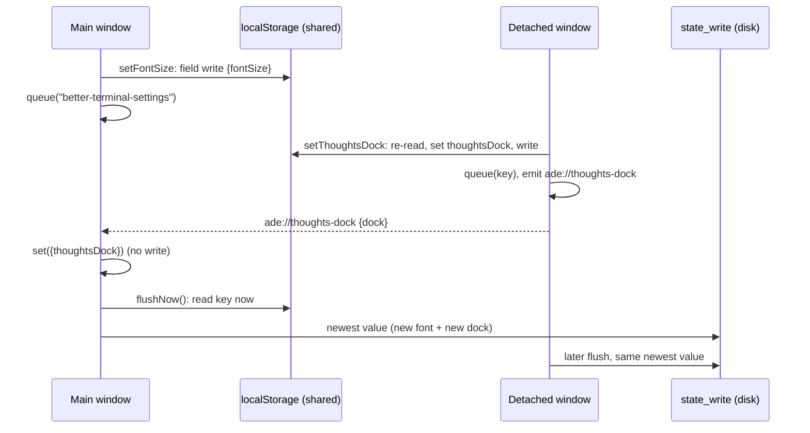

# Thoughts panel dock: architecture note

- **Status:** Proposed 2026-11-10. Not yet approved.
- **UX amendment it builds:** [`2026-11-10-thoughts-panel-right-ux.md`](2026-11-10-thoughts-panel-right-ux.md), revision 3, approved by the owner 2026-11-10 (PR #114). TR-1 to TR-31 are its criteria; this note does not restate them.
- **Scope.** This is a UI layout feature, so this note decides only what the scrum-master needs to shard it: the module layout, how settings are written, the disk race, sequencing against F3 S1, the focus helper, and the new keys. Anything else follows the UX spec.
- **Verification command:** unchanged (`docs/architecture.md`, "In force"). TR-3's Rust test runs under `cd src-tauri && cargo test`; everything else under `npm test`.
- **Decision:** [ADR 0033](../../../.ade/context/decisions/0033-shared-local-keys-are-written-field-by-field.md). **Contracts:** `.ade/context/local-key-writes.md`, `.ade/context/pane-focus.md`, `.ade/context/thoughts-panel.md`.

## 1. Layout host and the pure functions

The name **`PanelLayout`** stays. The code splits into one pure module, one I/O module and one component. Nothing in the pure module reads the DOM, `localStorage` or a store.

| File | Kind | Exports |
| --- | --- | --- |
| `src/lib/panelLayout.ts` | pure | `layoutPanels`, `largestFit`, `thoughtsChrome`, `listSplit`, `PANEL_RANGES`, and the types below |
| `src/lib/thoughtsLayout.ts` | I/O | `readThoughtsLayout()` (clamps on read, falls back to defaults), `writeThoughtsLayoutField(field, value)` (field-level, section 2) |
| `src/components/PanelLayout.tsx` + `PanelLayout.css` | component | `default PanelLayout` |

```ts
// src/lib/panelLayout.ts
export type Panel = "fileBrowser" | "preview" | "board" | "thoughts";
export type Dock = "right" | "bottom";
export type Placement = Dock;
export type Chrome = "full" | "compact" | "narrow";
export interface LayoutInput {
  windowWidth: number;
  dock: Dock;
  open: Record<Panel, boolean>;
  saved: Record<Panel, number>;
  previous: { placement: Placement | null; open: Record<Panel, boolean>; dock: Dock } | null;
}
export interface LayoutResult {
  placement: Placement | null;                      // null: Thoughts closed
  widths: Partial<Record<Panel, number>> & { main: number };
}
export const PANEL_RANGES: Record<Panel, { min: number; max: number; initial: number }>;
// main view: min 320, no max (MAIN_MIN)
export function layoutPanels(input: Readonly<LayoutInput>): LayoutResult;
export function largestFit(input: Readonly<LayoutInput>, panel: Panel): number;
export function thoughtsChrome(width: number): Chrome;
export function listSplit(bodyHeight: number, ratio: number): { list: number; composer: number };
```

`largestFit` is defined as UX rule 5 says: it calls `layoutPanels` and checks the result. It does not repeat the give-way rule. A linear scan of at most 640 − 280 calls is cheap enough, and only a handle reads it.

**`PanelLayout`'s contract.** Both `App.tsx` and `DetachedApp.tsx` render it.

```ts
interface PanelLayoutProps {
  dock: Dock;
  open: Record<Panel, boolean>;
  saved: Record<Panel, number>;
  onResize(panel: Panel, width: number): void;   // the host clamps to [min, largestFit] before calling
  fileBrowser?(width: number): ReactNode;
  main: ReactNode;
  preview?(width: number): ReactNode;
  board?(width: number): ReactNode;
  thoughts(placement: Placement | null, width: number | undefined): ReactNode;
}
```

- The host reads `window.innerWidth` and listens to `resize`. It keeps `previous` in a ref and calls `layoutPanels` on every render whose inputs changed.
- It renders the layout wrapper, `<div class="panel-layout" data-placement=…>`, with exactly two children: the main row, then whatever `thoughts()` returns. `PanelLayout.css` places the two with grid areas keyed on `data-placement`: two columns `1fr auto` for right, two rows `1fr auto` for bottom. `PanelLayout.css` joins `noInlineStyles.test.ts`'s `it.each` next to `Scratchpad.css`.
- Each side panel renders exactly the width it is given, with `flex: none`. The main view is `flex: 1 1 0; min-width: 0`.
- **Scratchpad's open state moves up to the window.** Today it is Scratchpad's own `useState(true)`; it becomes App's and DetachedApp's `useState(true)`, passed in as `open` and `onOpenChange`. The host needs the open flag as an input. `ScratchpadHandle` keeps its methods.
- **Saved width sources.** Thoughts: `readThoughtsLayout()`, read once at mount. Board: App state. File browser and Preview: see section 4, which depends on F3 S1.
- `useDragWidth` stops owning a width. It reports the dragged width from a start width the caller passes, which is the shown width; it no longer measures the DOM. The host clamps it and calls `onResize`.

**The announcer.** The UX spec leaves this to the architect. A new `src/stores/announceStore.ts` exports `say(text)`. `SubTerminalAnnouncer` subscribes to it as its third source, next to the tab store and `useOpenStatus`. Thoughts calls `say` and owns no live region. `DetachedApp` mounts `SubTerminalAnnouncer` (TR-24).

## 2. Field-level writes to shared local keys (ADR 0033)

**Rule.** Any window that writes a JSON key in `localStorage` that more than one window reads or writes does four things in one synchronous step:

1. re-read the key;
2. change only the fields it means to change;
3. write the result back;
4. update its own in-memory store with `set`, never with a whole-object persist.

**No window ever writes its whole in-memory copy of such a key.** The helper is `writeJsonFields(key, patch, base)` in `src/lib/storage.ts`, next to `readJson`. `base` (the window's full copy) is used only when the key is absent or unreadable.

This note goes one step further than the UX spec: **every** settings setter becomes field-level, not only `setThoughtsDock`. `settingsStore`'s `save(patch)` becomes `set(patch)` followed by `writeJsonFields(SETTINGS_KEY, patch, get())`. `persistSettings(get())` is no longer called on any path after load.

The reason is a race. Say a detached window writes `thoughtsDock: "bottom"`, and the main window changes the font before the `ade://thoughts-dock` event reaches it. Today's whole-copy save would then put `"right"` back in `localStorage`. The listener only calls `set`, so nothing would correct it before the next launch. With field-level setters the font write touches `fontSize` alone.

The UX spec's sentence "the main window's other setters are unchanged" is superseded by this. TR-2 still holds: the event listener calls `set` and writes nothing.

| Key | Writers | Field-level write |
| --- | --- | --- |
| `better-terminal-settings` | every settings setter, in any window; `setThoughtsDock` from any window | `writeJsonFields` (TR-30, plus the test below) |
| `ade-thoughts-layout` | any window, on a drag end, a key step or a size button | `writeThoughtsLayoutField` (TR-31) |
| `ade-thoughts-dock-notice` | main window only; one value | plain `setItem` |
| `ade-file-browser` | F3 S1 story 3's `setShowHidden` and the mirror | already read-modify-write in F3's design; consistent with this rule |

**Added test, beyond TR-30.** `localStorage` holds `thoughtsDock: "bottom"`, written by another window, while the window's store still says `"right"`. Calling `setFontSize(15)` leaves the stored `thoughtsDock` at `"bottom"`.

## 3. The disk race

**Problem.** The UX spec names the case:

1. The main window has a settings write queued (the user just changed the font).
2. A detached window then changes the dock.
3. The main window's queued write reaches disk last and carries the old dock.

Flushing the main window's queue when the event arrives is necessary but not enough on its own. `persistence.ts` queues the **value string** at the moment `setItem` runs. Flushing early therefore still writes the stale string. Worse, a failed `state_write` puts the stale batch back and retries 5 s later, after the detached window's write has landed.

**Decision, two parts:**

1. **The queue holds keys, not values.** `queue(key)` records the key only. `flush()` builds its batch by reading `localStorage.getItem(key)` for each queued key at flush time (`null` means remove). The retry path re-reads in the same way. `localStorage` is shared by every window, so whichever window flushes writes the newest value. This applies to every persisted key. For a key only one window writes, behaviour is unchanged.
2. **The main window flushes when the event arrives.** On `ade://thoughts-dock` it does `set({ thoughtsDock })` and then `await flushNow()`, so its last write to disk carries the new dock, whatever is queued.



**Test** (the story that adds `setThoughtsDock`, in `src/lib/__tests__/persistence.test.ts`). With `invoke` mocked:

1. Queue a settings write.
2. Change the key's value directly, as another window would (original `setItem`).
3. Call the event handler.
4. The last `state_write` carries the new dock.

A second case: the first `state_write` rejects, `localStorage` changes, and the retry writes the newest value.

## 4. Interplay with F3 S1 (PR #116)

The F3 S1 design (`2026-11-10-per-view-viewer-design.md`, section 15) builds five stories **in sequence**. Three of them touch this feature's files:

| F3 S1 story | Overlapping files | What clashes |
| --- | --- | --- |
| 2 Saving | `src/lib/persistence.ts`, the Rust key-set test | Both add `PERSISTED_KEYS` lines. This feature also changes `queue`/`flush` (section 3). F3 story 2 relies on the queue as it is, and keys-not-values is compatible with that. The Rust key-set test: whichever lands second extends the other's test rather than adding a second one. |
| 3 File browser per view | `FileBrowser.tsx`, `fileBrowserStore.ts`, `App.tsx` (⌘B, browser drag) | `isOpen` and `width` leave `fileBrowserStore` and go into `viewerStore` layout. ⌘B and the drag write `setLayout`. |
| **4 Preview per view** | **`App.tsx`, `PreviewPanel.tsx`, `previewFocus.ts`** | The Preview's open state and width come from `viewerStore` layout. It adds the focus rule (VV-1 AC7) in `App.tsx` and `previewFocus.ts`. |

Stories 1 and 5 do not touch this feature's files.

**Recommended landing order:**

1. **Now, in parallel with F3 S1 stories 1 to 3.** These Thoughts stories touch no file in the table except `persistence.ts` (a trivial merge):
   - the pure functions (`panelLayout.ts`, TR-10 to TR-13 on the function, TR-15, TR-17a, TR-20, TR-21's function half);
   - the settings and persistence work (TR-1, TR-2's store half, TR-3, TR-30, TR-31, section 3);
   - the panel's internals (`Scratchpad.tsx`/`.css`: same-node tree, chrome, handles, lists, accessibility);
   - the palette's `keywords`.
2. **The focus helper story (section 5, TR-25) before F3 S1 story 4.** It changes `previewFocus.ts` `closePreviewFocus` and `App.tsx`'s ⌘J. F3 story 4's VV-1 AC7 then reuses the helper rather than writing one.
3. **The layout host story after F3 S1 story 4 has merged.** This covers `PanelLayout`, the App and DetachedApp wiring, TR-4, TR-14, TR-24, TR-13's rendered half, and **TR-17b**. The host then reads the file-browser and Preview widths and open flags from `viewerStore` (`states[inSight].layout`) and writes them with `setLayout`. Nothing adds App-held Preview state only for F3 to remove it. **This story carries TR-17b**, since F3 S1 has landed.
4. **Visible changes ship with or after the host story.** No earlier story may change what App shows:
   - Before the host lands, the window passes Scratchpad `placement="bottom"`, whatever the setting says.
   - The Settings radio group, the palette entry, the header dock button and the upgrade notice (TR-7, TR-8, TR-9, TR-16, TR-27) land in or after the host story. Until then, a Right default would show nothing.

If the owner wants the right dock sooner (see the question below), invert step 3: the host lands first with App-held Preview state, as the UX table says. F3 S1 stories 3 and 4 then rewire `PanelLayout`'s inputs instead of their components' widths. The scrum-master then copies that note into F3 stories 3 and 4. TR-17b moves to F3 story 4.

## 5. The `data-pane-id` focus helper

Recorded in `.ade/context/pane-focus.md` for F3 S1's VV-1 AC7 to reuse:

```ts
// src/lib/paneFocus.ts
export const PANE_ID_ATTR = "data-pane-id";          // on TerminalPane's root
export const TERMINAL_INPUT_SELECTOR = ".xterm-helper-textarea"; // moves here from previewFocus.ts
export function focusPaneInput(paneId: string | null | undefined, root?: ParentNode): boolean;
export function focusActivePane(): boolean;          // the active tab's shownView(tab).activePaneId
export function thoughtsHotkey(sp: ScratchpadHandle | null): void; // ⌘J's three cases, App and DetachedApp
```

- `focusPaneInput` finds the element whose `dataset.paneId === paneId` by comparison, not by building a selector, so pane ids need no escaping. It focuses that element's terminal input and returns `true`.
- It returns `false` and does nothing when there is no such pane or input. It **never falls back** to the first terminal in the document.
- `focusActivePane` handles terminal panes only. A non-terminal tab's own focus stays with the caller.

## 6. The new keys

`src/lib/persistence.ts` `PERSISTED_KEYS` gains `"ade-thoughts-layout"` and `"ade-thoughts-dock-notice"`. Neither goes in `SHARED_KEYS` or `DEVICE_KEYS` in `src-tauri/src/sync.rs`, so neither syncs. TR-3's Rust test asserts that. Value shapes and defaults are as in the UX spec's "Persistence and sync" table, and are recorded in `.ade/context/thoughts-panel.md`.

## 7. Failure modes

| Failure | Handling |
| --- | --- |
| `ade-thoughts-layout` unreadable or out of range | Each field falls back to its default or is clamped on read. Nothing is written back until a drag. |
| `better-terminal-settings` absent when a field write runs | `writeJsonFields` writes the window's full copy (`base`) with the patch applied. |
| `ade://thoughts-dock` lost (window not listening yet) | The window shows its loaded dock. It reads the new value the next time it opens. `localStorage` and disk are already right. |
| `state_write` fails | The retry re-reads the queued keys, so it writes the newest values, never a stale batch. |
| No terminal input in the active pane | The focus helper does nothing (UX TR-25). |

## 8. Owner question

**Q1. Landing order.** The recommendation is for the visible right dock to wait until F3 S1 stories 1 to 4 have merged. Those stories run one after another. The other order ships it sooner, but F3 stories 3 and 4 then have to rewire the layout host, which is more rework in `App.tsx`, `PreviewPanel` and `FileBrowser`. Which do you want?
