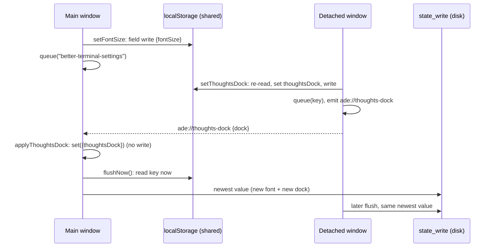
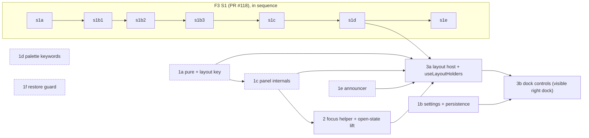

# Thoughts panel dock: architecture note

- **Status:** Revision 3, 2026-11-10. Revision 1 (50cefee) was blocked by review (B1, M1 to M4, m1 to m8); revision 2 (1291a96) was blocked by the delta review (B1: section 4 stale against PR #118 at 67310e5; M-A, M-B, M-C and five minors). The persistence decisions of revision 1 passed and are kept: field-level setters, and a disk queue that holds keys and reads them at flush time. Section 9 lists each finding and where it is answered. Not yet approved.
- **Owner decision (2026-11-10, answer to Q1):** the visible right dock ships **after** F3 S1 stories s1a to s1d. PR #118 (`_bmad-output/initiative-per-view-viewer/epic-slice-1-viewer-state/tickets.toml`, at 67310e5) shards them as seven stories, s1a, s1b1, s1b2, s1b3, s1c, s1d and s1e, so "s1a to s1d" now means s1a, s1b1, s1b2, s1b3, s1c and s1d. The internals may be built in parallel. Section 4 is ordered by this decision.
- **UX amendment it builds:** [`2026-11-10-thoughts-panel-right-ux.md`](2026-11-10-thoughts-panel-right-ux.md), revision 3, approved by the owner 2026-11-10 (PR #114). TR-1 to TR-31 are its criteria; this note does not restate them. Section 4.3 maps every TR to a step.
- **Scope.** This is a UI layout feature. The note decides only what the scrum-master needs to shard it: the module layout, how settings and layout are written, the disk race, sequencing against F3 S1, the focus helper, and the new keys. Anything else follows the UX spec.
- **Verification command:** unchanged. It is the seven lines under "In force" in `docs/architecture.md`, each run from the repository root, each exiting 0. TR-3's Rust test and the restore guard's tests (section 3.4) run under `cd src-tauri && cargo test`. Everything else runs under `npm test`, and the types are checked by `npx tsc --noEmit`.
- **Decision:** [ADR 0033](../../../.ade/context/decisions/0033-shared-local-keys-are-written-field-by-field.md). **Contracts:** `.ade/context/local-key-writes.md`, `.ade/context/pane-focus.md`, `.ade/context/thoughts-panel.md`.

## 1. Layout host and the pure functions

The name **`PanelLayout`** stays. The code splits into one pure module, one I/O module, one hook and one component. Nothing in the pure module reads the DOM, `localStorage` or a store.

| File | Kind | Exports |
| --- | --- | --- |
| `src/lib/panelLayout.ts` | pure | `layoutPanels`, `largestFit`, `thoughtsChrome`, `listSplit`, `PANEL_RANGES`, and the types below |
| `src/lib/thoughtsLayout.ts` | I/O | `readThoughtsLayout()` (clamps on read, falls back to defaults), `writeThoughtsLayoutField(field, value)` (field-level, section 2) |
| `src/hooks/useThoughtsWidth.ts` | hook | `useThoughtsWidth(): { width, commit(width) }`, the window's holder of the saved right-dock width (section 1.2) |
| `src/hooks/useLayoutHolders.ts` | hook | `useLayoutHolders(inSightKey, flags): { saved, open, onCommit }`, the one place that routes a committed width to its holder (section 1.2). App and DetachedApp both call it. |
| `src/components/PanelLayout.tsx` + `PanelLayout.css` | component | `default PanelLayout`, the types `PanelSlot` and `ThoughtsSlot` |

```ts
// src/lib/panelLayout.ts
export type Panel = "fileBrowser" | "preview" | "board" | "thoughts";
export type Dock = "right" | "bottom";
export type Placement = Dock;
export type Chrome = "full" | "compact" | "narrow";
export interface LayoutInput {
  windowWidth: number;
  dock: Dock;
  open: Record<Panel, boolean>;
  saved: Record<Panel, number>;
  previous: { placement: Placement | null; open: Record<Panel, boolean>; dock: Dock } | null;
}
export interface LayoutResult {
  placement: Placement | null;                      // null: Thoughts closed
  widths: Partial<Record<Panel, number>> & { main: number };
}
export const PANEL_RANGES: Record<Panel, { min: number; max: number; initial: number }>;
// fileBrowser 180..500 (240), preview 280..900 (480), board 280..720 (380), thoughts 280..640 (360)
// main view: min 320, no max (MAIN_MIN)
export function layoutPanels(input: Readonly<LayoutInput>): LayoutResult;
export function largestFit(input: Readonly<LayoutInput>, panel: Panel): number;
export function thoughtsChrome(width: number): Chrome;
export function listSplit(bodyHeight: number, ratio: number): { list: number; composer: number };
```

- `largestFit` is defined as UX rule 5 says: it calls `layoutPanels` and checks the result. It does not repeat the give-way rule. A linear scan of at most 640 − 280 calls is cheap enough, and the host computes it only for open panels.
- `PANEL_RANGES.fileBrowser` and `.preview` must equal F3 S1's clamps (s1a: file browser 180 to 500, preview 280 to 900). `PANEL_RANGES.board` must equal `BoardPanel.tsx`'s `BOARD_WIDTH`. The host story (step 3a) adds a test that compares them, so the two sources cannot drift.

### 1.1 `PanelLayout`'s contract

Both `App.tsx` and `DetachedApp.tsx` render it, and both feed its `saved`, `open` and `onCommit` from `useLayoutHolders` (section 1.2). Neither window routes a width itself.

```ts
// src/components/PanelLayout.tsx
export interface PanelSlot {
  width: number;                              // the fitted width to render (layoutPanels)
  max: number;                                // largestFit(input, panel): "Widest that fits", aria-valuemax
  onResize(width: number, final: boolean): void;
}
export interface ThoughtsSlot extends PanelSlot {
  placement: Placement | null;                // width and max apply only when "right"
}
interface PanelLayoutProps {
  dock: Dock;
  inSightKey: string;                         // viewerKey of the view in sight (M1, section 1.3)
  open: Record<Panel, boolean>;
  saved: Record<Panel, number>;               // each panel's holder value (section 1.2)
  onCommit(panel: Panel, width: number): void;// once per finished resize; the window routes it to the holder
  fileBrowser?(slot: PanelSlot): ReactNode;
  main: ReactNode;
  preview?(slot: PanelSlot): ReactNode;
  board?(slot: PanelSlot): ReactNode;
  thoughts(slot: ThoughtsSlot): ReactNode;
}
```

- The host reads `window.innerWidth` and listens to `resize`. It keeps `previous` in a ref and calls `layoutPanels` on every render whose inputs changed. It computes `max` with `largestFit` on the same input.
- **Resizing.** A panel calls `slot.onResize(width, false)` on every pointer move of a drag, and `slot.onResize(width, true)` once at its end. A key step, Home, End, Enter or a size button calls `slot.onResize(width, true)` alone. The host clamps every value to `[PANEL_RANGES[panel].min, max]`.
  - When `final` is false, the host keeps the clamped value in its own `live` state, and lays out with `{ ...saved, ...live }`. Nothing is written.
  - When `final` is true, the host drops `live[panel]` and calls `onCommit(panel, clamped)` exactly once.
  - So TR-13's "a Thoughts drag ending at 420 at 1100 saves 320" is the clamp on commit. Fitting itself never calls `onCommit`.
- The host renders `<div class="panel-layout" data-placement=…>` with exactly two children: the main row, then whatever `thoughts()` returns. `PanelLayout.css` places the two with grid areas keyed on `data-placement`: two columns `1fr auto` for right, two rows `1fr auto` for bottom. `PanelLayout.css` joins `noInlineStyles.test.ts`'s `it.each` next to `Scratchpad.css`.
- Each side panel renders exactly `slot.width`, with `flex: none`. The main view is `flex: 1 1 0; min-width: 0`.
- `useDragWidth` stops owning a width. It takes the shown width as its start width and reports through a callback (`onResize(width, final)`). It neither measures the DOM nor clamps. `PreviewPanel` and `BoardPanel` take a `PanelSlot` prop and pass `slot.onResize` to it. `FileBrowser`'s edge drag does the same.

### 1.2 Who holds each saved width after a write: `useLayoutHolders` (M-C)

The routing from a panel to its holder lives in one hook, not in `App.tsx`, which no test renders:

```ts
// src/hooks/useLayoutHolders.ts
export interface LayoutFlags {
  boardOpen: boolean;        // App's state; DetachedApp passes false
  thoughtsOpen: boolean;     // the window's state (section 1.4)
  viewerPanels: boolean;     // true in App; false in DetachedApp until F3 S3
}
export function useLayoutHolders(inSightKey: string, flags: LayoutFlags): {
  saved: Record<Panel, number>;
  open: Record<Panel, boolean>;
  onCommit(panel: Panel, width: number): void;
};
```

- App calls `useLayoutHolders(inSightKey, { boardOpen, thoughtsOpen, viewerPanels: true })` and passes the three results to `PanelLayout` unchanged. DetachedApp calls it with `boardOpen: false, viewerPanels: false`.
- The hook owns the board width (`useState(BOARD_WIDTH.initial)`) and calls `useThoughtsWidth()` inside. It reads `viewerStore` with equality selectors on `states[inSightKey].layout`.
- `onCommit` is a stable callback (`useCallback` over `inSightKey`). It routes by the table below and touches **only** that panel's holder.
- With `viewerPanels: false`, `saved.fileBrowser` and `saved.preview` are the ranges' `initial`, `open.fileBrowser` and `open.preview` are `false`, and a commit for either is ignored.

| Panel | Holder (the value the host gets as `saved[panel]`) | `onCommit` does |
| --- | --- | --- |
| `thoughts` (right-dock width) | `useThoughtsWidth()` in App and in DetachedApp: React state, read once at mount from `readThoughtsLayout().rightWidth` | `writeThoughtsLayoutField("rightWidth", w)`, then `setState(w)` in the same handler. The host's next layout uses the committed width; there is no stale copy. |
| `fileBrowser` | `viewerStore.states[inSightKey].layout.browserWidth` (after s1c), read in App with an equality selector | `viewerStore.setLayout(inSightKey, { browserWidth: w })`. `viewerPersist` saves `ade-viewer-state`; s1c's mirror writes `ade-file-browser`. |
| `preview` | `viewerStore.states[inSightKey].layout.previewWidth` (after s1d) | `viewerStore.setLayout(inSightKey, { previewWidth: w })` |
| `board` | the hook's `useState(BOARD_WIDTH.initial)`. Not persisted, as today. | `setState(w)` |

- Another window's `rightWidth` write is not picked up until this window reopens. Widths send no event (UX, TR-31). The write is field-level, so neither window's write erases the other's.
- `bottomHeight` and `listSplit` do not enter the layout. Scratchpad holds them itself: it reads them once at mount with `readThoughtsLayout()`, and on a commit calls `writeThoughtsLayoutField` and then its own `setState`.
- The open flags come from the same holders: `layout.browserOpen` and `layout.previewOpen` of the view in sight, and the `boardOpen` and `thoughtsOpen` flags the window passes in (section 1.4).
- DetachedApp passes neither `fileBrowser` nor `preview` render props until F3 S3; `viewerPanels: false` gives the `saved` and `open` values above.

**Test A-5** (step 3a, `src/hooks/__tests__/useLayoutHolders.test.ts`, `renderHook` with the real `viewerStore` and a `localStorage` seeded with `ade-thoughts-layout` and two views' layouts):
- `onCommit("thoughts", 400)`: `ade-thoughts-layout.rightWidth` is 400 and `saved.thoughts` is 400; both views' `layout` in `viewerStore` and `saved.board` are unchanged.
- `onCommit("fileBrowser", 300)`: `states[inSightKey].layout.browserWidth` is 300 and `saved.fileBrowser` is 300; the other view's layout, `ade-thoughts-layout` and `saved.board` are unchanged.
- `onCommit("preview", 700)`: only `states[inSightKey].layout.previewWidth` changes.
- `onCommit("board", 500)`: only `saved.board` changes; nothing is written to `localStorage` and `viewerStore` is unchanged.
- Rerendering with the other view's key: `saved.fileBrowser` and `saved.preview` are that view's values, and a commit lands on that view only.
- With `viewerPanels: false`: `open.fileBrowser` and `open.preview` are `false`, the saved values are `initial`, and `onCommit("fileBrowser", 300)` changes nothing.
- A string test: `App.tsx` and `DetachedApp.tsx` each call `useLayoutHolders(` and neither calls `setLayout(` or `writeThoughtsLayoutField(` itself.

### 1.3 Cause of a move, and the one announcer

- `inSightKey` is `shownView(activeTab).viewerKey` (`.ade/context/viewer-state.md`), passed by both windows. A tab switch changes it too.
- **`PanelLayout` is the only code that announces a Thoughts move.** `setThoughtsDock`, the header button, the palette entry, the Settings radio group and the notice never call `say`.
- After each commit, the host compares the result with the previous render's `{ placement, inSightKey }`, kept in a ref:
  - If either placement is `null` (Thoughts opened or closed), it says nothing.
  - If the placement is unchanged, it says nothing.
  - If the placement changed **and `inSightKey` changed**, the cause is a view or tab switch. It says nothing (TR-17b).
  - Otherwise the cause is the dock setting, the window's width, or a panel opened or closed. It calls `say`:
    - to `"right"`: "Thoughts moved to the right";
    - to `"bottom"` with `dock` `"bottom"`: "Thoughts moved to the bottom";
    - to `"bottom"` with `dock` `"right"`: "Thoughts moved to the bottom while the window is narrow".
- If a view switch and a resize land in the same render, the move is silent. This is accepted.

**The announcer.** A new `src/stores/announceStore.ts` holds `{ text: string; n: number }`. `say(text)` sets `{ text, n: n + 1 }`. It changes state on every call, including for the same text twice in a row. `SubTerminalAnnouncer` subscribes to it as its third source, next to the tab store and `useOpenStatus`. For each change it does `setSaid((p) => ({ text, n: p.n + 1 }))`, the same new-node rule it already uses, so the same words said twice are heard twice. The panel owns no live region. DetachedApp mounts `SubTerminalAnnouncer` (TR-24). **Test (m8),** `src/stores/__tests__/announceStore.test.ts`:
- `say("Thoughts moved to the right")` twice notifies a subscriber twice, and `n` goes up by 2;
- rendering `SubTerminalAnnouncer` and saying the same text twice gives two distinct announcement nodes.

### 1.4 Scratchpad's open state moves to the window (m7)

This is done in **step 2**, the focus story, which already edits every caller: `App.tsx`, `DetachedApp.tsx`, `Scratchpad.tsx` and `useKeybindings.ts`. Step 2 starts after step 1c merges, because both edit `Scratchpad.tsx` heavily (section 4.2).

- `Scratchpad` loses `useState(true)` for `isOpen`. It gains the props `open: boolean` and `onOpenChange(open: boolean): void`. App and DetachedApp each hold `const [thoughtsOpen, setThoughtsOpen] = useState(true)`.
- `ScratchpadHandle` keeps its shape. Its methods delegate:
  - `toggle()` calls `onOpenChange(!open)`;
  - `close()` calls `onOpenChange(false)`;
  - the `isOpen` getter returns the `open` prop.
- Everything inside Scratchpad that read `isOpen` reads `open`: the `claimKeyboard` effect, the voice stop, focus-on-reopen, and `if (!open) return null`.
- App's `useKeybindings` actions take `isScratchpadOpen: thoughtsOpen`, App's state, instead of `scratchpadRef.current?.isOpen`. The ref read happened during render and could be stale.
- The host story then passes `thoughtsOpen` as `open.thoughts`.

## 2. Field-level writes to shared local keys (ADR 0033)

**Rule.** A window that writes a JSON key in `localStorage` that more than one window writes does four things in one synchronous step:

1. re-read the key;
2. change only what it means to change;
3. write the result back;
4. update its own in-memory store with `set`, never with a whole-copy persist.

What step 2 means depends on the key's shape:

- **Object keys** are field-level. The helper is `writeJsonFields(key, patch, base)` in `src/lib/storage.ts`, next to `readJson`. It applies `patch` to the re-read object's top-level fields. `base`, the window's full copy, is used only when the key is absent or unreadable.
- **Array keys** are operation-level. The writer re-reads the array, applies its one operation to the fresh array, caps the array, and writes it. The operations are: add an entry (with the key's de-duplication), remove an entry by id or by value (never by index), or replace one entry matched by id. It then sets its store from the array it wrote. It never writes its own in-memory array.

**No window ever writes its whole in-memory copy of such a key.**

This note goes one step further than the UX spec: **every** settings setter becomes field-level, not only `setThoughtsDock`. `settingsStore`'s `save(patch)` becomes `set(patch)` followed by `writeJsonFields(SETTINGS_KEY, patch, get())`. `persistSettings(get())` is no longer called on any path after load. `setCustomColor` patches `customColors` whole, as today (ADR 0033: top-level fields are the unit).

The reason is a race. Say a detached window writes `thoughtsDock: "bottom"`, and the main window changes the font before the `ade://thoughts-dock` event reaches it. Today's whole-copy save would then put `"right"` back in `localStorage`. The listener only calls `set`, so nothing would correct it before the next launch. With field-level setters the font write touches `fontSize` alone.

The UX spec's sentence "the main window's other setters are unchanged" is superseded by this. TR-2 still holds: the event listener calls `set` and writes nothing.

| Key | Shape | Writers | Write |
| --- | --- | --- | --- |
| `better-terminal-settings` | object | every settings setter, in any window; `setThoughtsDock` from any window | `writeJsonFields` (TR-30, plus test A-1) |
| `ade-thoughts-layout` | object | any window: a drag end, a key step or a size button | `writeThoughtsLayoutField`, built on `writeJsonFields` (TR-31) |
| `ade-file-browser` | object | F3 s1c: `setShowHidden` and the mirror (main window) | read-modify-write in F3's design; consistent with this rule |
| `ade-thoughts-dock-notice` | string | main window only | plain `setItem` |

**Test A-1, beyond TR-30.** `localStorage` holds `thoughtsDock: "bottom"`, written by another window, while the window's store still says `"right"`. Calling `setFontSize(15)` leaves the stored `thoughtsDock` at `"bottom"`.

### 2.1 Known exceptions in existing code (M2)

These keys break the rule today. Each is written as a whole array from a copy the writer read earlier, and they are written in both kinds of window. All three are in `SHARED_KEYS`, so a stale copy also syncs to the user's other Macs.

| Key | Writer today | Windows |
| --- | --- | --- |
| `better-terminal-prompt-history` | `Scratchpad.tsx` `saveHistory` (line 86), from the `history` state read at mount (`addToHistory`, `deleteHistoryItem` by index) | main and detached (both mount Scratchpad) |
| `better-terminal-saved-notes` | `Scratchpad.tsx` `persistNotes` (line 99), from the `notes` state read at mount (`saveNote`, `deleteNote`) | main and detached |
| `better-terminal-agent-tracker` | `agentTrackerStore.ts` `persistSessions`, from the store's `sessions` | main, and detached through `useTerminal`'s `endSession` on pane close |

- They stay as they are in this feature. Changing them is not part of the Thoughts stories.
- **Follow-up F-1** (one small story, for the scrum-master to shard separately): move all three to operation-level writes as defined above.
  - History removes by value, not by index.
  - Notes and agent sessions remove or replace by `id`.
  - Each test seeds the key from "another window" after the store loaded, runs one operation, and asserts that the other window's entry survives.
  - The history and notes half edits `Scratchpad.tsx`, so it runs after step 1c merges. The agent-tracker half is independent.
- The other keys in `SHARED_KEYS` (`better-terminal-workspaces`, `better-terminal-orchestrator`, `ade-bmad-dismissed`) have a single writer, the main window. I checked that DetachedApp's imports reach none of their writers. They may keep plain `setItem` while that stays true.

### 2.2 Behaviour change: settings no longer persist load-time migrations (m5)

- Today any setter writes the whole migrated copy. That also persists the in-memory migrations:
  - the dropped legacy `fontFamily` stack (`migrate`);
  - `RETIRED_MODELS`;
  - the `gemini` to `claude` fallback.
- It also persists every default the user never touched.
- With field-level setters:
  - The stored value keeps the legacy `fontFamily`, model id or `"gemini"` until the user sets that field. Each load re-applies the migration in memory. The migrations are idempotent, so this is safe. **They must not be deleted** while old values can be on disk. A comment at the migrations in `settingsStore.ts` says so (step 1b).
  - A field the user never set stays absent from storage, so it **follows future changes of its default**. Today it is frozen at the default in force when the user first changed any setting. This is intended. A future change of a default is therefore a change for every user who never set that field, and must be reviewed as one.
- Step 1b adds test A-4: a stored `orchestratorModel` `"claude-opus-4-20250514"` reads as `"claude-opus-5"` in the store; `setFontSize(15)` leaves the stored `orchestratorModel` unchanged; a stored object without `fontSize` stays without it after `setLineHeight(1.3)`.

## 3. The disk race

**Problem.** The UX spec names the case:

1. The main window has a settings write queued (the user just changed the font).
2. A detached window then changes the dock.
3. The main window's queued write reaches disk last and carries the old dock.

Flushing the main window's queue when the event arrives is necessary but not enough on its own. `persistence.ts` queues the **value string** at the moment `setItem` runs, so flushing early still writes the stale string. Worse, a failed `state_write` puts the stale batch back and retries 5 s later, after the detached window's write has landed.

**Decision, two parts:**

1. **The queue holds keys, not values.** `queue(key)` records the key only. `flush()` builds its batch by reading `localStorage.getItem(key)` for each queued key at flush time (`null` means remove). The retry path re-reads in the same way. `localStorage` is shared by every window, so whichever window flushes writes the newest value it can see. This applies to every persisted key. For a key only one window writes, behaviour is unchanged.
2. **The main window flushes when the event arrives.** On `ade://thoughts-dock` it does `set({ thoughtsDock })` and then `await flushNow()`, so its next write to disk carries the new dock, whatever is queued.



**Test A-2** (step 1b, `src/lib/__tests__/persistence.test.ts`), with `invoke` mocked:
1. Queue a settings write.
2. Change the key's value directly, as another window would (the original `setItem`).
3. Call `applyThoughtsDock` as the main window.
4. The last `state_write` carries the new dock.

A second case: the first `state_write` rejects, `localStorage` changes, and the retry writes the newest value.

### 3.1 The listener's home (M4)

The listener half of TR-2 lives in **`src/lib/thoughtsDockSync.ts`**, not in `App.tsx`, which no test renders:

```ts
export function applyThoughtsDock(payload: unknown, isMain: boolean): Promise<void>;
// Ignores a payload whose dock is not "right" or "bottom".
// useSettingsStore.setState({ thoughtsDock }); writes nothing to localStorage.
// isMain: settleDockNotice() (writes "done" if the notice is due), then await flushNow().
export function startThoughtsDockSync(isMain: boolean): Promise<() => void>;
// listen("ade://thoughts-dock", (e) => applyThoughtsDock(e.payload, isMain)); resolves to the unlisten.
```

- `settleDockNotice()` and `dockNoticeDue()` live in `src/lib/thoughtsDockNotice.ts`, with a small store the notice component reads. That component lands in step 3b.
- **Who registers it.** App's mount effect calls `startThoughtsDockSync(true)`. DetachedApp's mount effect calls `startThoughtsDockSync(false)`, next to `startTerminalOpen`. Each calls the unlisten on cleanup.
- **Steps.**
  - Step 1b builds the module and tests it with `@tauri-apps/api/event` mocked: TR-2's listener and notice halves, and A-2.
  - Step 3b registers it in both windows. TR-24 covers DetachedApp. A string test asserts that `App.tsx` calls `startThoughtsDockSync(true)`.

### 3.2 Cross-window ordering is best effort (m3)

The guarantees above hold for writes separated by more than the time it takes a write to reach every window. They are not atomic across windows:

- `state_write` is an async Tauri command. Two windows' batches can reach Rust in either order.
- WebKit propagates `localStorage` between web-content processes asynchronously. A window can re-read a key before another window's write has reached it. Two field writes to one key within that interval can then lose one field. And the main window's `flushNow()` on the event can read a value that does not yet hold the new dock, because the Tauri event can arrive before the storage change.
- What is left is self-healing. Any later flush of the key, from any window, writes the converged value, because the queue reads at flush time. A loss needs two writes to one key within milliseconds, faster than a person changes settings in two windows. Its worst effect is that one setting reverts at the next launch. No data is lost.
- This is accepted. No lock or cross-window sequence number is added.

### 3.3 New keys in the queue

`PERSISTED_KEYS` gains `"ade-thoughts-layout"` and `"ade-thoughts-dock-notice"` (section 6).

### 3.4 Snapshot restore and other windows (m4, M-B)

- `suspendAutoSave()` acts only in the window that calls it, the main window's Settings → Sync. It sets `suspended`, drops the pending batch and clears the flush timer. It does **not** stop the 10-minute `state_snapshot` interval (`startAutoSave`'s `setInterval`), and it does nothing in detached windows.
- So after a restore, a detached window's settings write (the dock), a Thoughts layout write, a history or notes write, or an agent-tracker write can still call `state_write` and overwrite the restored files before the restart that loads them. With the keys-only queue the value written is that window's current `localStorage`, which is exactly what the restore meant to replace.
- The snapshot interval that keeps running is harmless: `state_snapshot` copies `kv/` into a new snapshot and prunes the oldest. It never writes `kv/`. It is left as it is.

**Handling: a guard in Rust, where every window's writes meet, held in Tauri managed state.** There is no `static`. Each test makes its own guard, so `cargo test`'s parallel threads cannot see each other's flag.

```rust
// src-tauri/src/state.rs
#[derive(Default)]
pub struct RestoreGuard(std::sync::Mutex<bool>); // true: a restore is pending until restart

/// The only writer that checks the guard. Used by the state_write command and by tests A-3, A-6 and A-7.
pub fn guarded_write(kv: &Path, entries: &HashMap<String, Option<String>>, guard: &RestoreGuard) -> std::io::Result<()>;
// lock; if *pending { return Ok(()) } (nothing written); else write_batch(kv, entries); unlock.

/// The only restorer that sets the guard. Used by the state_restore_snapshot command and by tests A-3 and A-6.
pub fn guarded_restore(state_dir: &Path, name: &str, now_ms: u64, guard: &RestoreGuard) -> std::io::Result<()>;
// lock; *pending = true; restore_snapshot(state_dir, name, now_ms);
// on Err: *pending = false and return the error; unlock.
```

- **Where the flag lives.** `lib.rs` registers `.manage(state::RestoreGuard::default())` next to the other managers. `state_write` and `state_restore_snapshot` each take `guard: tauri::State<'_, RestoreGuard>` and call `guarded_write` or `guarded_restore`. Nothing else reads or sets it.
- **Where it is not.** `write_batch` and `restore_snapshot` are unchanged and know nothing of the guard. `write_batch` is shared with `sync.rs`'s `import_state` and with the existing `state.rs` and `sync.rs` tests, which keep calling it directly.
- **No window between the swap and the flag.** `guarded_restore` sets the flag **before** `restore_snapshot` starts, so before the rename that swaps `kv/`. It holds the lock for the whole restore, so a `state_write` that arrives during the restore waits for the outcome instead of being dropped:
  - the restore succeeds: the waiting write sees the flag and is dropped;
  - the restore fails: the flag is cleared before the lock is released, and the waiting write lands as normal. A failed restore loses no write.
- The commands run on Tauri's thread pool (`#[tauri::command(async)]` on a sync `fn`), so a write blocked for the length of a restore blocks no UI thread. A poisoned lock is recovered with `into_inner()`, never unwrapped.
- While the flag is set, `state_write` returns `Ok(())`, not an error, so no window's retry loop spins.
- The flag lives as long as the process. The restart that loads the snapshot starts with a fresh guard.
- The JS-side `suspendAutoSave()` stays. A failed restore leaves the main window suspended until restart, as today; this feature does not change that.
- **The message.** `SyncSettings.tsx`'s success message becomes: "Snapshot restored. Auto-save is paused in every window until you restart ADE, which loads it."
- **Out of scope, unchanged:** `sync_now`'s `import_state` writes `kv/` through `write_batch` and is not guarded. A sync pull after a restore can still import shared keys over restored ones, as it can today.

**Tests, step 1f** (`state.rs`'s `tests` module, each with its own `tmp` folder and its own `RestoreGuard::default()`):
- **A-3:** after `guarded_restore` succeeds, `guarded_write` of a new value leaves the kv folder byte for byte as the restore left it, and returns `Ok`.
- **A-6:** `guarded_restore` with a name that is not a snapshot returns `Err`, and a following `guarded_write` lands.
- **A-7:** with a fresh guard, `guarded_write` writes exactly as `write_batch` does (the existing write test, through the guard).
- A string test (`src/lib/__tests__/restoreMessage.test.ts`) asserts that `SyncSettings.tsx` contains "paused in every window".

## 4. Interplay with F3 S1 (PR #118)

F3 S1 is seven stories built **in order, never two in parallel**: s1a, s1b1, s1b2, s1b3, s1c, s1d, s1e (`tickets.toml` at 67310e5). "After" below means merged to main.

### 4.1 Files both features change (m1, B1)

From the tickets in PR #118 at 67310e5:

| F3 S1 story | Its files that this feature also changes | Thoughts step that changes them |
| --- | --- | --- |
| **s1a** | `src/App.tsx` (the load effect: `hydrateViewerState`, `loadSession`, `endRestore`); `src-tauri/src/sync.rs` (`SESSION_LOCAL_FIELDS`, plus a unit test in its `tests` module) | 1b (`sync.rs` `tests` module: TR-3's Rust test); 2, 3a, 3b (`App.tsx`) |
| **s1b1** | `src/lib/persistence.ts` (`"ade-viewer-state"` in `PERSISTED_KEYS`); `src/lib/__tests__/persistence.test.ts` (its key test) | 1b (`persistence.ts`: the two keys and the keys-only queue; `persistence.test.ts`: TR-3's TS half and A-2) |
| **s1b2** | `src/App.tsx` (`startViewerPersistence()` in the load effect, after `endRestore`); `src/stores/tabStore.ts` (`saveSession`'s flush and ladder); `src/lib/viewerPersist.ts` (the writer). It reads `src/DetachedApp.tsx` in a string test but does not edit it. | 2, 3a, 3b (`App.tsx`). No Thoughts step edits `tabStore.ts` or `viewerPersist.ts`. |
| **s1b3** | `src-tauri/src/sync.rs` `tests` module (the export test against the golden fixture, and a Rust key-set test for `"ade-viewer-state"`) | 1b (`sync.rs` `tests` module: TR-3's Rust key-set test, section 4.2 item 2) |
| **s1c** | `src/App.tsx` (`readPaneFolder`); **`src/components/TerminalPane.tsx`** (its poll goes through `readPaneFolder`); `FileBrowser.tsx` (width and drag through `setLayout`); `fileBrowserStore.ts`; `viewerPersist.ts` (the `ade-file-browser` mirror) | 2 (`TerminalPane.tsx`: `data-pane-id`; `App.tsx`); 3a (`FileBrowser.tsx` takes a `PanelSlot`; `App.tsx`) |
| **s1d** | `src/App.tsx`, `src/lib/previewFocus.ts` (VV-1 AC7), `PreviewPanel.tsx` (width from `layout.previewWidth`, replacing `useDragWidth`'s state), `CodeView.tsx`, `openFile.ts`, `tabStore.ts` | 2 (`previewFocus.ts`, `App.tsx`); 3a (`PreviewPanel.tsx` takes a `PanelSlot`; `useDragWidth.ts`; `App.tsx`) |
| s1e | `MonacoWrapper.tsx`, `CodeView.tsx`, the Monaco stub and its own tests: none of this feature's files | none |

Files no F3 S1 story touches: `Scratchpad.tsx`/`.css`, `CommandPalette.tsx`, `SubTerminalAnnouncer`, `announceStore.ts`, `settingsStore.ts`, `storage.ts`, `useKeybindings.ts`, `src-tauri/src/state.rs`, `src-tauri/src/lib.rs`, `SyncSettings.tsx`, and every new file of this feature.

### 4.2 Landing order



The F3 constraints on steps 1b and 2 are "never in flight beside" rules, not edges; the table after the list gives them.

1. **Step 1: any time, in parallel with any F3 story** (dashed boxes). None of these touches a file in 4.1.
   - **1a.** The pure module, `writeJsonFields`, and `thoughtsLayout.ts`.
   - **1c.** The panel's internals: `Scratchpad.tsx` and `Scratchpad.css`. Depends on 1a for `thoughtsLayout.ts` and `thoughtsChrome`. **Its new props, `placement`, `slot` (a `ThoughtsSlot`) and `onDockChange`, are optional.** With `placement` absent Scratchpad lays out as the bottom dock and takes its height from its own state, as today, so both windows keep rendering it unchanged until 3a. Step 3a makes `placement` and `slot` required and both windows pass them. `onDockChange` stays optional for good: its absence is what hides the dock controls (section 4.2 item 5).
   - **1d.** The palette's `keywords`, in `CommandPalette.tsx`. s1d changes App's toggle handlers, not the palette's item type.
   - **1e.** `announceStore` and `SubTerminalAnnouncer`'s third source.
   - **1f. The restore guard** (section 3.4): `state.rs` (`RestoreGuard`, `guarded_write`, `guarded_restore`, the two commands), `lib.rs` (`.manage`), the `SyncSettings.tsx` message, and tests A-3, A-6, A-7. It is its own story because it shares no file and no test with 1b: it is Rust plus one message, and it is independent of the dock, so it can land first and be verified alone.
2. **Step 1b: settings and persistence.** It edits `persistence.ts` and `persistence.test.ts` (s1b1) and the `sync.rs` `tests` module (s1a, s1b3), so it **never runs beside s1a, s1b1 or s1b3**. It may run beside s1b2, s1c, s1d or s1e, or while no F3 story is in flight.
   - **The Rust key-set test.** s1b3 adds a Rust test asserting `"ade-viewer-state"` is in neither `SHARED_KEYS` nor `DEVICE_KEYS`; step 1b needs the same assertion for `"ade-thoughts-layout"` and `"ade-thoughts-dock-notice"` (TR-3). There is **one** such test, named `local_only_keys_are_in_neither_shared_nor_device_keys`, over a list of keys. Whichever of s1b3 and 1b lands first adds it with its own keys; whichever lands second **extends its list** and adds no second test.
   - The TypeScript key tests in `persistence.test.ts` are separate `it` blocks (s1b1's for `ade-viewer-state`, 1b's for the two Thoughts keys). Neither extends the other; the second to land rebases over the first.
3. **Step 2: the focus helper and the open-state lift.** It edits `App.tsx` (s1a, s1b2, s1c, s1d), `TerminalPane.tsx` (s1c) and `previewFocus.ts` (s1d), so it **never runs beside s1a, s1b2, s1c or s1d**. It may run beside s1b1, s1b3 or s1e, or while no F3 story is in flight.
   - **It starts after step 1c merges** (M-A): both edit `Scratchpad.tsx` heavily (1c the layout and chrome, step 2 the `open`/`onOpenChange` lift and the close and Escape focus moves). Step 2 builds on 1c's file; 1c has no F3 constraint, so it can start now and is not on F3's path.
   - **Recommended slot:** beside s1b1 (start after s1a merges, merge before s1b2 starts), or beside s1b3 (start after s1b2 merges, merge before s1c starts). Either way it is on main before s1d is pulled, and s1d calls the helper.
   - **If it misses both,** it runs beside s1e, after s1d merges, and before 3a. F3 does not wait for it.
   - **The s1d rule (the ticket's version, adopted here and in `pane-focus.md`):** if `src/lib/paneFocus.ts` is on main when s1d is pulled, s1d's VV-1 AC7 focus move calls `focusInSightSoon()` and `closePreviewFocus` already calls `focusInSight()`. If it is not, s1d writes the rule in `previewFocus.ts` as its ticket says, and **step 2 owns the move**: it replaces s1d's view-switch focus move with `focusInSightSoon()` and `closePreviewFocus`'s with `focusInSight()`, removes s1d's local lookup, and leaves VV-1 AC7's tests unchanged and green. s1d never builds `paneFocus.ts`.
4. **Step 3a: the layout host and `useLayoutHolders`, after s1d merges** (owner decision), and after steps 1a, 1c, 1e and 2. It may run beside s1e, which touches none of its files. The host reads the file-browser and Preview widths and open flags from `viewerStore` through `useLayoutHolders` and commits them with `setLayout` (section 1.2). Nothing adds App-held Preview state only for F3 to remove it.
   - **The windows pass `dock="bottom"` to `PanelLayout` until 3b**, whatever the setting says. 3a's tests drive the host's `dock` prop directly.
5. **Step 3b: the visible right dock**, after 3a and 1b.
   - The windows pass the setting as `dock`.
   - The dock controls: the header dock button and "Bottom while narrow" (Scratchpad renders them only when the window passes `onDockChange`), the Settings radio group, the palette entry, and the upgrade notice.
   - `startThoughtsDockSync` is registered in both windows. DetachedApp mounts `SubTerminalAnnouncer`.
   - 3a and 3b may be one PR or two. **No release coupling is needed:** 3a alone passes `dock="bottom"` and no `onDockChange`, so a release holding 3a without 3b shows the bottom dock and no dock control, which is a consistent product.

Before 3b, no story shows the right dock or a dock control. The bottom panel's own changes in 1c (resizable height, list rows, accessible names, hint colours) ship when they land, as the UX spec's bottom-dock rules say.

**Who may be in flight together** (F3 story in flight, Thoughts step allowed beside it):

| F3 in flight | 1a, 1c, 1d, 1e, 1f | 1b | 2 | 3a | 3b |
| --- | --- | --- | --- | --- | --- |
| none | yes | yes | yes (after 1c) | after s1d only | after 3a |
| s1a | yes | **no** | **no** | no (order) | no (order) |
| s1b1 | yes | **no** | yes | no (order) | no (order) |
| s1b2 | yes | yes | **no** | no (order) | no (order) |
| s1b3 | yes | **no** | yes | no (order) | no (order) |
| s1c | yes | yes | **no** | no (order) | no (order) |
| s1d | yes | yes | **no** | no (order) | no (order) |
| s1e | yes | yes | yes | yes | yes |

Follow-up F-1's history and notes half also edits `Scratchpad.tsx`: it starts after 1c merges and never runs beside step 2.

**Ticket changes for the scrum-master** (PR #118 and the Thoughts stories):
- **s1d, build item 3, the cross-reference:** replace "the Thoughts dock story (ordered by the owner after s1a to s1d) adopts paneFocus.ts" with "Thoughts step 2 (the focus helper story) adopts it: it moves this item's view-switch focus move to `focusInSightSoon()` and `closePreviewFocus` to `focusInSight()`, and VV-1 AC7's tests stay unchanged." In its first sentence, name the calls: "the focus move in this item calls `focusInSightSoon()`; `closePreviewFocus` calls `focusInSight()`".
- **s1b3, build item 3:** name the second Rust test `local_only_keys_are_in_neither_shared_nor_device_keys`, over a list of keys. "If Thoughts step 1b has already added this test, add `"ade-viewer-state"` to its list instead of adding a test." Its `verify` line's "the Rust key-set test passing by name" then refers to that name.
- **s1a, s1b1, s1b3:** a note that Thoughts step 1b must not be in flight beside them. **s1a, s1b2, s1c, s1d:** the same for Thoughts step 2.
- **Thoughts stories:** shard 1f as its own story; step 2 depends on 1c merged; 3a depends on 2 merged; 1c's props are optional until 3a; F-1's Scratchpad half depends on 1c and is never beside step 2.
- Shard F-1 (section 2.1) as its own story, as before.

### 4.3 Every TR mapped to a step

| Step | Carries |
| --- | --- |
| **1a** pure functions and the layout key | TR-10, TR-11, TR-12, TR-13 (function half: the `largestFit` values and the clamp on commit, on the function), TR-15, TR-17a, TR-20 (`thoughtsChrome`), TR-21 (`listSplit`), TR-31, TR-3 (TS half: the three fields restored and clamped on read, unreadable to default) |
| **1b** settings and persistence | TR-1, TR-2 (sender half: `setThoughtsDock` does a field write and `emit`; listener half: `applyThoughtsDock` sets and writes nothing; main window settles the notice), TR-3 (`isPersistedKey`, and the Rust key-set test of 4.2 item 2), TR-30, A-1, A-2, A-4 |
| **1c** panel internals (`Scratchpad.tsx`/`.css`, tested by rendering `Scratchpad` with `placement`, a `ThoughtsSlot` and `onDockChange` passed in, and once with none of them to show the bottom dock unchanged) | TR-5, TR-6, TR-18 (handle half: role, name, `aria-valuemin`, `aria-valuemax` = `slot.max`, `aria-valuenow`, the keys calling `onResize(w, true)`, the "Widest that fits" state at `slot.max`), TR-19, TR-20 (`data-chrome`), TR-21 (splitter half), TR-22, TR-23, TR-26, TR-28, TR-29 (`Scratchpad.css`) |
| **1d** palette | TR-9 (keyword half: items accept `keywords`, search matches one) |
| **1e** announcer | the m8 tests (section 1.3) |
| **1f** restore guard | A-3, A-6, A-7, the message string test (section 3.4) |
| **2** focus helper and open-state lift | TR-25, the tests in section 5.2, and, if s1d merged first, the move of s1d's focus calls with VV-1 AC7's tests green |
| **3a** layout host and `useLayoutHolders` | TR-4, TR-13 (rendered half, section 4.4), TR-14, TR-17b, A-5 (section 1.2), TR-18 (end to end, on `useLayoutHolders`: a test harness renders `PanelLayout` fed by `useLayoutHolders` and the real `Scratchpad`; the handle shows 360 from a seeded `ade-thoughts-layout`; a → key step commits once, `ade-thoughts-layout.rightWidth` becomes 344, and the slot's width becomes 344; plus A-5's string test that both windows use the hook), TR-29 (`PanelLayout.css` joins the `it.each`), the `PANEL_RANGES` agreement test, the section 1.3 announcement rules |
| **3b** visible right dock | TR-7, TR-8, TR-9 (entry half), TR-16, TR-24, TR-27, TR-2 (registration: the `App.tsx` string test; DetachedApp through TR-24) |

**TR-24's Scratchpad mock (3b).** jsdom does no layout, so TR-24 reads widths from what the host passes. Its `Scratchpad` mock renders its root as `<div data-testid="thoughts" data-placement={slot.placement} style={{ width: slot.width }}>`, at `slot.width`. The host sets `data-main-width={widths.main}` on the main row (an attribute only; the main row is still sized by CSS). TR-24 asserts the mock root's `data-placement` is `"right"` and `style.width` is `"360px"`, and the main row's `data-main-width` is `"540"`.

### 4.4 TR-13's rendered half, after s1c (m6)

- After s1c, `FileBrowser` no longer writes `ade-file-browser`. s1c's mirror in `viewerPersist` writes it from the view in sight's layout.
- The rendered check therefore renders `PanelLayout` with the real `viewerStore` and the mirror started (s1c's test seam), in the TR-12 1440 case. It asserts that `ade-file-browser.width` stays 300 and `ade-thoughts-layout.rightWidth` stays 360 after the render and after a `resize` to 1100.
- It runs in step 3a. TR-10's frozen-input test stays the real guard.

## 5. The `data-pane-id` focus helper

Recorded in `.ade/context/pane-focus.md` for F3 s1d's VV-1 AC7 to reuse.

```ts
// src/lib/paneFocus.ts
export const PANE_ID_ATTR = "data-pane-id";                         // on TerminalPane's root
export const TAB_CONTENT_ATTR = "data-tab-content";                 // on App's wrapper of a non-terminal tab's content
export const TERMINAL_INPUT_SELECTOR = ".xterm-helper-textarea";    // moves here from previewFocus.ts
export function focusPaneInput(paneId: string | null | undefined, root?: ParentNode): boolean;
export function focusTabContent(tabId: string, root?: ParentNode): boolean;
export function focusInSight(): boolean;     // replaces revision 1's focusActivePane
export function focusInSightSoon(): void;    // focusInSight, retried until the target is mounted (m2)
export function inSightContains(el: Element | null): boolean;
export function thoughtsHotkey(sp: ScratchpadHandle | null): void; // ⌘J, App and DetachedApp
```

- `focusPaneInput` finds the element whose `dataset.paneId === paneId` by comparison, not by building a selector, so pane ids need no escaping. It focuses that element's terminal input and returns `true`. It returns `false` and does nothing when there is no such pane or input. It **never falls back** to the first terminal in the document.
- `focusTabContent(tabId)` finds the element whose `dataset.tabContent === tabId`:
  - If that element holds a Monaco editor (`.monaco-editor textarea`), it focuses the editor's input. This is what a switch to an editor tab does today (`MonacoWrapper` `autoFocus`).
  - Otherwise it focuses the wrapper itself, which has `tabIndex={-1}`.
  - It returns `false` when there is no such element.
- `focusInSight()` reads `useTabStore`'s active tab.
  - A terminal tab gives `focusPaneInput(shownView(tab).activePaneId)`.
  - Any other type gives `focusTabContent(tab.id)`.
  - This is the UX rule "the tab's own content, as a tab switch does".
- `inSightContains(el)`: whether `el` is inside the active pane's element (terminal tab) or the `data-tab-content` wrapper (other tabs).
- **App's wrapper (step 2):** the non-terminal branches of App's main row are wrapped in `<div data-tab-content={activeTab.id} tabIndex={-1} className="h-full">`. Terminal tabs are not wrapped. DetachedApp shows terminal tabs only.

### 5.1 The five callers on a terminal and a non-terminal tab (M3)

| # | Caller | What it does |
| --- | --- | --- |
| 1 | `thoughtsHotkey(sp)`: ⌘J in App and DetachedApp | Closed: `sp.toggle()`, then `requestAnimationFrame(() => sp.focus())`. Open with the text box focused: `focusInSight()`. Open and not focused: `sp.focus()`. |
| 2 | `useKeybindings`' Escape | Settings open: close Settings and nothing else (unchanged). Otherwise, if Thoughts is open, `closeScratchpad()`. Then, if `inSightContains(document.activeElement)` is false, `focusInSight()`. So Escape from Thoughts, a panel or the page body goes to the content, and Escape inside a non-terminal tab's own field (a browser tab's URL box, Monaco) leaves focus where it is, as today. |
| 3 | Scratchpad's close button ("Close Thoughts (Esc)") | `focusInSight()` first, then `onOpenChange(false)`. Focus moves before the panel unmounts, so it never drops to `body`. |
| 4 | Scratchpad's text-box Escape | `preventDefault`, blur the text box, `focusInSight()`. Anything else that happens on that key is unchanged: the window's Escape handler (caller 2) then sees focus already in the content and leaves it. |
| 5 | `previewFocus.ts` `closePreviewFocus(panelEl)` | If focus is inside the panel, `focusInSight()` (was: the first terminal in the document). Used by ⌘⇧B, the palette toggle and the panel's ✕. s1d's view-switch case uses `focusInSightSoon()` instead (5.3). |

The same table holds for both kinds of tab, because `focusInSight` picks the target. A non-terminal tab with no wrapper found (it is still loading in `Suspense`) is a `false` return, and the caller does nothing more. Caller 5's view-switch case retries.

### 5.2 Tests (step 2)

- **TR-25 as written:** the two-pane DOM fixture; each caller tested without App; the DetachedApp checks; the string test over the five files.
- **Added:**
  - A non-terminal fixture (`data-tab-content="t2"` holding a button and a `.monaco-editor textarea`). The active tab is an editor: callers 1 to 5 focus the Monaco textarea. The active tab is a browser tab (no Monaco): they focus the wrapper.
  - Escape with focus in a browser tab's `<input>` inside the wrapper leaves focus on the input.
  - The close button test asserts `document.activeElement` is the pane input after the panel has unmounted.
  - Scratchpad with `open` and `onOpenChange` props: `handle.toggle()` calls `onOpenChange(false)` when `open` is true; `handle.isOpen` equals the prop; `handle.close()` calls `onOpenChange(false)`.

### 5.3 Retry when the target is not mounted yet (m2)

On s1d's view switch, the new view's pane or tab content may not be mounted when the switch handler runs, so `focusInSight()` returns `false`.

`focusInSightSoon()`:
1. Records `start = document.activeElement` and calls `focusInSight()`. On `true`, it is done.
2. Otherwise it retries once per animation frame, for at most **30 frames** (about 0.5 s at 60 Hz).
3. It stops as soon as `focusInSight()` returns `true`.
4. It also stops if `document.activeElement` becomes an element other than `start`, `body` or `null`, because something else (the user, a dialog) has placed focus.
5. A new call cancels the pending one, so only one retry runs at a time.
6. After 30 frames it gives up silently. This is the "no terminal input" failure mode in section 7.

Each attempt re-reads the view in sight, so it always targets the current view. Tests use a mocked `requestAnimationFrame`:
- the pane mounts at frame 2 and is focused at frame 2;
- the pane never mounts: 30 attempts, then no more;
- focus moved to a button at frame 1: no further attempt.

## 6. The new keys

`src/lib/persistence.ts` `PERSISTED_KEYS` gains `"ade-thoughts-layout"` and `"ade-thoughts-dock-notice"`. Neither goes in `SHARED_KEYS` or `DEVICE_KEYS` in `src-tauri/src/sync.rs`, so neither syncs. TR-3's Rust test asserts that, as part of the one key-set test (section 4.2). Value shapes and defaults are as in the UX spec's "Persistence and sync" table, and are recorded in `.ade/context/thoughts-panel.md`.

## 7. Failure modes

| Failure | Handling |
| --- | --- |
| `ade-thoughts-layout` unreadable or out of range | Each field falls back to its default or is clamped on read. Nothing is written back until a commit. |
| `better-terminal-settings` absent when a field write runs | `writeJsonFields` writes the window's full copy (`base`) with the patch applied. |
| `ade://thoughts-dock` lost (window not listening yet) | The window shows its loaded dock. It reads the new value the next time it opens. `localStorage` and disk are already right. |
| Two windows write one key within the propagation delay | Best effort (3.2). One field can be lost until the next write of that key. A flush always writes the value the flushing window sees. |
| `state_write` fails | The retry re-reads the queued keys, so it writes the newest values, never a stale batch. |
| A window writes after a snapshot restore | `state_write` drops it in Rust through `guarded_write` (3.4). |
| A window writes while a restore is running | The write waits on the guard's lock. It is dropped if the restore succeeds and lands if it fails (3.4). |
| A restore fails | `guarded_restore` clears the flag before releasing the lock; other windows keep saving. The main window stays suspended until restart, as today. |
| A sync pull after a restore | Not guarded; `import_state` can import shared keys over restored ones, as today. Out of scope (3.4). |
| A drag pushes past the room | The host clamps to `largestFit` on every move and on commit. The handle shows "Widest that fits". |
| A view switch moves Thoughts | It is silent (1.3), and the same nodes keep focus (TR-17b). |
| No focus target in sight (no terminal input, tab content still loading) | `focusInSight` does nothing (UX TR-25). The view-switch case retries for 30 frames, then gives up. |
| A shared array key written whole from a stale copy (history, notes, agent tracker) | A known exception (2.1). Follow-up F-1. |

## 8. Owner decision

**Q1. Landing order. Answered 2026-11-10:** the visible right dock ships after F3 S1 stories s1a to s1d (PR #118). The internals may be built in parallel. Section 4 is ordered by this. The alternative in revision 1, where the host lands first with App-held Preview state, is withdrawn.

## 9. Review findings and where they are answered

### 9.1 Revision 3: the delta review of revision 2

| Finding | Answer |
| --- | --- |
| B1: section 4 stale against PR #118 (67310e5, seven stories) | 4.1 (rows for s1a, s1b1, s1b2, s1b3, s1c, s1d, s1e), 4.2 (diagram; step 1b never beside s1a, s1b1 or s1b3; step 2 never beside s1a, s1b2, s1c or s1d, slot beside s1b1 or s1b3; the in-flight table), 4.3 (step references) |
| B1: the s1d focus fallback | 4.2 item 3 adopts the ticket's rule; step 2 owns the move to `focusInSightSoon()`; `pane-focus.md` agrees; the s1d ticket change is listed |
| B1: the key-set test | 4.2 item 2: one Rust test, `local_only_keys_are_in_neither_shared_nor_device_keys`; whichever of s1b3 and 1b lands second extends its list; the s1b3 ticket change is listed |
| B1: ticket changes | 4.2, "Ticket changes for the scrum-master" |
| M-A: 1c and 2 both edit `Scratchpad.tsx` | 4.2 (edge 1c → 2; 1c's `placement`, `slot` and `onDockChange` optional until 3a), 1.4 |
| M-B: `RESTORE_PENDING` and `cargo test` | 3.4 (`RestoreGuard` in Tauri managed state, no static; `guarded_write` and `guarded_restore` used only by the two commands and the tests; `write_batch` untouched; flag set before the swap under one lock, cleared on failure) |
| M-C: layout routing in `App.tsx` | 1.2 (`useLayoutHolders`, used by App and DetachedApp; test A-5 with `renderHook`), 4.3 (TR-18's end-to-end half on the hook) |
| minor: "both ship in the same release" | 4.2 item 5: dropped; 3a alone is a consistent release |
| minor: the restore message | 3.4: "paused in every window" |
| minor: `suspendAutoSave` and the snapshot interval | 3.4: it does not stop the interval; why that is harmless |
| minor: the restore guard's story | 4.2 item 1: its own step, 1f |
| minor: TR-24's Scratchpad mock | 4.3: the mock renders its root at `slot.width`; the host's `data-main-width` |

### 9.2 Revision 2: the review of revision 1

| Finding | Answer |
| --- | --- |
| B1: no width limit, no drag report | 1.1 (`PanelSlot { width, max, onResize }`, live and final, the clamp), 1.2 (the holder after a write, for each panel) |
| M1: cause input for TR-17b | 1.3 (`inSightKey` input; `PanelLayout` is the one announcer) |
| M2: ADR 0033 contradicted by Scratchpad | 2 (the rule covers keys more than one window writes; arrays are operation-level), 2.1 (three known exceptions, follow-up F-1) |
| M3: the five focus callers on a non-terminal tab | 5 (`focusInSight`, `focusTabContent`, the `data-tab-content` wrapper), 5.1, 5.2 |
| M4: listener home | 3.1 (`thoughtsDockSync.ts`; registered by App and DetachedApp; steps 1b and 3b) |
| m1: overlap table from PR #118 | 4.1, 4.2 (step 2 is never beside s1c; the s1d cross-reference request) |
| m2: retry on view switch | 5.3 |
| m3: best effort | 3.2 |
| m4: restore and other windows | 3.4 (Rust guard, test A-3) |
| m5: migrations and defaults | 2.2 (test A-4) |
| m6: TR-13 rendered half after s1c | 4.4 |
| m7: open-state lift | 1.4 (step 2) |
| m8: `say` twice is heard twice | 1.3 (tests) |
| TR mapping | 4.3 |
