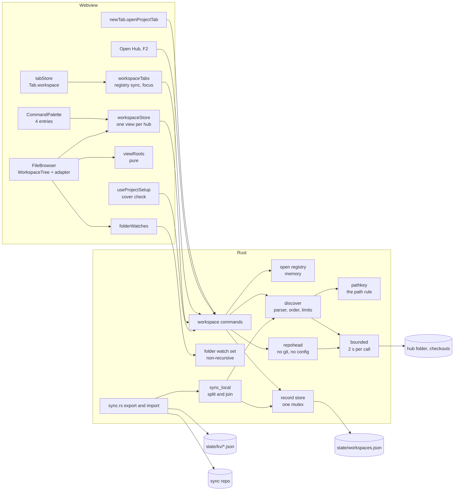
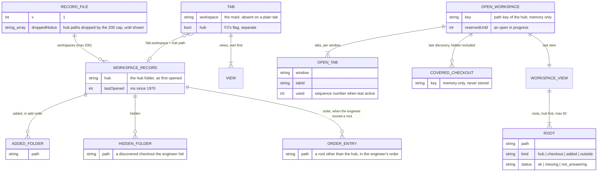

# Workspaces (F4): technical design for slice S1

- **Status:** Proposed, revision 1 (2026-11-15). Not reviewed, not approved.
- **Owner:** architect.
- **PRD:** `docs/prd.md` section F4, revision 3.3, approved by the owner 2026-11-10 with no open questions (branch `prd-workspaces`, b2f541c). This design adds nothing to F4's scope. Where the PRD leaves a choice to the architect, the choice is made here and marked **(architect)**. Where the PRD cannot be built as written, or two passages disagree, it is listed in section 19 and not papered over.
- **Scope:** slice S1 in full. Slice S2 (recents, live refresh) only as far as S1 must not block it (section 16).
- **Decisions (all Proposed, numbers provisional until merge, see the decision log's numbering notes):**
  - `0037-the-workspace-record-is-one-rust-owned-local-file.md`
  - `0038-a-workspace-is-the-folders-of-one-hub.md` (OQ-1)
  - `0039-a-finished-hub-is-read-from-the-repository-files-without-git.md`
  - `0040-sync-splits-shared-keys-into-a-public-and-a-local-part.md`
- **Contracts:** `.ade/context/workspaces.md` (the record, the mark, the discovery output, the path rule, the commands) and `.ade/context/sync-local-fields.md` (the sync strip and its import rule, shared with F2).
- **UX:** the F4 UX spec is in progress on branch `ux-f4`. This design assumes its screens exist and names what it needs from it in section 18.
- **Code read:** every statement about "today's code" was read from `origin/main` at **84389eb** (2026-11-15, after release 0.24.0, with code-viewer stories cv3 and cv5 and the F3 S1 tickets). File and line references are to that commit. Anything stated from memory and not checked is marked **unverified**.
- **Public repository:** the agent hub template is private. This document names its files and folders as the PRD does (`hub.conf`, `ACCESS.md`, `projects/`, `ops/`, `bin/setup`, `bin/doctor`) and describes its behaviour only. No test runs the template.

## 1. Summary

- **Everything that touches the disk is in Rust**, in one new module, `src-tauri/src/workspace/`. That covers discovery, the finished-hub check, the path rule, the bounds and the workspace record. The webview holds a derived, in-memory view per hub and never compares two paths itself.
- **The workspace record is one file that Rust owns:** `<app data>/state/workspaces.json`. It is outside `state/kv/`, so ADE sync's export, which reads only named keys from `kv/`, cannot reach it. Local snapshots do not copy it either. One mutex guards it, so several windows cannot overwrite each other (ADR 0037).
- **Discovery is a Rust parser with a hand-written frozen fixture.** Rust, because the same result is needed by the file browser, by the sync strip and by the automatic-setup check, and because the reads must be bounded and non-blocking.
- **The finished-hub check reads the repository's files and starts no process.** It resolves `HEAD` through loose and packed refs and reads the commit and its root tree from loose objects or packs. It never reads git's config, so nothing that config names can run (ADR 0039). The cost is about 450 lines of Rust and three repository formats it does not read, each reported as "check failed", never as "finished".
- **The sync strip is a split, and the import rule is its inverse.** One Rust function splits a key's value into a public part, which is exported, and a local part, which stays. The import joins the imported public part with this machine's local part. F2's hub-tab strip is two more rows of the same table (ADR 0040).
- **The strip needs to know every workspace folder at export**, and discovered checkouts are never stored. This design runs discovery for each recorded hub at export, bounded, and strips every path when that knowledge is incomplete. Section 9.5 states the cost and two gaps the PRD's wording leaves, and section 19 recommends a simpler rule for the owner to decide.
- **The workspace mark is `Tab.workspace`**, the hub folder's path. It is set only by code that makes a tab, and is separate from F2's `Tab.hub`. A small registry in Rust knows which workspaces are open in which window. It serves bring-forward (D7) and the automatic-setup check (WS-1 AC8).
- **The multi-root tree is one presentational component with two adapters.** The adapter for "F3 S1 on `main`" (WS-5 AC2) reads F3's viewer state. The adapter for "before F3 S1" (WS-5 AC1) keeps each workspace tab's expanded folders in memory. Swapping one for the other is the whole merges-second change. F3 S1 is on `main` as tickets, not code; section 11.4 says which case S1 will most likely meet.
- **Twelve stories**, eleven of which do not need F2 to be built. The twelfth carries every F2 seam (Open Hub, the run tab, the hub-tab flag, tab-set hub entries) and waits for F2 slice 1 (section 17).

## 2. Where things stand (origin/main 84389eb)

| Area | Today | Where |
|---|---|---|
| File browser root | One root, `rootPath`, set from a 3-second poll of the own view's active pane | `src/stores/fileBrowserStore.ts:24`, `:119`; `src/components/FileBrowser.tsx:153`, `:156` to `:181` |
| File browser watch | One recursive watch of the root; `watch_directory` is a main-thread command | `FileBrowser.tsx:202`; `src-tauri/src/watcher.rs:151`, `:200` |
| A tab | No flags. `Tab` has `name`, `type`, `color`, the views and a few per-type fields | `src/stores/tabStore.ts:54` to `:82` |
| What tab operations copy | Each copies its own subset: `ClosedTab` is `{ name, cwd, color }`; `SerializedTab` is `id`, `name`, `type`, `root`, `activePaneId`; Duplicate calls `addTab(name, cwd)` | `tabStore.ts:139`, `:460`; `src/lib/detachWindow.ts:7`, `:33`; `src/components/TabBar.tsx:139` |
| Saved session | `ade-session`, written by the main window; a pane's folder is `savedCwd` | `tabStore.ts:626` to `:659`, `:722`, `:865` |
| Disk state | One JSON file per `localStorage` key under `<app data>/state/kv/`; snapshots copy `kv/` only | `src-tauri/src/state.rs:10` to `:12`, `:229`; `src/lib/persistence.ts:21` to `:45` |
| Sync export | Reads only `SHARED_KEYS` and `DEVICE_KEYS` from `kv/`; strips `anthropicApiKey`, and `serializedBuffer` from `ade-session` | `src-tauri/src/sync.rs:36` to `:47`, `:69`, `:88` to `:96`, `:260` to `:282` |
| Sync import | For each shared key whose repo copy is newer, replaces the whole local value and puts back only secret fields | `sync.rs:99` to `:113`, `:285` to `:300` |
| Sync tests | A two-machine harness (`machine`, `setup`) over a local bare remote | `sync.rs:645` to `:700` |
| Automatic project setup | One hook, in the main window only, driven by the active tab's own-view folder | `src/hooks/useProjectSetup.ts:165`, `:186` to `:276`; `src/App.tsx:100`, `:180` |
| Opening a folder as a tab | One function, `openProjectTab(path)`, behind the New tab dialog's folder picker and its recent projects; it asks its setup questions before it opens the tab | `src/lib/newTab.ts:82` to `:115`; `src/components/NewTabDialog.tsx:55`, `:67` |
| A new terminal | `create_pty(rows, cols, cwd, request_id)`: always the login shell; an agent is started by typing a launch line afterwards | `src-tauri/src/pty.rs:260` to `:276`; `src/hooks/useTerminal.ts:587` |
| Tab sets | `WorkspacePreset { id, name, tabs: { name, splits }[], savedAt }` under `better-terminal-workspaces`; Load restores names only | `src/stores/settingsStore.ts:334` to `:342`; `src/components/SettingsPanel.tsx:816` |
| Orchestrator, agent tracker | `OrchestratorSession.projectDir`; `AgentSession.cwd`; both keys are written whole | `src/stores/orchestratorStore.ts:38`, `:63`; `src/stores/agentTrackerStore.ts:25`, `:49` |
| macOS-only Rust tests | `ci.yml` has a `backend-macos` job, display name `Backend on macOS (cargo test)` | `.github/workflows/ci.yml:136` to `:138` |
| F3 S1 | **Tickets on `main`, no code.** Seven stories (`s1a` to `s1e`) under `_bmad-output/initiative-per-view-viewer/`; no `viewerStore.ts` exists. Story `s1c` builds `fileBrowserStore.show(key, roots[])` and carries F4 WS-5 AC2 as conditional item (11) | the tickets; F3 design sections 6.3 and 10.6 |
| F2 | **Nothing built.** PRD revision 5.2 on `onboarding-prd` (PR #98); design revision 7 on `onboarding-arch` (PR #101), not approved | section 15 |

## 3. Components



### 3.1 Modules

| Module | New or changed | Responsibility | Tested by |
|---|---|---|---|
| `src-tauri/src/pathkey.rs` | new (or moved, section 6) | The path rule: one key per folder; `inside`, `same` | Rust, every OS; `macos_only` module for the volume's own answers |
| `src-tauri/src/workspace/bounded.rs` | new | Runs one file-system call off the caller's thread under a deadline; counts and caps abandoned calls | Rust, every OS |
| `src-tauri/src/workspace/access.rs` | new | The Code-table parser. Pure: text in, rows out | Rust, every OS; the frozen fixture |
| `src-tauri/src/workspace/discover.rs` | new | Which files to read, in which order; bounded non-blocking reads; `~` expansion; the too-broad rule; duplicates; the 50 and 200 limits; existence checks | Rust, every OS; `macos_only` for case, NFC, `~/Library` and the 1-second test |
| `src-tauri/src/workspace/repohead.rs` | new | The finished-hub check from the repository's files | Rust, every OS |
| `src-tauri/src/workspace/record.rs` | new | The record file: read, validate, write; add, hide, show, move; retention; the format fixture | Rust, every OS |
| `src-tauri/src/workspace/assemble.rs` | new | Pure: discovery rows + record → the ordered root list, hidden list and notices | Rust, every OS |
| `src-tauri/src/workspace/registry.rs` | new | Which workspace tabs are open in which window; reservation; most recently used; covered checkouts and the per-terminal memory of WS-1 AC8 | Rust, every OS |
| `src-tauri/src/workspace/watchset.rs` | new | One non-recursive watcher per window over many folders, capped | Rust, every OS |
| `src-tauri/src/workspace/mod.rs` | new | The Tauri commands and events (section 13.4) | Rust |
| `src-tauri/src/sync_local.rs` | new | `split` and `join` for the keys of section 9 | Rust, every OS; the two-machine test |
| `src-tauri/src/sync.rs` | changed | `value_for_repo` and `import_state` call `sync_local`; the comparison on import uses the public part | Rust |
| `src-tauri/src/lib.rs` | changed | Registers the commands; manages the registry, the record store and the watch sets; clears a window's entries when it is destroyed | Rust string test |
| `src/stores/tabStore.ts` | changed | `Tab.workspace`; `addWorkspaceTab`; the mark in `ClosedTab`, `SavedTab`, Duplicate; `markRunTab` and the removal rule (story w12) | vitest |
| `src/lib/detachWindow.ts` | changed | `SerializedTab.workspace` | vitest |
| `src/lib/workspaceTabs.ts` | new | Reports this window's workspace tabs to the registry; `openHubFolder`; applies a focus event; `workspacesReady` | vitest |
| `src/stores/workspaceStore.ts` | new | One `WorkspaceView` per hub, in memory; `load`, `refresh`, the four hand changes; drops stale answers by `gen` | vitest |
| `src/lib/workspaceRoots.ts` | new | Pure: labels told apart, the roots a view shows, the extra root | vitest |
| `src/lib/visibleText.ts` | new | Shows bidi and control characters escaped, never applied | vitest |
| `src/components/WorkspaceTree.tsx` | new | Root rows and their trees; keyboard and accessible names. Presentational | vitest |
| `src/lib/workspaceTreeState.ts` | new | The adapter: per tab in memory (WS-5 AC1) or F3's viewer state (WS-5 AC2) | vitest; the swap of section 11.4 |
| `src/lib/folderWatches.ts` | new | Keeps the window's watch set equal to the folders on screen | vitest |
| `src/components/FileBrowser.tsx` | changed | Renders `WorkspaceTree` when the view in sight shows a workspace; unchanged otherwise | vitest |
| `src/components/CommandPalette.tsx` | changed | Four entries, present only for a workspace tab (WS-2 AC6) | vitest |
| `src/lib/newTab.ts` | changed | `openProjectTab` asks `workspace_resolve` first | vitest |
| `src/hooks/useProjectSetup.ts`, `src/App.tsx` | changed | The cover check before any automatic setup (section 10) | vitest |
| `src/components/SettingsPanel.tsx`, `SyncSettings.tsx`, `Tour.tsx`, `docs/guide/settings.md`, `docs/guide/sync.md` | changed | The Tab Sets relabel (WS-10) | vitest; the scan |
| `scripts/workspaceWord.test.ts` | new | WS-10 AC2's scan | vitest |

Why Rust for discovery and not TypeScript **(architect)**:

- Its result is needed in Rust: by the sync export (section 9.5) and by the cover check, which must see workspaces open in other windows (section 10).
- Its reads must never block and must be bounded (WS-9 AC2, AC3). The webview has no file API; it would have to call Rust for each read anyway.
- The path rule needs `realpath`, the volume's case rule and Unicode folding (section 6), which exist only in Rust.
- One implementation means the frozen fixture pins the only parser there is.

The cost: every change of what the file browser shows goes through a command, and the webview cannot answer "is this folder inside that root" itself. Section 11.3 gives it one command for that.

## 4. Data model



Stored on disk by F4: the record file, and one field on saved tabs (`workspace`) in `ade-session`, in `ClosedTab` (memory) and in `SerializedTab` (a URL parameter of the new window). Nothing else. Discovered checkouts, the open registry, the covered set and the views are memory only.

### 4.1 The record file

`<app data>/state/workspaces.json`, resolved from `state::state_dir(app)` (`state.rs:229`), so it is per profile wherever the profile's state is. When F1's `ProfilePaths` resolver lands (`engagement-profiles.md`; not on `main`), the path goes through it like every other path under the profile root.

```json
{
  "v": 1,
  "workspaces": [
    {
      "hub": "/Users/dev/hubs/acme-backend",
      "added": ["/Users/dev/notes/acme"],
      "hidden": ["/Users/dev/Project/acme-legacy"],
      "order": ["/Users/dev/Project/acme-web", "/Users/dev/Project/acme-api", "/Users/dev/notes/acme"],
      "lastOpened": 1763200000000
    }
  ],
  "droppedNotice": []
}
```

- **Paths are stored as text, compared by key.** `hub`, `added`, `hidden` and `order` hold the path as the engineer or the hub's files gave it (after `~` expansion). Every comparison computes path keys (section 6) at use. Keys are not stored: a key depends on the volume's case rule, which can differ after a restore to another disk.
- **`order`** is empty until the engineer moves a root. A move writes the whole current sequence of roots other than the hub folder. WS-1 AC1 then applies: the roots `order` names come first, in that order; the others follow in the default order.
- **A record has hand changes** when `added`, `hidden` or `order` is not empty (WS-6 AC2).
- **No names.** Nothing read from `hub.conf` or from a Code table's other columns is stored (WS-7 AC4).
- **`droppedNotice`** holds the hub folders of records the 200 cap dropped, until the next workspace opened shows the notice (WS-6 AC2). It is local like the rest of the file.
- **Reading.** A file that does not parse is moved aside as `workspaces.json.unreadable-<ms>` and F4 starts with no records and one notice. A `v` above the reader's is treated as read-only for this run: F4 works from an empty record in memory and **never writes the file**, so an older build cannot destroy a newer one's records. A `v` the reader knows is read by that version's reader; version 1 has one. Each field is validated: a path that is not an absolute string without U+0000 is dropped; `lastOpened` that is not a non-negative safe integer becomes 0; more than 200 records keep the 200 most recently opened.
- **Writing.** `state::atomic_write` (`state.rs:63`), under the store's mutex, from Rust only. The webview never reads or writes the file.
- **The format fixture** (WS-6 AC2's last test) is `src-tauri/src/fixtures/workspaces/record-v1.json`, checked in, read by the current reader in a test that asserts every field.

### 4.2 Why one Rust-owned file (ADR 0037)

| Option | Why not |
|---|---|
| A `localStorage` key in `PERSISTED_KEYS`, as F3 does for viewer state | Every window holds its own copy of each store and writes whole values (`persistence.ts:141`; the problem ADR `0033-shared-local-keys-are-written-field-by-field`, on branch `arch-thoughts`, sets out). A workspace tab can be moved to its own window, so two windows would write the record. The data is used by Rust (discovery, the strip, the cover check), which would read it 800 ms late from `kv/`. And a key in `kv/` is one edit of `SHARED_KEYS` away from syncing |
| One file per hub | Retention and the 10 most recent need them all; 200 small files buy nothing |
| A field of `ade-session` | `ade-session` is exported (`sync.rs:47`) and is rewritten whole every few seconds |

The chosen store is not in snapshots (`state.rs` copies `kv/` only). The PRD allows either (WS-7 AC2); the consequence is that restoring a snapshot does not bring back an older record.

### 4.3 Retention (WS-6 AC2)

A pure function, `retain(records, open_hub_keys) -> (kept, dropped_by_cap)`, run after every `open` and `restore` has stamped `lastOpened`:

1. A record with no hand changes, whose hub has no open workspace tab, and which is not among the 10 most recently opened records, is dropped.
2. If more than 200 remain, the least recently opened records whose hub has no open workspace tab are dropped until 200 remain, and their hub folders are appended to `droppedNotice`.
3. Nothing else drops a record. In particular the hub's state (missing, not finished, check failed) is never an input.

S2's recent list is the 10 most recently opened records of this same store, and its Remove from list deletes the record. S1 builds no second store for it (section 16).

## 5. Discovery

### 5.1 The parser (`access.rs`)

`parse_code_rows(text: &str) -> Vec<Row>`, where `Row { line: usize, cell: String }`. Pure, no I/O. The rules, each from the PRD (F4.1 "Checkout row", WS-1 AC2, D10, sharding note m11):

1. A leading U+FEFF is dropped. Lines end at `\n`; a trailing `\r` is dropped.
2. A line is a table row when its **first character** is `|`. Leading spaces disqualify it. The heading it stands under is not looked at, so a row appended below the table counts.
3. Cells are split at `|`, except that `\|` is a literal `|` and does not split (m11). No other escape is read: a backslash before anything else stays a backslash.
4. The Checkout cell is the second cell (the text between the second and third unescaped `|`), trimmed of spaces and tabs. A row with fewer than two cells is not a checkout row.
5. A row is a **checkout row** when that cell starts with `/` or `~`. Header rows, separator rows, empty cells, `(none, works in the hub)`, `$HOME/x`, `./x` and a cell in backticks are not checkout rows and produce nothing, not even a notice.

`expand(cell, home) -> Candidate | Unread`:

- `~` alone → `home`; `~/rest` → `home/rest`.
- any other `~…` (`~bob/x`) → `Unread`;
- a cell holding U+0000 → `Unread` (the operating system cannot take it as a path);
- anything else starting with `/` → the cell as written.
- No `$VAR`, no globs, no relative paths, no shell.

`home` is a parameter. The commands pass ADE's home (`HOME` first, as `get_home_dir` does, `lib.rs:223`); tests pass their own.

A path that holds bidi or control characters is still a path and still gives a root. Showing it safely is the webview's job (section 12.2).

### 5.2 Which files, in which order (`discover.rs`)

`discover(hub, env) -> Discovery`, where `env` carries the home folder, ADE's data folders, the limits and the file-system seam used by tests.

1. `<hub>/ACCESS.md`.
2. `<hub>/projects/<name>/ACCESS.md` for each folder directly under `projects/`, in name order.
3. `<hub>/ops/<name>/ACCESS.md` for each folder directly under `ops/`, in name order.

Name order is by Unicode code points after NFC (WS-1 AC1). Never recursive. A work folder with no `ACCESS.md` is skipped silently. At most 200 work folders across both groups are read, in the order above; the rest are skipped with one notice (WS-9 AC2).

### 5.3 Reading a file (WS-9 AC2, WS-1 AC7)

On Unix, one function:

1. `open(path, O_RDONLY | O_NONBLOCK | O_CLOEXEC)`. With `O_NONBLOCK`, opening a FIFO with no writer returns at once and a device does not wait.
2. `fstat` the descriptor. Anything but a regular file (`S_IFREG`) is **unreadable**. Checking the open descriptor, not the path, leaves no gap between check and read. A symbolic link to a regular file is followed and read.
3. Read at most 1 MiB + 1 byte. More than 1 MiB is **unreadable** ("too large").
4. The bytes must be valid UTF-8, all of them; otherwise **unreadable**.

Steps 1 to 3 run as one bounded call (section 7). No answer in 2 seconds is **unreadable** ("not answering").

An unreadable file costs only its own rows. The discovery records `{ file, why }` and sets `complete = false`. `complete` is also false when work folders were skipped, or when listing `projects/` or `ops/` failed for a reason other than "does not exist".

### 5.4 From rows to candidates

For each candidate, in reading order:

1. Its **path key** (section 6), as one bounded call.
2. **Too broad** (WS-9 AC5): the key is `/`; or the home folder; or a volume root (the folder's device differs from its parent's); or contains ADE's own data (the key is a component prefix of the key of `app_data_dir()`, `app_local_data_dir()`, `app_cache_dir()` or, on macOS, `~/Library/WebKit/<bundle identifier>`). A too-broad candidate gives no root and is counted.
3. **Duplicate** (WS-1 AC3): a key already seen, or the hub folder's own key, is dropped. The first position wins.
4. **Status:** `ok` when the path is an existing folder; `missing` when it is not; `not_answering` when the call did not return in time.

The result:

```rust
pub struct Discovery {
    pub checkouts: Vec<Checkout>,        // in order, duplicates and too-broad ones removed; not capped, hidden ones included
    pub unread_rows: Vec<FileCount>,     // ~user and NUL rows, per file
    pub too_broad: usize,
    pub unreadable: Vec<FileProblem>,    // { file, why: Permission | NotRegular | NotUtf8 | TooLarge | NotAnswering | Other }
    pub work_folders_skipped: usize,
    pub complete: bool,                  // every file that exists was read, and none was skipped
}
pub struct Checkout { pub path: String, pub key: PathKey, pub status: Status, pub file: String, pub line: usize }
```

The 50-root cap is applied later, in `assemble`, because hidden folders do not count against it (WS-9 AC1).

### 5.5 The frozen fixture (WS-1 AC2, D10)

Checked in under `src-tauri/src/fixtures/workspaces/hub-rules/`, written by hand from the rules above, never generated and never compared with the template:

- `ACCESS.md`, `projects/b/ACCESS.md`, `projects/a/ACCESS.md`, `ops/a/ACCESS.md`, holding between them rows with: `/abs/acme/api`; `~`; `~/rel`; `~bob/x`; `$HOME/x`; `./x`; `(none, works in the hub)`; an empty cell; a header row; a separator row; a row appended after the table; a row whose cell is `/abs/we\|ird` (m11); one row each whose folder name holds U+202E, U+2066, U+200F, U+0007 and U+0085 (m11); the same path twice.
- `expected.json`: the checkouts in order (file, line, path with `<home>` standing for the test's home), the unread rows per file, the too-broad count (the `~` row: the home folder itself is too broad), written by hand.

The test runs `discover` on the fixture with a temporary home and asserts the output equals `expected.json` field for field. A second test runs `parse_code_rows` alone on each file. Because the fixture's absolute paths do not exist on any machine, every status is `missing`; statuses are covered by the tests of section 17.3 that build real folders.

### 5.6 Assembling the roots (`assemble.rs`)

`assemble(hub, hub_status, discovery, record, limits) -> WorkspaceView`, pure:

1. Start with the hub folder.
2. Add each discovered checkout that is not hidden (by key), in discovery order.
3. Add each added folder not already present (by key), in add order, each with its own status check done by the caller.
4. Apply `order` (WS-1 AC1).
5. Cap at 50 roots; count the rest for the notice (WS-9 AC1).
6. `hidden_shown`: the record's hidden paths that the discovery still names, for Show Hidden Workspace Folders.

**Cleaning the record** happens only on a discovery with `complete == true`: a hidden path, or an `order` entry, that no discovered checkout and no added folder matches is removed from the record (WS-1 AC5, WS-3 AC3). When `complete` is false nothing is removed (WS-1 AC7). That is broader than WS-1 AC7 asks ("the hidden entries for paths that file named are kept"): the record does not store which file a hidden path came from (WS-7 AC4 forbids more fields), so every hidden entry is kept until a refresh reads every file. It keeps more, never less.

## 6. The path rule

**One function, not two.** F2's design already specifies this rule as the key of its folder registry (F2 design section 4.10.1, `registry_key(path, case)` in `hubmark.rs`), with the crates and the folding function chosen and checked against APFS. F4.1's path rule is the same rule. F4 adopts it unchanged and gives it a home both features call: **`src-tauri/src/pathkey.rs`**.

- `key(path, home) -> PathKey`:
  1. expand a leading `~` or `~/` with `home`; normalise lexically (`.` and `..`, repeated and trailing `/`);
  2. `realpath` the nearest existing ancestor and append the missing components, so a path that does not exist yet still has a key and a symbolic link anywhere in the existing part is resolved;
  3. normalise to NFC (`icu_normalizer` 2.1.1, already in `src-tauri/Cargo.lock`);
  4. on macOS, when `pathconf(ancestor, _PC_CASE_SENSITIVE)` is 0, case-fold with CoreFoundation's `CFStringFold` (through `core-foundation-sys` 0.8.7, already in the lock file), then NFC again. A failed `pathconf` folds.
- `same(a, b)`: equal keys. `inside(a, b)`: `b`'s key is a **component** prefix of `a`'s (`/x/ab` is not inside `/x/a`).
- Off macOS the key is the NFC path. F4 is not offered there (F4.9), so it decides nothing.

Both crates and their versions were read in `Cargo.lock` on `origin/main`. That making them direct dependencies changes only the root package's dependency list is F2's finding (its design, revision 6, D1) and is **unverified** here; story w1's first step is `cargo metadata --locked`.

**Who builds it.** Whichever of F4 story w1 and F2's story for OB-13 lands first creates `pathkey.rs`. If F2's lands first with the function in `hubmark.rs`, w1 moves it to `pathkey.rs` and leaves a re-export there. This needs one line in F2's design (section 15).

**Where it is used in F4:** duplicates and the hub-named-as-checkout rule (WS-1 AC3); add refusals (WS-3 AC1); hidden and order matching; "inside" for the current root (WS-5), the cover check (WS-1 AC8), the sync strip (WS-7 AC3) and the too-broad rule (WS-9 AC5); and "is this hub already open" (WS-2 AC3).

**The webview never compares paths.** It compares only strings that Rust returned (a root's `path`, a listing entry's `path`) for equality, and asks `workspace_locate` (section 11.3) for everything else.

## 7. Bounds and non-blocking calls (WS-9 AC2, AC3)

`bounded::call(deadline, label, f) -> Result<T, NotAnswering>`:

- runs `f` on a worker thread and waits for its answer up to `deadline` (2 seconds unless stated);
- on time-out returns `NotAnswering` and **abandons** the thread, which stays blocked in its system call until the kernel answers. Nothing can cancel a blocked `stat` on a dead network mount;
- keeps a process-wide count of abandoned calls and the folder each is stuck on. While a folder has an abandoned call outstanding, a new call for a path inside it answers `NotAnswering` at once, so a refresh every few seconds cannot pile threads onto one dead mount. Past 32 abandoned calls, every bounded call for a path not yet known to answer returns `NotAnswering` at once until some return.

What goes through it: every `open`+`fstat`+`read` of an `ACCESS.md`; every `read_dir` of `projects/` and `ops/`; every path key; every existence and device check; each step of the finished-hub check; and setting up one folder's watch. Reading and writing the record file does not go through it: that is ADE's own file in ADE's own data folder.

**Concurrency.** Discovery runs three independent chains at once: the top-level file; `projects/` (list, then its files); `ops/` (list, then its files). Within a chain the files are read at once, and each file's candidates are checked at once. So a call that hangs delays only what depends on it. The command answers when the slowest chain is done:

| Case | Answer after |
|---|---|
| A hub with 20 checkouts on a local disk | milliseconds (WS-9 AC3's 1-second test is the proof, on macOS) |
| One checkout's folder check hangs | 2 s; that root is `not_answering`, every other root is there |
| `projects/` hangs on listing | 2 s; the top-level file's and `ops/`'s roots are there, with a notice |
| A chain that is slow at every step but never hangs | at most 6 s (three calls deep) |

The last row is the honest worst case: each call is within its bound, and the answer still takes 6 seconds. The PRD's bound is per call (WS-9 AC3), and this meets it; it is stated so nobody reads "2 seconds" as the bound on the whole discovery.

**Never on the UI thread.** Every F4 command is `#[tauri::command(async)]`, which Tauri runs off the main thread (as `watch_file` is, `watcher.rs:302`). A Rust string test asserts it for each F4 command, in the style of the existing test at `watcher.rs:705` to `:720`.

## 8. The finished-hub check (WS-2 AC8, F4.1, ADR 0039)

`repohead::finished_hub(path) -> HubCheck`

```rust
pub enum HubCheck {
    Finished,
    Missing,                              // the folder does not exist, or does not answer
    NotHub(NotHub),                       // NotAFolder | NoHubConf
    NotFinished(NotFinished),             // NoRepository | GitFile | NoCommit | NotCommitted | NotAFile
    Failed(CheckFailure),                 // Unsupported(what) | ObjectMissing | Damaged(what) | NotAnswering
}
```

### 8.1 What it reads, exactly

Every step is a bounded call. No process is started. **No config file is opened**: not `<path>/.git/config`, not the global or system config, not `.gitattributes`, not a hook. So nothing those name can run: no `core.fsmonitor`, hook, pager, filter, external diff, credential helper or transport.

1. `path` is an existing folder, else `Missing` or `NotHub(NotAFolder)`.
2. `<path>/hub.conf` exists as a regular file, else `NotHub(NoHubConf)`. This is the cheap exit: for an ordinary project folder the check stops here and never opens its repository.
3. `<path>/.git` by `lstat`:
   - absent → `NotFinished(NoRepository)`. **This is the top-level rule** (F4.1, m10): only the folder's own `.git` is looked at, never a parent's, so a parent repository that commits `sub/hub.conf` does not make `sub` a finished hub;
   - a regular file (a linked worktree or a submodule) → `NotFinished(GitFile)` (section 19, Q5);
   - a symbolic link → `Failed(Unsupported("git folder is a link"))`;
   - a folder → the git folder `G`.
4. **Resolve `HEAD`.** Read `G/HEAD` (at most 1 KiB).
   - `G/reftable` exists → `Failed(Unsupported("reftable"))`.
   - 40 or 64 hex characters → that object id (a detached `HEAD`).
   - `ref: <name>`: `<name>` must start with `refs/`, hold no `..` component, no empty component, no U+0000 and no backslash; otherwise `Failed(Damaged("HEAD"))`. Then, at most 5 levels deep: the loose file `G/<name>` (regular, at most 1 KiB), else the line for `<name>` in `G/packed-refs` (at most 16 MiB read). Neither → `NotFinished(NoCommit)`: an unborn branch, the repository of a run killed before its first commit.
5. **Read the object** with that id, at most 5 peels if it is a tag:
   - loose: `G/objects/<2 hex>/<rest>`, inflated with zlib (`flate2`), output capped;
   - else packed: for each `G/objects/pack/*.idx` (at most 200), parse index version 2 (magic, fan-out, sorted ids, offsets with the 64-bit table) by `pread` of the ranges needed, never the whole file; at the offset in the `.pack`, read the entry header and inflate. `OFS_DELTA` and `REF_DELTA` entries are resolved against their base, at most 64 levels deep;
   - not found anywhere → `Failed(ObjectMissing)`. `G/objects/info/alternates` is **not** followed, and a partial clone's missing objects are not fetched.
   - Caps: 1 MiB for a commit, 8 MiB for a tree. Over a cap → `Failed(Damaged("object too large"))`.
6. The object must be a **commit**. Its first line gives the root tree's id.
7. Read the **root tree** the same way. Scan its entries (`<mode> <name>\0<id>`) for the name `hub.conf`:
   - mode `100644` or `100755` → `Finished`;
   - present with another mode (a symbolic link, a folder, a submodule) → `NotFinished(NotAFile)`;
   - absent → `NotFinished(NotCommitted)`. This is the hub whose `hub.conf` is untracked, or staged and never committed: the index is never read.

Object ids of 20 and 32 bytes are both read (SHA-1 and SHA-256 repositories): the length comes from the id `HEAD` resolved to. Object hashes are not verified: the check decides what ADE shows, it grants nothing, and the repository is the engineer's own.

### 8.2 What it costs

- **About 450 lines of Rust and their tests**, owned by this project: loose refs, `packed-refs`, loose objects, pack index version 2, pack entries, delta application, commit and tree parsing. These formats have been stable for many years, but they are now ADE's to keep right.
- **One new direct dependency**, `flate2`, for zlib. Version 1.1.9 is already in `src-tauri/Cargo.lock` on `origin/main` (with `miniz_oxide` 0.8.9). That adding it directly leaves the rest of the lock file unchanged is **unverified**; story w3's first step is `cargo metadata --locked`.
- **Three formats are not read, each reported as `Failed`, never as `Finished` and never silently as "not a hub":**
  - **reftable** refs. Git plans to make it the default for new repositories in a later major version (**unverified**, from memory). When that reaches engineers' machines, new hubs would show "check failed" until a reftable reader is added. This is a known limit with a detection and a message, not a solved case;
  - **alternates and partial clones** (an object that is in neither the loose store nor a local pack);
  - **pack index version 1** (written by git before 2008).
- **`.git` as a file is "not finished"**, so a hub checked out as a linked worktree has no workspace (Q5).
- **It can disagree with F2's check.** F2's design decides "finished" by running `/usr/bin/git` (ADR `0029-a-finished-hub-is-judged-by-head-with-ades-own-git`). For the three formats above, and for a `hub.conf` committed as a symbolic link, git says finished and this check does not. Then Open Hub opens a hub tab and F4 gives it no workspace mark, with a notice saying why. Section 15 asks F2's design to use this check, which removes the disagreement.

### 8.3 What was rejected

| Option | Why not |
|---|---|
| ADE's own `git` with the dangerous settings overridden (`-c core.fsmonitor=false`, `--no-pager`, `GIT_CONFIG_NOSYSTEM=1`, `GIT_CONFIG_GLOBAL=/dev/null`, as ADR 0029 does, plus overrides for the repository's own config) | The criterion is a negative over all of git's configuration: "anything the repository config names". The two commands needed (`rev-parse`, `ls-tree`) run no hook, filter or pager today, but a repository config can also declare a promisor remote, and git then fetches a missing object by starting a transport the config names (**unverified**, from memory of git's lazy fetch; closing it needs `GIT_NO_LAZY_FETCH` or protocol overrides that differ by git version). The list of such routes changes with git, and ADE runs whatever git the Mac has. Reading the files makes the criterion true by construction. It also needs the Command Line Tools, costs two or three process starts per check, and S2 checks up to ten folders each time its list is shown |
| The `gix` crate | It reads everything this check does not, but it is a large dependency tree that is not in the lock file, for one question about one file in one commit |
| `git ls-files`, or reading the index | The index holds `hub.conf` after `git add` with no commit, which is F2.5's unfinished hub |

### 8.4 Tests

All in `repohead.rs`, on every CI OS. Fixtures are built in a temporary folder by the test's own `git`, with the system and global config neutralised and a fixed identity; a missing `git` is a `panic!` naming it, never a skip.

- loose objects and loose refs → `Finished`;
- after `git gc` (packed refs, one pack) → `Finished`;
- after many commits and `git repack -adf --depth=50 --window=50`, with the test first asserting through `git verify-pack -v` that the `HEAD` tree **is** stored as a delta (else the test fails, so the delta path cannot go untested) → `Finished`;
- a detached `HEAD`; a symbolic ref to another ref → `Finished`;
- a SHA-256 repository → `Finished`;
- no commit yet → `NotFinished(NoCommit)`; `hub.conf` untracked → `NotCommitted`; staged, not committed → `NotCommitted`; committed as a symbolic link → `NotAFile`;
- a parent repository that commits `sub/hub.conf`, `sub` with no `.git` → `NotFinished(NoRepository)` for `sub`;
- `.git` a file → `GitFile`; a `reftable` folder → `Failed(Unsupported)`; a truncated object → `Failed(Damaged)`; a `HEAD` naming `ref: ../../x` → `Failed(Damaged)`;
- a folder with no `hub.conf` returns `NotHub` and the file-system seam records **no** open under `.git`;
- **the marker fixture** (WS-1 AC6, WS-2 AC8): section 17.3.

## 9. The sync strip and its import rule (WS-7 AC3, F2 OB-10 AC2, OB-14 AC5, ADR 0040)

### 9.1 One split, used twice

`sync_local.rs`:

```rust
pub struct Local(/* per entry id: the fields taken out */);
pub fn split(key: &str, value: &str, know: &Knowledge) -> Option<(String /* public */, Local)>;
pub fn join(key: &str, public: &str, local: &Local) -> String;
```

- **Export** writes `split(key, local_value).public` to the repo. `None` means the value did not parse into the shape the rule expects, and the key is **not exported** this run, as `value_for_repo` already does for a session it cannot parse (`sync.rs:84` to `:96`). The strip never fails open.
- **Import** computes `split(key, local_value).local` from this machine's value, then writes `join(key, imported_public, local)`. An entry the other machine deleted is absent from `imported_public`, so it stays deleted and its local part is dropped. An entry only the other machine has is taken as it came.
- **The invariant**, tested for every key: `split(join(p, l)).public == p`. Without it the joined value would look like a local change and be exported back on the next sync.

A key with no rule passes through unchanged: `split` returns the value and an empty `Local`.

This is **re-apply, not a three-way merge (architect)**: the import still takes the newer copy whole, as it does today, and then puts this machine's local fields back onto the entries that survived. A merge would need a base copy per key, which sync does not keep for state (it keeps one only for memory files, `sync.rs:130`).

### 9.2 The rules

| Key | Entry and its id | Local fields | Taken out when |
|---|---|---|---|
| `ade-session` (device key, exported, never imported) | each saved tab | every pane's `savedCwd`, in the own view and every sub-terminal; every `subViews[].name`; `name`, when it equals the last component of the mark's path; the mark `workspace` | the saved tab has `workspace` (F4), or `hub` (F2, story w12) |
| `better-terminal-workspaces` (tab sets, shared) | each tab of each tab set: the set's `id` and the tab's index | `cwd`, `hub` (the fields F2 OB-14 AC5 adds) | the entry has `cwd` |
| `better-terminal-orchestrator` (shared) | each session: `id` | `projectDir` | the path is inside a known workspace folder (9.4) |
| `better-terminal-agent-tracker` (shared) | each entry: `id` when it has one, else `paneId` and `startTime` | `cwd` | the same |
| `better-terminal-prompt-history`, `better-terminal-saved-notes`, `ade-scratchpad-draft` | none | none | never: the engineer's own text (WS-7 AC3's table) |

- **Tab sets** are immutable after they are saved (`settingsStore.ts:522` to `:538`: save and delete only), so "set `id` and tab index" identifies an entry for good.
- **Agent-tracker entries have no id today** (`agentTrackerStore.ts:6` to `:29`); `paneId` restarts at 1 in every run. Story w5 adds an optional `id` (random, minted in `startSession`) and matches older entries by `paneId` and `startTime`. Two machines can produce the same pair only by starting an agent in the same millisecond in a pane with the same number; the result would be one entry keeping this machine's `cwd`.
- **A stripped name** in `ade-session` is replaced, not removed: a sub-terminal's becomes `null` (the field's own "no name" value, `tabStore.ts:43`), and a tab's becomes `"Terminal"`.
- **`ade-session`'s rows need no knowledge**: the mark is in the saved tab itself. The rule covers every pane of a marked tab wherever its folder is.
- **F2's rows** (`hub` in `ade-session`; `cwd` and `hub` in tab sets) are in this table because the mechanism is designed once (F4.11). The fields exist only once F2 writes them. Until then those rows match nothing, and story w5 tests them with hand-written values. Whether the exported entry keeps `hub: true` is F2's to say in its design revision (section 15).

### 9.3 Changes to `sync.rs`

- `value_for_repo(key, raw, know)` (`sync.rs:88`): after `strip_secrets` and the `serializedBuffer` strip, apply `split` and return its public part.
- `import_state` (`sync.rs:285`):
  - line 292 compares `strip_secrets(local)` with the repo value today. It must compare the **public part** of the local value. Otherwise every key with a local part differs on every run;
  - line 294 writes `restore_secrets(join(key, w.value, local_part), local_raw)`.
- `export_state` is otherwise unchanged. Its test `w.value != value && local_at > w.updated_at` (`sync.rs:272`) now sees the public part on both sides, so a join on import does not cause an export.
- F3 S1's change to `SESSION_LOCAL_FIELDS` (`viewerKey`, `previewPath`; F3 design section 3) is a different function and does not conflict.

### 9.4 What "known to this profile" means

`Knowledge` is a set of path keys, built at the start of each export and each import:

1. from every record: the hub folder, the added folders, the hidden folders, the `order` entries;
2. from a discovery of every recorded hub, run then (9.5): every discovered checkout, hidden or not, capped or not;
3. from the open registry: the last discovery of every workspace open in this instance (which covers a hub opened seconds ago whose record is being written).

A path is "inside a known workspace folder" when its key is inside any of those. A path whose key cannot be computed in time is treated as inside.

### 9.5 Sharding note m9: the choice and its cost

Discovered checkouts are never stored (D4, WS-1 AC5), and the orchestrator and agent-tracker rows strip "any workspace folder known to this profile", open or not. So the export must learn the checkouts of hubs that are closed. Two ways:

**(A) Chosen (architect): the export runs discovery for each recorded hub.**

- For every record, `discover(hub)` under section 7's bounds, all hubs at once. No finished-hub check: the files are read whatever the repository's state, which strips more, not less.
- **Fail closed.** If any recorded hub's discovery is not `complete` (its folder is missing or on an unmounted volume, a file is unreadable or does not answer, work folders were skipped), the knowledge is incomplete, and this export takes out **every** `projectDir` and **every** `cwd`, workspace or not. Paths that should have stayed can never leave because a disk was unplugged.
- Cost, stated plainly:
  - sync now reads the hubs' files: at most 200 records, each at most 201 small files, on every sync (every 3 minutes and on close). For a handful of hubs that is a few dozen small reads. A hub on a dead mount adds up to 2 seconds to that sync, and then fails closed;
  - a record whose hub is gone for good keeps this machine failing closed until the record goes. A record without hand changes ages out by itself (4.3). One with hand changes stays until S2's Remove from list, so until S2 ships such a machine exports no `projectDir` and no `cwd` at all;
  - **two gaps remain, both inside the PRD's wording ("known to this profile") and both against G2's plain reading:**
    1. **A dropped record.** A hub with no hand changes that is not among the 10 most recent loses its record (WS-6 AC2). From then on its folders are not known, and an agent-tracker entry or orchestrator session inside them is exported the next time that key is written.
    2. **A removed row.** A checkout taken out of `ACCESS.md` is no longer discovered, and entries inside it are exported the same way.

**(B) Rejected as the base, recommended to the owner (Q1): a rule that needs no discovery.** Take `projectDir` and `cwd` out of **every** exported entry, whatever the folder. No file is read at export, no fail-closed state exists, and both gaps close. It is rejected as the base only because it changes what every engineer syncs today, hubs or not: another machine would no longer receive a session's project folder or a finished run's folder, and WS-7 AC3's table does not say that. It is one changed predicate in `sync_local.rs`, and it deletes steps 2 and 3 of 9.4. The owner decides.

**(C) Rejected: marking entries when they are written.** The webview would ask "is this folder in a workspace" when an agent starts or a project folder is set, and store a flag. It needs the same knowledge of closed hubs at write time, misses entries written before a hub was first opened, and adds a field to two shared keys.

### 9.6 Tests

In `sync_local.rs` and `sync.rs`, every CI OS:

- per key: `split` takes out exactly the listed fields; the invariant of 9.1; a value of the wrong shape is not exported;
- **WS-7 AC3's one-machine test:** a session with a workspace tab named after its hub folder and a focus sub-terminal named after a checkout, a tab set holding a hub entry (hand-written until F2 exists), an orchestrator session and an agent run in a checkout, each with path markers; after `run_sync` no marker is anywhere in the repo's working tree or in `git log -p`; the local `kv/` files are byte-for-byte unchanged;
- **the two-machine test**, on the existing harness (`sync.rs:659`): A exports; B imports, saves another tab set, adds an orchestrator session and an agent run, exports; A imports. Then A's tab-set entry still has its `cwd`, A's session its `projectDir`, A's tracker entry its `cwd`; B's new entries are on A; an entry B deleted is gone on A; and A's next export holds no marker and writes nothing new;
- **fail closed:** with one recorded hub's `ACCESS.md` unreadable, a non-workspace `projectDir` is absent from the export too;
- **WS-7 AC1:** a record with markers in a hub path, an added folder, a hidden folder and an `order` entry; `run_sync` leaves none in the repo; and a static test asserts `workspaces.json` is not under `kv/` and that no key in `SHARED_KEYS` or `DEVICE_KEYS` names it;
- **m8:** the snapshot folder is never read by `export_state` (a static test over the paths it opens, through the test seam).

## 10. No automatic setup in discovered checkouts (WS-1 AC8)

Automatic setup is one hook in the main window, fed the active tab's own-view folder (`App.tsx:100`, `:180`). A workspace can be open in another window. So the answer comes from Rust.

**The covered set.** For each open workspace the registry keeps the keys of its discovered checkouts from the latest discovery: hidden ones included (OQ-13), capped ones included, too-broad rows excluded (a row naming `~` must not switch setup off everywhere). When a file was unreadable in the latest discovery, the keys last known from that file are kept, so a transient read failure does not uncover a client's checkout.

**The command.** `workspace_setup_covered(folder, pty_id) -> bool`:

1. If any open workspace has not had its first discovery yet (the registry knows the tab, `workspace_open` has not answered), wait for it, at most 6 seconds; on time-out answer `true` (no setup now).
2. If `folder` is inside a covered checkout of any open workspace: remember `(pty_id, that checkout's key)` and answer `true`.
3. If `(pty_id, k)` is remembered and `folder` is inside `k`: answer `true`.
4. Otherwise `false`.

**When a workspace closes** (its last workspace tab in any window): before its covered set is dropped, the registry reads the folder of every live terminal (the foreground-aware lookup `get_pty_cwd` uses, `pty.rs:518`), off the UI thread, and remembers `(pty_id, checkout key)` for each one inside a covered checkout. A terminal whose folder cannot be read in 2 seconds is remembered against every covered checkout of that workspace. This is what makes the PRD's second case true for a terminal that was never the active one while the workspace was open. A terminal's entries are dropped when its PTY ends. Nothing is stored: a restart starts new terminals, which "are set up as today".

**The hook.** `useProjectSetup(cwd, ptyId, show, withdraw)`:

- awaits `workspacesReady` (this window has reported its restored workspace tabs), then `workspace_setup_covered(cwd, ptyId)`, **before** `setupRootOf`. Covered: withdraw any setup question it has on screen, and stop;
- re-runs when the registry's set of open workspaces changes (an `ade://workspaces-open-changed` event bumps a counter in the effect's dependencies), so a workspace opening while a terminal sits in a checkout takes its question down, and a workspace closing re-evaluates the terminal against what it remembers;
- a failed or late answer counts as covered for that run. The safe direction: a question that comes one `cd` later, never a client's repository written by surprise.

Setup the engineer asks for (the palette's project setup, the Agents tab's Set up now, the New tab dialog) does not go through the hook and is unchanged. Added folders are not covered. The hub folder is F2 OB-13's (section 15).

**"For the rest of that terminal's life" is read as: for that checkout (architect, Q2).** A terminal that later moves to an unrelated project is set up there as today, just as it would be while the workspace is still open.

## 11. The workspace in the file browser

### 11.1 What the webview holds

```ts
// src/stores/workspaceStore.ts — memory only
interface WorkspaceView {
  hub: string;
  gen: number;                         // per hub, increases; an older answer is dropped
  state:
    | { kind: "ok" }
    | { kind: "hub_missing" }
    | { kind: "not_finished"; reason: "no_repository" | "git_file" | "no_commit" | "not_committed" | "not_a_file" | "no_hub_conf" }
    | { kind: "check_failed"; reason: "unsupported" | "object_missing" | "damaged" | "not_answering" };
  roots: Root[];                       // hub first; at most 50; hidden ones left out
  hidden: string[];                    // hidden checkouts the hub's files still name
  notices: Notice[];
}
interface Root { path: string; kind: "hub" | "checkout" | "added"; status: "ok" | "missing" | "not_answering" }
type Notice =
  | { kind: "rows_unread"; files: { file: string; count: number }[] }
  | { kind: "file_unreadable"; file: string; why: string }
  | { kind: "too_broad"; count: number }
  | { kind: "not_shown"; count: number }
  | { kind: "work_folders_skipped"; count: number }
  | { kind: "record_dropped"; hubs: string[] }
  | { kind: "record_unreadable" };
```

- `load(hub, reason)` calls `workspace_open(hub, reason)` with `reason` `open`, `restore` or `refresh`. The four hand changes call their commands. Each answer replaces the hub's view if its `gen` is higher.
- Every window listens for `ade://workspace-changed { hub, gen }` and asks for the current view when it shows that hub. Rust keeps the last view per open hub, so a second window's request reads no file.
- Hand changes re-assemble from the last discovery; only `open`, `restore` and `refresh` read the hub's files (WS-1 AC5).
- The store is never saved, and no payload that leaves the machine is built from it.

**What each state shows (WS-6 AC3, WS-2 AC6):**

| State | The own view shows | Palette entries |
|---|---|---|
| `ok` | the roots | all four |
| `hub_missing` | one missing root (the hub folder) and a notice | Refresh only |
| `not_finished`, `check_failed` | the tab as a plain tab: one root following its folder, and a notice with the reason | Refresh only |

In the last two rows the tab keeps its mark and the record is untouched: no command that changes the record is offered, and `workspace_add_folder` and the others refuse with `not_finished` if called anyway.

### 11.2 Which view shows which roots

One pure function, `viewRoots(tab, view, ws, located)` in `workspaceRoots.ts`:

- a tab with no mark, a non-terminal tab, or a workspace whose state is `not_finished` or `check_failed` → today's single root;
- **a sub-terminal of a workspace tab** → its single root (D6), when the build has per-view browsers (WS-5 AC2); when it has one browser per tab (WS-5 AC1), the workspace, because that browser follows the own view;
- **the own view of a workspace tab** → the workspace's roots, plus the extra root of WS-5 AC3 when `located.outside` is set and not too broad.

With F3 S1 on `main`, this is the workspace case of F3's `viewerRoots(tab, view)` (F3 design 10.6), and the existing-root paths are what `fileBrowserStore.show(key, roots)` is given. Missing and not-answering roots are drawn as rows but are **not** passed to `show`: nothing is listed or watched for them.

### 11.3 The current root and the reveal

`workspace_locate(hub, folder) -> { root: string | null, chain: string[], outside: { path: string, tooBroad: boolean } | null }`

- `root`: the deepest root whose folder holds `folder`, by key (F4.1 "Current root").
- `chain`: the folders from that root down to `folder`, built on the root's `path` with the names as they are on disk, so each string equals the `path` a listing returns for that folder (`list_directory` joins the parent's path and the entry's name, `lib.rs:75` to `:100`).
- `outside`: set when no root holds `folder` (WS-5 AC3). A folder inside a hidden checkout and no other root is outside.

The webview calls it when the own view's active folder changes (today's 3-second poll; F3's `usePaneCwd` afterwards). It then expands every folder of `chain`, scrolls the last into view and marks it as current. It only ever adds expansions: a `cd` removes no root and collapses nothing.

One limit, from F3 and unchanged (WS-5 AC2 says F3's caps apply): with F3's 500-folder cap, a reveal that makes the 501st expansion evicts the one expanded longest ago (F3 design 4.5).

### 11.4 The tree, and the merges-second swap (WS-5 AC1, AC2)

**`WorkspaceTree`** is presentational:

```ts
interface WorkspaceTreeProps {
  roots: RootRow[];                               // path, label, tooltip, kind, status, current
  expanded: ReadonlySet<string>;                  // absolute paths; a root's own path means its row is expanded
  listings: Record<string, FileEntry[] | "loading" | "error">;
  current: string | null;                         // the folder to mark
  showHidden: boolean;
  onToggle(path: string): void;
  onOpenFile(path: string, e: React.MouseEvent): void;   // openFileFromTerminal, as FileBrowser.tsx:81 does today
  onRootMenu(root: RootRow, at: DOMRect): void;
}
```

Below a root row, a folder row and a file row behave as today's `FileTreeNode` (`FileBrowser.tsx:66`). Roles: `tree`, `treeitem`, `aria-expanded`, `aria-level`, `aria-current`; arrow keys as the tree pattern has them (WS-4 AC5). A root's accessible name is its label, "workspace folder", and "missing" or "not answering" when it is; the same words are on screen, not colour alone (WS-4 AC2).

**The adapter** (`workspaceTreeState.ts`) supplies `expanded`, `listings` and `onToggle`. There are two, and exactly one is in the build:

| | **Per tab** (WS-5 AC1: F3 S1 not on `main`) | **Per view** (WS-5 AC2: F3 S1 on `main`) |
|---|---|---|
| Shown when | the active tab is a workspace tab, whichever view is in sight | the view in sight is a workspace tab's own view |
| `expanded` | a `Map<tabId, Set<path>>` in memory, for the life of the tab, not saved | `viewerStore.states[ownView.viewerKey].expanded` (F3's set; saved by F3) |
| `listings` | the adapter's own cache, by path, through a queue of at most 4 `list_directory` calls | `fileBrowserStore.listings`, through F3's queue (`show(key, roots)`) |
| Active folder | `getPtyCwd(ownView(tab).activePaneId)` every 3 s, as `FileBrowser.tsx:156` does | `terminalRoot(ownView)` (F3 stores no root, F3 design 10.6) |
| Sub-terminal in sight | the workspace | that sub-terminal's single root |
| Tests | `workspaceBrowserPerTab.test.tsx` | `workspaceBrowserPerView.test.tsx` |

Today's `fileBrowserStore` (`rootPath`, `tree`) is **not changed** by the per-tab adapter. Plain tabs keep it exactly as it is, which is WS-4 AC4, and F3 story `s1c` then rewrites that store without meeting F4 code in it.

**The swap, in practice.** Everything else (the component, `viewRoots`, the labels, the store, the watches, the Rust side) is the same in both cases. The story that merges second:

1. deletes the per-tab adapter and `workspaceBrowserPerTab.test.tsx`;
2. adds the per-view adapter and `workspaceBrowserPerView.test.tsx`, which is WS-5 AC2's test as the PRD and F3's ticket `s1c` item (11) word it;
3. adds the workspace case to F3's `viewerRoots`.

AC1's and AC2's tests are never in one build, because their files are swapped in one commit.

**Which case S1 will most likely meet.** F3 S1 is on `main` as **tickets**: seven stories in a fixed order, the design approved, the first ready to pull. F4 S1 is not sharded, this design is not reviewed, and F4's last story waits for F2, which is not built. So F3 story `s1c` will very likely be on `main` before F4's file-browser story (w8) is built. **Recommendation to the scrum-master:** order w8 after F3 `s1c`. Then w8 is built against WS-5 AC2 from the start, the per-tab adapter is never written, and F3's `s1c` item (11) (its carve-out) never applies. This is an ordering, not a new dependency of the slice: if the owner wants F4's file browser first, w8 builds the per-tab adapter and `s1c`'s carve-out story does the swap above. Either way the merge-order check of F4.8 stands: at w8's review, and again before it merges.

### 11.5 Watches (WS-9 AC6)

- **A workspace view never uses `watch_directory`**, which is recursive (`watcher.rs:200`) and runs on the main thread (`watcher.rs:151`).
- New: one **watch set** per window (`watchset.rs`): a single watcher holding many folders, each added `NonRecursive`. `folder_watch_set(paths, on_event)` makes the set equal to `paths`, adding and removing the difference, each addition a bounded call. It answers which folders it could not watch.
- The set's own filter passes an event only when the changed path's parent is a watched folder, or the path is a watched folder itself. So the guarantee does not rest on how the operating system's watcher treats `NonRecursive`. (On macOS the `notify` crate uses FSEvents, whose streams report whole trees; whether `notify` 7 filters those for `NonRecursive` is **unverified**, and w8b's first step is a test that a change two levels down sends nothing.)
- Events are `{ folder }`, sent at most once per 500 ms per folder. The webview re-lists that one folder.
- **What is watched:** the folders that have a listing on screen in the workspace view in sight: each expanded root and each expanded folder under one. A collapsed root has no watch. A missing root has none.
- **The cap:** 500 folders per window. `folderWatches.ts` asks for the first 500 in display order; the rest refresh when they are expanded and on the toolbar's Refresh. S2's watches (the hub folder, each work folder, `projects/`, `ops/`) are asked for first and count against the same 500 (section 16).
- Plain tabs and sub-terminals keep today's watch, unchanged.

**Test (WS-9 AC6):** a workspace of 50 roots with nothing expanded asks for 0 watches (at most 50, as the criterion says), and a static test asserts `RecursiveMode::Recursive` does not appear in `src-tauri/src/workspace/`.

## 12. Labels and hostile text

### 12.1 Labels (WS-4 AC1)

`rootLabels(paths: string[]) -> string[]`, pure. A root's label is its last path component. When several roots share one, each gets `name — <suffix>`, where `<suffix>` is the shortest run of trailing parent components that differs between them (`api — acme`, `api — beta`; if the parents share a name too, one more level). The full path, with the home folder shown as `~`, is the tooltip.

### 12.2 Bidi and control characters (m11)

`visibleText(s) -> string` replaces U+202A to U+202E, U+2066 to U+2069, U+200E, U+200F, and every C0 and C1 control character with a visible form such as `<U+202E>`. It is applied to every label, tooltip, notice and menu text built from a path, a file name from the hub, or a reason. Nothing F4 renders takes a path as HTML or as a `dir` attribute. Test: each of the fixture's five names renders with its code point spelled out and the row's text direction unchanged.

## 13. The workspace mark and the open registry

### 13.1 The mark (D9, F4.1)

`Tab.workspace?: string`: the hub folder's path, as the record holds it. Rules:

- It is set **only** by code that makes a tab: `addWorkspaceTab(hub, opts)` (the hub-folder route and Open Hub), Duplicate, `reopenClosedTab`, `tabFromDetached`, `loadSession`, loading a tab set (w12), and `markRunTab(tabId, hub)` (w12, WS-2 AC7). No effect, poll or folder change sets it. A test lists every writer of the field in `src/` and fails on a new one.
- It is separate from F2's `Tab.hub`. F4 never writes `hub`. Each operation copies each mark on its own, so a tab keeps whichever it had (WS-6 AC4).
- It is cleared in one case: F2's "Hub removed" tab. The reducer that sets `hubRemoved` clears `workspace` in the same update (w12, WS-2 AC7).

| Operation | Today | Change |
|---|---|---|
| Duplicate (`TabBar.tsx:139`) | `addTab(name, cwd)` | for a tab with the mark: `addWorkspaceTab(hub, { name })`, an empty plain shell in the hub folder (D7); no persona |
| Close, then Reopen Closed Tab (`tabStore.ts:409`, `:460`) | `ClosedTab { name, cwd, color }` | `ClosedTab.workspace`; reopened with the mark, in the hub folder |
| Move to New Window (`detachWindow.ts:7`, `:10`, `:33`) | `SerializedTab` without flags | `SerializedTab.workspace`; `tabFromDetached` copies it |
| Save (`tabStore.ts:761`) | `SavedTab` | `SavedTab.workspace`, written only when set, after `color`; a plain tab's record is byte-for-byte what it is today, and F3's `viewerKey` stays last |
| Restore (`tabStore.ts:877`) | | the mark is restored when it is an absolute path with no U+0000; otherwise the tab is plain. Each restored workspace then loads with reason `restore` |
| Tab sets | names and splits only | nothing from F4 (D2). An F2 hub entry opens as a workspace tab (w12, WS-6 AC4) |

A restored workspace tab without F2's flag is saved and restored exactly as a plain tab is today, scrollback included (D9).

### 13.2 The registry (D7, WS-2 AC3)

In Rust, in Tauri managed state, memory only:

- `workspace_tabs_set(tabs: { tabId, hub }[], active: tabId | null)`: a window reports its whole set whenever it changes, when its active tab changes and when the window gains focus. The window's label comes from the command's own `WebviewWindow`, not from an argument. The registry diffs, stamps `used` on the active tab, marks a hub newly open as "not yet discovered" until the window's `workspace_open` for it answers, runs section 10's close step for a hub with no tab left, and emits `ade://workspaces-open-changed`.
- A window that is destroyed loses its entries (`on_window_event`, `Destroyed`).
- `workspace_resolve(path, reserve) -> Resolve`:

```ts
type Resolve =
  | { kind: "workspace"; hub: string; open: { window: string; tabId: string } | null; opening: boolean }
  | { kind: "plain"; why: "not_hub" | "not_finished" | "check_failed" | "too_broad" | "missing"; reason?: string };
```

  It computes the key, applies the too-broad rule (WS-2 AC4), runs the finished-hub check, and looks the key up. `hub` is the record's spelling of the folder when one exists, else `path`. `open` is the most recently used workspace tab of that hub in any window. With `reserve`, a hub that is not open is reserved for 10 seconds, and a second `resolve` in that time answers `opening: true`; the first `workspace_tabs_set` that includes the hub ends the reservation. That closes the double-click race, which matters because two persona sessions in one hub is what D7 exists to prevent.
- `workspace_focus(window, tabId)`: focuses that window and sends it `ade://workspace-focus { tabId }`; the window makes the tab active. Nothing else is started.

**A workspace tab in its own window.** A detached window renders no file browser and no command palette today (`src/DetachedApp.tsx` mounts neither). F4 does not add them. So a workspace tab moved to its own window keeps its mark, is reported to the registry by `workspaceTabs.ts` (which both `App` and `DetachedApp` start), counts as open for bring-forward and for the cover check, and shows no roots there, exactly as a plain tab shows no file browser there. F3's slice S3 is the work that gives detached windows a viewer; the workspace roots follow it then through `viewRoots`. A detached window carries only the tab's own view today (`detachWindow.ts:7`), so no sub-terminal is involved.

### 13.3 Opening a hub folder (WS-2 AC2, AC3, AC4, D8)

```mermaid
sequenceDiagram
  participant D as NewTabDialog
  participant N as newTab.openProjectTab
  participant R as Rust: workspace
  participant T as tabStore
  participant W as workspaceTabs / workspaceStore
  participant P as TerminalPane
  D->>N: openProjectTab(path)
  N->>R: workspace_resolve(path, reserve: true)
  R->>R: key, too broad?, finished_hub(path), registry
  alt already open (D7)
    R-->>N: workspace, open: {window, tabId}
    N->>R: workspace_focus(window, tabId)
    R-->>W: ade://workspace-focus (that window)
    Note over N: nothing started, no tab made
  else a finished hub, not open
    R-->>N: workspace, open: null
    N->>T: rememberProject(path), addWorkspaceTab(hub)
    T-->>W: tabs changed
    W->>R: workspace_tabs_set([... {tabId, hub}], active)
    W->>R: workspace_open(hub, "open")
    R->>R: discover, stamp lastOpened, retain, assemble
    R-->>W: WorkspaceView (roots, notices)
    P->>R: create_pty(rows, cols, cwd: hub)
    Note over P: the login shell; nothing typed
  else not a finished hub, or too broad
    R-->>N: plain, why
    Note over N: today's path, unchanged, plus a notice when why is too_broad or check_failed
  end
```

- `openProjectTab` (`newTab.ts:82`) calls `workspace_resolve` **before** `setupRootFor`. For a finished hub it does not ask the methodology questions and sets nothing up: it would otherwise write ADE's files into the hub before the tab exists (`newTab.ts:91` to `:120`).
- It still calls `rememberProject(path)`: an unflagged hub folder goes into recent projects as today (D9, WS-2 AC5).
- A folder inside a hub (`<hub>/projects/acme`) has no `hub.conf` at its top, so `resolve` answers `plain` and it opens as today.
- If `workspace_resolve` itself fails or does not answer, the folder opens as a plain tab, as today.
- **No Claude process:** the tab is made by `addWorkspaceTab`, which starts nothing but the pane's `create_pty`. F2's `hub_open_existing` is not called on this route.

### 13.4 Commands and events

All commands are `#[tauri::command(async)]`. Errors are codes with no path in them (section 14).

| Command | Does | Reads the hub's files |
|---|---|---|
| `workspace_resolve(path, reserve)` | 13.2 | the finished-hub check only |
| `workspace_open(hub, reason)` | `reason` is `open`, `restore` or `refresh`: the finished-hub check, discovery, the record's cleaning (5.6), `assemble`; `open` and `restore` also stamp `lastOpened` and run retention. Answers a `WorkspaceView` | yes |
| `workspace_view(hub)` | the last view of an open hub, from memory | no |
| `workspace_add_folder(hub, path)` | WS-3 AC1; refusals `not_a_folder`, `already_a_root`, `too_broad`, `over_limit`, `not_finished` | the added folder's own check |
| `workspace_remove_folder(hub, path)` | removes an added folder, hides a discovered checkout, refuses the hub (`hub_folder`) | no |
| `workspace_show_folder(hub, path)` | un-hides | no |
| `workspace_move_folder(hub, path, direction)` | WS-3 AC5 | no |
| `workspace_locate(hub, folder)` | 11.3 | the folder's key |
| `workspace_tabs_set(tabs, active)` | 13.2 | no |
| `workspace_focus(window, tabId)` | 13.2 | no |
| `workspace_setup_covered(folder, ptyId)` | section 10 | the folder's key |
| `folder_watch_set(paths, onEvent)` | 11.5 | sets up watches |

| Event | To | When |
|---|---|---|
| `ade://workspace-changed { hub, gen }` | every window | a view of that hub changed |
| `ade://workspace-focus { tabId }` | one window | bring-forward |
| `ade://workspaces-open-changed` | every window | a workspace opened or closed in this instance |

## 14. Failure modes

| What goes wrong | What F4 does |
|---|---|
| An `ACCESS.md` is unreadable, a FIFO, not UTF-8, over 1 MiB, or does not answer | Its rows are lost; the others stay; one notice names the file; nothing is cleaned from the record (5.3, 5.6) |
| A checkout's folder is missing, or does not answer in 2 s | A missing or not-answering root, in its place; never created, cloned or written (WS-1 AC4) |
| A dead network mount | Each call to it is abandoned after 2 s; later calls to it answer at once; at most 32 threads are ever parked (section 7) |
| The hub folder is gone | The tab keeps its mark; one missing root; Refresh only; the record is untouched (11.1) |
| `hub.conf` is not committed for now (a rebase, another branch) | The tab shows as a plain tab with a notice; the record is untouched; Refresh brings the workspace back |
| The repository is in a format the check does not read | `check_failed`, shown as the row above with the reason; never "finished" (8.2) |
| The record file does not parse | Moved aside, F4 starts with no records, one notice |
| The record file is from a newer build | Read-only for this run: nothing is written, so nothing is lost |
| Writing the record fails (disk full) | The command answers an error code, the view is not changed, a notice says the change was not saved |
| Two windows change one workspace at once | One mutex in Rust orders them; both windows get `ade://workspace-changed` |
| Two opens of one hub at the same moment | The reservation answers the second one `opening` (13.2) |
| Discovery knowledge is incomplete at export | Every `projectDir` and `cwd` is taken out of that export (9.5) |
| A shared key's value has an unexpected shape at export | The key is not exported this run (9.1) |
| `workspace_setup_covered` fails or is late | Counts as covered: no automatic setup for that run (section 10) |
| A watch cannot be set up, or the cap is reached | That folder refreshes when expanded and on Refresh (11.5) |
| A path holds bidi or control characters | Shown escaped everywhere (12.2) |
| An error message from an F4 command | Carries a code and no path. So an unhandled rejection, which `src/main.tsx:17` passes to `log_error` (`crashlog.rs:53`), writes no path to ADE's log (WS-7 AC2) |

Not handled, and said so: a hub whose files change between two reads of one discovery gives a view that mixes old and new rows until the next refresh; S2's live refresh narrows that, S1 does not.

## 15. Dependencies on work that is not built or not merged

| # | F4 needs | From | State | What F4 does about it |
|---|---|---|---|---|
| F2-1 | Open Hub, the hub-tab flag `Tab.hub`, the run tab and its events, tab-set hub entries, the "Hub removed" tab | F2 slice 1. PRD revision 5.2 on `onboarding-prd` (PR #98, approved, not merged); design revision 7 on `onboarding-arch` (PR #101, **not approved**); UX on `onboarding-ux` (PR #102); it in turn needs the bundling plan (PR #91) | not built | Every F2 seam is in one story, **w12**, which is not pulled until F2 slice 1 is on `main`. The other eleven stories do not need F2 |
| F2-2 | F2's design to be revised for F4's approved amendments | PR #101 | The design still says the hub folder's path "stays in the session and … in the synced workspaces key" (its section 8), and its Open Hub always opens a hub tab. The F4 PRD says so too (F4.9) | F2's architect revision must: adopt `sync-local-fields.md` for OB-10 AC2 and OB-14 AC5 and say whether an exported entry keeps `hub`; bring Open Hub's flow through `workspace_resolve` (D7) with WS-2 AC3's message; name the run event that means "`hub.conf` is committed" for WS-2 AC7 and OB-14 AC6; clear `workspace` with `hub` on a finished removal |
| F2-3 | One finished-hub check | F2 ADR `0029-…-with-ades-own-git` (Proposed, on `onboarding-arch`) | Runs git; can disagree with section 8 (8.2) | Recommended: F2's `hub_folder_kind` calls `repohead::finished_hub` for its git part. F4 does not change F2 (F4.9); until F2 does, w12's test pins the disagreeing case (a hub tab with no workspace mark and a notice) |
| F2-4 | One path rule | F2 design 4.10.1 (`hubmark.rs`) | not built | Section 6: `pathkey.rs`, created by whichever lands first; F2's design gains one line saying so |
| F2-5 | Project setup kept out of the hub folder itself (OB-13) | F2 slice 1 | not built | F4 skips setup on its own route into a hub (13.3). The `cd` hook in a hub folder is F2's guard. **Until OB-13 is on `main`, a terminal sitting in a hub folder can still be asked the setup question, as it can today.** So WS-1 AC6's "the hub is unchanged" is proved for F4's own actions in w2 to w9, and end to end only with w12 |
| F3-1 | `fileBrowserStore.show(key, roots[])`, `viewerRoots`, `viewerStore.expanded`, `terminalRoot` | F3 S1 story `s1c` (and `s1a` to `s1b3` before it) | tickets on `main`, no code | Section 11.4: w8 is ordered after `s1c` by recommendation; both cases are designed |
| F3-2 | The mirror of WS-5 AC2 in F3's ticket | `s1c` item (11), `.ade/context/f3-merges-second.md` | **already written on `main`** | At F4 S1's sharding the scrum-master names `s1c` in w8's ticket and copies the merge-order check; no `f4-merges-second.md` is needed |
| P-1 | The relay's tab payload | phone-watch story 8 | sharded, not built | WS-7 AC2's relay part is [Second]. Rule for the code until then: a payload builder picks fields and never spreads a `Tab`, so `workspace` cannot leak. The scrum-master writes the mirror into story 8's ticket |
| T-1 | Field-level writes of shared keys | ADR `0033-shared-local-keys-are-written-field-by-field` (branch `arch-thoughts`, PR #117, Proposed) | not merged | F4 adds no multi-window `localStorage` key, so it does not depend on it. The new `id` on agent-tracker entries (9.2) is added inside the store's existing writer |
| F1-1 | `ProfilePaths` | F1 slice 1 | not built | The record's path is resolved from `state::state_dir` today and through `ProfilePaths` once it exists (4.1) |
| F1-2 | F1's rule that target-gated tests live in `macos_only` modules and on `platform-tests.txt` | F1 slice 0 | not built | F4's macOS-only tests are written in modules named `macos_only` and never skip, so they satisfy that rule when it arrives; the story that lands after it adds them to the list |
| D-1 | The F4 UX spec | branch `ux-f4` | in progress | Section 18 |
| M-1 | This branch is 30 commits behind `origin/main` | | | `docs/architecture.md`'s Designs table has an F3 row on `main` that this branch lacks; the merge keeps both rows |

## 16. S2, as far as S1 must allow for it

- **Open Workspace… and the recent list (WS-2 AC5).** The list is the 10 most recently opened records (4.3). S2 adds a command that lists them with a finished-hub check per entry, each checked at most once per 10 seconds while the list is shown, and "Remove from list", which deletes the record. S1's store, check and `openHubFolder` are what it calls. Nothing in S1 changes.
- **Live refresh (WS-5 AC4).** S2 adds to the window's watch set the hub folder, each work folder, `projects/` and `ops/` (non-recursive), and on an event for a file named `ACCESS.md`, or for a folder directly under `projects/` or `ops/`, calls `workspace_open(hub, "refresh")`, debounced. Watching folders rather than files is what catches a file renamed over the old one. S1's watch set takes any folder and already reserves S2's entries first under the one cap (11.5).
- **What S1 must not do:** store the recent list anywhere else; let the tree's watches use the whole cap with no room for S2's; or tie `refresh` to a palette action only. None of these is done.

## 17. Stories, tests and where they run

### 17.1 The proposed split for S1

Advice to the scrum-master. "After" means merged to `main`.

| Story | Builds | After |
|---|---|---|
| **w1. The path rule and bounded calls** | `pathkey.rs`, `workspace/bounded.rs` | none |
| **w2. Discovery** | `access.rs`, `discover.rs`, the frozen fixture, the too-broad rule, the limits | w1 |
| **w3. The finished-hub check** | `repohead.rs`, `flate2` | w1 |
| **w4. The record** | `record.rs`, `assemble.rs`, retention, the format fixture, the four hand changes as Rust functions | w2 |
| **w5. The sync split** | `sync_local.rs`, the `sync.rs` changes, the tracker entry `id`, knowledge at export | w4 |
| **w6. The mark and the registry** | `Tab.workspace` through every tab operation; `registry.rs`; `workspace_tabs_set`, `resolve`, `focus`, `open`; `workspaceTabs.ts`; `workspaceStore.ts` | w3, w4 |
| **w7. Opening a hub folder** | `openProjectTab`'s seam, bring-forward, the plain-tab cases | w6 |
| **w8a. The workspace tree** | `WorkspaceTree`, `workspaceRoots.ts`, `visibleText.ts`, `workspace_locate`, the adapter (per view if F3 `s1c` is on `main`, else per tab), the extra root | w6; **recommended:** F3 `s1c` |
| **w8b. Folder watches** | `watchset.rs`, `folderWatches.ts` | w8a |
| **w9. Hand changes and restore in the UI** | the four palette entries, the file browser's workspace menu, Show Hidden, the notices, the states of 11.1, restore | w8a |
| **w10. No automatic setup in covered checkouts** | the covered set, `workspace_setup_covered`, the hook | w6 |
| **w11. Tab sets renamed** | the relabel, the guide, the scan | none |
| **w12. The F2 seams** | Open Hub through `resolve`, WS-2 AC3's message, the run tab, the flag carried beside the mark, tab-set hub entries, F2's rows of the split end to end, the review-step copy (m1) | w7, w9, w5, and **F2 slice 1** |

Order: w11 at any time. w1, then w2 and w3 (parallel: different files), then w4, then w5 and w6 (parallel), then w7, w8a and w10 (parallel after w6: w7 touches `newTab.ts`, w8a the file browser, w10 the hook and `registry.rs`'s covered set; w10 and w6 both edit `registry.rs`, so w10 follows w6), then w8b and w9, then w12.

**The slice S1 is Done when w12 is.** Until F2 slice 1 exists, w1 to w11 can each be Done, and together they give a working workspace for a hub folder opened from the New tab dialog.

### 17.2 Test style (sharding note m6)

There is no GUI end-to-end harness (the desktop e2e design is proposed, not approved). So:

- **(a) Spawn-request assertions**, in vitest, with `@tauri-apps/api/core`'s `invoke` mocked and recorded. "No Claude process" is: the recorded calls hold exactly one `create_pty` whose `cwd` is the hub folder, no `write_pty` carrying a launch line, and no F2 command (`hub_open_existing`, `hub_run_*`). "One persona session" (w12) is: exactly one `hub_open_existing`.
- **(b) Rust marker-fixture tests** drive discovery, refresh, the finished-hub check and the hand changes directly.
- Component tests render `WorkspaceTree` and `FileBrowser` in jsdom.

### 17.3 Every S1 criterion and its test

"Rust" means `cd src-tauri && cargo test`; "vitest" means `npm test`. **macOS** marks a test compiled only there (17.4).

| Criterion | Story | Test | Runs |
|---|---|---|---|
| F4.1 path rule | w1 | `pathkey`: lexical cases, a missing tail, component-prefix `inside`, a forced case-sensitive volume, `case_from_pathconf` | Rust |
| | w1 | `pathkey::macos_only`: `/x/api`, `/x/api/`, `/X/api` are one key on the default volume; NFC and NFD spellings are one key; a symbolic link is its target's key | Rust, **macOS** |
| WS-1 AC1 | w2, w4 | `discover`: file order (top level, `projects/a`, `projects/b`, `ops/a`); `assemble`: hub, discovered, added; a saved order wins and new roots follow | Rust |
| WS-1 AC2 | w2 | `access`: the frozen fixture file by file; `discover`: output equals `expected.json` | Rust |
| WS-1 AC3 | w2 | `discover`: two rows, one folder, one root at the first position; the hub named as a checkout is dropped; `<hub>/repos/web` is its own root | Rust |
| | w2 | `discover::macos_only`: `/x/api`, `/x/api/`, `/X/api` give one root; composed and decomposed names give one root; a link `/y` to `/x/api` gives one root | Rust, **macOS** |
| | w8a | `WorkspaceTree`: a nested root is a root row and also appears in its parent's tree | vitest |
| WS-1 AC4 | w2, w9 | `discover`: a row naming a missing folder is `missing`; after `mkdir` and a refresh it is `ok` in the same place; the tree snapshot of its parent shows nothing written by ADE | Rust |
| WS-1 AC5 | w4, w9 | `record`: removing a row and refreshing removes the root and its hidden entry; palette Refresh calls `workspace_open(hub, "refresh")` | Rust; vitest |
| WS-1 AC6 | w2, w3, w4 | **the marker fixture**, `workspace::tests::marker_fixture`: a hub whose `hub.conf` and every script under `bin/` write a marker when run or sourced, and whose `.git/config` sets `core.fsmonitor`, `core.pager`, a clean and smudge filter and `core.hooksPath` to marker scripts, with two checkouts. The test drives `finished_hub`, `discover`, open, refresh, add, hide, show and move. Then: no marker anywhere; a snapshot (path, size, mode, content hash) of the hub and each checkout is identical before and after; `git status --porcelain` is empty, run by the test with those four settings overridden | Rust |
| | w2 to w4 | a static test: no `std::process`, `Command::new` or `RecursiveMode::Recursive` in `src-tauri/src/workspace/`, `pathkey.rs` or `sync_local.rs` | Rust |
| | w7 | `openHubFolder.test.ts`: the spawn-request assertion of 17.2 (a) | vitest |
| WS-1 AC7 | w2, w4 | `discover` (unix): a work folder's `ACCESS.md` with no read permission gives the other files' roots and `file_unreadable`; `record`: a hidden entry is still there after that refresh | Rust |
| WS-1 AC8 | w10 | `registry`: covered while open; a hidden checkout is covered; a too-broad row covers nothing; after the last tab closes, a remembered terminal stays covered for that checkout and a new `pty_id` is not | Rust |
| | w10 | `useProjectSetup.test.tsx`: with the answer `true`, no `setupStatus`, no `set_up` invoke, no question, nothing added to `ade-project-setup-done`; asked-for setup still runs; with no workspace open the checkout is set up as today; the open-changed event re-runs the hook | vitest |
| WS-2 AC1 | w12 | Open Hub on a fixture hub with two checkouts, one missing: a tab with both marks; `FileBrowser` shows three roots in order; one `hub_open_existing` | vitest |
| WS-2 AC2 | w7 | the hub folder gives a tab with the mark, no `hub`, one `create_pty` in the hub folder, nothing typed; `<hub>/projects/acme` gives a plain tab; no setup question for the hub | vitest |
| WS-2 AC3 | w6, w7 | `registry`: the most recently used tab of an open hub; a reservation; a destroyed window's tabs are gone. `openHubFolder.test.ts`: a second open makes no tab, no `create_pty`, one `workspace_focus` | Rust; vitest |
| | w12 | Open Hub on an open hub: no `hub_open_existing`; with the `bin/setup` option on, the message and neither script | vitest |
| WS-2 AC4 | w3, w7 | `resolve`: unfinished, no `hub.conf`, `/`, the home folder, a folder containing ADE's data → `plain`; the dialog opens a plain tab, with a notice for too broad | Rust; vitest |
| WS-2 AC6 (S1) | w9 | `CommandPalette`: the four entries absent for a plain tab, present for a workspace tab; with `hub_missing` or `not_finished`, Refresh only; all four after the hub is finished and refreshed | vitest |
| WS-2 AC7 | w12 | after the fixture run's commit event the run tab has the mark; after Remove, the "Hub removed" tab has neither mark | vitest |
| WS-2 AC8 | w3 | `repohead` (8.4), including the parent-repository case and the marker fixture | Rust |
| WS-3 AC1 | w4, w9 | `record`: each refusal (not a folder, already a root, too broad, over 50) changes nothing; a valid add is last and is read back from the file | Rust |
| WS-3 AC2 | w4, w9 | `record`: removing an added folder; hiding a checkout survives a refresh and a re-read; the hub is refused. Component: the hub's entry is disabled and says why | Rust; vitest |
| WS-3 AC3 | w4, w9 | `record`: show again restores the place; a row removed drops the hidden entry on a complete refresh; an unreadable file keeps it | Rust |
| WS-3 AC4 | w4 | `assemble`: a new row is shown | Rust |
| WS-3 AC5 | w4, w9 | `record`: move the third above the second, re-read, the order holds; the hub cannot move | Rust |
| WS-4 AC1 | w8a | `workspaceRoots.test.ts`: `/a/acme/api` and `/a/beta/api` are labelled apart; `WorkspaceTree`: one row per root, each collapsible alone | vitest |
| WS-4 AC2 | w8a | a missing root shows the word, has no `aria-expanded`, and does nothing on click or arrow keys | vitest |
| WS-4 AC3 | w8a | a file under the second root calls `openFileFromTerminal` as today, modifier included | vitest |
| WS-4 AC4 | w8a | a plain tab and a sub-terminal render today's single tree; `FileBrowserOpen.test.tsx` still passes unchanged | vitest |
| WS-4 AC5 | w8a | arrow keys across roots; accessible names and expanded states | vitest |
| WS-5 AC1 **or** AC2 | w8a | `workspaceBrowserPerTab.test.tsx` **or** `workspaceBrowserPerView.test.tsx` (11.4); never both | vitest |
| WS-5 AC3 | w8a | `workspace_locate`: `/tmp` is outside, `/` is too broad. Component: a marked `/tmp` root last; gone after `cd <hub>`; the record file never held it | Rust; vitest |
| WS-6 AC1 | w6, w9 | `session.test.ts`: a workspace tab round-trips its mark; a plain tab's saved record is unchanged (the golden). `workspaceRestore.test.tsx`: an added folder, a hidden checkout and a custom order show the same roots after a save and a load | vitest |
| WS-6 AC2 | w4 | `record`: eleven plain hubs, the first dropped at the eleventh; a hub with a hidden checkout kept after eleven others; an open hub kept; the 200 cap and its notice; a hub made unfinished keeps its record and shows it again when finished; `record-v1.json` is read | Rust |
| WS-6 AC3 | w9 | each of the two cases: the tab, the notice, no other root, the record file byte-for-byte unchanged, Refresh only; then the full workspace after a refresh | vitest; Rust |
| WS-6 AC4 | w6 | Duplicate, Reopen Closed Tab and Move to New Window each keep the mark; Duplicate starts nothing but `create_pty`; a plain tab in a hub folder stays plain | vitest |
| | w12 | the same with `hub` beside the mark; a tab-set hub entry whose folder is a finished hub loads as a workspace tab with a plain shell | vitest |
| WS-7 AC1 | w4, w5 | 9.6: the record's markers are in no export; the static tests | Rust |
| WS-7 AC2 | w6, w9 | a saved tab set holds no marker from the record; the agent-tracker key holds none; the strings F4's commands can return as errors hold no path. The snapshot folder is not exported (m8) | vitest; Rust |
| WS-7 AC2, relay | [Second] | with phone-watch story 8 | — |
| WS-7 AC3 | w5 | 9.6: the one-machine test, the two-machine test, the invariant, fail closed | Rust |
| | w12 | the same with entries written by F2's own code | Rust; vitest |
| WS-7 AC4 | w4 | `record`: the written file's fields are exactly `v`, `workspaces[].{hub, added, hidden, order, lastOpened}`, `droppedNotice` | Rust |
| WS-9 AC1 | w4 | a fixture naming 60 checkouts gives 50 roots and `not_shown: 10`; an add past 50 is refused | Rust |
| WS-9 AC2 | w2 | (unix) an `ACCESS.md` that is a FIFO gives `file_unreadable` and the discovery ends within the bound; a 1 MiB + 1 file; 201 work folders | Rust |
| WS-9 AC3 | w1, w2 | a stubbed folder check that hangs for one checkout: the answer comes within 2 s with the other roots; the abandoned-call cap | Rust |
| | w2 | `discover::macos_only`: a hub with 20 real local checkouts, median of 5 runs under 1 s | Rust, **macOS** |
| WS-9 AC4 | w4 | with WS-6 AC2 | Rust |
| WS-9 AC5 | w2 | rows naming `/` and a folder holding the test's data folder give no roots and are counted | Rust |
| | w2 | `discover::macos_only`: rows naming `/`, `~` and `~/Library` give no roots and the notice counts three | Rust, **macOS** |
| WS-9 AC6 | w8b | 11.5's test; a change two levels below a watched folder sends nothing; the 500 cap | Rust; vitest |
| WS-10 AC1 | w11 | `SettingsPanel`: entries written by today's code show unchanged under Tab Sets, and Load opens the same tabs; the labels | vitest |
| WS-10 AC2 | w11 | `scripts/workspaceWord.test.ts` (17.5) | vitest |

### 17.4 macOS-only tests (sharding note m5)

Written in Rust, in modules named `macos_only` under `#[cfg(all(test, target_os = "macos"))]`:

| Test | Module | Story |
|---|---|---|
| one key for `/x/api`, `/x/api/`, `/X/api`; for NFC and NFD; for a link | `pathkey::macos_only` | w1 |
| one root for each of those (WS-1 AC3) | `workspace::discover::macos_only` | w2 |
| 20 local checkouts within 1 s, median of 5 (WS-9 AC3) | `workspace::discover::macos_only` | w2 |
| `/`, `~`, `~/Library` give no roots, notice counts three (WS-9 AC5) | `workspace::discover::macos_only` | w2 |

They never skip: a missing precondition is a `panic!`. On Linux and Windows they are not compiled, which is why section 20 proposes an addition to the gate for w1 and w2.

### 17.5 WS-10: the rename and the scan

**The rename** (strings read on `origin/main`):

| Where | Today | Becomes (exact copy: the designer's) |
|---|---|---|
| `SettingsPanel.tsx:35` | tab label "Workspace" | "Tabs" |
| `SettingsPanel.tsx:738` | "Save Current Workspace" | "Save Current Tabs" |
| `SettingsPanel.tsx:783` | "Saved Workspaces" | "Tab Sets" |
| `SettingsPanel.tsx:787` and the name field's placeholder | "No workspaces saved yet." | "tab set" wording |
| `SyncSettings.tsx:107`, `:117` | "settings and workspaces", "workspaces and orchestrator history" | "tab sets" |
| `Tour.tsx:60` | "save workspace layouts" | "tab sets" |
| `docs/guide/settings.md:3`, `:4`, `:33` | "workspaces", "a named workspace" | "tab sets" |
| `docs/guide/sync.md:14`, `:44` | "saved workspaces", "workspaces" | "tab sets" |

The settings tab's id (`"workspace"`, `SettingsPanel.tsx:32`, `:650`), the store key, `WorkspacePreset`, `saveWorkspace` and `deleteWorkspace` do not change: they are identifiers, and the key is shared by sync (D2). F2's review-step copy (m1) is w12's.

**The scan**, `scripts/workspaceWord.test.ts`, beside the existing `scripts/csp.test.ts`:

- For `src/components/**/*.tsx` and `src/App.tsx` it walks each file with the TypeScript compiler API and collects every JSX text and every string and template literal, except import paths, object keys, and literals in type positions. That is **wider** than WS-10 AC2's list (JSX text and `label`, `title`, `aria-label`, `placeholder` and palette names): it also catches a toast's `body` or a Tour step, which are user-visible and which the PRD's list would miss (`Tour.tsx:60` is one).
- For `docs/guide/**` it reads the text.
- It fails on any case-insensitive "workspace" that is not in one of two lists in the test's own source:
  - **F4's own strings**, each quoted in full: the four palette entries, the notices, the settings copy;
  - **named exceptions**, each a file and the exact literal or sentence: the settings tab id `"workspace"`; `docs/guide/integrations.md`'s two Orgo sentences, quoted by their text, not their line numbers (m1); nothing else.
- `src/data/mcpCatalog.ts` and `src/lib/bmadRuntime/**` are outside the scanned set, as the PRD says.
- A planted "workspace" in a test fixture file proves the scan fails when it should.

## 18. What the UX spec needs to settle

Exact copy and layout are the designer's. This design assumes, and the UX spec must confirm or change:

- root rows: label, the disambiguated label, the tooltip path, and the marks for missing, not answering, not part of the workspace, and the current root;
- the file browser's workspace menu (Add, Remove or Hide, Move up, Move down, Show Hidden);
- one notice per `Notice` kind of 11.1, including the reasons of `not_finished` and `check_failed`;
- WS-2 AC3's message;
- the escaped form of a bidi or control character (12.2).

Nothing in sections 4 to 13 depends on those choices.

## 19. Questions for the product manager or the owner

Each has a default this design is built on, so sharding is not blocked; each answer could change a story.

- **Q1. The strip's knowledge has two gaps (9.5).** WS-7 AC3 strips paths "inside any workspace folder known to this profile". After a record is dropped (WS-6 AC2, the eleventh plain hub) or a row leaves `ACCESS.md`, that folder is no longer known, and agent-tracker entries and orchestrator sessions inside it are exported at the next write of their key. G2 says "0 workspace or checkout paths". *Recommend:* strip `projectDir` and `cwd` from **every** exported entry (9.5 option B). It closes both gaps, removes discovery from the sync path, removes the fail-closed state, and is the PRD's own reason for OQ-5 ("a folder path from another machine is of no use on this one") applied to every folder. Its effect outside hubs is why it needs the owner: other machines stop receiving those two fields for any project. *Default built here:* option A, with the gaps as stated.
- **Q2. WS-1 AC8, "for the rest of that terminal's life".** Read literally, a terminal that was once inside a covered checkout would never be set up automatically anywhere again. *Default built here:* no automatic setup **in that checkout** for the rest of the terminal's life; elsewhere as today. Confirm, or say the wider reading is meant.
- **Q3. WS-5 AC2 says F3's viewer state has a root that "holds" the own view's active folder.** F3 S1 stores no root; it derives it (F3 design 4.1, 10.6, which already notes this for F4). Behaviour is unchanged. *Recommend:* reword to "F3 derives the view's root from its active folder".
- **Q4. A check that fails.** The PRD has "finished" and "not finished". Section 8 has a third outcome: the repository is in a format the check does not read, or does not answer. *Default built here:* shown as WS-6 AC3's "not a finished hub right now" case, with the reason in the notice; opening such a folder gives a plain tab with a notice. Confirm, and the designer writes the copy.
- **Q5. A hub whose `.git` is a file** (a linked worktree, a submodule). F4.1 says "the top level of its own git repository". *Default built here:* not a finished hub. Reading it would mean following a path a hub file gives, which D3 rules out for `hub.conf` and which this design extends to `.git`. Say if hubs in linked worktrees must work.
- **Q6. D4 says discovered checkouts are "never stored at all".** The record's hidden list and its `order` hold the paths of the discovered checkouts the engineer hid or reordered, as WS-3 and WS-7 AC4 require. No contradiction in behaviour. *Recommend:* D4 say "the list of discovered checkouts is never stored; the paths the engineer hid or reordered are".
- **Q7. `hub.conf` committed as a symbolic link.** F2's check accepts it (git prints it as a blob); section 8 does not (`NotAFile`). *Default built here:* not finished. It only matters if F2 keeps its own check (F2-3).
- **Q8. WS-1 AC7 keeps "the hidden entries for paths that file named".** The record may not store which file a path came from (WS-7 AC4), so this design keeps **every** hidden entry until a refresh reads every file (5.6). It keeps more, never less. Confirm that is acceptable.

## 20. Verification command

The command in force is the seven lines under "Verification command" in `docs/architecture.md`. Every F4 story is judged by all seven. These lines exercise F4:

```
npx tsc --noEmit                    # Tab.workspace, SerializedTab, ClosedTab, the new hook argument
npm test                            # every vitest test of section 17.3, and the WS-10 scan
cd src-tauri && cargo test          # pathkey, workspace/*, sync_local, the marker fixture, the two-machine test
```

**Proposed addition, for stories w1 and w2 only. It needs the owner's approval and is not in force.**

The four macOS-only tests of 17.4 are compiled only on macOS. On a Linux machine the seven lines pass without running them. So for w1 and w2, Done would also need:

> One counted run of the `CI` workflow on the story's SHA in which the job **`Backend on macOS (cargo test)`** passed, produced and cited as item 4 of the F1 gate describes (dispatched once, never re-run, `attempt` 1), with QA pasting from that job's log the `test … ok` line of each test listed in 17.4 for that story.

That is note m5's "shown in that job's output as run, not skipped or filtered out". If QA runs the seven lines on a Mac, the same lines appear in the local output; the addition is what makes it true wherever QA runs. No new workflow, job or line of `ci.yml` is needed: `backend-macos` already runs `cargo test` (`ci.yml:136`). Nothing else in F4 proposes a change to the command.

## 21. Review findings and their answers

None yet. This is revision 1.
