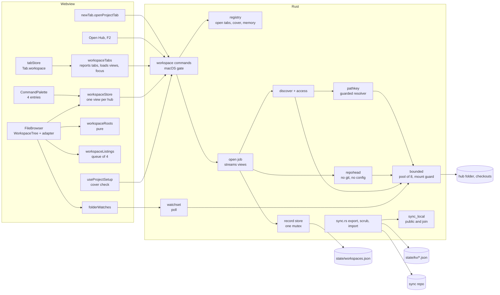

# Workspaces (F4): technical design for slice S1

- **Status:** Proposed, revision 2 (2026-11-15). Revision 1 was BLOCKED by its adversarial review (four blockers, sixteen majors, eleven minors). This revision answers every finding (section 22) and folds in the owner's decision of 2026-11-15 on the sync strip. Not approved. A delta review follows.
- **Owner:** architect.
- **PRD:** `docs/prd.md` section F4, revision 3.3, approved by the owner 2026-11-10 (branch `prd-workspaces`, b2f541c). Where the PRD leaves a choice to the architect, the choice is made here and marked **(architect)**. Where a choice belongs to the product manager, the designer or the owner, it is listed in section 19 with a recommendation, the PRD's literal text is the default built, and the recommended case is designed too.
- **Owner decision, 2026-11-15 (revision 1's Q1, review finding B3):** **strip all paths.** An orchestrator session's `projectDir` and an agent-tracker entry's `cwd` are never synced, for anyone, hub or not. Each machine keeps its own. This goes beyond WS-7 AC3's table as approved. The PRD text it needs is written out in section 21 for the product manager; this design does not edit the PRD.
- **Scope:** slice S1 in full. Slice S2 (recents, live refresh) only as far as S1 must not block it (section 16).
- **Decisions (all Proposed; numbers provisional until merge, see the decision log's numbering notes):**
  - `0037-the-workspace-record-is-one-rust-owned-local-file.md`
  - `0038-a-workspace-is-the-folders-of-one-hub.md` (OQ-1)
  - `0039-a-finished-hub-is-read-from-the-repository-files-without-git.md`
  - `0040-sync-splits-shared-keys-into-a-public-and-a-local-part.md`
  - `0041-workspace-file-system-calls-run-in-one-bounded-pool-guarded-by-mount.md` (new in revision 2)
- **Contracts:** `.ade/context/workspaces.md` and `.ade/context/sync-local-fields.md` (shared with F2).
- **UX:** the F4 UX spec is on branch `ux-f4` and is being revised after its own blocked review. Section 18 answers each item of its section 22.
- **Code read:** every statement about "today's code" was read from `origin/main` at **84389eb**. File and line references are to that commit. Anything not checked is marked **unverified**.
- **Public repository:** the agent hub template is private. This document names its files and folders as the PRD does (`hub.conf`, `ACCESS.md`, `projects/`, `ops/`, `bin/setup`, `bin/doctor`) and describes its behaviour only. No test runs the template.

## 1. Summary

- **Everything that touches the disk is in Rust**, in `src-tauri/src/workspace/` and `src-tauri/src/pathkey.rs`. The webview holds a derived view per hub in memory and never compares two paths itself.
- **Every file-system call F4 makes goes through one fixed pool** of 8 worker threads, guarded by mount. At most 4 calls are in flight per mount, a mount whose calls do not return is marked stuck and answered at once from then on, and the mark is lifted when its calls return or the mount goes away. A dead mount parks at most 4 threads and never stops calls to other mounts (section 7, ADR 0041).
- **Opening a workspace streams.** The first view is published at once (the hub's root, checking). The finished-hub check has one 2-second deadline for the whole check. Roots are published as their checks finish; a root not yet checked shows as checking and arrives later under a higher `gen`. Discovery as a whole stops after 10 seconds (section 7.4).
- **The workspace record is one file that Rust owns**, `<app data>/state/workspaces.json`, outside `state/kv/`, so no key list can export it (ADR 0037).
- **Discovery is a Rust parser with a hand-written frozen fixture**, capped at 200 work folders and 500 candidate rows per hub.
- **The finished-hub check reads the repository's files and starts no process** (ADR 0039). It does not read: reftable refs, objects reached only through alternates or a partial clone, pack index version 1, a `.git` that is a file or a link, more than 200 packs, a delta chain deeper than 64, a `packed-refs` over 16 MiB, or an object over its size cap. Each is reported as "check failed" with its reason, never as finished.
- **The sync strip needs no knowledge of workspaces.** Sync's export removes every `projectDir` from the orchestrator key and every `cwd` from the agent-tracker key, whatever the folder. So sync runs no discovery, has no fail-closed state, does not read the record, and costs nothing at launch or close. The other rows are decided by fields of the exported value itself. The import joins the imported copy with this machine's own fields, by a rule defined for every case (section 9, ADR 0040).
- **The workspace mark is `Tab.workspace`**, the hub folder's path, separate from F2's `Tab.hub`. A registry in Rust knows which workspaces and hub tabs are open in which window. It serves bring-forward (D7) and the automatic-setup check (WS-1 AC8).
- **The multi-root tree is F4's own component, listing cache and watch set.** It never passes roots to F3's `fileBrowserStore.show`, so F3's one recursive watch per root is never set on a workspace root. What differs between "before F3 S1" and "with F3 S1" is listed file by file (section 11.4).
- **Folder watches are a bounded poll** of the expanded folders' timestamps, at most 500 per window, every 2 seconds. No operating-system watch is set, so nothing is recursive on any platform (section 11.5).
- **F4 is gated to macOS in one place** in Rust and one in the webview (section 13.5).
- **Fourteen stories.** Thirteen do not need F2. The fourteenth carries every F2 seam and waits for F2 slice 1 (section 17).

## 2. Where things stand (origin/main 84389eb)

| Area | Today | Where |
|---|---|---|
| File browser root | One root, `rootPath`, set from a 3-second poll of the own view's active pane | `src/stores/fileBrowserStore.ts:24`, `:119`; `src/components/FileBrowser.tsx:153`, `:156` to `:181` |
| File browser watch | One recursive watch of the root; `watch_directory` is a main-thread command | `FileBrowser.tsx:202`; `src-tauri/src/watcher.rs:151`, `:200` |
| A tab | No flags | `src/stores/tabStore.ts:54` to `:82` |
| What tab operations copy | `ClosedTab` is `{ name, cwd, color }`, and Reopen opens at that `cwd`; `SerializedTab` is `id`, `name`, `type`, `root`, `activePaneId`, sent in the new window's URL; Duplicate calls `addTab(name, cwd)` with the tab's current folder | `tabStore.ts:139`, `:409` to `:416`, `:460` to `:466`; `src/lib/detachWindow.ts:7`, `:33` to `:46`; `src/components/TabBar.tsx:139` |
| Saved session | `ade-session`. A terminal tab's saved record holds `id`, `name`, `type`, `root`, `activePaneId`, `color`, and `subViews` and `shownView` when it has sub-terminals. A saved pane holds `id`, `serializedBuffer`, `savedCwd`. `SavedTab.previewPath` is declared and restored, but `saveSession` writes none today | `tabStore.ts:626` to `:659`, `:668` to `:684`, `:761` to `:778`, `:886` |
| A detached window | Mounts the pane container and the scratchpad only: no file browser, no command palette, no toast | `src/DetachedApp.tsx:1` to `:9`, `:98` to `:103` |
| Disk state | One JSON file per `localStorage` key under `<app data>/state/kv/`; snapshots copy `kv/` only | `src-tauri/src/state.rs:10` to `:12`, `:229` |
| Sync export | Reads only `SHARED_KEYS` and `DEVICE_KEYS` from `kv/`. A key is rewritten only when its value differs **and** the local file is newer than the repo copy | `src-tauri/src/sync.rs:36` to `:47`, `:88` to `:96`, `:260` to `:282` (the test is `:272`) |
| Sync import | For each shared key whose repo copy is newer, replaces the whole local value and puts back only secret fields. Device keys are never imported | `sync.rs:285` to `:300` |
| Sync order and budgets | One run: pull, export, commit, push, then import. The import is skipped past the startup deadline (6 s minus 500 ms); closing waits at most 4 s | `sync.rs:511` to `:556`; `src/lib/sync.ts:20`, `:84`; `src/App.tsx:136` |
| Orchestrator sessions | A bare array under `better-terminal-orchestrator`; each has `id` and an optional `projectDir`. Dispatching a session with no `projectDir` creates a project folder and sets it | `src/stores/orchestratorStore.ts:31` to `:38`, `:63` to `:67`, `:139`; `src/components/OrchestratorTab.tsx:391` to `:397` |
| Agent tracker | A bare array under `better-terminal-agent-tracker`; entries have **no id**; `cwd` is optional | `src/stores/agentTrackerStore.ts:6` to `:29`, `:41` to `:51` |
| Tab sets | `WorkspacePreset { id, name, tabs: { name, splits }[], savedAt }`, a bare array under `better-terminal-workspaces`; save and delete only | `src/stores/settingsStore.ts:334` to `:342`, `:522` to `:538` |
| Automatic project setup | One hook, in the main window only, fed the **active tab's own-view folder** and nothing else | `src/hooks/useProjectSetup.ts:165`, `:186` to `:276`; `src/App.tsx:95` to `:100`, `:180` |
| Pane folders | Each terminal pane polls its folder; `get_pty_cwd` reads the foreground process's folder from the process table | `src/components/TerminalPane.tsx:67`; `src-tauri/src/pty.rs:518` to `:532` |
| Opening a folder as a tab | `openProjectTab(path)` asks its setup questions before it opens the tab | `src/lib/newTab.ts:82` to `:120` |
| Toasts | 4 s, or 15 s with an action; main window only | `src/hooks/useContextGuard.ts:15` to `:41`; `App.tsx:174` to `:180` |
| Platform constants | `platform::IS_MACOS` in Rust; `IS_MAC` in the webview | `src-tauri/src/platform.rs`; `src/lib/shortcuts.ts:14` |
| CI | `backend` (Linux), `backend-macos` (display name `Backend on macOS (cargo test)`) and `backend-windows` (`cargo check` and `cargo test`) | `.github/workflows/ci.yml:93`, `:136` to `:138`, `:222` to `:249` |
| `serde_json` | No `preserve_order`: a value written back by Rust has its keys sorted | `src-tauri/Cargo.toml`; `src-tauri/src/claude_settings.rs:5` |
| F3 S1 | **Tickets on `main`, no code.** Story `s1c` builds `fileBrowserStore.show(key, roots[])` with "one `watch_directory` per root, started and stopped by show" (its item 6) and carries F4 WS-5 AC2 as conditional item (11) | `_bmad-output/initiative-per-view-viewer/epic-slice-1-viewer-state/tickets.toml`; `.ade/context/f3-merges-second.md` |
| F2 | **Nothing built.** Design revision 7 on `onboarding-arch` (PR #101), not approved | section 15 |

## 3. Components



Sync no longer touches the workspace modules: `sync_local` reads no record, runs no discovery and asks no registry.

### 3.1 Modules

| Module | New or changed | Responsibility | Tested by |
|---|---|---|---|
| `src-tauri/src/pathkey.rs` | new (or moved, section 6) | The path rule: a guarded resolver, one key per folder, `inside`, `same` | Rust, every CI OS; `macos_only` for the volume's own answers |
| `src-tauri/src/workspace/bounded.rs` | new | The fixed pool, the per-mount limit, the stuck-mount guard, recovery, the mount table | Rust, every CI OS, with a fake file system and a fake mount table |
| `src-tauri/src/workspace/access.rs` | new | The table-row parser. Pure | Rust; the frozen fixture |
| `src-tauri/src/workspace/discover.rs` | new | Files and their order, bounded reads, `~`, too broad, duplicates, the caps | Rust; `macos_only` for case, NFC and `~/Library` |
| `src-tauri/src/workspace/repohead.rs` | new | The finished-hub check | Rust (fixtures built with `git`: `cfg(unix)`) |
| `src-tauri/src/workspace/record.rs` | new | The record file: read, validate, write, retention, the hand changes, the format fixture | Rust |
| `src-tauri/src/workspace/assemble.rs` | new | Pure: discovery + record → roots, hidden list, notices | Rust |
| `src-tauri/src/workspace/open.rs` | new | The open job: check, discovery, record, assemble; publishes views by `gen`; the deadlines | Rust; `macos_only` for the 1-second test |
| `src-tauri/src/workspace/registry.rs` | new | Open tabs per window, reservations, most recently used, the covered set, the terminal sampler | Rust |
| `src-tauri/src/workspace/watchset.rs` | new | One poll set per window | Rust, every CI OS |
| `src-tauri/src/workspace/testhub.rs` | new, `cfg(test)` | The marker-fixture builder and its "nothing changed" assertion (section 17.3) | used by the tests of w3, w5, w9 |
| `src-tauri/src/workspace/mod.rs` | new | The commands, the events, the platform gate (section 13) | Rust |
| `src-tauri/src/sync_local.rs` | new | `public` and `join` for the keys of section 9 | Rust, every CI OS |
| `src-tauri/src/sync.rs` | changed | `value_for_repo`, the scrub, `import_state`, `SyncReport.skipped_keys` | Rust; the two-machine tests |
| `src-tauri/src/lib.rs` | changed | Registers the commands and the managed state; clears a window's entries when it is destroyed | Rust string test |
| `src/stores/tabStore.ts` | changed | `Tab.workspace`; `addWorkspaceTab`; the mark in `ClosedTab`, `SavedTab`, Duplicate; `markRunTab` (w14) | vitest |
| `src/lib/detachWindow.ts`, `src/DetachedApp.tsx` | changed | `SerializedTab.workspace`; the detached window starts `workspaceTabs` and mounts the tab notice bar | vitest |
| `src/lib/workspaceTabs.ts` | new | In every window: reports this window's workspace and hub tabs, **loads each hub's view**, applies a focus event | vitest |
| `src/stores/workspaceStore.ts` | new | One `WorkspaceView` per hub, in memory; drops stale answers by `gen` | vitest |
| `src/stores/tabNoticeStore.ts`, `src/components/TabNoticeBar.tsx` | new unless F2 slice 1 built them first | Per-tab notices above the terminal, never saved (section 18, item 4) | vitest |
| `src/lib/workspaceRoots.ts` | new | Pure: labels, which roots a view shows, the extra root | vitest |
| `src/lib/visibleText.ts` | new | Shows bidi and control characters escaped | vitest |
| `src/lib/workspaceListings.ts` | new | F4's listing cache: by path, a queue of at most 4 `list_directory` calls, results tagged by `gen`, every rejection caught | vitest |
| `src/components/WorkspaceTree.tsx` | new | Root rows and their trees. Presentational | vitest |
| `src/lib/workspaceTreeState.ts` | new | Where `expanded` and the active folder come from: per tab (WS-5 AC1) or F3's viewer state (WS-5 AC2) | vitest; the swap of 11.4 |
| `src/lib/folderWatches.ts` | new | Keeps the window's poll set equal to the folders on screen | vitest |
| `src/components/FileBrowser.tsx` | changed | Renders `WorkspaceTree` when the view in sight shows a workspace; unchanged otherwise | vitest |
| `src/components/CommandPalette.tsx` | changed | Four entries, present only for a workspace tab | vitest |
| `src/lib/newTab.ts` | changed | `openProjectTab` asks `workspace_resolve` first | vitest |
| `src/hooks/useProjectSetup.ts`, `src/App.tsx` | changed | The cover check before any automatic setup (section 10) | vitest |
| `src/stores/agentTrackerStore.ts` | changed | An optional `id` on new entries (section 9.3) | vitest |
| `src/components/SettingsPanel.tsx`, `SyncSettings.tsx`, `Tour.tsx`, `docs/guide/settings.md`, `docs/guide/sync.md` | changed | The Tab Sets relabel (WS-10) | vitest; the scan |
| `scripts/workspaceWord.test.ts` | new | WS-10 AC2's scan | vitest |

Why Rust for discovery **(architect)**: its reads must be bounded and guarded (WS-9 AC2, AC3), which the webview cannot do; the path rule needs `realpath`, the volume's case rule and Unicode folding; the cover check must see workspaces open in other windows; and one implementation means the frozen fixture pins the only parser there is. The cost: every change of what the file browser shows goes through a command.

## 4. Data model


`ROOT.kind` has three values, as the TypeScript type has. The extra root of WS-5 AC3 is not in a view: it comes from `workspace_locate` and exists only as a row of the tree (`RootRow.kind: "outside"`, section 11.4).

Stored on disk by F4: the record file, and one field on saved tabs (`workspace`) in `ade-session`. `ClosedTab.workspace` is memory. `SerializedTab.workspace` is a URL parameter of the new window (section 13.1). Discovered checkouts, the registry, the covered set, the touched terminals and the views are memory only.

### 4.1 The record file

`<app data>/state/workspaces.json`, resolved from `state::state_dir(app)` (`state.rs:229`), and through F1's `ProfilePaths` once that exists.

```json
{
  "v": 1,
  "workspaces": [
    {
      "hub": "/Users/dev/hubs/acme-backend",
      "added": ["/Users/dev/notes/acme"],
      "hidden": ["/Users/dev/Project/acme-legacy"],
      "order": ["/Users/dev/Project/acme-web", "/Users/dev/Project/acme-api", "/Users/dev/notes/acme"],
      "lastOpened": 1763200000000
    }
  ],
  "droppedNotice": []
}
```

- **Paths are stored as text, compared by key.** Keys are not stored: a key depends on the volume's case rule, which can differ after a restore to another disk. `hidden` holds the path exactly as the hub's file gave it after `~` expansion, so it equals the row's text while the row is unchanged (this matters in 5.6).
- **`order`** is empty until the engineer moves a root. A move writes the whole current sequence of roots other than the hub folder.
- **A record has hand changes** when `added`, `hidden` or `order` is not empty (WS-6 AC2).
- **No names** from `hub.conf` or the tables' other columns (WS-7 AC4).
- **`droppedNotice`** holds the hub folders of records the 200 cap dropped. It is emptied when a published view has carried the notice (section 18, item 12).
- **Writing.** `state::atomic_write` (`state.rs:63`), under the store's mutex, from Rust only.
- **The format fixture** (WS-6 AC2's last test) is `src-tauri/src/fixtures/workspaces/record-v1.json`.

**Reading, and every outcome of it:**

| The file | What F4 does |
|---|---|
| Absent | No records. Normal on first use |
| Parses, `v` is 1 | Each field is validated: a path that is not an absolute string without U+0000 is dropped; `lastOpened` that is not a non-negative safe integer becomes 0; more than 200 records keep the 200 most recently opened |
| Does not parse, or `v` is missing or not a positive integer | Moved aside as `workspaces.json.unreadable-<ms>`. F4 starts with no records. Every view carries the notice `record_unreadable` until the first successful write. Hand changes made before are in the moved file, not applied |
| `v` above the reader's (a newer build wrote it) | **Read-only for this run.** Nothing is read from it and nothing is written, so an older build cannot destroy a newer build's records. Workspaces still open, from discovery alone: hidden checkouts are shown, added folders and a saved order are not applied. Every view carries `recordState: "read_only"` and the notice `record_newer`. The four hand-change commands refuse with `record_read_only`, and the palette offers only Refresh (as for a hub that is not finished). `lastOpened` is not stamped and retention does not run |
| Cannot be read for another reason (permission, I/O error) | As the row above, with the notice `record_unreadable`: read-only for this run, nothing written, nothing moved |
| A write fails (disk full) | The command answers `not_saved`, the view is not changed, and the tab shows the notice `not_saved` |

A hidden checkout shown again in the read-only cases is shown on this machine only. It is still covered by WS-1 AC8 (the covered set comes from discovery, not from the record) and no synced key depends on the record (section 9).

### 4.2 Why one Rust-owned file (ADR 0037)

| Option | Why not |
|---|---|
| A `localStorage` key in `PERSISTED_KEYS` | Every window holds its own copy of each store and writes whole values (`persistence.ts:141`). A workspace tab can be moved to its own window, so two windows would write the record. And a key in `kv/` is one edit of `SHARED_KEYS` away from syncing |
| One file per hub | Retention needs them all |
| A field of `ade-session` | `ade-session` is exported (`sync.rs:47`) and rewritten whole every few seconds |

The record is not in snapshots (`state.rs` copies `kv/` only). The PRD allows either (WS-7 AC2).

### 4.3 Retention (WS-6 AC2)

A pure function, `retain(records, open_hub_keys) -> (kept, dropped_by_cap)`, run after an `open` or `restore` has stamped `lastOpened`:

1. A record with no hand changes, whose hub has no open workspace tab, and which is not among the 10 most recently opened, is dropped.
2. If more than 200 remain, the least recently opened records whose hub has no open workspace tab are dropped until 200 remain, and their hub folders are appended to `droppedNotice`.
3. Nothing else drops a record. The hub's state is never an input.

S2's recent list is the 10 most recently opened records of this store (section 16).

## 5. Discovery

### 5.1 The parser (`access.rs`)

`parse_rows(text: &str) -> Vec<Row>`, where `Row { line: usize, cell: String, section: Option<String> }`. Pure, no I/O.

1. A leading U+FEFF is dropped. Lines end at `\n`; a trailing `\r` is dropped.
2. A line whose first character is `#` is a heading. `section` of the rows after it is the heading's text without the `#` characters, trimmed and lower-cased, until the next heading.
3. A line is a table row when its **first character** is `|`. Leading spaces disqualify it.
4. Cells are split at `|`, except that `\|` is a literal `|` (m11). No other escape is read.
5. The cell is the second cell, trimmed of spaces and tabs. A row with fewer than two cells is not a checkout row.
6. A row is a **checkout row** when that cell starts with `/` or `~`. Header rows, separator rows, empty cells, `(none, works in the hub)`, `$HOME/x`, `./x` and a cell in backticks are not, and produce nothing.

**Which rows count** is one constant, `RowRule`:

- `Anywhere` (**the default built: the PRD's literal text**, F4.1 "anywhere in one of the `ACCESS.md` files"): every checkout row, whatever its section.
- `CodeSection` (recommended, question P-6): only rows whose `section` is `code`. A row appended below the Code table is still in that section until the next heading, so the PRD's "a row appended below the table counts" holds.

Why it is a question: a hub's `ACCESS.md` has other tables, and their second cell can start with `/` or `~`. Under `Anywhere` each such row becomes a root and a covered folder. The fixture has one such row, so the rule in force is pinned either way.

`expand(cell, home) -> Candidate | Unread`:

- `~` alone → `home`; `~/rest` → `home/rest`;
- any other `~…` (`~bob/x`) → `Unread`;
- a cell holding U+0000 → `Unread`;
- anything else starting with `/` → the cell as written.

`home` is a parameter: the commands pass ADE's home (`HOME` first, as `get_home_dir` does, `lib.rs:223`); tests pass their own.

### 5.2 Which files, in which order (`discover.rs`)

1. `<hub>/ACCESS.md`.
2. `<hub>/projects/<name>/ACCESS.md` for each folder directly under `projects/`, in name order.
3. `<hub>/ops/<name>/ACCESS.md` for each folder directly under `ops/`, in name order.

Name order is by Unicode code points after NFC (WS-1 AC1). Never recursive. A work folder with no `ACCESS.md` is skipped silently.

**Caps** (the first is the PRD's; the second is new, question P-13):

| Cap | Value | Over it |
|---|---|---|
| Work folders read, across both groups | 200 | the rest skipped, notice `work_folders_skipped` |
| Candidate rows per hub, in reading order, after dropping rows whose expanded text repeats an earlier one | 500 | the rest not checked, notice `rows_over_limit` with the count |

So one discovery makes at most 2 listings, 201 file reads and 500 candidate checks, each one job in the pool of section 7. A 1 MiB file with tens of thousands of rows costs its parse and nothing more.

### 5.3 Reading a file (WS-9 AC2, WS-1 AC7)

On Unix, one function, run as one pool job:

1. `open(path, O_RDONLY | O_NONBLOCK | O_CLOEXEC)`: a FIFO with no writer returns at once and a device does not wait.
2. `fstat` the descriptor. Anything but a regular file is **unreadable**. A symbolic link to a regular file is followed.
3. Read at most 1 MiB + 1 byte. More than 1 MiB is **unreadable** ("too large").
4. The bytes must be valid UTF-8, all of them.

No answer within the job's bound is **unreadable** ("not answering"). An unreadable file costs only its own rows.

Off Unix (section 13.5) the function is `metadata` (regular file), then `File::open` and the same capped read. F4 is not offered there; this exists so the module compiles and its pure tests run.

### 5.4 From rows to candidates

One pool job per candidate, on the candidate's text:

1. Its **path key** by the guarded resolver (section 6), and, with the resolved path, whether it is an existing folder.
2. **Too broad** (WS-9 AC5): the key is `/`; or the home folder; or a volume root (the key is a mount point in the mount table of 7.2); or contains ADE's own data (the key is a component prefix of the key of `app_data_dir()`, `app_local_data_dir()`, `app_cache_dir()` or, on macOS, `~/Library/WebKit/<bundle identifier>`). A too-broad candidate gives no root and is counted per file.
3. **Duplicate** (WS-1 AC3): a key already seen, or the hub folder's own key, is dropped. The first position wins.
4. **Status:** `ok` (an existing folder), `missing`, or `not_answering`.

**A candidate whose key could not be computed** (the job did not answer, or its mount is stuck) has `key: None` and status `not_answering`. It is a duplicate only of an earlier row with the same expanded text. It is never too broad by key; it is too broad by text when its lexically normalised text is `/` or the home folder.

```rust
pub struct Discovery {
    pub checkouts: Vec<Checkout>,        // in order; duplicates and too-broad ones removed; not capped at 50; hidden ones included
    pub unread_rows: Vec<FileCount>,     // ~user and NUL rows, per hub-relative file
    pub too_broad: Vec<FileCount>,       // per hub-relative file
    pub unreadable: Vec<FileProblem>,    // { file, why: Permission | NotRegular | NotUtf8 | TooLarge | NotAnswering | Other }
    pub work_folders_skipped: usize,
    pub rows_over_limit: usize,
    pub cut_short: bool,                 // the 10-second deadline of 7.4 was reached
    pub complete: bool,
}
pub struct Checkout { pub path: String, pub key: Option<PathKey>, pub status: Status, pub file: String /* hub-relative */, pub line: usize }
```

**`complete`, one definition.** A `Discovery` exists only when the hub folder was found to be a finished hub; a missing or unfinished hub has no discovery, so the word does not apply to it. `complete` is true exactly when all of these hold: the listing of `projects/` and of `ops/` each succeeded or answered "does not exist"; every `ACCESS.md` that exists was read; no work folder was skipped; no row was over the limit; and the run was not cut short. It is used in one place only, the cleaning of 5.6. Sync does not use it.

### 5.5 The frozen fixture (WS-1 AC2, D10)

Checked in under `src-tauri/src/fixtures/workspaces/hub-rules/`, written by hand, never generated and never compared with the template:

- `ACCESS.md`, `projects/b/ACCESS.md`, `projects/a/ACCESS.md`, `ops/a/ACCESS.md`, holding between them rows with: `/abs/acme/api`; `~`; `~/rel`; `~bob/x`; `$HOME/x`; `./x`; `(none, works in the hub)`; an empty cell; a header row; a separator row; a row appended after the Code table; a row whose cell is `/abs/we\|ird`; one row each whose folder name holds U+202E, U+2066, U+200F, U+0007 and U+0085; the same path twice; and **one row of another table, under another heading, whose second cell is `/abs/other-table`** (the row rule).
- `expected.json`, written by hand: the checkouts in order (file, line, path with `<home>` for the test's home), the unread rows and the too-broad rows per file. Under `RowRule::Anywhere` it lists `/abs/other-table` as a checkout; if P-6 is answered the other way, the file is edited by hand and the constant changed in the same commit.

The test runs `discover` on the fixture with a temporary home and asserts the output equals `expected.json` field for field. A second test runs `parse_rows` alone on each file. No folder of the fixture exists on any machine, so every status is `missing`; statuses are covered by the tests that build real folders.

### 5.6 Assembling the roots (`assemble.rs`)

`assemble(hub, hub_status, discovery, record, limits) -> WorkspaceView`, pure:

1. Start with the hub folder.
2. Add each discovered checkout that is not hidden, in discovery order.
3. Add each added folder not already present, in add order, each with its own status.
4. Apply `order` (WS-1 AC1).
5. Cap at 50 roots; count the rest (WS-9 AC1).
6. `hidden`: the record's hidden paths that the discovery still names.

**Matching a record entry to a discovered row.** By key when both have one; otherwise by text (the entry's stored text equal to the row's expanded text). So a hidden checkout on a mount that does not answer stays hidden: its row has no key, and its text equals the stored one (4.1). The one case that is not held: the row was re-spelled in the hub's file **and** the mount does not answer; then the row shows as a not-answering root until the mount answers. This is stated, not solved.

**Cleaning the record** removes a hidden or `order` entry that nothing matches. It runs only when all three hold: `complete` is true; every discovered checkout has a key; and the entry's own key could be computed. Otherwise nothing is removed (WS-1 AC7, WS-3 AC3). That keeps more than WS-1 AC7 asks ("the hidden entries for paths that file named"): the record may not store which file a path came from (WS-7 AC4), so every hidden entry is kept until a refresh reads every file (question P-12). In the read-only record states of 4.1 nothing is cleaned.

## 6. The path rule

**One function for F2 and F4.** F2's design specifies this rule as the key of its folder registry (F2 design 4.10.1, `registry_key` in `hubmark.rs`). F4 adopts it and gives it a home both features call: `src-tauri/src/pathkey.rs`.

`key(path, home) -> Result<PathKey, NotAnswering>`, run as one pool job:

1. Expand a leading `~` or `~/` with `home`; normalise lexically (`.` and `..`, repeated and trailing `/`).
2. **Resolve, one component at a time (the guarded resolver).** Starting from `/`, for each component: look up the mount of the prefix resolved so far in the mount table (7.2) and note it as the mount this job is touching; if that mount is stuck, stop with `NotAnswering`; `lstat` the component; if it is a symbolic link, `readlink` it and splice the target in (at most 40 links); if it does not exist, stop resolving and append the remaining components as written. The prefix resolved so far holds no link, so its mount in the table is the mount the next call really touches. This is what makes the guard of section 7 exact.
3. Normalise to NFC (`icu_normalizer` 2.1.1, in `src-tauri/Cargo.lock`).
4. On macOS, when `pathconf(resolved ancestor, _PC_CASE_SENSITIVE)` is 0, case-fold with CoreFoundation's `CFStringFold` (`core-foundation-sys` 0.8.7, in the lock file; the function is at `string.rs:515` of that crate), then NFC again. A failed `pathconf` folds.

- `same(a, b)`: equal keys. `inside(a, b)`: `b`'s key is a **component** prefix of `a`'s. Both compare strings and make no file-system call.
- **Off macOS** the key is steps 1 to 3. F4 is not offered there (13.5).

The review confirmed the three crates and versions in the lock file. Whether making `icu_normalizer` and `core-foundation-sys` direct dependencies leaves the lock file otherwise unchanged is **unverified**; story w2's first step is `cargo metadata --locked`.

**Who builds it.** Whichever of F4 story w2 and F2's story for OB-13 lands first creates `pathkey.rs`. If F2's lands first with the function in `hubmark.rs`, w2 moves it and leaves a re-export. F2's design needs one line saying so (section 15).

**The webview never compares paths.** It compares only strings that Rust returned, for equality, and asks `workspace_locate` (11.3) for everything else.

## 7. Bounds (WS-9 AC2, AC3; ADR 0041)

### 7.1 The pool

`bounded::run(job) -> Result<T, NotAnswering>`. Every file-system call F4 makes on a hub, a checkout, an added folder or a watched folder is a job: one `ACCESS.md` read, one listing of `projects/` or `ops/`, one candidate check, the finished-hub check, one `workspace_locate`, one watch add, one watch tick per mount. Reading and writing the record file is not a job: it is ADE's own file in ADE's own data folder.

- **A fixed pool of 8 worker threads**, process-wide, started on first use.
- **At most 4 jobs in flight per mount.** Further jobs for that mount wait in its queue.
- **A job's bound is 2 seconds from the moment it starts running**, not from when it was queued. So a job that waited behind others is not reported as "not answering" for waiting.
- **A queue holds at most 1,024 waiting jobs per mount.** Past that the new job answers `NotAnswering` at once. One discovery submits at most 703 jobs (5.2).
- A job declares the mount it is about to touch before each call (the resolver of section 6 does this per component; every other job runs on an already resolved path, whose mount is known before it starts).

### 7.2 The mount guard

- **The mount table** is a snapshot of the mounted file systems: on macOS from `getfsstat` with `MNT_NOWAIT`; on Linux from `/proc/self/mountinfo`. One dedicated thread refreshes it at most once per second, on demand. Callers read the last snapshot and never wait for a refresh. That `getfsstat(MNT_NOWAIT)` never blocks on a dead mount is what its manual page says and is **unverified** here; because the refresher is its own thread, a refresh that did block would freeze the snapshot and stop nothing else. Tests inject the table.
- **The mount of a path** is the longest mount point that is a component prefix of the path. For a resolved path this is exact.
- **Stuck.** When a job has run for 2 seconds without returning, its caller gets `NotAnswering`, and the mount the job last declared is marked **stuck**. From then on every queued and every new job for that mount answers `NotAnswering` at once and starts no thread.
- **A worker that is still blocked is parked**, and a replacement is started so 8 workers stay available. At most **8** replacements exist at any time.
- **How many threads one dead mount can park: 4** (the per-mount limit). A hub with 33 sibling checkouts on one dead mount starts 4 calls into it, waits 2 seconds, marks it, and answers the other 29 at once.
- **Calls to other mounts are not affected** by a stuck mount: they have their own queues, and the pool keeps 8 workers.

**Recovery.** A stuck mark is lifted when either happens:

1. a parked job returns (a hard mount whose server came back; a soft mount that timed out). The thread goes back to the pool and the surplus replacement is retired;
2. the mount is no longer in the mount table (it was unmounted).

There is no timer that lets new calls into a stuck mount: the parked calls are the probes. After recovery the next refresh or open reads the folder normally.

**The residual cliff, stated.** Each dead mount holds up to 4 parked threads against the 8 replacements. With **three or more mounts dead at once** the pool can run short: a third dead mount may be left with fewer than 8 working threads, and when all 8 workers and 8 replacements are parked, every job answers `NotAnswering` until a mount recovers or is unmounted. For this to happen, 16 calls must each be blocked on a mount that never returns. It is a slow-down first and an outage of F4's file reads only at that limit; terminals, tabs and the rest of ADE do not use the pool.

**What is no longer in the design:** revision 1's count of abandoned calls with a cap of 32, "known to answer", and guarding by folder.

### 7.3 Never on the UI thread, never on an async worker

Every F4 command is declared `#[tauri::command] async fn` and does its work inside `tauri::async_runtime::spawn_blocking` (as `sync.rs:615` does), so a wait of up to 2 seconds holds a thread of the blocking pool, not an async-runtime worker, and never the main thread. A Rust string test asserts both for each F4 command, in the style of `watcher.rs:705` to `:720`.

### 7.4 Opening a workspace: the deadlines (WS-9 AC3)

`workspace_open(hub, reason)` starts (or joins) the hub's **open job** and answers at once with the current view. The job then publishes better views, each with a higher `gen`, and emits `ade://workspace-changed { hub, gen }`. Time is counted from the job's start, T.

| Step | Bound | What is on screen |
|---|---|---|
| The first view | at once | the hub's root with status `checking`; on a refresh, the roots already shown stay |
| The finished-hub check | **one deadline of 2 s for the whole check** (it is one job; its internal caps are in 8.1). Past it: `not answering`, and its mount is marked stuck | the view's state: `ok`, `hub_missing`, `not_finished` or `check_failed` |
| Listing `projects/` and `ops/`, and reading the top-level file | each one job, started together when the check says finished | |
| Reading each work folder's file, then checking each candidate | each one job, queued as soon as it is known | a root appears when its row is known, with status `checking`, and gets its real status when its job answers. Views are published at most every 100 ms |
| The whole discovery | **10 s after the check finished.** Jobs not yet started are cancelled: their files count as unreadable ("not answering"), their roots show `not_answering`, `cut_short` is set and the notice says so | the final view |

- **No root delays another by more than the bound.** A root whose own job hangs is `not_answering` 2 seconds after that job started, and the others were published as they arrived. A slow chain delays only what depends on it.
- **The worst case, stated.** The final view comes at most 2 s (the check) + 10 s (discovery) + 2 s (jobs running at the cut) after T. A dead mount costs 2 seconds once. Only a mount that is slow at every call without ever exceeding 2 seconds reaches the 10-second cut.
- **The local case.** For a hub with 20 checkouts on a local disk the whole job takes milliseconds. The macOS test of WS-9 AC3 times **the open job from T to its final view** (the check, discovery, the record and the added folders' checks), 20 real checkouts, median of 5 runs after one warm-up run, under 1 second. It is `workspace::open::macos_only`, in story w5.
- **`workspace_resolve`** (before a tab exists) runs the key and the check as one job under one 2-second deadline. No answer is `plain` with `check_failed: not_answering`.

## 8. The finished-hub check (WS-2 AC8, F4.1, ADR 0039)

`repohead::finished_hub(path) -> HubCheck`

```rust
pub enum HubCheck {
    Finished,
    Missing,                       // the folder, or a folder above it, does not exist
    NotHub(NotHub),                // NotAFolder | NoHubConf
    NotFinished(NotFinished),      // NoRepository | NoCommit | NotCommitted | NotAFile
    Failed(CheckFailure),          // NotAnswering | Unsupported(what) | ObjectMissing | Damaged(what)
}
```

`Missing` is only "does not exist". A folder that does not answer is `Failed(NotAnswering)`. Section 11.1 says how each is shown.

### 8.1 What it reads, exactly

The whole check is **one job with one 2-second deadline**. No process is started. **No config file is opened**: not `<path>/.git/config`, not the global or system config, not `.gitattributes`, not a hook.

1. `path` by `stat`: does not exist → `Missing`; exists and is not a folder → `NotHub(NotAFolder)`.
2. `<path>/hub.conf` by **`lstat`**: absent → `NotHub(NoHubConf)`, the cheap exit for an ordinary project folder; present and not a regular file (a link, a folder, a FIFO) → `NotFinished(NotAFile)`. The link is not followed: a hub file never sends the check to another path (D3).
3. `<path>/.git` by `lstat`:
   - absent → `NotFinished(NoRepository)`. **The top-level rule** (F4.1): only the folder's own `.git` is looked at, never a parent's;
   - a regular file (a linked worktree or a submodule) → `Failed(Unsupported("git_file"))`. It is unsupported, not unfinished (question P-8);
   - a symbolic link → `Failed(Unsupported("git_link"))`;
   - a folder → the git folder `G`.
4. **Resolve `HEAD`.** Read `G/HEAD` (at most 1 KiB).
   - `G/reftable` exists → `Failed(Unsupported("reftable"))`.
   - 40 or 64 hex characters → that object id.
   - `ref: <name>`: `<name>` must start with `refs/` and hold no `..` component, no empty component, no U+0000 and no backslash; otherwise `Failed(Damaged("head"))`. Then, at most 5 levels deep: the loose file `G/<name>` (regular, at most 1 KiB), else the line for `<name>` in `G/packed-refs`. A `packed-refs` over 16 MiB → `Failed(Unsupported("packed_refs_too_large"))`. More than 5 levels → `Failed(Damaged("ref_loop"))`. Neither loose nor packed → `NotFinished(NoCommit)`.
5. **Read the object** with that id, at most 5 peels if it is a tag:
   - loose: `G/objects/<2 hex>/<rest>`, inflated with zlib (`flate2`), output capped;
   - else packed: list `G/objects/pack/*.idx`. More than 200 → `Failed(Unsupported("too_many_packs"))`. For each, parse index version 2 by `pread` of the ranges needed; version 1 → `Failed(Unsupported("pack_index_v1"))`. At the offset in the `.pack`, read the entry and inflate. `OFS_DELTA` and `REF_DELTA` entries are resolved against their base; a chain deeper than 64 → `Failed(Unsupported("delta_too_deep"))`;
   - not found anywhere → `Failed(ObjectMissing)`. `G/objects/info/alternates` is not followed and a partial clone's missing objects are not fetched;
   - a commit over 1 MiB or a tree over 8 MiB → `Failed(Unsupported("object_too_large"))`.
6. The object must be a **commit** (else `Failed(Damaged("not_a_commit"))`). Its first line gives the root tree's id.
7. Read the **root tree** the same way and scan it for the name `hub.conf`:
   - mode `100644` or `100755` → `Finished`;
   - another mode (a symbolic link, a folder, a submodule) → `NotFinished(NotAFile)`;
   - absent → `NotFinished(NotCommitted)`. The index is never read.

**A repack under the check.** A persona commits often, and `git gc` replaces packs while they are read. When steps 4 to 7 end in `ObjectMissing` or `Damaged`, or a pack listed in step 5 is gone when opened, the check **runs steps 4 to 7 once more** from a fresh listing, inside the same 2-second deadline. The second result stands.

Object ids of 20 and 32 bytes are both read. Hashes are not verified: the check decides what ADE shows and grants nothing.

### 8.2 What it costs

- **An estimated 600 to 900 lines of Rust with their tests**, owned by this project: loose refs, `packed-refs`, loose objects, pack index version 2, pack entries, delta application, commit and tree parsing, the retry. The estimate is not measured.
- **One new direct dependency**, `flate2` (1.1.9 with `miniz_oxide` 0.8.9 is in the lock file; the review confirmed it). That adding it directly leaves the rest of the lock file unchanged is **unverified**; story w3's first step is `cargo metadata --locked`.
- **What it does not read**, each `Failed` with its reason and never `Finished`: reftable refs; objects reached only through alternates or a partial clone; pack index version 1; `.git` as a file; `.git` as a link; more than 200 packs; a delta chain deeper than 64; a `packed-refs` over 16 MiB; an object over its cap.
- **reftable.** The default `git init` of Apple Git 2.50.1 uses the files backend (checked here and by the review). Whether a newer git from another source defaults to reftable is **unverified**. If one does, every new hub made with it is "check failed" until a reftable reader is added. That is a known limit with a detection and a message.
- **Where it can disagree with F2's check** (ADR 0029 on `onboarding-arch`, which runs `/usr/bin/git`). The review ran F2's commands and found they answer finished for: a hub checked out as **a linked worktree** (`.git` is a file), and a `hub.conf` committed as **a symbolic link**. F2's would also answer finished for every unsupported format above. Section 13.2 says what happens to bring-forward in those cases, and section 15 asks F2's design to use this check.

### 8.3 What was rejected

| Option | Why not |
|---|---|
| ADE's own `git` with the dangerous settings overridden, as ADR 0029 does | The criterion is a negative over all of git's configuration. The commands needed run no hook, filter or pager today, but a repository config can also declare a promisor remote, and git then fetches a missing object by starting a transport the config names (**unverified**, from memory of git's lazy fetch). The list of such routes changes with git, and ADE runs whatever git the Mac has. Reading the files makes the criterion true by construction |
| The `gix` crate | A large dependency tree that is not in the lock file, for one question about one file in one commit |
| `git ls-files`, or reading the index | The index holds `hub.conf` after `git add` with no commit |

### 8.4 Tests

In `repohead.rs`. The fixtures are built in a temporary folder by the test's own `git`, with the system and global config neutralised and a fixed identity; a missing `git` is a `panic!`, never a skip. These tests are `cfg(unix)` (Linux and macOS CI); on Windows the module compiles and only its byte-level parser tests run (13.5).

- loose objects and loose refs → `Finished`; after `git gc` → `Finished`;
- **the delta path.** Commit 300 small files and `hub.conf`; delete one file and commit; `git repack -adf --depth=50 --window=50`. The last commit shrinks the root tree, so git stores `HEAD`'s tree as a delta of the larger one. This was run here on Apple Git 2.50.1: `git verify-pack -v` printed the `HEAD` tree with depth 1 and the earlier tree as its base. The test asserts that line first and fails if the tree is not a delta, so the delta path cannot go untested;
- a detached `HEAD`; a symbolic ref to another ref; a SHA-256 repository → `Finished`;
- no commit → `NoCommit`; `hub.conf` untracked → `NotCommitted`; staged only → `NotCommitted`; committed as a link → `NotAFile`; a working-tree `hub.conf` that is a link → `NotAFile`;
- a parent repository that commits `sub/hub.conf`, `sub` with no `.git` → `NoRepository`;
- `.git` a file → `Unsupported("git_file")`; a `reftable` folder; 201 index files; a ref loop; a truncated object → `Damaged`; `HEAD` naming `ref: ../../x` → `Damaged`;
- **the retry:** a file-system seam removes the pack after it is listed and puts the repacked one in place; the check answers `Finished`;
- **the deadline:** a seam that hangs on the third read gives `Failed(NotAnswering)` within 2 seconds;
- a folder with no `hub.conf` returns `NotHub` and the seam records **no** open under `.git`;
- the marker fixture (section 17.3).

## 9. The sync strip and its import rule (WS-7 AC3, F2 OB-10 AC2, OB-14 AC5, ADR 0040)

### 9.1 The rule in one paragraph

Some fields of synced keys are **local fields**: they never go to the sync repo, and each machine keeps its own. Which fields are local is fixed by the key and the field's name, or by a field of the same saved tab. **Nothing in sync looks at a workspace, a record, a discovery or a folder.** The export writes the value without its local fields. The import takes the other machine's value and puts this machine's own local fields back onto the entries that are still there.

### 9.2 The rows

| Key | Group | Local fields | Decided by |
|---|---|---|---|
| `better-terminal-orchestrator` | shared | every `projectDir`, at any depth of the value | the name alone (owner, 2026-11-15) |
| `better-terminal-agent-tracker` | shared | every `cwd`, at any depth | the name alone (owner, 2026-11-15) |
| `better-terminal-workspaces` (tab sets) | shared | every `cwd` and every `hub`, at any depth (the fields F2 OB-14 AC5 adds to a tab-set entry) | the names alone |
| `ade-session` | device: exported, never imported | for a saved tab that has `workspace` (F4) or `hub` (F2): everything but the allowlist of 9.4 | that saved tab's own fields |
| `better-terminal-prompt-history`, `better-terminal-saved-notes`, `ade-scratchpad-draft`, every other key | | none | the engineer's own text (WS-7 AC3's table) |

**What remains dependent on knowledge of workspaces: nothing.** Revision 1's `Knowledge`, discovery at export, fail closed and the registry lookup are removed, with their costs: sync reads no hub file, adds no time to the launch import (`sync.ts:20`) or to the close (`App.tsx:136`), and behaves the same whether the record is present, lost, unreadable or from a newer build.

**What changes for someone with no hub** (the owner's decision makes this deliberate):

- An orchestrator session received from another machine has no `projectDir`. Dispatching it here creates a project folder here, as a new session does (`OrchestratorTab.tsx:391` to `:397`). Before, it pointed at the other machine's path.
- An agent run received from another machine has no `cwd`, so the fleet does not attribute it to a project.
- This machine's own sessions and runs keep their folders, also after an import (9.5).

### 9.3 The functions

`sync_local.rs`:

```rust
/// `value` with every local field of `key` removed. None when `value` is not JSON.
pub fn public(key: &str, value: &str) -> Option<String>;
/// The imported copy with this machine's local fields put back. None when `imported` cannot be joined.
pub fn join(key: &str, imported: &str, local: Option<&str>) -> Option<String>;
```

- `public` returns its input text unchanged when nothing was removed. Otherwise it re-serialises, which sorts the keys (`serde_json` has no `preserve_order`). **Every comparison of two values in sync is therefore made on parsed JSON**, not on text.
- `public` needs no shape: it removes the named keys wherever they are. Only text that is not JSON cannot be made public.

**Entries and their ids**, used by `join` only:

| Key | The value is | An entry | Its id |
|---|---|---|---|
| `better-terminal-orchestrator` | an array | each element | its `id` (a string) |
| `better-terminal-agent-tracker` | an array | each element | its `id` when it is a string; else `paneId` and `startTime` together |
| `better-terminal-workspaces` | an array of tab sets | each element of each tab set's `tabs` | the tab set's `id` and the element's index |

- Agent-tracker entries have no id today (`agentTrackerStore.ts:6` to `:29`), and `paneId` restarts in every run. Story w12 adds an optional random `id`, minted in `startSession`. Older entries are matched by `paneId` and `startTime`; two machines produce the same pair only by starting an agent in the same millisecond in a pane with the same number.
- Tab sets are save and delete only (`settingsStore.ts:522` to `:538`), so a set's `id` and a tab's index name an entry for good.
- **The shapes are pinned across the two languages.** A vitest writes each store's persisted value for a fixed sample and asserts it equals a checked-in file under `src-tauri/src/fixtures/sync/`; the Rust tests of `join` read the same files. A store that changes its shape fails the vitest.

**`join(key, imported, local)`, every case:**

| Imported copy | This machine's value | Result |
|---|---|---|
| Not JSON, or not an array | anything | `None`: **the key is not imported in this run**; the local value stays; the key is listed in `SyncReport.skipped_keys` with `imported_unreadable` |
| An array | absent, not JSON, or not an array | `public(imported)`: there is no local field that could be kept. (Today this local value would be overwritten too) |
| An array | an array | each imported entry, in the imported order, built as below |

For one imported entry `e` and one local field `f`:

| `e` has `f` (an older build wrote it) | This machine has an entry with `e`'s id | That entry has `f` | `f` in the result |
|---|---|---|---|
| yes or no | yes | yes | **this machine's value** |
| yes or no | yes | no | absent |
| yes or no | no | | absent |

- An imported value of a local field is **never taken**, whichever machine wrote it. Each machine keeps its own or none.
- An entry that is not an object, or has no id, is taken as `public` of itself.
- An entry only this machine has is not in the result: the other machine deleted it, or never had it. That is today's whole-replace rule (`sync.rs:285` to `:300`) and is not changed.
- Two local entries with one id: the first is used.

**The invariants**, each a test over a table of hand-built values per key. There is no knowledge parameter, because no rule takes one: two machines compute the same `public` for the same value.

1. `public(public(v)) == public(v)`, and `public(v)` holds no local field at any depth.
2. **`public(join(p, l)) == public(p)`** for every `p` and `l` that join. A join never looks like a local change. In particular, when `p` is already public, `public(join(p, l)) == p`.
3. **Keeps:** for every id in both `p` and `l`, each local field of `l`'s entry is in the join with `l`'s value.
4. `join(public(v), v) == v` when `v`'s ids are unique: importing one's own export changes nothing.
5. The join has exactly `p`'s entries, in `p`'s order.

### 9.4 `ade-session`: the allowlist

`ade-session` is exported to `devices/<device>/` and never imported (`sync.rs:285` reads `SHARED_KEYS` only), so there is no join for it, and the local file is never changed by sync.

A saved tab that has `workspace` (a string) or `hub` (`true`) is exported as a **new object holding only**:

| Field | Exported as |
|---|---|
| `id`, `type`, `color`, `activePaneId`, `shownView` | as saved |
| `name` | as saved, except that a name equal to the last component of `workspace` becomes `"Terminal"` (WS-7 AC3's second row) |
| `root` | its structure only: `type`, `direction`, `children`, and for a pane only `id` |
| `subViews[]` | `id`, `activePaneId`, `root` (structure only), and `name: null` |

Everything else is left out: every pane's `savedCwd` and `serializedBuffer`, the mark `workspace`, the flag `hub`, `previewPath`, F3's `viewerKey`, **and any field added to a saved tab later**. An allowlist is why `previewPath` cannot leak whichever of F4 and F3 story `s1a` merges first, and why a new field is local until someone lists it. Whether an exported hub tab should keep `hub: true` is F2's to say (section 15); until it does, `hub` is left out.

A saved tab with neither field is exported as today.

**Why no sequence exports a workspace tab's folders, including with a lost record.** The rule reads only the saved tab. The mark is saved in the tab itself (13.1) and restored from it, so a record that is lost, unreadable or newer changes nothing here. A session that does not parse is not exported at all (`sync.rs:84` to `:96`, unchanged). A tab that lost its mark on load (an invalid value, 13.1) is a plain tab by definition.

**What the PRD's table leaves in the export, stated.** WS-7 AC3 strips "every pane of every workspace tab". So these still leave the machine, as they do today: the folder of a **plain** tab whose terminal sits in a checkout (`savedCwd`); the file of an editor tab opened on a checkout's file (`editorFilePath`, and the tab's name); a contracts tab's `contractsRoot`; a plain tab's sub-terminal names; and a tab name the engineer typed. Question O-3 recommends removing the path fields for every tab, which would make this key's rule as plain as the other three. The default built is the PRD's text.

### 9.5 Changes to `sync.rs`

- **`value_for_repo(key, raw)`** (`sync.rs:88`): after `strip_secrets`, return `sync_local::public(key, value)`, which for `ade-session` also applies the allowlist and today's `serializedBuffer` strip. `None` (the local value is not JSON, for a key with a rule) means the key is **not exported in this run** and is listed in `skipped_keys` with `local_unreadable`. Today such a shared key is exported raw; a value that cannot be parsed cannot be shown to hold no path, so it stays. Keys without a rule are exported as today.
- **The scrub**, new, in `export_state` before the comparison, for every shared key and this device's device keys: if the repo copy's value holds a local field, the repo file is rewritten with `public` of it, **keeping its `updated_at` and `device`**. So paths that an earlier build put in the repo leave its current files at this machine's next sync, even though nothing changed locally, and the rewrite does not look like a newer copy to any machine.
- **`export_state`'s test** (`sync.rs:272`) is unchanged in form, `w.value != value && local_at > w.updated_at`, with both sides compared as parsed JSON.
- **`import_state`** (`sync.rs:285`):
  - `differs` (`:292`) becomes: `public(local)` is not equal to `public(repo copy)`, as parsed JSON. An older build's copy that differs from ours only by its paths is therefore not imported;
  - the write (`:294`) becomes `restore_secrets(join(key, w.value, local), local)`; when `join` is `None` the key is skipped and reported.
- **`SyncReport`** gains `skipped_keys: { key, why }[]`. Settings → Sync shows them beside the last result (section 18).
- F3 story `s1a` adds `viewerKey` and `previewPath` to `SESSION_LOCAL_FIELDS` (its ticket, item 8). That and this change both edit `value_for_repo`; the two rules do not conflict (F3's removes two names from every tab, F4's rebuilds marked tabs), and whichever merges second resolves a textual conflict in that one function.

**Why a join on import causes no export.** A run is pull, scrub, export, commit, push, import (`sync.rs:511` to `:556`). After an import the local file is newer than the repo copy, so the next run's export compares `public(join(p, l))` with the repo copy. The scrub has already made the repo copy `public(p)`, and invariant 2 makes the two equal, so nothing is written. The two-machine tests assert it by counting commits.

### 9.6 Paths already in the sync repo, and older builds

- **Current files.** The scrub removes them at the first sync of any machine running this build. Without the scrub they would stay until the key next changed locally (`sync.rs:272`).
- **History.** The sync repo is a git repository. A path committed before the scrub stays in its history (`git log -p`) for good. This design does not rewrite history: a forced push would break every other machine's clone. G2 as amended (section 21) says "current files". Whether to offer a way to start the sync repository afresh is question O-2.
- **An older build syncing to the same repo** has neither the strip nor the join. It writes its paths back whenever it exports the key, and when it imports a copy written by this build it replaces its whole local value, so **it loses its own `projectDir` and `cwd` values** for the entries it imports. A machine on this build scrubs the paths again at its next sync. So the guarantee holds from the moment every machine syncing to the repo runs a build with this change. The release note must say: update every machine. This is stated, not solved (O-2).

### 9.7 Tests

In `sync_local.rs` and `sync.rs`, on every CI OS, on the existing harness (`sync.rs:645` to `:700`). "Marker" means a made-up path component that the test then searches for.

- per key: the five invariants of 9.3; every row of the two `join` tables; the pinned shapes;
- **WS-7 AC3's one-machine test:** a session with a workspace tab named after its hub folder, a focus sub-terminal named after a checkout, a previewed file, a tab set holding a hub entry (hand-written until F2 exists), an orchestrator session and an agent run in a checkout, **and an orchestrator session and an agent run in a folder that is no workspace**, each with markers. After `run_sync`: no marker anywhere in the repo's working tree or in `git log -p` (a fresh repo); the local `kv/` files are byte-for-byte unchanged;
- **the PRD's two-machine case:** A exports; B imports, saves another tab set, adds a session and a run, exports; A imports. A's tab-set entry still has its `cwd`, A's session its `projectDir`, A's entry its `cwd`; B's new entries are on A; an entry B deleted is gone on A; A's next `run_sync` makes no commit;
- **review sequence 1** (B1): B has entry E with a `cwd` in a folder that is no workspace, and exports; A imports E; A changes the key and exports; B imports. **E still has B's `cwd` on B.** The same with every one of A's hubs unreadable or missing, which no longer matters;
- **review sequence 2** (B1): the same folder is a checkout of an open workspace on A and a plain project on B. Same steps, same result, and A's next `run_sync` makes no commit;
- **review B2's sequence:** A has session S with `projectDir`; B imports S without one; B calls `setProjectDir` and exports; A imports. **A's S has A's `projectDir`, B's S has B's**, and neither machine's next `run_sync` makes a commit;
- **B2's sequence with B on an older build** (simulated by writing B's repo copy by hand with `projectDir` in it): A imports; A's S keeps A's value; a session A never had arrives with no `projectDir`; A's scrub removes B's path from the repo's current file and keeps its `updated_at`; A's next run makes no further commit;
- **paths from before F4:** a repo copy written with markers and an unchanged local file: one `run_sync` removes the markers from the current file; the test also asserts that `git log -p` still shows them, so the limit of 9.6 is pinned, not hidden;
- **unreadable values:** a local value that is not JSON is not exported and is in `skipped_keys`; an imported value that is not an array is not imported, the local value is unchanged, and it is in `skipped_keys`;
- **the allowlist:** a marked saved tab with an unknown extra field holding a marker exports without it; an unmarked tab is byte-for-byte what `value_for_repo` gives today;
- **WS-7 AC1:** a record with markers; `run_sync` leaves none in the repo; a static test asserts `workspaces.json` is not under `kv/` and that no key in `SHARED_KEYS` or `DEVICE_KEYS` names it; a static test asserts `sync.rs` and `sync_local.rs` do not name the `workspace` module;
- **m8:** the snapshot folder is never read by `export_state`.

## 10. No automatic setup in discovered checkouts (WS-1 AC8)

Automatic setup is one hook in the main window, fed the active tab's own-view folder (`App.tsx:95` to `:100`, `:180`). A workspace can be open in another window, so the answer comes from Rust.

**The covered set.** For each open hub the registry keeps the keys of its discovered checkouts from the open job's latest discovery: hidden ones included (OQ-13 (a)), ones past the 50 cap included, too-broad rows and rows without a key excluded. When a file was unreadable in the latest discovery, the keys last known from it in this run are kept.

**Who makes the covered set exist.** `workspaceTabs.ts` runs in **every** window, the main one and each detached one (`DetachedApp` starts it). For each hub it reports, it calls `workspace_open`. So a hub whose only tab is in a detached window gets its discovery like any other. If no window asks within 15 seconds of the registry learning of a hub (longer than the worst case of 7.4), the hub counts as having **no known coverage** from then until a view arrives. Its answer is never left open.

**The command.** `workspace_setup_covered(folder, pty_id) -> "covered" | "not_covered" | "unknown"`:

1. No hub is open in this instance and no terminal is touched (below): `not_covered`, with no file-system call. This is the path of everyone who has no hub.
2. `pty_id` is a **touched terminal**: `covered` (OQ-13 (b), literally: "for the rest of that terminal's life").
3. Some open hub has no first view yet: `unknown`.
4. The folder's key (one job). No answer: `unknown`.
5. The key is inside a covered checkout of any open hub: the terminal becomes touched; `covered`.
6. Otherwise `not_covered`.

**Touched terminals (OQ-13 (b)).** The PRD's words are "a terminal whose folder was inside a covered checkout while the workspace was open gets no automatic setup and no setup question for the rest of that terminal's life". **The default built is that text**: a set of PTY ids; once a terminal is in it, the answer for it is `covered` in every folder until its PTY ends. Question P-1 recommends the narrower rule (covered only in that checkout); it would change the set to pairs of PTY id and checkout key and step 2 to an `inside` test, nothing else.

How a terminal becomes touched without ever being the active one:

- **The sampler.** While any hub is open, the registry reads the folder of every live PTY every 3 seconds (the lookup behind `get_pty_cwd`, `pty.rs:518`, which reads the process table and no project folder). The folder the kernel reports is already resolved, so it is compared with the covered keys after NFC and the checkout's own case rule, with no file-system call. A terminal found inside a covered checkout becomes touched.
- **At close.** When a hub's last tab has been gone for 3 seconds (the grace that keeps Move to New Window from closing and reopening the workspace), the sampler runs once more before the covered set is dropped.
- **The limit, stated.** A terminal that was inside a covered checkout for less than one sample interval, was never the active tab there, and left before the workspace closed, is not remembered.
- Nothing is stored. A restart starts new terminals.

**The hook.** `useProjectSetup(cwd, ptyId, show, withdraw)`, on macOS only (13.5):

- awaits `workspace_setup_covered(cwd, ptyId)` **before** `setupRootOf`;
- `covered`: withdraw any setup question it has on screen, and stop;
- `not_covered`: go on as today;
- `unknown`: do nothing in this run, leave a question already on screen where it is, and **run again** when `ade://workspace-cover-changed` arrives, and once more after 5 seconds. The event is sent whenever a hub's covered set changes, which includes its first view arriving, its discovery failing, and the 15-second lapse above. So `unknown` ends by itself;
- the command rejects (a fault in ADE): go on as today. **A failure never switches automatic setup off.** The other direction is question P-2;
- it also runs again on `ade://workspaces-open-changed`, so a workspace opening while a terminal sits in a checkout takes its question down.

**What a failed or partial discovery covers (the default built, P-2):** exactly the checkouts that were read, plus those last known in this run. A checkout named only by a file that has never been readable in this run is not covered, as the PRD's text has it ("discovered checkouts"). The workspace's notice already names the file (WS-1 AC7).

Setup the engineer asks for (the palette's project setup, the Agents tab's Set up now, the New tab dialog) does not go through the hook. Added folders are not covered. The hub folder is F2 OB-13's (section 15).
