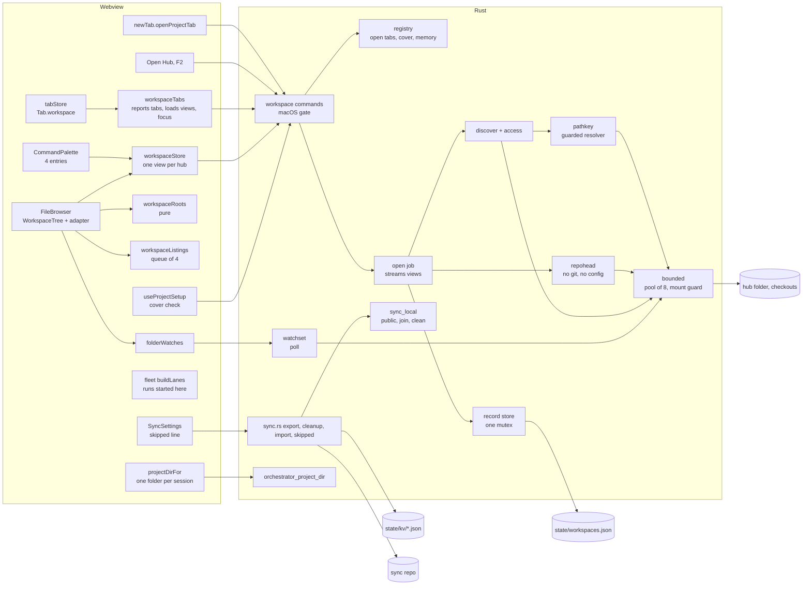
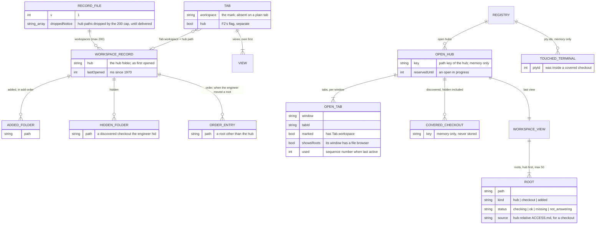

# Workspaces (F4): technical design for slices S0 and S1

- **Status:** Proposed, revision 3 (2026-11-15). Revision 1 was BLOCKED by its adversarial review (four blockers, sixteen majors, eleven minors). Revision 2 (3c9354a) closed every revision 1 blocker and most majors; its delta review was BLOCKED on three new blockers, four new majors and twelve new minors. This revision answers each of those (section 23) and builds in the owner's answers of 2026-11-15 to OQ-14 to OQ-21. Not approved. A delta review follows.
- **Owner:** architect.
- **PRD:** `docs/prd.md` section F4 on branch `prd-workspaces`. **Revision 3.3 is the approved text** (owner, 2026-11-10). **Revisions 3.4 to 3.7** (2026-11-15; 3.7 is bae3e5f) are pending the owner's approval of their text; this design is built against 3.7, and section 21 reconciles it with 3.7 row by row. Where the PRD leaves a choice to the architect, the choice is made here and marked **(architect)**. Where a choice belongs to the product manager, the designer or the owner, it is listed in section 19 with a recommendation, the PRD's literal text is the default built, and the recommended case is designed too.
- **Owner decisions this design builds on:**
  - 2026-11-15, revision 1's Q1 (review finding B3): **strip all paths.** An orchestrator session's `projectDir` and an agent-tracker entry's `cwd` are never synced, for anyone, hub or not. Each machine keeps its own.
  - 2026-11-15, **OQ-14 to OQ-21, each as recommended**: the repository's current files are cleaned of those two fields (OQ-14); a skipped key is shown in Settings → Sync on the machine that skipped it (OQ-15); git history is not rewritten (OQ-16); a release-note item, for devops (OQ-17); per-task Dispatch makes the folder first, one folder per session, nothing starts if that fails (OQ-18 (i)); **S0 ships ahead of S1 on every OS with all four rules and the Dispatch and fleet fixes** (OQ-19); a recorded `projectDir` that is not a folder counts as none (OQ-21).
  - 2026-11-15, **OQ-20 (b′)**: the fleet joins a run to a live pane only when this instance started it in this launch, **and** the agent picker and the board's `dispatchAgent` record the run's `cwd` at start, as orchestrator dispatch already does. The PRD (3.7) carries (b); the product manager is recording the answers and (b′).
- **Scope:** slice **S0** (the two sync rows, every OS, ahead of S1) and slice **S1** in full. Slice S2 (recents, live refresh) only as far as S1 must not block it (section 16).
- **Decisions (all Proposed; numbers provisional until merge, see the decision log's numbering notes):**
  - `0037-the-workspace-record-is-one-rust-owned-local-file.md`
  - `0038-a-workspace-is-the-folders-of-one-hub.md` (OQ-1)
  - `0039-a-finished-hub-is-read-from-the-repository-files-without-git.md`
  - `0040-sync-splits-shared-keys-into-a-public-and-a-local-part.md` (revised in revision 3: the scope of each rule, per row)
  - `0041-workspace-file-system-calls-run-in-one-bounded-pool-guarded-by-mount.md` (revised in revision 3: a bound per call, charging by device, a path mark before a mount mark)
- **Contracts:** `.ade/context/workspaces.md` and `.ade/context/sync-local-fields.md` (shared with F2; it also holds S0's fleet and Dispatch contracts).
- **UX:** the F4 UX spec is on branch `ux-f4` and is being revised on another machine; this design does not edit it. Section 18 answers each item of its section 22; D-5 (section 19) is new.
- **Code read:** every statement about "today's code" was read from `origin/main` at **84389eb**. File and line references are to that commit. Anything not checked is marked **unverified**. Nothing in this revision was compiled or run on a Mac.
- **Public repository:** the agent hub template is private. This document names its files and folders as the PRD does (`hub.conf`, `ACCESS.md`, `projects/`, `ops/`, `bin/setup`, `bin/doctor`) and describes its behaviour only. No test runs the template.

## 1. Summary

- **Slice S0 ships first, on every OS, with no hub, no workspace and no F2 code** (OQ-19). It is three stories: the two sync rows with their import, never-take, unreadable, cleanup and skipped-key rules (w12a); the fleet's join of runs to live panes (w12b); and Dispatch making the project folder first (w12c). Section 9.
- **Everything else that touches the disk is in Rust**, in `src-tauri/src/workspace/` and `src-tauri/src/pathkey.rs`. The webview holds a derived view per hub in memory and never compares two paths itself.
- **Every file-system call F4 makes on a hub's paths is bounded on its own: 2 seconds per system call**, not per job. Each call is made through a descriptor of the folder already resolved, follows no link, and is charged to the file system it really enters: by the folder's device, or by the mount table when the child is a mount point. A blocked call marks its **path** stuck; a **mount** is marked only when its mount point blocks or two unrelated paths on it do. When a mark lifts, what was shown "not answering" because of it is checked again. The pool and the mount table are values in Tauri managed state, so each test builds its own (section 7, ADR 0041).
- **Opening a workspace streams.** The first view is published at once (the hub's root, checking). Roots are published as their checks finish under a higher `gen`. Each root, each `ACCESS.md` and the finished-hub check has a 2-second deadline for its answer, which shows "not answering" and marks nothing. Discovery as a whole stops after 10 seconds (section 7.6).
- **The workspace record is one file that Rust owns**, `<app data>/state/workspaces.json`, outside `state/kv/`, so no key list can export it (ADR 0037).
- **Discovery is a Rust parser with a hand-written frozen fixture**, capped at 200 work folders and 500 candidate rows per hub.
- **The finished-hub check reads the repository's files and starts no process** (ADR 0039). It follows no link inside `.git`. It does not read: reftable refs, objects reached only through alternates or a partial clone, pack index version 1, a `.git` that is a file or a link, a link inside `.git`, more than 200 packs, a delta chain deeper than 64, a `packed-refs` over 16 MiB, or an object over its size cap. Each is reported as "check failed" with its reason, never as finished.
- **The sync strip needs no knowledge of workspaces, and each of its rules has a scope per row** (section 9.2). The never-take rule, the unreadable rule, the cleanup and the skipped-key notice cover only the orchestrator's `projectDir` and the agent tracker's `cwd`. The tab-set row keeps this machine's F2 fields and is otherwise today's import; `ade-session` exports an allowlist for marked and hub tabs.
- **No automatic setup in a covered checkout while the covered set may be partial:** the cover check answers `unknown` until the main window has reported its tabs and until every open hub's discovery is final (section 10).
- **The workspace mark is `Tab.workspace`**, the hub folder's path, separate from F2's `Tab.hub`. A registry in Rust knows which workspaces and hub tabs are open in which window. It serves bring-forward (D7) and the automatic-setup check (WS-1 AC8).
- **The multi-root tree is F4's own component, listing cache and watch set.** It never passes roots to F3's `fileBrowserStore.show`. What differs between "before F3 S1" and "with F3 S1" is listed file by file (section 11.4).
- **Folder watches are a bounded poll** of the expanded folders' timestamps, at most 500 per window, every 2 seconds. No operating-system watch is set (section 11.5).
- **F4's workspace features are gated to macOS in one place** in Rust and one in the webview (section 13.5). S0 is not gated.
- **Sixteen stories.** Three form S0 and need nothing. Thirteen form S1; twelve of them do not need F2, and the thirteenth carries every F2 seam and waits for F2 slice 1 (section 17).

## 2. Where things stand (origin/main 84389eb)

| Area | Today | Where |
|---|---|---|
| File browser root | One root, `rootPath`, set from a 3-second poll of the own view's active pane | `src/stores/fileBrowserStore.ts:24`, `:119`; `src/components/FileBrowser.tsx:153`, `:156` to `:181` |
| File browser watch | One recursive watch of the root; `watch_directory` is a main-thread command | `FileBrowser.tsx:202`; `src-tauri/src/watcher.rs:151`, `:200` |
| A tab | No flags | `src/stores/tabStore.ts:54` to `:82` |
| What tab operations copy | `ClosedTab` is `{ name, cwd, color }`, and Reopen opens at that `cwd`; `SerializedTab` is `id`, `name`, `type`, `root`, `activePaneId`, sent in the new window's URL; Duplicate calls `addTab(name, cwd)` with the tab's current folder | `tabStore.ts:139`, `:409` to `:416`, `:460` to `:466`; `src/lib/detachWindow.ts:7`, `:33` to `:46`; `src/components/TabBar.tsx:139` |
| Saved session | `ade-session`. A terminal tab's saved record holds `id`, `name`, `type`, `root`, `activePaneId`, `color`, and `subViews` and `shownView` when it has sub-terminals. A saved pane holds `id`, `serializedBuffer`, `savedCwd`. `SavedTab.previewPath` is declared and restored, but `saveSession` writes none today | `tabStore.ts:626` to `:659`, `:667` to `:684`, `:761` to `:778`, `:886` |
| A detached window | Mounts the pane container and the scratchpad only: no file browser, no command palette, no toast | `src/DetachedApp.tsx:1` to `:9`, `:98` to `:103` |
| Disk state | One JSON file per `localStorage` key under `<app data>/state/kv/`; snapshots copy `kv/` only | `src-tauri/src/state.rs:10` to `:12`, `:229` |
| Sync export | Reads only `SHARED_KEYS` and `DEVICE_KEYS` from `kv/`. A key is rewritten only when its value differs **and** the local file is newer than the repo copy | `src-tauri/src/sync.rs:36` to `:47`, `:88` to `:96`, `:260` to `:282` (the test is `:272`) |
| Sync import | For each shared key whose repo copy is newer, replaces the whole local value and puts back only secret fields. Device keys are never imported | `sync.rs:285` to `:300` |
| Sync order and budgets | One run: pull, export, commit, push, then import. The import is skipped past the startup deadline (6 s minus 500 ms); closing waits at most 4 s | `sync.rs:510` to `:556`; `src/lib/sync.ts:20`, `:84`; `src/App.tsx:136` |
| Orchestrator sessions | A bare array under `better-terminal-orchestrator`; each has `id` and an optional `projectDir`. **Dispatch all** makes a project folder for a session with none, sets it and writes `SPEC.md`; **per-task Dispatch** passes `session?.projectDir`, so for a session with none its agent starts in the home folder without the spec line. Generation also makes the folder, after `setTasks` | `src/stores/orchestratorStore.ts:31` to `:38`, `:63` to `:67`, `:139`; `src/components/OrchestratorTab.tsx:56`, `:196` to `:208`, `:250`, `:325`, `:385` to `:406`, `:739` |
| The fleet | `buildLanes` takes each tracker entry's tab, tab name and folder from the live pane with the same `paneId`, before the entry's own `cwd`; cost follows the lane's folder and time. Pane ids are `pane-${n}`, per page | `src/stores/fleetStore.ts:133` to `:168`, `:209`; `src/hooks/useFleetData.ts:133` to `:185`; `tabStore.ts:219` to `:220` |
| Runs with no folder | The agent picker and the board's `dispatchAgent` start tracker entries with no `cwd`; orchestrator dispatch records one | `src/components/AgentPicker.tsx:250` to `:256`; `src/lib/agentLaunch.ts:91`; `OrchestratorTab.tsx:355` to `:363` |
| Sync's local state | `sync-state.json` in the app data folder, never in the repo; the webview keeps the last `SyncReport`, replaced by each run | `sync.rs:130`, `:574`; `src/lib/sync.ts:57` |
| Agent tracker | A bare array under `better-terminal-agent-tracker`; entries have **no id**; `cwd` is optional | `src/stores/agentTrackerStore.ts:6` to `:29`, `:41` to `:51` |
| Tab sets | `WorkspacePreset { id, name, tabs: { name, splits }[], savedAt }`, a bare array under `better-terminal-workspaces`; save and delete only | `src/stores/settingsStore.ts:334` to `:342`, `:522` to `:538` |
| Automatic project setup | One hook, in the main window only, fed the **active tab's own-view folder** and nothing else | `src/hooks/useProjectSetup.ts:165`, `:186` to `:276`; `src/App.tsx:95` to `:100`, `:180` |
| Pane folders | Each terminal pane polls its folder; `get_pty_cwd` reads the foreground process's folder from the process table (`cwd_of`), and falls back to `/usr/bin/lsof` without `-b` | `src/components/TerminalPane.tsx:67`; `src-tauri/src/pty.rs:518` to `:532`, `:678` to `:720`, `:768` |
| Listing a folder | `list_directory` lists with `read_dir` and calls `entry.metadata()` (an `lstat`) on every entry; its error message holds the path | `src-tauri/src/lib.rs:74` to `:105` |
| Opening a folder as a tab | `openProjectTab(path)` asks its setup questions before it opens the tab | `src/lib/newTab.ts:82` to `:120` |
| Toasts | 4 s, or 15 s with an action; main window only | `src/hooks/useContextGuard.ts:15` to `:41`; `App.tsx:174` to `:180` |
| Platform constants | `platform::IS_MACOS` in Rust; `IS_MAC` in the webview | `src-tauri/src/platform.rs:16`; `src/lib/shortcuts.ts:14` |
| CI | `backend` (Linux), `backend-macos` (display name `Backend on macOS (cargo test)`) and `backend-windows` (`cargo check` and `cargo test`) | `.github/workflows/ci.yml:93`, `:136` to `:138`, `:222` to `:249` |
| `serde_json` | No `preserve_order`: a value written back by Rust has its keys sorted | `src-tauri/Cargo.toml`; `src-tauri/src/claude_settings.rs:5` |
| F3 S1 | **Tickets on `main`, no code.** Story `s1c` builds `fileBrowserStore.show(key, roots[])` with "one `watch_directory` per root, started and stopped by show" (its item 6) and carries F4 WS-5 AC2 as conditional item (11) | `_bmad-output/initiative-per-view-viewer/epic-slice-1-viewer-state/tickets.toml`; `.ade/context/f3-merges-second.md` |
| F2 | **Nothing built.** Design revision 7 on `onboarding-arch` (PR #101), not approved | section 15 |

## 3. Components



Sync does not touch the workspace modules: `sync_local` reads no record, runs no discovery and asks no registry. S0's three parts (the fleet, `projectDirFor`, the skipped line) touch no workspace module either.

### 3.1 Modules

| Module | New or changed | Responsibility | Tested by |
|---|---|---|---|
| `src-tauri/src/pathkey.rs` | new (or moved, section 6) | The path rule: a guarded resolver, one key per folder, `inside`, `same` | Rust, every CI OS; `macos_only` for the volume's own answers |
| `src-tauri/src/workspace/bounded.rs` | new | `Bounded`, a value in managed state: workers and spares, the per-call bound and its watchdog, charging by device and mount point, path and mount marks, recovery and its listener, the mount table and its refresher | Rust, every CI OS, each test with its own `Bounded`, fake file system and fake mount table; `macos_only` for firmlinks and a real mount point |
| `src-tauri/src/workspace/access.rs` | new | The table-row parser. Pure | Rust; the frozen fixture |
| `src-tauri/src/workspace/discover.rs` | new | Files and their order, bounded reads, `~`, too broad, duplicates, the caps | Rust; `macos_only` for case, NFC and `~/Library` |
| `src-tauri/src/workspace/repohead.rs` | new | The finished-hub check | Rust (fixtures built with `git`: `cfg(unix)`) |
| `src-tauri/src/workspace/record.rs` | new | The record file: read, validate, write, retention, the hand changes, the format fixture | Rust |
| `src-tauri/src/workspace/assemble.rs` | new | Pure: discovery + record → roots, hidden list, notices | Rust |
| `src-tauri/src/workspace/open.rs` | new | The open job: check, discovery, record, assemble; publishes views by `gen`; the deadlines | Rust; `macos_only` for the 1-second test |
| `src-tauri/src/workspace/registry.rs` | new | Open tabs per window, reservations, most recently used, the covered set, the terminal sampler | Rust |
| `src-tauri/src/workspace/watchset.rs` | new | One poll set per window | Rust, every CI OS |
| `src-tauri/src/workspace/testhub.rs` | new, `cfg(test)` | The marker-fixture builder and its "nothing changed" assertion (section 17.3) | used by the tests of w3, w5, w9 |
| `src-tauri/src/workspace/mod.rs` | new (w2 declares every module) | The commands, the events, the platform gate (section 13) | Rust |
| `src-tauri/src/sync_local.rs` | new (w12a rows 1, 2; w13 rows 3, 4) | `public`, `join` and `clean`, row by row (9.2, 9.3) | Rust, every CI OS |
| `src-tauri/src/sync.rs` | changed (w12a; w13) | `value_for_repo`, the cleanup, `import_state`, `SyncState.skipped`, `SyncReport.skipped_keys` | Rust; the two-machine tests |
| `src-tauri/src/orchestrator_dir.rs` | new (w12c) | `orchestrator_project_dir`: the recorded folder if it is one, else a new one (9.9) | Rust, all three CI jobs |
| `src-tauri/src/pty.rs` | changed (w11) | `quick_cwd(id)`: ids under the PTY lock, `cwd_of` outside it, no `lsof` | Rust |
| `src-tauri/src/lib.rs` | changed | Registers the commands and the managed state (`Bounded`, the registry, the record store); clears a window's entries when it is destroyed. `list_directory` is not changed: `workspace_list` has its own bounded listing (11.4) | Rust string test |
| `src/stores/tabStore.ts` | changed | `Tab.workspace`; `addWorkspaceTab`; the mark in `ClosedTab`, `SavedTab`, Duplicate; `markRunTab` (w14) | vitest |
| `src/lib/detachWindow.ts`, `src/DetachedApp.tsx` | changed | `SerializedTab.workspace`; the detached window starts `workspaceTabs` and mounts the tab notice bar | vitest |
| `src/lib/workspaceTabs.ts` | new | In every window: reports this window's workspace and hub tabs, **loads each hub's view**, applies a focus event | vitest |
| `src/stores/workspaceStore.ts` | new | One `WorkspaceView` per hub, in memory; drops stale answers by `gen` | vitest |
| `src/stores/tabNoticeStore.ts`, `src/components/TabNoticeBar.tsx`, `src/lib/announce.ts` | new unless F2 slice 1 built them first | Per-tab notices above the terminal, in a fixed order, never saved; one polite live region (section 18, items 4 and 5) | vitest |
| `src/lib/workspaceRoots.ts` | new | Pure: labels, which roots a view shows, the extra root | vitest |
| `src/lib/visibleText.ts` | new | Shows bidi and control characters escaped | vitest |
| `src/lib/workspaceListings.ts` | new | F4's listing cache: by path, a queue of at most 4 `workspace_list` calls, results tagged by `gen`, every rejection caught | vitest |
| `src/components/WorkspaceTree.tsx` | new | Root rows and their trees. Presentational | vitest |
| `src/lib/workspaceTreeState.ts` | new | Where `expanded` and the active folder come from: per tab (WS-5 AC1) or F3's viewer state (WS-5 AC2) | vitest; the swap of 11.4 |
| `src/lib/folderWatches.ts` | new | Keeps the window's poll set equal to the folders on screen | vitest |
| `src/components/FileBrowser.tsx` | changed | Renders `WorkspaceTree` when the view in sight shows a workspace; unchanged otherwise | vitest |
| `src/components/CommandPalette.tsx` | changed | Four entries, present only for a workspace tab | vitest |
| `src/lib/newTab.ts` | changed | `openProjectTab` asks `workspace_resolve` first | vitest |
| `src/hooks/useProjectSetup.ts`, `src/App.tsx` | changed | The cover check before any automatic setup (section 10) | vitest |
| `src/stores/agentTrackerStore.ts` | changed (w12a, w12b) | An optional `id` on new entries (9.3); `startedHere` and `startedThisLaunch` (9.8) | vitest |
| `src/stores/fleetStore.ts`, `src/hooks/useFleetData.ts` | changed (w12b) | `buildLanes`'s `joinable` (9.8) | vitest |
| `src/components/AgentPicker.tsx`, `src/lib/agentLaunch.ts` | changed (w12b) | record the run's `cwd` at `startSession` (9.8) | vitest |
| `src/lib/orchestratorProjectDir.ts`, `src/components/OrchestratorTab.tsx` | new; changed (w12c) | `projectDirFor`; its three callers (9.9) | vitest |
| `src/components/SyncSettings.tsx`, `src/lib/sync.ts` | changed (w12a) | `SyncReport.skippedKeys` and its line (9.5) | vitest |
| `src/components/SettingsPanel.tsx`, `SyncSettings.tsx`, `Tour.tsx`, `docs/guide/settings.md`, `docs/guide/sync.md` | changed | The Tab Sets relabel (WS-10) | vitest; the scan |
| `scripts/workspaceWord.test.ts` | new | WS-10 AC2's scan | vitest |

Why Rust for discovery **(architect)**: its reads must be bounded and guarded (WS-9 AC2, AC3), which the webview cannot do; the path rule needs `realpath`, the volume's case rule and Unicode folding; the cover check must see workspaces open in other windows; and one implementation means the frozen fixture pins the only parser there is. The cost: every change of what the file browser shows goes through a command.

## 4. Data model



`ROOT.kind` has three values, as the TypeScript type has. The extra root of WS-5 AC3 is not in a view: it comes from `workspace_locate` and exists only as a row of the tree (`RootRow.kind: "outside"`, section 11.4).

Stored on disk by F4: the record file, and one field on saved tabs (`workspace`) in `ade-session`. `ClosedTab.workspace` is memory. `SerializedTab.workspace` is a URL parameter of the new window (section 13.1). Discovered checkouts, the registry, the covered set, the touched terminals and the views are memory only.

### 4.1 The record file

`<app data>/state/workspaces.json`, resolved from `state::state_dir(app)` (`state.rs:229`), and through F1's `ProfilePaths` once that exists.

```json
{
  "v": 1,
  "workspaces": [
    {
      "hub": "/Users/dev/hubs/acme-backend",
      "added": ["/Users/dev/notes/acme"],
      "hidden": ["/Users/dev/Project/acme-legacy"],
      "order": ["/Users/dev/Project/acme-web", "/Users/dev/Project/acme-api", "/Users/dev/notes/acme"],
      "lastOpened": 1763200000000
    }
  ],
  "droppedNotice": []
}
```

- **Paths are stored as text, compared by key.** Keys are not stored: a key depends on the volume's case rule, which can differ after a restore to another disk. `hidden` holds the path exactly as the hub's file gave it after `~` expansion, so it equals the row's text while the row is unchanged (this matters in 5.6).
- **`order`** is empty until the engineer moves a root. A move writes the whole current sequence of roots other than the hub folder.
- **A record has hand changes** when `added`, `hidden` or `order` is not empty (WS-6 AC2).
- **No names** from `hub.conf` or the tables' other columns (WS-7 AC4).
- **`droppedNotice`** holds the hub folders of records the 200 cap dropped. It is emptied when a published view has carried the notice (section 18, item 19, which also gives the other choice).
- **Writing.** `state::atomic_write` (`state.rs:63`), under the store's mutex, from Rust only.
- **The format fixture** (WS-6 AC2's last test) is `src-tauri/src/fixtures/workspaces/record-v1.json`.

**Reading, and every outcome of it:**

| The file | What F4 does |
|---|---|
| Absent | No records. Normal on first use |
| Parses, `v` is 1 | Each field is validated: a path that is not an absolute string without U+0000 is dropped; `lastOpened` that is not a non-negative safe integer becomes 0; more than 200 records keep the 200 most recently opened |
| Does not parse, or `v` is missing or not a positive integer | Moved aside as `workspaces.json.unreadable-<ms>`. F4 starts with no records. Every view carries the notice `record_unreadable` until the first successful write. Hand changes made before are in the moved file, not applied |
| `v` above the reader's (a newer build wrote it) | **Read-only for this run.** Nothing is read from it and nothing is written, so an older build cannot destroy a newer build's records. Workspaces still open, from discovery alone: hidden checkouts are shown, added folders and a saved order are not applied. Every view carries `recordState: "read_only"` and the notice `record_newer`. The four hand-change commands refuse with `record_read_only`, and the palette offers only Refresh (as for a hub that is not finished). `lastOpened` is not stamped and retention does not run |
| Cannot be read for another reason (permission, I/O error) | As the row above, with the notice `record_unreadable`: read-only for this run, nothing written, nothing moved |
| A write fails (disk full) | The command answers `not_saved`, the view is not changed, and the tab shows the notice `not_saved` |

A hidden checkout shown again in the read-only cases is shown on this machine only. It is still covered by WS-1 AC8 (the covered set comes from discovery, not from the record) and no synced key depends on the record (section 9).

### 4.2 Why one Rust-owned file (ADR 0037)

| Option | Why not |
|---|---|
| A `localStorage` key in `PERSISTED_KEYS` | Every window holds its own copy of each store and writes whole values (`persistence.ts:141`). A workspace tab can be moved to its own window, so two windows would write the record. And a key in `kv/` is one edit of `SHARED_KEYS` away from syncing |
| One file per hub | Retention needs them all |
| A field of `ade-session` | `ade-session` is exported (`sync.rs:47`) and rewritten whole every few seconds |

The record is not in snapshots (`state.rs` copies `kv/` only). The PRD allows either (WS-7 AC2).

### 4.3 Retention (WS-6 AC2)

A pure function, `retain(records, open_hub_keys) -> (kept, dropped_by_cap)`, run after an `open` or `restore` has stamped `lastOpened`:

1. A record with no hand changes, whose hub has no open workspace tab, and which is not among the 10 most recently opened, is dropped.
2. If more than 200 remain, the least recently opened records whose hub has no open workspace tab are dropped until 200 remain, and their hub folders are appended to `droppedNotice`.
3. Nothing else drops a record. The hub's state is never an input.

S2's recent list is the 10 most recently opened records of this store (section 16).

## 5. Discovery

### 5.1 The parser (`access.rs`)

`parse_rows(text: &str) -> Vec<Row>`, where `Row { line: usize, cell: String, section: Option<String> }`. Pure, no I/O.

1. A leading U+FEFF is dropped. Lines end at `\n`; a trailing `\r` is dropped.
2. A line whose first character is `#` is a heading. `section` of the rows after it is the heading's text without the `#` characters, trimmed and lower-cased, until the next heading.
3. A line is a table row when its **first character** is `|`. Leading spaces disqualify it.
4. Cells are split at `|`, except that `\|` is a literal `|` (m11). No other escape is read.
5. The cell is the second cell, trimmed of spaces and tabs. A row with fewer than two cells is not a checkout row.
6. A row is a **checkout row** when that cell starts with `/` or `~`. Header rows, separator rows, empty cells, `(none, works in the hub)`, `$HOME/x`, `./x` and a cell in backticks are not, and produce nothing.

**Which rows count** is one constant, `RowRule`:

- `Anywhere` (**the default built: the PRD's literal text**, F4.1 "anywhere in one of the `ACCESS.md` files"): every checkout row, whatever its section.
- `CodeSection` (recommended, question P-6): only rows whose `section` is `code`. A row appended below the Code table is still in that section until the next heading, so the PRD's "a row appended below the table counts" holds.

Why it is a question: a hub's `ACCESS.md` has other tables, and their second cell can start with `/` or `~`. Under `Anywhere` each such row becomes a root and a covered folder. The fixture has one such row, so the rule in force is pinned either way.

`expand(cell, home) -> Candidate | Unread`:

- `~` alone → `home`; `~/rest` → `home/rest`;
- any other `~…` (`~bob/x`) → `Unread`;
- a cell holding U+0000 → `Unread`;
- anything else starting with `/` → the cell as written.

`home` is a parameter: the commands pass ADE's home (`HOME` first, as `get_home_dir` does, `lib.rs:223`); tests pass their own.

### 5.2 Which files, in which order (`discover.rs`)

1. `<hub>/ACCESS.md`.
2. `<hub>/projects/<name>/ACCESS.md` for each folder directly under `projects/`, in name order.
3. `<hub>/ops/<name>/ACCESS.md` for each folder directly under `ops/`, in name order.

Name order is by Unicode code points after NFC (WS-1 AC1). Never recursive. A work folder with no `ACCESS.md` is skipped silently.

**Caps** (the first is the PRD's; the second is new, question P-13):

| Cap | Value | Over it |
|---|---|---|
| Work folders read, across both groups | 200 | the rest skipped, notice `work_folders_skipped` |
| Candidate rows per hub, in reading order, after dropping rows whose expanded text repeats an earlier one | 500 | the rest not checked, notice `rows_over_limit` with the count |

So one discovery makes at most 2 listings, 201 file reads and 500 candidate checks, each one job in the pool of section 7. A 1 MiB file with tens of thousands of rows costs its parse and nothing more.

### 5.3 Reading a file (WS-9 AC2, WS-1 AC7)

On Unix, one pool job per file, every call of it made as section 7.2 says:

1. **Resolve the file's folder** with the guarded resolver (section 6), from the hub's own resolved descriptor: `<hub>`, or `<hub>/projects/<name>`, or `<hub>/ops/<name>`. A link on the way is read and its target resolved component by component, each call charged to the file system it enters. Revision 2 opened the path and let the kernel follow links (review N-B1).
2. **Look at the name** with `fstatat(folder, "ACCESS.md", AT_SYMLINK_NOFOLLOW)`. A symbolic link is read with `readlinkat` and its target resolved the same way, at most 40 links in all; then step 3 runs on the target's folder and name. Anything that is not a regular file is **unreadable** ("not regular").
3. **Open it** with `openat(folder, name, O_RDONLY | O_NONBLOCK | O_CLOEXEC | O_NOFOLLOW)`. `O_NOFOLLOW` makes a name that became a link after step 2 fail (`ELOOP`) instead of being followed; that is **unreadable** ("other"). A FIFO with no writer returns at once and a device does not wait.
4. `fstat` the descriptor: anything but a regular file is **unreadable** ("not regular").
5. Read at most 1 MiB + 1 byte, in reads of 64 KiB, each one call. More than 1 MiB is **unreadable** ("too large").
6. The bytes must be valid UTF-8, all of them.

A call blocked past its bound, or the job past its 2-second deadline (7.6), is **unreadable** ("not answering"). Only the first marks anything (7.3). An unreadable file costs only its own rows.

Off Unix (section 13.5) the function is `symlink_metadata` (regular file), then `File::open` and the same capped read. F4 is not offered there; this exists so the module compiles and its pure tests run.

### 5.4 From rows to candidates

One pool job per candidate, on the candidate's text:

1. Its **path key** by the guarded resolver (section 6), and, with the resolved path, whether it is an existing folder.
2. **Too broad** (WS-9 AC5): the key is `/`; or the home folder; or a volume root (the key is a mount point in the mount table of 7.2); or contains ADE's own data (the key is a component prefix of the key of `app_data_dir()`, `app_local_data_dir()`, `app_cache_dir()` or, on macOS, `~/Library/WebKit/<bundle identifier>`). A too-broad candidate gives no root and is counted per file.
3. **Duplicate** (WS-1 AC3): a key already seen, or the hub folder's own key, is dropped. The first position wins.
4. **Status:** `ok` (an existing folder), `missing`, or `not_answering`.

**A candidate whose key could not be computed** (the job did not answer, or its mount is stuck) has `key: None` and status `not_answering`. It is a duplicate only of an earlier row with the same expanded text. It is never too broad by key; it is too broad by text when its lexically normalised text is `/` or the home folder.

```rust
pub struct Discovery {
    pub checkouts: Vec<Checkout>,        // in order; duplicates and too-broad ones removed; not capped at 50; hidden ones included
    pub unread_rows: Vec<FileCount>,     // ~user and NUL rows, per hub-relative file
    pub too_broad: Vec<FileCount>,       // per hub-relative file
    pub unreadable: Vec<FileProblem>,    // { file, why: Permission | NotRegular | NotUtf8 | TooLarge | NotAnswering | Other }
    pub work_folders_skipped: usize,
    pub rows_over_limit: usize,
    pub cut_short: bool,                 // the 10-second deadline of 7.6 was reached
    pub complete: bool,
}
pub struct Checkout { pub path: String, pub key: Option<PathKey>, pub status: Status, pub file: String /* hub-relative */, pub line: usize }
```

**`complete`, one definition.** A `Discovery` exists only when the hub folder was found to be a finished hub; a missing or unfinished hub has no discovery, so the word does not apply to it. `complete` is true exactly when all of these hold: the listing of `projects/` and of `ops/` each succeeded or answered "does not exist"; every `ACCESS.md` that exists was read; no work folder was skipped; no row was over the limit; and the run was not cut short. It is used in one place only, the cleaning of 5.6. Sync does not use it.

### 5.5 The frozen fixture (WS-1 AC2, D10)

Checked in under `src-tauri/src/fixtures/workspaces/hub-rules/`, written by hand, never generated and never compared with the template:

- `ACCESS.md`, `projects/b/ACCESS.md`, `projects/a/ACCESS.md`, `ops/a/ACCESS.md`, holding between them rows with: `/abs/acme/api`; `~`; `~/rel`; `~bob/x`; `$HOME/x`; `./x`; `(none, works in the hub)`; an empty cell; a header row; a separator row; a row appended after the Code table; a row whose cell is `/abs/we\|ird`; one row each whose folder name holds U+202E, U+2066, U+200F, U+0007 and U+0085; the same path twice; and **one row of another table, under another heading, whose second cell is `/abs/other-table`** (the row rule).
- `expected.json`, written by hand: the checkouts in order (file, line, path with `<home>` for the test's home), the unread rows and the too-broad rows per file. Under `RowRule::Anywhere` it lists `/abs/other-table` as a checkout; if P-6 is answered the other way, the file is edited by hand and the constant changed in the same commit.

The test runs `discover` on the fixture with a temporary home and asserts the output equals `expected.json` field for field. A second test runs `parse_rows` alone on each file. No folder of the fixture exists on any machine, so every status is `missing`; statuses are covered by the tests that build real folders.

### 5.6 Assembling the roots (`assemble.rs`)

`assemble(hub, hub_status, discovery, record, limits) -> WorkspaceView`, pure:

1. Start with the hub folder.
2. Add each discovered checkout that is not hidden, in discovery order.
3. Add each added folder not already present **and not hidden**, in add order, each with its own status. Hidden wins: a folder that is both a hidden checkout and an added folder gives no root.
4. **The 50 limit (WS-9 AC1), by the PRD's rule:** "discovered checkouts past 50 are not shown". When the hub, the discovered checkouts that are not hidden and the added folders number more than 50, **discovered checkouts** are left out, from the end of the discovery order, until 50 remain. The hub and the added folders are never left out (an add past 50 is refused, so there are at most 49 of them). The paths left out are listed in the notice `not_shown`, so the engineer can see them and hide others to make room. Revision 1 cut by position after ordering, which could cut an added folder.
5. Apply `order` (WS-1 AC1) to the roots that remain. The cut of step 4 was made on the discovery order, so moving a root never changes which ones are left out.
6. `hidden`: the record's hidden paths that the discovery still names.

**Matching a record entry to a discovered row.** By key when both have one; otherwise by text (the entry's stored text equal to the row's expanded text). So a hidden checkout on a mount that does not answer stays hidden: its row has no key, and its text equals the stored one (4.1). The one case that is not held: the row was re-spelled in the hub's file **and** the mount does not answer; then the row shows as a not-answering root until the mount answers. This is stated, not solved.

**Cleaning the record** removes a hidden or `order` entry that nothing matches. It runs only when all three hold: `complete` is true; every discovered checkout has a key; and the entry's own key could be computed. Otherwise nothing is removed (WS-1 AC7, WS-3 AC3). That keeps more than WS-1 AC7 asks ("the hidden entries for paths that file named"): the record may not store which file a path came from (WS-7 AC4), so every hidden entry is kept until a refresh reads every file (question P-12). In the read-only record states of 4.1 nothing is cleaned.

## 6. The path rule

**One function for F2 and F4.** F2's design specifies this rule as the key of its folder registry (F2 design 4.10.1, `registry_key` in `hubmark.rs`). F4 adopts it and gives it a home both features call: `src-tauri/src/pathkey.rs`.

`key(path, home) -> Result<PathKey, NotAnswering>`, run as one pool job:

1. Expand a leading `~` or `~/` with `home`; normalise lexically (`.` and `..`, repeated and trailing `/`).
2. **Resolve, one component at a time (the guarded resolver).** Starting from a descriptor of `/`, for each component `c` of the folder resolved so far, `P`: charge the call to `P/c`'s mount (7.2: its own mount when `P/c` is a mount point in the table, else `P`'s device); if that path or mount is marked (7.3), stop with `NotAnswering`; `fstatat(P, c, AT_SYMLINK_NOFOLLOW)`; if it is a symbolic link, `readlinkat(P, c)` and splice the target in (at most 40 links); if it is a folder, open it with `openat(P, c, O_RDONLY | O_DIRECTORY | O_NOFOLLOW | O_CLOEXEC)` as the next `P`, keeping the device the `fstatat` returned; if it does not exist, stop resolving and append the remaining components as written. Every call is made through the descriptor of a folder that holds no link, so no call follows one, and the device of that folder names the file system the next call enters. Revision 2 charged by the longest mount-point prefix of the text, which a macOS firmlink defeats (7.2).
3. Normalise to NFC (`icu_normalizer` 2.1.1, in `src-tauri/Cargo.lock`).
4. On macOS, when `fpathconf(descriptor of the resolved ancestor, _PC_CASE_SENSITIVE)` is 0, case-fold with CoreFoundation's `CFStringFold` (`core-foundation-sys` 0.8.7, in the lock file; the function is at `string.rs:515` of that crate), then NFC again. A failed `fpathconf` folds. The decision (fold or not, from the volume's answer) is a plain function tested on every OS through a seam for the answer; the fold itself is `cfg(target_os = "macos")` and tested only there (17.5).

- `same(a, b)`: equal keys. `inside(a, b)`: `b`'s key is a **component** prefix of `a`'s. Both compare strings and make no file-system call.
- **Off macOS** the key is steps 1 to 3. F4 is not offered there (13.5).

The review confirmed the three crates and versions in the lock file. Whether making `icu_normalizer` and `core-foundation-sys` direct dependencies leaves the lock file otherwise unchanged is **unverified**; story w2's first step is `cargo metadata --locked`.

**Who builds it.** Whichever of F4 story w2 and F2's story for OB-13 lands first creates `pathkey.rs`. If F2's lands first with the function in `hubmark.rs`, w2 moves it and leaves a re-export. F2's design needs one line saying so (section 15).

**The webview never compares paths.** It compares only strings that Rust returned, for equality, and asks `workspace_locate` (11.3) for everything else.

## 7. Bounds (WS-9 AC2, AC3; ADR 0041)

Revision 2 bounded a **job**. Its delta review (N-B1) showed what that costs: a job made of many fast calls (200 index files, a 1 MiB read, a 500-folder watch tick) could pass 2 seconds on a live mount and mark it stuck, failing every queued job; jobs touched mounts they never declared (an `ACCESS.md` opened through a link, `entry.metadata()` on a mount-point child, a link inside `.git`); on macOS the home folder, the hubs and most checkouts share one volume, so one slow job turned every local root "not answering"; and nothing was checked again when a mark lifted. Revision 3 bounds each **system call**, charges each call to the file system it really enters, marks a path before it marks a mount, and checks again when a mark lifts.

### 7.1 The pool: a value, whose unit of bound is a call

- **`workspace::bounded::Bounded` is a value, not a process-wide pool** (review N-M4). `Bounded::new(config, mounts: Arc<dyn MountTable>, fs: Arc<dyn Fs>)` builds one with its own workers, spares, watchdog and mount-table refresher. The app builds one in `setup`, holds `Arc<Bounded>` in Tauri managed state, and every command passes it down; every function in `workspace/` and `pathkey.rs` that touches the disk takes it as an argument. Each test builds its own, with a fake file system and a fake mount table, so tests that run in parallel in one `cargo test` process share no worker, no spare and no table. A static test asserts that `src-tauri/src/workspace/` and `pathkey.rs` hold no `static` item other than constants, no `OnceLock`, `LazyLock`, `lazy_static!` or `thread_local!`.
- **Hang seams release on drop.** The fake file system's `hang(path)` returns a `HangGuard`; while it lives, calls on that path block; dropping it makes every blocked call return `Err(Interrupted)`. Every test that hangs a call holds the guard in a local, so a failing assertion still releases its threads, and ends by asserting `bounded.parked() == 0` within one second. `Bounded`'s `Drop` stops its workers and the watchdog and does not wait for a parked thread (in production a parked thread can be in a call that never returns).
- **Config:** 8 workers, 8 spares, 4 calls in flight per mount, a bound of 2 seconds per call. Tests pass their own.
- **A job** is what a caller submits: one `ACCESS.md` read, one listing of `projects/` or `ops/`, one candidate check, the finished-hub check, one `workspace_locate`, one listing of a folder in the tree (`workspace_list`), one watch add, one watch tick of one mount's folders. A job runs on a worker and makes every file-system call through its context: `ctx.stat_at(dir, name)`, `ctx.open_at(dir, name, flags)`, `ctx.read(fd, len)`, `ctx.readlink_at(dir, name)`, `ctx.read_dir_batch(dir)`, `ctx.fstat(fd)`. A static test asserts that no file in `workspace/` but `record.rs` (ADE's own file), and not `pathkey.rs`, names `std::fs::`.
- **The bound is per call: 2 seconds from the moment that call is issued.** Time in a queue never counts, and neither do the job's other calls. A watchdog thread looks at each worker's current call every 100 ms. A call that has run for 2 seconds is **blocked**: the job's caller gets `NotAnswering` at once, the worker is parked (7.3) and a spare takes its place. A job that is slow because it makes many fast calls is never "blocked".
- **Deadlines are the caller's, and never mark anything.** Each kind of job has a deadline for its answer (7.6). A job past its deadline answers `NotAnswering` to its caller and is cancelled at its next call (it checks a flag before each). Nothing is marked: the mount answered every call it was asked.
- **At most 4 calls in flight per mount.** A job is always on one mount: the mount its next call is charged to (7.2). Before a call charged to another mount, the job yields its worker and is queued again under that mount, carrying where it was (for the resolver, the folder resolved so far and its descriptor). So the limit counts calls, and a link on the local disk that points into a dead mount is charged to the dead mount.
- **A job queued again keeps its deadline** (review minor 11). The deadline runs from when the job first started running and is never restarted by a move between queues; only the per-call bound starts again, at each call. "One job, one deadline" is now "one deadline per job, one bound per call".
- **Queues, without a cap that refuses** (review minor 6). Each mount's queue is served round-robin by submitter: each open job, each window's listing queue, each window's watch set. Each open job keeps at most 16 jobs queued at a time and submits the next as one ends; a window's listing queue holds at most 4 (11.4); a watch set submits one tick per mount (11.5). So a mount's queue holds at most 16 jobs per open job plus 5 per window, and no job is refused because a queue is full. Fifty hubs restoring on one mount share its 4 calls in turn, so each hub's first roots arrive in step instead of after the other hubs' candidates. Revision 2's cap of 1,024 is gone.

### 7.2 Which mount a call is charged to

The resolver (section 6) walks a path one component at a time from an open descriptor of the folder resolved so far, `P`. Every call is made on one child `c` of `P` through `P`'s descriptor: `fstatat(P, c, AT_SYMLINK_NOFOLLOW)`, `openat(P, c, O_NOFOLLOW | …)`, `readlinkat(P, c)`, `fdopendir` and `readdir` on a descriptor opened that way. **No call F4 makes follows a link**: a link is read and its target resolved component by component, each call charged in turn. A call on `P/c` is charged:

1. **to the mount whose mount point is `P/c`**, when the mount table has one: the `lstat` of a mount point enters the file system mounted there. On macOS each table entry is matched in two spellings, as listed and with a leading `/System/Volumes/Data` removed (see "Firmlinks" below);
2. otherwise **to `P`'s file system**, named by the device (`st_dev`) that the call which resolved `P` returned. A mount is identified by its device. The table gives each entry's device where it can: on Linux `mountinfo`'s major:minor, which is exactly `st_dev`; on macOS `statfs.f_fsid.val[0]`, which is taken to equal `st_dev` and is **unverified**. The guard also learns the link between a mount point and its device the first time a call on that mount point returns. A mount whose two names are never linked is tracked under both; that splits its limit of 4 calls between them and never charges a call to the wrong file system.

`/` is stat'ed once when `Bounded` is built; its device names the first component's file system.

**Every path F4 touches is charged this way** (review N-B1's list):

- an `ACCESS.md` (5.3): its folder resolved, the name looked at with `fstatat`, opened with `O_NOFOLLOW`;
- the finished-hub check (8.1): the hub folder is resolved; inside `.git` nothing is followed at all;
- a listing for the tree (11.4): names and `d_type` from `readdir`, then each entry's size from `fstatat` on the listed folder's descriptor, charged to the listed folder's mount; an entry that is a mount point in the table is charged to its own mount, and when that mount or its path is marked, the call is not made and the entry is listed as a folder;
- a candidate, `workspace_locate`, a watch add, a watch tick: resolved component by component.

**The mount table** is a snapshot of the mounted file systems: on macOS from `getfsstat` with `MNT_NOWAIT`; on Linux from `/proc/self/mountinfo`. One dedicated thread per `Bounded` refreshes it at most once per second, on demand. Callers read the last snapshot and never wait for a refresh. That `getfsstat(MNT_NOWAIT)` never blocks on a dead mount is what its manual page says and is **unverified** here; a refresh that did block would freeze the snapshot and stop nothing else.

**Firmlinks: the review's suspicion is right in mechanism. Checked by reading Apple's documented layout, not by running anything** (this revision was written on Linux). Since macOS 10.15 the startup disk is a read-only system volume mounted at `/` and a data volume mounted at `/System/Volumes/Data`. `/Users`, `/Volumes`, `/Applications`, `/Library`, `/private`, `/opt`, `/usr/local` and a few more are firmlinks from the system volume into the data volume. A firmlink is not a symbolic link: `lstat` reports a folder and `realpath` keeps the `/Users/…` spelling. So for `/Users/dev/x` the longest mount point that is a prefix is `/`, while the file system every call enters is the data volume. Revision 2's prefix match therefore charged every home-folder call to the system volume: wrong, and with no warning. Revision 3 never matches by prefix: rule 2 uses the device, and `lstat("/Users")` reports the data volume's. Rule 1 still compares a path with the table, and a mount made below a firmlinked folder may be listed under its data-volume spelling (from memory, `mount` prints `map auto_home on /System/Volumes/Data/home`; **unverified**), hence the second spelling. A mount point that both spellings miss is still contained: its hang marks its path (7.3), not the volume above it. Tests in `bounded::macos_only` (w2): `lstat("/Users")`'s device is the table's entry for `/System/Volumes/Data`; a disk image attached with `hdiutil attach -mountpoint <home>/<temp>/m` is a mount point by rule 1, and a call on `m` is charged to the image, not to the data volume.

### 7.3 Stuck: a path first, a mount only on more evidence

- **Only a blocked call marks anything.** A slow job, a job past its deadline and a busy queue mark nothing.
- **The path mark.** A blocked call's path, `P/c`, is marked stuck. From then on every call on that path or below it answers `NotAnswering` at once and starts no thread.
- **The mount mark.** The mount the blocked call was charged to is marked stuck when the call's path is that mount's own mount point, or when a **second** call charged to that mount is blocked at a path that is neither on nor below an existing path mark. From then on every call charged to that mount answers at once.
- **Why two steps.** On a Mac, one hang under the home folder is far more likely a dead share mounted at a place the table did not name than a dead startup disk. The path mark answers every other call into that subtree at once, so the share costs one hang, and the volume above it is marked only when two unrelated paths on it hang. A truly dead mount is marked within one bound when its calls in flight block at its mount point or at two unrelated paths, and within two bounds when they all block at one path below it (the path mark, then the next call elsewhere on it).
- **A parked call leaves its mount's count of 4** and is counted against the spares instead. So a hang charged to the local volume (the missed mount point) does not take the volume's slots.
- **Spares.** A parked worker is replaced, up to 8 spares at a time. A dead mount parks at most 4 threads (its calls in flight). **The residual cliff, unchanged:** with three or more mounts dead at once the pool can run short, and when all 8 workers and 8 spares are parked every job answers `NotAnswering` until a mark lifts. Sixteen calls must each be blocked on a file system that never answers. Terminals, tabs and the rest of ADE do not use the pool.

### 7.4 Recovery, and checking again

- **A mark lifts** when a call parked under it returns (its thread rejoins the pool and a surplus spare retires), or when its mount leaves the table (unmounted). Path marks below a mount that leaves the table lift with it.
- **A call parked on a hard-mounted share that never answers never returns.** Its mark stays until the share is unmounted or ADE restarts, and its thread stays parked. Every later call there would hang too, so the mark is the right answer; the thread is counted in the cliff above. Stated, not solved.
- **There is no timer that lets calls into a marked path or mount.** The parked calls are the probes.
- **When a mark lifts, whatever was shown "not answering" because of it is checked again** (review N-B1). `Bounded` tells its listener, the registry, which mark lifted. For each open hub whose last view has, at or below that mark: a hub state `hub_missing` with why `not_answering`, the open job runs again from the finished-hub check (reason `recheck`); a root with status `not_answering`, its status is checked again (one resolution); an `ACCESS.md` that did not answer, it is read again and its rows added. This finishes the open, restore or refresh that met the hang; it is not a new occasion to read the hub's files (WS-1 AC5), and cleaning the record (5.6) still needs a complete discovery. The new view goes out under a higher `gen`, with `ade://workspace-changed` and `ade://workspace-cover-changed` (section 10). Each window's watch set adds again the folders it reported unwatched under that mark (11.5).

### 7.5 Never on the UI thread, never on an async worker

Every F4 command is declared `#[tauri::command] async fn` and does its work inside `tauri::async_runtime::spawn_blocking` (as `sync.rs:615` does), so a wait for a job holds a thread of the blocking pool, not an async-runtime worker, and never the main thread. A Rust string test asserts both for each F4 command, in the style of `watcher.rs:705` to `:720`.

### 7.6 Opening a workspace: the deadlines (WS-9 AC3)

`workspace_open(hub, reason)` starts (or joins) the hub's **open job** and answers at once with the current view. The job then publishes better views, each with a higher `gen`, and emits `ade://workspace-changed { hub, gen }`. Time is counted from the job's start, T.

**The deadline of each job's answer is 2 seconds from when it starts running**, as WS-9 AC3 words it ("every file-system call F4 makes for one root or one `ACCESS.md` … under a 2-second bound"): one root's check, one `ACCESS.md`, one listing, the finished-hub check, `workspace_resolve`, `workspace_locate`, `workspace_list`, a watch add. Past it the answer is "not answering", and nothing is marked unless one of its calls was itself blocked. A watch tick has no deadline (11.5).

| Step | Bound | What is on screen |
|---|---|---|
| The first view | at once | the hub's root with status `checking`; on a refresh, the roots already shown stay |
| The finished-hub check | each call 2 s; the check's answer 2 s (it is one job; its caps are in 8.1). Past it: `Failed(NotAnswering)`; its mount is marked only if a call blocked | the view's state: `ok`, `hub_missing`, `not_finished` or `check_failed` |
| Listing `projects/` and `ops/`, and reading the top-level file | each one job, started together when the check says finished | |
| Reading each work folder's file, then checking each candidate | each one job, queued as soon as it is known | a root appears when its row is known, with status `checking`, and gets its real status when its job answers. Views are published at most every 100 ms |
| The whole discovery | **10 s after the check finished.** Jobs not yet started are cancelled: their files count as unreadable ("not answering"), their roots show `not_answering`, `cut_short` is set and the notice says so | the final view (`final: true`) |

- **No root delays another by more than the bound.** A root whose own job hangs is `not_answering` 2 seconds after that job started, and the others were published as they arrived.
- **The worst case, stated.** The final view comes at most 2 s (the check) + 10 s (discovery) + 2 s (jobs running at the cut) after the check started running. When many hubs restore on one mount, the check waits its turn in that mount's queue first; it is the open job's first submission, so it waits behind other hubs' jobs only, round-robin.
- **The local case.** For a hub with 20 checkouts on a local disk the whole job takes milliseconds. The macOS test of WS-9 AC3 times **the open job from T to its final view**, 20 real checkouts, median of 5 runs after one warm-up run, under 1 second. It is `workspace::open::macos_only`, in story w5.
- **`workspace_resolve`** (before a tab exists) runs the key and the check as one job with one 2-second deadline. No answer is `plain` with `check_failed: not_answering`.

## 8. The finished-hub check (WS-2 AC8, F4.1, ADR 0039)

`repohead::finished_hub(path) -> HubCheck`

```rust
pub enum HubCheck {
    Finished,
    Missing,                       // the folder, or a folder above it, does not exist
    NotHub(NotHub),                // NotAFolder | NoHubConf
    NotFinished(NotFinished),      // NoRepository | NoCommit | NotCommitted | NotAFile
    Failed(CheckFailure),          // NotAnswering | Unsupported(what) | ObjectMissing | Damaged(what)
}
```

`Missing` is only "does not exist". A folder that does not answer is `Failed(NotAnswering)`. Section 11.1 says how each is shown.

### 8.1 What it reads, exactly

The whole check is **one job whose answer has a 2-second deadline** (7.6); each of its calls has its own 2-second bound, and only a call blocked past that bound marks anything (7.3). A check that is merely slow, say over 200 index files on a slow share, answers `Failed(NotAnswering)` at its deadline and marks nothing. No process is started.

**Nothing inside `.git` is followed** (review N-B1). The hub folder `path` is resolved by the guarded resolver (section 6). From then on every file and folder below `path` is opened from its parent's descriptor with `O_NOFOLLOW` (and `O_DIRECTORY` for a folder): `hub.conf`, `.git`, `HEAD`, `refs/…`, `packed-refs`, `objects/…`, `objects/pack/…`. A symbolic link met at any of them is `Failed(Unsupported("link_in_git"))` (or, for `hub.conf` and `.git`, the outcomes below). So the check never enters a file system its folder is not on, other than through a mount point, which the charging of 7.2 handles. **No config file is opened**: not `<path>/.git/config`, not the global or system config, not `.gitattributes`, not a hook.

1. `path` by the resolver: does not exist → `Missing`; exists and is not a folder → `NotHub(NotAFolder)`.
2. `<path>/hub.conf` by **`lstat`**: absent → `NotHub(NoHubConf)`, the cheap exit for an ordinary project folder; present and not a regular file (a link, a folder, a FIFO) → `NotFinished(NotAFile)`. The link is not followed: a hub file never sends the check to another path (D3).
3. `<path>/.git` by `lstat`:
   - absent → `NotFinished(NoRepository)`. **The top-level rule** (F4.1): only the folder's own `.git` is looked at, never a parent's;
   - a regular file (a linked worktree or a submodule) → `Failed(Unsupported("git_file"))`. It is unsupported, not unfinished (question P-8);
   - a symbolic link → `Failed(Unsupported("git_link"))`;
   - a folder → the git folder `G`.
4. **Resolve `HEAD`.** Read `G/HEAD` (at most 1 KiB).
   - `G/reftable` exists → `Failed(Unsupported("reftable"))`.
   - 40 or 64 hex characters → that object id.
   - `ref: <name>`: `<name>` must start with `refs/` and hold no `..` component, no empty component, no U+0000 and no backslash; otherwise `Failed(Damaged("head"))`. Then, at most 5 levels deep: the loose file `G/<name>` (regular, at most 1 KiB), else the line for `<name>` in `G/packed-refs`. A `packed-refs` over 16 MiB → `Failed(Unsupported("packed_refs_too_large"))`. More than 5 levels → `Failed(Damaged("ref_loop"))`. Neither loose nor packed → `NotFinished(NoCommit)`.
5. **Read the object** with that id, at most 5 peels if it is a tag:
   - loose: `G/objects/<2 hex>/<rest>`, inflated with zlib (`flate2`), output capped;
   - else packed: list `G/objects/pack/*.idx`. More than 200 → `Failed(Unsupported("too_many_packs"))`. For each, parse index version 2 by `pread` of the ranges needed; version 1 → `Failed(Unsupported("pack_index_v1"))`. At the offset in the `.pack`, read the entry and inflate. `OFS_DELTA` and `REF_DELTA` entries are resolved against their base; a chain deeper than 64 → `Failed(Unsupported("delta_too_deep"))`;
   - not found anywhere → `Failed(ObjectMissing)`. `G/objects/info/alternates` is not followed and a partial clone's missing objects are not fetched;
   - a commit over 1 MiB or a tree over 8 MiB → `Failed(Unsupported("object_too_large"))`.
6. The object must be a **commit** (else `Failed(Damaged("not_a_commit"))`). Its first line gives the root tree's id.
7. Read the **root tree** the same way and scan it for the name `hub.conf`:
   - mode `100644` or `100755` → `Finished`;
   - another mode (a symbolic link, a folder, a submodule) → `NotFinished(NotAFile)`;
   - absent → `NotFinished(NotCommitted)`. The index is never read.

**A repack under the check.** A persona commits often, and `git gc` replaces packs while they are read. When steps 4 to 7 end in `ObjectMissing` or `Damaged`, or a pack listed in step 5 is gone when opened, the check **runs steps 4 to 7 once more** from a fresh listing, inside the same deadline. The second result stands.

Object ids of 20 and 32 bytes are both read. Hashes are not verified: the check decides what ADE shows and grants nothing.

### 8.2 What it costs

- **An estimated 600 to 900 lines of Rust with their tests**, owned by this project: loose refs, `packed-refs`, loose objects, pack index version 2, pack entries, delta application, commit and tree parsing, the retry. The estimate is not measured.
- **One new direct dependency**, `flate2` (1.1.9 with `miniz_oxide` 0.8.9 is in the lock file; the review confirmed it). That adding it directly leaves the rest of the lock file unchanged is **unverified**; story w3's first step is `cargo metadata --locked`.
- **What it does not read**, each `Failed` with its reason and never `Finished`: reftable refs; objects reached only through alternates or a partial clone; pack index version 1; `.git` as a file; `.git` as a link; a link inside `.git`; more than 200 packs; a delta chain deeper than 64; a `packed-refs` over 16 MiB; an object over its cap.
- **reftable.** The default `git init` of Apple Git 2.50.1 uses the files backend (checked here and by the review). Whether a newer git from another source defaults to reftable is **unverified**. If one does, every new hub made with it is "check failed" until a reftable reader is added. That is a known limit with a detection and a message.
- **Where it can disagree with F2's check** (ADR 0029 on `onboarding-arch`, which runs `/usr/bin/git`). The review ran F2's commands and found they answer finished for: a hub checked out as **a linked worktree** (`.git` is a file), and a `hub.conf` committed as **a symbolic link**. F2's would also answer finished for every unsupported format above. Section 13.2 says what happens to bring-forward in those cases, and section 15 asks F2's design to use this check.

### 8.3 What was rejected

| Option | Why not |
|---|---|
| ADE's own `git` with the dangerous settings overridden, as ADR 0029 does | The criterion is a negative over all of git's configuration. The commands needed run no hook, filter or pager today, but a repository config can also declare a promisor remote, and git then fetches a missing object by starting a transport the config names (**unverified**, from memory of git's lazy fetch). The list of such routes changes with git, and ADE runs whatever git the Mac has. Reading the files makes the criterion true by construction |
| The `gix` crate | A large dependency tree that is not in the lock file, for one question about one file in one commit |
| `git ls-files`, or reading the index | The index holds `hub.conf` after `git add` with no commit |

### 8.4 Tests

In `repohead.rs`. The fixtures are built in a temporary folder by the test's own `git`, with the system and global config neutralised and a fixed identity; a missing `git` is a `panic!`, never a skip. These tests are `cfg(unix)` (Linux and macOS CI); on Windows the module compiles and only its byte-level parser tests run (13.5).

- loose objects and loose refs → `Finished`; after `git gc` → `Finished`;
- **the delta path.** Commit 300 small files and `hub.conf`; delete one file and commit; `git repack -adf --depth=50 --window=50`. The last commit shrinks the root tree, so git stores `HEAD`'s tree as a delta of the larger one. This was run here on Apple Git 2.50.1: `git verify-pack -v` printed the `HEAD` tree with depth 1 and the earlier tree as its base. The test asserts that line first and fails if the tree is not a delta, so the delta path cannot go untested;
- a detached `HEAD`; a symbolic ref to another ref; a SHA-256 repository → `Finished`;
- no commit → `NoCommit`; `hub.conf` untracked → `NotCommitted`; staged only → `NotCommitted`; committed as a link → `NotAFile`; a working-tree `hub.conf` that is a link → `NotAFile`;
- a parent repository that commits `sub/hub.conf`, `sub` with no `.git` → `NoRepository`;
- `.git` a file → `Unsupported("git_file")`; a `reftable` folder; 201 index files; a ref loop; a truncated object → `Damaged`; `HEAD` naming `ref: ../../x` → `Damaged`;
- **the retry:** a file-system seam removes the pack after it is listed and puts the repacked one in place; the check answers `Finished`;
- **the deadline:** a seam that hangs on the third read gives `Failed(NotAnswering)` within 2 seconds and marks that path; a seam that makes each of 300 reads take 10 ms gives `Failed(NotAnswering)` at the deadline and marks nothing;
- **no link followed:** `G/refs/heads` a link to another folder, and `G/objects/pack` a link → `Unsupported("link_in_git")`, and the seam records no call outside `path`;
- a folder with no `hub.conf` returns `NotHub` and the seam records **no** open under `.git`;
- the marker fixture (section 17.3).

## 9. Sync, the fleet and Dispatch (S0, and S1's rows; WS-7 AC3, F2 OB-10 AC2, OB-14 AC5, ADR 0040)

### 9.1 The rule in one paragraph

Some fields of synced keys are **local fields**: they never go to the sync repo, and each machine keeps its own. Which fields are local is fixed by the key and the field's name, or, for `ade-session`, by a field of the same saved tab. **Nothing in sync looks at a workspace, a record, a discovery or a folder.** The export writes the value without its local fields; the import takes the other machine's value and puts this machine's own local fields back onto the entries that are still there. **Every rule beyond that has a scope, and the scope is per row** (review N-B3; PRD 3.7 WS-7 AC3 and F4.9): the never-take rule, the unreadable rule, the cleanup of the repository's current files and the skipped-key notice cover **only the orchestrator's `projectDir` and the agent tracker's `cwd`, in those two keys**. F2's rows (tab sets, `ade-session`) get the PRD's import rule ("keep what this machine holds") and nothing more.

### 9.2 The rows, each rule's scope

| | `better-terminal-orchestrator` (shared) | `better-terminal-agent-tracker` (shared) | `better-terminal-workspaces`, tab sets (shared) | `ade-session` (device: exported, never imported) |
|---|---|---|---|---|
| **Slice, story** | S0, w12a | S0, w12a | S1, w13 (F2 writes the fields: w14) | S1, w13 |
| **Local fields** (the export leaves them out) | `projectDir`, anywhere inside each element of the list | `cwd`, anywhere inside each element of the list | `cwd` and `hub` of each entry of each set's `tabs` (F2's fields: its design gives a hub entry `hub?: true` and `cwd?`; F2 OB-14 AC5: the entry is exported "without its folder", Load on another Mac opens "a plain tab", and this Mac "keeps its own entries' folders and flags") | for a saved tab with `workspace` (F4) or `hub` (F2): every field outside the allowlist of 9.4 |
| **Source** | WS-7 AC3's row; the owner, 2026-11-15 | the same | WS-7 AC3's tab-set row; F2 OB-14 AC5 | WS-7 AC3's two `ade-session` rows; F2 OB-10 AC2 |
| **Readable means** | a JSON array; an element that is not an object is readable and passes as it is (PRD 3.6 m7) | the same | no rule in the PRD: as today | as today: JSON |
| **Local value not readable** | not exported in that run; recorded as skipped (`local_unreadable`) | the same | as today: a value that is not JSON is exported as it is (`value_for_repo`, `sync.rs:88`, returns it); a JSON value that is not an array has nothing removed | as today: not exported (`sync.rs:84` to `:96`), not recorded |
| **Import** | `join` by `id` | `join` by `id`, else `paneId` and `startTime` | `join` by set `id`, set `name` and the entry's index | never imported |
| **Imported value of a local field** | **never taken** | **never taken** | **taken when this machine holds none for that entry** (the PRD's rule for this row is only "keep what this machine holds", F4.9; F2's design may adopt the never-take rule, section 15, F2-2) | |
| **Imported copy not readable** | not imported; this machine's value stays; recorded (`imported_unreadable`) | the same | as today: not JSON or not an array → the whole local value is replaced by it, since there are no entries to keep fields on | |
| **Cleanup of the repo's current file** (OQ-14, yes) | yes: a repo copy that is a list and holds `projectDir` anywhere in an element is rewritten without it; a copy that is not a list is left as it is | yes, for `cwd` | **no** | **no** |
| **Shown when skipped** (OQ-15, yes) | yes, until the key next syncs (9.5) | yes | no (never skipped) | no |

`better-terminal-prompt-history`, `better-terminal-saved-notes`, `ade-scratchpad-draft` and every other key have no local field and no new rule: the engineer's own text (WS-7 AC3's table).

**The flag `hub` (review minor 4), one rule: each of F2's fields follows its own row's text.** In tab sets it is local (F2 OB-14 AC5: Load on another Mac opens a plain tab; this Mac keeps its flags). In `ade-session` it is **kept** in the export: the allowlist (9.4) lists it, because F2 OB-10 AC2 strips a hub tab's folders and sub-terminal names, not the flag, and a boolean holds no path. Revision 2 stripped it in tab sets by name and left it out of `ade-session` "until F2 says"; that was two rules. If F2's design wants it out of `ade-session`, it is one line of the allowlist.

**What remains dependent on knowledge of workspaces: nothing.** Sync reads no hub file, adds no time to the launch import (`sync.ts:20`) or to the close (`App.tsx:136`), and behaves the same whether the record is present, lost, unreadable or from a newer build.

### 9.3 The functions

`src-tauri/src/sync_local.rs` (S0 builds it with rows 1 and 2; w13 adds rows 3 and 4):

```rust
pub enum Unreadable { NotJson, NotAList }
/// `value` without the local fields of `key`. Err only where the row has an unreadable rule:
/// rows 1 and 2 (not a JSON array), and `ade-session` (not JSON, as today).
pub fn public<'a>(key: &str, value: &'a str) -> Result<Cow<'a, str>, Unreadable>;
/// The imported copy with this machine's local fields put back, by the row's rule.
/// Err only for rows 1 and 2, when `imported` is not a JSON array.
pub fn join(key: &str, imported: &str, local: Option<&str>) -> Result<String, Unreadable>;
/// Rows 1 and 2 only (OQ-14): the repo copy without its local fields, or None when it holds
/// none, is not a list, or the key has no cleanup.
pub fn clean(key: &str, repo_value: &str) -> Option<String>;
```

- `public` returns its input text unchanged (`Cow::Borrowed`) when nothing was removed. Otherwise it re-serialises, which sorts the keys (`serde_json` has no `preserve_order`). **Every comparison of two values in sync is therefore made on parsed JSON**, not on text.

**Entries and their ids**, used by `join` only:

| Key | The value is | An entry | Its id |
|---|---|---|---|
| orchestrator | an array | each element that is an object | its `id` (a string) |
| agent tracker | an array | each element that is an object | its `id` when it is a string; else `paneId` and `startTime` together |
| tab sets | an array of tab sets | each element of each tab set's `tabs` | the tab set's `id` **and `name`**, and the element's index |

- Agent-tracker entries have no id today (`agentTrackerStore.ts:6` to `:29`), and `paneId` restarts in every run. Story w12a adds an optional random `id` (`crypto.randomUUID()`), minted in `startSession`. Older entries are matched by `paneId` and `startTime`; two machines produce the same pair only by starting an agent in the same millisecond in a pane with the same number.
- **Tab-set ids can collide** (review minor 5). An id is `Date.now().toString(36)` (`settingsStore.ts:523`), so two machines that save a set in the same millisecond give two sets one id. The id therefore includes the set's `name`. Two sets saved in the same millisecond **with the same name** on two machines still share an id; then the first local set with that id lends its entries' F2 fields to the imported one, so a hub entry can load in the other set's folder on this machine. Stated, not solved. Tab sets are save and delete only (`settingsStore.ts:522` to `:538`), so a set's id, name and a tab's index name an entry for good.
- **The shapes are pinned across the two languages.** A vitest writes each store's persisted value for a fixed sample and asserts it equals a checked-in file under `src-tauri/src/fixtures/sync/`; the Rust tests of `join` read the same files. A store that changes its shape fails the vitest.

**`join(key, imported, local)`, every case:**

| Imported copy | This machine's value | Result |
|---|---|---|
| Rows 1, 2: not a JSON array | anything | `Err`: **not imported in this run**; the local value stays; recorded as skipped (9.5) |
| Row 3: not JSON, or not an array | anything | the imported copy as it is (today's whole replace) |
| An array | absent, not JSON, or not an array | rows 1, 2: `public(imported)` (nothing local to keep, and nothing taken); row 3: the imported copy as it is |
| An array | an array | each imported entry, in the imported order, built as below |

For one imported entry `e` and one local field `f`:

| This machine has an entry with `e`'s id | That entry has `f` | `f` in the result, rows 1 and 2 | `f` in the result, row 3 |
|---|---|---|---|
| yes | yes | **this machine's value** | **this machine's value** |
| yes | no | absent | `e`'s value, if any |
| no | | absent | `e`'s value, if any |

- Rows 1 and 2: an imported value of a local field is **never taken**, whichever machine or build wrote it (the owner's decision; WS-7 AC3 "nothing is taken from another machine").
- An element that is not an object, or an object with no id, is taken as `public` of itself (rows 1, 2) or as it is (row 3).
- An entry only this machine has is not in the result: the other machine deleted it, or never had it (today's whole-replace rule, `sync.rs:285` to `:300`).
- Two local entries with one id: the first is used.

**The invariants**, each a test over a table of hand-built values per row:

1. `public(public(v)) == public(v)`, and `public(v)` holds no local field of its row.
2. **`public(join(p, l)) == public(p)`** for every `p` and `l` that join. A join never looks like a local change.
3. **Keeps:** for every id in both `p` and `l`, each local field of `l`'s entry is in the join with `l`'s value.
4. **`join(public(v), v) == v` when every entry of `v` that holds a local field has an id, and the ids are unique** (review minor 9: an entry with a local field and no id is joined as `public` of itself, so it loses the field; on `main` no orchestrator session lacks an `id` and every tracker entry has `paneId` and `startTime`, so the case is a hand-written value only).
5. The join has exactly `p`'s entries, in `p`'s order.
6. **Never take (rows 1 and 2):** no value of a local field in `join(p, l)` comes from `p`.

### 9.4 `ade-session`: the allowlist (S1, w13)

`ade-session` is exported to `devices/<device>/` and never imported (`sync.rs:285` reads `SHARED_KEYS` only), so there is no join for it, and the local file is never changed by sync.

A saved tab that has `workspace` (a string) or `hub` (`true`) is exported as a **new object holding only**:

| Field | Exported as |
|---|---|
| `id`, `type`, `color`, `activePaneId`, `shownView`, `hub` | as saved |
| `name` | as saved, except that a name equal to the last component of `workspace` becomes `"Terminal"` (WS-7 AC3's second row) |
| `root` | the pane tree's structure only. A split node is `{ type: "split", direction, children }` and is kept so, with each child rebuilt; a pane node is `{ type: "pane", pane: { id, serializedBuffer, savedCwd } }` (`tabStore.ts:667` to `:684`) and is exported as `{ type: "pane", pane: { id } }` (review minor 10) |
| `subViews[]` | `id`, `activePaneId`, `root` (rebuilt as above), and `name: null` |

Everything else is left out: every pane's `savedCwd` and `serializedBuffer`, the mark `workspace`, `previewPath`, F3's `viewerKey`, **and any field added to a saved tab later**. A node of any other shape is left out with its subtree. This is stricter than the PRD's two rows, on purpose: the key is never imported, so leaving out more loses nothing, and an allowlist is why `previewPath` cannot leak whichever of F4 and F3 story `s1a` merges first.

A saved tab with neither field is exported as today.

**Why no sequence exports a workspace tab's folders, including with a lost record.** The rule reads only the saved tab. The mark is saved in the tab itself (13.1) and restored from it, so a record that is lost, unreadable or newer changes nothing here. A session that does not parse is not exported at all (`sync.rs:84` to `:96`, unchanged). A tab that lost its mark on load (an invalid value, 13.1) is a plain tab by definition.

**What the PRD's rows leave in the export, stated** (PRD 3.7 "What still syncs"): the folder of a **plain** tab whose terminal sits in a checkout (`savedCwd`); the file of an editor tab (`editorFilePath`, and the tab's name); a contracts tab's `contractsRoot`; a plain tab's `previewPath` until F3's `s1a` strips it; a plain tab's sub-terminal names; and a tab name the engineer typed. Question O-3 asks whether to remove the path fields for every tab. The default built is the PRD's text.

### 9.5 Changes to `sync.rs`

- **`value_for_repo(key, raw)`** (`sync.rs:88`): after `strip_secrets`, return `sync_local::public(key, value)`. For rows 1 and 2, `Err` means the key is **not exported in this run** and is recorded as skipped with `local_unreadable`. For `ade-session`, `public` also applies today's `serializedBuffer` strip, and `Err` is today's "not exported", not recorded. Other keys are exported as today.
- **The cleanup (OQ-14, yes; rows 1 and 2 only).** In `export_state`, before the comparison, for those two keys only: when the repo copy's value is a JSON array holding a `projectDir` (respectively `cwd`) anywhere in an element, the repo file is rewritten with `clean`'s result, **keeping its `updated_at` and `device`**, so no machine sees a newer copy. A copy that is not an array is left as it is: neither cleaned nor imported. No other key or field is cleaned. It runs in every sync; after a machine's first sync on this build it finds nothing. Revision 2 scrubbed every shared and device key on any JSON; that went beyond the PRD (review N-B3).
- **`export_state`'s test** (`sync.rs:272`) is unchanged in form, `w.value != value && local_at > w.updated_at`, with both sides compared as parsed JSON.
- **`import_state`** (`sync.rs:285`):
  - `differs` (`:292`) becomes: `public(local)` is not equal to `public(repo copy)`, as parsed JSON, for rows 1 to 3. So a copy that differs from ours only by local fields is not imported;
  - the write (`:294`) becomes `restore_secrets(join(key, w.value, local), local)`; for rows 1 and 2, `Err` means the key is skipped and recorded with `imported_unreadable`.
- **Skipped keys outlive the report** (OQ-15, yes; the 3.7 review's note: imports run only at launch, `sync.ts:46`, and the next periodic sync replaces `lastReport`, `sync.ts:57`). `SyncState` (`sync.rs:130`, kept in `<app data>/sync-state.json` on this machine and never in the repo) gains `skipped: { key, why: "local_unreadable" | "imported_unreadable", sinceMs }[]`. A run that skips a key adds or keeps its entry. A `local_unreadable` entry is removed by the next run that reads this machine's value as the key's list; an `imported_unreadable` entry by the next run that reads the repo copy as the key's list (the cleanup reads it in every run, import or not; a copy that became readable is then imported at the next launch like any newer copy) or that exports this machine's value over it. **Every `SyncReport` carries `skippedKeys` from that set**, so the periodic report that replaces the launch report still carries a skip found at launch, and a restart does not lose it. Only rows 1 and 2 are ever in it.
- **The notice (OQ-15, yes; w12a).** `SyncSettings.tsx` shows one line per entry of `report.skippedKeys`, beside the last sync result, naming the store in words ("Orchestrator sessions", "Agent runs") and saying it was not synced. The copy is the designer's (D-5). It never shows the key's name, and never the word "workspace" (WS-10 AC2). `sync-state.json` is this machine's, so no other machine shows the line.
- F3 story `s1a` adds `viewerKey` and `previewPath` to `SESSION_LOCAL_FIELDS` (its ticket, item 8). That and w13 both edit `value_for_repo`; the two rules do not conflict (F3's removes two names from every tab, F4's rebuilds marked tabs), and whichever merges second resolves a textual conflict in that one function.

**Why a join on import causes no export.** A run is pull, cleanup, export, commit, push, import (`sync.rs:510` to `:556`). After an import the local file is newer than the repo copy, so the next run's export compares `public(join(p, l))` with the repo copy. For rows 1 and 2 the cleanup has already made the repo copy `public(p)`; for row 3 a this-build copy is `public(p)` already, since no build exports F2's fields. Invariant 2 makes the two equal, so nothing is written. The two-machine tests assert it by counting commits.

### 9.6 Paths already in the sync repo, and older builds

- **Current files** (OQ-14, yes): the cleanup removes `projectDir` and `cwd` from the two keys' current files at the first sync of any machine on this build.
- **History** (OQ-16, yes): the sync repo is a git repository; what was committed before stays in its history (`git log -p`). This design does not rewrite it: a forced push would break every other machine's clone. Whether to offer starting the sync repository afresh is still question O-2.
- **An older build syncing to the same repo** (stated limit (a)) writes its folders back whenever it exports the key, and when it imports a copy written by this build it replaces its whole local value, **losing its own `projectDir` and `cwd`** for the entries it imports. A machine on this build cleans them again at its next sync. So the guarantee holds once every machine syncing to the repo runs this build. The release note says so (OQ-17, yes): devops's item, checked at release review, not a test.
- **Values imported before this build** (stated limit (c)): a machine that synced before it upgraded holds other machines' `projectDir` and `cwd` for entries it imported then. This build cannot tell them from its own: they count as its own, the import keeps them, and they never leave the machine. For a session, OQ-21 (9.9) makes such a folder count as none when it does not exist here.

### 9.7 What S0 changes for everyone

- An orchestrator session received from another machine has no `projectDir` here. **Dispatch all and per-task Dispatch** both make a project folder here first (9.9). Before, Dispatch all saw the other machine's path and started its agents in the home folder.
- An agent run received from another machine has no `cwd` here and is never joined to a pane here (9.8): the fleet shows it under "Unknown project", with no tab and no cost.
- This machine's own sessions and runs keep their folders, also after an import; runs started from the agent picker and the board now record theirs (9.8).
- A reinstall, a new profile or cleared app state that gets its sessions and runs back only through sync gets them back with no `projectDir` and no `cwd`.

### 9.8 The fleet joins only this launch's runs to live panes (OQ-20 (b′), S0, w12b)

**Today.** `buildLanes` (`fleetStore.ts:133` to `:168`) gives every tracker entry the tab, tab name and live folder of `paneMeta[s.paneId]`, the live pane with the same id, before the entry's own `cwd`; `withUsage` (`:209`) then puts a Claude session's cost on the lane by that folder and time. Pane ids are `pane-${++paneCounter}` per page (`tabStore.ts:219` to `:220`), so they restart at every launch, in every window, on every machine. So an entry from an earlier launch, from another window or from another machine whose `paneId` is live here takes that pane's tab, folder and cost. And the agent picker (`AgentPicker.tsx:250` to `:256`) and the board's `dispatchAgent` (`agentLaunch.ts:91`) start their entries with **no `cwd`**, so their folder and cost come only from that join.

**The change (b′):**

1. **Remembered at the start, in memory only.** `agentTrackerStore.ts` keeps a module-level `Set<string>` of the `id`s that `startSession` minted in this page: `startedHere`. It is never saved and never synced. `startedThisLaunch(entry)` is `entry.id !== undefined && startedHere.has(entry.id)`. A page is the scope in which a pane id names one pane: a restart, a reload of the window or a detached window starts with an empty set and a fresh pane counter. This is "this instance started it since it launched", made exact for windows: a run started in a detached window is not joined to a main-window pane that happens to share its number either. No field is stored, and nothing compares times, so another machine's clock cannot matter.
2. **`buildLanes(sessions, subagents, paneMeta, joinable)`**, with `joinable = startedThisLaunch` passed by `useFleetData`: `const meta = joinable(s) ? paneMeta[s.paneId] : undefined`. Every other entry has `tabId: null`, `tabName: null` and `cwd: s.cwd ?? null`. Its cost comes only from its own folder and time, through `withUsage` as today, never through a live pane. Sub-agents attach by folder as today.
3. **The agent picker and `dispatchAgent` record the folder** (the owner's (b′)), as orchestrator dispatch already does (`OrchestratorTab.tsx:355` to `:363`). `AgentPicker.tsx:250` passes the folder it built the command for (`cwd`, `AgentPicker.tsx:201`: the pane's polled folder, else its starting folder), `?? null`; `agentLaunch.ts:91` passes `args.cwd`. So a run from an earlier launch keeps its project and its cost through its own `cwd`, and the strip (9.2) keeps that `cwd` out of sync.
4. `getActiveSession` and `endSession` are unchanged: they match `status: "running"`, and `loadSessions` marks every loaded entry that was running as cancelled (`agentTrackerStore.ts:41` to `:45`), imported ones included, so only entries this page started can be running.

The cost the owner accepted: a run from an earlier launch never shows a tab. On `main` it showed the wrong one.

### 9.9 Dispatch makes the project folder first (OQ-18 (i), OQ-21 yes; S0, w12c)

**Today.** Dispatch all (`OrchestratorTab.tsx:385` to `:406`) makes a folder only when the session records none, then sets it and writes `SPEC.md`. Per-task Dispatch, `dispatchOne(task, session?.projectDir)` (`:739`), passes `undefined` for a session with none, so `addTab(title, undefined)` (`:250`) starts the agent in the home folder, and the prompt has no "Read SPEC.md" (`:325`). Revision 2 said only that dispatching a received session "creates a project folder here" (its line 562): true of Dispatch all only (review N-M2). Generation also makes the folder (`:196` to `:208`), after `setTasks`, so a Dispatch clicked during that await can make a second one.

**One Rust command**, new, `orchestrator_project_dir(recorded: Option<String>, name: Option<String>) -> Result<String, String>`, in `src-tauri/src/orchestrator_dir.rs`, registered in `lib.rs`:

- `recorded` is used when it names an existing folder (`Path::is_dir` after `~` expansion, following links, as `path_exists` does at `lib.rs:464`). **A recorded path that is not an existing folder counts as none** (OQ-21): missing, a file, or another machine's path imported before this build.
- Otherwise it makes `~/.ade/orchestrator/<slug>-<ms in base 36>` (the name `createProjectDir` builds today, `OrchestratorTab.tsx:56` to `:59`): `create_dir_all` of the parent, then `create_dir` of the leaf, adding `-2`, `-3` … when the leaf exists, so two sessions never share one. It answers the new folder's path, or an error message. It is ADE's own folder, so it is not an F4 pool job; a `recorded` path on a dead mount can hold this command's async thread for as long as `is_dir` blocks, never the UI.
- Its inner function takes `home` and the time as arguments. **Rust tests run in all three CI jobs** (`backend`, `backend-macos`, `backend-windows`, each `cargo test --locked`; PRD 3.7 F4.9): an existing folder is answered and nothing is made; a missing one, a file and `None` each make a new folder under the test's home; an existing leaf gets `-2`; a parent that cannot be made (the test's `.ade` is a file) answers an error and makes nothing.

**One webview function**, new, `src/lib/orchestratorProjectDir.ts`: `projectDirFor(sessionId): Promise<string>`:

- **One folder per session, in any order of clicks.** A module-level `Map<sessionId, Promise<string>>` holds the folder being made. A call while one is in flight returns that same promise; a call after it settled reads the session's recorded folder again.
- It calls `orchestrator_project_dir(session.projectDir, session.name)`. When the answer differs from what is recorded, it writes `SPEC.md` there, **then** calls `setProjectDir(sessionId, dir)`. So a failure (the command's error, or the write's) records nothing, and the old path, if any, is replaced only by a folder that holds the spec.
- Callers: **Dispatch all** (`:390` to `:401`, replacing its own creation), **per-task Dispatch** (`dispatchOne`, `:375`, which now awaits it before `dispatchTask`), and **generation's `onTasksCreated`** (`:196`), so the generation's folder and a Dispatch clicked meanwhile are one folder. When it rejects, the button shows today's message, "Could not create the project folder: …", via `setDispatchError`, and **no agent is started**: no tab, no role file, no spawn request. Generation's failure stays a console error, as today.
- Then `dispatchTask(task, dir)` runs as today: the tab opens in `dir` and the prompt carries the spec line.

### 9.10 Tests

In `sync_local.rs` and `sync.rs`, on every CI OS, on the existing harness (`sync.rs:645` to `:700`). "Marker" means a made-up path component that the test then searches for.

**w12a (S0, every OS):**
- per row 1 and 2: the six invariants of 9.3; every row of the `join` tables; the pinned shapes;
- **the one-machine test, S0's part** (PRD S0's list): an orchestrator session and an agent run in a checkout path and in a folder that is in no workspace, each with markers. After `run_sync`: no marker in the repo's working tree or in `git log -p` of a fresh repo; the local `kv/` files byte-for-byte unchanged;
- **No hub, no record:** the same, in a profile with no workspace record;
- **the two-machine case, S0's part:** A exports; B imports, adds a session and a run, exports; A imports. A's session keeps its `projectDir`, A's run its `cwd`; B's new ones are on A with neither; an entry B deleted is gone on A; A's next `run_sync` makes no commit;
- **each machine keeps its own:** A has session S with `projectDir`; B imports S without one; B calls `setProjectDir` and exports; A imports. A's S has A's, B's has B's; neither machine's next `run_sync` commits;
- **a copy that holds another machine's folders** (written by hand, as an older build writes it): A imports it and takes none of its `projectDir` or `cwd`; a session A did not have arrives with none;
- **paths from before (OQ-14):** A and B on this build; the repo's current files of the two keys hold markers; A's local values unchanged since its last sync. After one sync by A, the current files hold no marker and keep their `updated_at`; A's local values are unchanged; **B's next sync leaves B's local values unchanged** (review minor 7); `git log -p` still shows the markers (OQ-16), so the limit is pinned; a repo copy that is not a list is neither cleaned nor imported; the tab-set and session files are not touched by the cleanup;
- **unreadable:** for each of the two keys, a local value that does not parse and one that parses to an object are not exported and are in `skippedKeys`; an imported copy of either kind is not imported and the local value is byte-for-byte unchanged; a list with a number in it is readable and the number passes as it is;
- **the skipped-key notice (OQ-15):** an unreadable local value, then a sync: `skippedKeys` names the key; a second, periodic sync with the value still unreadable still names it; after the value is fixed, the next sync does not. The same with an unreadable **imported** copy at a launch sync: still named after a periodic sync that does not import; gone after another machine exports a readable copy and a sync reads it. Machine B, syncing to the same repo, never has the entry. Vitest (`SyncSettings.test.tsx`): a report with each entry shows its line, in words, with no key name and no "workspace"; one without shows none;
- the tracker `id`: `startSession` mints one; an entry without one still joins by `paneId` and `startTime`.

**w12b (S0, vitest, no OS branch):** in `fleetAttribution.test.ts` and a new `fleetLaunch.test.ts`:
- **same machine, sync off** (with (b′)): launch 1, a run started from the agent picker in pane P in folder F1, finishing; the module is re-imported (`vi.resetModules()`), as a restart is; a pane gets id P in folder F2 and a run starts there. The fleet shows launch 1's run under F1, with no tab and **its own cost** from F1's sessions, and this launch's run under F2 with that pane's tab and its own cost; neither takes the other's cost;
- the picker's and `dispatchAgent`'s entries record their folder;
- **across machines:** A's run in pane P in F; an imported entry of B's in pane P with a start time after A's launch and no `cwd`: A's run under F with A's tab and cost; B's under "Unknown project", no tab, no cost;
- **imported before this build:** an entry with `cwd` G and pane id P, present before this page loaded: under G, no tab, nothing from pane P;
- a run started in this page keeps its tab, live folder and cost as today; `fleetAttribution.test.ts`'s existing cases pass with `joinable` true.

**w12c (S0):** Rust, as listed in 9.9, in all three CI jobs. Vitest, in `OrchestratorDispatch.test.tsx` with `invoke` mocked and recorded:
- a session with no `projectDir`, per-task Dispatch of one task: one `orchestrator_project_dir`, a `SPEC.md` write there, the agent tab's folder and its typed prompt name that folder and carry "Read SPEC.md", the session records it;
- folder creation made to fail: per-task Dispatch makes no tab and no spawn request, shows "Could not create the project folder: …", records nothing; the same for Dispatch all;
- **with creation held open**, each order: per-task then per-task; per-task then Dispatch all; Dispatch all then per-task. Each: one `orchestrator_project_dir` call, every agent's folder is the one folder, the session records it; and generation's `onTasksCreated` then a per-task Dispatch, the same;
- **a recorded folder that does not exist** (OQ-21): the command answers a new folder; Dispatch all's agents and, separately, a per-task Dispatch's agent are in the new folder, which holds the spec, and the session records it in place of the old path.

**w13 (S1):**
- **WS-7 AC3's one-machine test, S1's part:** a session with a workspace tab named after its hub folder, a focus sub-terminal named after a checkout, a previewed file, a tab set holding a hub entry (hand-written until F2 exists), with markers. After `run_sync`: no marker in the repo; the local files unchanged;
- **No hub, with the record:** S0's orchestrator and tracker values again with the workspace record unreadable, and again with a record whose `v` is newer: the export holds no marker (review minor 7);
- **the two-machine case, tab sets:** A's tab-set entry keeps its `cwd` and `hub` after A imports B's newer copy; an entry this machine holds none for takes the imported entry's fields (row 3); A's next `run_sync` makes no commit;
- **review sequences 1 and 2** (revision 1's B1), on rows 1 and 2 and on row 3;
- **the allowlist:** a marked saved tab with an unknown extra field holding a marker exports without it; `hub: true` is exported; a pane node exports as `{ type: "pane", pane: { id } }`; an unmarked tab is byte-for-byte what `value_for_repo` gives today;
- **WS-7 AC1:** a record with markers; `run_sync` leaves none in the repo; a static test asserts `workspaces.json` is not under `kv/` and that no key in `SHARED_KEYS` or `DEVICE_KEYS` names it; a static test asserts `sync.rs` and `sync_local.rs` do not name the `workspace` module;
- **m8:** the snapshot folder is never read by `export_state`.

## 10. No automatic setup in discovered checkouts (WS-1 AC8)

Automatic setup is one hook in the main window, fed the active tab's own-view folder (`App.tsx:95` to `:100`, `:180`). A workspace can be open in another window, so the answer comes from Rust.

**The covered set.** For each open hub the registry keeps the keys of its discovered checkouts from the open job's latest discovery: hidden ones included (OQ-13 (a)), ones past the 50 cap included, too-broad rows and rows without a key excluded. When a file was unreadable in the latest discovery, the keys last known from it in this run are kept.

**A covered set is partial until its discovery is final** (review N-B2). An open job publishes its first view at once, holding only the hub's root (7.6), then roots as they are checked. Revision 2 answered `unknown` only until the first view, so a terminal in a checkout not yet discovered got `not_covered`, and `useProjectSetup` went on to set the checkout up or add stack agents to it (`useProjectSetup.ts:216` to `:240`). That happens most on a restore, when the terminal is already in the checkout. And the hook can run before the main window has reported its tabs at all.

**Who makes the covered set exist.** `workspaceTabs.ts` runs in **every** window, the main one and each detached one (`DetachedApp` starts it). In the main window it starts right after `loadSession()` (`App.tsx:110`, synchronous), so its first `workspace_tabs_set` carries every restored mark. For each hub it reports, it calls `workspace_open`. If no window asks within 15 seconds of the registry learning of a hub, the hub counts as **final with an empty covered set** from then until a view arrives (a fault in ADE; stated), so `unknown` is never left open.

**The command.** `workspace_setup_covered(folder, pty_id) -> "covered" | "not_covered" | "unknown"`, in this order:

1. **The main window has not yet reported its tabs in this launch** (no `workspace_tabs_set` from it): `unknown`, with no file-system call. Closes the launch race.
2. `pty_id` is a **touched terminal**: `covered` (OQ-13 (b), literally: "for the rest of that terminal's life").
3. No hub is open in this instance: `not_covered`, with no file-system call. This is the path of everyone who has no hub, a few milliseconds after launch.
4. **Some open hub's discovery is not final**: `unknown`. Final means the open job published its last view (`final: true`): every row read, the 10-second cut, or a hub that is missing, not finished or failed its check. A `recheck` after a lift (7.4) does not make a final view un-final; it can only add covered keys, and sends the event.
5. **The terminal's folder, from the terminal itself.** `pty::quick_cwd(pty_id)`: the folder of the PTY's foreground process, else its shell's, from the process table (`cwd_of`, `pty.rs:689` to `:720`). The two process ids are read under the PTY manager's lock; `cwd_of` runs after it is released, and never under the registry's lock. No `lsof` (review minor 8: `pty_cwd`'s fallback runs `/usr/bin/lsof` without `-b`, `pty.rs:768`, which can block on a dead mount and starts a process). The kernel's folder is already resolved, so it is compared with the covered keys after the macOS spelling rule of 7.2, NFC and the checkout volume's case rule, with no file-system call. Only when the process table gives no folder (the PTY has no live process) is the `folder` argument's key computed by the resolver; no answer is `unknown`.
6. The folder is inside a covered checkout of any open hub: the terminal becomes touched; `covered`.
7. Otherwise `not_covered`.

**`ade://workspace-cover-changed`** is sent to every window when: the main window first reports its tabs; a hub's discovery becomes final; a covered set changes; a mark lifts (7.4); the 15-second lapse above.

**How long `unknown` lasts.** From launch until the main window's first report (one command after `loadSession`), and, while a hub opens, until its discovery is final: at most 2 + 10 + 2 seconds after its check starts running (7.6). Setup in every folder waits that long while any hub is opening; it is delayed, never skipped.

**Touched terminals (OQ-13 (b)).** The PRD's words are "a terminal whose folder was inside a covered checkout while the workspace was open gets no automatic setup and no setup question for the rest of that terminal's life". **The default built is that text**: a set of PTY ids; once a terminal is in it, the answer for it is `covered` in every folder until its PTY ends. Question P-1 recommends the narrower rule (covered only in that checkout); it would change the set to pairs of PTY id and checkout key and step 2 to an `inside` test, nothing else.

How a terminal becomes touched without ever being the active one:

- **The sampler.** While any hub is open, the registry reads every live PTY's folder every 3 seconds with `pty::quick_cwd` (step 5: ids under the PTY lock, `cwd_of` outside it, outside the registry's lock, no `lsof`), and compares as step 5 does. A terminal found inside a covered checkout becomes touched. A PTY whose folder the process table does not give is not sampled in that round.
- **At close.** When a hub's last tab has been gone for 3 seconds (the grace that keeps Move to New Window from closing and reopening the workspace), the sampler runs once more before the covered set is dropped.
- **The limit, stated.** A terminal that was inside a covered checkout for less than one sample interval, was never the active tab there, and left before the workspace closed, is not remembered.
- Nothing is stored. A restart starts new terminals.

**The hook.** `useProjectSetup(cwd, ptyId, show, withdraw)`, on macOS only (13.5):

- awaits `workspace_setup_covered(cwd, ptyId)` **before** `setupRootOf`;
- `covered`: withdraw any setup question it has on screen, and stop;
- `not_covered`: go on as today;
- `unknown`: do nothing in this run, leave a question already on screen where it is, and **run again** on `ade://workspace-cover-changed`, and once more after 5 seconds. Every way `unknown` ends sends the event, so it ends by itself;
- the command rejects (a fault in ADE): go on as today. **A failure never switches automatic setup off.** The other direction is question P-2;
- it also runs again on `ade://workspaces-open-changed`, so a workspace opening while a terminal sits in a checkout takes its question down.

With revision 3 a slow or dead mount no longer turns `unknown` into the common answer: step 5 makes no file-system call for a live terminal, and a mark on one mount marks nothing else (7.3).

**What a failed or partial discovery covers (the default built, P-2):** exactly the checkouts that were read, plus those last known in this run, once the discovery is final. A checkout named only by a file that has never been readable in this run is not covered, as the PRD's text has it ("discovered checkouts"). The workspace's notice already names the file (WS-1 AC7).

Setup the engineer asks for (the palette's project setup, the Agents tab's Set up now, the New tab dialog) does not go through the hook. Added folders are not covered. The hub folder is F2 OB-13's (section 15).

## 11. The workspace in the file browser

### 11.1 What the webview holds

```ts
// src/stores/workspaceStore.ts — memory only
interface WorkspaceView {
  hub: string;
  gen: number;                         // per hub, increases; an older answer is dropped
  final: boolean;                      // false while the open job is still publishing (7.6)
  state:
    | { kind: "checking" }
    | { kind: "ok" }
    | { kind: "hub_missing"; why: "missing" | "not_answering" }
    | { kind: "not_finished"; reason: "not_a_folder" | "no_hub_conf" | "no_repository" | "no_commit" | "not_committed" | "not_a_file" }
    | { kind: "check_failed"; reason: "git_file" | "git_link" | "link_in_git" | "reftable" | "pack_index_v1" | "too_many_packs" | "delta_too_deep" | "packed_refs_too_large" | "object_too_large" | "object_missing" | "damaged" };
  recordState: "ok" | "read_only";     // 4.1
  roots: Root[];                       // hub first; at most 50; hidden ones left out
  hidden: string[];                    // hidden checkouts the hub's files still name
  notices: Notice[];
}
interface Root {
  path: string;
  kind: "hub" | "checkout" | "added";
  status: "checking" | "ok" | "missing" | "not_answering";
  source?: string;                     // for a checkout: the hub-relative ACCESS.md that names it
}
type Notice =
  | { kind: "rows_unread"; files: { file: string; count: number }[] }
  | { kind: "too_broad"; files: { file: string; count: number }[] }
  | { kind: "file_unreadable"; file: string; why: "permission" | "not_regular" | "not_utf8" | "too_large" | "not_answering" | "other" }
  | { kind: "not_shown"; paths: string[] }                 // discovered checkouts left out by the 50 limit
  | { kind: "work_folders_skipped"; count: number }
  | { kind: "rows_over_limit"; count: number }
  | { kind: "cut_short" }
  | { kind: "record_dropped"; hubs: string[] }
  | { kind: "record_unreadable" }
  | { kind: "record_newer" }
  | { kind: "not_saved" };
```

**How the check's outcome becomes a state.** Every outcome has one:

| `HubCheck` | `state` |
|---|---|
| `Finished` | `ok` |
| `Missing` | `hub_missing`, why `missing` |
| `Failed(NotAnswering)` | `hub_missing`, why `not_answering` (the PRD counts a folder that does not answer as missing, F4.1) |
| `NotHub(NotAFolder)`, `NotHub(NoHubConf)`, every `NotFinished` | `not_finished` with that reason |
| every other `Failed` | `check_failed` with that reason (question P-7) |

- `load(hub, reason)` calls `workspace_open(hub, reason)`; `reason` is `open`, `restore`, `refresh` or `attach` (a tab that arrived from another window: the view is answered from memory and nothing is read or stamped). Each answer and each `ade://workspace-changed { hub, gen }` replaces the hub's view if its `gen` is higher.
- Rust keeps the last view per open hub, so a second window's request reads no file.
- Hand changes re-assemble from the last discovery; only `open`, `restore` and `refresh` read the hub's files (WS-1 AC5).
- The store is never saved, and no payload that leaves the machine is built from it.

**What each state shows (WS-6 AC3, WS-2 AC6):**

| State | The own view shows | Palette entries |
|---|---|---|
| `checking`, first open or restore | the hub's root, checking | Refresh only |
| `checking`, on a refresh | the roots already shown | as before the refresh |
| `ok` | the roots | all four; Refresh only when `recordState` is `read_only` |
| `hub_missing` | one missing root (the hub folder) and a notice saying missing or not answering | Refresh only |
| `not_finished`, `check_failed` | the tab as a plain tab: one root following its folder, and a notice with the reason | Refresh only |

In the last two rows the tab keeps its mark and the record is untouched. The hand-change commands refuse with `not_finished` if called anyway. These states apply whenever a check finds them, on a restored tab or an open one (the UX spec's question P10 asks the product manager to say so in the PRD).

### 11.2 Which view shows which roots

One pure function, `viewRoots(tab, view, ws, located)` in `workspaceRoots.ts`:

- a tab with no mark, a non-terminal tab, or a workspace whose state is `not_finished` or `check_failed` → today's single root;
- **a sub-terminal of a workspace tab** → its single root (D6) in a build with per-view browsers (WS-5 AC2); the workspace in a build with one browser per tab (WS-5 AC1). This one rule differs between the two builds (11.4);
- **the own view of a workspace tab** → the workspace's roots, plus the extra root of WS-5 AC3 when `located.outside` is set and not too broad.

Missing, checking and not-answering roots are drawn as rows and are never listed or watched.

A detached window shows no file browser for any tab today (`DetachedApp.tsx:98` to `:103`), and F4 adds none (13.2).

### 11.3 The current root and the reveal

`workspace_locate(hub, folder) -> { root: string | null, chain: string[], outside: { path: string, tooBroad: boolean } | null }`, one job:

- `root`: the deepest root whose folder holds `folder`, by key (F4.1 "Current root").
- `chain`: the folders from that root down to `folder`, built on the root's `path` with the names as they are on disk, so each string equals the `path` a listing returns (the listing code joins the parent's path and the entry's name, `lib.rs:75` to `:100`).
- `outside`: set when no root holds `folder` (WS-5 AC3). A folder inside a hidden checkout and no other root is outside (the UX spec's question P6 is about that row's words).

The webview calls it when the own view's active folder changes. It expands every folder of `chain`, scrolls the last into view and marks it. It only ever adds expansions.

With F3 S1, F3's 500-folder cap applies to the expanded set (WS-5 AC2): a reveal that makes the 501st expansion evicts the one expanded longest ago (F3 design 4.5).

### 11.4 The tree, the two builds, and the merges-second swap (WS-5 AC1, AC2)

**`WorkspaceTree`** is presentational: one `role="tree"`, one scroll area, one roving focus for every root.

```ts
interface RootRow { path: string; label: string; tooltip: string; kind: "hub" | "checkout" | "added" | "outside"; status: Root["status"]; source?: string; current: boolean }
interface WorkspaceTreeProps {
  roots: RootRow[];
  expanded: ReadonlySet<string>;                  // absolute paths; a root's own path means its row is expanded
  listings: Record<string, FileEntry[] | "loading" | { error: "permission" | "not_found" | "not_a_folder" | "not_answering" | "other" }>;
  current: string | null;
  showHidden: boolean;
  onToggle(path: string): void;
  onOpenFile(path: string, e: React.MouseEvent): void;   // openFileFromTerminal, as FileBrowser.tsx:81 does today
  onRootMenu(root: RootRow, at: DOMRect): void;
}
```

Roles: `tree`, `treeitem`, `aria-expanded`, `aria-level`, `aria-current`; arrow keys as the tree pattern has them (WS-4 AC5). A root's accessible name is its label, "workspace folder", and its status when it is not `ok`; the same words are on screen, not colour alone (WS-4 AC2).

**The listings are F4's own in both builds, and bounded.** WS-9 AC3 names listing among the calls that run under the 2-second bound, and today's `list_directory` has no bound (`lib.rs:75`). So the workspace tree lists through a new command, `workspace_list(path) -> FileEntry[]`, one job of the pool, which gives **the same entries as `list_directory`** (the same `FileEntry` fields, skipped names, order and `path` strings, so a listing's paths are the ones `workspace_locate`'s `chain` holds) **without its calls**. `list_directory` runs `entry.metadata()`, an `lstat`, on every entry (`lib.rs:89`), and the `lstat` of a mount-point child enters that child's file system unguarded (review N-B1). `workspace_list` resolves the folder (section 6), reads names and `d_type` with `readdir` batches on its descriptor, drops the skipped names, and takes each entry's `is_dir` and size from `fstatat(folder, name, AT_SYMLINK_NOFOLLOW)`, charged to the folder's mount. An entry whose path is a mount point in the table (7.2) has that call charged to its own mount; when that mount or path is marked, or the call is blocked, the entry is listed as a folder of size 0 and the rest of the listing is unaffected. A `d_type` of `DT_UNKNOWN` changes nothing, since the `fstatat` decides. `list_directory` itself is not changed. It fails with a code and no path: `permission`, `not_found`, `not_a_folder`, `not_answering` or `other`. `workspaceListings.ts` holds a cache by path, fed by a queue of at most 4 `workspace_list` calls, each result tagged with the `gen` it was asked under. A rejection is caught inside the queue and becomes `{ error: code }`, which the tree can show as a reason (section 18, item 21); none leaves the queue (section 14, the log). Revision 1 listed through `list_directory`; the review did not raise it, and it is corrected here.

**F4 never gives a workspace's roots to F3's `fileBrowserStore.show`.** F3 story `s1c` sets "one `watch_directory` per root, started and stopped by show" (its item 6), and `watch_directory` is recursive (`watcher.rs:200`). Passing up to 50 workspace roots to `show` would set up to 50 recursive watches, which WS-9 AC6 forbids. So, in a build with F3 S1, when the view in sight is a workspace tab's own view, `FileBrowser` calls `show(key, [])`: F3's store holds no root, lists nothing and watches nothing for that view, and `WorkspaceTree` renders from F4's listings and F4's watch set (11.5). What F4 takes from F3 is the expanded set and the active folder, which is what WS-5 AC2 names.

**What differs between the two builds.** Exactly one is in a build.

| | **Per tab** (WS-5 AC1: F3 story `s1c` not on `main`) | **Per view** (WS-5 AC2: `s1c` on `main`) |
|---|---|---|
| The tree is shown when | the active tab is a workspace tab, whichever of its views is in sight | the view in sight is a workspace tab's own view |
| `viewRoots`, sub-terminal in sight | the workspace | that sub-terminal's single root |
| `expanded` | a `Map<tabId, Set<path>>` in memory, for the life of the tab | `viewerStore.states[ownView.viewerKey].expanded`, changed through F3's `expand` and `collapse`; after a successful listing F4 calls F3's `pruneMissing` |
| Active folder | `getPtyCwd(ownView(tab).activePaneId)` every 3 s, as `FileBrowser.tsx:156` does | F3's `terminalRoot(ownView)` (F3 stores no root, its design 10.6) |
| F3's store | not there | `show(key, [])` for a workspace own view |
| Listings, watches, the component, labels, the Rust side | the same | the same |
| Test | `workspaceBrowserPerTab.test.tsx` | `workspaceBrowserPerView.test.tsx` |

**The swap, file by file.** It is done by whichever of F4 story **w7** and F3 story `s1c` merges second. Revision 1 called it "delete one adapter, add the other"; it is more:

1. `src/lib/workspaceRoots.ts` and `workspaceRoots.test.ts`: the sub-terminal rule of `viewRoots`.
2. `src/lib/workspaceTreeState.ts`: the per-tab source of `expanded` and of the active folder is deleted; the per-view source is added.
3. `src/components/FileBrowser.tsx`: the branch that picks `WorkspaceTree` moves from "the active tab" to "the view in sight"; `show(key, [])` is called for a workspace own view; the per-tab build's own 3-second poll for the workspace goes (F3 removes `FileBrowser`'s poll, its item 3). **Both stories rewrite this file** (`s1c` items 3, 4 and 6), so the second one to merge rebuilds this branch on the other's version.
4. `src/stores/fileBrowserStore.ts` (F3's, after `s1c`): `show` must accept an empty list of roots, holding no listing and starting no watch. If `s1c` did not build that, the swap adds it.
5. Tests: `workspaceBrowserPerTab.test.tsx` is deleted and `workspaceBrowserPerView.test.tsx` added, which is WS-5 AC2's test as the PRD and `s1c` item (11) word it. AC1's and AC2's tests are never in one build.

Not touched by the swap: `WorkspaceTree.tsx`, `workspaceListings.ts`, `folderWatches.ts`, `workspaceStore.ts`, `visibleText.ts`, the labels, every Rust file.

**What the scrum-master must amend in F3's ticket `s1c`** (and the matching row of `.ade/context/f3-merges-second.md`), at F4 S1's sharding. `s1c` is held and not started, so this is an amendment before work begins:

- item 4: add "`show(key, [])` is valid: no listing and no watch";
- item 6: after "one `watch_directory` per root, started and stopped by show", add "none for an empty list. A workspace tab's own view (F4) passes an empty list; F4's own tree, listings and watch set show it (F4 design 11.4, 11.5)";
- item (11): replace "If F4 S1 is merged to main" with "If F4 story **w7** (the workspace tree) is merged to main", and add the five-item list above as what the carved-out story does;
- F3's design says F4 "adds the workspace case" to `viewerRoots` (its 6.3 and 10.6). With this revision F4 does not change `viewerRoots`; the branch is in `FileBrowser`. One line of F3's design needs that correction at its next revision.

The review confirmed that item (11) and the context note already carry the WS-5 AC2 mirror on `origin/main`, so no `f4-merges-second.md` is needed.

**Which case S1 will most likely meet.** F3 S1 is seven tickets in a fixed order, the first held on other work. F4 S1 is not sharded and w7 is its seventh story. **Recommendation to the scrum-master:** order w7 after F3 `s1c`. Then w7 is built per view from the start and the per-tab column is never written. If the owner wants F4's file browser first, w7 builds the per-tab column and `s1c`'s carve-out does the swap. Either way the merge-order check of F4.8 stands: at w7's review, and again before it merges.

### 11.5 Watches (WS-9 AC6)

**A workspace view sets no operating-system watch.** It keeps a **poll set**: the folders whose listing is on screen, checked on a timer.

Why not `notify` **(architect)**. The review read `notify` 7.0.0's `fsevent.rs`, and this revision read it again:

- every `watch()` and `unwatch()` stops and restarts the one FSEvents stream (lines 283 to 297). 500 folders is 500 restarts, with events lost in each gap (the stream starts from "now", line 274);
- `NonRecursive` is a filter inside `notify` (lines 524 to 541). FSEvents itself has no non-recursive mode: watching a folder delivers its whole subtree's events to the process, and `notify` drops them. So on macOS a "non-recursive watch" of a root with a build running under it still wakes ADE for every file the build writes;
- events carry canonical paths (line 367), so a filter keyed on the paths the webview gave would miss them;
- adding a watch is a call into a shared watcher that a dead mount can hold.

A poll has none of these. It is non-recursive by nature, the same on every platform, tested on Linux CI, and bounded by the pool of section 7.

**The poll set** (`watchset.rs`), one per window:

- `folder_watch_set(paths, on_event) -> { unwatched: string[] }` makes the window's set equal to `paths`, at most **500**. Adding a folder is one job (resolve it, read its modification time and identity). A folder that cannot be added, or is past 500, is in `unwatched`.
- **Every 2 seconds**, while the set is not empty and the window is visible (`folder_watch_pause(bool)`, called on `visibilitychange`), **one job per mount** reads the modification time of that mount's folders, in turn, each one `fstatat` on the folder's parent descriptor with its own 2-second bound (7.1). **A tick has no deadline of its own**: 500 fast calls that take longer than 2 seconds in all mark nothing (review N-B1). A mount whose previous tick is still running is skipped this time, and folders a tick did not reach are first in the next. A blocked call marks that folder's path (7.3); folders at or below a marked path, or on a marked mount, are reported once as unwatched and skipped. When the mark lifts (7.4), they are added again and read at the next tick.
- A folder whose modification time or identity changed sends `{ folder, kind: "changed" }`; one that is gone sends `{ folder, kind: "gone" }`. The webview re-lists that one folder. `folder` is the string the webview gave.
- **Coarse timestamps.** Some volumes keep whole seconds. A folder whose modification time is less than 2 seconds old when read is read as changed once more on a later tick, so a second change inside the same second is not missed.
- **What it sees and what it does not.** A folder's modification time changes when an entry is created, removed or renamed in it, which is what a listing shows. It does not change when a file's content changes, or when something changes deeper down. So a change two levels below a watched folder sends nothing, by the file system's own rule.
- **Cost, stated.** At most 500 `stat` calls every 2 seconds per visible window with a workspace view in sight, and a change shows up to 2 seconds late (today's recursive watch is near-instant, with a 500 ms debounce). Question P-14 asks the product manager to confirm the delay.

**What is watched:** each expanded root and each expanded folder under one, in display order, in the workspace view in sight. A collapsed root has none. A missing root has none. S2's entries (section 16) are asked for first and count against the same 500. Past 500, a folder refreshes when it is expanded and on Refresh, with no sign on screen (section 18, item 8).

Plain tabs and sub-terminals keep today's watch, unchanged.

**Tests (WS-9 AC6),** in `watchset.rs` with real temporary folders, on every CI OS, and in vitest:

- a file created in a watched folder sends `changed` within two ticks; a file created two levels below sends nothing in three ticks; a removed folder sends `gone`;
- the 501st folder is in `unwatched`; a workspace of 50 roots with nothing expanded asks for 0 folders;
- a folder on a mount the fake table marks stuck starts no job; after the mark lifts it is watched again and a change is sent;
- 500 folders on one fake mount whose `fstatat` each takes 6 ms (3 s per tick): no folder is reported unwatched and nothing is marked;
- two changes within one second, on a seam that reports whole-second times, send two events;
- a static test: `src-tauri/src/workspace/` and `pathkey.rs` hold no `notify::`, no `RecursiveMode`, no `std::process` and no `Command::new`.

## 12. Labels and hostile text

### 12.1 Labels (WS-4 AC1)

`rootLabels(paths: string[]) -> string[]`, pure. A root's label is its last path component. When several roots share one, each gets `name — <suffix>`, where `<suffix>` is the shortest run of trailing parent components that differs between them (`api — acme`, `api — beta`). The full path, with the home folder shown as `~`, is the tooltip.

### 12.2 Bidi and control characters (m11)

`visibleText(s) -> string`, in `src/lib/visibleText.ts`, replaces each character of one set with a visible form such as `<U+202E>`. The set is one constant. The default built is note m11's: U+202A to U+202E, U+2066 to U+2069, U+200E, U+200F, and every C0 and C1 control character. The UX spec's question P3 asks for a wider set (all of Cc and Cf, U+2028, U+2029); that is a change of the constant. It is applied to every label, tooltip, notice, menu text and toast built from a path, a file name from the hub, or a reason. Nothing F4 renders takes a path as HTML or as a `dir` attribute. Test: each of the fixture's five names renders with its code point spelled out and the row's text direction unchanged.

## 13. The workspace mark, the registry and the platform gate

### 13.1 The mark (D9, F4.1)

`Tab.workspace?: string`: the hub folder's path, as the record holds it.

- **It is set when a tab is made**: by `addWorkspaceTab(hub, opts)` (the hub-folder route and Open Hub), Duplicate, `reopenClosedTab`, `tabFromDetached`, `loadSession`, and loading a tab set's hub entry (w14).
- **One writer marks a tab that already exists:** `markRunTab(tabId, hub)` (w14), for F2's run tab at the moment its run commits `hub.conf` (WS-2 AC7). The PRD lists this case with the others (F4.1).
- No effect, poll or folder change sets it. A test lists every writer of the field in `src/` and fails on a new one.
- It is separate from F2's `Tab.hub`. F4 never writes `hub`. Each operation copies each mark on its own (WS-6 AC4).
- It is cleared in one case: F2's "Hub removed" tab (w14, WS-2 AC7).

| Operation | Today | Change |
|---|---|---|
| Duplicate (`TabBar.tsx:139`) | `addTab(name, cwd)` in the tab's current folder | the same, with the mark copied: an empty plain shell in the folder Duplicate uses today; no persona (D7) |
| Close, then Reopen Closed Tab (`tabStore.ts:409` to `:416`, `:460` to `:466`) | `ClosedTab { name, cwd, color }`, reopened at `cwd`, the tab's last folder | `ClosedTab.workspace`; reopened with the mark, **at the same `cwd` as today** |
| Move to New Window (`detachWindow.ts:7`, `:33` to `:46`) | `SerializedTab` without flags, sent in the window's URL | `SerializedTab.workspace`; `tabFromDetached` copies it |
| Save (`tabStore.ts:761`) | `SavedTab` | `SavedTab.workspace`, written only when set, after `color`; a plain tab's record is byte-for-byte what it is today, and F3's `viewerKey` stays last |
| Restore (`loadSession`, `tabStore.ts:865`) | | the mark is restored when it is an absolute path with no U+0000 and the platform is macOS (13.5); otherwise the tab is plain. Each restored hub is then loaded with reason `restore` |
| Tab sets | names and splits only | nothing from F4 (D2). An F2 hub entry opens as a workspace tab (w14, WS-6 AC4) |

Revision 1 reopened and duplicated a workspace tab in the hub folder. That changed today's behaviour without the PRD asking; the default built is now today's folder (question P-4).

**The mark in the detached window's URL.** `detachTabToWindow` puts the serialized tab in `index.html?detached=…` (`detachWindow.ts:42` to `:46`). That URL already carries every pane's `initialCwd` and `savedCwd` (`detachWindow.ts:36`; `tabStore.ts:6` to `:11`), so the hub path is in it today for any tab opened in a hub; the mark adds no new place. Nothing F4 writes logs it: `main.tsx:15` to `:18` logs an error's message, script file and stack, the app version and the user agent, never the page's address. A vitest detaches a workspace tab and asserts `log_error` is never invoked with the hub's marker. Whether WebKit or Tauri logs a window's address elsewhere is **unverified**.

### 13.2 The registry (D7, WS-2 AC3)

In Rust, in Tauri managed state, memory only.

- **`workspace_tabs_set(tabs: { tabId, hub, marked }[], active, showsRoots)`.** A window reports its whole set whenever it changes, when its active tab changes and when it gains focus. `workspaceTabs.ts` does this in the main window and in each detached window. The window's label comes from the command's own `WebviewWindow`. `showsRoots` is true for the main window and false for a detached one. An entry is reported for every tab with the mark, and (from w14) for every tab with F2's hub-tab flag, with its hub folder and `marked: false`.
- A destroyed window loses its entries (`on_window_event`, `Destroyed`).
- **A hub is open** when some window holds an entry for its key. When the last entry has been gone for 3 seconds the hub is closed: section 10's last sample runs and its covered set and view are dropped. The 3 seconds keep Move to New Window, where the tab leaves one window before it appears in the other, from closing the workspace.

**`workspace_resolve(path, reserve) -> Resolve`**, one job under one 2-second deadline:

```ts
type Resolve =
  | { kind: "open"; hub: string; tab: { window: string; tabId: string }; tabWithRoots: { window: string; tabId: string } | null; marked: boolean }
  | { kind: "opening"; hub: string; retryAfterMs: number }
  | { kind: "workspace"; hub: string; token: string | null }
  | { kind: "plain"; why: "unsupported_platform" | "not_hub" | "not_finished" | "check_failed" | "too_broad" | "missing"; reason?: string; hasHubConf: boolean };
```

In this order:

1. Not macOS → `plain`, `unsupported_platform`, with no file-system call (13.5).
2. The key. Too broad (WS-2 AC4) → `plain`, `too_broad`.
3. **The registry, by key, before the finished-hub check.** Any entry for that key, marked or not → `open`. `tab` is the most recently used entry; `tabWithRoots` is the most recently used entry in a window that shows roots.
4. A live reservation for the key → `opening`.
5. The finished-hub check. Finished → `workspace`, and with `reserve` a reservation is made and its `token` returned. Anything else → `plain` with the reason and whether a `hub.conf` is there.

`hub` is the record's spelling of the folder when one exists, else `path`.

**Why step 3 comes before step 5 (review finding M5).** F2's check and this one can disagree (8.2: a linked worktree, a `hub.conf` committed as a link, an unsupported format). In that case Open Hub opens a hub tab that F4 gives no mark. If bring-forward looked only at marked tabs, a second Open Hub on that hub would resolve to `plain` and start a second persona session, which is what D7 exists to prevent. With step 3, the registry knows the hub tab by its folder, the second open answers `open`, and nothing is started. What stays unmet in the disagreeing case is WS-2 AC1 itself: that hub tab shows no workspace, with a notice giving the reason. The cure is one check for both features (section 15, F2-3).

**Reservations (review finding M12).** A reservation holds one hub key for one window, for at most 10 seconds. It ends when:

- any window's `workspace_tabs_set` includes that hub (the open succeeded);
- its holder calls `workspace_release(token)`. `openHubFolder` and Open Hub do this in a `finally`, so a failed or cancelled open releases at once;
- the holder's window is destroyed;
- 10 seconds pass.

**What a caller does with each answer:**

| Answer | The caller |
|---|---|
| `open` | calls `workspace_focus` on `tab` (the default built: the PRD's "the most recently used of those tabs"; see below), makes no tab and starts nothing |
| `opening` | makes no tab and starts nothing. It waits for `ade://workspaces-open-changed`, at most `retryAfterMs`, then resolves once more: `open` → focus; `workspace` → it opens the hub itself. The hub is never left unopenable: the wait ends when the first open lands, fails or times out |
| `workspace` | opens the hub (13.3) |
| `plain` | today's path (13.3) |

**`workspace_focus(window, tabId, notice?)`** unminimises, shows and focuses that window and sends it `ade://workspace-focus { tabId, notice }`. The window makes the tab active and shows the notice, if any (section 18, item 11).

**A workspace tab in its own window (review finding M13, question P-3).** A detached window renders no file browser, no palette and no toast (`DetachedApp.tsx`). F4 adds none; F3's slice S3 gives detached windows a viewer. So a workspace tab moved to its own window keeps its mark (WS-6 AC4), is reported to the registry, has its view loaded (for the cover check), counts as open, and shows no roots there. That leaves a dead end when it is the hub's **only** tab: opening the hub focuses a window with no file browser, and D7 forbids a second tab.

- **The default built: the PRD's text.** `open` focuses `tab`, the most recently used tab of the hub in any window, even a detached one.
- **Recommended, and designed:** focus `tabWithRoots` when there is one. When there is none (every tab of the hub is detached): opening a hub **folder** makes one more plain-shell workspace tab in the main window, as Duplicate would (no persona, D7's own exception); **Open Hub** focuses the detached tab, starts no second persona, and its notice says the folders show in the main window when the hub's folder is opened there. This is a change of what the caller does with one answer; the registry and `Resolve` already carry both tabs.

The product manager and the designer decide (P-3; the UX review raised the same gap). The design is complete either way.

### 13.3 Opening a hub folder (WS-2 AC2, AC3, AC4, D8)

```mermaid
sequenceDiagram
  participant D as NewTabDialog
  participant N as newTab.openProjectTab
  participant R as Rust: workspace
  participant T as tabStore
  participant W as workspaceTabs / workspaceStore
  participant P as TerminalPane
  D->>N: openProjectTab(path)
  N->>R: workspace_resolve(path, reserve: true)
  R->>R: gate, key, too broad?, registry by key, reservation, finished_hub
  alt open (D7)
    R-->>N: open, tab {window, tabId}
    N->>R: workspace_focus(window, tabId)
    R-->>W: ade://workspace-focus (that window)
    Note over N: nothing started, no tab made
  else opening (another open of this hub is under way)
    R-->>N: opening, retryAfterMs
    N->>N: wait for workspaces-open-changed, at most retryAfterMs
    N->>R: workspace_resolve(path, reserve: true)
    Note over N: then as "open" or as "workspace"
  else workspace (a finished hub, not open; reserved, token)
    R-->>N: workspace, token
    N->>T: rememberProject(path), addWorkspaceTab(hub)
    T-->>W: tabs changed
    W->>R: workspace_tabs_set([... {tabId, hub, marked: true}], active, showsRoots)
    Note over R: the reservation ends
    W->>R: workspace_open(hub, "open")
    R-->>W: first view at once (hub root, checking)
    R-->>W: ade://workspace-changed, gen 2, 3, ... (roots as they are checked)
    P->>R: create_pty(rows, cols, cwd: hub)
    Note over P: the login shell; nothing typed
    N->>R: workspace_release(token) in finally, if no tab was made
  else plain
    R-->>N: plain, why, hasHubConf
    Note over N: today's path, plus a notice when why is too_broad or check_failed
  end
```

- `openProjectTab` (`newTab.ts:82`) calls `workspace_resolve` **before** `setupRootFor`. For a finished hub it asks no methodology question and sets nothing up: it would otherwise write ADE's files into the hub before the tab exists (`newTab.ts:91` to `:120`).
- It still calls `rememberProject(path)`: an unflagged hub folder goes into recent projects as today (D9, WS-2 AC5).
- A folder inside a hub has no `hub.conf` at its top, so `resolve` answers `plain` and it opens as today.
- **`plain` with `hasHubConf`** (an unfinished hub, or a check that failed). The default built is the PRD's "as today" (WS-2 AC4): the folder goes down today's path, **which asks the setup questions and can set ADE up in a folder that holds `hub.conf`**. Recommended (question P-5): skip the setup questions and open a plain tab with the notice, whenever `hasHubConf` is true. It is one branch on a field the answer already carries.
- If `workspace_resolve` itself rejects, the folder opens as a plain tab, as today.
- **No Claude process:** the tab is made by `addWorkspaceTab`, which starts nothing but the pane's `create_pty`.

### 13.4 Commands and events

Every command is `async` and works in the blocking pool (7.5). Errors are a closed set of codes with no path in them (section 14). Off macOS every command but `workspace_resolve` answers `unsupported` (13.5).

| Command | Does | Story |
|---|---|---|
| `workspace_open(hub, reason)` | starts or joins the open job (7.6); `open` and `restore` stamp `lastOpened` and run retention; answers the current view at once | w5 |
| `workspace_view(hub)` | the last view of an open hub, from memory | w5 |
| `workspace_tabs_set(tabs, active, showsRoots)` | 13.2 | w5 |
| `workspace_resolve(path, reserve)`, `workspace_release(token)`, `workspace_focus(window, tabId, notice?)` | 13.2 | w6 |
| `workspace_locate(hub, folder)` | 11.3 | w7 |
| `workspace_list(path)` | one bounded listing for the tree (11.4); errors are codes | w7 |
| `workspace_recheck_root(hub, path)` | re-checks one root's status and publishes a new view if it changed; reads no `ACCESS.md` (section 18, item 14). **Designed; built only if the UX spec's P17 is approved** | w7 |
| `folder_watch_set(paths, onEvent)`, `folder_watch_pause(paused)` | 11.5 | w8 |
| `workspace_add_folder(hub, path)` | WS-3 AC1; refusals, each its own code: `missing` (nothing there), `not_answering` (no answer in time), `not_a_folder`, `already_a_root`, `hidden_checkout`, `too_broad`, `over_limit`, `not_finished`, `record_read_only`, `not_saved` | w9 |
| `workspace_remove_folder(hub, path)` | removes an added folder; hides a discovered checkout; **for a folder that is both, hides it and takes it out of `added`**, so no root is left; refuses the hub (`hub_folder`); answers an `undo` token | w9 |
| `workspace_show_folder(hub, path)` | un-hides | w9 |
| `workspace_move_folder(hub, path, direction)` | WS-3 AC5 | w9 |
| `workspace_undo(hub, token)` | puts back the last removal (section 18, item 6) | w9 |
| `workspace_dismiss_dropped()` | empties `droppedNotice` and tells every window (section 18, item 19). **Designed; built only if the UX spec's P18 is approved** | w10 |
| `workspace_setup_covered(folder, ptyId)` | section 10 | w11 |

| Event | To | When |
|---|---|---|
| `ade://workspace-changed { hub, gen }` | every window | a view of that hub changed |
| `ade://workspace-focus { tabId, notice }` | one window | bring-forward |
| `ade://workspaces-open-changed` | every window | a hub opened or closed, or a reservation ended |
| `ade://workspace-cover-changed` | every window | a hub's covered set changed (section 10) |

`hidden_checkout` on add: a folder that is a hidden checkout of this hub is refused, so a folder is never both hidden and added (the UX spec's question P1 asks the product manager to confirm; the PRD's literal list of refusals does not have it, and without it the add would succeed and the folder would show as an added root).

### 13.5 The platform gate (F4.9: macOS only)

F4's workspaces are not offered off macOS. Revision 1 said so and designed no gate. **S0 is not gated** (PRD 3.6 F4.5, F4.9): the two sync rows, the fleet's join and Dispatch apply on every OS where ADE sync runs, and none of their code reads `WORKSPACES_SUPPORTED` or `workspace::supported()`.

- **Rust, one function:** `workspace::supported() -> bool`, which is `platform::IS_MACOS`. Each command's body starts with it: `workspace_resolve` answers `plain` with `unsupported_platform`; every other command answers the error code `unsupported`. The commands' inner functions take `supported` as an argument, so both answers are tested on every CI OS.
- **The webview, one constant:** `WORKSPACES_SUPPORTED`, which is `IS_MAC` (`shortcuts.ts:14`). When it is false: `openProjectTab` does not call `workspace_resolve`; `loadSession` and `tabFromDetached` drop a `workspace` mark (a session file copied from a Mac gives plain tabs); `workspaceTabs.ts` does not start; `useProjectSetup` does not call the cover check; the palette entries cannot appear, because no tab has the mark.
- **So on Linux and Windows nobody can get a workspace tab**, and the NFC-only key of section 6 decides nothing.
- **What the non-macOS builds contain.** The modules are plain library code and compile everywhere, because their logic is tested on Linux CI:
  - `access`, `assemble`, `record`, `registry`, `sync_local`, `watchset`: no platform code; all tests run on every CI OS.
  - `pathkey`: steps 1 to 3 of section 6, and the decision of step 4 (fold or not, from the volume's answer, through a seam), on every OS; the fold itself (`CFStringFold`) and its tests are `cfg(target_os = "macos")` (review minor 3).
  - `bounded`: the mount table is `getfsstat` on macOS, `/proc/self/mountinfo` on Linux, and one mount (the path's root) on Windows; the descriptor calls of 7.2 are `cfg(unix)`, with plain `std::fs` calls on Windows so the module compiles; tests inject the table and the file system.
  - `discover`: the read of 5.3 has a Unix form and a plain form; the FIFO and permission tests are `cfg(unix)`.
  - `repohead`: the same code everywhere; the tests that build repositories with `git` are `cfg(unix)`. On Windows (`backend-windows`, `ci.yml:222`) the module compiles and its byte-level parser tests run. **F4 is not a tested target on Windows**, because it is not offered there.
- **Tests:** vitest, with the constant false: picking a finished hub's folder makes a plain tab and records no `workspace_*` invoke; a saved session with a mark loads plain tabs. Rust, on every CI OS: `resolve_inner(supported: false, …)` answers `unsupported_platform` and the file-system seam records no call.

## 14. Failure modes

| What goes wrong | What F4 does |
|---|---|
| An `ACCESS.md` is unreadable, a FIFO, not UTF-8, over 1 MiB, or does not answer | Its rows are lost; the others stay; one notice names the file; nothing is cleaned from the record (5.3, 5.6) |
| A checkout's folder is missing, or does not answer | A missing or not-answering root, in its place; never created, cloned or written (WS-1 AC4) |
| A dead mount | Its calls in flight (at most 4) block for 2 s; the blocked paths are marked, and the mount when its mount point or two unrelated paths block; every other call there answers at once; calls to other mounts go on; when a mark lifts, what it hid is checked again (7.3, 7.4) |
| A share mounted where the table does not name it | The hang marks its path only; the volume above it is not marked unless a second, unrelated path on it hangs (7.3) |
| A hard-mounted share that never answers | Its calls stay parked and its mark stays until it is unmounted or ADE restarts; counted in the cliff (7.4) |
| Three or more dead mounts at once | The pool can run short; at 16 parked threads F4's file reads answer "not answering" until a mark lifts (7.3) |
| A mount that is slow but not dead | Nothing is marked: only a single call blocked past 2 s marks. A root, a file or the check that takes over 2 s in all answers "not answering" for that open; discovery is cut at 10 s with a notice (7.1, 7.6) |
| The hub folder is gone, or does not answer | The tab keeps its mark; one missing root; Refresh only; the record is untouched (11.1) |
| `hub.conf` is not committed for now | The tab shows as a plain tab with a notice; the record is untouched; Refresh brings the workspace back |
| The repository is in a form the check does not read | `check_failed` with its reason; never "finished" (8.2) |
| A repack while the check reads | The check reads once more (8.1) |
| The record file does not parse | Moved aside; F4 starts with no records; a notice on every view (4.1) |
| The record file is from a newer build, or cannot be read | Read-only: nothing read from it, nothing written; workspaces open from discovery alone; hand changes refused; a notice (4.1) |
| Writing the record fails | `not_saved`; the view is not changed; a notice |
| Two windows change one workspace at once | One mutex orders them; both get `ade://workspace-changed` |
| Two opens of one hub at the same moment | The second gets `opening`, waits, then focuses the first's tab (13.2) |
| An open that fails or is cancelled after reserving | Released in a `finally`, or when its window closes, or after 10 s (13.2) |
| F2's check says finished and F4's does not | Open Hub's tab has no mark and a notice; a second open still brings it forward (13.2) |
| A hub's only tab is in a detached window | It counts as open; the default focuses it; the recommended case is in 13.2 (P-3) |
| The orchestrator's or tracker's local value is not the key's list | Not exported this run; kept in `sync-state.json` and shown in Settings → Sync until the key next syncs (9.5) |
| An imported orchestrator or tracker copy is not the key's list | Not imported; the local value stays; shown the same way until a run reads a readable copy (9.5) |
| A tab set or session value is unreadable | As today (9.2) |
| An older build syncs to the same repo | It writes its folders back and loses its own on import; this build cleans the two keys' current files again (9.6) |
| Dispatch cannot make the project folder | No agent starts; "Could not create the project folder: …"; nothing recorded (9.9) |
| A recorded project folder no longer exists | A new one is made and recorded (9.9) |
| A tracker entry from another launch or machine shares a live pane's id | Not joined: no tab, its own folder and cost only (9.8) |
| The cover check cannot answer yet (before the main window reports, or while a hub's discovery is not final) | `unknown`: no setup in this run, and the hook runs again when it can (section 10) |
| The cover check rejects | Setup goes on as today; a failure never switches it off (section 10) |
| A folder past the 500 poll entries, or that cannot be added | It refreshes when expanded and on Refresh (11.5) |
| A path holds bidi or control characters | Shown escaped everywhere (12.2) |
| Not macOS | No workspace tab can exist (13.5) |

**Paths and ADE's log (WS-7 AC2).** Revision 1's claim covered only F4's own commands. The whole rule:

- F4's commands answer errors as a closed set of codes (a Rust enum with unit variants); none can hold a path.
- `list_directory`'s error does carry the path (`lib.rs:78`), and an unhandled rejection is written to the log (`main.tsx:17`). **F4 does not call `list_directory`.** Its tree lists through `workspace_list` (11.4), whose errors are codes, and `workspaceListings.ts`'s queue catches every rejection besides.
- F4's Rust modules write nothing to the log: a static test asserts `src-tauri/src/workspace/`, `pathkey.rs` and `sync_local.rs` hold no `eprintln!`, `println!`, `log::` or `crashlog`.
- **A test reads the log's input:** a vitest drives a workspace tree whose `workspace_list` rejects with a marker in its message (which the real command cannot produce; the test proves the queue holds even so), through expand, a watch event and Refresh, with vitest's unhandled-error check on, and asserts `log_error` was never invoked with the marker. F3's ticket `s1c` has the same test for F3's queue (its item 13).

Not handled, and said so: a hub whose files change between two reads of one discovery gives a view that mixes old and new rows until the next refresh.

## 15. Dependencies on work that is not built or not merged

| # | F4 needs | From | State | What F4 does about it |
|---|---|---|---|---|
| F2-1 | Open Hub, `Tab.hub`, the run tab and its events, tab-set hub entries, the "Hub removed" tab | F2 slice 1 (PRD revision 5.2, PR #98; design revision 7, PR #101, **not approved**) | not built | Every F2 seam is in one story, **w14**, not pulled until F2 slice 1 is on `main`. The other fifteen stories (S0's three and twelve of S1's) do not need F2 |
| F2-2 | F2's design revised for F4's approved amendments and for this revision | PR #101 | Its section 8 still says the hub folder's path stays in the synced keys, and its Open Hub always opens a hub tab | F2's architect revision must: adopt `sync-local-fields.md` for OB-10 AC2 and OB-14 AC5, with its tab-set fields named `cwd` and `hub` (as F2's design has them) and the `ade-session` allowlist keeping `hub: true` unless F2 says otherwise; say whether its rows should also take the never-take and unreadable rules, which the PRD gives only to the orchestrator and tracker rows (9.2; the default built is the PRD's text); bring Open Hub through `workspace_resolve`, with `workspace_release` in a `finally`, and act on `open` and `opening` as 13.2 says; name the run event that means "`hub.conf` is committed" (WS-2 AC7); clear `workspace` with `hub` on a finished removal; **give `workspaceTabs.ts` the hub folder of a tab that has `Tab.hub`** (today the flag is a boolean, F2 design section 8), so the registry can key a hub tab by its folder; and say whether anything knows that a persona session is still running in a tab (the UX spec's need 18) |
| F2-3 | One finished-hub check | F2 ADR `0029-…-with-ades-own-git` (Proposed) | Runs git; disagrees with section 8 for a linked worktree, a `hub.conf` committed as a link, and every form section 8 does not read | Recommended: F2's `hub_folder_kind` calls `repohead::finished_hub` for its git part. Until it does, bring-forward still holds (13.2); WS-2 AC1 is unmet for a hub the two checks disagree on, and w14's test pins that case |
| F2-4 | One path rule | F2 design 4.10.1 (`hubmark.rs`) | not built | Section 6: `pathkey.rs`, created by whichever lands first |
| F2-5 | Project setup kept out of the hub folder itself (OB-13) | F2 slice 1 | not built | F4 skips setup on its own route into a finished hub (13.3). **Until OB-13 is on `main`, a terminal sitting in a hub folder can still be asked the setup question, as it can today.** So WS-1 AC6's "the hub is unchanged" is proved for F4's own actions in w3 to w10, and end to end only with w14 |
| F3-1 | `viewerStore.expanded`, `expand`, `collapse`, `pruneMissing`, `terminalRoot`, and `show(key, [])` | F3 S1 story `s1c` (after `s1a` to `s1b3`) | tickets on `main`, no code | 11.4: w7 is ordered after `s1c` by recommendation; both builds are designed |
| F3-2 | Three amendments to ticket `s1c` (items 4, 6 and 11), the matching row of `f3-merges-second.md`, and one line of F3's design (6.3, 10.6) | the scrum-master, at F4 S1's sharding; F3's architect at its next revision | **not made** | 11.4 gives the text |
| F3-3 | `value_for_repo` is edited by F3 `s1a` (two names added to `SESSION_LOCAL_FIELDS`) and by F4 w13 | F3 story `s1a` | ticket | The rules do not conflict (9.5); the second to merge resolves the text |
| P-1 | The relay's tab payload | phone-watch story 8 | sharded, not built | WS-7 AC2's relay part is [Second]. Rule for the code until then: a payload builder picks fields and never spreads a `Tab`. The scrum-master writes the mirror into story 8's ticket |
| T-1 | Field-level writes of shared keys | ADR `0033-shared-local-keys-are-written-field-by-field` (PR #117, Proposed) | not merged | F4 adds no multi-window `localStorage` key. The new `id` on agent-tracker entries is added inside the store's existing writer; `startedHere` is memory only |
| S-1 | The skipped-key line's copy | the designer (D-5; PRD F4.11) | not written | w12a builds the line with placeholder words from 9.5 and takes the designer's copy when it lands |
| F1-1 | `ProfilePaths` | F1 slice 1 | not built | The record's path is resolved from `state::state_dir` today (4.1) |
| F1-2 | F1's rule that target-gated tests live in `macos_only` modules and on `platform-tests.txt` | F1 slice 0 | not built | F4's macOS-only tests are in modules named `macos_only` and never skip |
| D-1 | The F4 UX spec | branch `ux-f4`, being revised | in progress | Section 18 |
| M-1 | This branch is behind `origin/main` | | | `docs/architecture.md`'s Designs table has an F3 row on `main` that this branch lacks; the merge keeps both rows |

## 16. S2, as far as S1 must allow for it

- **Open Workspace… and the recent list (WS-2 AC5).** The list is the 10 most recently opened records (4.3). S2 adds a command that lists them with a finished-hub check per entry, each at most once per 10 seconds while the list is shown, and "Remove from list", which deletes the record.
- **Live refresh (WS-5 AC4).** S2 adds to the window's poll set the hub folder, each work folder, `projects/` and `ops/`, and calls `workspace_open(hub, "refresh")`, debounced, when one changes. A file renamed over the old one changes its folder's modification time, so the PRD's rename case is caught within one 2-second tick. **An `ACCESS.md` edited in place does not change its folder's time**, so S2 also polls the `ACCESS.md` files themselves (at most 201 more entries, under the same cap). The PRD says ADE "watches the folders … not the files"; S2's design should note that the poll reads both and why.
- **What S1 must not do:** store the recent list anywhere else; let the tree use the whole cap with no room for S2's entries (S2's are asked for first, 11.5); or tie `refresh` to a palette action only. None is done.

## 17. Stories, tests and where they run

### 17.1 The split for S0 and S1

Advice to the scrum-master. "After" means merged to `main`. **Sixteen stories: three for S0, thirteen for S1.**

| Story | Slice | Kind | Builds | After |
|---|---|---|---|---|
| **w12a. Project and run folders never sync** | S0 | vertical, every OS | `sync_local.rs` rows 1 and 2; `public`, the cleanup, `join`, the never-take and unreadable rules in `sync.rs`; `SyncState.skipped` and `SyncReport.skippedKeys`; the Settings → Sync line (D-5's copy); the tracker entry `id`; the pinned shapes; S0's tests of 9.10; one line in `docs/guide/sync.md` | none |
| **w12b. The fleet joins only this launch's runs** | S0 | vertical, every OS | `startedHere` and `startedThisLaunch` in `agentTrackerStore.ts`; `buildLanes`'s `joinable`; the `cwd` the agent picker and `dispatchAgent` record (9.8) | w12a (the `id`) |
| **w12c. Dispatch makes the project folder first** | S0 | vertical, every OS | `orchestrator_dir.rs` and its command, with Rust tests in all three CI jobs; `orchestratorProjectDir.ts`; its three callers in `OrchestratorTab.tsx` (9.9) | none |
| **w1. Tab sets renamed** | S1 | vertical | the relabel, the guide, the scan (WS-10) | none |
| **w2. The path rule and the bounded pool** | S1 | infrastructure | `pathkey.rs`, `workspace/bounded.rs`; **creates `workspace/mod.rs` with every module of section 3.1 declared, each as an empty file holding one line naming its story**, and `mod workspace;` in `lib.rs` | none |
| **w3. The finished-hub check** | S1 | infrastructure | `repohead.rs`, `flate2`; fills `testhub.rs`, the marker-fixture builder, and its first test | w2 |
| **w4. Discovery** | S1 | infrastructure | `access.rs`, `discover.rs`, the frozen fixture, too broad, the caps | w2 |
| **w5. The record and the open job** | S1 | infrastructure with a command contract | `record.rs` (the file, every reading outcome, retention, the format fixture; not the hand changes), `assemble.rs`, `open.rs` (including the recheck of 7.4), `registry.rs` (the open tabs and open hubs), `workspace_open`, `workspace_view`, `workspace_tabs_set`, the Rust half of the platform gate | w3, w4 |
| **w6. A hub folder opens as a workspace tab** | S1 | vertical | `Tab.workspace` through every tab operation; `addWorkspaceTab`; `workspace_resolve`, `release`, `focus` and reservations; `workspaceTabs.ts` in both windows; `workspaceStore.ts`; `openProjectTab`'s seam; bring-forward; the webview half of the platform gate | w5 |
| **w7. The workspace tree** | S1 | vertical | `WorkspaceTree`, `workspaceRoots.ts`, `visibleText.ts`, `workspaceListings.ts`, `workspaceTreeState.ts`, `workspace_list`, `workspace_locate`, the extra root, `FileBrowser`'s branch | w6; **recommended:** F3 `s1c` |
| **w8. Folder watches** | S1 | vertical | `watchset.rs`, `folderWatches.ts` | w7 |
| **w9. Hand changes** | S1 | vertical | the five record commands in Rust, the four palette entries, the file browser's workspace menu, Show Hidden, undo | w7 |
| **w10. States, notices and restore** | S1 | vertical | `tabNoticeStore`, `TabNoticeBar` and `announce` (also in the detached window), every state of 11.1, every `Notice`, the read-only record on screen, restore (WS-6 AC1, AC3) | w9 |
| **w11. No automatic setup in covered checkouts** | S1 | vertical | the covered set, finality, the first-report gate, `pty::quick_cwd`, the sampler, `workspace_setup_covered`, the hook | w6 |
| **w13. Workspace tabs and tab-set folders in the export** | S1 | vertical | `sync_local.rs` rows 3 and 4: the `ade-session` allowlist, the tab-set row (hand-written entries until F2 exists); WS-7 AC1's and AC3's S1 tests of 9.10 | w6, w12a |
| **w14. The F2 seams** | S1 | vertical | Open Hub through `resolve`, WS-2 AC3's message, the run tab, the flag carried beside the mark, hub tabs in the registry, tab-set hub entries, F2's rows of the strip end to end, the review-step copy (m1) | w6, w9, w10, w13, and **F2 slice 1** |

**S0 is its own slice and ships ahead** (OQ-19, the owner, 2026-11-15). It needs no hub, no workspace, no F2 and no F3, has no platform gate, and its tests run on every CI OS (its Rust in `backend`, `backend-macos` and `backend-windows`; its vitest on ubuntu, with no OS branch in the code). w12a builds the shared import mechanism (`sync_local.rs`) that w13 and F2 extend. Revision 2's single w12 is cut in three because it now carries the fleet and Dispatch fixes; the three share no file except that w12b reads the `id` w12a adds.

**Why four stories are infrastructure, said plainly.** w2 to w5 have no behaviour a person can see. Each is where a PRD criterion is decided and is tested alone in Rust (the path rule, F4.1; WS-2 AC8; WS-1 AC2 and its frozen fixture; WS-1 AC1, WS-6 AC2, WS-9 AC1 to AC3). The risk of this feature is in what touches a client's disk, and those rules must be proved before a screen calls them. This departs from `CLAUDE.md`'s "small, vertically sliced" discipline, so it is the owner's to accept: question **O-5** (section 19). If the owner says no, the recommended re-cut folds w3 and w4 into w5 and w5 into w6, which gives two very large stories.

**Order and what may run in parallel:**

- S0 (w12a, then w12b; w12c at any time) first; w1 and w2 at any time.
- w3 and w4 in parallel after w2. **They share no file** (review minor 2): w2 creates `workspace/mod.rs` with every module declared, and `testhub.rs` as an empty file; w3 fills `repohead.rs` and `testhub.rs`, w4 fills `access.rs` and `discover.rs`, and neither edits `mod.rs`.
- w5, then w6.
- w7, w11 and w13 in parallel after w6. w7 and w11 each add commands to `workspace/mod.rs`'s command list and `lib.rs`'s `invoke_handler`; the second to merge rebases those lines.
- w8 and w9 in parallel after w7. w10 after w9.
- w14 last.

**Dependencies revision 1 had wrong.** The sync story no longer needs the registry (it needs no knowledge at all). The marker fixture has one owner (17.3). The hand-change commands and `workspace_view` have stories (w9, w5). WS-6 AC2's "made untracked, kept, back when finished" is in w10. WS-1 AC5's refresh is in w5 (Rust) and w9 (the palette entry).

**Old names to new.** Revision 1 → revision 2: w1 → w2; w2 → w4; w3 → w3; w4 → w5 and w9; w5 → w12 and w13; w6 → w5 and w6; w7 → w6; w8a → w7; w8b → w8; w9 → w9 and w10; w10 → w11; w11 → w1; w12 → w14. Revision 2 → revision 3: w12 → w12a, w12b and w12c; the rest unchanged.

**S0 is Done when w12a to w12c are. S1 is Done when w14 is.** Until F2 slice 1 exists, w1 to w13 can each be Done, and together they give a working workspace for a hub folder opened from the New tab dialog.

### 17.2 Test style (sharding note m6)

There is no GUI end-to-end harness. So:

- **(a) Spawn-request assertions**, in vitest, with `invoke` mocked and recorded. "No Claude process" is: exactly one `create_pty` whose `cwd` is the hub folder, no `write_pty` carrying a launch line, and no F2 command. "One persona session" (w14) is: exactly one `hub_open_existing`.
- **(b) Rust marker-fixture tests** drive the check, discovery, the open job and the hand changes directly.
- Component tests render `WorkspaceTree` and `FileBrowser` in jsdom.
- **`IS_MAC` in vitest** (review minor 1). jsdom's user agent names no Mac, so `IS_MAC` (`shortcuts.ts:14`), and with it `WORKSPACES_SUPPORTED`, is false in every vitest run. Every F4 vitest file that needs the macOS behaviour uses the existing pattern of `FileBrowserOpen.test.tsx:15`: `vi.mock("../../lib/shortcuts", async (original) => ({ ...(await original<typeof import("../../lib/shortcuts")>()), IS_MAC: true }))`, and the platform gate's own tests mock it `false`. **No F4 test may skip itself**: no `it.skipIf`, `it.runIf`, `describe.skipIf`, `.skip`, `.todo`, and no early `return` on a platform check. `scripts/workspaceWord.test.ts` gains one check that fails on any of those in the F4 test files it is given by name (the list is in its source, as its string lists are). S0's tests need no mock: their code has no platform branch.
- **Rust tests that hang a call** each build their own `Bounded` and hold their `HangGuard` in a local (7.1), so `cargo test`'s parallel threads share nothing.

### 17.3 The marker fixture and who owns it (WS-1 AC6, WS-2 AC8)

`src-tauri/src/workspace/testhub.rs`, `cfg(test)`: `marker_hub(dir) -> MarkerHub` builds a hub whose `hub.conf` and every script under `bin/` write a marker when run or sourced, whose `.git/config` sets `core.fsmonitor`, `core.pager`, a clean and smudge filter and `core.hooksPath` to marker scripts, with two checkouts; `assert_untouched()` asserts no marker anywhere, an identical snapshot (path, size, mode, content hash) of the hub and each checkout, and an empty `git status --porcelain` run with those four settings overridden.

- **w3 creates it** and the first test: `finished_hub`.
- **w5 adds its own test** (in `open.rs`): open and refresh, which drive discovery.
- **w9 adds its own test** (in `record.rs`): add, hide, show, move.
- **No later story edits the builder.** A story that finds it must stops and reports, as its ticket's stop rule.

### 17.4 Every S0 and S1 criterion and its test

"Rust" is `cd src-tauri && cargo test`; "vitest" is `npm test`. **macOS** marks a test compiled only there (17.5).

| Criterion | Story | Test | Runs |
|---|---|---|---|
| F4.1 path rule | w2 | `pathkey`: lexical cases, a missing tail, component-prefix `inside`; **with the volume seam answering case-sensitive, no fold is applied** (the decision; the fold itself is macOS only, review minor 3); a link resolved step by step through descriptors; 41 links refused; every call is made `*at` on a parent descriptor (the fake file system records it) | Rust |
| | w2 | `pathkey::macos_only`: `/x/api`, `/x/api/`, `/X/api` are one key on the default volume (the volume answers case-insensitive and `CFStringFold` folds); NFC and NFD are one key; a link is its target's key | Rust, **macOS** |
| WS-1 AC1 | w4, w5 | `discover`: file order; `assemble`: hub, discovered, added; a saved order wins and new roots follow | Rust |
| WS-1 AC2 | w4 | `access`: the frozen fixture file by file; `discover`: output equals `expected.json` | Rust |
| WS-1 AC3 | w4 | `discover`: two rows, one folder, one root at the first position; the hub named as a checkout is dropped; `<hub>/repos/web` is its own root; two rows with no key and the same text are one | Rust |
| | w4 | `discover::macos_only`: `/x/api`, `/x/api/`, `/X/api` give one root; composed and decomposed names give one root; a link gives one root | Rust, **macOS** |
| | w7 | a nested root is a root row and also appears in its parent's tree | vitest |
| WS-1 AC4 | w5, w7 | open: a row naming a missing folder is `missing`; after `mkdir` and a refresh it is `ok` in the same place; nothing was written. The row cannot be expanded | Rust; vitest |
| WS-1 AC5 | w5, w9 | open: removing a row and refreshing removes the root and its hidden entry; the palette's Refresh calls `workspace_open(hub, "refresh")` | Rust; vitest |
| WS-1 AC6 | w3, w5, w9 | the marker fixture (17.3) | Rust |
| | w2 to w5, w8 | the static test of 11.5 (no process, no `notify`, no recursive mode) | Rust |
| | w6 | `openHubFolder.test.ts`: the spawn-request assertion | vitest |
| WS-1 AC7 | w4, w5 | `discover` (unix): a work folder's `ACCESS.md` with no read permission gives the other files' roots and `file_unreadable`; open: a hidden entry is still in the record after that refresh; a hidden row with no key stays hidden and is not cleaned | Rust |
| WS-1 AC8 | w11 | `registry`: covered while open; a hidden checkout is covered; a too-broad row covers nothing; a touched terminal stays covered after the last tab closes, and a new PTY is not; the sampler touches a terminal that was never active, with no `lsof` and no file-system call (the fake file system records none); a hub with no open job after 15 s counts as final with nothing covered. **Replacing revision 2's "`unknown` before the first view" (review N-B2):** `unknown` before the main window's first `workspace_tabs_set`; `unknown` while a hub's discovery is not final, for a folder in a checkout named by a file not yet read **and** for a folder in no checkout, with the open job held by a hang seam on the second `ACCESS.md`; after the seam is dropped, `covered` and `not_covered`, and `ade://workspace-cover-changed` was sent each time `unknown` could end | Rust |
| | w11 | `useProjectSetup.test.tsx`: `covered` → no `setupStatus`, no setup invoke, no question, nothing added to `ade-project-setup-done`; `unknown` then the cover-changed event → the hook runs again; a rejecting command → setup as today; asked-for setup still runs; with no hub open the checkout is set up as today. **The restore case (N-B2):** `loadSession` restores a workspace tab and a plain tab whose terminal is in a checkout; `workspace_setup_covered` (mocked) answers `unknown` until the test releases its seam; **no setup invoke is made** while it is held; after release it answers `covered` and still none is made | vitest |
| | w11 | `registry::macos_only`: a child process started in a folder under the home folder: `quick_cwd`'s folder, after the spelling rule, equals the resolver's key for that folder (pins the kernel's spelling under a firmlink) | Rust, **macOS** |
| WS-2 AC1 | w14 | Open Hub on a fixture hub with two checkouts, one missing: a tab with both marks; three roots in order; one `hub_open_existing` | vitest |
| WS-2 AC2 | w6, w7 | the hub folder gives a tab with the mark, no `hub`, one `create_pty` in the hub folder, nothing typed, no setup question; `<hub>/projects/acme` gives a plain tab; the roots show | vitest |
| WS-2 AC3 | w5, w6 | `registry`: the most recently used tab; a hub tab without the mark is found by its folder; a reservation and each way it ends; a destroyed window's tabs are gone. `openHubFolder.test.ts`: a second open makes no tab and one `workspace_focus`; `opening` waits and then focuses; a failed open releases | Rust; vitest |
| | w14 | Open Hub on an open hub: no `hub_open_existing`; with the `bin/setup` option on, the message and neither script; on a hub the two checks disagree on, a second Open Hub starts nothing | vitest |
| WS-2 AC4 | w3, w6 | `resolve`: unfinished, no `hub.conf`, `/`, the home folder, a folder containing ADE's data → `plain`; the dialog opens a plain tab, with a notice for too broad | Rust; vitest |
| WS-2 AC6 (S1) | w9, w10 | the four entries absent for a plain tab, present for a workspace tab; with `hub_missing`, `not_finished` or a read-only record, Refresh only; all four after the hub is finished and refreshed | vitest |
| WS-2 AC7 | w14 | after the fixture run's commit event the run tab has the mark; after Remove, neither mark | vitest |
| WS-2 AC8 | w3 | `repohead` (8.4) | Rust |
| WS-3 AC1 | w9 | each refusal, by its own code, changes nothing; a valid add is last and is read back from the file | Rust; vitest |
| WS-3 AC2 | w9 | removing an added folder; hiding a checkout survives a refresh and a re-read; hiding a folder that is both discovered and added leaves no root; undo puts a folder back at its place; the hub is refused; the hub's entry is disabled and says why | Rust; vitest |
| WS-3 AC3 | w9 | show again restores the place; a row removed drops the hidden entry on a complete refresh; an unreadable file keeps it | Rust |
| WS-3 AC4 | w5 | `assemble`: a new row is shown | Rust |
| WS-3 AC5 | w9 | move the third above the second, re-read, the order holds; the hub cannot move | Rust; vitest |
| WS-4 AC1 to AC5 | w7 | labels told apart; one row per root, each collapsible alone; a missing root shows the word and does nothing; a file under the second root opens as today, modifier included; a plain tab and a sub-terminal render today's tree and `FileBrowserOpen.test.tsx` passes unchanged; arrow keys and accessible names | vitest |
| WS-5 AC1 **or** AC2 | w7 | `workspaceBrowserPerTab.test.tsx` **or** `workspaceBrowserPerView.test.tsx` (11.4); never both | vitest |
| WS-5 AC3 | w7 | `workspace_locate`: `/tmp` is outside, `/` is too broad. A marked `/tmp` root last; gone after `cd <hub>`; the record file never held it | Rust; vitest |
| WS-6 AC1 | w6, w10 | `session.test.ts`: a workspace tab round-trips its mark; a plain tab's saved record is unchanged. `workspaceRestore.test.tsx`: an added folder, a hidden checkout and a custom order show the same roots after a save and a load | vitest |
| WS-6 AC2 | w5, w10 | `record`: eleven plain hubs; a record with hand changes kept; an open hub kept; the 200 cap and its notice; `record-v1.json` is read; each reading outcome of 4.1. Open (w10): a hub with a hidden checkout made untracked keeps its record and shows it again when committed | Rust |
| WS-6 AC3 | w10 | each case: the tab, the notice, no other root, the record file byte-for-byte unchanged, Refresh only; then the full workspace after a refresh | vitest; Rust |
| WS-6 AC4 | w6 | Duplicate, Reopen Closed Tab and Move to New Window each keep the mark; Duplicate starts nothing but `create_pty`; a plain tab in a hub folder stays plain | vitest |
| | w14 | the same with `hub` beside the mark; a tab-set hub entry whose folder is a finished hub loads as a workspace tab with a plain shell | vitest |
| WS-7 AC1 | w13 | 9.10: the record's markers are in no export; the static tests | Rust |
| WS-7 AC2 | w9, w10, w7 | a saved tab set holds no marker from the record; the agent-tracker key holds none; the error codes hold no path; the log test of section 14; the snapshot folder is not exported (m8) | vitest; Rust |
| WS-7 AC2, relay | [Second] | with phone-watch story 8 | |
| WS-7 AC3, S0 | w12a | 9.10 (w12a): the six invariants on rows 1 and 2, the `join` tables, the one-machine and two-machine parts, each machine keeps its own, a copy with another machine's folders, paths from before with B unchanged, unreadable, the skipped-key notice and its persistence, No hub with no record | Rust, every CI OS; vitest (shapes, `SyncSettings`) |
| | w12b | 9.10 (w12b): same machine with a picker run that keeps its project and cost after a restart; across machines; imported before | vitest |
| | w12c | 9.10 (w12c): `orchestrator_project_dir` in all three CI jobs; per-task Dispatch makes the folder; failure starts nothing; the three click orders and generation; a recorded folder that does not exist, for both buttons | Rust, `backend`, `backend-macos`, `backend-windows`; vitest |
| WS-7 AC3, S1 | w13 | 9.10 (w13): the one-machine test's workspace parts, No hub with an unreadable and a newer record, the tab-set two-machine part, review sequences 1 and 2 on row 3, the allowlist | Rust |
| | w14 | the same with entries written by F2's own code | Rust; vitest |
| WS-7 AC4 | w5 | the written file's fields are exactly `v`, `workspaces[].{hub, added, hidden, order, lastOpened}`, `droppedNotice` | Rust |
| WS-9 AC1 | w5, w9 | a fixture naming 60 checkouts gives 50 roots and `not_shown` with the last 10 paths; with two added folders, 47 checkouts show and both added folders do; a custom order does not change which are left out; an add past 50 is refused | Rust |
| WS-9 AC2 | w4 | (unix) an `ACCESS.md` that is a FIFO gives `file_unreadable` within the bound; a 1 MiB + 1 file; 201 work folders; 501 candidate rows | Rust |
| WS-9 AC3 | w2 | `bounded`, each test with its own `Bounded`: **a hanging `lstat` of a child that the fake table names as a mount point marks only that child's mount**, and calls to its parent's mount go on; **calls that take 2.5 s in all, none over 50 ms, mark nothing**; a blocked call below the home folder marks its path, not the volume, and a second unrelated blocked path marks the volume; a parked call leaves its mount's count of 4; 33 calls into one dead mount park at most 4 threads and answer the rest at once; calls to another mount still answer; **lifting a mark (a parked call returns; the mount leaves the table) calls the listener, and an open hub's not-answering root is re-published `ok` under a higher `gen`**; a job queued again under another mount keeps its deadline; round-robin: two submitters on one mount alternate; two `Bounded` values in one test process share nothing; every hang guard dropped leaves `parked() == 0` | Rust |
| | w2 | `bounded::macos_only`: `lstat("/Users")`'s device is the table's entry for `/System/Volumes/Data`; a disk image attached with `hdiutil attach -mountpoint` under the home folder is a mount point by rule 1 and a call on it is charged to the image | Rust, **macOS** |
| | w5 | open: with one checkout's check hung, a view holding every other root is published within 2 s and that root is `not_answering`; a hung finished-hub check answers within 2 s; a slow `projects/` listing does not hold back the top-level file's roots; the 10-second cut | Rust |
| | w5 | `open::macos_only`: 20 real local checkouts, the whole open job, median of 5 under 1 s | Rust, **macOS** |
| | w7 | `workspace_list`: a listing on a mount the fake table marks stuck answers `not_answering` at once; a hung listing answers within 2 s; its entries equal `list_directory`'s for the same real folder (files, folders, a link to a folder, a hidden file, each skipped name); **a child that the fake table names as a mount point, whose `fstatat` hangs, is listed as a folder, the other entries arrive, and only that child's mount is marked**; each error is a code | Rust |
| WS-9 AC4 | w5 | with WS-6 AC2 | Rust |
| WS-9 AC5 | w4 | rows naming `/` and a folder holding the test's data folder give no roots and are counted per file; a mount point is too broad | Rust |
| | w4 | `discover::macos_only`: rows naming `/`, `~` and `~/Library` give no roots and are counted | Rust, **macOS** |
| WS-9 AC6 | w8 | 11.5's tests | Rust; vitest |
| WS-10 AC1, AC2 | w1 | entries written by today's code show unchanged under Tab Sets and Load opens the same tabs; `scripts/workspaceWord.test.ts` (17.6) | vitest |
| F4.9 platforms | w5, w6; w12a to w12c | 13.5's tests; S0 reads no platform constant (a static test) | Rust; vitest |

### 17.5 macOS-only tests (sharding note m5)

In Rust, in modules named `macos_only` under `#[cfg(all(test, target_os = "macos"))]`. They never skip: a missing precondition is a `panic!`.

| Test | Module | Story |
|---|---|---|
| one key for `/x/api`, `/x/api/`, `/X/api` (the fold); for NFC and NFD; for a link | `pathkey::macos_only` | w2 |
| firmlinks charged by device; a real mount point by the table | `workspace::bounded::macos_only` | w2 |
| one root for each of those (WS-1 AC3) | `workspace::discover::macos_only` | w4 |
| `/`, `~`, `~/Library` give no roots (WS-9 AC5) | `workspace::discover::macos_only` | w4 |
| 20 local checkouts, the whole open job, within 1 s (WS-9 AC3) | `workspace::open::macos_only` | w5 |
| the kernel's folder of a process, after the spelling rule, is the resolver's key | `workspace::registry::macos_only` | w11 |

The watch set has no macOS-only behaviour (11.5), so w8 needs none. On Linux and Windows these six are not compiled, which is why section 20 proposes an addition to the gate for w2, w4, w5 and w11. S0 has none.

### 17.6 WS-10: the rename and the scan

**The rename** (strings read on `origin/main`):

| Where | Today | Becomes (exact copy: the designer's) |
|---|---|---|
| `SettingsPanel.tsx:35` | tab label "Workspace" | "Tabs" |
| `SettingsPanel.tsx:738` | "Save Current Workspace" | "Save Current Tabs" |
| `SettingsPanel.tsx:783` | "Saved Workspaces" | "Tab Sets" |
| `SettingsPanel.tsx:787` and the name field's placeholder | "No workspaces saved yet." | "tab set" wording |
| `SyncSettings.tsx:107`, `:117` | "settings and workspaces", "workspaces and orchestrator history" | "tab sets" |
| `Tour.tsx:60` | "save workspace layouts" | "tab sets" |
| `docs/guide/settings.md:3`, `:4`, `:33` | "workspaces", "a named workspace" | "tab sets" |
| `docs/guide/sync.md:14`, `:44` | "saved workspaces", "workspaces" | "tab sets" |

The settings tab's id (`"workspace"`, `SettingsPanel.tsx:32`, `:650`), the store key, `WorkspacePreset`, `saveWorkspace` and `deleteWorkspace` do not change: they are identifiers, and the key is shared by sync (D2). F2's review-step copy (m1) is w14's. w12a also edits `docs/guide/sync.md` (one new line); if w1 and w12a are open at once, the second to merge rebases.

**The scan**, `scripts/workspaceWord.test.ts`, beside `scripts/csp.test.ts`:

- For `src/components/**/*.tsx` and `src/App.tsx` it walks each file with the TypeScript compiler API and collects every JSX text and every string and template literal, except import paths, object keys, and literals in type positions. That is wider than WS-10 AC2's list: it also catches a toast's `body` or a Tour step.
- For `docs/guide/**` it reads the text.
- It fails on any case-insensitive "workspace" that is not in one of two lists in the test's own source: **F4's own strings**, each quoted in full; and **named exceptions**, each a file and the exact literal or sentence (the settings tab id `"workspace"`; `docs/guide/integrations.md`'s two Orgo sentences, quoted by their text).
- `src/data/mcpCatalog.ts` and `src/lib/bmadRuntime/**` are outside the scanned set, as the PRD says.
- A planted "workspace" in a test fixture file proves the scan fails when it should.

## 18. Answers to the UX spec's section 22

The numbers are the UX spec's (`docs/superpowers/specs/2026-11-15-workspaces-ux.md`, **draft 2**, section 22, read on branch `ux-f4` on 2026-11-15). Draft 2 marked each item against revision 1 of this design. **Revision 2 changes several of those answers**, marked "changed" below, so those items reopen in the UX spec. The designer can cite "architecture 18, item N".

| # | The need | The architecture's answer |
|---|---|---|
| 1 | Per root: path, kind, state, and the `ACCESS.md` that names it | `path`; `kind` (`hub`, `checkout`, `added`; the extra root is `outside`, from `workspace_locate`, 11.3); `status`; and `source`. **Changed, two ways.** (a) There **is** a `checking` status again: opening now streams (7.4), so the hub's root is shown at once and a root can be on screen before its folder has been checked. Draft 2 removed its Checking state because revision 1 had none; it is needed. (b) `source`, the hub-relative `ACCESS.md` that names a checkout, **is** in the view (11.1), so the tooltip can name the file. The row's line number is known in Rust and can be sent at no cost |
| 2 | Per refresh: counts by cause, the files, a reason per unread file | The `Notice` kinds of 11.1. **Changed:** the too-broad notice now has its files, each with a count, like the rows-not-read notice. New kinds that need copy: `rows_over_limit` (rows past 500 per hub), `cut_short` (discovery stopped at 10 seconds), `record_newer`, `record_unreadable`, `not_saved`. No row's text is sent |
| 3 | The hub's state, a check that does not answer, and when it is checked | 11.1. **Changed:** there is a `checking` state; `hub_missing` carries why (`missing` or `not_answering`); `check_failed` has eleven reasons, not four (revision 3 adds `link_in_git`); and **any** step of the check that does not answer is `hub_missing` with why `not_answering`, because the whole check has one deadline (8.1). It is checked at open, at restore and at every refresh; never on a timer and never on a `cd` |
| 4 | One bar above the terminal, stacking several, holding back while F2's notice shows, with a per-tab store that is not saved | A per-tab store that is never saved, `tabNoticeStore` (`Record<tabId, TabNotice[]>`), and one component, `TabNoticeBar`, mounted in the main window and in the detached window. A notice has a `kind`, text parts (which go through `visibleText`) and up to two buttons. The bar draws a tab's notices in one fixed order, a list of kinds in the store's module, which the UX spec's 12.2 fills in. A kind can be marked exclusive: while a tab has an exclusive notice (F2's run notice), the others stay in the store and are not drawn. Story w10 builds both unless F2 slice 1 has built its own by then, in which case F4 adds its kinds to F2's |
| 5 | Raising a toast, and a polite live region | **Toast:** F4's actions dispatch a window event, `workspace-toast`, with a `GuardToast` (`useContextGuard.ts:15`); `App.tsx` shows it with the `showToast` it has, as it does for `project-setup-done` (`App.tsx:188`). One action button gives the 15-second life (`useContextGuard.ts:38` to `:41`). **Live region:** new, `src/lib/announce.ts`: one visually hidden `aria-live="polite"` element mounted in `App` and in `DetachedApp`, and `announce(text)`. Story w10 |
| 6 | Undo: "Add Back" at the old place | **Changed: possible.** `workspace_remove_folder` answers an `undo` token; Rust keeps the last removal per hub in memory for 60 seconds (the path, its kind, and `added` and `order` as they were). `workspace_undo(hub, token)` puts the folder back at its old place when `added` and `order` have not changed since and answers `placed: "same"`; otherwise it adds it last and answers `placed: "last"`, so the toast can say so |
| 7 | The folder picker and macOS's recent places | Moved by the UX spec to its P22. The architecture's part: the picker is the system's (`tauri-plugin-dialog`, a dependency today), and ADR 0021's in-app picker when it lands. G2 names ADE's stores, sync, the relay, tab sets and logs, not the operating system's own lists (question P-15) |
| 8 | The tree with up to 50 roots; virtualisation; the cap has no sign | One `role="tree"`, one scroll area, one roving focus for every root (11.4). Rows are **not virtualised in S1**, as today's tree is not, so `aria-setsize`, sticky root rows and scroll padding work on real rows. Past 500 polled folders a folder refreshes when it is expanded and on Refresh, with no sign on screen; `folder_watch_set` tells the webview which folders those are and nothing draws it |
| 9 | Does a plain tab use the same tree component? | No, in S1. Plain tabs and sub-terminals keep today's rows, and `FileBrowserOpen.test.tsx` passes unchanged (WS-4 AC4). `WorkspaceTree` takes a list of roots and would render one as well; moving plain tabs onto it is a later story if the UX spec's P11 is approved |
| 10 | `focusFiles` in `shortcuts.ts` | `SHORTCUTS` is one table for every platform and `isAppShortcut` is static (`shortcuts.ts:25` to `:57`, `:113`), so a new entry is taken from the shell in every tab on every platform. If the owner approves the UX spec's O1: add `focusFiles` as a **macOS-only** entry (matched only when `IS_MAC`), since F4 is macOS only. Then no key stops reaching a shell on Linux or Windows. `shortcutList.ts` and the guide follow. Without O1 the palette entry stands alone |
| 11 | Bringing a tab forward in another window | `workspace_focus(window, tabId, notice?)` unminimises, shows and focuses the window and sends it the event; the window makes the tab active and shows the notice (13.2). In the main window the notice can be a toast or a bar; in a detached window it is the bar (item 20) |
| 12 | The dropped-record bar: must it outlive a restart? | Moved by the UX spec to its P18; see item 19 |
| 13 | Escaping is one function | `visibleText` in `src/lib/visibleText.ts`, beside the label code, used by every F4 surface, with the fixture's folder names of note m11 as its test (12.2). The **set** of characters is one constant: m11's by default, the wider set if the UX spec's P3 is approved. The **visible form** (`⟨U+202E⟩`, the escaping of a literal `⟨`, and the rules for spaces and joiners) is the UX spec's section 14, and the function implements it as written there; this design's `<U+202E>` was an example |
| 14 | A check of one root, asked when the terminal enters a root shown missing | **Designed:** `workspace_recheck_root(hub, path)`, one job: it reads that folder's status, and if it changed publishes a new view. It reads no `ACCESS.md`, so it is not a discovery. It is built only if the UX spec's P17 is approved; the default is the PRD's text ("at the next refresh", WS-1 AC4), and then the command does not exist |
| 15 | The 50-folder cut by the PRD's rule, and the left-out folders' paths | **Changed to the PRD's rule** (5.6, step 4): discovered checkouts are left out, from the end of the discovery order; the hub and added folders never are; the cut is made before the engineer's order is applied. `not_shown` now carries the paths, so they can be listed and others hidden to make room |
| 16 | Refusal codes for Add | Each its own code (13.4): `missing`, `not_answering`, `not_a_folder`, `hidden_checkout`, `already_a_root`, `too_broad`, `over_limit`, `not_finished`, `record_read_only`, `not_saved` |
| 17 | Hiding a folder that is both listed by the hub and added by hand leaves no root | **Changed: it leaves none.** Remove on such a folder hides it and takes it out of `added` (13.4), and `assemble` lets hidden win in any case (5.6, step 3). Adding a hidden checkout is refused, so the two states cannot meet again |
| 18 | Is the persona's session running in this tab? | F4 does not know. F2 starts the session and F2's run store is the only thing that could say. This is asked of F2's design (section 15, F2-2). Until F2 answers, the UX spec's two fallback bars stand |
| 19 | The dropped-record notice is cleared by Dismiss, and reaches every window | **Default built:** the PRD's text ("the next workspace opened shows one notice"): `droppedNotice` is in the record file, so it outlives a restart until a published view has carried it, and is emptied then. **Designed for the UX spec's P18:** `workspace_dismiss_dropped()` empties it and tells every window; with P18 approved, views carry the notice until that command is called, in every window |
| 20 | In the detached window: the bar, the toast and a live region | The bar and the live region are mounted there (items 4 and 5). **No toast is mounted there** by default: a message for a tab in a detached window goes to its bar. If the UX spec's P13 asks for a toast there, w10 moves `App.tsx`'s toast host into a component both windows mount |
| 21 | A reason with a failed listing | **Available.** The tree lists through `workspace_list` (11.4), which fails with one code: `permission`, `not_found`, `not_a_folder`, `not_answering` or `other` |

Also for the designer:

- The consequence the UX spec records (a nested checkout's root row and its folder row inside the hub's tree open and close together) still holds: `expanded` is one set of absolute paths.
- A first open **streams** (7.6): roots appear in steps. A second open of a hub that is being opened waits up to 10 seconds, normally milliseconds, and shows nothing (13.2; question D-3).
- Settings → Sync needs one line for each key a sync skipped, kept until that key next syncs (9.5, D-5). It must not use the word "workspace" (WS-10 AC2).

## 19. Questions

Each has a default this design is built on, so sharding is not blocked. The default is the PRD's literal text wherever the PRD speaks. Each recommended case is designed too.

### For the owner

- **O-1. Answered 2026-11-15: strip all paths** (revision 1's Q1). Section 9 is built on it.
- **OQ-14 to OQ-21. Answered 2026-11-15, each as recommended; OQ-20 as (b′).** What is built for each:

  | Question | The answer | What this design builds | Where |
  |---|---|---|---|
  | OQ-14 cleanup of the repo's current files | yes | the cleanup, rows 1 and 2 only, keeping `updated_at`; a copy that is not a list is left as it is | 9.2, 9.5; w12a |
  | OQ-15 tell the engineer about a skipped key | yes | `SyncState.skipped`, kept until the key next syncs; `skippedKeys` in every report; one line per key in Settings → Sync on that machine | 9.5; w12a; D-5 |
  | OQ-16 history | yes, not rewritten | nothing; the test pins that `git log -p` still shows old values | 9.6, 9.10 |
  | OQ-17 release note | yes | nothing in code: devops's item, checked at release review | 9.6 |
  | OQ-18 per-task Dispatch | (i) | `projectDirFor`: one folder per session in any click order; nothing starts on failure | 9.9; w12c |
  | OQ-19 ship ahead | S0 ahead, with all four rules and the Dispatch and fleet fixes | S0 = w12a, w12b, w12c, every OS, no gate on platform | 17.1 |
  | OQ-20 fleet | (b′) | `startedThisLaunch`; `buildLanes`'s `joinable`; the picker and `dispatchAgent` record `cwd` | 9.8; w12b |
  | OQ-21 recorded folder that does not exist | yes | `orchestrator_project_dir` treats it as none | 9.9; w12c |

- **O-2. Starting the sync repository afresh (9.6).** OQ-16 accepts that history keeps old folders; whether to offer a fresh start is still open. *Recommend:* separate later work. *Default built:* nothing.
- **O-3. The other path fields of `ade-session` (9.4).** The PRD's rows strip workspace and hub tabs only, so a plain tab sitting in a checkout, an editor tab on a checkout's file and a contracts tab still export a path. `ade-session` is never imported by any machine, so nothing would be lost by removing them. *Recommend:* remove `savedCwd`, `editorFilePath`, `contractsRoot` and `previewPath` from every exported tab. *Default built:* the PRD's text.
- **O-4. The addition to the verification command for w2, w4, w5 and w11** (section 20). It is not in force until you approve it.
- **O-5. Four infrastructure stories (17.1).** `CLAUDE.md` asks for "small, vertically sliced, independently testable changes". w2 to w5 are independently testable but not vertical: none has behaviour a person can see. *Recommend:* accept them as cut, because each proves a rule about what touches a client's disk before any screen calls it. *If not:* fold w3 and w4 into w5 and w5 into w6, which makes two very large stories. *Default built:* the cut of 17.1, pending your answer.

### For the product manager

- **P-1. WS-1 AC8, "for the rest of that terminal's life" (revision 1's Q2).** *Default built:* the approved text, read literally: a terminal that was once inside a covered checkout gets no automatic setup anywhere, until it ends. *Recommend:* narrow it to that checkout. It protects the client's repository equally, and a long-lived terminal that later moves to the engineer's own project is set up there as today. The owner confirmed the current words (OQ-13), so the change needs the owner.
- **P-2. What a failed or partial discovery covers (section 10).** *Default built and recommended:* the checkouts that were read plus those last known in this run, and a failure never switches automatic setup off for other projects. The other direction (no automatic setup anywhere while any open hub's discovery is incomplete) protects a checkout named only by an unreadable file, and silently turns setup off for every project meanwhile.
- **P-3. A workspace tab in its own window (13.2).** *Default built:* the PRD's text; the most recently used tab comes forward even when it is detached and shows no folders. *Recommend:* prefer a tab in a window that shows folders; when the hub's only tabs are detached, a hub folder opens one more plain-shell tab in the main window, and Open Hub focuses the detached tab and says where the folders show. For the designer too.
- **P-4. Reopen Closed Tab and Duplicate of a workspace tab (13.1).** *Default built and recommended:* the folder each uses today (the closed tab's last folder; the tab's current folder), with the mark. Revision 1 used the hub folder.
- **P-5. A folder that holds `hub.conf` but is not a finished hub, from the New tab dialog (13.3).** *Default built:* "as today" (WS-2 AC4), which asks the setup questions and can write ADE's files there. *Recommend:* no setup questions for it, a plain tab and a notice.
- **P-6. Which rows are checkout rows (5.1).** *Default built:* the PRD's "anywhere in the file", so a row of another table whose second cell starts with `/` or `~` becomes a root and a covered folder. *Recommend:* only rows under the `## Code` heading, up to the next heading; a row appended below the Code table still counts.
- **P-7. A check that fails (revision 1's Q4).** The PRD has finished and not finished. *Default built:* a third outcome, shown as WS-6 AC3's "not a finished hub right now" case with its reason; opening such a folder gives a plain tab with a notice; a hub that does not answer is shown as missing.
- **P-8. A hub whose `.git` is a file (revision 1's Q5).** *Default built and recommended for S1:* unsupported, reported as "check failed" with that reason (not as "not finished", which would promise it comes back). Reading it means following a path a hub file gives.
- **P-9. `hub.conf` committed as a symbolic link (revision 1's Q7).** *Default built:* not finished. F2's check accepts it; it matters only while F2 keeps its own check.
- **P-10. WS-5 AC2 says F3's viewer state has a root that "holds" the active folder (revision 1's Q3).** F3 stores no root; it derives it. *Recommend:* reword.
- **P-11. D4 says discovered checkouts are "never stored at all" (revision 1's Q6).** The record holds the paths the engineer hid or reordered. *Recommend:* say so.
- **P-12. WS-1 AC7 keeps "the hidden entries for paths that file named" (revision 1's Q8).** *Default built:* every hidden entry is kept until a refresh reads every file. It keeps more, never less.
- **P-13. Limits the PRD does not list:** 500 candidate rows per hub; discovery cut at 10 seconds; the check's caps (200 packs, a delta chain of 64, a 16 MiB `packed-refs`); adding a hidden checkout refused. *Recommend:* confirm, and add them to WS-9.
- **P-14. Watches are a poll (11.5).** A change in an expanded folder shows up to 2 seconds late. *Recommend:* accept; it is what makes WS-9 AC6 true on macOS, where no watch of the operating system is non-recursive.
- **P-15. G2 and the system folder picker's recent places** (section 18, item 7). *Recommend:* say G2 does not cover the operating system's own lists.
- The UX spec's own questions (draft 2: O1 and P1 to P23) are the designer's to carry; where one touches the architecture, section 18 says what the architecture does and what is built for either answer (its P13, P17, P18 and P23 in particular).

### For the designer

- **D-1.** Revision 2 reopens items 1, 2, 3, 6, 15 and 17 of the UX spec's section 22 (section 18 says how). In particular the **Checking** state is back, and copy is needed for: `rows_over_limit`, `cut_short`, `record_newer`, `record_unreadable`, `not_saved`; the eleven `check_failed` reasons (or one line for all, with the reason as a detail); `hub_missing` with why `not_answering`; and the listing errors of item 21.
- **D-2.** The detached window: it gets the bar and no toast; say what a workspace tab shows there (with P-3).
- **D-3.** `opening` (13.2): a second open waits up to 10 seconds, normally milliseconds, and shows nothing. Say if it should show something.
- **D-4.** Settings → Sync: one line for skipped keys (9.5). Now decided by the owner (OQ-15, yes), so it is **D-5**'s, below.
- **D-5.** The skipped-key line's copy (PRD 3.7 F4.11, OQ-15): one line per skipped store, on the machine that skipped it, beside the last sync result, naming the store in words ("Orchestrator sessions", "Agent runs") and saying it was not synced; it stays until the key next syncs (9.5), so the copy must read right on later syncs too. No key name; not the word "workspace".

## 20. Verification command

The command in force is the seven lines under "Verification command" in `docs/architecture.md`. Every F4 story is judged by all seven. This design does not change it. These lines exercise F4:

```
npx tsc --noEmit                    # Tab.workspace, SerializedTab, ClosedTab, the new hook argument
npm test                            # every vitest test of section 17.4, and the WS-10 scan
cd src-tauri && cargo test          # pathkey, workspace/*, sync_local, orchestrator_dir, the marker fixture, the two-machine tests
```

**S0 needs no addition.** Its code has no platform branch, so the seven lines on any machine run every one of its tests. CI also runs its Rust in `backend`, `backend-macos` and `backend-windows` (PRD 3.7 F4.9); that is CI's coverage, not part of Done.

**Proposed addition, for stories w2, w4, w5 and w11 only. It needs the owner's approval (O-4) and is not in force.**

The six macOS-only tests of 17.5 are compiled only on macOS. On a Linux machine the seven lines pass without running them. So for w2, w4, w5 and w11, Done would also need:

> A run of the `CI` workflow on the story's SHA in which the job **`Backend on macOS (cargo test)`** passed, with QA pasting from that job's log the `test … ok` line of each test listed in 17.5 for that story. If a run fails and the only failing test is `workspace::open::macos_only`'s timing test, one more dispatch on the same SHA is allowed, and QA cites both runs.

Revision 1 copied the F1 gate's "dispatched once, never re-run". Combined with a timing test on a shared runner that would make Done depend on the runner's load. The timing test is built to have a wide margin (a warm-up run, then the median of 5, for work that takes milliseconds against a 1-second limit), and the one extra dispatch is for the case where the margin is still not enough. No new workflow, job or line of `ci.yml` is needed: `backend-macos` already runs `cargo test` (`ci.yml:136`). If QA runs the seven lines on a Mac, the same lines appear in the local output.

## 21. Reconciliation with the PRD (revision 3.7, bae3e5f)

Revision 2's section 21 listed amendments for the product manager to write; revisions 3.4 to 3.7 wrote them, so that list is gone (review N-M3). This table reconciles the design with PRD 3.7 and the owner's answers of 2026-11-15, item by item. "Matches" means the design builds the PRD's text. "Beyond" means the design does more, and says why. "Needs PRD text" means the design builds an owner's answer the PRD does not carry yet; the product manager is recording those.

| PRD 3.7 item | Design | Status |
|---|---|---|
| G2: F4's stores never leave the machine; 0 workspace or checkout paths from the keys WS-7 AC3's table strips; 0 `projectDir` and 0 `cwd` for everyone; holds once every machine runs this build; limit (c) | 4.1, 9.2, 9.6 | Matches |
| F4.5 and F4.9 Platforms: the two rows, their rules, the Dispatch and fleet rules exempt from "macOS only"; their Rust tests in `backend`, `backend-macos`, `backend-windows` (`cargo test --locked`); new Rust for OQ-18 and OQ-21 gets Rust tests | 13.5, 17.1 (S0), 9.9, 9.10 | Matches |
| F4.9 Platforms: tests in TypeScript "guard themselves to skip elsewhere" | 17.2 forbids skip guards in F4 tests and mocks `IS_MAC` instead (review minor 1) | Beyond: stricter; nothing is skipped |
| WS-7 AC1, AC2, AC4 | 4.1, 9.10 (w13), 14 | Matches |
| WS-7 AC3 table, `ade-session` rows: every pane's `savedCwd` and the mark of a workspace tab; sub-terminal names; the tab's own name when it is the hub folder's name | 9.4: an allowlist for marked and hub tabs | Beyond: the allowlist also leaves out `previewPath`, `viewerKey` and any later field of a marked tab; the key is never imported, so nothing is lost |
| WS-7 AC3 table, tab sets: a workspace tab saved without its folder; Load on another machine opens a plain tab | 9.2 row 3: F2's `cwd` and `hub` are local | Matches F2 OB-14 AC5 |
| WS-7 AC3 table, orchestrator and agent tracker: every `projectDir` and `cwd` left out | 9.2 rows 1, 2 | Matches |
| WS-7 AC3 table, prompt history, notes, scratchpad draft: not stripped | 9.2 | Matches |
| "What still syncs" and the design's O-3 | 9.4, 19 | Matches; O-3 open |
| "What the two rows change, for everyone" | 9.7 | Matches; Dispatch and the fleet as answered |
| The import keeps this machine's paths, for every row; an entry deleted elsewhere stays deleted | 9.3 `join` | Matches |
| Never take another machine's `projectDir` or `cwd`; for other rows the keep rule is the whole rule | 9.2, 9.3 (invariant 6; row 3 takes an imported value when it holds none) | Matches (revision 2 applied never-take to tab sets; review N-B3) |
| Stated limits (a), (b), (c) | 9.6 | Matches |
| OQ-14 [yes]: the two keys' current files hold no `projectDir` or `cwd` at any depth after a machine's first sync; not a newer copy; a copy that is not the key's list is neither cleaned nor imported; no other key or field cleaned | 9.5 cleanup | Matches (revision 2 scrubbed every key; review N-B3) |
| A value sync cannot read (the two keys): not exported; an imported copy not imported; a list with non-object elements is readable; recorded as skipped | 9.2, 9.3, 9.5 | Matches |
| OQ-15 [yes]: on the machine that skipped it only, the Settings → Sync result names the store in words and says it was not synced | 9.5; D-5 | Matches. **Beyond:** the skip is kept in `sync-state.json` until the key next syncs, because a later periodic report replaces the one that found it (the 3.7 review's note); **needs PRD text** for that persistence |
| OQ-18 (i): per-task Dispatch makes the folder first; failure starts nothing and records nothing; one folder per session in any of the three click orders | 9.9; w12c | Matches. Beyond: generation's own folder creation goes through the same function, so a click during generation is the fourth order, tested |
| OQ-21 yes: a recorded `projectDir` that is not a folder counts as none, for both buttons; the old path is replaced | 9.9 | Matches |
| OQ-20: the criterion is written for (b) | 9.8 | **Needs PRD text:** the owner chose (b′), which adds the agent picker's and `dispatchAgent`'s `cwd`, and the same-machine test's picker run that keeps its project and cost after a restart |
| OQ-20 (b): "this running instance started that entry since it launched" | 9.8: a set per page | Beyond: per window page, the scope of a pane id, so a detached window's run is not joined to a main-window pane either |
| OQ-16 yes; OQ-17 yes (devops) | 9.6 | Matches |
| OQ-19: S0 ahead with the never-take rule, the unreadable rule, OQ-14, OQ-15, OQ-18, OQ-20, OQ-21; S1 takes the rest | 17.1 | Matches |
| S0's test list | 9.10 w12a, w12b, w12c | Matches, plus "B's next sync leaves B's local values unchanged" and the persistence of the notice |
| S1's part of WS-7 AC3: `ade-session`, names and tab-set rows, the tab-set import, the one-machine test's workspace parts, the two-machine tab-set part, the No-hub variants that need the record | 9.10 w13 | Matches |
| F4.11 m9 note (3.7): no row needs the workspace folders at export | 9.2 | Matches |
| WS-1, WS-2, WS-3, WS-4, WS-5, WS-6, WS-9, WS-10 | 17.4 | Matches 3.3's approved text, which 3.4 to 3.7 do not change. WS-9 AC3's "2-second bound" is built as a 2-second deadline per root, per `ACCESS.md` and per check, with a 2-second bound per system call deciding what is marked (7.1, 7.6) |
| The product questions of section 19 (P-1 to P-15) and the UX spec's | 19 | Open; each has its default built |

## 22. Review findings and their answers

The section numbers in this table are revision 2's. In revision 3, 7.3 is 7.5, 7.4 is 7.6, 7.2's mount guard is 7.2 to 7.4, and 9.7 is 9.10; the answers to B4, M1 and M2 are revised by N-B1 (section 23).

The adversarial review of revision 1: four blockers, sixteen majors, eleven minors. "Fixed" means the design changed. "Question" means the decision is someone else's; it is listed in section 19 with a recommendation, the PRD's text is the default built, and the recommended case is designed.

| Finding | Answer | Where |
|---|---|---|
| **B1** the join loses another machine's paths; the invariant is false when machines know different things | Fixed. No rule depends on what a machine knows. The local part is every `projectDir` and `cwd` this machine holds, put back by id. The invariant is stated for all values. Sequences 1 and 2 are tests | 9.1 to 9.3, 9.7 |
| **B2** `join` undefined when both sides hold a field; unparsable values | Fixed. A table for every case: this machine's value wins, an imported value is never taken. An unreadable local value is not exported, an unreadable imported one is not imported, both reported. B2's sequence is a test, with an older-build variant | 9.3, 9.5, 9.7 |
| **B3** Q1 had no safe default; G2 gaps; lost record; paths already in the repo; `previewPath`; budgets | Fixed by the owner's decision (strip all): no discovery at export, no fail closed, no dependence on the record, no cost at launch or close. The scrub removes paths already in the repo's files; history and older builds are stated (O-2). `previewPath` is covered by the allowlist. What the PRD's table still leaves in `ade-session` is stated (O-3). The PRD text is in section 21 | 9.2, 9.4 to 9.6, 21 |
| **B4** WS-9 AC3's bound not met | Fixed. One 2-second deadline for the whole check; a first view at once and roots published as they are checked; discovery cut at 10 s; the 1-second test times the whole open job | 7.4, 8.1, 17.4 |
| **M1** the abandoned-call cap can switch F4 off | Fixed. A guard by mount, exact because the resolver declares the mount per component; 4 calls per mount; recovery defined; the residual limit stated | 6, 7.1, 7.2 |
| **M2** no cap on candidates or threads | Fixed. A fixed pool of 8; 500 candidate rows per hub; at most 703 jobs per discovery; sync no longer runs discovery | 5.2, 7.1 |
| **M3** the per-view adapter and F3's `show` break WS-9 AC6 | Fixed. F4 never passes roots to `show`; it calls `show(key, [])` and uses its own listings and watch set. The `s1c` amendment is written out | 11.4 |
| **M4** the swap is larger than stated | Fixed. The five-item swap, file by file; `viewRoots` named as differing; the item (11) amendment names w7 and the files | 11.4, 15 (F3-2) |
| **M5** where F2 and F4 disagree, a second persona can start | Fixed. The registry is keyed on the hub folder for any hub tab and is asked before the check. The worktree case is listed. WS-2 AC1 stays unmet in the disagreeing case until F2 uses one check, and that is said | 8.2, 13.2, 15 (F2-2, F2-3) |
| **M6** the cover check can silently disable setup | Fixed. `workspaceTabs.ts` loads each hub's view in every window; three answers; `unknown` ends by an event and a 15-second lapse; a failure never switches setup off. The other direction is question P-2 | 10 |
| **M7** Q2 built on a narrower reading; a terminal that left before close | Fixed. The default is the literal text (touched terminals); the sampler remembers terminals that were never active; its limit is stated. The narrower reading is question P-1 | 10 |
| **M8** lost keys and lost record knowledge | Fixed. `key` is optional; matching falls back to text; cleaning needs every key; the record's reading outcomes are a table, with a read-only state that refuses hand changes | 4.1, 5.4, 5.6 |
| **M9** no platform gate | Fixed. One gate in Rust and one in the webview, with tests; what each module does off macOS; Windows stated as not a tested target | 13.5 |
| **M10** the watch set on FSEvents | Fixed. No operating-system watch: a bounded poll, the same on every platform, tested on Linux CI. The `notify` facts the review verified are the reason. The "unverified" note is closed | 11.5 |
| **M11** story dependencies and ownership | Fixed. Fourteen stories re-cut; the sync story needs no registry; one owner of the marker fixture; stories for the hand-change commands and `workspace_view`; the four infrastructure stories named as such, with the reason | 17.1, 17.3 |
| **M12** `opening` has no behaviour | Fixed. Four ways a reservation ends; what the second caller does; the branch is in the sequence diagram | 13.2, 13.3 |
| **M13** a detached workspace tab is a dead end | Question P-3 (and D-2). The default is the PRD's text; the recommended case is designed (`tabWithRoots`) | 13.2, 19 |
| **M14** `complete` defined two ways | Fixed. One definition; a missing hub has no discovery; sync does not use it | 5.4 |
| **M15** the reader leaves outcomes unstated | Fixed. Outcomes for more than 200 packs, a deep chain, a large `packed-refs`, a ref loop; one retry on a repack; `lstat` for `hub.conf`; not answering is `Failed`, never `Missing`; every outcome has a view state. The third outcome is question P-7 | 8.1, 11.1 |
| **M16** section 19 omitted decisions | Fixed. The per-call reading is designed away (B4). Fail closed is gone (B3). Fail covered is P-2, the detached tab P-3, Reopen's folder P-4, setup in a folder with `hub.conf` P-5, the row rule P-6 | 19 |
| **m1** story count | Fixed: fourteen, everywhere | 1, 15, 17.1 |
| **m2** `Root.kind` "outside" | Fixed: three kinds in the view and the diagram; `outside` is a row kind only | 4, 11.1, 11.4 |
| **m3** "only by code that makes a tab", then `markRunTab` | Fixed: the one writer that marks an existing tab is named | 13.1 |
| **m4** "three formats it does not read" | Fixed: the full list, in the summary and in 8.2 | 1, 8.2 |
| **m5** `.git` as a file is unsupported, not unfinished | Fixed: `check_failed` with `git_file` | 8.1, 11.1 |
| **m6** the delta test would fail its precondition | Fixed: the last commit shrinks the tree. Run here on Apple Git 2.50.1; `verify-pack` showed the `HEAD` tree as a delta | 8.4 |
| **m7** 450 lines is optimistic | Fixed: an estimate of 600 to 900 with tests, marked as not measured | 8.2 |
| **m8** the log claim covered only F4's commands | Fixed: the whole rule; F4 lists through its own bounded command whose errors are codes; and a test reads what is sent to `log_error` | 11.4, 14 |
| **m9** the mark in the detached window's URL | Fixed: what the URL already carries, what logs, a test, and what is unverified | 13.1 |
| **m10** a flaky gate | Fixed in the proposal: a warm-up run, and one more dispatch allowed for the timing test only | 20 |
| **m11** blocking inside an async command | Fixed: every command works in the blocking pool; a static test | 7.3 |
| "Unverified" notes the review settled | Closed: the crates and versions in the lock file; `notify` filtering `NonRecursive` itself; `ci.yml:136`; the files ref backend of Apple Git 2.50.1 | 6, 8.2, 11.5 |
| Still unverified, and marked | Whether a newer git defaults to reftable; whether the three direct dependencies leave the lock file unchanged; whether `getfsstat(MNT_NOWAIT)` can block; whether anything outside ADE's own code logs a window's address; git's lazy fetch through a promisor remote | 6, 7.2, 8.2, 8.3, 13.1 |

## 23. Delta review of revision 2: findings and their answers

The delta review of revision 2 (3c9354a) confirmed every revision 1 blocker closed, and most majors, and was BLOCKED on three new blockers, four new majors and twelve new minors. "Fixed" means the design changed. The owner's answers of 2026-11-15 to OQ-14 to OQ-21 arrived during this revision, so what revision 2 built as conditional is built here as decided.

| Finding | Answer | Where |
|---|---|---|
| **N-B1** one slow or wrongly charged job marks a whole mount stuck, the boot volume included; jobs touch mounts they never declare; nothing re-checks | Fixed, as the review proposed. The bound is per system call (2 s), not per job; a job's own deadline answers its caller and marks nothing. Every call is made through the resolved folder's descriptor, follows no link, and is charged by device, or to a mount-point child's own mount from the table. `ACCESS.md` is resolved and opened with `O_NOFOLLOW`; `.git` follows nothing (`link_in_git`); the tree's listing uses `d_type`, `fstatat` on the folder's descriptor and the table. A blocked call marks its path; a mount is marked only at its mount point or on a second unrelated blocked call; a parked call leaves its mount's count. Queued jobs keep their deadlines, and each call has its own bound. When a mark lifts, the hub check, the not-answering roots and the unread files under it are checked again and re-published, and watch sets re-add their folders. The hard-mount case that never returns is stated. Tests: a hanging child `lstat` marks only the child's mount; 2.5 s of fast calls marks nothing; lifting a mark re-publishes; and more (17.4) | 5.3, 6, 7.1 to 7.4, 8.1, 11.4, 11.5, ADR 0041 |
| N-B1, the firmlink suspicion | Right in mechanism, checked by reading, not run (this revision was written on Linux). `/Users` and the other firmlinked folders on `/` live on the data volume at `/System/Volumes/Data`, and `realpath` keeps the `/Users` spelling, so revision 2's prefix match charged home-folder calls to the system volume. Revision 3 charges by device, matches table entries in both spellings, and contains a missed mount point with the path mark. Two `macos_only` tests pin it, and join O-4's gate | 7.2, 17.5 |
| **N-B2** while streaming, the covered set is partial, so automatic setup can write into a client checkout | Fixed. `unknown` until every open hub's discovery is final, and until the main window's first `workspace_tabs_set`; `workspaceTabs.ts` reports right after `loadSession`. The terminal's folder comes from the process table, so a live terminal's answer needs no file-system call. The w11 test that pinned the gap is replaced: a restore with a terminal in a checkout and discovery held back by a seam makes no setup invoke | 10, 17.4 |
| **N-B3** section 9 and ADR 0040 contradict the PRD's sync rules | Fixed, key by key (9.2's table). Unreadable means "not the key's list of entries" for the two keys, with non-object elements readable; the other rows keep today's handling. `public` has a shape per row. The cleanup covers only `projectDir` and `cwd` in the two keys, only on a list, and is built because OQ-14 is answered yes. The never-take, unreadable and skipped-key rules cover only those two keys; tab sets keep this machine's F2 fields and otherwise take the import; `skipped_keys` holds only the two keys. ADR 0040 and `sync-local-fields.md` state the scope per row | 9.1 to 9.5, ADR 0040 |
| **N-M1** the PRD's fleet criterion is not designed; "the fleet does not attribute it" was false | Fixed, for the owner's (b′): a set of runs this page started, `buildLanes` joins only those to live panes, and the picker and `dispatchAgent` record `cwd`. The false line is replaced. In S0 (w12b), with its tests | 9.7, 9.8, 9.10 |
| **N-M2** per-task Dispatch starts in the home folder; revision 2's line was wrong | Fixed. The line is corrected (9.9 says what `main` does). Built as answered: per-task Dispatch makes the folder first, one folder per session in any click order (generation included), nothing starts and nothing is recorded on failure (OQ-18 (i)); a recorded folder that is not a folder counts as none (OQ-21); S0 ships ahead (OQ-19). The new Rust command has Rust tests in `backend`, `backend-macos` and `backend-windows` | 9.9, 9.10, 17.1 (w12c) |
| **N-M3** section 21 stale; section 19 lacks OQ-14 to OQ-21; header cites 3.3 only; handoff note line 33 | Fixed. Section 21 is a reconciliation table against 3.7; section 19 lists OQ-14 to OQ-21 with their answers and what is built; the header cites 3.3 as approved and 3.4 to 3.7 as pending; the handoff note says the PRD now carries the decision | header, 19, 21; handoff note |
| **N-M4** the process-wide pool makes `cargo test` flaky | Fixed. `Bounded` (pool, spares, watchdog, mount table) is a value in Tauri managed state, passed in; each test builds its own; a static test forbids process-wide state in the modules; every hang seam is a guard that releases on drop, and each test ends with nothing parked | 7.1 |
| **minor 1** `IS_MAC` is false in vitest | Fixed. F4's vitest files use the pattern of `FileBrowserOpen.test.tsx:15`, `vi.mock("../../lib/shortcuts", …IS_MAC: true)` (and `false` for the gate's tests); skip guards are forbidden in F4 tests, and a scan checks it | 17.2 |
| **minor 2** w3 and w4 share `workspace/mod.rs` | Fixed. w2 creates `mod.rs` with every module declared and each file empty, `testhub.rs` included; w3 and w4 fill only their own files | 17.1 |
| **minor 3** the case-folding test is listed for every OS but compiles on macOS only | Fixed. On every OS: with the volume seam answering case-sensitive, no fold is applied. macOS only: a case-insensitive answer folds, with `CFStringFold`. The two tables agree | 13.5, 17.4, 17.5 |
| **minor 4** `hub` in tab sets stripped by name, left to F2 in `ade-session` | Fixed: one rule, each F2 field follows its own row's PRD text. Local in tab sets (F2 OB-14 AC5); kept in `ade-session`'s allowlist (F2 OB-10 AC2 strips folders and names, not the flag) | 9.2, 9.4 |
| **minor 5** tab-set ids can collide across machines | Fixed: the id now includes the set's name; the case left (same millisecond, same name) is stated with its effect | 9.3 |
| **minor 6** the 1,024-job queue per mount can overflow | Fixed: no refusing cap; each open job keeps at most 16 queued; round-robin by submitter, so many hubs on one mount progress together | 7.1 |
| **minor 7** PRD tests 9.7 lacked | Fixed: No hub with no record (w12a), with an unreadable record and with a newer `v` (w13); "B's next sync leaves B's local values unchanged" (w12a) | 9.10 |
| **minor 8** the sampler's `pty_cwd` falls back to `lsof` without `-b` | Fixed: `pty::quick_cwd` uses `cwd_of` only, with the process ids read under the PTY lock and `cwd_of` run outside it and outside the registry's lock | 10 |
| **minor 9** invariant 4 false for an entry with a local field and no id | Fixed: restricted to values whose entries holding a local field all have unique ids | 9.3 |
| **minor 10** the allowlist named a shape that does not exist | Fixed: a pane node is `{ type: "pane", pane: { id, serializedBuffer, savedCwd } }` and is exported as `{ type: "pane", pane: { id } }`; a split keeps `type`, `direction`, `children` | 9.4 |
| **minor 11** does a re-queued job restart its deadline | Answered: no. The deadline runs from the job's first start; only the per-call bound restarts, at each call | 7.1 |
| **minor 12** the infrastructure stories depart from "vertically sliced" | Listed as owner question O-5, with the re-cut if the answer is no | 17.1, 19 |
| Still unverified, and marked | `f_fsid.val[0]` equals `st_dev` on macOS (a mismatch only splits a mount's limit); the data-volume spelling of mount points below a firmlink; that `getfsstat(MNT_NOWAIT)` never blocks; the kernel's spelling of a process's folder under a firmlink (a `macos_only` test pins it); and revision 2's list (reftable defaults, the lock file, window addresses in logs, git's lazy fetch) | 7.2, 10, 17.5 |
