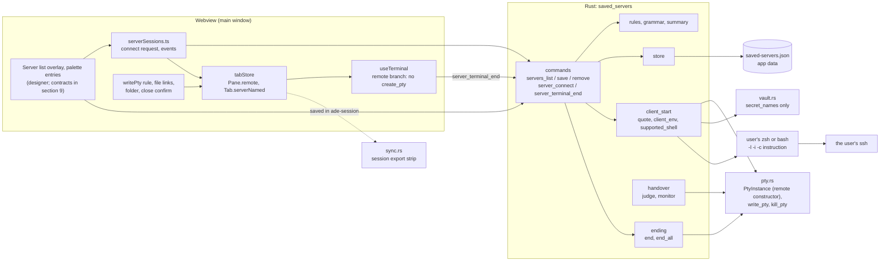
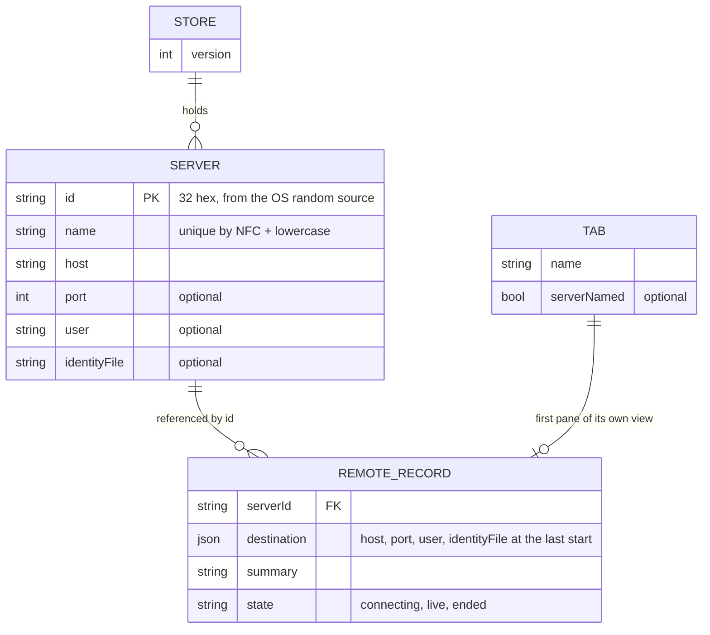

# F7 Saved servers (SSH), slice S1: design

- **Status:** revision 2, proposed 2026-11-18. **Not approved.** It answers the
  adversarial review of revision 1 (blocked: 2 blocking, 7 major, 19 minor) and
  **awaits a delta review**. Section 19 lists every finding with its answer. The
  three hard parts the review re-ran and found sound (ending without writing, the
  client start, the observation rule) are not redesigned; what changed in them is
  named in section 19.
- **Covers:** `docs/prd.md` F7, slice **S1** only (SV-1 to SV-9, revision 7, approved
  by the owner 2026-11-18). S1b (SV-13) and S2 (SV-12) are not designed here;
  section 14 says what S1's seams leave for S1b.
- **Contracts:** `.ade/context/saved-servers.md`, `.ade/context/server-panes.md`.
- **ADRs (Proposed, numbers provisional):** 0043 (the store), 0044 (the client
  start), 0045 (ending a remote pane's terminal), 0046 (the hand-over check).
  0046 amends ADR `0014-terminals-open-terminals-through-the-hook-endpoint` and
  `.ade/context/terminal-open.md` in one point, the exit event's shape (3.6).
- **Verification command:** the one in force (`docs/architecture.md`), with no new
  line. Proposed there, marked **not in force**, for the owner: one environment
  prerequisite, and a same-commit run of two CI jobs for the stories that start
  processes (section 17).
- **Evidence:** everything marked *run* was run on 2026-11-18 on macOS 26
  (Darwin 25.6, arm64) with `/bin/zsh` 5.9 and `/bin/bash` 3.2.57, against
  `portable-pty` 0.9.0 and `sysinfo` 0.33, by a scratch program outside the
  repository: a scratch `HOME` and `ZDOTDIR`, a stub `ssh` first on `PATH`, no host
  contacted, the user's own `~/.ssh`, keys, agent, keychain and start-up files never
  touched. Where a result is the review's own run or reading it is cited as "the
  review" and taken as fact. Revision 2 ran three things anew, each named where
  it is used: `end_all(No)` then `end_all(Yes)` (1.5), the stopped reader and the
  dropped handles as the last step (1.4), and the quoted-alias row (2.1).
  **Nothing was run on Linux**, by the architect or by the review (no Linux
  machine or container was available); section 16 lists what that leaves
  unverified and section 17 says how the stories find out first. Code references
  are to this branch (`origin/main` at 18b6769).

The three hardest parts come first (sections 1 to 3). Section 4 on gives the
overview, the data, the webview side, the stories and the test map.

## 1. Ending a remote pane's terminal (SV-2 AC3)

### 1.1 What is wrong today, read and run

- `kill_pty` calls `kill`, which calls `remove`: it takes the instance out of the
  table and forgets its agent state (`src-tauri/src/pty.rs:503-515`, `216-219`). It
  signals nothing. The only `Child::kill` calls are in `#[cfg(test)]` helpers
  (`pty.rs:113-128`).
- Dropping the instance drops its `input` sender, so the writer thread's `recv`
  fails and the thread ends, dropping the library's writer (`pty.rs:44-56`). That
  writer is a `UnixMasterWriter`, and its `Drop` writes a newline and the
  terminal's end-of-file byte whenever the terminal has one set (`portable-pty`
  0.9.0, `src/unix.rs:393-405`).
- The reader thread holds its own duplicate of the master
  (`try_clone_reader`, `unix.rs:352-355`; `pty.rs:195-212`), so dropping the
  instance's master does not close the terminal and no hangup is sent.
- **Run:** with the library's writer and today's drop order, a stub in raw mode
  read exactly the bytes `[10, 4]` and was alive 1.5 s later, under both shells.

### 1.2 The decision

A remote pane's terminal is a **remote terminal**: a `PtyInstance` built by a second
constructor, carrying `remote: Some(Remote { pane, leader, started, ending, .. })`,
and ended only by one routine. Four rules (ADR 0045):

1. **ADE never takes the library's writer for a remote terminal.**
   `UnixMasterWriter` exists only as the return value of `take_writer`
   (`unix.rs:357-364`), and no other type in the crate's Unix code implements
   `Drop` (checked: one `impl Drop` in `unix.rs`; the review re-read it). The
   remote constructor duplicates the master's descriptor
   (`MasterPty::as_raw_fd`, then `BorrowedFd::try_clone_to_owned`) into a
   `std::fs::File` and gives that to the writer thread. Closing a `File` writes
   nothing. So no code of ADE's or of the library's writes at drop.
2. **The hangup is a signal ADE sends.** Signalling needs no cooperation from any
   thread of ADE's, reaches a child `ssh` in the foreground group, and can
   escalate to a kill.
3. **The reader can be told to stop, so closing every master handle is the
   routine's last step** (revision 2; review A-M6). The remote constructor does
   not call `try_clone_reader`. Its reader is ADE's own: a second duplicate of the
   master and the read end of a **wake pipe**, read with `poll` on both; when the
   pipe's write end is written to or closed, the reader returns end of output.
   The instance holds the write end. So the last step of an ending stops the
   reader, joins it, and drops the master and the writer's duplicate: no handle
   of ADE's is left on the terminal, and the kernel hangs up whatever is still
   attached to it, whoever owns it. Revision 1 could not do this (its reader
   stayed blocked in `read` on a duplicate nothing could close) and so left a
   process it could not signal with a working terminal for good.
4. **One routine, `saved_servers::ending::end`, is the only way a remote terminal
   leaves the table while its process may be alive.** `kill_pty` for a remote
   terminal's id starts it (1.5), so no webview path, old or new, can forget a
   remote terminal the way a local one is forgotten.

*Rejected:* (a) reuse `kill_pty` and patch the writer for every terminal. It fixes
today's defect for all terminals, which is a change to existing behaviour F7 does
not ask for (PRD F7.11); see 1.8. (b) `Child::kill`: on Unix the library's kill
sends a hangup to the one process id only (`portable-pty` `src/lib.rs:341-347`),
which misses a child `ssh` in its own foreground group and never escalates. (c)
Closing the handles as the *only* mechanism: it does not kill a job that ignores
the hangup, and it gives no moment at which "none alive" was checked.

### 1.3 "A process of the pane", in code

Read at the moment of the action, and again on every poll:

- `leader`: the process id ADE started for the terminal. `portable-pty` calls
  `setsid` for it (`unix.rs:257`), so it leads its own session and its id is the
  session's id.
- `fg`: the terminal's foreground process group, `tcgetpgrp` on the master
  (`MasterPty::process_group_leader`), when it is above 0.
- A process `p` is **a process of the pane** when `getsid(p) == leader`, it is not
  a zombie, and (`p == leader` or `getpgid(p) == fg`).

That is F7.1's definition: the session's shell or whatever replaced it (same
process id), and the foreground job. A process a start-up file moved to a session
of its own fails `getsid(p) == leader` and is left. A background job of the
session is not signalled either; it loses its terminal when the last step closes
it, as it does when a terminal window is closed in any terminal program. The set
is one pure function over a table of `(pid, sid, pgid, start time, zombie)` rows,
so it is unit-tested without a terminal; the table comes from `sysinfo` (process
ids, start times, status) and `libc::getsid` / `getpgid`.

**The start-time check has a resolution of one second** (`sysinfo`'s
`start_time`; the review read the value `1794995341`). Before each signal the
routine checks that the process id still has the start time it had when it was
first seen. That narrows the reuse of a process id; it does not close it: a new
process that took the same id within the same second, and is in the same
session, would be signalled. The session test (`getsid(p) == leader`) is the
stronger guard: a reused id in another session is never a member.

### 1.4 The routine

`end(table, gate, id) -> Ended`, blocking, never called on the UI thread (1.5 says
how each caller keeps to that; the exit handler is the one place that waits, and
it waits through `end_all`, not by calling `end`).

| Step | What | Why |
|---|---|---|
| 1 | Under the table lock: if the instance is absent or not remote, return `NotRemote`; if it is already ending, return `AlreadyEnding` **at once** (a caller that must wait uses `wait_gone`, 1.5). Mark it `ending`. Read `leader`, its start time, and `fg`. Tell the monitor `EndedByUser` (3.4). | Idempotent, and never a second set of signals. `write_to` (`pty.rs:374-379`) and `type_line` gain one check: a terminal marked `ending` is sent nothing, and `write_to` returns `Ok`, so a key pressed during the ending is dropped without an error reaching the webview's log. The input queue is not closed: it is simply no longer fed. |
| 2 | Compute the set (1.3). Send each member `SIGHUP`, then `SIGCONT`, by process id, after the start-time check. A signal the system refuses (`EPERM`: a process of another user) is noted and the routine goes on. | A stopped job does not act on a hangup until continued. By id, not `killpg`, so only members of this session are signalled. |
| 3 | Poll: recompute the set (with the `fg` read in step 1 and the current one). Empty: go to 5. Otherwise sleep 50 ms, **or to the 2 s deadline if that is sooner**. | A hangup handler may have changed the foreground group. Sleeping to the deadline means the kill is sent at 2 s, not at the next poll after it (review A-m6). |
| 4 | At 2 s from step 1: send `SIGKILL` to every member still alive, once; keep polling every 50 ms. At 5 s: stop polling whatever is left. | SV-2 AC3: an uncatchable kill at 2 s, none alive within 5 s. |
| 5 | **Last, always:** if members were left at 5 s, tell the monitor `GaveUp` (3.4), so the pane gets its `exit`. Take the instance out of the table; stop the reader through the wake pipe and join it; drop the instance: the master, the reader's duplicate and (when the writer thread next wakes, which the dropped queue causes) the writer's duplicate are closed. Notify the gate's condition variable. Return `Gone`, or `GaveUp`. | Dropping writes 0 bytes (rule 1). With no handle of ADE's left, the kernel hangs the terminal up for whatever is still attached (rule 3). |

The pane's exit event comes from the monitor (section 3.6): `by: "ended"` and no
kind, so an End leaves the pane ended with its output. It is sent once, whether
the leader was seen to exit or the routine gave up.

**A process ADE may not signal** (review A-M6). `kill` fails with `EPERM` for a
process of another user in the session. The ordinary case is `sudo` waiting for a
password in a start-up file; a start-up file that replaces the shell with a
setuid program is the other. What the routine does:

- The members it may signal are ended as usual. When the pane's own process is
  among them (a shell with `sudo` as its child), its exit alone takes the
  terminal from the child: **run** (the child's signals refused in the probe),
  the child read end of input and was gone 27 to 49 ms after the action, under
  both shells, before the last step.
- When the pane's own process is the one that may not be signalled, steps 2 to 4
  change nothing, the routine gives up at 5 s, and step 5 closes the terminal.
  **Run** (every signal to the stub refused): with the reader stopped and the
  handles dropped, the stub read end of input and was not alive 0.7 s later, under
  both shells; with revision 1's reader, kept blocked on its own duplicate, the
  same stub was alive and still attached.
- The pane is told: `GaveUp` gives it an `exit` with `by: "ended"`, so it is
  ended and no longer holds a PTY id that Rust has forgotten.

**What is still left alive, a stated limit:** a process ADE may not signal that
also survives its terminal being hung up by the kernel (it ignores `SIGHUP` and
does not read the terminal), and a process that survives `SIGKILL` (a kernel
matter). ADE has no further means against either; the routine returns `GaveUp`,
the terminal is closed, the pane is ended. Also stated: if the writer thread is
at that moment blocked in a write the remote program is not reading, its
duplicate stays open until that write returns, and the kernel's hangup comes
then. **Not run:** a real process of another user (it needs root); the probe
refused the signals instead.

**Run** (each case under `/bin/zsh` and `/bin/bash`, the stub in raw mode recording
every byte it reads, a fixture process the start-up file put in its own session).
Revision 1's runs, which the review re-ran with the same outcomes (zsh live: none
alive at 51 ms; a zsh child ignoring the hangup: kill at 2088 ms, none alive at
2151 ms; a bash child: 26 ms; own-session process alive each time):

| Case | Members found | None alive after | Kill sent | Bytes the stub read | Own-session process |
|---|---|---|---|---|---|
| stub is the pane's own process (live) | leader | 30 ms (zsh), 117 ms (bash) | no | 0 | alive |
| stub is a child of the shell (connecting) | child and shell | 32 ms, 34 ms | no | 0 | alive |
| the pane's own process ignores the hangup | leader | 2079 ms, 2097 ms | at 2010 ms, 2025 ms | 0 | alive |
| a child ignores the hangup | child and shell | 2139 ms, 2104 ms | at 2060 ms, 2033 ms | 0 | alive |
| a fixture program the start-up file put in the shell's place | leader | 36 ms, 40 ms | no | 0 | alive |
| *today's close, for contrast* | | stub alive at 1.5 s | | `[10, 4]` | |

Revision 2's runs, with the routine as written above (the reader on a wake pipe,
the sleep to the deadline, the last step), two remote terminals at once:

| Case | Kill sent | None alive, reader joined, instance removed | Bytes |
|---|---|---|---|
| the pane's own process ignores the hangup (zsh, bash) | at 2005 ms, 2017 ms | 2076 ms, 2093 ms | 0 |
| a child ignores the hangup (zsh, bash) | at 2022 ms, 2028 ms | 2096 ms, 2096 ms | 0 |

The kill is now sent at the 2 s deadline plus the one process-table read that
finds who is left (5 to 28 ms in the runs). The poll-based reader was also run
by itself on macOS: it delivered output as it arrived and stopped when the wake
pipe's write end was dropped.

### 1.5 Who calls it, and the invariant

**The invariant (review A-B1).** A remote terminal exists in Rust's table only
while a pane holds its id. Exactly, every remote terminal in the table is in one
of three conditions, and each of the other two is bounded:

- **held:** a pane in the main window's store has its id as `ptyId`;
- **starting:** its `server_connect` has not yet been answered (the webview's
  connect call holds it; bounded by routes 1 to 3 below);
- **ending:** `end` is running on it (it leaves within 5 s).

Rust cannot see panes, so the invariant is kept from both sides: the webview ends
whatever it cannot hold, and Rust ends everything whenever the main webview that
held the ids is gone or replaced.

**The gate.** One small state beside the table, `ending::Gate`, read and written
only while the table lock is held: `closed` (the main window was destroyed, or
ADE is exiting), `page` (a count of the main webview's page loads) and `starting`
(client starts between their spawn and their insert). Its condition variable is
used with the table's mutex and is notified whenever a remote terminal leaves the
table or `starting` drops.

| Action | Path |
|---|---|
| End (SV-2 AC9) | webview `invoke("server_terminal_end", { args: { id } })`; `#[tauri::command(async)]`, so it runs off the UI thread. It calls `end`; on `AlreadyEnding` it calls `wait_gone(id, 5 s)`. It resolves when the terminal has left the table or 5 s have passed |
| A confirmed close of the pane; a close of the tab | The caller reads "this pane is remote" from the pane's record **before** the store update that removes it, and passes it: `destroyInstance(paneId, storePtyId, remote)` (`src/hooks/useTerminal.ts:158-163`). With `remote` true it sends `server_terminal_end` in place of `kill_pty`, not awaited. `closePane` (`tabStore.ts:523`) and `closeTab` (`tabStore.ts:422-423`) both call it from a lazy import that runs after their `set`, which is why the fact is captured first and not read from the store there (review A-M1) |
| A resolved connect with no pane to hold it (route 1) | `serverSessions.ts` sends `server_terminal_end` at once |
| Any other `kill_pty` for a remote terminal's id | `kill` in `pty.rs` (`pty.rs:511-515`) reads the instance's `remote` under the table lock. Remote: it calls `ending::start(id)`, which marks the terminal ending and runs `end`'s remaining steps **on a thread of its own**, and returns at once. `kill_pty` is a sync command and runs on the main thread (`pty.rs:503`, no `async`), so it never blocks there. Not remote: today's `remove`, unchanged |
| The main window is destroyed | `tauri::Builder::on_window_event`: `WindowEvent::Destroyed` for the window labelled `main` calls `ending::main_closed`, which sets `gate.closed` and calls `end_all(.., Wait::No)` |
| The main webview loads a page (route 3) | `tauri::Builder::on_page_load`: `PageLoadEvent::Started` for the webview labelled `main` calls `ending::main_page_loaded`, which adds 1 to `gate.page` and calls `end_all(.., Wait::No)` |
| Better Terminal exits | `App::run`'s callback: `RunEvent::Exit` calls `ending::app_exiting`, which sets `gate.closed` and calls `end_all(.., Wait::Yes)` |
| A client start that completes after the gate moved (route 2) | `server_connect`'s insert (2.5 step 7) puts the instance in the table already marked ending and calls `ending::start` on it |

**`end_all(table, gate, wait)`** (review A-B2), the **teardown routine** of SV-2
AC3's static test:

- it calls `ending::start` for every remote terminal that is not already ending
  (each ending on its own thread); and
- with `Wait::Yes` it then blocks **until no remote terminal is left in the
  table and no client start is in progress, or 5 s have passed**, whichever
  comes first, on the gate's condition variable. What was already ending when it
  was called makes no difference: it waits for the table, not for the endings it
  started. `Wait::No` returns at once.

`wait_gone(id, limit)` is the same wait for one id.

So the commonest quit, a close of the main window, is: `Destroyed`
(`end_all(No)`: every remote terminal starts ending, the handler returns), then
`RunEvent::Exit` (`end_all(Yes)`: nothing new to start, and it waits until the
table is empty). **Run**, with a stub that ignores the hangup as the pane's own
process in one terminal and as a child in another, `end_all(No)` then at once
`end_all(Yes)`:

| Shell | `end_all(No)` returned | `end_all(Yes)` returned | In the table then | Alive then | Kills sent at | Bytes |
|---|---|---|---|---|---|---|
| `zsh` | 0 ms, 2 in the table | 2096 ms | 0 | none of the four | 2005 ms, 2022 ms | 0, 0 |
| `bash` | 0 ms, 2 in the table | 2096 ms | 0 | none of the four | 2017 ms, 2028 ms | 0, 0 |

In the give-up case (a process that may not be signalled) `end_all(Yes)` returned
at 5003 ms with the terminal still in the table and the routine's last step 15
to 37 ms behind it (run). ADE then exits, which closes every handle it holds:
the kernel's hangup is the same one the last step would have caused.

**The three routes by which a client start could be left with no pane, closed**
(review A-B1):

1. **The pane is gone when the connect resolves** (a Reconnect whose ended pane
   or tab was closed meanwhile; an ended pane closes without asking). The
   webview's resolve handler looks the target pane up in the store **in the
   same step in which it would give it the id**. Not there, or no longer an
   ended remote pane with no PTY: it sends `server_terminal_end` for the new id
   at once, drops the buffered output, and updates nothing. A second Reconnect
   on a pane while one is in flight makes no request (8.4). Rust backs this up:
   the request carries the pane (2.5), and a start for a pane that already has a
   remote terminal that is not ending is refused before any process is started.
2. **The main window is destroyed while a connect is in flight.** `server_connect`
   reads `gate.closed` and `gate.page` under the table lock before it spawns,
   refuses if the gate is closed, and counts itself in `gate.starting`. At the
   insert, under the same lock, it reads them again: if `closed` is set or `page`
   has changed, the instance is inserted already marked ending and
   `ending::start` runs on it; the command rejects (2.5). Because the start is
   counted, and the late instance is in the table, a quit's `end_all(Yes)` waits
   for it as for any other.
3. **The main webview loads a page** (`ErrorBoundary.tsx:31`'s Reload button, in
   production). Every remote terminal is ended (`main_page_loaded`, above), and a
   connect in flight across the load is refused at its insert by the changed
   `page`. The new page then restores its panes ended with no PTY (8.5), which is
   now also what Rust holds: nothing. Reconnect therefore starts the only
   connection, not a second one.

   *How Rust learns of the load.* Tauri's page-load hook: `Builder::on_page_load`
   (`tauri` 2.10.3 `src/app.rs:1651`) is called with `PageLoadEvent::Started` when
   the webview commits a navigation (read: `wry` 0.54.4
   `src/wkwebview/navigation.rs:17-25`, `did_commit_navigation`; on Linux
   `src/webkitgtk/mod.rs:477`). It needs nothing from the page, so it works when
   the old page had crashed. The first load at launch finds an empty table.
   **Read, not run:** that the hook fires for a `window.location.reload()` in the
   packaged app on each platform; the story's manual check covers it (1.6), and
   the automated tests cover the function and the wiring.

Server tabs live only in the main window (Move to New Window is refused, section
8.6), so "every remote terminal" is "the main window's".

Today `lib.rs` ends in `.run(tauri::generate_context!())` with no window-event
handler, no page-load hook and no run callback (`src-tauri/src/lib.rs:503-601`);
the story changes that to `.on_window_event(..)`, `.on_page_load(..)`,
`.build(..)` and `.run(|app, event| ..)`.

**The static wiring test** (Rust, `saved_servers/wiring.rs`): it scans every `.rs`
file under `src-tauri/src/` outside `#[cfg(test)]` modules for `end_all(` and
compares the sites with the checked-in list
`src-tauri/src/saved_servers/teardown.sites`: **three** lines, `main_closed`,
`main_page_loaded` and `app_exiting`, each as `file: enclosing item`; and it
compares the call sites of those three functions with the same file's second
part: the `Destroyed` handler, the page-load hook and the `Exit` handler in
`lib.rs`. A missing or extra site fails. SV-2 AC3 asks for the exit and the
window-destroyed handlers; the page-load line is this design's addition. The
same test file holds the list of sends into a terminal's input queue (section
8.8).

### 1.6 What a quit costs, and which quits reach it

- No remote terminal connecting or live, and no start in progress: nothing is
  waited for.
- Every process obeys the hangup: about 30 to 120 ms (run; it includes one 50 ms
  poll).
- A process ignores the hangup: about 2.1 s (run: 2096 ms), once, however many
  panes, since the endings run in parallel.
- Hard stop: 5 s, then ADE exits whatever is left.

The main window's close does not block: `end_all(No)` returns at once and the
endings run on their own threads. If destroying that window makes ADE exit, the
exit handler's `end_all(Yes)` then waits until the table is empty (1.5; this is
the case revision 1's wording let skip the wait). With a detached window still
open ADE stays, and the endings finish in the background.

**Which ways of quitting reach the exit handler.** Read by the review, not run:
on macOS `tao` 0.34.5's `applicationWillTerminate` sends `LoopDestroyed`, which
`tauri-runtime-wry` 2.10.0 (`src/lib.rs:4046`) maps to `RunEvent::Exit`, so
Cmd-Q, the menu's Quit and the Dock's Quit should reach it, and blocking there
is allowed. **A limit, stated:** ADE installs no signal handler, so `SIGTERM`
(a `kill`, a Linux session's log-out) runs none of ADE's code, like a crash or a
forced quit: the operating system closes the terminal and hangs the session up,
and a job that ignores the hangup stays (PRD F7.9 names the crash and the forced
quit; `SIGTERM` is the same case and is listed for the product manager, section
15).

**The manual check** (story R3b's notes; not part of Done, ADR
`0009-manual-checks-do-not-gate-done`): with a fixture connection whose stub
ignores the hangup, one run per route, recording whether the stub was gone
afterwards. macOS: Cmd-Q; the menu's Quit; the Dock's Quit; the window's close
button with no detached window; the window's close with a detached window open;
a log-out; Reload on the error screen (route 3). Linux: the window's close;
`SIGTERM`. A route found to skip the handler, other than `SIGTERM`, comes back
as a defect against this design.

### 1.7 Tests

| Test | Kind | Asserts |
|---|---|---|
| the set of 1.3 over a table of rows | Rust, pure | leader, foreground members, other-session and zombie rows; a changed start time is not a member |
| `end` against fixture programs started directly in a remote terminal (the recording stub as leader; `sh -c` with the stub as a child; each ignoring the hangup; an own-session process) | Rust, Unix, real PTY | 0 bytes recorded; none alive at 5 s; the kill only in the ignoring cases, and not before 2 s; own-session alive; `write_pty` after the call queues nothing; a second `end` returns `AlreadyEnding` at once; exactly one `exit`, with `by: "ended"`, and no event after it |
| the last step (review A-M6): a stub as leader with every signal to it refused through the routine's signal seam, ending when it reads end of input | Rust, Unix, real PTY | `end` returns `GaveUp` at 5 s; the reader thread has ended; the stub read end of input and is not alive 1 s later; one `exit` with `by: "ended"` was sent; the id is no longer in the table |
| **`end_all(No)` then at once `end_all(Yes)`** (review A-B2): two remote terminals, a hangup-ignoring stub as leader in one and as a child in the other | Rust, Unix, real PTY | the first call returns in under 100 ms with both still in the table; the second returns no sooner than 2 s and no later than 3 s after the first; the table then holds no remote terminal; none of the four processes is alive; 0 bytes |
| `end_all(Yes)` with an empty table, and with a start counted in `gate.starting` that inserts 300 ms later | Rust, Unix | returns at once; returns only after the late instance has left |
| the gate at the insert (routes 2 and 3): `main_closed`, and again `main_page_loaded`, called between a start's spawn and its insert (the test holds the start at a seam) | Rust, Unix, real PTY | the command rejects; the instance is ended by `end` (0 bytes, none alive); the table is empty; with `closed` set a new `server_connect` starts 0 processes |
| `main_page_loaded` with two live remote terminals and one local terminal | Rust, Unix, real PTY | both remote terminals are ended; the local terminal is untouched and still in the table |
| the per-pane rule (route 1's backstop): a second start for a pane whose remote terminal is not ending | Rust, Unix | refused; 0 stub records for it; the first terminal untouched |
| `kill` (review A-M1): for a remote id with a hangup-ignoring stub; for a local terminal's id | Rust, Unix, real PTY | remote: `kill` returns in under 100 ms, the terminal is marked ending and still in the table, and is gone by 3 s; local: the instance is out of the table when `kill` returns and its process was sent no signal (alive 300 ms later), as today |
| SV-2 AC3's matrix through a real client start (live; connecting as a child; connecting replaced; each ignoring), ended by `server_terminal_end`, by `kill_pty`, by `main_closed` and by `app_exiting` | Rust, Unix, `zsh` and `bash`; in story R5, which has the client start and the states | the same outcomes |
| the wiring test of 1.5 | Rust, static | the three `end_all` sites and their three callers |
| a confirmed close and a tab close each send one `server_terminal_end` for the pane's PTY id, 0 `kill_pty` for it and 0 `write_pty`; a local pane's close still sends `kill_pty` | TypeScript, store | section 8.3 |
| a Reconnect whose pane was closed before the connect resolved (route 1): by `closePane`, and by `closeTab` | TypeScript, store | exactly one `server_terminal_end`, for the id the connect returned; no pane, tab or session buffer holds that id |

### 1.8 A note for whoever owns `pty.rs` (not an F7 requirement)

Every local terminal still ends the old way: no signal, a newline and the
end-of-file byte typed into it, the process left to end by itself (1.1). An `ssh`
typed by hand in any tab is closed that way today. F7 leaves it. The remote
constructor shows the fix (ADE's own duplicate as the writer; an explicit hangup
with an escalation), and applying it to every terminal is a separate change to
existing behaviour with its own decision.

## 2. The client start (SV-2 AC1, AC2, AC5, AC8, AC10)

### 2.1 The invocation

ADE starts the shell `shell_from` gives (`src-tauri/src/platform.rs:45-58`:
`$SHELL`, or `/bin/zsh` when unset or empty) with exactly four arguments:

```
<shell> -l -i -c <instruction>
```

| Shell (base name, exactly) | Instruction, before quoting | Words |
|---|---|---|
| `zsh` | `exec command ssh G...` | `exec`, `command`, `ssh`, then the grammar |
| `bash` | `exec ssh G...` | `exec`, `ssh`, then the grammar |

**Every word is quoted** by the rule of ADR 0008 (2.3) and the words are joined by
one space: for `{host: db1.example.com, port: 2222, user: deploy}` under `zsh` the
fourth argument is

```
'exec' 'command' 'ssh' '-p' '2222' '-l' 'deploy' '--' 'db1.example.com'
```

Why these words: in `zsh` a plain `exec ssh` runs a function named `ssh`, and
`command` skips functions; in `bash` `exec` already runs the program. Quoting stops
alias expansion for every alias whose name is the bare word: an alias named `ssh`
or `exec`, and a `zsh` global alias named `ssh`, `--` or the Host value, none of
which matches the quoted text. **It does not stop every alias** (review A-m1;
revision 1 said it did, and the PRD repeats the claim). `zsh` matches a global
alias against the text of the word as written, quotes included, so a global
alias whose **name includes the quotes** still applies: `alias -g
"'db1.example.com'"=evil.example.net` rewrites the quoted Host word, and `alias
-g "'ssh'"=/bin/echo` rewrites the quoted `ssh`. No quoting form avoids this,
since the alias can be named after whatever form ADE writes. The outcome is
(ii), never live: the argument list the pane's process then holds is not the
grammar, so it is judged "another program" (3.3). What the engineer is not
shown: with a real `ssh` in the stub's place the first of these would be
connecting to the alias's host while the pane says "not handed over: another
program is running". That is the user's own start-up file choosing the
destination, the class the PRD already states for a `hash` entry, and it is
listed for the product manager (section 15). `-l -i` makes the shell
read the files a new ADE terminal's shell reads (`$SHELL -l` on a terminal is
interactive). `-c` keeps the instruction out of every history file and means ADE
types nothing.

**Run**, per row of SV-2 AC2's table (the definition confirmed in effect by the
start-up file's own last line; "own" means the stub's process id equals the
pane's):

| Added to the start-up file | `zsh` | `bash` | Required |
|---|---|---|---|
| nothing (base) | stub, exactly the grammar, own; home folder; `SSH_AUTH_SOCK=/marker`; no history file | the same | (i) |
| a function `ssh`, then an alias `ssh` | (i) | (i) | (i) |
| a global alias `ssh` | (i) | n/a | (i) |
| a global alias on the Host value | (i), last argument unchanged | n/a | (i) |
| a global alias on `--` | (i), no `-o` | n/a | (i) |
| a global alias whose name is the **quoted** Host word (`alias -g "'db1.example.com'"=evil.example.net`) | the stub runs as the pane's own process with the alias's host as its last argument; the list is not the grammar: **(ii), never live**, "another program is running" (run in revision 2, and by the review) | n/a | a stated (ii): not in the PRD's table |
| a global alias whose name is the quoted word `'ssh'`, sending it to `/bin/echo` | `echo` prints the grammar and exits 0; no stub; never live (run in revision 2, and by the review) | n/a | a stated (ii) |
| an alias `exec` | (i) | (i) | (i) |
| a function `exec` that returns | exits 0, no stub | exits 0, no stub | (i) or (ii) |
| a function `command` that returns | exits 0, no stub | not a word of the instruction: (i) | (i) or (ii) |
| a function `command` (zsh) or `exec` (bash) that runs its arguments | stub as a **child**, exactly the grammar; the pane's process stays the shell | the same | (ii), connecting |
| `hash ssh=/bin/echo` | `echo` runs with first word `ssh` and the grammar, prints it, exits 0 | the same; too brief to be sampled | (i) or (ii) |
| no `ssh` on `PATH` | exits 127, "command not found: ssh" | exits 127, "exec: ssh: not found" | SV-8 AC2 |

A function named `builtin` (the PRD's `bash` row) is not a word of either
instruction, so that row gives (i). The review ran the whole table again without
the architect's program (a shell script, `zsh` 5.9 and `bash` 3.2.57): every row
gave its required outcome, and also (i) for `setopt POSIX_BUILTINS`, `disable
command` and a `preexec` hook, and status 127 for `disable exec` and `enable -n
exec`.

**The two quoted-alias rows are fixture rows** of SV-2 AC2's test, asserted as:
the pane is never reported live; for the Host row there is exactly one stub
record and its last argument is the alias's value; the "another program" notice
is sent. The PRD's sentence "there is no stub record with any other arguments"
does not hold for the Host row and cannot be made to; that too is on the
product manager's list. **Not run:** bash 5 (5.3 is installed on the
machine and can be added to the fixture matrix; CI's Linux image carries bash 5.1,
which decides there), other `zsh` versions, Linux.

### 2.2 The supported-shell decision (SV-2 AC10)

`supported_shell(path) -> Result<Shell, Kind>` is pure: the base name is the text
after the last `/`; `zsh` and `bash` are supported, exactly; anything else is the
"shell not supported" kind, carrying the base name only when it is 1 to 32
characters of `A-Z a-z 0-9 . _ + -`. It runs before anything is started. The path
is never carried.

### 2.3 Quoting in Rust without a second quoter (SV-7 AC3)

The webview may not build the instruction (it never sees an argument), so Rust
must quote. ADR 0008's quoter is a rule with one TypeScript implementation
(`src/lib/shellQuote.ts`). The design keeps **one rule and one table**:

- `src/lib/shellQuote.cases.json` is a checked-in table of `[input, output]` pairs
  (the empty string, plain words, every character of `0x20`-`0x7e`, runs of `'` and
  `\`, a leading and a trailing quote).
- `shellQuote.test.ts` asserts the TypeScript quoter against it; a Rust test
  asserts `saved_servers::quote::shell_quote` against the same file
  (`include_str!`). A case added for one side is a test on both.
- The Rust function is used only by the client start. The source scan that guards
  ADR 0008 in the webview is unchanged; the Rust wiring test asserts that
  `shell_quote` is the only function in `src-tauri/src/saved_servers/` that emits
  a quote character into an instruction.

**Nothing outside `0x20`-`0x7e` reaches the quoter, by type** (review A-m4).
Validation (section 6) refuses every character outside that range in a saved
value, but one argument is not a saved value: the identity file after its
leading `~/` was replaced by the home folder. So `shell_quote` does not take a
string. It takes a `quote::Word`, and `Word::new(&str)` is the only way to make
one: it returns nothing when the input holds a character outside
`0x20`-`0x7e`. `grammar::arguments` returns `Word`s, and it refuses a record
whose expanded identity file cannot be one (section 6). The shared table holds
only in-range inputs, because no other input can exist on the Rust side; a
Rust-only test asserts that `Word::new` refuses a control character, DEL, and a
non-ASCII letter.

### 2.4 The environment (SV-2 AC8)

```rust
/// What ADE hands the shell of a client start. No input is a vault value.
pub fn client_env(
    base: Vec<(OsString, OsString)>,   // in the app: std::env::vars_os()
    remove: &[String],                 // the vault's list of names
    macos: bool,
) -> Vec<(OsString, OsString)>
```

1. Start from `base`, and from nothing else.
2. Drop every variable whose name starts `ADE_`, and every variable whose name is
   in `remove`.
3. Set `TERM=xterm-256color`. On macOS, when `LANG`, `LC_ALL` and `LC_CTYPE` are
   all unset or empty, set `LANG=en_US.UTF-8` (`platform::default_locale`, as for a
   terminal).

It sets nothing else: no `ADE_*`, no `SSH_*`, no vault value. The spawn then does
`CommandBuilder::new(shell)`, **`env_clear()`**, and `env(k, v)` for each pair.

**Why a builder that starts from `CommandBuilder::new` is wrong.** `new` copies the
process's whole environment at construction (`portable-pty`
`src/cmdbuilder.rs:215-224`, `get_base_env`, `74-86`). A builder that lays the
filtered base over that copy passes whatever the process holds and the base does
not: on a developer's machine, the outer ADE terminal's `ADE_HOOK_TOKEN` and vault
values. SV-2 AC8's `ADE_ONLY_IN_PROCESS` row exists to catch it. **Run:** with
`env_clear()` and an explicit list, a variable set only in the process was absent
from the stub's environment, `KEEP_ME` was present, and the start-up file's
`SSH_AUTH_SOCK` and `ADE_FROM_RC` were present.

**How the test gets a variable that is only in its own process** (review A-m5).
The probe called `std::env::set_var`. A story's test must not: the unit-test
binary runs its tests on parallel threads, `src-tauri`'s tests contain no
`set_var` today (the review's `grep` is empty), and changing the environment of
a threaded process is unsound. The row is one test function with two roles. Run
normally, it starts **its own test executable again as a child**
(`std::env::current_exe()`, with `--exact <this test's name> --test-threads=1`),
giving the child's environment `ADE_ONLY_IN_PROCESS=leak` and a role variable,
and asserts the child passed. Run as that child, it does the client start with
a base that does not hold the variable and asserts the stub's environment lacks
it. So the variable is in the starting process's real environment, as in the
app, and no test writes to its own.

**One thing the library adds, stated:** when it builds the command, `portable-pty`
sets `SHELL` itself after clearing (`cmdbuilder.rs:498-529`): the builder's own
`SHELL` if it has one, else the user's shell from the password database. Run: the
stub saw `SHELL=/bin/zsh` although the list held none. In the app the base holds
`SHELL` already, so nothing changes; the test's "nothing else" assertion excludes
`SHELL`. `client_start` does not call `apply_hook_env` (`pty.rs:250-257`) and takes
no `agent.terminal_env`.

**The list of names.** `vault.rs` gains one function, the only thing of the vault's
F7 may name:

```rust
/// The vault's secret names, from vault-index.json. No keychain call.
pub(crate) fn secret_names(app_data: &Path) -> Vec<String>
```

It wraps today's private `read_index` (`src-tauri/src/vault.rs:78-83`), which reads
a missing or unparseable file as empty. It is read at every client start.

**The keychain stand-in.** `keyring` 3.6.3 has
`set_default_credential_builder` (`src/lib.rs:332`) and a public
`CredentialBuilderApi` (`src/credential.rs:152`). The stand-in is process-wide, and
Rust runs one binary's tests on parallel threads, so the "0 calls" test is a test
binary of its own: `src-tauri/tests/saved_servers_keychain.rs`. It installs a
recording builder, then runs add, edit, remove, a client start, a second one and a
list load against a fixture app-data folder, and asserts 0 recorded calls and a
byte-identical `vault-index.json`. For that the client-start core and the store
are reachable from an integration test: `saved_servers` is a `pub mod` with a
small `pub` surface that takes paths and a sink, not a Tauri handle, as
`bmadswitch` and `projectsetup` are for `tests/bmadswitch_e2e.rs`.

### 2.5 The command and what the webview sends

```rust
#[tauri::command(async)]
pub fn server_connect(
    app, window, ptys, agent,
    args: ConnectArgs,           // { serverId, paneId, rows, cols }
    on_event: Channel<PtyEvent>,
) -> Result<Connected, Kind>
```

**The connect request carries the saved server's identifier and the pane it is
for, and nothing else** (PRD F7.1; review A-m8: revision 1 left the pane out
without saying so). `paneId` is the webview's id for the pane that will hold the
terminal: the ended pane on a Reconnect, and on a Connect the id the webview has
just made for the pane of the tab it will open if the start succeeds (the tab
itself is still made only at the resolve, SV-2 AC7). Rust keeps it on the
remote instance and uses it for one rule, the per-pane rule of step 6. It is 1
to 64 characters of `A-Z a-z 0-9 - _`; anything else is refused as step 6's
refusal is. The arguments are one `serde` struct (`deny_unknown_fields`), so
the shape has a fixture (section 10) and a host, a user or an argument sent by a
webview bug fails to parse.

`Connected` is `{ ptyId, destination: {host, port?, user?, identityFile?},
summary }`: the destination of this client start, for the pane's remote record.
The order inside, each refusal before any process exists:

1. `availability` (section 11): "not available in an engagement"; the window must
   be `main`.
2. Load the store: "the server list could not be read".
3. Find the identifier: "that saved server no longer exists".
4. `rules::check` on the record (section 6): "a saved server failed its checks",
   with the field's name.
5. `supported_shell`: "shell not supported".
6. Build the grammar and the instruction (section 6: a record whose identity file
   cannot be expanded is refused here as step 4's kind, field `identityFile`) and
   the environment. Then, under the table lock (1.5): if the gate is closed, or
   `paneId` already has a remote terminal that is not ending, refuse with "could
   not start a terminal" and no error number; otherwise note `gate.page` and add
   1 to `gate.starting`. Open the terminal; spawn in the home folder: "could not
   start a terminal", carrying the error number when the library's error holds
   one (and when `HOME` is unset, with none).
7. Under the table lock again: subtract 1 from `gate.starting`; insert the remote
   instance **with no `/open` request id** and start its reader, writer, waiter
   and monitor (section 3). **If the gate was closed meanwhile or `gate.page`
   changed,** the instance is inserted already marked ending, `ending::start`
   runs on it, and the command rejects with "could not start a terminal" and no
   error number. That one refusal is not "before any start": a shell was started
   and is being ended by the routine. Its requester no longer exists (the window
   is destroyed or the page was replaced), so nobody is shown it; section 7's
   table says so.

**No `/open` can type into it.** `type_line` reaches a terminal only after
`claim_ok` matched the terminal's request id (`src-tauri/src/terminal_open.rs:242-246`),
and a remote instance's is always `None`. The story also makes
`Ptys::type_line` (`pty.rs:164-167`) refuse a remote instance outright, so the
property does not rest on the claim alone; a unit test calls it for a remote
terminal's id and asserts `false` and an empty queue.

"Could not start a terminal" is used for the two refusals of step 6 because the
fixed list has no closer kind and each is true as worded; neither can be reached
by a webview that keeps its own rules (a closed gate has no main window to ask;
8.4 never sends a second request for a pane).

Reconnect is the same command for the same pane (section 8.4). There is no other
caller: the wiring test asserts that `client_start::start` has one call site
outside tests, `server_connect`.

### 2.6 Tests that need a real shell

SV-2 AC2, AC8, AC9, AC3's matrix, AC4, AC10's "0 processes" rows, SV-7 AC2 and
AC3, SV-8 AC2 and SV-5 AC4's log test start `zsh` and `bash` for real. One fixture
module, `saved_servers::fixture` (`#[cfg(test)]`, and `pub` behind the
integration test's needs), builds a fixture root per test under the system temp
folder: `home/` (set as `HOME` **and** `ZDOTDIR`), `bin/` (the stub, first on
`PATH` by the start-up file), `out/` (records); `BASH_ENV` and `ENV` are never in
the base it passes. The start-up file is `.zshrc` for `zsh` and `.bash_profile`
for `bash`. `shell(name)` resolves `zsh` and `bash` on `PATH` and **panics with
"zsh is required" when one is missing**: a test never skips.

**The stub is a compiled program**, because the base case must show the form
`[P, G]`, which a script never does (a script shows under its interpreter). It is
a Cargo **example** target: `[[example]] name = "f7_ssh_stub"`, source
`src-tauri/tests/support/ssh_stub.rs`. `cargo test` builds examples and
`cargo build --release` does not (**run** on a scratch crate: the example was at
`target/debug/examples/f7_ssh_stub` after `cargo test`, a unit test found it from
`current_exe()` and ran it through a link named `ssh`, and a release build made
no example), so the stub is in no shipped build and the verification command
needs no new line. The fixture links it into `bin/` as `ssh`; the script cases
write a `#!/bin/sh` or `#!/usr/bin/env bash` file there that runs it. Its
behaviour comes from variables the fixture sets (record folder; exit with a
status, stay, or go raw and record every byte; ignore the hangup; ignore the
hangup signal but end when it reads end of input, for the last-step test of
1.7). `ending::end` takes its signal function as a parameter (`libc::kill` in
the app), which is the seam that test uses to refuse every signal to one
process id. `cargo test
--lib` alone does not build examples: the fixture then panics with "run cargo
test without --lib", which the verification command never does.

## 3. The hand-over check (SV-2 AC9)

### 3.1 How ADE observes the pane's own process

`image(pid) -> Option<Vec<String>>`: `sysinfo` 0.33, refreshed for that one process
id with `ProcessRefreshKind::nothing().with_cmd(UpdateKind::Always)`, the call
`fg_facts` already makes for the foreground leader (`pty.rs:633-648`); here it is
given **the process id ADE started**, never the foreground group. On macOS
`sysinfo` reads the arguments with `sysctl(KERN_PROCARGS2)`; on Linux it reads
`/proc/<pid>/cmdline`.

**Run on macOS:** the argument list was returned for the shell, for the stub, for
a `/bin/sh` script, for `/usr/bin/env bash script` and for `/bin/echo` started
under the name `ssh`, in every sample taken. A login shell started this way shows
exactly the list ADE passed (`/bin/zsh -l -i -c ...`), not `-zsh`: ADE passes `-l`
and does not rewrite the first word. **Unverified on Linux:** the same through
`/proc`. A process whose arguments cannot be read (another user's, under
`hidepid`) gives no observation, which is the safe side.

### 3.2 Two things a sample can be that are not an image of the shell's making

**Run, and not in the PRD.** In the first tens of milliseconds after the spawn
returned, 20 ms samples showed, before the shell's own list:

- **an empty list** (in most starts): the process is between images;
- **the list of the process that started it** (11 of the 37 starts run): taken
  to be the forked copy before it became the shell (the cause is inferred; the
  sample is what was run). In the app that is ADE's own argument list.

Read literally, "the first image ADE observes that is not that shell is judged"
would judge those "another program" on most Connects. So the design defines an
**observation**:

> A sample is an observation unless it is unreadable, empty, or equal to the
> argument list of the ADE process itself.

Every excluded sample only delays a judgement; none can make a pane live. A
start-up file that replaced the shell with ADE's own binary and ADE's own
arguments would stay "connecting" and get "not handed over yet" at the bound, the
safe direction.

**ADE's own argument list is read through the same sampler** (review A-m18):
`image(std::process::id())`, once per client start, never `std::env::args`. The
two sides of the comparison then come from one source in one representation
(the same system call, the same decoding of bytes that are not UTF-8), so they
cannot differ by how they were read. If ADE's own list cannot be read, nothing
is excluded by that clause; a forked-copy sample would then be judged "another
program", which is wrong for the engineer and safe for the rule (section 12).

**The review checked the rule:** 29,526 samples of a process that replaces
itself continuously showed whole lists or `[]` only, never a part of a list, and
one sample of one process took 99 microseconds. The rule adds a third input,
ADE's own list, to a criterion the owner approved with two. That is Q1 (section
15): the wording is the product manager's and the owner is told.

### 3.3 The judging function

```rust
pub enum Judged { StillShell, SshClient, Other }
/// Pure. `started`: the list ADE started the shell with. `observed`: an observation.
/// `grammar`: the arguments of this client start.
pub fn judge(started: &[String], observed: &[String], grammar: &[String]) -> Judged
```

`base(w)` is the text after the last `/`. `I` is a word whose base is exactly one
of `sh`, `bash`, `zsh`, `dash`, `ksh`.

| Observed | Judged |
|---|---|
| equal to `started`, word for word | `StillShell` |
| `[P, G]`, `base(P) == "ssh"` | `SshClient` |
| `[I, P, G]`, `base(P) == "ssh"` | `SshClient` |
| `[E, I, P, G]`, `base(E) == "env"`, `base(P) == "ssh"` | `SshClient` |
| anything else | `Other` |

`G` must equal `grammar` exactly, in order, with nothing before, between or after.
The table SV-2 AC9 gives is the unit test, plus these rows, which this design
places:

| Row | Judged | Why |
|---|---|---|
| `[/bin/sh, -e, /x/ssh, G]`, `[bash, -e, /x/ssh, G]` (an interpreter line with an option; **run**: this is what `#!/bin/sh -e` shows on macOS) | `Other` | The shape `[I, option, P, G]` is not one meaning: with `-c` the word after it is a command string and `G` becomes positional parameters, so `P` runs with **no** arguments; with `-s` the script is read from input. Accepting "an option" would accept those. A closed list of harmless options (`-e`, `-u`, `-x`) is possible later, one fixture each. Until then the pane of such a wrapper stays connecting with the message while its session works. |
| `[bash, -l, /x/ssh, G]`, `[env, -i, sh, /x/ssh, G]`, `[-bash, /x/ssh, G]`, `[-zsh, ...]` | `Other` | unlisted; the PRD's safe side |
| `[/bin/sh, <shell wrapper script>, -l, -i, -c, instruction]` (a `$SHELL` that is a script; **run**) | `Other` | see 3.5 |
| `[ssh, G]` whose executable is `/bin/echo` (a `hash` entry; **run**) | `SshClient` | the PRD's stated case: the argument list decides |

### 3.4 The monitor: one thread, one pure state machine

Each remote terminal has a **monitor** thread. It owns the pane's state and is the
only sender of the events of section 3.6, so their order is fixed. Its logic is a
pure function, tested without a process:

```rust
pub enum Input { Sample(Option<Vec<String>>), Tick(Duration), Exited(Option<i32>), EndedByUser, GaveUp }
pub enum Output { Live, Notice(NoticeKind), Exit { status: Option<i32>, kind: Option<Kind>, by_user: bool } }
pub fn step(state: &mut Monitor, input: Input) -> Vec<Output>
```

**The monitor exists from the first story that has a remote terminal** (review
A-M7), so a remote terminal's `exit` has one sender from the start and no later
story rewrites the path. Story R3a builds the thread, the waiter, and `step` with
its **unwatched** state and the three inputs that need no judging (`Exited`,
`EndedByUser`, `GaveUp`): a remote terminal made by the constructor with no
watch (R3a's and R3b's fixture terminals) sends exactly its `exit`. Story R5
adds the watching states, `Sample` and `Tick`, and the sampling inside the same
thread's wait; `server_connect` then makes every terminal watched. R5 adds rows
to `step`; it changes none of R3a's.

| State | Input | Then |
|---|---|---|
| watching | a sample that is not an observation, or `StillShell` | watching |
| watching | `SshClient` | **live**; emit `Live` (a showing notice is thereby cleared); stop sampling |
| watching | `Other` | **judged not**; emit `Notice(AnotherProgram)` at once; stop sampling; never live |
| watching | `Tick` at or past the bound, no notice yet | emit `Notice(NotYet)`; keep sampling |
| watching or judged not | `Exited(s)` | emit `Exit` with kind "no SSH client found" when `s == 127`, else "ended before ssh was seen to start"; both carry `s` |
| live | `Exited(s)` | emit `Exit { status: s, kind: None }` |
| any | `EndedByUser`, then `Exited(s)` | emit `Exit { status: s, by_user: true, kind: None }` |
| any | `EndedByUser`, then `GaveUp` (the routine stopped at 5 s with a process left, 1.4) | emit `Exit { status: None, by_user: true, kind: None }` |
| unwatched (a terminal made with no watch) | `Exited(s)` | emit `Exit { status: s, kind: None }` |
| done (an `Exit` was emitted) | anything | nothing: one `exit` per terminal, and nothing after it |

Judged once: after `SshClient` or `Other` no sample is taken again. ADE ends,
signals and stops nothing here; the monitor only reports.

**Sampling interval.** 25 ms for the first 2 s after the start, 100 ms until the
bound, 500 ms after it for as long as the pane stays watching. One sample is one
`sysctl` or one small file read. Run: with 20 ms samples the shell's hand-over to
the stub was seen 26 to 60 ms after the spawn, and a `/usr/bin/env bash` wrapper's
first image at 24 ms.

**The bound** is 30 s in the app. `Monitor::new(bound)` takes it, and the tests
pass 2 s. `Tick` carries the time since the client start, from a monotonic clock.

**The wrapper that adds arguments** (run): `#!/usr/bin/env bash` then `exec real
-o ControlMaster=auto "$@"` showed `[/usr/bin/env, bash, P, G]`, then `[bash, P,
G]`, then the real client with the added option, one process id throughout. The
first is judged `SshClient` and nothing after it is judged.

### 3.5 A `$SHELL` that is itself a script: confirmed

Run: with `$SHELL` a `#!/bin/sh` script that runs the real shell with the same
arguments, the first observation was `[/bin/sh, <script>, -l, -i, -c,
instruction]`. It is not `started`, so it is judged `Other`: "another program is
running" at once, on every Connect, while the session then works (the real shell
handed over to the stub 1.5 s later, unjudged). The PRD's suspected limit (F7.9)
holds as written. Recognising `[I, started...]` as "still that shell" would remove
it; that is a change to SV-2 AC9's rule and is note N-Q3 (section 15.2), not done
here.

### 3.6 The pane's events and the exit status

A remote terminal reports on the same channel a terminal's output uses
(`PtyEvent`, `pty.rs:170-179`; contract in `.ade/context/server-panes.md`):

| Event | JSON | When |
|---|---|---|
| output | `{"type":"output","data":[..]}` | unchanged |
| live | `{"type":"live"}` | `Output::Live` |
| notice | `{"type":"notice","kind":"not-handed-over-yet"}` or `"not-handed-over-another-program"` | `Output::Notice` |
| exit | `{"type":"exit","status":255,"kind":null,"by":"process"}` | `Output::Exit` |

**`exit` now carries `status`, `kind` and `by`, for every terminal.** `status` is
the process's exit status, or `null` when it was ended by a signal or is unknown.
A local terminal sends `{"type":"exit","status":null,"kind":null,"by":"process"}`:
its exit is still sent by its reader at end of output (`ptysink::pump`), which has
no status, and F7 does not change that path. The field is present on every exit so
that the webview has one shape.

**This amends a recorded contract** (review A-m2). `.ade/context/terminal-open.md`
(line 202) says "No exit code in v1: `PtyEvent::Exit` is unchanged", and ADR
`0014-terminals-open-terminals-through-the-hook-endpoint` lists exit codes as
out of v1. F7 changes the event's shape for every terminal and gives a local
terminal no exit code: its `status` is always `null`. Today's one consumer reads
`type` only (`useTerminal.ts:404`; the review read it), so nothing breaks. The
amendment is recorded in ADR 0046 and in `server-panes.md`; `terminal-open.md`
carries a marked "Proposed (F7 S1 design, not built)" note at that line; and
story R3a, which makes the change, rewrites that line and adds an "amended by"
line to ADR 0014 in the same commit.

For a remote terminal the reader does **not** send the exit, and a read error is
end of output, not an `error` event. A **waiter** thread blocks in `Child::wait`
and gives the monitor `Exited(status)`. The monitor then waits for the reader's
end of output, at most 1 s; if the reader has not ended by then (a background
process holds the terminal open) it **stops the reader** through the wake pipe
and joins it; only then does it send the exit through the terminal's sink, and
take the instance out of the table through the routine's last step (1.4 step 5,
which is idempotent). So the exit is always the last event on the channel (SV-2
AC4: "the output after the stub's last byte is empty"), and a background process
holding the terminal open delays it by at most 1 s. That process loses its
terminal then, as it does when a terminal window is closed.

Threads per remote terminal: reader (ADE's own, on a wake pipe, 1.2), writer
(ADE's own duplicate), waiter, monitor. The waiter reaping the leader is also
what makes "not alive" true for it at once. When the routine gives up on a
process it may not signal, the waiter stays parked in `wait` until that process
ends; it holds no handle on the terminal.

### 3.7 Tests

| Test | Kind |
|---|---|
| `judge` over SV-2 AC9's table and 3.3's rows | Rust, pure |
| the observation rule of 3.2 (empty, unreadable, ADE's own list), with ADE's own list read by `image(getpid())` | Rust, pure, and one test that `image` of the test's own process is not empty |
| `step` over every row of 3.4, the notice-then-live sequence, "judged once", and nothing after an `Exit` (the unwatched rows, `EndedByUser` and `GaveUp` in R3a; the rest in R5) | Rust, pure |
| each event serialised and compared with `src/lib/serverFixtures/events.json` (section 10) | Rust; the TypeScript side parses the same file |
| a remote terminal whose process exits while a background process holds the terminal open | Rust, Unix, real PTY: the `exit` arrives within 1.5 s and no `output` event follows it |
| SV-2 AC9's eleven fixture cases, bound 2 s | Rust, Unix, `zsh` and `bash` |
| the shell-wrapper fixture of 3.5: "another program" at once, the stub alive at twice the bound | Rust, Unix, `zsh` and `bash` |
| SV-2 AC4: stub exits 0 and 255 after live; status reported; nothing alive; no output after the stub's | Rust, Unix |
| each kind's message, End beside the hand-over message, both gone on live, the status shown | component |

## 4. Overview

S1 adds one Rust module tree, `src-tauri/src/saved_servers/`, one store file, five
commands, one field on a pane and one on a tab, and one new crate
(`unicode-normalization`, section 6). No new process, service or dependency on a
network. Nothing of F7 runs unless the engineer opens the list or
presses Connect or Reconnect.



**Rust files** (the checked-in list `src-tauri/src/saved_servers/sources.list`,
which SV-7 AC4's text test reads; the test also fails when a `.rs` file under
`saved_servers/` is not in the list):

| File | Holds |
|---|---|
| `mod.rs` | the five commands, `availability`, the `pub` surface for integration tests |
| `rules.rs` | `check`, the name key, the destination summary, the list order |
| `grammar.rs` | `arguments(record, home)` |
| `store.rs` | the file, its version, load, the three mutations |
| `kinds.rs` | the twelve kinds and their JSON |
| `wire.rs` | every type that crosses to the webview, with its `serde` shape and a redacting `Debug`: `ServerRow`, `SaveArgs`, `SaveResult`, `RemoveArgs`, `ConnectArgs`, `Connected`, `Destination`, `EndArgs` (section 10) |
| `quote.rs` | `Word`, `shell_quote` (section 2.3) |
| `client_env.rs` | `client_env` (section 2.4) |
| `client_start.rs` | `supported_shell`, the instruction, the spawn |
| `handover.rs` | `judge`, `step`, the sampler, the monitor and waiter threads |
| `ending.rs` | the set, `end`, `start`, `wait_gone`, `end_all`, the gate, `main_closed`, `main_page_loaded`, `app_exiting` |
| `reader.rs` | the stoppable reader and its wake pipe (1.2) |
| `wiring.rs` | the static tests (`#[cfg(test)]`) |
| `fixture.rs` | the fixture home, stub and shells (tests) |

Outside the tree S1 touches: `pty.rs` (the remote constructor and the instance's
`remote` member, `PtyEvent`, the delegation in `kill`, the check in `write_to`,
the refusal in `type_line`), `ptysink.rs` (an exit that carries the three fields;
output without an exit for a remote reader), `vault.rs` (`secret_names`),
`sync.rs` (the export strip), `lib.rs` (the commands, the gate's state and the
three handlers), `Cargo.toml` and `Cargo.lock` (the new crate, the example
target). In the webview, besides the files section 8 names: `main.tsx` (its
rejection handler becomes a named function, section 7).

```mermaid
sequenceDiagram
  actor E as Engineer
  participant W as Webview
  participant R as Rust (saved_servers)
  participant S as zsh or bash
  participant C as ssh
  E->>W: Enter on a server's palette entry
  W->>R: server_connect({serverId, paneId, rows, cols}, channel)
  R->>R: availability, load store, find, check, supported_shell, gate and per-pane rule
  alt refused before any start
    R-->>W: reject(kind)
    W->>E: message in the list (name from the list it holds); no tab
  else started
    R->>S: spawn shell -l -i -c 'exec' 'command' 'ssh' ...
    R-->>W: { ptyId, destination, summary }
    W->>W: one store update: new tab, name, serverNamed, pane paneId with remote = connecting
    S->>S: start-up files
    S->>C: exec (same process id)
    R->>R: monitor samples the process: [ssh, G] is the SSH client
    R-->>W: {"type":"live"}
    W->>E: mark changes to live
    C-->>R: exits with a status
    R-->>W: {"type":"exit","status":N,"kind":null,"by":"process"}
    W->>E: ended, Reconnect
  end
```

## 5. The store (SV-1 AC2 to AC4, SV-5 AC1, SV-7 AC5; ADR 0043)

- **Where:** `saved-servers.json` in the instance's app-data folder
  (`app.path().app_data_dir()`), beside `vault-index.json`. An instance's app data
  is its profile's, so the list is per profile. It is **not** under `state/`
  (`state.rs:229-234`), so it is not a persisted key: the webview cannot read or
  write it as storage, the 10-minute snapshots do not copy it, and ADE sync, which
  exports named keys of that folder (`sync.rs:36-47`), cannot export it.
- **Who writes it:** Rust only, through `state::atomic_write` (`state.rs:63-84`: a
  sibling temp file, fsync, rename). A failed write leaves the old file whole.
- **Format, version 1:**

```json
{
  "version": 1,
  "servers": [
    { "id": "3f6c0e9a51d24b7c8a1e0d5b9c2f7a64", "name": "db1",
      "host": "db1.example.com", "port": 2222, "user": "deploy",
      "identityFile": "~/.ssh/id_ed25519" }
  ]
}
```



- **Loading**, one function, `load(path) -> Result<List, Kind>`:

| On disk | Result |
|---|---|
| no file | an empty list |
| not JSON; not an object; `version` missing, not an integer, or below 1; `servers` not an array; a row that is not an object; an `id` that is not 32 lowercase hex characters or occurs twice; one of the five members present with the wrong JSON type | "the server list could not be read". **Nothing is written** by any command until it loads |
| `version` above 1 | the same |
| a member other than `id` and the five | dropped on load; gone from the file at the next save (SV-1 AC2) |
| a row whose values fail `rules::check` | loaded, with `problem: <field name>` (the first failing field, in the order name, host, port, user, identity file); listed; Connect refused (section 2.5); Edit and Remove allowed. **No value that failed its field's rule is sent to the webview** (review A-m13): each of the five members is checked by itself, and one that fails is left out of the `ServerRow` (a failing name is sent as the empty string, for which the designer has a fixed text); `summary` is empty unless host, port and user all passed. So an unbounded length, a control character or a bidirectional override in a hand-edited file never reaches the overlay or the palette. Edit opens such a row with those fields empty |
| two rows whose names have one name key | both loaded. The first in the file's order keeps its name with no problem; each later one gets `problem: "name"`. Its name passed the character rule, so it is sent and shown; Connect is refused for it until it is renamed |
| more than 200 rows | loaded; Add refused |

- **Mutations** (`add`, `edit`, `remove`): under one process-wide mutex, load from
  disk, check, apply, write. Nothing is cached between calls: the file is
  untrusted input and is read every time (at most 200 small rows). `add` refuses
  when the list already holds 200 ("the server list is full"). A refused check
  writes nothing. A write that fails returns "the server list could not be saved"
  with the error number, and the next load gives the list as it was.
- **After a mutation** Rust emits the Tauri event `servers-changed` (no payload) to
  the main window; the webview reloads the list. The palette and every Reconnect
  control read that list.
- **Two processes on one profile** (possible today; F1's lock is not on `main`): the
  later write wins, whole. No merge.

*Rejected:* a persisted key in the webview's storage (`ade-servers`): it would be
snapshotted 21 times, would sit one typo away from `SHARED_KEYS`, and would make
the webview a writer of the rows the rules guard.

## 6. Rules, grammar, summary (SV-1 AC1, SV-2 AC1, SV-9 AC1)

One implementation, Rust, `rules.rs` and `grammar.rs`. The webview never
validates, builds a summary or sees an argument: the form sends what was typed and
shows the field the kind names.

- `check(input, existing) -> Result<Record, Field>`: SV-1 AC1's table, field by
  field. Host: the character set and first character, then (a) with a `:`,
  `std::net::Ipv6Addr::from_str` must accept it and it must not be `::`; (b) only
  digits and dots: four decimal parts 0 to 255 with no leading zero; (c) no
  dot-separated part starting `0x` or `0X`. Name: trimmed, 1 to 64 code points,
  each passing `terminal_open::name_char_ok` (`terminal_open.rs:180`, the rule
  `ade open --name` uses); unique by **name key**, which is NFC then
  `str::to_lowercase`. NFC needs one new direct dependency,
  `unicode-normalization` (`icu_normalizer` is in the lock file only through
  another crate's internals). **It is a new crate in `Cargo.lock`** (review
  A-m19: the lock file does not hold it today). Story R1 adds it to `Cargo.toml`
  and commits the lock file, with whatever the crate itself depends on, in the
  same change, because CI builds with `--locked`; ADR 0043 records it.
- `arguments(record, home) -> Result<Vec<Word>, Field>`: `[-p PORT] [-l USER] [-i
  FILE] -- HOST`; at most 8 words. A leading `~/` in the identity file is replaced
  by `home` (from `crate::env_home`, `lib.rs:66`). **The home folder is checked
  like a typed value** (review A-m4): the replacement is made only when `home` is
  present, is valid UTF-8 and is absolute, and the **expanded** path must itself
  pass the identity-file rule (1 to 1024 characters, each in `0x20`-`0x7e`, no
  `%`, no `${`). Otherwise the result is the field `identityFile`, and the
  connect is refused with "a saved server failed its checks" before anything is
  started. So SV-7 AC3's "no argument holds a character outside `0x20`-`0x7e`"
  holds for the argument ADE passes, not only for the value saved. A record with
  no identity file, or an absolute one, does not need `home` for its grammar.
  What this costs: on a machine whose home folder has a character outside that
  range (a non-ASCII user name), a `~/` identity file cannot be used from a
  saved server; the key goes in `~/.ssh/config` under an alias, the PRD's
  stated way out for values the rules do not take. Listed for the product
  manager (section 15).
- `summary(record) -> String`: `[USER@]HOST[:PORT]`, an IPv6 host in brackets when
  a port follows. `servers_list` returns it with each row, and returns the rows
  **in order** (name key, then code points), so the webview sorts nothing.
- `identity_warning(path) -> Option<Warning>`: `std::fs::metadata` only, never an
  open; "not found" or "not a regular file". `metadata` follows a symbolic link
  without opening the file, so a key that is a link to a regular file gives no
  warning, and it still returns for a FIFO (review A-m3; revision 1's
  `symlink_metadata` warned for every linked key). Returned by `servers_save`
  beside the saved row; never a refusal (SV-1 AC5).
- The hostile fixture (SV-7 AC2) is `src-tauri/src/saved_servers/hostile.json`: at
  least 40 values per field. The pure half (refused, or accepted with every
  character in the field's set) runs in `rules.rs`; the half that goes through a
  client start runs with the fixture shells.

## 7. Kinds (SV-5 AC4)

`Kind` is one Rust enum, serialised as `{ "kind": "<id>", ...payload }`. It is the
value every F7 command rejects with and the `kind` of an exit or notice event. No
variant has a field that can hold text ADE did not choose, except the shell's
base name under 2.2's rule.

| Id | Payload | Before any start |
|---|---|---|
| `server-failed-checks` | `field`: one of `name`, `host`, `port`, `user`, `identityFile` | yes |
| `list-unreadable` | none | yes |
| `list-not-saved` | `errno`: integer or absent | n/a |
| `list-full` | none | n/a |
| `server-gone` | none | yes |
| `shell-not-supported` | `shell`: the base name, or absent | yes |
| `not-in-engagement` | none | yes |
| `terminal-not-started` | `errno`: integer or absent | yes (no process exists), with one exception: a start that completed after the main window was destroyed or its page replaced is rejected with this kind while `end` ends the shell it started (2.5 step 7); no requester is left to be shown it |
| `no-ssh-client` | `status`: 127 | no (an exit) |
| `ended-before-ssh` | `status`: integer or absent | no (an exit) |
| `not-handed-over-another-program` | none | no (a notice) |
| `not-handed-over-yet` | none | no (a notice) |

The webview mirrors the ids in `src/lib/serverKinds.ts` as a union type. The one
checked-in list of both sides is the fixture
`src/lib/serverFixtures/kinds.json` (section 10): every kind with each payload
form it may carry. A Rust test serialises each `Kind` and compares; a TypeScript
test parses each and fails when the union and the file differ. **A message that
names a server is composed in the webview**: the caller knows the identifier it
sent and looks the name up in the list it holds; a kind never carries a name.

**The log.** F7's code logs nothing through `log_error` on either side. Two
other routes reach `ade.log`, and each has a rule:

- **A rejection left unhandled** reaches `main.tsx`'s handler. Today that
  handler is an inline arrow (`main.tsx:15-17`) and logs `String(reason)`, which
  for a kind is `[object Object]` (the review read it), so nothing leaks now;
  but SV-5 AC4's TypeScript test has nothing to call. **Story W3 extracts it**
  as `rejectionMessage(reason): string` in `src/lib/crashReport.ts`, with
  `main.tsx` calling it and its behaviour for an `Error` and for a string
  pinned by a test first, unchanged. W3's test then feeds it each rejection of
  `server_connect` from the fixture and asserts no marker; W5 adds the rows for
  the three list commands (review A-m17).
- **A panic.** `crashlog::install_panic_hook` (`lib.rs:504`) writes every panic's
  message to `ade.log`, and an `unwrap` on an `Err` prints the error's `Debug`
  (review A-m12). So, in every file of `sources.list` outside its tests: no
  `unwrap`, `expect`, `panic!`, `unreachable!`, `assert!`, `dbg!`, `println!` or
  `eprintln!`, except the one form `.lock().unwrap()` (a poisoned lock's message
  holds no value); and `Record`, `Destination`, every type of `wire.rs` and every
  error that holds one have a hand-written `Debug` that prints the type's name
  and no member. The wiring test scans for the words; a unit test formats each
  type with `{:?}` and `{:#?}` holding markers and asserts none appears.
  `fixture.rs` and `wiring.rs` are test support, hold no saved value that is
  not a marker, and are exempt from the scan (the fixture's "zsh is required"
  panic is deliberate).

## 8. The webview side

### 8.1 Records

```ts
// src/stores/tabStore.ts
interface RemoteRecord {
  serverId: string;
  destination: { host: string; port?: number; user?: string; identityFile?: string };
  summary: string;                       // Rust's, for the destination above
  state: "connecting" | "live" | "ended";
  notice?: "not-handed-over-yet" | "not-handed-over-another-program"; // never saved
  end?: { status: number | null; kind: KindId | null; by: "process" | "ended" }; // never saved
  refusal?: Kind;                        // a refused Reconnect; never saved
}
interface Pane { /* today's fields */ remote?: RemoteRecord }
interface Tab  { /* today's fields */ serverNamed?: true }
```

Pure functions, `src/lib/serverTabs.ts`: `paneKind(pane)` gives `"local"`,
`"connecting"`, `"live"` or `"ended"`; `remotePane(tab)` the tab's remote pane or
null; `isServerTab(tab)` is `tab.serverNamed === true || remotePane(tab) !== null`;
`outwardName(facts)` (8.9); `sameDestination(a, b)` (8.4). A pane is remote from
creation and never becomes local; a local pane never becomes remote.

### 8.2 Connect

`src/lib/serverInvoke.ts` is the only file that calls the five commands
(`invoke("servers_list")`, `"servers_save"`, `"servers_remove"`,
`"server_connect"`, `"server_terminal_end"`). It is a leaf: it imports no store
and no hook, so `useTerminal`'s `destroyInstance` and the stores can both use it
without a cycle. `src/lib/serverSessions.ts` holds the logic below and calls it.

1. **Before anything is sent** `requestConnect({ serverId, paneId?, shown,
   confirmed? })` asks `availability` (section 11) and runs the pre-send check
   of 8.4: it reloads the list and compares. It sends nothing when the check
   says no.
2. It then makes a `Channel` and a **session object** for this call, and invokes
   `server_connect` with `{ args: { serverId, paneId, rows: 24, cols: 80 },
   onEvent }` and nothing else of the server. `paneId` is the ended pane's id for
   a Reconnect and a newly made pane id for a Connect.
3. **Events before the resolve.** The channel's messages and the command's answer
   are separate posts to the webview and may arrive in either order: `live`
   usually arrives 30 to 60 ms after the spawn (review A-m10). The session
   object keeps what arrived: the state (`connecting`, or `live`, or ended with
   its `end`), the notice, and the output chunks. Nothing else is buffered and
   no pane exists yet.
4. **Rejected:** the kind is returned to the caller (the list overlay or the
   palette), which shows the message. No store update happened, so no tab exists
   (SV-2 AC7). For a Reconnect the pane stays ended and shows the kind.
5. **Resolved:**
   - **Connect:** `openServerTab` makes, in **one** `set`, a new active tab named
     after the server (the name from the list the webview holds), `serverNamed:
     true`, whose first pane has the id `paneId`, the returned `ptyId`, and
     `remote` with the state the session object holds (`connecting` unless an
     event already moved it).
   - **Reconnect:** 8.4, including the case where the pane is gone.
   - In the same step **the xterm is created**, with no container, as
     `createSubTerminalInstance` does for a pane `ade open` adds
     (`useTerminal.ts:620-626`), the buffered output is written to it, and its
     input is wired. From here output goes straight to the xterm and the
     emulator's replies to the remote program's queries go out at once; they do
     not wait for the pane to be laid out (up to 500 ms).
6. **Events after the resolve update the store on arrival**, mounted or not:
   `live` sets `state: "live"` and clears `notice`; `notice` sets it; `exit`
   writes today's `[Process exited]` line, sets `state: "ended"`, `end`, and
   `ptyId: null`. Only output goes to the terminal, never to the store.
7. When the pane mounts, `useTerminal` sees `pane.remote` and takes the **remote
   branch**: it never calls `create_pty`. With an instance for the pane it seats
   it and sends one `resize_pty`; without one (restored, reopened) it shows the
   saved scrollback and starts nothing. So `create_pty` calls for a remote pane
   are 0 by construction (SV-2 AC6, SV-4 AC2).

Splits and sub-terminals of a server tab go through today's paths and are local:
their panes have no `remote`, start in the home folder (the remote pane gives no
folder), and call `create_pty` (SV-3 AC5).

### 8.3 Rename, close of the remote pane, Reopen

- `renameTab(id, name)`: when `name === tab.name` it returns the state unchanged
  (the same object, so no subscriber fires and no save is scheduled). Otherwise it
  sets the name and removes `serverNamed`. Both rename boxes already trim before
  calling (`TabBar.tsx:126-131`, `SettingsPanel.tsx:208-209`), and the rule is in
  the store, so every route has it (SV-3 AC1).
- `closePane`: when the removed pane is remote, the same `set` that removes it also
  removes `serverNamed` and, **only if the mark was set**, renames the tab
  "Terminal" (the name `addTab` gives). A renamed tab has no mark and keeps its
  typed name (SV-3 AC9). The pane's terminal is ended through `destroyInstance`,
  which is told the pane is remote: `closePane` reads `pane.remote !== undefined`
  from the pane it found **before** its `set`, next to where it reads the pane's
  `ptyId` today (`tabStore.ts:522`), and passes both. `closeTab` passes the same
  fact for each pane of the tab object it captured before its `set`
  (`tabStore.ts:422-423`). `destroyInstance` cannot read it from the store: it
  runs after the pane is gone (section 1.5; review A-M1).
- `closeTab`: for a server tab the `ClosedTab` entry gains
  `server?: { serverNamed: boolean; serverId; destination; summary }` and its
  `cwd` is null. `reopenClosedTab` then opens a tab with that name and mark whose
  first pane has `remote` with `state: "ended"` and no PTY: no `create_pty`, no
  connect request (SV-4 AC3). A server-named tab with **no** remote pane (only a
  session not written by this build can hold one) has no remote record to bring
  back, and reopening it as it was would put a local shell under a server's
  name. So its `ClosedTab` entry is remembered as a local tab named "Terminal"
  with no mark and no folder, the same outcome SV-3 AC9 gives a tab whose remote
  pane was closed. **This departs from the PRD's text** (review A-m9): SV-4 AC3
  says its two rules "hold ... for a tab that is server-named without a remote
  pane", and its Reopen rule keeps "the name and mark it had". The design's
  choice is the safer one and agrees with SV-3 AC9 and with SV-2 AC6's "no tab
  server-named without a remote pane", but it is not what AC3 says. It is
  decision D-1 in section 15, for the product manager; the store test covers
  the choice as built, and Duplicate stays not offered for that tab, as AC3
  says.
- A saved server renamed or removed changes no tab (SV-3 AC7): tabs hold the
  identifier and their own name.

### 8.4 Ended, Reconnect, and the check before every request

**"Differs" is the destination, all four members** (found while answering A-M2;
revision 1 compared summaries). PRD F7.1 defines a destination as Host, Port,
User and Identity file, and the summary shows only the first three, so two
destinations that differ only in the key have one summary. `sameDestination(a,
b)` in `serverTabs.ts` compares the four members as the values Rust returned,
with no normalising. When the summaries are equal and the destinations differ,
the control says the identity file changed and shows both paths (a contract for
the designer).

The ended pane's control reads the current list (the store of section 9):

| Current list | Control |
|---|---|
| unreadable, or not loaded | the list's message; no Reconnect |
| no row with `serverId` | "the saved server no longer exists"; no Reconnect |
| the row has a `problem` | the failed-checks message with the field; no Reconnect |
| the row's destination equals the pane's | Reconnect, with the summary |
| it differs | both destinations, "the destination changed", Reconnect, and a second, separate confirmation |

**The check before every request** (review A-M2; this is SV-3 AC4's literal text,
and revision 1 did not build it). The list a control shows can be stale: it is
reloaded on `servers-changed`, which only ADE's own saves send, and when the
palette or the overlay opens. A rewrite of the file by another program is not
announced. So **on the press itself**, before anything is sent, `requestConnect`:

1. awaits a fresh `servers_list`;
2. finds the row by `serverId` and compares its destination with `shown`: the
   destination the pressed control was showing as the current one (for
   Reconnect, the row the control rendered; for Connect in the overlay, the
   pressed row; for a palette entry, the row its label was built from);
3. sends the connect request **only if** the row exists, has no `problem`,
   equals `shown`, and either equals the pane's own destination (always true
   for a Connect, which has no earlier one) or equals `confirmed`: the
   destination the engineer gave the second confirmation for;
4. otherwise sends nothing. The control now renders from the fresh list, which
   by the table above shows both destinations and asks for the second
   confirmation (or shows the removed, unreadable or failed-checks message). For
   a Connect whose row changed under the open overlay or palette, the overlay
   shows the row with what it showed before and what it holds now, and Connect
   needs the same second confirmation; a palette entry opens the overlay on
   that row to do so.

A confirmation is for one destination: if the list changes again before the
confirmed press, step 3 fails and the control asks again. No thirteenth kind is
needed: Rust is asked for nothing new.

**The residual risk, stated for the owner** (section 15, note N-Q4). Between the
fresh `servers_list` answering and `server_connect` reading the file there are
two command round trips, some milliseconds. A program that rewrites the store
inside that window gets a start to its destination unconfirmed. It is not
unseen: the resolve gives the pane the destination and summary Rust used, so
the pane shows where it went. Closing the window fully needs the request to
carry what was shown and Rust to refuse on a difference, which is a thirteenth
kind and a PRD change. *Rejected:* comparing after the resolve and ending the
new connection automatically when it differs. It narrows the harm but has ADE
end a connection of its own accord, which SV-2 AC9 rules out, and the client
has by then already been started toward the other host.

**Reconnect's request and its answer.** `requestConnect` with the pane's id. **One
request per pane at a time:** while a request for a pane is in flight a second
press makes none (a per-pane in-flight mark in `serverSessions.ts`, cleared on
the answer; Rust's per-pane rule, 2.5 step 6, is the backstop).

- **Resolved, and the pane is still an ended remote pane with no PTY:** one `set`
  gives the pane the new `ptyId`, `destination`, `summary`, the state the session
  object holds, and clears `end` and `refusal`; a new xterm takes the saved
  scrollback's place as in 8.2 step 5.
- **Resolved, and the pane is gone or is no longer that** (its tab or the pane
  was closed while the request was in flight; route 1 of 1.5): the same step
  that would have set the id instead sends `server_terminal_end` for it, drops
  the session object and its output, and updates nothing.
- **Rejected:** the pane stays remote and ended and shows the kind (`refusal`).

### 8.5 Session save and restore (SV-4)

- `saveSession` (`tabStore.ts:735-830`): a remote pane is saved as `{ id,
  serializedBuffer, remote: { serverId, destination, summary, state } }`. It is not
  asked for a folder and gets no `savedCwd`. A tab is saved with `serverNamed:
  true` when set. Nothing else changes; the session has no version field today and
  gains none.
- **The saved shape has a checked-in fixture** (review A-M5):
  `src/lib/serverFixtures/session.json`. Story W2's store test builds a fixed
  state (a local tab; a server tab; a server tab the engineer renamed; a server
  tab with a local split; each remote record holding markers), runs
  `saveSession` against a stubbed store, and asserts that what was written
  **equals the file** (`UPDATE_FIXTURES=1` regenerates it, the pattern of
  `scripts/bmadTextFixture.test.ts`). Rust's strip test (8.9) reads that same
  file. So "Rust looks where the store writes" is a test, not prose, and a
  change to either side's shape fails the other's test.
- `loadSession`: a pane with `remote` comes back with `state: "ended"`, `ptyId:
  null`, no `initialCwd`. Mounting it takes the remote branch (8.2, step 4).
- **An older build** (PRD F7.9). It ignores the two new members: it opens the pane
  as a local shell under its scrollback, exports the tab's real name, and its next
  save drops both members for good. The format cannot prevent that: an older
  build reads `ade-session` with no version check, and any shape it would refuse
  to open (a new tab `type`, a moved key) either loses the tab's place and
  scrollback on this build or is rewritten by the older one anyway. The limit
  stands as the PRD states it.

### 8.6 Duplicate, Move to New Window, tab sets

- `TabBar`'s menu omits Duplicate and Move to New Window when `isServerTab(tab)`
  (`TabBar.tsx:139-147`).
- `detachTabToWindow` (`src/lib/detachWindow.ts:19`) returns before anything else
  when `isServerTab(tab)`: no window, no `detachTab`, the PTY untouched
  (SV-3 AC8).
- `saveCurrentWorkspace` (`SettingsPanel.tsx:195-205`) filters out server tabs and
  reports how many it left out, through a pure helper `tabSetEntries(tabs) ->
  { entries, leftOut }` so the store test needs no component (SV-5 AC3).

### 8.7 Close confirm (SV-3 AC6)

`useGuardedClose` (`src/hooks/useGuardedClose.ts:19-23, 154`) asks `paneKind` first:
`connecting` or `live` asks (the designer's wording), `ended` does not, and
`paneBusy` is not called for a remote pane in either case. A local pane goes
through today's path unchanged. A tab asks when any pane would.

### 8.8 Writes, file links, the folder (SV-6)

**Writes.** `writePty(id, text, opts?)` (`src/lib/terminalCommands.ts:43`) looks the
pane up by PTY id; if it is remote and `opts?.userSend !== true` it shows the
server-session message and rejects with `RemotePaneError`. Callers that resolve
the active pane before they have a PTY id (`sendToActiveTerminal`, the agent
picker's "This terminal") ask `remoteRefusal(pane)` first, so an ended remote pane,
which has no PTY, refuses with the same message instead of "no active terminal".

The checked-in list `src/lib/ptyWriters.sites.json`, compared by a static test
with every call of `writePty(`, `writePtyInput(` and `invoke("write_pty"` under
`src/` outside tests (file and enclosing function; today's sites):

| Site | Class |
|---|---|
| `terminalCommands.ts` `writePtyInput` (the `invoke`) | terminal input |
| `terminalCommands.ts` `writePty` (its call of `writePtyInput`) | terminal input, after the rule |
| `useTerminal.ts` `wireInput` | terminal input |
| `Scratchpad.tsx` send, chain step, Send Enter | named user send |
| `App.tsx` Send Enter | named user send |
| `terminalCommands.ts` `sendToActiveTerminal` | refused in a remote pane |
| `terminalCommands.ts` `typeWhenReady` | refused in a remote pane |
| `SubTerminalNotice.tsx` Insert command | refused in a remote pane |

The scratchpad's send to a remote pane with an image attached sends nothing, keeps
the text and says why. **Rust side:** `saved_servers/wiring.rs` lists every
`.input.send(` under `src-tauri/src/` outside tests against
`input-queue.sites`: `write_to` and `Ptys::type_line` (`pty.rs:376`, `166`); a
third fails.

**File links.** `registerFileLinks(term, getCwd, open, enabled)`
(`src/lib/terminalFileLinks.ts:179`) gains a predicate; the provider returns no
links while it is false. `useTerminal` passes `() => paneKind(pane) === "local"`.
URL links are another provider and are untouched.

**The folder.** A remote pane has no folder because three facts hold, each with
its own test (review A-m15: revision 1 called `getPtyCwd` "the one function
every folder reader calls", which is not so):

| Fact | Where it is made true |
|---|---|
| F1. `getPtyCwd(paneId)` gives null for a remote pane, without an `invoke` | `useTerminal.ts:743` |
| F2. The folder store (`usePaneCwd`'s `cwds`) never holds an entry for a remote pane | its only writer is `TerminalPane`'s 3 s poll (`TerminalPane.tsx:64-72`), which stores what `getPtyCwd` gave and returns early on null; F1 therefore gives F2, and a store test asserts no entry after three polls |
| F3. A remote pane never has `initialCwd` or `savedCwd` | creation (8.2), save and restore (8.5), Reopen (8.3); a store test asserts both absent after each |

And two readers change, because each would otherwise keep or find a folder that
is not the remote pane's:

| Place | Change |
|---|---|
| `tabCwd` (`src/lib/tabDisplay.ts:33-39`) | null when the own view's active pane is remote (F2 and F3 already give null; the explicit rule keeps it true if a later change breaks one of them) |
| `useOwnFolderCwd` (`src/hooks/useOwnFolderCwd.ts:28-36`) | sets null when the folder pane is remote; today it keeps the last folder when the read gives none (`if (cwd && ...)`) |

`App`'s `activeCwd`, which Board, Contracts, Tokens, Integrations, Fleet, the
context guard and project setup take (`App.tsx:100-441`), is then null while a
remote pane is active. `FileBrowser` shows its on-a-server state when the pane it
follows is remote (its own poll, `FileBrowser.tsx:167-169`, changes nothing on
null today, so it would otherwise keep the last local folder).

**Every reader of a pane's folder on this branch** (a `grep` for `getPtyCwd(`,
`.cwds[`, `initialCwd` and `savedCwd` under `src/` outside tests), which fact
covers it, and what it does with no folder. "Read" means the cited lines were
read for revision 2; the test named in the last column is what proves it, in
story W4 unless marked.

| Reader | Through | With no folder | Read? |
|---|---|---|---|
| `TerminalPane.tsx:67` (the 3 s poll) | `getPtyCwd` (F1) | returns early; stores nothing | read |
| `FileBrowser.tsx:167` | `getPtyCwd` (F1) | keeps its root today; gains the on-a-server state | read |
| `useOwnFolderCwd.ts:35` | `getPtyCwd` (F1) | keeps the last folder today; changed above | read |
| `useKeybindings.ts:148` (split from the pane) | `getPtyCwd` (F1) | `splitPane(.., null)`: the new pane starts in the home folder | read |
| `CommandPalette.tsx:66, 79, 133` (project and BMAD entries) | `getPtyCwd` (F1) | expected: as for a non-terminal tab | not read beyond the call |
| `bmadSwitch.ts:166` (scan of panes) | `getPtyCwd` (F1) | the pane contributes `cwd: null` | read (the call) |
| `useFleetData.ts:167` | `getPtyCwd` (F1), only when `ptyId` is not null | null | read |
| `useFleetData.ts:142` (`fallbackCwd`) | `savedCwd`, `initialCwd` (F3) | null | read |
| `tabStore.ts:753-757` (`saveSession`) | `getPtyCwd` (F1), then `savedCwd`, `initialCwd` (F3) | 8.5: a remote pane is not asked and gets no `savedCwd` | read |
| `tabStore.ts:416` (`closeTab`'s remembered folder) | the folder store (F2), `savedCwd`, `initialCwd` (F3) | null; 8.3 also sets it null outright for a server tab | read |
| `tabDisplay.ts:38` (`tabCwd`) | F2, F3 | null; changed above | read |
| `SubTerminalStrip.tsx:35` (`viewCwd`), `:275` | F2, F3 | null for a remote pane's view | read |
| `AgentPicker.tsx:201` ("New tab", "This terminal") | the folder store (F2), `initialCwd` (F3) | `cwd` undefined: a new tab starts in the home folder; "This terminal" is refused by the `writePty` rule first | read |
| `OrchestratorTab.tsx:362` | the folder store (F2) for an agent pane | an agent pane is a local pane it made; a remote pane is never one | read (the call) |
| `useTerminal.ts:671` (`initialCwd` at mount) | F3 | the remote branch does not use it | read |
| `useTerminal.ts:383` (file links' folder) | `getPtyCwd` (F1) | the provider is off for a remote pane (above) | read |
| `TabBar.tsx:35`, `TabSwitcher.tsx:15`, `useGuardedClose.ts:52` (labels and project groups) | the folder store through `tabCwd` (F2) | the tab has no folder label and joins no project group | not read beyond the call |

**F4's S0b** (PRD F7.9 and F7.11: generic names in `ade-session`'s export, pending
the owner's approval, on another branch). It touches the same strip in
`sync.rs`. If it merges first, story R6 writes SV-5 AC2's rule into S0b's strip
function and keeps one table of outward names; if R6 merges first, S0b builds
on `outward_name`. Whichever is second records it in `.ade/context/`. Nothing
else of 8.8 or 8.9 depends on F4.

SV-5 AC5 (recent projects, the agent tracker, the orchestrator untouched) follows
from "no folder": each of those stores is keyed by a folder. Its test asserts the
keys byte-identical across a Connect and its end.

### 8.9 The outward-name rule (SV-5 AC2, AC7)

The export is Rust over saved JSON and the phone's payload will come from the
webview, so there are **two implementations and one table**:
`src/lib/outwardName.cases.json`, read by a TypeScript test of `outwardName` and,
through `include_str!`, by a Rust test of `sync::outward_name`.

| Case | Server-named | Holds a remote pane | Name | Outward name |
|---|---|---|---|---|
| a local tab | no | no | `api` | `api` |
| a server tab | yes | yes | `db1` | `Remote server` |
| a server tab the engineer renamed | no | yes | `prod db` | `Remote server` |
| server-named with no remote pane (hand-built) | yes | no | `db1` | `Remote server` |
| after the remote pane was closed | no | no | `Terminal` | `Terminal` |
| renamed, then the remote pane closed | no | no | `prod db` | `prod db` |
| a non-terminal tab | no | no | `Fleet` | `Fleet` |

Each side derives the two facts from its own shape and is tested for that
separately: `isServerTab` in the webview; in Rust, over the session JSON, "the tab
object has `serverNamed: true`, or any pane object in its `root` or `subViews`
trees has a non-null `remote`". `sync.rs`'s export of `ade-session` then (a) sets
`name` to the outward name and (b) drops every `remote` member (added to
`SESSION_LOCAL_FIELDS`, `sync.rs:69`). Its tests run over two inputs: the
hand-built tabs SV-5 AC2 lists (a session not written by this build is the
point of two of them), and `serverFixtures/session.json`, the session the
TypeScript store really saves (8.5), for which the export must hold none of the
fixture's markers, "Remote server" for each of its server tabs, and the local
tab's name. Nothing in S1 sends a tab's name anywhere
else; the relay's payload, when phone-watch ticket 8 builds it, calls
`outwardName`.

## 9. The list overlay and the palette: contracts only

The designer draws both (branch `ux-f7`). What they stand on:

- `src/stores/serverListStore.ts` (zustand, not persisted): `{ status: "idle" |
  "ok" | "unreadable", servers: ServerRow[] }`, `load()`, reloaded on
  `servers-changed`, when the overlay or the palette opens, and **on every
  Connect or Reconnect press, before the request** (8.4).
  `ServerRow = { id, name, host?, port?, user?, identityFile?, summary, problem? }`;
  a row with a `problem` may lack the members that failed and has an empty
  `name` or `summary` when those could not be shown safely (section 5).
- Overlay actions: `servers_save` (add when `id` is absent, edit otherwise),
  `servers_remove`, `requestConnect({ serverId, shown })` with the pressed row
  as `shown`. When the pre-send check finds the row changed, the overlay shows
  the row's earlier and current destination and Connect needs the second
  confirmation (8.4); the designer draws it. A refused save names the field; a saved row may
  come with an identity-file warning.
- Palette (`CommandPalette.tsx:73-178`): after every entry it has today, one entry
  "open the server list" and one per `ServerRow`, with `label` holding the name
  and the summary (the wording is the designer's), `category` the designer's, no
  shortcut, `action: () => requestConnect({ serverId: row.id, shown: row })`. A
  row with a `problem` still has its entry (SV-9 AC2: one per saved server); its
  label uses the designer's fixed text for a withheld name, and running it gives
  the failed-checks message. The match rule, the selection and the
  order of today's entries are not touched. With `availability` false, or the list
  unreadable, there are no per-server entries.
- The overlay is opened by a window event, as Integrations is
  (`toggle-integrations`, `CommandPalette.tsx:175`): `toggle-servers`.

## 10. Commands

| Command | Arguments | Resolves | Rejects with |
|---|---|---|---|
| `servers_list` | none | `ServerRow[]`, ordered | `list-unreadable`, `not-in-engagement` |
| `servers_save` | `{ args: { id?, name, host, port, user, identityFile } }` as typed (strings) | `{ server: ServerRow, warning? }` | `server-failed-checks`, `list-unreadable`, `list-full`, `list-not-saved`, `server-gone` (an edit of a removed row), `not-in-engagement` |
| `servers_remove` | `{ args: { id } }` | nothing | `list-unreadable`, `list-not-saved`, `not-in-engagement` |
| `server_connect` | `{ args: { serverId, paneId, rows, cols }, onEvent }` | `{ ptyId, destination, summary }` | the "before any start" kinds of section 7 |
| `server_terminal_end` | `{ args: { id } }` (a PTY id) | nothing, when the terminal has left the table or 5 s have passed (1.5) | never |

All are `#[tauri::command(async)]`. Each checks that the calling window is `main`
and that `availability` holds. Each takes its arguments as one `serde` struct of
`wire.rs` (`rename_all = "camelCase"`, `deny_unknown_fields`), so a shape is a
type with a test and not a parameter list only Tauri reads.

**One checked-in fixture per shape that crosses the boundary** (review A-M5).
The two sides agreed by prose in revision 1; the kinds, the quoter and the
outward name each had a shared table and nothing else did. Now, under
`src/lib/serverFixtures/` (Rust reads them with `include_str!`, as it reads
`shellQuote.cases.json`):

| File | Holds | Rust test | TypeScript test | Made by |
|---|---|---|---|---|
| `kinds.json` | each of the twelve kinds with every payload form (with and without `errno`, `shell`, `status`; each `field`) | each `Kind` serialised equals its row; a thirteenth variant fails | each row parses as the `Kind` union; an id in the file and not in the union, or the reverse, fails | R1 |
| `commands.json` | the arguments of each of the five commands as the webview sends them; `ServerRow` (whole, minimal, with a `problem` and a withheld member); `SaveResult` with and without a warning; `Connected` | every arguments row deserialises into its `wire.rs` struct and an extra member is refused; every result value built in the test serialises equal to its row | `serverInvoke.ts`'s wrappers, run against a stubbed `invoke`, send exactly the arguments rows; each result row parses into its type | R1 (the types and the file); R2 and R4 assert their commands return those types |
| `events.json` | every event: `output`; `live`; both `notice` kinds; `exit` with a status of 0, 255 and null, with each kind, with `by` as `process` and as `ended`, and the gave-up form; a local terminal's `exit`; `error` | each `PtyEvent` serialised equals its row | each row, fed to the session object of 8.2, gives the state the row names beside it | R3a |
| `session.json` | a session as `saveSession` writes it (8.5) | the export strip over it (8.9) | `saveSession`'s output **equals** it | W2; R6 reads it |

A fixture is the contract: a story that needs a shape to change changes the file
and both tests in one commit. The webview stories that read a fixture need the
story that makes it (section 17), in place of revision 1's "the contract
only". `resize_pty`, `write_pty` and `kill_pty` work on a
remote terminal's id as on any (with `kill` delegating, section 1.5);
`get_pty_cwd` and `pty_foreground_job` are not called for one by the webview.

## 11. Platforms and availability (SV-8, SV-5 AC8)

One function per side, same table:

```ts
// src/lib/serverAvailability.ts
export function serversAvailable(f: { platform: "macos" | "linux" | "windows"; engagement: boolean }): boolean
```

| Platform | Engagement | Available |
|---|---|---|
| macOS, Linux | no | yes |
| macOS, Linux | yes | no (`not-in-engagement`) |
| Windows | either | no |

In S1 the `engagement` input is the constant `false` on both sides, supplied from
one place each (`instance_is_engagement()` in `saved_servers/mod.rs`; a matching
function in the webview). F1's story e29, or S1 if it merges second, connects them
to F1's real signal (`.ade/context/f7-merges-second.md`, which the scrum-master
writes). The palette entries, the overlay's opener and `requestConnect` all ask the
function. **On Windows the five commands are not registered** (`#[cfg(unix)]` on
them and on the module's process code): the fixed list has no kind for "not on
this platform", and the webview, whose function answers no there, never calls
them (N-Q7). The pure parts (`rules`, `grammar`, `kinds`, `wire`, `quote`, `judge`,
`step`) compile
and are tested on every platform.

No `ssh` installed (SV-8 AC2) is not detected up front: the shell exits 127 before
`ssh` was seen and the exit carries `no-ssh-client`. `find_command` is never
named (SV-7 AC4's text test asserts it).

## 12. Failure modes

| What fails | What happens |
|---|---|
| the store is corrupt or newer | every command that reads the store rejects with `list-unreadable`, `servers_list` included (section 10); nothing is written; the webview's list store is then `unreadable` and the overlay says so |
| the disk is full or the folder read-only | `list-not-saved`; the file is as it was |
| the row was edited on disk to something hostile | refused at connect by the same `check`; nothing starts |
| `$SHELL` is unsupported, or missing | refused before any start; `terminal-not-started` when the path does not exist |
| the start-up files never hand over | the pane stays connecting; the notice at once or at 30 s; End; ADE ends nothing itself |
| the process's arguments cannot be read | no observation; stays connecting; the notice at 30 s |
| the monitor thread cannot start | the spawn is undone through `end`, and `terminal-not-started` is returned |
| a process ignores the hangup | killed at 2 s |
| a process of the pane may not be signalled (another user's: `sudo` at a password prompt in a start-up file) | 1.4: the processes ADE may signal are ended; at 5 s the routine gives up, stops the reader and closes every handle, so the kernel hangs the terminal up; the pane gets its `exit` and is ended. Left alive, stated: a process that also ignores the kernel's hangup |
| a process survives the kill for 5 s (kernel-level) | the same last step; the routine returns `GaveUp`; the pane is ended; stated, not hidden |
| the pane a connect was for is gone when it resolves | the webview ends the new terminal at once (1.5, route 1) |
| the main window is destroyed, or its page reloads, while a connect is in flight | the start is refused at its insert and ended by the routine (1.5, routes 2 and 3) |
| the main webview reloads (the error screen's Reload) | every remote terminal is ended; panes come back ended; Reconnect starts the only connection |
| a second Reconnect is pressed before the first is answered | no second request (8.4); Rust would refuse it (2.5 step 6) |
| the store is rewritten by another program after the list was shown | caught on the press by the reload and compare (8.4); a rewrite in the milliseconds after that is the stated residual risk |
| ADE's own argument list cannot be read | the "ADE's own list" exclusion of 3.2 does nothing; an early sample may be judged "another program"; never a wrong live |
| the home folder is unset, or has a character outside `0x20`-`0x7e`, and the identity file starts `~/` | refused before any start, field `identityFile` (section 6) |
| ADE is sent `SIGTERM` | as a crash: none of ADE's code runs (1.6) |
| a process holds the terminal open after the pane's process ended | the exit is sent after 1 s without it |
| the webview is gone when an event is sent | the sink keeps output as for any terminal (`ptysink.rs`); the terminal is ended by the window-destroyed handler or the page-load hook |
| ADE crashes or is killed | no code runs; the kernel hangs the session up; a job that ignores it stays (PRD F7.9) |
| two Connects pressed at once | two client starts, two tabs; each is the engineer's press |
| the vault's list of names is missing or damaged | read as empty; nothing is removed by name (PRD's stated limit) |

There is no scalability cliff in S1: 200 rows, one small file read per action, one
thread set per connection, and sampling that slows to twice a second.

## 13. What leaves the machine

Nothing of a saved server (SV-5). The list is outside every exported store
(section 5). `ade-session`'s export carries "Remote server" and no remote record
(8.9). Tab sets hold no server tab (8.6). The log holds kinds only (section 7).
Folder-keyed stores see no folder (8.8). The phone's payload does not exist yet
and will use `outwardName`. On this machine: the list file; `ade-session` and its
snapshots, with each remote pane's scrollback and remote record.

## 14. What S1 leaves for S1b (not designed)

S1b is not approved and nothing here is built for it. Four seams exist because S1
needs them anyway:

- `client_start::start` takes a checked `Record` and a label-free destination, not
  a store row, so a second source of records can call it after its own check.
- `RemoteRecord.serverId` is the only source reference; a second kind of source
  would add a member beside it, and the session strip already drops the whole
  record.
- `Kind` is one enum with one checked-in fixture read by both sides.
- `availability` is one function with named inputs.

## 15. Questions, notes and decisions

Revision 1 listed seven questions. The review found one of them answered wrongly
(Q4), one avoidable (Q5), and four decisions taken without being listed. This
section now has one open question, the notes, and every decision the design
takes where the PRD is silent or says otherwise.

### 15.1 The one question: Q1, the observation rule

**To the product manager for the wording of SV-2 AC9; flagged for the owner,
because it adds an input to a criterion the owner approved.**

SV-2 AC9 says "the first image ADE observes that is not that shell is judged,
once", and that the rule is "one pure function of two argument lists: the one
ADE started the shell with, and the one observed". **Run:** in the first tens of
milliseconds after a start, a reading of the new process's argument list is
often empty, and in 11 of 37 starts it was the argument list of the process
that started it (section 3.2). Read literally, most Connects would show "another
program is running". The design does not judge those readings. The review
tested the rule (29,526 samples of a process replacing itself continuously:
whole lists or `[]` only, never a part of one) and found it safe: it only ever
delays a judgement, and no excluded reading can make a pane live.

It is still a change to approved text: a third input, Better Terminal's own
argument list. **The sentence proposed for SV-2 AC9**, after "The first image
ADE observes that is not that shell is judged, once.":

> **What counts as observing an image.** A reading of the process's argument
> list that cannot be made, that is empty, or that is equal to the argument list
> of the running Better Terminal process itself, read the same way, is not an
> observation: nothing is judged from it and the pane stays connecting. (Such
> readings occur in the first moments after a start, before the process has
> become the shell.)

and, in the paragraph that follows the rule, "one pure function of two argument
lists: the one ADE started the shell with, and the one observed" becomes:

> one pure function of three argument lists: the one ADE started the shell with,
> the one observed, and Better Terminal's own.

The pure test's table gains three rows (unreadable, empty, equal to Better
Terminal's own: each "not judged"). The default built is the rule as proposed.
If the owner prefers the literal text, the alternative is a fixed delay before
the first reading, which ADR 0046 rejects as a guess a slow machine breaks.

### 15.2 Notes (no answer needed)

| # | Note | Built | For |
|---|---|---|---|
| N-Q2 | An interpreter line with an option (`#!/bin/sh -e`) is placed "not" (section 3.3). Such a wrapper's pane never shows live, though its session works. A closed list of options can be added later, one fixture each; "any option" is unsafe (`-c`, `-s`). F7.11 gives the placing to the architect; ADR 0046 records it. | not the SSH client | the record |
| N-Q3 | A `$SHELL` that is itself a script shows "another program is running" on every Connect: confirmed by a run (section 3.5). Recognising an interpreter given the started list as "still that shell" is a rule change with its own fixture. | the PRD's rule as written | the product manager, for the guide |
| N-Q4 | **For the owner, one line:** Reconnect and Connect now re-read the list on the press and ask for the second confirmation when the destination changed (SV-3 AC4 as written); what remains is a rewrite of the store in the few milliseconds between that read and the start, which goes to the new destination unconfirmed but is shown on the pane, and closing it would need a thirteenth kind (8.4). | SV-3 AC4's literal text | the owner |
| N-Q5 | Withdrawn. The routine sleeps to the 2 s deadline, so the kill is sent at 2 s plus one process-table read (2005 to 2028 ms in the runs), and F7.9's "2 s" needs no rewording. A quit that meets a job ignoring the hangup takes about 2.1 s in all. | as the PRD says | nobody |
| N-Q6 | `hash ssh=/bin/echo`: under `zsh` the pane shows **live** for an instant (the first word is `ssh` and the list is the grammar), prints the arguments and ends with status 0 and no kind. The PRD allows it ("(i) or (ii)"; the argument list decides). | as the PRD says | the record |
| N-Q7 | On Windows the five commands are not registered, since no kind says "not on this platform" (section 11). The review checked that `generate_handler!` (`tauri-macros` 2.5.4) accepts a `#[cfg]` on an entry and that an unregistered command rejects with fixed text. | not registered; the webview's function answers no | the record |

### 15.3 Decisions the design takes

Each is built as stated. "PRD" says whether the PRD's text agrees.

| # | Decision | PRD | For |
|---|---|---|---|
| D-1 | **Reopen of a server-named tab that holds no remote pane** opens a local tab named "Terminal" with no mark (8.3). | **Departs.** SV-4 AC3 says the Reopen rule holds for that tab and keeps "the name and mark it had". The design's choice agrees with SV-3 AC9 and SV-2 AC6 and never puts a local shell under a server's name. | the product manager: change AC3's sentence, or say the mark is kept |
| D-2 | **The exit event carries `status`, `kind` and `by` for every terminal**; a local terminal's `status` is always null (3.6). | Asked for (F7.11: "a shared contract"). It amends `terminal-open.md` line 202 and ADR 0014's "out of v1: exit codes", recorded in ADR 0046. | the record; story R3a edits both files |
| D-3 | **A new crate, `unicode-normalization`**, for the name key (section 6). | Silent. | the record; ADR 0043 |
| D-4 | **The connect request carries the pane** (2.5), as F7.1 defines it. Revision 1 left it out. Rust uses it for the per-pane rule only. | Agrees. | the record |
| D-5 | **Three teardown call sites, not two**: the page-load hook is added to the exit and window-destroyed handlers (1.5). | SV-2 AC3's static test names two; the checked-in list holds those two and one more. | the product manager, to add the third to AC3's sentence |
| D-6 | **"Could not start a terminal" is also the refusal** for a closed gate, for a second start for one pane, and for a start that completed after the main window or its page was gone (2.5). None is reachable by a webview that keeps its rules; the last is the one refusal after a start. | The fixed list has no closer kind; the PRD's "when" column for this kind says "the shell could not be started". | the product manager, to widen that cell or accept |
| D-7 | **A home folder that is unset or has a character outside `0x20`-`0x7e` refuses a `~/` identity file** at the client start, as "a saved server failed its checks", field `identityFile` (section 6). | SV-7 AC3 requires the range for every argument; SV-2 AC1 says `~/` is replaced by the home folder and does not say what happens when that breaks the range. | the product manager, for the message's wording and the guide |
| D-8 | **A value that failed its field's rule is not sent to the webview** (section 5); a second row with one name key is the one marked. | Silent. | the designer (a fixed text for a withheld name) |
| D-9 | **"The destination changed" compares all four members**, the identity file included (8.4), not the summary. | Agrees with F7.1's definition; SV-3 AC4's component test says "shows both summaries", which are equal when only the key changed. | the product manager and the designer: what the control shows then |
| D-10 | **A background process that holds the terminal open after the pane's process ended loses the terminal after 1 s** (3.6), and a background job of the session loses it at an ending (1.3). ADE signals neither. | Agrees with "as when any terminal is closed" in the sense of a closed terminal window; today's ADE never closes the master (1.1). | the record |
| D-11 | **The global-alias claim is corrected** (2.1): a `zsh` global alias whose name includes the quotes still applies. Outcome (ii), never live. | **The PRD repeats the false claim** (SV-2 AC2: "quoted, neither applies"; "there is no stub record with any other arguments"). | the product manager: both sentences, and a row for the table |
| D-12 | **`SIGTERM` is a limit** like a crash (1.6). | F7.9 names a crash and a forced quit only. | the product manager, to add it |

No S1 criterion was found unbuildable.

## 16. Unverified

**On Linux, everything that involves a process.** Nothing was run there by the
architect or by the review. Until a story's first Linux run (section 17) these
are unverified:

- **The argument list through `/proc`:** the forms a script named `ssh` shows
  (Linux passes the whole rest of an interpreter line as one argument, so
  `#!/usr/bin/env bash` should show as on macOS and `#!/bin/sh -e` as `[/bin/sh,
  -e, P, G]`); what a login shell started this way shows; a process under
  `hidepid`, or another user's (expected: no reading, the safe side).
- **The early samples:** whether the first readings after a start are empty or
  the starting process's own list there, as on macOS, and whether a reading can
  ever be a part of a list (the review marks this "suspected, not verified" for
  Linux; on macOS it ran 29,526 samples without one).
- **Signal timings and the ending routine:** that the set of 1.3 is the same
  there (`tcgetpgrp` on the master; `bash` runs start-up commands in its own
  process group), the times to "none alive", the kill at 2 s.
- **The reader and the last step:** `poll` on a master and a pipe, end of
  output as a read error (`EIO`) on Linux, and that closing the last master
  handle hangs the session up as on macOS.
- **`bash` 5** (the CI image has 5.1; 5.3 is on this machine and was not run) and
  **`zsh` as Ubuntu packages it**: SV-2 AC2's table, the quoted-alias rows.

Elsewhere:

- That `RunEvent::Exit` is delivered for every way of quitting: read by the
  review for Cmd-Q, the menu and the Dock on macOS; not run; nothing read for
  Linux. That the page-load hook fires for a reload of the packaged app: read
  in `wry`'s source, not run (1.5, 1.6).
- A real process of another user in a pane (needs root): the probe refused the
  signals instead (1.4).
- That other `zsh` versions treat a global alias named with quotes as 5.9 does.
- That Tauri's bundler ships only the main binary, so that an example target can
  never be bundled (examples are not built by a release build at all: run).
- The folder readers marked "not read beyond the call" in 8.8.
- That `portable-pty`'s spawn error holds an operating-system error number that
  can be recovered for `terminal-not-started` (the kind may carry none).
- The designer's UX (branch `ux-f7`) was not read; sections 8 and 9 give it
  contracts and take no position on layout or words. Not reviewed by the review
  either: `keyring`'s source, the sync import path, F1's engagement signal,
  prompt history and Fleet as holders of tab names or sent text.

## 17. Stories, order, the proposed gate and tests

Each story is test-first, carries the tests of its own criteria, and ends at the
verification command. **There is no tests-only story** (review A-M4; revision 1's
R7 is dissolved: the table below and the criterion map say where each of its
tests went). "Infra" marks a story that is testable alone but shows the engineer
nothing.

| # | Story | Kind | Needs | Real shell or PTY |
|---|---|---|---|---|
| R1 | Rules, `Word` and `shell_quote` with the shared table, grammar (with the home-folder rule), summary, order, the kinds enum, the `wire.rs` types with `kinds.json` and `commands.json`, the hostile fixture's pure half; **SV-7 AC4's text test and the `sources.list` check** (it fails when a file under `saved_servers/` is not listed, so every later story adds its files in its own commit), the no-panic-words scan and the redacting `Debug` test; the new crate and the lock file | infra (Rust, pure): nothing else can be checked without it | none | no |
| R2 | The store and `servers_list`, `servers_save`, `servers_remove`; `availability` (Rust); the identity-file warning; no failing value in a `ServerRow`; **SV-5 AC4's Rust log test for the kinds it adds a way to reach** (failed checks at a save, list unreadable, not saved, full, not in an engagement), with the test's log helper; `vault-index.json` byte-identical after add, edit, remove and a load | vertical for the list's data | R1 | no |
| R3a | **The remote terminal and `end`:** the constructor with ADE's own writer and stoppable reader; the instance's `remote` member; the exit event's three fields for every terminal, `events.json`, and the edits to `terminal-open.md` and ADR 0014; the waiter; the monitor with `step`'s unwatched rows, `EndedByUser` and `GaveUp` (so a remote terminal's `exit` has its final sender here, 3.4); `ending::end`, `start`, `wait_gone`; `server_terminal_end`; the delegation in `kill` and the local terminal's unchanged `kill`; the check in `write_to` and the refusal in `type_line`; the input-queue wiring test; the stub example and the fixture module. **First step: the Linux findings (below)** | infra (Rust): the primitive every later Rust story starts processes with | R1 (the kind type in the event) | PTY; `sh` |
| R3b | **`end_all` and the app's handlers:** the gate (`closed`, `page`, `starting`) and its checks in the insert; `end_all` with both waits; `main_closed`, `main_page_loaded`, `app_exiting`; the three handlers in `lib.rs` (the change to `.build(..)` and `.run(..)`); the teardown wiring test; the `No` then `Yes` test; the gate-at-insert, page-load and per-pane tests; the manual check of 1.6 in its notes | infra (Rust) | R3a | PTY; `sh` |
| R4 | The client start: `client_env`, `secret_names`, `supported_shell`, the instruction, `server_connect` up to "started" (through R3b's insert); SV-2 AC2's table on stub records, the quoted-alias rows included; **the keychain test binary; SV-7 AC2's and AC3's client-start halves; SV-7 AC1's `.ssh` test; `vault-index.json` byte-identical after a connect and a second one**; SV-5 AC4's log test for the kinds it adds a way to reach (server gone, shell not supported, could not start a terminal, failed checks at a connect). **First step: SV-2 AC2's table under the CI image's `bash` 5 and `zsh`** | vertical in Rust | R1, R2, R3b | `zsh`, `bash` |
| R5 | The hand-over check: `judge`, `step`'s watching rows, the sampling, `live` and `notice`; SV-2 AC9's cases; AC2's "live" clauses, never live for the quoted-alias rows; AC3's matrix through a client start; AC4; SV-8 AC2; SV-5 AC4's log test for the four kinds it adds (no SSH client, ended before ssh, the two notices). **First step: the Linux findings (below)** | vertical in Rust | R4 | `zsh`, `bash` |
| R6 | The session export strip and `outward_name` with its table, over the hand-built tabs and over `session.json` | vertical (Rust) | W1 (the table), W2 (the fixture) | no |
| W1 | `Pane.remote`, `Tab.serverNamed`, `serverTabs.ts` (with `sameDestination`), `outwardName` and its table, the rename rule, `closePane`'s single update, the detach refusal, `tabSetEntries` | infra-leaning (store, pure) | the contract | no |
| W2 | Session save and restore with `session.json`; `ClosedTab` and Reopen (the record; decision D-1) | vertical (store) | W1 | no |
| W3 | `serverInvoke.ts`, `serverKinds.ts` and its mirror test, `serverAvailability.ts`, `serverListStore` (the store, no component), `serverSessions.ts` (`requestConnect` with the check before every request, the session object, events to states), `openServerTab`, the remote branch of `useTerminal` and the xterm at the resolve, the remote fact passed to `destroyInstance` by `closePane` and `closeTab`, Reconnect's store side (one request per pane, the pane gone at the resolve, the second confirmation), splits stay local; **SV-4 AC2's "after every mount" test and SV-4 AC3's Reconnect-after-Reopen row** (they need this story's remote branch and Reconnect; review A-m11); `rejectionMessage` extracted from `main.tsx`, and SV-5 AC4's TypeScript log test for `server_connect` | vertical (store, hook) | W1, W2, R1 (`kinds.json`, `commands.json`), R3a (`events.json`) | no |
| W4 | The `writePty` rule and its site list, the scratchpad's image case, file links, the folder's three facts and two changed readers, `FileBrowser`'s state, the close confirm, SV-5 AC5 | vertical | W1 | no |
| W5 | The list overlay, its form, the changed-row confirmation on Connect, the palette entries; SV-5 AC4's TypeScript log test for the three list commands | vertical (component) | W3, the UX spec | no |
| W6 | The marks (tab bar, tab switcher, pane), the Reconnect control and the changed-destination confirmation, the hand-over message and End, the kind messages, the tab menu, the tab set's left-out count | vertical (component) | W1, W3, the UX spec | no |
| D1 | DevOps: `zsh` on the Linux Backend CI job | CI | none; **before R4's first step** | n/a |

**Order.** R1, W1 and D1 start together. Then R2, R3a, W2, W4. Then R3b, R6, W3.
Then R4, W5, W6. Then R5. A webview story tests against a stubbed `invoke` and
needs a Rust story only where it reads a fixture that story makes (W3: R1 and
R3a), not that story's code.

**Where revision 1's R7 went:** SV-7 AC4's text test and the `sources.list` check
to R1; the hostile fixture's and the quoter's client-start halves, the `.ssh`
test and the keychain binary to R4, which builds the code they guard; SV-5
AC4's Rust log test to R2, R4 and R5, each for the kinds it adds; the vault
index's byte-identity to R2 and R4.

**The first Linux run is a stated first step** (review A-M3) of the three
stories that start processes in new ways, done before the rest of the story is
built, and recorded in the story's notes with the run's URL:

- **R3a:** the fixture terminal and `end` (the five cases of 1.4 with `sh`, the
  last-step case, the stoppable reader) pushed and run on the Linux `backend`
  job. Recorded: the set found, the times to "none alive", the kill's time,
  0 bytes, the reader's end. **If the ending routine does not hold there**
  (a member missed, a byte written, a process left, the reader not stopping),
  the story stops and the finding goes to the owner with the architect; it is
  not patched inside the story.
- **R4:** SV-2 AC2's table under the image's `bash` 5.1 and `zsh`. A row that
  gives another outcome there is a finding for the product manager's table,
  before the client start is built further.
- **R5:** one test that prints every reading of the pane's own process for the
  first 2 s of each fixture start, run on the Linux `backend` job. Recorded:
  the forms seen (the shell, the stub, each script wrapper), the early
  readings, any reading that is neither a whole list, empty nor ADE's own.
  **If the observation rule does not hold there** (a partial list; a form
  section 3.3 does not place), the story stops and the finding goes to the
  owner, as the PRD says a form the rule does not list comes back as a
  question.

**The proposed gate for the stories that start processes** (review A-M3).
**Proposed, NOT in force; it needs the owner's approval** (`docs/architecture.md`,
"F7 S1 stories", holds the same text). The command in force is local lines only,
so as things stand QA on macOS could mark R3a, R3b, R4 and R5 Done with no Linux
evidence. Proposed:

> For stories R3a, R3b, R4 and R5 of F7 S1, and for any later F7 story that adds
> a test which starts a process, Done needs, besides the lines in force run
> locally: **a green run of the `CI` workflow's two backend jobs, `Backend
> (cargo test)` (Linux, `ubuntu-22.04`) and `Backend on macOS (cargo test)`, on
> the story's final commit**, the same commit the local lines ran on. QA
> produces and cites the runs as F1's gate does (`docs/architecture.md`, F1
> stories, item 4: push the commit to its branch, list the commit's runs, start
> `ci.yml` once with `gh workflow run ci.yml --ref <branch>` if none is running,
> count every run on the commit, and record each run's URL and the two jobs'
> results by their display names in the story's Verification section). A red or
> cancelled run of either job on that commit makes the story not Done. F7's
> process tests are `#[cfg(unix)]`, both jobs are Unix, and each test fails when
> `zsh` or `bash` is missing, so neither job can pass by leaving them out.

Until the owner approves this, it gates nothing, and this design does not claim
that a green story means anything on Linux.

**Every S1 criterion, its tests, and the owning side:**

| Criterion | Rust | TypeScript (pure, store) | Component | Story |
|---|---|---|---|---|
| SV-1 AC1 | table per field | | | R1 |
| SV-1 AC2 | extra members; grammar; one save | | | R1, R2 |
| SV-1 AC3 | add, edit, remove; refused save byte-identical | | Remove's confirmation | R2, W5 |
| SV-1 AC4 | corrupt, newer, read-only folder; 201st add | | | R2 |
| SV-1 AC5 | FIFO, mode 000 and a link to a regular file: save, warning, client start return | | | R2, R4 |
| SV-2 AC1 | table of records; at most 8, ends `--`, host; the home-folder rule | | | R1 |
| SV-2 AC2 | the fixture table, both shells, with the two quoted-alias rows | | | R4 (records), R5 (live, never live) |
| SV-2 AC3 | `end` and `kill`; `end_all` with `No` then `Yes`; the gate; the wiring test; the matrix through a client start | writers driven once: 0 `write_pty`; one end request per close, 0 `kill_pty`; the pane gone at the resolve | | R3a, R3b, R5, W3, W4 |
| SV-2 AC4 | exit 0 and 255 after live; a background holder: exit within 1.5 s and last | | | R3a, R5 |
| SV-2 AC5 | edited record: 0 stub records, the kind | Connect: tab count; Reconnect: stays ended | | R4, W3 |
| SV-2 AC6 | | the six rows; no mark without a remote pane | `TabBar` menu | W1, W2, W3, W6 |
| SV-2 AC7 | | one new active server tab; each refusal: count unchanged | | W3 |
| SV-2 AC8 | the builder; the process-only variable through a child run of the test executable; the index missing and damaged; the keychain binary | | | R4 |
| SV-2 AC9 | `judge` table; `step`; the eleven cases; the observation rule | | messages, End | R3a (`step`'s exit rows), R5, W6 |
| SV-2 AC10 | the `SHELL` table | refused Connect: count | the message, with and without a name | R4, W3, W6 |
| SV-3 AC1 | export after the sequence | rename unchanged and changed | both rename boxes | W1, W6, R6 |
| SV-3 AC2 | | `paneKind` four results; tab and split | marks, accessible names | W1, W6 |
| SV-3 AC3 | | exit: remote and ended, tab open; events before and after the resolve | Reconnect, End only with the message | W3, W6 |
| SV-3 AC4 | a start after an edit has the edited values | unchanged: one request; changed, also when only the key changed, and changed by a rewrite the list store had not seen: none until confirmed, then one; removed: none | both destinations | R4, W3, W6 |
| SV-3 AC5 | | a split: `create_pty`, local | | W3 |
| SV-3 AC6 | | `useGuardedClose` three cases | | W4 |
| SV-3 AC7 | | rename and remove of the server | | W1 |
| SV-3 AC8 | | `detachTabToWindow` | menu | W1, W6 |
| SV-3 AC9 | export after the sequence | the sequence; a subscriber sees no half state; markers | | W1, W2, R6 |
| SV-4 AC1 | | saved record equals `session.json`, no `savedCwd` | | W2 |
| SV-4 AC2 | | restored ended; 0 `create_pty` for it and 0 connects after every mount | | W2 (the record), W3 (the mount) |
| SV-4 AC3 | | close, reopen; an edited Host between: no request until confirmed | menu, hand-built tab | W2, W3, W6 |
| SV-5 AC1 | markers absent from the export | | | R2, R6 |
| SV-5 AC2 | the five tabs; the sequence; `session.json` | `saveSession` equals `session.json` | | R6, W2 |
| SV-5 AC3 | | `tabSetEntries`; after the sequence | the left-out count | W1, W6 |
| SV-5 AC4 | the twelve kinds, markers, the log, each in the story that adds its reach; the redacting `Debug` | unhandled rejections through `rejectionMessage`; the message holds the name, the kind does not | | R1, R2, R4, R5, W3, W5 |
| SV-5 AC5 | | folder-keyed keys byte-identical | | W4 |
| SV-5 AC7 | `outward_name` against the table | `outwardName` against the table | | R6, W1; the payload test by whichever merges second |
| SV-5 AC8 | a connect with the input set: refused, 0 starts | `serversAvailable`; palette entries with the input set | | R2, R4, W3, W5; the instance test by whichever merges second |
| SV-6 AC1 | | the provider, remote and local | | W4 |
| SV-6 AC2 | | the three facts; `tabCwd`; active folder null | `FileBrowser` | W4 |
| SV-6 AC3 | by SV-2 AC1's and AC8's tests | | | R1, R4 |
| SV-6 AC4 | the input-queue list | named sends write; image case; the site list | refused callers' message | R3a, W4 |
| SV-7 AC1 | no `-o` in any grammar; `.ssh` byte-identical | | | R1, R4 |
| SV-7 AC2 | the hostile fixture: the pure half; through a client start | | | R1, R4 |
| SV-7 AC3 | the quoter's table and `Word`; accepted values through both shells; history untouched | the same table for the TypeScript quoter | | R1, R4 |
| SV-7 AC4 | the text test and `sources.list`; `vault-index.json` byte-identical; the keychain binary | | | R1, R2, R4 |
| SV-7 AC5 | by the tests it names | | | |
| SV-8 AC1 | by SV-2 AC2, AC9, SV-7 AC4 | | | |
| SV-8 AC2 | no `ssh` on `PATH`, both shells | | the message | R5, W6 |
| SV-8 AC3 | | `serversAvailable`; the palette | | W3, W5 |
| SV-9 AC1 | summary and order tables | | keyboard reach | R1, W5 |
| SV-9 AC2 | | the palette's entries, match, order, one request | | W5 |
| SV-9 AC3 | | | the empty list | W5 |

**Tests that need `zsh`, `bash` and a real terminal** (so `zsh` on the Linux
Backend job, D1): SV-2 AC2, AC3 (matrix), AC4, AC5, AC8, AC9, AC10; SV-3 AC4
(Rust); SV-7 AC1 (fixture), AC2, AC3; SV-8 AC2; SV-5 AC4 (Rust, the kinds
reached through a start). They live in stories R4 and R5; R3a and R3b need a
terminal and `sh` only. All are `#[cfg(unix)]`; on a Windows build they do not
exist, which matches SV-8 AC3.

## 18. The SV-12 spike

A separate, named task for the architect: **the F7 stored-password spike**. It is
not a story, has no Done gate, is not sharded and nothing in S1 waits for it. Its
scope is SV-12's questions GQ-1 to GQ-12 under the conditions of PRD F7.11; its
output is one evidence note,
`docs/superpowers/specs/<date>-f7-stored-password-spike.md`. It was not started
and nothing in this design depends on it.

## 19. Findings of the review of revision 1, and their answers

The review blocked revision 1: 2 blocking, 7 major, 19 minor. Every finding is
answered below. What the review ran or read is taken as fact and cited where it
is used. S-1 is a defect found while answering, not one of the review's.

| Finding | Answer | Where |
|---|---|---|
| **A-B1** (blocking) a client start can be left running with no pane | The invariant is stated: a remote terminal is in the table only while a pane holds its id, with the two bounded conditions (starting, ending). The wrong citation of `useTerminal.ts:598` is removed. Route 1: after a resolved connect with no pane to hold it, the webview sends `server_terminal_end` at once (store test); one request per pane at a time, with a Rust per-pane rule behind it. Route 2: a gate (`closed`, `page`, `starting`) read under the table lock before the spawn and at the insert; a late start is inserted as ending and ended by the routine (Rust test). Route 3: `Builder::on_page_load` for the `main` webview ends every remote terminal and changes `page` (Rust test of the function, the wiring test, a manual check for the delivery) | 1.5, 1.7, 2.5 steps 6 and 7, 8.2, 8.4, 12; ADR 0045; `server-panes.md` |
| **A-B2** (blocking) the quit can skip its wait | `end_all(Wait::Yes)` returns when no remote terminal is left in the table and no start is in progress, or 5 s have passed, whatever was already ending. Run: `No` then at once `Yes` with hangup-ignoring stubs returned at 2096 ms with the table empty and nothing alive, under both shells. The Rust test is listed. 1.4, 1.5 and 1.6 agree: a second `end` returns at once; only `end_all(Yes)` and `wait_gone` wait, and they wait on the table | 1.4 step 1, 1.5, 1.6, 1.7; ADR 0045 |
| **A-M1** the close path cannot tell a remote pane and blocks a sync command | The caller captures "remote" before its `set` and passes it to `destroyInstance`, which sends `server_terminal_end`. `kill`'s delegation marks the terminal ending and runs the routine on a thread, returning at once. A test pins a local terminal's `kill` as unchanged | 1.5, 1.7, 8.3 |
| **A-M2** Q4's default was not SV-3 AC4's text | Built as the default: on the Reconnect press, and on Connect from the overlay or the palette, the webview reloads the list, compares the destination with what the control showed, and only then sends; a changed destination shows both and needs the second confirmation. No thirteenth kind. The millisecond race is stated as the residual risk. Q4 is withdrawn and replaced by a one-line note for the owner | 8.4, 9, 12, 15.2 (N-Q4) |
| **A-M3** no story gated on a Linux run | A gate is proposed for the owner, marked not in force: a same-commit green run of the two backend CI jobs for R3a, R3b, R4, R5, cited in QA's record as F1's gate does. What is unverified on Linux is listed plainly. The first Linux findings are a stated first step of R3a, R4 and R5, with a return to the owner if the ending routine or the observation rule does not hold. The false sentence "green would then also mean: on macOS and on Linux" is conditioned on the proposed gate | 16, 17; `docs/architecture.md` |
| **A-M4** a tests-only story | R7 is dissolved. The text test and the `sources.list` check are in R1; the keychain binary and SV-7 AC2's and AC3's client-start halves in R4; SV-5 AC4's Rust log test in R2, R4 and R5, each for its kinds | 17 |
| **A-M5** no test crosses the boundary | Four checked-in fixtures under `src/lib/serverFixtures/`: `kinds.json`, `commands.json`, `events.json`, `session.json`, each read by a Rust serialisation or strip test and a TypeScript parse test; `session.json` is what the TypeScript store test saves and asserts equal. Command arguments are `serde` structs so they have a shape to test | 7, 8.5, 8.9, 10, 17 |
| **A-M6** a process ADE may not signal | The case is stated. The remote reader is ADE's own, on a wake pipe, so the routine's last step stops it and drops every master handle, which makes the kernel hang the terminal up. `GaveUp` sends the pane its `exit`. Run: with every signal refused, the stub read end of input and was gone; with revision 1's reader it stayed. What is still left alive is a stated limit | 1.2 rule 3, 1.4, 3.4, 3.6, 12, 16 |
| **A-M7** the exit between R3 and R5; R3's size | The monitor thread, the waiter and `step`'s exit rows are built in R3a, so a remote terminal's exit has its final sender from the first story; R5 adds rows and changes none. R3 is split: R3a (the terminal with `end`), R3b (`end_all`, the gate, the handlers, the wiring tests). Order and dependencies re-checked | 3.4, 17 |
| **A-m1** quoting and global aliases | The sentence is corrected: an alias whose name includes the quotes still applies; outcome (ii), never live. Two fixture rows added. Run again in revision 2. Listed for the product manager, since the PRD repeats the claim | 2.1, 15.3 (D-11); ADR 0044 |
| **A-m2** the exit event's shape against its contract | Recorded as an amendment of `terminal-open.md` line 202 and ADR 0014 in ADR 0046 and `server-panes.md`; a marked proposed note is at that line; R3a edits both files | 3.6, 15.3 (D-2); ADR 0046; `terminal-open.md` |
| **A-m3** `symlink_metadata` | `metadata` | 6 |
| **A-m4** the home folder reaching the quoter | `shell_quote` takes a `Word`, which cannot hold a character outside `0x20`-`0x7e`; the expanded identity file must pass the identity-file rule; an unset or out-of-range home refuses a `~/` identity file before any start | 2.3, 6, 12, 15.3 (D-7) |
| **A-m5** the `ADE_ONLY_IN_PROCESS` row | The test re-runs its own test executable as a child with the variable set; no `set_var` | 2.4 |
| **A-m6** Q5 avoidable | The routine sleeps to the 2 s deadline. Run: kills at 2005 to 2028 ms. Q5 withdrawn | 1.4 step 3, 15.2 (N-Q5) |
| **A-m7** start-time resolution | Stated: one second; it narrows reuse and does not close it; the session test is the stronger guard | 1.3 |
| **A-m8** the connect request carries no pane | It now carries it, as F7.1 says; Rust uses it for the per-pane rule | 2.5, 10, 15.3 (D-4) |
| **A-m9** Reopen of a server-named tab with no remote pane | Listed as decision D-1 against SV-4 AC3's text, for the product manager | 8.3, 15.3 (D-1) |
| **A-m10** state events and the mount buffer | State events update the store on arrival; only output is buffered, and only until the resolve; the xterm is created at the resolve | 8.2 |
| **A-m11** story order | SV-4 AC2's mount test and SV-4 AC3's Reconnect row moved to W3, which now needs W2 | 17 |
| **A-m12** panics reach `ade.log` | No `unwrap`, `expect` or panic macro in F7's files outside tests, bar `.lock().unwrap()`; a redacting `Debug`; a scan and a test | 7 |
| **A-m13** rows that fail validation sent as they are | A member that fails its rule is left out of the `ServerRow`; of two rows with one name key the later is marked | 5, 9, 15.3 (D-8) |
| **A-m14** five contradictions | (1) ADR 0045 no longer says the input queue is closed. (2) `server-panes.md` lists every way a remote terminal is ended. (3) `server_terminal_end` resolves when the terminal has left the table or 5 s passed, in all three places. (4) "exactly one `exit`, last" now holds: the reader is stopped before the exit is sent, and `GaveUp` sends one. (5) Section 12 agrees with section 10 on `servers_list` | ADR 0045; `server-panes.md`; `saved-servers.md`; 3.6; 10; 12 |
| **A-m15** the folder callers | The false sentence is removed. Three facts carry the outcome, each with a test; every reader found by a `grep` is listed with what it reads through and whether it was read; F4's S0b is addressed | 8.8 |
| **A-m16** exit routes | The review's reading is recorded; `SIGTERM` is a stated limit; the manual check names its routes | 1.6, 12, 15.3 (D-12) |
| **A-m17** `main.tsx`'s rejection handler | Extracted by W3 as `rejectionMessage`, behaviour pinned first | 7, 17 |
| **A-m18** ADE's own argument list | Read through the same sampler | 3.2 |
| **A-m19** the new crate | Recorded: section 6, ADR 0043, `saved-servers.md`; R1 commits the lock file | 4, 6, 15.3 (D-3); ADR 0043 |
| **Q1** | To the product manager for SV-2 AC9's wording, flagged for the owner; the exact sentence is given | 15.1 |
| **Q2, Q3, Q6, Q7** | Kept as notes | 15.2 |
| **Q4, Q5** | Withdrawn (A-M2, A-m6) | 15.2 |
| **Decisions not listed** | Listed: D-1 to D-4 are the review's four; D-5 to D-12 are the ones revision 2 itself takes | 15.3 |
| **S-1** (found in revision 2) "the destination changed" compared summaries, which leave out the identity file | It compares the four members of the destination | 8.4, 15.3 (D-9) |
