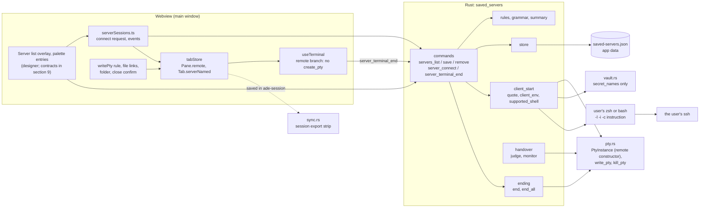
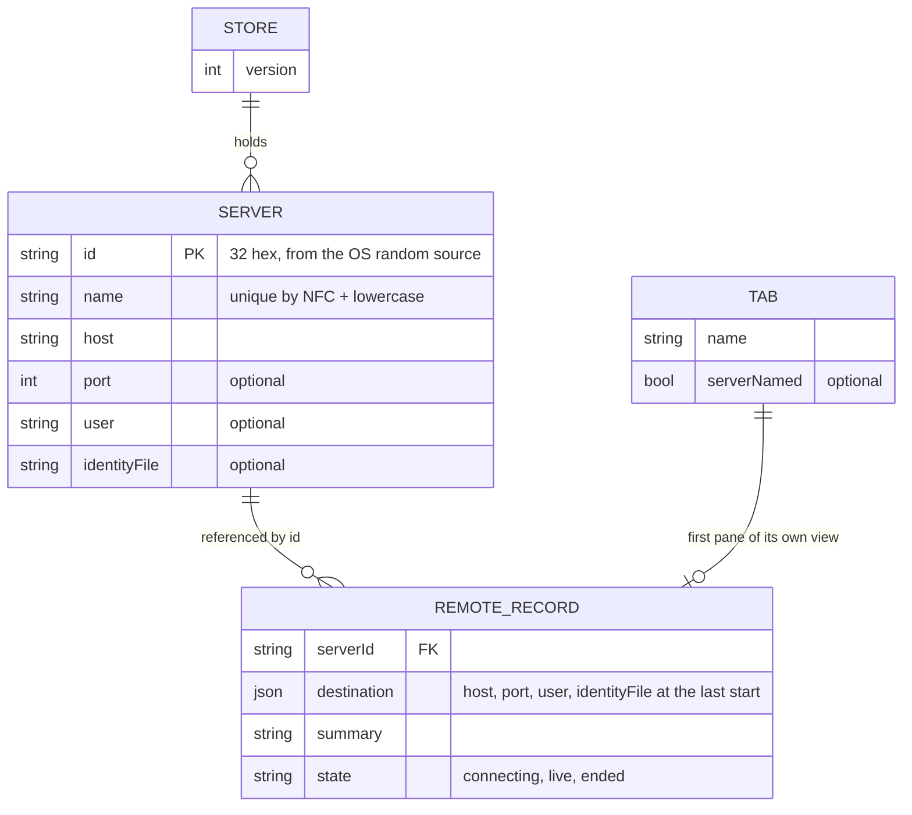

# F7 Saved servers (SSH), slice S1: design

- **Status:** revision 1, proposed 2026-11-18. **Not approved.** Not yet reviewed.
- **Covers:** `docs/prd.md` F7, slice **S1** only (SV-1 to SV-9, revision 7, approved
  by the owner 2026-11-18). S1b (SV-13) and S2 (SV-12) are not designed here;
  section 14 says what S1's seams leave for S1b.
- **Contracts:** `.ade/context/saved-servers.md`, `.ade/context/server-panes.md`.
- **ADRs (Proposed, numbers provisional):** 0043 (the store), 0044 (the client
  start), 0045 (ending a remote pane's terminal), 0046 (the hand-over check).
- **Verification command:** the one in force (`docs/architecture.md`), with no new
  line. One environment prerequisite is proposed there, marked not in force.
- **Evidence:** everything marked *run* was run on 2026-11-18 on macOS 26
  (Darwin 25.6, arm64) with `/bin/zsh` 5.9 and `/bin/bash` 3.2.57, against
  `portable-pty` 0.9.0 and `sysinfo` 0.33, by a scratch program outside the
  repository: a scratch `HOME` and `ZDOTDIR`, a stub `ssh` first on `PATH`, no host
  contacted, the user's own `~/.ssh`, keys, agent, keychain and start-up files never
  touched. A first run of the same program by an earlier session was not relied
  on: every result quoted here is from the second run. **Nothing was run on
  Linux** (no Linux machine or container was available); section 16 lists what
  that leaves unverified. Code references are to this branch (`origin/main` at
  18b6769).

The three hardest parts come first (sections 1 to 3). Section 4 on gives the
overview, the data, the webview side, the stories and the test map.

## 1. Ending a remote pane's terminal (SV-2 AC3)

### 1.1 What is wrong today, read and run

- `kill_pty` calls `kill`, which calls `remove`: it takes the instance out of the
  table and forgets its agent state (`src-tauri/src/pty.rs:503-515`, `216-219`). It
  signals nothing. The only `Child::kill` calls are in `#[cfg(test)]` helpers
  (`pty.rs:113-128`).
- Dropping the instance drops its `input` sender, so the writer thread's `recv`
  fails and the thread ends, dropping the library's writer (`pty.rs:44-56`). That
  writer is a `UnixMasterWriter`, and its `Drop` writes a newline and the
  terminal's end-of-file byte whenever the terminal has one set (`portable-pty`
  0.9.0, `src/unix.rs:393-405`).
- The reader thread holds its own duplicate of the master
  (`try_clone_reader`, `unix.rs:352-355`; `pty.rs:195-212`), so dropping the
  instance's master does not close the terminal and no hangup is sent.
- **Run:** with the library's writer and today's drop order, a stub in raw mode
  read exactly the bytes `[10, 4]` and was alive 1.5 s later, under both shells.

### 1.2 The decision

A remote pane's terminal is a **remote terminal**: a `PtyInstance` built by a second
constructor and ended only by one routine. Three rules (ADR 0045):

1. **ADE never takes the library's writer for a remote terminal.**
   `UnixMasterWriter` exists only as the return value of `take_writer`
   (`unix.rs:357-364`), and no other type in the crate's Unix code implements
   `Drop` (checked: one `impl Drop` in `unix.rs`). The remote constructor
   duplicates the master's descriptor (`MasterPty::as_raw_fd`, then
   `BorrowedFd::try_clone_to_owned`) into a `std::fs::File` and gives that to the
   writer thread. Closing a `File` writes nothing. So no code of ADE's or of the
   library's writes at drop.
2. **The hangup is a signal ADE sends, not a side effect of closing handles.**
   Closing every master handle would also hang the session up, but the reader
   thread is blocked in `read` on its own duplicate, and there is no safe way to
   close a descriptor another thread is reading. Signalling needs no cooperation
   from the reader: once the processes are gone the terminal's other side closes,
   the reader sees end of output by itself, and ADE then drops its handles.
3. **One routine, `saved_servers::ending::end`, is the only way a remote terminal
   leaves the table while its process may be alive.** `kill_pty` for a remote
   terminal's id delegates to it, so no webview path, old or new, can forget a
   remote terminal the way a local one is forgotten.

*Rejected:* (a) reuse `kill_pty` and patch the writer for every terminal. It fixes
today's defect for all terminals, which is a change to existing behaviour F7 does
not ask for (PRD F7.11); see 1.8. (b) `Child::kill`: on Unix the library's kill
sends a hangup to the one process id only (`portable-pty` `src/lib.rs:341-347`),
which misses a child `ssh` in its own foreground group and never escalates. (c)
Closing handles and waiting: needs the reader's cooperation and still does not
kill a job that ignores the hangup.

### 1.3 "A process of the pane", in code

Read at the moment of the action, and again on every poll:

- `leader`: the process id ADE started for the terminal. `portable-pty` calls
  `setsid` for it (`unix.rs:257`), so it leads its own session and its id is the
  session's id.
- `fg`: the terminal's foreground process group, `tcgetpgrp` on the master
  (`MasterPty::process_group_leader`), when it is above 0.
- A process `p` is **a process of the pane** when `getsid(p) == leader`, it is not
  a zombie, and (`p == leader` or `getpgid(p) == fg`).

That is F7.1's definition: the session's shell or whatever replaced it (same
process id), and the foreground job. A process a start-up file moved to a session
of its own fails `getsid(p) == leader` and is left. A background job of the
session is left too, as when any terminal is closed. The set is one pure function
over a table of `(pid, sid, pgid, start time, zombie)` rows, so it is unit-tested
without a terminal; the table comes from `sysinfo` (process ids, start times,
status) and `libc::getsid` / `getpgid`.

### 1.4 The routine

`end(table, agent, id) -> Ended`, blocking, called off the UI thread except at exit
(1.6):

| Step | What | Why |
|---|---|---|
| 1 | Under the table lock: if the instance is not remote, or is already ending, return (a second caller waits on the first's completion signal). Mark it `ending`. Read `leader`, its start time, and `fg`. | Idempotent. `write_to` (`pty.rs:374-379`) and `type_line` gain one check: a terminal marked `ending` is sent nothing, and `write_to` returns `Ok`, so a key pressed during the ending is dropped without an error reaching the webview's log. |
| 2 | Compute the set (1.3). Send each member `SIGHUP`, then `SIGCONT`, by process id, after checking its start time still matches. | A stopped job does not act on a hangup until continued. By id, not `killpg`, so only members of this session are signalled. The start-time check guards a reused id. |
| 3 | Every 50 ms: recompute the set (with the `fg` read in step 1 and the current one). Empty: go to 5. | A hangup handler may have changed the foreground group. |
| 4 | At 2 s from step 1: send `SIGKILL` to every member still alive, once; keep polling. At 5 s: stop polling whatever is left. | SV-2 AC3: an uncatchable kill at 2 s, none alive within 5 s. `SIGKILL` leaves nothing to wait for but the kernel. |
| 5 | Remove the instance (`remove`, `pty.rs:216`): the master and ADE's own writer `File` are dropped; the waiter thread has reaped the leader; the reader thread ends at end of output. Signal completion. | Dropping writes 0 bytes (rule 1). |

The pane's exit event follows from the waiter thread (section 3.6), with
`by: "ended"` and no kind, so an End leaves the pane ended with its output.

**Run** (each case under `/bin/zsh` and `/bin/bash`, the stub in raw mode recording
every byte it reads, a fixture process the start-up file put in its own session):

| Case | Members found | None alive after | Kill sent | Bytes the stub read | Own-session process |
|---|---|---|---|---|---|
| stub is the pane's own process (live) | leader | 30 ms (zsh), 117 ms (bash) | no | 0 | alive |
| stub is a child of the shell (connecting) | child and shell | 32 ms, 34 ms | no | 0 | alive |
| the pane's own process ignores the hangup | leader | 2079 ms, 2097 ms | at 2010 ms, 2025 ms | 0 | alive |
| a child ignores the hangup | child and shell | 2139 ms, 2104 ms | at 2060 ms, 2033 ms | 0 | alive |
| a fixture program the start-up file put in the shell's place | leader | 36 ms, 40 ms | no | 0 | alive |
| *today's close, for contrast* | | stub alive at 1.5 s | | `[10, 4]` | |

In every designed case the leader was reaped, and the reader reached end of output
before ADE dropped its master. The kill lands up to one poll late (2.01 to 2.06 s);
"2 s" in the PRD is met as "at the first poll at or after 2 s".

### 1.5 Who calls it

| Action | Path |
|---|---|
| End (SV-2 AC9) | webview `invoke("server_terminal_end", { id })`; `#[tauri::command(async)]`, so it runs off the UI thread and resolves when the routine returns |
| A confirmed close of the pane; a close of the tab | `destroyInstance` (`src/hooks/useTerminal.ts:158-163`) sends `server_terminal_end` in place of `kill_pty` when the pane's record is remote; not awaited |
| Any other `kill_pty` for a remote terminal's id (the closed-while-starting path, `useTerminal.ts:598`) | `kill` in `pty.rs` delegates to `end` for a remote instance |
| The main window is destroyed | `tauri::Builder::on_window_event`: `WindowEvent::Destroyed` for the window labelled `main` calls `end_all(.., Wait::No)` |
| Better Terminal exits | `App::run`'s callback: `RunEvent::Exit` calls `end_all(.., Wait::Yes)` |

`end_all(table, agent, wait)` starts `end` for every remote terminal that is not
already ending, each on its own thread, and with `Wait::Yes` blocks until all have
returned. It is the **teardown routine** of SV-2 AC3's static test. Today `lib.rs`
ends in `.run(tauri::generate_context!())` with no window-event handler and no run
callback (`src-tauri/src/lib.rs:503-601`); the story changes that to
`.on_window_event(..)`, `.build(..)` and `.run(|app, event| ..)`. Server tabs live
only in the main window (Move to New Window is refused, section 8.6), so "every
remote terminal" is "the main window's".

**The static wiring test** (Rust, `saved_servers/wiring.rs`): it scans every `.rs`
file under `src-tauri/src/` outside `#[cfg(test)]` modules for `end_all(` and
compares the sites with the checked-in list
`src-tauri/src/saved_servers/teardown.sites` (two lines: the `Destroyed` handler
and the `Exit` handler, each as `file: enclosing item`). A missing or extra site
fails. The same test file holds the list of sends into a terminal's input queue
(section 8.8).

### 1.6 What a quit costs

- No remote terminal connecting or live: nothing is waited for.
- Every process obeys the hangup: about 30 to 120 ms (run; it includes one 50 ms
  poll).
- A process ignores the hangup: 2.0 to 2.15 s (run), once, however many panes,
  since the endings run in parallel.
- Hard stop: 5 s, then ADE exits whatever is left.

The main window's close does not block: its endings run on their own threads, and
if destroying that window makes ADE exit, the exit handler then waits for the same
endings. With a detached window still open ADE stays, and the endings finish in
the background. A crash or a forced quit runs none of this; the operating system
closes the terminal and hangs the session up (PRD F7.9).

**Unverified:** that Tauri 2.10 delivers `RunEvent::Exit` for every way of
quitting on macOS (the menu's Quit, the Dock, a log-out) and on Linux. The static
test proves the wiring, not the delivery. The story records one manual run per
platform in its notes; if a route is found that skips `RunEvent::Exit`, that comes
back as a defect against this design, not a silent gap.

### 1.7 Tests

| Test | Kind | Asserts |
|---|---|---|
| the set of 1.3 over a table of rows | Rust, pure | leader, foreground members, other-session and zombie rows |
| `end` against fixture programs started directly in a remote terminal (the recording stub as leader; `sh -c` with the stub as a child; each ignoring the hangup; an own-session process) | Rust, Unix, real PTY | 0 bytes recorded; none alive at 5 s; the kill only in the ignoring cases; own-session alive; `write_pty` after the call queues nothing; a second call returns |
| SV-2 AC3's matrix through a real client start (live; connecting as a child; connecting replaced; each ignoring), ended by `server_terminal_end`, by `kill_pty`, and by `end_all` with each `Wait` | Rust, Unix, `zsh` and `bash` | the same outcomes |
| the wiring test of 1.5 | Rust, static | the two call sites |
| a confirmed close and a tab close each send one `server_terminal_end` and 0 `write_pty` | TypeScript, store | section 8 |

### 1.8 A note for whoever owns `pty.rs` (not an F7 requirement)

Every local terminal still ends the old way: no signal, a newline and the
end-of-file byte typed into it, the process left to end by itself (1.1). An `ssh`
typed by hand in any tab is closed that way today. F7 leaves it. The remote
constructor shows the fix (ADE's own duplicate as the writer; an explicit hangup
with an escalation), and applying it to every terminal is a separate change to
existing behaviour with its own decision.

## 2. The client start (SV-2 AC1, AC2, AC5, AC8, AC10)

### 2.1 The invocation

ADE starts the shell `shell_from` gives (`src-tauri/src/platform.rs:45-58`:
`$SHELL`, or `/bin/zsh` when unset or empty) with exactly four arguments:

```
<shell> -l -i -c <instruction>
```

| Shell (base name, exactly) | Instruction, before quoting | Words |
|---|---|---|
| `zsh` | `exec command ssh G...` | `exec`, `command`, `ssh`, then the grammar |
| `bash` | `exec ssh G...` | `exec`, `ssh`, then the grammar |

**Every word is quoted** by the rule of ADR 0008 (2.3) and the words are joined by
one space: for `{host: db1.example.com, port: 2222, user: deploy}` under `zsh` the
fourth argument is

```
'exec' 'command' 'ssh' '-p' '2222' '-l' 'deploy' '--' 'db1.example.com'
```

Why these words: in `zsh` a plain `exec ssh` runs a function named `ssh`, and
`command` skips functions; in `bash` `exec` already runs the program. Quoting stops
alias expansion on every word, global aliases included. `-l -i` makes the shell
read the files a new ADE terminal's shell reads (`$SHELL -l` on a terminal is
interactive). `-c` keeps the instruction out of every history file and means ADE
types nothing.

**Run**, per row of SV-2 AC2's table (the definition confirmed in effect by the
start-up file's own last line; "own" means the stub's process id equals the
pane's):

| Added to the start-up file | `zsh` | `bash` | Required |
|---|---|---|---|
| nothing (base) | stub, exactly the grammar, own; home folder; `SSH_AUTH_SOCK=/marker`; no history file | the same | (i) |
| a function `ssh`, then an alias `ssh` | (i) | (i) | (i) |
| a global alias `ssh` | (i) | n/a | (i) |
| a global alias on the Host value | (i), last argument unchanged | n/a | (i) |
| a global alias on `--` | (i), no `-o` | n/a | (i) |
| an alias `exec` | (i) | (i) | (i) |
| a function `exec` that returns | exits 0, no stub | exits 0, no stub | (i) or (ii) |
| a function `command` that returns | exits 0, no stub | not a word of the instruction: (i) | (i) or (ii) |
| a function `command` (zsh) or `exec` (bash) that runs its arguments | stub as a **child**, exactly the grammar; the pane's process stays the shell | the same | (ii), connecting |
| `hash ssh=/bin/echo` | `echo` runs with first word `ssh` and the grammar, prints it, exits 0 | the same; too brief to be sampled | (i) or (ii) |
| no `ssh` on `PATH` | exits 127, "command not found: ssh" | exits 127, "exec: ssh: not found" | SV-8 AC2 |

A function named `builtin` (the PRD's `bash` row) is not a word of either
instruction, so that row gives (i). **Not run:** bash 5 (5.3 is installed on the
machine and can be added to the fixture matrix; CI's Linux image carries bash 5.1,
which decides there), other `zsh` versions, Linux.

### 2.2 The supported-shell decision (SV-2 AC10)

`supported_shell(path) -> Result<Shell, Kind>` is pure: the base name is the text
after the last `/`; `zsh` and `bash` are supported, exactly; anything else is the
"shell not supported" kind, carrying the base name only when it is 1 to 32
characters of `A-Z a-z 0-9 . _ + -`. It runs before anything is started. The path
is never carried.

### 2.3 Quoting in Rust without a second quoter (SV-7 AC3)

The webview may not build the instruction (it never sees an argument), so Rust
must quote. ADR 0008's quoter is a rule with one TypeScript implementation
(`src/lib/shellQuote.ts`). The design keeps **one rule and one table**:

- `src/lib/shellQuote.cases.json` is a checked-in table of `[input, output]` pairs
  (the empty string, plain words, every character of `0x20`-`0x7e`, runs of `'` and
  `\`, a leading and a trailing quote).
- `shellQuote.test.ts` asserts the TypeScript quoter against it; a Rust test
  asserts `saved_servers::quote::shell_quote` against the same file
  (`include_str!`). A case added for one side is a test on both.
- The Rust function is used only by the client start. The source scan that guards
  ADR 0008 in the webview is unchanged; the Rust wiring test asserts that
  `shell_quote` is the only function in `src-tauri/src/saved_servers/` that emits
  a quote character into an instruction.

Validation (section 6) already refuses every character outside `0x20`-`0x7e` in a
grammar value, so no control character reaches the quoter.

### 2.4 The environment (SV-2 AC8)

```rust
/// What ADE hands the shell of a client start. No input is a vault value.
pub fn client_env(
    base: Vec<(OsString, OsString)>,   // in the app: std::env::vars_os()
    remove: &[String],                 // the vault's list of names
    macos: bool,
) -> Vec<(OsString, OsString)>
```

1. Start from `base`, and from nothing else.
2. Drop every variable whose name starts `ADE_`, and every variable whose name is
   in `remove`.
3. Set `TERM=xterm-256color`. On macOS, when `LANG`, `LC_ALL` and `LC_CTYPE` are
   all unset or empty, set `LANG=en_US.UTF-8` (`platform::default_locale`, as for a
   terminal).

It sets nothing else: no `ADE_*`, no `SSH_*`, no vault value. The spawn then does
`CommandBuilder::new(shell)`, **`env_clear()`**, and `env(k, v)` for each pair.

**Why a builder that starts from `CommandBuilder::new` is wrong.** `new` copies the
process's whole environment at construction (`portable-pty`
`src/cmdbuilder.rs:215-224`, `get_base_env`, `74-86`). A builder that lays the
filtered base over that copy passes whatever the process holds and the base does
not: on a developer's machine, the outer ADE terminal's `ADE_HOOK_TOKEN` and vault
values. SV-2 AC8's `ADE_ONLY_IN_PROCESS` row exists to catch it. **Run:** with
`env_clear()` and an explicit list, a variable set only in the process was absent
from the stub's environment, `KEEP_ME` was present, and the start-up file's
`SSH_AUTH_SOCK` and `ADE_FROM_RC` were present.

**One thing the library adds, stated:** when it builds the command, `portable-pty`
sets `SHELL` itself after clearing (`cmdbuilder.rs:498-529`): the builder's own
`SHELL` if it has one, else the user's shell from the password database. Run: the
stub saw `SHELL=/bin/zsh` although the list held none. In the app the base holds
`SHELL` already, so nothing changes; the test's "nothing else" assertion excludes
`SHELL`. `client_start` does not call `apply_hook_env` (`pty.rs:250-257`) and takes
no `agent.terminal_env`.

**The list of names.** `vault.rs` gains one function, the only thing of the vault's
F7 may name:

```rust
/// The vault's secret names, from vault-index.json. No keychain call.
pub(crate) fn secret_names(app_data: &Path) -> Vec<String>
```

It wraps today's private `read_index` (`src-tauri/src/vault.rs:78-83`), which reads
a missing or unparseable file as empty. It is read at every client start.

**The keychain stand-in.** `keyring` 3.6.3 has
`set_default_credential_builder` (`src/lib.rs:332`) and a public
`CredentialBuilderApi` (`src/credential.rs:152`). The stand-in is process-wide, and
Rust runs one binary's tests on parallel threads, so the "0 calls" test is a test
binary of its own: `src-tauri/tests/saved_servers_keychain.rs`. It installs a
recording builder, then runs add, edit, remove, a client start, a second one and a
list load against a fixture app-data folder, and asserts 0 recorded calls and a
byte-identical `vault-index.json`. For that the client-start core and the store
are reachable from an integration test: `saved_servers` is a `pub mod` with a
small `pub` surface that takes paths and a sink, not a Tauri handle, as
`bmadswitch` and `projectsetup` are for `tests/bmadswitch_e2e.rs`.

### 2.5 The command and what the webview sends

```rust
#[tauri::command(async)]
pub fn server_connect(
    app, window, ptys, agent,
    server_id: String,           // the identifier, and nothing else of the server
    rows: u16, cols: u16,
    on_event: Channel<PtyEvent>,
) -> Result<Connected, Kind>
```

`Connected` is `{ ptyId, destination: {host, port?, user?, identityFile?},
summary }`: the destination of this client start, for the pane's remote record.
The order inside, each refusal before any process exists:

1. `availability` (section 11): "not available in an engagement"; the window must
   be `main`.
2. Load the store: "the server list could not be read".
3. Find the identifier: "that saved server no longer exists".
4. `rules::check` on the record (section 6): "a saved server failed its checks",
   with the field's name.
5. `supported_shell`: "shell not supported".
6. Build the grammar (the home folder from `crate::env_home`), the instruction and
   the environment; open the terminal; spawn in the home folder: "could not start a
   terminal", carrying the error number when the library's error holds one.
7. Insert the remote instance **with no `/open` request id** and start its reader,
   writer, waiter and monitor (section 3).

**No `/open` can type into it.** `type_line` reaches a terminal only after
`claim_ok` matched the terminal's request id (`src-tauri/src/terminal_open.rs:242-246`),
and a remote instance's is always `None`. The story also makes
`Ptys::type_line` (`pty.rs:164-167`) refuse a remote instance outright, so the
property does not rest on the claim alone; a unit test calls it for a remote
terminal's id and asserts `false` and an empty queue.

Reconnect is the same command for the same pane (section 8.4). There is no other
caller: the wiring test asserts that `client_start::start` has one call site
outside tests, `server_connect`.

### 2.6 Tests that need a real shell

SV-2 AC2, AC8, AC9, AC3's matrix, AC4, AC10's "0 processes" rows, SV-7 AC2 and
AC3, SV-8 AC2 and SV-5 AC4's sweep start `zsh` and `bash` for real. One fixture
module, `saved_servers::fixture` (`#[cfg(test)]`, and `pub` behind the
integration test's needs), builds a fixture root per test under the system temp
folder: `home/` (set as `HOME` **and** `ZDOTDIR`), `bin/` (the stub, first on
`PATH` by the start-up file), `out/` (records); `BASH_ENV` and `ENV` are never in
the base it passes. The start-up file is `.zshrc` for `zsh` and `.bash_profile`
for `bash`. `shell(name)` resolves `zsh` and `bash` on `PATH` and **panics with
"zsh is required" when one is missing**: a test never skips.

**The stub is a compiled program**, because the base case must show the form
`[P, G]`, which a script never does (a script shows under its interpreter). It is
a Cargo **example** target: `[[example]] name = "f7_ssh_stub"`, source
`src-tauri/tests/support/ssh_stub.rs`. `cargo test` builds examples and
`cargo build --release` does not (**run** on a scratch crate: the example was at
`target/debug/examples/f7_ssh_stub` after `cargo test`, a unit test found it from
`current_exe()` and ran it through a link named `ssh`, and a release build made
no example), so the stub is in no shipped build and the verification command
needs no new line. The fixture links it into `bin/` as `ssh`; the script cases
write a `#!/bin/sh` or `#!/usr/bin/env bash` file there that runs it. Its
behaviour comes from variables the fixture sets (record folder; exit with a
status, stay, or go raw and record every byte; ignore the hangup). `cargo test
--lib` alone does not build examples: the fixture then panics with "run cargo
test without --lib", which the verification command never does.

## 3. The hand-over check (SV-2 AC9)

### 3.1 How ADE observes the pane's own process

`image(pid) -> Option<Vec<String>>`: `sysinfo` 0.33, refreshed for that one process
id with `ProcessRefreshKind::nothing().with_cmd(UpdateKind::Always)`, the call
`fg_facts` already makes for the foreground leader (`pty.rs:633-648`); here it is
given **the process id ADE started**, never the foreground group. On macOS
`sysinfo` reads the arguments with `sysctl(KERN_PROCARGS2)`; on Linux it reads
`/proc/<pid>/cmdline`.

**Run on macOS:** the argument list was returned for the shell, for the stub, for
a `/bin/sh` script, for `/usr/bin/env bash script` and for `/bin/echo` started
under the name `ssh`, in every sample taken. A login shell started this way shows
exactly the list ADE passed (`/bin/zsh -l -i -c ...`), not `-zsh`: ADE passes `-l`
and does not rewrite the first word. **Unverified on Linux:** the same through
`/proc`. A process whose arguments cannot be read (another user's, under
`hidepid`) gives no observation, which is the safe side.

### 3.2 Two things a sample can be that are not an image of the shell's making

**Run, and not in the PRD.** In the first tens of milliseconds after the spawn
returned, 20 ms samples showed, before the shell's own list:

- **an empty list** (in most starts): the process is between images;
- **the list of the process that started it** (11 of the 37 starts run): taken
  to be the forked copy before it became the shell (the cause is inferred; the
  sample is what was run). In the app that is ADE's own argument list.

Read literally, "the first image ADE observes that is not that shell is judged"
would judge those "another program" on most Connects. So the design defines an
**observation**:

> A sample is an observation unless it is unreadable, empty, or equal to the
> argument list of the ADE process itself.

Every excluded sample only delays a judgement; none can make a pane live. A
start-up file that replaced the shell with ADE's own binary and ADE's own
arguments would stay "connecting" and get "not handed over yet" at the bound, the
safe direction. This is question Q1 for the product manager (section 15): the
wording of SV-2 AC9 should say it.

### 3.3 The judging function

```rust
pub enum Judged { StillShell, SshClient, Other }
/// Pure. `started`: the list ADE started the shell with. `observed`: an observation.
/// `grammar`: the arguments of this client start.
pub fn judge(started: &[String], observed: &[String], grammar: &[String]) -> Judged
```

`base(w)` is the text after the last `/`. `I` is a word whose base is exactly one
of `sh`, `bash`, `zsh`, `dash`, `ksh`.

| Observed | Judged |
|---|---|
| equal to `started`, word for word | `StillShell` |
| `[P, G]`, `base(P) == "ssh"` | `SshClient` |
| `[I, P, G]`, `base(P) == "ssh"` | `SshClient` |
| `[E, I, P, G]`, `base(E) == "env"`, `base(P) == "ssh"` | `SshClient` |
| anything else | `Other` |

`G` must equal `grammar` exactly, in order, with nothing before, between or after.
The table SV-2 AC9 gives is the unit test, plus these rows, which this design
places:

| Row | Judged | Why |
|---|---|---|
| `[/bin/sh, -e, /x/ssh, G]`, `[bash, -e, /x/ssh, G]` (an interpreter line with an option; **run**: this is what `#!/bin/sh -e` shows on macOS) | `Other` | The shape `[I, option, P, G]` is not one meaning: with `-c` the word after it is a command string and `G` becomes positional parameters, so `P` runs with **no** arguments; with `-s` the script is read from input. Accepting "an option" would accept those. A closed list of harmless options (`-e`, `-u`, `-x`) is possible later, one fixture each. Until then the pane of such a wrapper stays connecting with the message while its session works. |
| `[bash, -l, /x/ssh, G]`, `[env, -i, sh, /x/ssh, G]`, `[-bash, /x/ssh, G]`, `[-zsh, ...]` | `Other` | unlisted; the PRD's safe side |
| `[/bin/sh, <shell wrapper script>, -l, -i, -c, instruction]` (a `$SHELL` that is a script; **run**) | `Other` | see 3.5 |
| `[ssh, G]` whose executable is `/bin/echo` (a `hash` entry; **run**) | `SshClient` | the PRD's stated case: the argument list decides |

### 3.4 The monitor: one thread, one pure state machine

Each remote terminal has a **monitor** thread. It owns the pane's state and is the
only sender of the events of section 3.6, so their order is fixed. Its logic is a
pure function, tested without a process:

```rust
pub enum Input { Sample(Option<Vec<String>>), Tick(Duration), Exited(Option<i32>), EndedByUser }
pub enum Output { Live, Notice(NoticeKind), Exit { status: Option<i32>, kind: Option<Kind>, by_user: bool } }
pub fn step(state: &mut Monitor, input: Input) -> Vec<Output>
```

| State | Input | Then |
|---|---|---|
| watching | a sample that is not an observation, or `StillShell` | watching |
| watching | `SshClient` | **live**; emit `Live` (a showing notice is thereby cleared); stop sampling |
| watching | `Other` | **judged not**; emit `Notice(AnotherProgram)` at once; stop sampling; never live |
| watching | `Tick` at or past the bound, no notice yet | emit `Notice(NotYet)`; keep sampling |
| watching or judged not | `Exited(s)` | emit `Exit` with kind "no SSH client found" when `s == 127`, else "ended before ssh was seen to start"; both carry `s` |
| live | `Exited(s)` | emit `Exit { status: s, kind: None }` |
| any | `EndedByUser`, then `Exited` | emit `Exit { by_user: true, kind: None }` |

Judged once: after `SshClient` or `Other` no sample is taken again. ADE ends,
signals and stops nothing here; the monitor only reports.

**Sampling interval.** 25 ms for the first 2 s after the start, 100 ms until the
bound, 500 ms after it for as long as the pane stays watching. One sample is one
`sysctl` or one small file read. Run: with 20 ms samples the shell's hand-over to
the stub was seen 26 to 60 ms after the spawn, and a `/usr/bin/env bash` wrapper's
first image at 24 ms.

**The bound** is 30 s in the app. `Monitor::new(bound)` takes it, and the tests
pass 2 s. `Tick` carries the time since the client start, from a monotonic clock.

**The wrapper that adds arguments** (run): `#!/usr/bin/env bash` then `exec real
-o ControlMaster=auto "$@"` showed `[/usr/bin/env, bash, P, G]`, then `[bash, P,
G]`, then the real client with the added option, one process id throughout. The
first is judged `SshClient` and nothing after it is judged.

### 3.5 A `$SHELL` that is itself a script: confirmed

Run: with `$SHELL` a `#!/bin/sh` script that runs the real shell with the same
arguments, the first observation was `[/bin/sh, <script>, -l, -i, -c,
instruction]`. It is not `started`, so it is judged `Other`: "another program is
running" at once, on every Connect, while the session then works (the real shell
handed over to the stub 1.5 s later, unjudged). The PRD's suspected limit (F7.9)
holds as written. Recognising `[I, started...]` as "still that shell" would remove
it; that is a change to SV-2 AC9's rule and is question Q3, not done here.

### 3.6 The pane's events and the exit status

A remote terminal reports on the same channel a terminal's output uses
(`PtyEvent`, `pty.rs:170-179`; contract in `.ade/context/server-panes.md`):

| Event | JSON | When |
|---|---|---|
| output | `{"type":"output","data":[..]}` | unchanged |
| live | `{"type":"live"}` | `Output::Live` |
| notice | `{"type":"notice","kind":"not-handed-over-yet"}` or `"not-handed-over-another-program"` | `Output::Notice` |
| exit | `{"type":"exit","status":255,"kind":null,"by":"process"}` | `Output::Exit` |

**`exit` now carries `status`, `kind` and `by`, for every terminal.** `status` is
the process's exit status, or `null` when it was ended by a signal or is unknown.
A local terminal sends `{"type":"exit","status":null,"kind":null,"by":"process"}`:
its exit is still sent by its reader at end of output (`ptysink::pump`), which has
no status, and F7 does not change that path. The field is present on every exit so
that the webview has one shape.

For a remote terminal the reader does **not** send the exit. A **waiter** thread
blocks in `Child::wait` and gives the monitor `Exited(status)`; the monitor waits
for the reader's end of output, at most 1 s, then sends the exit through the
terminal's sink and removes the instance. So the exit follows the last output
(SV-2 AC4: "the output after the stub's last byte is empty"), and a background
process holding the terminal open cannot hold the exit back for more than 1 s.

Threads per remote terminal: reader (as today), writer (ADE's own duplicate),
waiter, monitor. The waiter reaping the leader is also what makes "not alive"
true for it at once.

### 3.7 Tests

| Test | Kind |
|---|---|
| `judge` over SV-2 AC9's table and 3.3's rows | Rust, pure |
| the observation rule of 3.2 (empty, unreadable, ADE's own list) | Rust, pure |
| `step` over every row of 3.4, the notice-then-live sequence, and "judged once" | Rust, pure |
| SV-2 AC9's eleven fixture cases, bound 2 s | Rust, Unix, `zsh` and `bash` |
| the shell-wrapper fixture of 3.5: "another program" at once, the stub alive at twice the bound | Rust, Unix, `zsh` and `bash` |
| SV-2 AC4: stub exits 0 and 255 after live; status reported; nothing alive; no output after the stub's | Rust, Unix |
| each kind's message, End beside the hand-over message, both gone on live, the status shown | component |

## 4. Overview

S1 adds one Rust module tree, `src-tauri/src/saved_servers/`, one store file, five
commands, one field on a pane and one on a tab. No new process, service or
dependency on a network. Nothing of F7 runs unless the engineer opens the list or
presses Connect or Reconnect.



**Rust files** (the checked-in list `src-tauri/src/saved_servers/sources.list`,
which SV-7 AC4's text test reads; the test also fails when a `.rs` file under
`saved_servers/` is not in the list):

| File | Holds |
|---|---|
| `mod.rs` | the five commands, `availability`, the `pub` surface for integration tests |
| `rules.rs` | `check`, the name key, the destination summary, the list order |
| `grammar.rs` | `arguments(record, home)` |
| `store.rs` | the file, its version, load, the three mutations |
| `kinds.rs` | the twelve kinds and their JSON |
| `quote.rs` | `shell_quote` (section 2.3) |
| `client_env.rs` | `client_env` (section 2.4) |
| `client_start.rs` | `supported_shell`, the instruction, the spawn |
| `handover.rs` | `judge`, `step`, the sampler, the monitor and waiter threads |
| `ending.rs` | the set, `end`, `end_all` |
| `wiring.rs` | the static tests (`#[cfg(test)]`) |
| `fixture.rs` | the fixture home, stub and shells (tests) |

Outside the tree S1 touches: `pty.rs` (the remote constructor, `PtyEvent`, the
delegation in `kill`, the refusal in `type_line`), `ptysink.rs` (an exit that
carries the three fields), `vault.rs` (`secret_names`), `sync.rs` (the export
strip), `lib.rs` (the commands and the two handlers).

```mermaid
sequenceDiagram
  actor E as Engineer
  participant W as Webview
  participant R as Rust (saved_servers)
  participant S as zsh or bash
  participant C as ssh
  E->>W: Enter on a server's palette entry
  W->>R: server_connect(serverId, rows, cols, channel)
  R->>R: availability, load store, find, check, supported_shell
  alt refused before any start
    R-->>W: reject(kind)
    W->>E: message in the list (name from the list it holds); no tab
  else started
    R->>S: spawn shell -l -i -c 'exec' 'command' 'ssh' ...
    R-->>W: { ptyId, destination, summary }
    W->>W: one store update: new tab, name, serverNamed, pane.remote = connecting
    S->>S: start-up files
    S->>C: exec (same process id)
    R->>R: monitor samples the process: [ssh, G] is the SSH client
    R-->>W: {"type":"live"}
    W->>E: mark changes to live
    C-->>R: exits with a status
    R-->>W: {"type":"exit","status":N,"kind":null,"by":"process"}
    W->>E: ended, Reconnect
  end
```

## 5. The store (SV-1 AC2 to AC4, SV-5 AC1, SV-7 AC5; ADR 0043)

- **Where:** `saved-servers.json` in the instance's app-data folder
  (`app.path().app_data_dir()`), beside `vault-index.json`. An instance's app data
  is its profile's, so the list is per profile. It is **not** under `state/`
  (`state.rs:229-234`), so it is not a persisted key: the webview cannot read or
  write it as storage, the 10-minute snapshots do not copy it, and ADE sync, which
  exports named keys of that folder (`sync.rs:36-47`), cannot export it.
- **Who writes it:** Rust only, through `state::atomic_write` (`state.rs:63-84`: a
  sibling temp file, fsync, rename). A failed write leaves the old file whole.
- **Format, version 1:**

```json
{
  "version": 1,
  "servers": [
    { "id": "3f6c0e9a51d24b7c8a1e0d5b9c2f7a64", "name": "db1",
      "host": "db1.example.com", "port": 2222, "user": "deploy",
      "identityFile": "~/.ssh/id_ed25519" }
  ]
}
```



- **Loading**, one function, `load(path) -> Result<List, Kind>`:

| On disk | Result |
|---|---|
| no file | an empty list |
| not JSON; not an object; `version` missing, not an integer, or below 1; `servers` not an array; a row that is not an object; an `id` that is not 32 lowercase hex characters or occurs twice; one of the five members present with the wrong JSON type | "the server list could not be read". **Nothing is written** by any command until it loads |
| `version` above 1 | the same |
| a member other than `id` and the five | dropped on load; gone from the file at the next save (SV-1 AC2) |
| a row whose values fail `rules::check` | loaded, with `problem: <field name>`; listed; Connect refused (section 2.5); Edit and Remove allowed |
| more than 200 rows | loaded; Add refused |

- **Mutations** (`add`, `edit`, `remove`): under one process-wide mutex, load from
  disk, check, apply, write. Nothing is cached between calls: the file is
  untrusted input and is read every time (at most 200 small rows). `add` refuses
  when the list already holds 200 ("the server list is full"). A refused check
  writes nothing. A write that fails returns "the server list could not be saved"
  with the error number, and the next load gives the list as it was.
- **After a mutation** Rust emits the Tauri event `servers-changed` (no payload) to
  the main window; the webview reloads the list. The palette and every Reconnect
  control read that list.
- **Two processes on one profile** (possible today; F1's lock is not on `main`): the
  later write wins, whole. No merge.

*Rejected:* a persisted key in the webview's storage (`ade-servers`): it would be
snapshotted 21 times, would sit one typo away from `SHARED_KEYS`, and would make
the webview a writer of the rows the rules guard.

## 6. Rules, grammar, summary (SV-1 AC1, SV-2 AC1, SV-9 AC1)

One implementation, Rust, `rules.rs` and `grammar.rs`. The webview never
validates, builds a summary or sees an argument: the form sends what was typed and
shows the field the kind names.

- `check(input, existing) -> Result<Record, Field>`: SV-1 AC1's table, field by
  field. Host: the character set and first character, then (a) with a `:`,
  `std::net::Ipv6Addr::from_str` must accept it and it must not be `::`; (b) only
  digits and dots: four decimal parts 0 to 255 with no leading zero; (c) no
  dot-separated part starting `0x` or `0X`. Name: trimmed, 1 to 64 code points,
  each passing `terminal_open::name_char_ok` (`terminal_open.rs:180`, the rule
  `ade open --name` uses); unique by **name key**, which is NFC then
  `str::to_lowercase`. NFC needs one new direct dependency,
  `unicode-normalization` (`icu_normalizer` is in the lock file only through
  another crate's internals).
- `arguments(record, home) -> Vec<String>`: `[-p PORT] [-l USER] [-i FILE] -- HOST`;
  a leading `~/` in the identity file is replaced by `home` (from
  `crate::env_home`, `lib.rs:66`); at most 8 words.
- `summary(record) -> String`: `[USER@]HOST[:PORT]`, an IPv6 host in brackets when
  a port follows. `servers_list` returns it with each row, and returns the rows
  **in order** (name key, then code points), so the webview sorts nothing.
- `identity_warning(path) -> Option<Warning>`: `std::fs::symlink_metadata` only,
  never an open; "not found" or "not a regular file". Returned by `servers_save`
  beside the saved row; never a refusal (SV-1 AC5).
- The hostile fixture (SV-7 AC2) is `src-tauri/src/saved_servers/hostile.json`: at
  least 40 values per field. The pure half (refused, or accepted with every
  character in the field's set) runs in `rules.rs`; the half that goes through a
  client start runs with the fixture shells.

## 7. Kinds (SV-5 AC4)

`Kind` is one Rust enum, serialised as `{ "kind": "<id>", ...payload }`. It is the
value every F7 command rejects with and the `kind` of an exit or notice event. No
variant has a field that can hold text ADE did not choose, except the shell's
base name under 2.2's rule.

| Id | Payload | Before any start |
|---|---|---|
| `server-failed-checks` | `field`: one of `name`, `host`, `port`, `user`, `identityFile` | yes |
| `list-unreadable` | none | yes |
| `list-not-saved` | `errno`: integer or absent | n/a |
| `list-full` | none | n/a |
| `server-gone` | none | yes |
| `shell-not-supported` | `shell`: the base name, or absent | yes |
| `not-in-engagement` | none | yes |
| `terminal-not-started` | `errno`: integer or absent | yes (no process exists) |
| `no-ssh-client` | `status`: 127 | no (an exit) |
| `ended-before-ssh` | `status`: integer or absent | no (an exit) |
| `not-handed-over-another-program` | none | no (a notice) |
| `not-handed-over-yet` | none | no (a notice) |

The webview mirrors the ids in `src/lib/serverKinds.ts` as a union type; a
TypeScript test reads `kinds.rs`'s checked-in id list
(`src-tauri/src/saved_servers/kinds.list`) and fails when the two differ. **A
message that names a server is composed in the webview**: the caller knows the
identifier it sent and looks the name up in the list it holds; a kind never
carries a name. F7's code logs nothing through `log_error` on either side; a
rejection left unhandled reaches `main.tsx`'s handler as the kind's JSON, which
holds no value (SV-5 AC4's TypeScript test).

## 8. The webview side

### 8.1 Records

```ts
// src/stores/tabStore.ts
interface RemoteRecord {
  serverId: string;
  destination: { host: string; port?: number; user?: string; identityFile?: string };
  summary: string;                       // Rust's, for the destination above
  state: "connecting" | "live" | "ended";
  notice?: "not-handed-over-yet" | "not-handed-over-another-program"; // never saved
  end?: { status: number | null; kind: KindId | null; by: "process" | "ended" }; // never saved
  refusal?: Kind;                        // a refused Reconnect; never saved
}
interface Pane { /* today's fields */ remote?: RemoteRecord }
interface Tab  { /* today's fields */ serverNamed?: true }
```

Pure functions, `src/lib/serverTabs.ts`: `paneKind(pane)` gives `"local"`,
`"connecting"`, `"live"` or `"ended"`; `remotePane(tab)` the tab's remote pane or
null; `isServerTab(tab)` is `tab.serverNamed === true || remotePane(tab) !== null`;
`outwardName(facts)` (8.9). A pane is remote from creation and never becomes
local; a local pane never becomes remote.

### 8.2 Connect

`src/lib/serverSessions.ts` is the only file that calls `invoke("server_connect")`
and `invoke("server_terminal_end")`.

1. `connect(serverId)` asks `availability` (section 11), makes a `Channel`, and
   invokes `server_connect` with `{ serverId, rows: 24, cols: 80, onEvent }` and
   nothing else of the server. Events that arrive before a terminal is mounted are
   kept in a per-PTY buffer.
2. **Rejected:** the kind is returned to the caller (the list overlay or the
   palette), which shows the message. No store update happened, so no tab exists
   (SV-2 AC7).
3. **Resolved:** `openServerTab` makes, in **one** `set`, a new active tab named
   after the server (the name from the list the webview holds), `serverNamed:
   true`, whose first pane has `ptyId` and `remote` with `state: "connecting"`.
4. When the pane mounts, `useTerminal` sees `pane.remote` and takes the **remote
   branch**: it never calls `create_pty`. With a session buffer for the pane's PTY
   it attaches (replays the buffer into xterm, then streams, and sends one
   `resize_pty`); without one (restored, reopened, ended) it shows the saved
   scrollback and starts nothing. So `create_pty` calls for a remote pane are 0 by
   construction (SV-2 AC6, SV-4 AC2).
5. Events: `live` sets `state: "live"` and clears `notice`; `notice` sets it;
   `exit` writes today's `[Process exited]` line, sets `state: "ended"`, `end`,
   and `ptyId: null`.

Splits and sub-terminals of a server tab go through today's paths and are local:
their panes have no `remote`, start in the home folder (the remote pane gives no
folder), and call `create_pty` (SV-3 AC5).

### 8.3 Rename, close of the remote pane, Reopen

- `renameTab(id, name)`: when `name === tab.name` it returns the state unchanged
  (the same object, so no subscriber fires and no save is scheduled). Otherwise it
  sets the name and removes `serverNamed`. Both rename boxes already trim before
  calling (`TabBar.tsx:126-131`, `SettingsPanel.tsx:208-209`), and the rule is in
  the store, so every route has it (SV-3 AC1).
- `closePane`: when the removed pane is remote, the same `set` that removes it also
  removes `serverNamed` and, **only if the mark was set**, renames the tab
  "Terminal" (the name `addTab` gives). A renamed tab has no mark and keeps its
  typed name (SV-3 AC9). The pane's terminal is ended through `destroyInstance`
  (section 1.5).
- `closeTab`: for a server tab the `ClosedTab` entry gains
  `server?: { serverNamed: boolean; serverId; destination; summary }` and its
  `cwd` is null. `reopenClosedTab` then opens a tab with that name and mark whose
  first pane has `remote` with `state: "ended"` and no PTY: no `create_pty`, no
  connect request (SV-4 AC3). A server-named tab with **no** remote pane (only a
  session not written by this build can hold one) has no remote record to bring
  back, and reopening it as it was would put a local shell under a server's
  name. So its `ClosedTab` entry is remembered as a local tab named "Terminal"
  with no mark and no folder, the same outcome SV-3 AC9 gives a tab whose remote
  pane was closed. The PRD does not say what Reopen does for that tab; this is
  the design's choice, and the store test covers it.
- A saved server renamed or removed changes no tab (SV-3 AC7): tabs hold the
  identifier and their own name.

### 8.4 Ended, Reconnect

The ended pane's control reads the current list (the store of section 9):

| Current list | Control |
|---|---|
| unreadable, or not loaded | the list's message; no Reconnect |
| no row with `serverId` | "the saved server no longer exists"; no Reconnect |
| the row's `summary` equals the pane's | Reconnect, with the summary |
| it differs | both summaries, "the destination changed", Reconnect, and a second, separate confirmation |

Reconnect calls `connect(serverId)` for the same pane. Resolved: one `set` gives
the pane the new `ptyId`, `destination`, `summary`, `state: "connecting"` and
clears `end`; the terminal instance stays and the new session attaches to it.
Rejected: the pane stays remote and ended and shows the kind (`refusal`). The
summaries are compared as strings Rust built, so the webview needs no rule of its
own for "differs".

### 8.5 Session save and restore (SV-4)

- `saveSession` (`tabStore.ts:735-830`): a remote pane is saved as `{ id,
  serializedBuffer, remote: { serverId, destination, summary, state } }`. It is not
  asked for a folder and gets no `savedCwd`. A tab is saved with `serverNamed:
  true` when set. Nothing else changes; the session has no version field today and
  gains none.
- `loadSession`: a pane with `remote` comes back with `state: "ended"`, `ptyId:
  null`, no `initialCwd`. Mounting it takes the remote branch (8.2, step 4).
- **An older build** (PRD F7.9). It ignores the two new members: it opens the pane
  as a local shell under its scrollback, exports the tab's real name, and its next
  save drops both members for good. The format cannot prevent that: an older
  build reads `ade-session` with no version check, and any shape it would refuse
  to open (a new tab `type`, a moved key) either loses the tab's place and
  scrollback on this build or is rewritten by the older one anyway. The limit
  stands as the PRD states it.

### 8.6 Duplicate, Move to New Window, tab sets

- `TabBar`'s menu omits Duplicate and Move to New Window when `isServerTab(tab)`
  (`TabBar.tsx:139-147`).
- `detachTabToWindow` (`src/lib/detachWindow.ts:19`) returns before anything else
  when `isServerTab(tab)`: no window, no `detachTab`, the PTY untouched
  (SV-3 AC8).
- `saveCurrentWorkspace` (`SettingsPanel.tsx:195-205`) filters out server tabs and
  reports how many it left out, through a pure helper `tabSetEntries(tabs) ->
  { entries, leftOut }` so the store test needs no component (SV-5 AC3).

### 8.7 Close confirm (SV-3 AC6)

`useGuardedClose` (`src/hooks/useGuardedClose.ts:19-23, 154`) asks `paneKind` first:
`connecting` or `live` asks (the designer's wording), `ended` does not, and
`paneBusy` is not called for a remote pane in either case. A local pane goes
through today's path unchanged. A tab asks when any pane would.

### 8.8 Writes, file links, the folder (SV-6)

**Writes.** `writePty(id, text, opts?)` (`src/lib/terminalCommands.ts:43`) looks the
pane up by PTY id; if it is remote and `opts?.userSend !== true` it shows the
server-session message and rejects with `RemotePaneError`. Callers that resolve
the active pane before they have a PTY id (`sendToActiveTerminal`, the agent
picker's "This terminal") ask `remoteRefusal(pane)` first, so an ended remote pane,
which has no PTY, refuses with the same message instead of "no active terminal".

The checked-in list `src/lib/ptyWriters.sites.json`, compared by a static test
with every call of `writePty(`, `writePtyInput(` and `invoke("write_pty"` under
`src/` outside tests (file and enclosing function; today's sites):

| Site | Class |
|---|---|
| `terminalCommands.ts` `writePtyInput` (the `invoke`) | terminal input |
| `terminalCommands.ts` `writePty` (its call of `writePtyInput`) | terminal input, after the rule |
| `useTerminal.ts` `wireInput` | terminal input |
| `Scratchpad.tsx` send, chain step, Send Enter | named user send |
| `App.tsx` Send Enter | named user send |
| `terminalCommands.ts` `sendToActiveTerminal` | refused in a remote pane |
| `terminalCommands.ts` `typeWhenReady` | refused in a remote pane |
| `SubTerminalNotice.tsx` Insert command | refused in a remote pane |

The scratchpad's send to a remote pane with an image attached sends nothing, keeps
the text and says why. **Rust side:** `saved_servers/wiring.rs` lists every
`.input.send(` under `src-tauri/src/` outside tests against
`input-queue.sites`: `write_to` and `Ptys::type_line` (`pty.rs:376`, `166`); a
third fails.

**File links.** `registerFileLinks(term, getCwd, open, enabled)`
(`src/lib/terminalFileLinks.ts:179`) gains a predicate; the provider returns no
links while it is false. `useTerminal` passes `() => paneKind(pane) === "local"`.
URL links are another provider and are untouched.

**The folder.** One rule in three places:

| Place | Change |
|---|---|
| `getPtyCwd(paneId)` (`useTerminal.ts:743`), the one function every folder reader calls | null for a remote pane, without an `invoke` |
| `tabCwd` (`src/lib/tabDisplay.ts:33-39`) | null when the own view's active pane is remote (it would otherwise fall back to `savedCwd`) |
| `useOwnFolderCwd` (`src/hooks/useOwnFolderCwd.ts`) | sets null when the folder pane is remote; today it keeps the last folder when the read gives none |

`TerminalPane`'s 3 s poll then stores nothing for a remote pane, and `App`'s
`activeCwd`, which Board, Contracts, Tokens, Integrations, Fleet, the context
guard and project setup take (`App.tsx:100-441`), is null while a remote pane is
active. `FileBrowser` shows its on-a-server state when the pane it follows is
remote. **Callers that open something new from the active pane's folder**, read
on this branch only as far as the line cited; what each does with null is asserted
by the story's tests, not claimed here:

| Caller | With no folder (expected, unverified) |
|---|---|
| agent picker "New tab" (`AgentPicker.tsx:201`) | `cwd` undefined: the new tab starts in the home folder |
| the keybinding that splits or opens from the pane (`useKeybindings.ts:148`) | the callback is not given a folder: home |
| the palette's project and BMAD entries (`CommandPalette.tsx:66, 79, 133`) | as for a non-terminal tab |
| the BMAD switch's scan of panes (`src/lib/bmadSwitch.ts:166`) | the pane contributes no folder |
| Fleet's per-pane read (`src/hooks/useFleetData.ts:167`) | null |
| `closeTab`'s remembered folder (`tabStore.ts:416`) | null for a server tab (8.3) |

SV-5 AC5 (recent projects, the agent tracker, the orchestrator untouched) follows
from "no folder": each of those stores is keyed by a folder. Its test asserts the
keys byte-identical across a Connect and its end.

### 8.9 The outward-name rule (SV-5 AC2, AC7)

The export is Rust over saved JSON and the phone's payload will come from the
webview, so there are **two implementations and one table**:
`src/lib/outwardName.cases.json`, read by a TypeScript test of `outwardName` and,
through `include_str!`, by a Rust test of `sync::outward_name`.

| Case | Server-named | Holds a remote pane | Name | Outward name |
|---|---|---|---|---|
| a local tab | no | no | `api` | `api` |
| a server tab | yes | yes | `db1` | `Remote server` |
| a server tab the engineer renamed | no | yes | `prod db` | `Remote server` |
| server-named with no remote pane (hand-built) | yes | no | `db1` | `Remote server` |
| after the remote pane was closed | no | no | `Terminal` | `Terminal` |
| renamed, then the remote pane closed | no | no | `prod db` | `prod db` |
| a non-terminal tab | no | no | `Fleet` | `Fleet` |

Each side derives the two facts from its own shape and is tested for that
separately: `isServerTab` in the webview; in Rust, over the session JSON, "the tab
object has `serverNamed: true`, or any pane object in its `root` or `subViews`
trees has a non-null `remote`". `sync.rs`'s export of `ade-session` then (a) sets
`name` to the outward name and (b) drops every `remote` member (added to
`SESSION_LOCAL_FIELDS`, `sync.rs:69`). Nothing in S1 sends a tab's name anywhere
else; the relay's payload, when phone-watch ticket 8 builds it, calls
`outwardName`.

## 9. The list overlay and the palette: contracts only

The designer draws both (branch `ux-f7`). What they stand on:

- `src/stores/serverListStore.ts` (zustand, not persisted): `{ status: "idle" |
  "ok" | "unreadable", servers: ServerRow[] }`, `load()`, reloaded on
  `servers-changed` and when the overlay or the palette opens.
  `ServerRow = { id, name, host, port?, user?, identityFile?, summary, problem? }`.
- Overlay actions: `servers_save` (add when `id` is absent, edit otherwise),
  `servers_remove`, `connect(id)`. A refused save names the field; a saved row may
  come with an identity-file warning.
- Palette (`CommandPalette.tsx:73-178`): after every entry it has today, one entry
  "open the server list" and one per `ServerRow`, with `label` holding the name
  and the summary (the wording is the designer's), `category` the designer's, no
  shortcut, `action: () => connect(row.id)`. The match rule, the selection and the
  order of today's entries are not touched. With `availability` false, or the list
  unreadable, there are no per-server entries.
- The overlay is opened by a window event, as Integrations is
  (`toggle-integrations`, `CommandPalette.tsx:175`): `toggle-servers`.

## 10. Commands

| Command | Arguments | Resolves | Rejects with |
|---|---|---|---|
| `servers_list` | none | `ServerRow[]`, ordered | `list-unreadable`, `not-in-engagement` |
| `servers_save` | `{ id?, name, host, port, user, identityFile }` as typed (strings) | `{ server: ServerRow, warning? }` | `server-failed-checks`, `list-unreadable`, `list-full`, `list-not-saved`, `server-gone` (an edit of a removed row), `not-in-engagement` |
| `servers_remove` | `{ id }` | nothing | `list-unreadable`, `list-not-saved`, `not-in-engagement` |
| `server_connect` | `{ serverId, rows, cols, onEvent }` | `{ ptyId, destination, summary }` | the "before any start" kinds of section 7 |
| `server_terminal_end` | `{ id }` | nothing, when the routine returned | never |

All are `#[tauri::command(async)]`. Each checks that the calling window is `main`
and that `availability` holds. `resize_pty`, `write_pty` and `kill_pty` work on a
remote terminal's id as on any (with `kill` delegating, section 1.5);
`get_pty_cwd` and `pty_foreground_job` are not called for one by the webview.

## 11. Platforms and availability (SV-8, SV-5 AC8)

One function per side, same table:

```ts
// src/lib/serverAvailability.ts
export function serversAvailable(f: { platform: "macos" | "linux" | "windows"; engagement: boolean }): boolean
```

| Platform | Engagement | Available |
|---|---|---|
| macOS, Linux | no | yes |
| macOS, Linux | yes | no (`not-in-engagement`) |
| Windows | either | no |

In S1 the `engagement` input is the constant `false` on both sides, supplied from
one place each (`instance_is_engagement()` in `saved_servers/mod.rs`; a matching
function in the webview). F1's story e29, or S1 if it merges second, connects them
to F1's real signal (`.ade/context/f7-merges-second.md`, which the scrum-master
writes). The palette entries, the overlay's opener and `connect` all ask the
function. **On Windows the five commands are not registered** (`#[cfg(unix)]` on
them and on the module's process code): the fixed list has no kind for "not on
this platform", and the webview, whose function answers no there, never calls
them (Q7). The pure parts (`rules`, `grammar`, `kinds`, `judge`, `step`) compile
and are tested on every platform.

No `ssh` installed (SV-8 AC2) is not detected up front: the shell exits 127 before
`ssh` was seen and the exit carries `no-ssh-client`. `find_command` is never
named (SV-7 AC4's text test asserts it).

## 12. Failure modes

| What fails | What happens |
|---|---|
| the store is corrupt or newer | every command but `servers_list` refuses; nothing is written; the list says so |
| the disk is full or the folder read-only | `list-not-saved`; the file is as it was |
| the row was edited on disk to something hostile | refused at connect by the same `check`; nothing starts |
| `$SHELL` is unsupported, or missing | refused before any start; `terminal-not-started` when the path does not exist |
| the start-up files never hand over | the pane stays connecting; the notice at once or at 30 s; End; ADE ends nothing itself |
| the process's arguments cannot be read | no observation; stays connecting; the notice at 30 s |
| the monitor thread cannot start | the spawn is undone through `end`, and `terminal-not-started` is returned |
| a process ignores the hangup | killed at 2 s |
| a process survives the kill for 5 s (kernel-level) | the routine returns; the instance is removed; stated, not hidden |
| a process holds the terminal open after the pane's process ended | the exit is sent after 1 s without it |
| the webview is gone when an event is sent | the sink keeps output as for any terminal (`ptysink.rs`); the terminal is ended by the window-destroyed handler |
| ADE crashes or is killed | no code runs; the kernel hangs the session up; a job that ignores it stays (PRD F7.9) |
| two Connects pressed at once | two client starts, two tabs; each is the engineer's press |
| the vault's list of names is missing or damaged | read as empty; nothing is removed by name (PRD's stated limit) |

There is no scalability cliff in S1: 200 rows, one small file read per action, one
thread set per connection, and sampling that slows to twice a second.

## 13. What leaves the machine

Nothing of a saved server (SV-5). The list is outside every exported store
(section 5). `ade-session`'s export carries "Remote server" and no remote record
(8.9). Tab sets hold no server tab (8.6). The log holds kinds only (section 7).
Folder-keyed stores see no folder (8.8). The phone's payload does not exist yet
and will use `outwardName`. On this machine: the list file; `ade-session` and its
snapshots, with each remote pane's scrollback and remote record.

## 14. What S1 leaves for S1b (not designed)

S1b is not approved and nothing here is built for it. Four seams exist because S1
needs them anyway:

- `client_start::start` takes a checked `Record` and a label-free destination, not
  a store row, so a second source of records can call it after its own check.
- `RemoteRecord.serverId` is the only source reference; a second kind of source
  would add a member beside it, and the session strip already drops the whole
  record.
- `Kind` is one enum with a checked-in id list on both sides.
- `availability` is one function with named inputs.

## 15. Questions

For the product manager unless marked for the owner. Each has the default this
design builds.

| # | Question | Default built | Recommendation |
|---|---|---|---|
| Q1 | SV-2 AC9 says the first image that is not the shell is judged. **Run:** the first samples after a start are often an empty list or ADE's own argument list (section 3.2). Literally read, most Connects would show "another program is running". | A sample that is unreadable, empty or equal to ADE's own argument list is not an observation. | Add that sentence to SV-2 AC9 and to its pure test's table. It only ever delays a judgement. |
| Q2 | An interpreter line with an option (`#!/bin/sh -e`) is placed "not" (section 3.3). Such a wrapper's pane never shows live, though its session works. | Not the SSH client. | Accept. A closed list of options can be added later, one fixture each; "any option" is unsafe (`-c`, `-s`). |
| Q3 | A `$SHELL` that is a script shows "another program is running" on every Connect: confirmed by a run (section 3.5). | The PRD's rule as written. | Keep for S1, state it in the guide. Recognising an interpreter given the started list as "still that shell" is a rule change with its own fixture. |
| Q4 | SV-3 AC4: the Reconnect control shows the current record, read when the list last loaded. A program that rewrites the store between that read and the press makes Reconnect go to the newer destination without the second confirmation; the pane then shows the new summary. Closing that needs the request to carry what the control showed, and a thirteenth kind for "it changed", which SV-5 AC4's fixed list does not have. | The PRD's literal text: the request carries the identifier only; the list reloads on `servers-changed`, on opening the palette or overlay, and when an ended pane is shown. | Accept for S1 (a rewritten store is SV-7 AC5's stated residual risk). S1b's "the read the row was showing" will need the mechanism; decide then whether saved servers adopt it. |
| Q5 | "A kill 2 s after" is met at the first 50 ms poll at or after 2 s (2.01 to 2.06 s in the runs), and a quit can take up to about 2.15 s, not "up to 2 s". | As run. | Reword F7.9 to "about 2 s". For the owner only as a note. |
| Q6 | `hash ssh=/bin/echo`: under `zsh` the pane shows **live** for an instant (the first word is `ssh` and the list is the grammar), prints the arguments and ends with status 0 and no kind. The PRD allows it ("(i) or (ii)"; the argument list decides). | As the PRD says. | None; reported so it is not a surprise in review. |
| Q7 | On Windows the five commands are not registered, since no kind says "not on this platform" (section 11). | Not registered; the webview's function answers no. | Accept; SV-8 AC3 asks only for the webview's answer. |

No S1 criterion was found unbuildable. Q1 is the one place where the criterion's
literal wording fails in practice; the default keeps its intent.

## 16. Unverified

- **Everything on Linux:** reading another process's arguments through `/proc`
  for a script named `ssh` and under `hidepid`; the forms a script shows there
  (Linux passes the whole rest of an interpreter line as one argument, so
  `#!/usr/bin/env bash` should show as on macOS, and `#!/bin/sh -e` as `[/bin/sh,
  -e, P, G]`); the ending routine's timings; the fork-before-exec sample; bash 5.
  The Linux Backend job decides. A form the rule does not list comes back as a
  question, as the PRD says.
- That `RunEvent::Exit` is delivered for every way of quitting (section 1.6).
- That Tauri's bundler ships only the main binary, so that an example target can
  never be bundled (examples are not built by a release build at all: run).
- What each folder caller of 8.8's second table does with no folder.
- That `portable-pty`'s spawn error holds an operating-system error number that
  can be recovered for `terminal-not-started` (the kind may carry none).
- The designer's UX (branch `ux-f7`) was not read; sections 8 and 9 give it
  contracts and take no position on layout or words.

## 17. Stories, order and tests

Each story is test-first and ends at the verification command. "Infra" marks a
story that is testable alone but shows the engineer nothing.

| # | Story | Kind | Needs | Real shell or PTY |
|---|---|---|---|---|
| R1 | Rules, grammar, summary, order, kinds enum, the hostile fixture's pure half | infra (Rust, pure): nothing else can be checked without it | none | no |
| R2 | The store and `servers_list`, `servers_save`, `servers_remove`; `availability` (Rust); the identity-file warning | vertical for the list's data | R1 | no |
| R3 | The remote terminal: the constructor with ADE's own writer, the exit event's three fields, the waiter, `ending::end`, `server_terminal_end`, the delegation in `kill`, `end_all`, the two handlers, the wiring tests; the stub example and the fixture module | infra (Rust): the primitive every later Rust story starts processes with | none | PTY; `sh` |
| R4 | The client start: `shell_quote` and its table, `client_env`, `secret_names`, `supported_shell`, the instruction, `server_connect` up to "started"; SV-2 AC2's table on stub records | vertical in Rust | R1, R2, R3 | `zsh`, `bash` |
| R5 | The hand-over check: `judge`, `step`, the monitor, the events; SV-2 AC9's cases; AC2's "live" clauses; AC3's matrix through a client start; AC4; SV-8 AC2 | vertical in Rust | R4 | `zsh`, `bash` |
| R6 | The session export strip and `outward_name` with its table | vertical (Rust) | the contract only | no |
| R7 | The safety sweep: SV-5 AC4's log test over all twelve kinds, SV-7 AC1's `.ssh` test, AC2 and AC3 through a client start, AC4's text test and the keychain test binary | infra (tests only): it proves properties of R2, R4, R5 together | R5 | `zsh`, `bash` |
| W1 | `Pane.remote`, `Tab.serverNamed`, `serverTabs.ts`, `outwardName` and its table, the rename rule, `closePane`'s single update, the detach refusal, `tabSetEntries` | infra-leaning (store, pure) | the contract | no |
| W2 | Session save and restore, `ClosedTab` and Reopen | vertical (store) | W1 | no |
| W3 | `serverSessions.ts`, `openServerTab`, the remote branch of `useTerminal`, events to states, the end request from `destroyInstance`, Reconnect's store side, splits stay local | vertical (store, hook) | W1 | no |
| W4 | The `writePty` rule and its site list, the scratchpad's image case, file links, the folder rule, `FileBrowser`'s state, the close confirm, SV-5 AC5 | vertical | W1 | no |
| W5 | The list overlay, its form, `serverListStore`, the palette entries, `serversAvailable`, the kinds mirror | vertical (component) | R2's contract, W3, the UX spec | no |
| W6 | The marks (tab bar, tab switcher, pane), the Reconnect control and the changed-destination confirmation, the hand-over message and End, the kind messages, the tab menu, the tab set's left-out count | vertical (component) | W1, W3, the UX spec | no |
| D1 | DevOps: `zsh` on the Linux Backend CI job | CI | none; **before R4 merges** | n/a |

Order: R1, R3, R6, W1 can start together. Then R2, W2, W4; then R4, W3; then R5,
W5, W6; R7 last. The webview stories test against a stubbed `invoke`, so they do
not wait for the Rust ones to merge, only for the contracts.

**Every S1 criterion, its tests, and the owning side:**

| Criterion | Rust | TypeScript (pure, store) | Component | Story |
|---|---|---|---|---|
| SV-1 AC1 | table per field | | | R1 |
| SV-1 AC2 | extra members; grammar; one save | | | R1, R2 |
| SV-1 AC3 | add, edit, remove; refused save byte-identical | | Remove's confirmation | R2, W5 |
| SV-1 AC4 | corrupt, newer, read-only folder; 201st add | | | R2 |
| SV-1 AC5 | FIFO and mode 000: save, warning, client start return | | | R2, R4 |
| SV-2 AC1 | table of records; at most 8, ends `--`, host | | | R1 |
| SV-2 AC2 | the fixture table, both shells | | | R4 (records), R5 (live) |
| SV-2 AC3 | the matrix; the wiring test | writers driven once: 0 `write_pty`; one end request per close | | R3, R5, W3, W4 |
| SV-2 AC4 | exit 0 and 255 after live | | | R5 |
| SV-2 AC5 | edited record: 0 stub records, the kind | Connect: tab count; Reconnect: stays ended | | R4, W3 |
| SV-2 AC6 | | the six rows; no mark without a remote pane | `TabBar` menu | W1, W2, W3, W6 |
| SV-2 AC7 | | one new active server tab; each refusal: count unchanged | | W3 |
| SV-2 AC8 | the builder; the process-only variable; the index missing and damaged; the keychain binary | | | R4, R7 |
| SV-2 AC9 | `judge` table; `step`; the eleven cases | | messages, End | R5, W6 |
| SV-2 AC10 | the `SHELL` table | refused Connect: count | the message, with and without a name | R4, W3, W6 |
| SV-3 AC1 | export after the sequence | rename unchanged and changed | both rename boxes | W1, W6, R6 |
| SV-3 AC2 | | `paneKind` four results; tab and split | marks, accessible names | W1, W6 |
| SV-3 AC3 | | exit: remote and ended, tab open | Reconnect, End only with the message | W3, W6 |
| SV-3 AC4 | a start after an edit has the edited values | unchanged, changed, removed | both summaries | R4, W3, W6 |
| SV-3 AC5 | | a split: `create_pty`, local | | W3 |
| SV-3 AC6 | | `useGuardedClose` three cases | | W4 |
| SV-3 AC7 | | rename and remove of the server | | W1 |
| SV-3 AC8 | | `detachTabToWindow` | menu | W1, W6 |
| SV-3 AC9 | export after the sequence | the sequence; a subscriber sees no half state; markers | | W1, W2, R6 |
| SV-4 AC1 | | saved record, no `savedCwd` | | W2 |
| SV-4 AC2 | | one `create_pty`, 0 connects, after every mount | | W2, W3 |
| SV-4 AC3 | | close, reopen; an edited Host between | menu, hand-built tab | W2, W6 |
| SV-5 AC1 | markers absent from the export | | | R2, R6 |
| SV-5 AC2 | the five tabs; the sequence | | | R6 |
| SV-5 AC3 | | `tabSetEntries`; after the sequence | the left-out count | W1, W6 |
| SV-5 AC4 | the twelve kinds, markers, the log | unhandled rejections; the message holds the name, the kind does not | | R7, W5 |
| SV-5 AC5 | | folder-keyed keys byte-identical | | W4 |
| SV-5 AC7 | `outward_name` against the table | `outwardName` against the table | | R6, W1; the payload test by whichever merges second |
| SV-5 AC8 | a connect with the input set: refused, 0 starts | palette entries with the input set | | R2, R4, W5; the instance test by whichever merges second |
| SV-6 AC1 | | the provider, remote and local | | W4 |
| SV-6 AC2 | | `tabCwd`; no poll result; active folder null | `FileBrowser` | W4 |
| SV-6 AC3 | by SV-2 AC1's and AC8's tests | | | R1, R4 |
| SV-6 AC4 | the input-queue list | named sends write; image case; the site list | refused callers' message | R3, W4 |
| SV-7 AC1 | no `-o` in any grammar; `.ssh` byte-identical | | | R1, R7 |
| SV-7 AC2 | the hostile fixture, both halves | | | R1, R7 |
| SV-7 AC3 | accepted values through both shells; history untouched; the quoter's table | the same table for the TypeScript quoter | | R4, R7 |
| SV-7 AC4 | the text test; `vault-index.json` byte-identical | | | R7 |
| SV-7 AC5 | by the tests it names | | | |
| SV-8 AC1 | by SV-2 AC2, AC9, SV-7 AC4 | | | |
| SV-8 AC2 | no `ssh` on `PATH`, both shells | | the message | R5, W6 |
| SV-8 AC3 | | `serversAvailable`; the palette | | W5 |
| SV-9 AC1 | summary and order tables | | keyboard reach | R1, W5 |
| SV-9 AC2 | | the palette's entries, match, order, one request | | W5 |
| SV-9 AC3 | | | the empty list | W5 |

**Tests that need `zsh`, `bash` and a real terminal** (so `zsh` on the Linux
Backend job, D1): SV-2 AC2, AC3 (matrix), AC4, AC5, AC8, AC9, AC10; SV-3 AC4
(Rust); SV-7 AC1 (fixture), AC2, AC3; SV-8 AC2; SV-5 AC4 (Rust). They live in
stories R3 (PTY and `sh` only), R4, R5 and R7. All are `#[cfg(unix)]`; on the
Windows job they do not exist, which matches SV-8 AC3.

## 18. The SV-12 spike

A separate, named task for the architect: **the F7 stored-password spike**. It is
not a story, has no Done gate, is not sharded and nothing in S1 waits for it. Its
scope is SV-12's questions GQ-1 to GQ-12 under the conditions of PRD F7.11; its
output is one evidence note,
`docs/superpowers/specs/<date>-f7-stored-password-spike.md`. It was not started
and nothing in this design depends on it.
